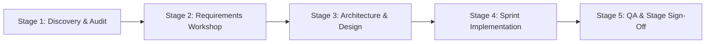

# ARNAV ABACUS ACADEMY (AAA) — PERMANENT AGENT GOVERNANCE & PROJECT INSTRUCTIONS

## 1. Prime Directive & Business Transformation Objective
Arnav Abacus Academy (AAA), Wakad, Pune, is an elite, child-development-focused mathematics academy offering:
- Abacus Mathematics (Ages 4.5–9)
- Vedic Mathematics (Ages 9–14)
- Mental Mathematics (Ages 6–14)
- School Mathematics (Grades 1–10 CBSE, ICSE, State Board)
- IPM & Olympiad Mathematics (Grades 2–9)

### Core Educational Philosophy:
> *"Mathematics is the medium; developing confident, independent and thoughtful learners is the mission."*

### Purpose of the Initiative:
This project is an **end-to-end business transformation initiative**, not merely a visual website redesign. Every recommendation, architectural change, design decision, and piece of copy must directly support:
1. Building a premium, trustworthy digital experience that commands parental trust in Wakad and the wider Pune region.
2. Increasing qualified parent inquiries, diagnostic assessments, and admissions.
3. Establishing AAA as the authoritative center for holistic child cognitive development and foundational mathematics.

---

## 2. Mandatory Safeguards & Non-Negotiable Rules

The following rules are permanent, strict, and non-negotiable for all human and AI agents working on this repository:

1. **Do Not Delete or Overwrite Existing Files Without Authorization:** Never remove existing application components, utilities, routes, or assets without documented justification and explicit management sign-off.
2. **Preserve Application Architecture & Route Integrity:** Never break existing routes (`/`, `/programs/*`, `/parent-guides/*`, `/mentor`, `/contact`, `/showcase`, `/worksheets`, `/blog/*`, `/teacher-franchise`, `/faqs`, `/brochure`, `/campaigns/*`). Preserve canonical URLs to safeguard organic search equity.
3. **AcademyOS Boundary Protection:** Do not modify, delete, redirect, or duplicate the student learning platform and ERP functionality located under `/login`, `/practice`, `/practice/session`, and `/practice/results`. The public portal (`AAA_WEB`) serves admissions and marketing; internal learning systems must remain stable and unaffected.
4. **Zero-PII Analytics Protocol:** Google Analytics 4 (`G-M2EL9MYSRL`) and Google Tag Manager telemetry must be strictly zero-PII compliant. Never transmit student names, parent names, phone numbers, email addresses, or personal identifiers in analytics events, dataLayer pushes, or URLs.
5. **Student & Parent Data Privacy:** Protect all parent and student inquiries. Form submissions must be sanitized against XSS and formula injection. Do not log personal contact information to client-side logs or public telemetry.
6. **No Fabricated Credentials or Claims:** Never invent, alter, or exaggerate teacher degrees, student competition records, fees, review counts, or institutional partnerships. Every claim must trace back to the verified Documentary Verification Register approved by AAA management.
7. **No Direct Production Pushes or Deployments:** Never push changes directly to `main` or trigger automated production deployments without completing the formal stage-gate approval process.
8. **Dependency Discipline:** Do not introduce unvetted third-party npm libraries or heavy dependencies that bloat bundle sizes or compromise security.

---

## 3. Brand Philosophy, Tone & Pedagogical Positioning

### 3.1 Educational Architecture
All marketing and course representations must adhere to:
- **The AAA Learning Model™ (6 Structured Stages):**
  1. *Inspire* — Spark numerical wonder and eliminate fear.
  2. *Explore* — Concrete tactile bead exploration and sensory number sense.
  3. *Understand* — Conceptual mastery of base-10 complements and Vedic sutras.
  4. *Practice* — Structured, stress-free micro-drills building accuracy.
  5. *Apply* — School exams, Olympiad problem decomposition, and speed challenges.
  6. *Reflect* — Celebrating personal progress, self-correction, and cognitive growth.
- **Eight Child Development Intelligence Pillars:**
  1. Spatial Visualization
  2. Working Memory & Mental Storage
  3. Pattern Recognition
  4. Rapid Information Processing
  5. Sustained Attention & Focus
  6. Cognitive Flexibility
  7. Executive Function & Problem Solving
  8. Self-Confidence & Mathematical Joy

### 3.2 Pedagogical Tone of Voice
- **Tone:** Warm, authoritative, reassuring, academically rigorous, and parent-centric.
- **Avoid:** Hyperbolic gimmicks ("Learn math in 2 days!"), fear-mongering copy, or cold corporate jargon.
- **Center Attribution:** Flat No. 3, 1st Floor, Adv. Balaji Sagar Bungalow, Opp. Creative Cameo, Near Park Street, Behind Wisdom World School, Wakad, Pune 411057.
- **Leadership Attribution:** Neha Patil (Founder & Academic Director).

---

## 4. Technical Quality, Code & Performance Standards

1. **TypeScript Integrity:** Strict TypeScript (`tsc --noEmit`). No unchecked `any` escapes without documented justification.
2. **Mobile-First UX:** Over 75% of parent discovery occurs on mobile devices. All views must be verified responsive from 320px to 4K without horizontal overflow, text clipping, or awkward touch targets.
3. **Core Web Vitals:**
   - Largest Contentful Paint (LCP) < 2.5s
   - Cumulative Layout Shift (CLS) < 0.1
   - First Input Delay / Interaction to Next Paint (INP) < 200ms
4. **Accessibility (WCAG 2.1 AA):** All interactive buttons and links must possess discernible text or explicit `aria-label` attributes. Form fields require explicit `<label htmlFor>` associations. Contrast ratios must meet AA standards.
5. **SEO & Structured Data:** Preserve dynamic page titles, unique meta descriptions, and Schema.org structured data (`EducationalOrganization`, `LocalBusiness`, `Course`, `FAQPage`) across all public pages.
6. **Build Verification:** Every proposed change must compile cleanly via `npm run lint` and `npm run build` with Exit Code 0 before pull request submission.

---

## 5. Development Workflow & Stage-Gate Governance

Every project phase must adhere to the formal 5-stage delivery lifecycle:

### Git Branching Rules:
- `main` — Production-only locked branch. Only receives merges following management sign-off.
- `audit-redesign-remediation` — Preserved historical audit baseline.
- `feat/*` — Feature branches created for specific authorized stages.

### Stage-Gate Closure Requirement:
No stage shall transition to execution without:
1. Documented analysis and findings register in `docs/`.
2. Written management approval of all business and architectural decisions.
3. Test evidence and verification records captured in `docs/11_evidence_and_screenshots/`.
