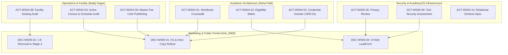

# AAA DIGITAL TRANSFORMATION — STAGE 2
# CROSS-WORKSTREAM DEPENDENCY & CONFLICT REGISTER

**Project:** Arnav Abacus Academy (AAA), Wakad, Pune  
**Leadership:** Neha Patil (Founder & Academic Director), Nitin Patil (Operations & Technology Lead)  
**Document Ref:** `docs/02_business_requirements/AAA_Stage2_Cross_Workstream_Dependency_and_Conflict_Register.md`  
**Governance Stage:** Stage 2 — Master Business Requirements Document (BRD) Umbrella Consolidation  
**Date:** November 03, 2026  
**Status:** 🟡 **CONSOLIDATED CROSS-WORKSTREAM ANALYSIS — PENDING STAGE 2 MASTER APPROVAL**  

---

## 1. Executive Summary & Purpose

During the consolidation of the five Stage 2 workstreams (WS-01 through WS-05), comprehensive cross-referencing was conducted to identify:
1. **Direct Requirement Conflicts:** Areas where different workstreams or source files express divergent numerical targets, durations, or scopes.
2. **Duplicated / Overlapping Requirements:** Requirements formulated in multiple workstreams that require unification under a single master policy.
3. **Cross-Domain Functional Dependencies:** Critical inter-workstream prerequisites (e.g. academic prerequisites to marketing claims).
4. **AcademyOS & Public Portal Boundaries:** Architectural demarcation protecting internal practice functionality from marketing workflows.
5. **Decisions Requiring Further Management Clarification:** Outstanding items needing explicit executive ruling.
6. **Technical Feasibility Prerequisites:** Architectural and security investigations required before engineering.

For every conflict identified, this register records both source references, assesses business and technical impact, formulates an explicit proposed resolution, and specifies the required approval authority.

---

## 2. Identified Requirement Conflicts & Proposed Resolutions

### Conflict 1: Discovery Session Operational Duration (45–90 min vs 35–45 min)
1. **Conflict ID:** `CNF-01`
2. **Exact Source Requirement & Source Documents:**
   - *Source 1:* `DEC-WS02-07`, `DEC-WS02-08` in `AAA_WS02_Management_Decision_Register.md` and `AAA_Stage2_WS03_Parent_Personas_and_Customer_Journey.md`: Free personalized demo session conducted in-center, lasting approximately 45 to 90 minutes adapting to child comfort and parent discussion.
   - *Source 2:* `AAA_WS05_Website_Conversion_Requirements.md` and `AAA_WS05_Marketing_and_Conversion_Architecture.md`: Proposed streamlined 35-minute intake session (10 min rapport, 15 min observation, 10 min parent consultation).
3. **Existing Management Decision:** `DEC-WS02-07` and `DEC-WS02-08` ratified the 45–90 minute session reality and the formal name "AAA Personalised Learning Discovery Session".
4. **Conflict Nature:** **Operating-Practice Difference & Proposal-versus-Approval Distinction.** (Actual delivery adapts dynamically between 45–90 minutes; 35–45 minutes is a streamlined workflow proposal for evaluation, not an approved SLA).
5. **Proposed Resolution:**
   - Preserve the historical documented operational practice of approximately 45–90 minutes, free of charge, as the established academy reality.
   - The structured 35–45 minute flow is classified strictly as an internal operational proposal for evaluation (`ACT-WS05-01`), NOT an approved or advertised customer guarantee.
   - Public marketing copy must use the approved service name "AAA Personalised Learning Discovery Session" without binding the academy to a rigid 35-minute timer.
6. **Approval Status:** **Proposed / Pending Management Decision** (Do not describe the proposed 35-minute sequence as ratified).
7. **Management Authority Required:** Neha Patil (Academic Director).
8. **Affected Requirements, Actions & Documents:** `REQ-JOUR-02`, `REQ-JOUR-03`, `ACT-WS05-01`, `DEC-WS02-08`, `DEC-WS05-03`, `AAA_Stage2_Master_Business_Requirements_Document.md`.

---

### Conflict 2: Micro-Batch Slogan and Legacy "1:8" Codebase Claims
1. **Conflict ID:** `CNF-02`
2. **Exact Source Requirement & Source Documents:**
   - *Source 1:* Ratified decisions `DEC-WS01-01`, `DEC-WS02-05`, `DEC-WS04-11`, and `DEC-WS05-02`: Universally mandate *"Personalised learning in small batches, with a maximum of five students per batch."*
   - *Source 2:* Active codebase files: `Hero.tsx:69` (*"1:8 Micro-Batches"*), `data.ts:64` (*"1:8 Micro-Batches"*), and legacy diagnostic PDFs.
3. **Existing Management Decision:** `DEC-WS01-01` formally superseded all 1:8 claims; `DEC-WS05-02` ratified removing 1:8 claims from copy, forms, and PDFs in Stage 4.
4. **Conflict Nature:** **True Contradiction between Ratified Management Policy and Unrefactored Legacy Codebase Assets.**
5. **Proposed Resolution:**
   - Removal of legacy "1:8" claims across all website components, forms, and diagnostic PDFs is an approved requirement for a separately authorised implementation stage (Stage 4).
   - Stage 2 remains strictly read-only; no codebase files are edited at this time.
6. **Approval Status:** **Approved with Conditions** (Approved requirement for Stage 4 implementation; does not authorise code changes in Stage 2).
7. **Management Authority Required:** Neha Patil & Nitin Patil (Stage 4 Stage-Gate Authorization).
8. **Affected Requirements, Actions & Documents:** `REQ-STRAT-01`, `REQ-BRAND-05`, `DEC-WS01-01`, `DEC-WS05-02`, `Hero.tsx`, `data.ts`, `LeadForm.tsx`.

---

### Conflict 3: Programme Age Eligibility Overlaps (Abacus vs Vedic Mathematics)
1. **Conflict ID:** `CNF-03`
2. **Exact Source Requirement & Source Documents:**
   - *Source 1:* `src/data.ts:13,35` listing Abacus as 4.5–9 years and Vedic Maths as 9–14 years; `ProgramAbacus.tsx:28` listing Abacus as 4–14 years.
   - *Source 2:* `AAA_WS04_Programme_Eligibility_and_Level_Framework.md`: Identifying an unaddressed crossover zone for 9-year-olds (Grade 4/5) eligible for both streams.
3. **Existing Management Decision:** `DEC-WS04-02` formally ratified: *"Proposed working age brackets... approved as working intake guidelines. Exact cutoff boundaries and diagnostic crossover rules are DEFERRED pending diagnostic intake rubric validation (`ACT-WS04-22`)."*
4. **Conflict Nature:** **Proposal-versus-Approval Distinction & Operating Guideline Ambiguity.**
5. **Proposed Resolution:**
   - Preserve working intake brackets: Soroban Abacus (Ages 4.5–9; Grades Jr KG to 4) and Vedic Mathematics (Ages 9–14; Grades 5 to 9) as unvalidated working guidelines.
   - The diagnostic crossover evaluation during the Discovery Session for 9-year-old candidates is classified strictly as an operational proposal (`[PROPOSED STRATEGY]`), pending formal rubric authoring under `ACT-WS04-22`.
   - Prohibit marketing any unapproved age cutoff as a confirmed admission rule.
6. **Approval Status:** **Deferred Pending Audit** (`DEC-WS04-02`).
7. **Management Authority Required:** Neha Patil (Academic Director).
8. **Affected Requirements, Actions & Documents:** `REQ-ACAD-02`, `ACT-WS04-22`, `DEC-WS04-02`, `CONF-ACAD-02`, `AAA_Stage2_Master_Business_Requirements_Document.md`.

---

### Conflict 4: In-Center Operating Hours for Inquiry Response Pilot
1. **Conflict ID:** `CNF-04`
2. **Exact Source Requirement & Source Documents:**
   - *Source 1:* `DEC-WS03-03` and `DEC-WS05-07` in decision registers: Approved 2-operating-hour inquiry follow-up turnaround as a pilot target during declared center hours.
   - *Source 2:* Proposed operational window cited in early drafts: Monday–Saturday, 9:30 AM–7:30 PM.
3. **Existing Management Decision:** `DEC-WS03-03` approved the response turnaround as a pilot target only, explicitly stating that actual operating hours must be validated before permanent adoption.
4. **Conflict Nature:** **Proposal-versus-Approval Distinction.** (2-hour response is an approved pilot principle, but Mon–Sat 9:30 AM–7:30 PM is unconfirmed operational data).
5. **Proposed Resolution:**
   - Reclassify Monday–Saturday 9:30 AM–7:30 PM as **`Proposed / Pending Management Confirmation` (`EVD-MKT-04`, `CONF-MKT-01`)**.
   - Retain the 2-operating-hour turnaround as an approved pilot principle.
   - Management must formally declare and confirm the center operating window before the response pilot begins.
   - Reaffirm that classroom teaching hours strictly take priority over inquiry follow-up.
6. **Approval Status:** **Proposed / Pending Management Confirmation** (`CONF-MKT-01`).
7. **Management Authority Required:** Nitin Patil (Operations Lead) & Neha Patil.
8. **Affected Requirements, Actions & Documents:** `REQ-JOUR-04`, `EVD-MKT-04`, `CONF-MKT-01`, `DEC-WS03-03`, `DEC-WS05-07`, `AAA_Stage2_Master_Business_Requirements_Document.md`.

---

### Conflict 5: Digital Practice Diploma vs Accredited Academic Certificate
1. **Conflict ID:** `CNF-05`
2. **Exact Source Requirement & Source Documents:**
   - *Source 1:* `src/components/PracticeResult.tsx` generating client-side PDF diplomas via `jsPDF` with titles like *"Certificate of Excellence"* and unverified serial numbers (`AAA-INT-xxxxxx`).
   - *Source 2:* `DEC-WS04-07` and `AAA_WS04_Security_Privacy_and_Certificate_Governance_Review.md`: Requiring strict separation between informal software drills and accredited level completion certificates.
3. **Existing Management Decision:** `DEC-WS04-07` approved re-labeling software PDFs to "Practice Achievement Records", approved 4 assessment layers and 4 certificate tiers in principle, and deferred passing marks (70%/80%) and server ledger design to Stage 3 (`ACT-WS04-10`, `ACT-WS04-15`).
4. **Conflict Nature:** **Operating-Practice Difference & Proposal-versus-Approval Distinction.**
5. **Proposed Resolution:**
   - Formally re-label software-generated PDFs to **"Practice Achievement Record"** in Stage 4 (`ACT-WS04-06`).
   - Reserve formal **"Level Completion Milestone Certificates"** for students passing Layer C written examinations (Form A/B), logged in a central ledger and physically signed by Neha Patil.
   - The central certificate ledger, QR verification, Layer C blueprints, and physical signature rules are classified strictly as **approved in principle / proposed specifications pending Stage 3 design**, NOT established entitlements.
6. **Approval Status:** **Approved with Conditions** (Software re-labeling approved; ledger and blueprints deferred to Stage 3).
7. **Management Authority Required:** Neha Patil & Nitin Patil.
8. **Affected Requirements, Actions & Documents:** `REQ-ACAD-04`, `REQ-ACAD-05`, `REQ-TECH-04`, `ACT-WS04-06`, `ACT-WS04-10`, `ACT-WS04-15`, `DEC-WS04-07`.

---

## 3. Duplicated & Overlapping Requirements Reconciled

| Overlapping Topic | Source Workstreams | Reconciled Master Policy | Master Source Location |
|---|:---:|---|---|
| **Maximum 5 Students / Batch** | WS-01, WS-02, WS-04, WS-05 | Universally mandated across all academy operations, marketing copy, and batch timetables. Legacy references to 1:8 revoked. | Master BRD Section 4 & 5; `DEC-WS01-01`, `DEC-WS02-05` |
| **Discovery Session Naming** | WS-02, WS-03, WS-05 | Standardize sitewide on "AAA Personalised Learning Discovery Session" delivering "AAA Demo Observation & Learning Recommendation". | Master BRD Section 7 & 13; `DEC-WS02-08`, `DEC-WS05-03` |
| **Observation Dimensions** | WS-02, WS-04, WS-05 | Exactly six formal names locked: Number Sense, Arithmetic Understanding, Logical Approach, Learning Attitude, Response and Engagement, Interest and Learning Passion. | Master BRD Section 10; `DEC-WS04-06`, `DEC-WS05-03` |
| **Minimum Necessary Privacy** | WS-03, WS-04, WS-05 | Adopt 4-field inquiry form with dual consent; ban DOB, school, address, clinical data; zero-PII GA4 telemetry. | Master BRD Section 13 & 15; `DEC-WS03-04`, `DEC-WS05-04` |
| **Ethical Advocacy & Reviews** | WS-02, WS-03, WS-05 | 100% voluntary, non-incentivized reviews; 74+ baseline; zero PII disclosure in responses; written consent for showcases. | Master BRD Section 11 & 12; `DEC-WS02-11`, `DEC-WS03-06`, `DEC-WS05-06` |
| **Admission Definition** | WS-03, WS-05 | Admission Completed recorded strictly upon formal enrollment and verified fee payment backed by official fee receipt. | Master BRD Section 7 & 14; `DEC-WS05-08` |

---

## 4. Cross-Domain Functional Dependencies

### Critical Traceability Dependencies:
1. **Marketing Copy Rollout (`DEC-WS05-01`, `02`) depends on Credential & Facility Audits:**
   - Public launch of certified educator claims depends on `ACT-WS04-02` (Archival degree dossier `VER-01`).
   - Slogan claiming maximum 5 students depends on `ACT-WS04-08` (Facility seating capacity audit verifying physical classroom desks).
2. **Lead Intake Form Rollout (`DEC-WS05-04`) depends on Legal & Privacy Review:**
   - Web lead form deployment depends on `ACT-WS05-05` (Privacy Notice specification) and `ACT-WS05-06` (Security assessment).
   - Form age/grade dropdown depends on `ACT-WS04-22` (Reconciled eligibility matrix).
3. **Lead Register Spreadsheet Operation depends on Access & Security Assessment:**
   - Interim lead tracking tool authorized **strictly after** `ACT-WS05-05` and `ACT-WS05-06` are formally signed off.
4. **Bi-Monthly Parent Progress Reporting (`DEC-WS04-08`) depends on Census & Time-Budgeting:**
   - Rolling out 10-minute bi-monthly parent chats depends on `ACT-WS04-03` (Active student census) and `ACT-WS04-13` (Consultation time-budget calendar) ensuring founder teaching hours are protected.

---

## 5. AcademyOS & Public Portal Boundaries

| Architectural Dimension | Public Admissions Portal (`AAA_WEB`) | AcademyOS Internal Practice & ERP (`/practice/*`) |
|---|---|---|
| **Primary Audience** | Prospective Wakad/PCMC parents, local community | Enrolled students, active batch educators, academy directors |
| **Target Routes** | `/`, `/programs/*`, `/parent-guides/*`, `/mentor`, `/contact`, `/showcase` | `/login`, `/practice`, `/practice/session`, `/practice/results` |
| **Data Handled** | Low-friction 4-field inquiry data (Parent Name, Mobile, Child Age/Grade, Program) | Longitudinal student drill attempts, module scores, speed metrics, accuracy percentages |
| **Privacy Sensitivity** | Marketing contact info (requires explicit opt-in consent) | Minor child developmental practice telemetry (requires strict DPDP safeguards) |
| **Stage 2/3 Boundary** | Subject to Stage 2 BRD consolidation and Stage 3 UI/UX architecture | Protected boundary; zero code edits; architecture specifications deferred to Stage 3 |
| **Cutover Schedule** | Public copy and form updates in Stage 4 | Database cutover, OTP removal, and cloud sync replacement in Stage 4 |

---

## 6. Open Items Requiring Management Clarification & Feasibility Validation

1. **Center Operating Window Confirmation (`CONF-MKT-01`):** Management must formally approve or adjust the proposed Monday–Saturday 9:30 AM–7:30 PM inquiry follow-up window.
2. **48-Hour Review Response Turnaround (`CONF-MKT-02`):** Management must confirm whether 48 hours is a sustainable operational target for GBP review responses.
3. **Action Owner Commitment Acceptance (`CONF-MKT-03`):** Proposed owners (Neha Patil, Nitin Patil, Solution Architect) must confirm acceptance of individual action scopes and due dates.
4. **Permanent Student ID Schema Feasibility (`ACT-WS04-14`):** Solution Architect must validate database schema supporting sibling accounts sharing a parent phone/email before Stage 3 design sign-off.
5. **Private Cloud Storage Cutover Feasibility (`ACT-WS04-05`, `19`):** Solution Architect must confirm whether active production users currently touch `jsonblob.com` to guarantee zero data loss during cutover.

---
*End of Cross-Workstream Dependency and Conflict Register — Arnav Abacus Academy (AAA)*
