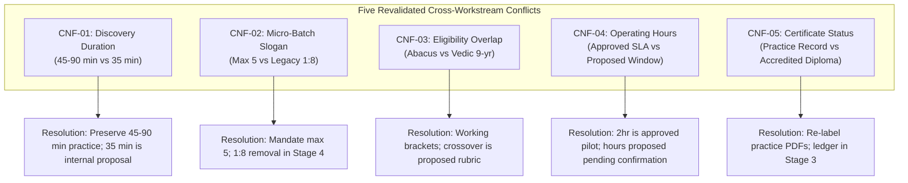
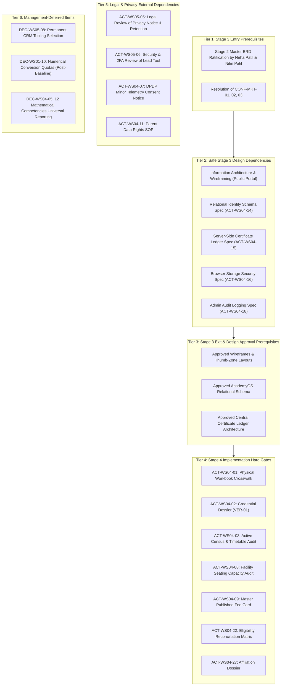

# AAA DIGITAL TRANSFORMATION — STAGE 2
# MASTER BRD CONSOLIDATION: GOVERNANCE CORRECTION & VALIDATION REPORT

**Project:** Arnav Abacus Academy (AAA), Wakad, Pune  
**Git Branch:** `audit-redesign-remediation`  
**Git Commit Baseline:** `b14c64189fe5aa8e5421a548f41cd1a9626d73ef`  
**Document Ref:** `docs/02_business_requirements/AAA_Stage2_Master_BRD_Correction_and_Validation_Report.md`  
**Governance Standard:** Strict Compliance with `AGENTS.md` and Management Stage-Gate Directives  
**Execution Mode:** Documentation-Only Correction, Reconciliation and Validation  
**Date:** November 03, 2026  
**Final Validation Outcome:** 🟡 **VALIDATED WITH OPEN CONDITIONS — READY FOR MANAGEMENT REVIEW**  

---

> [!IMPORTANT]
> **Implementation Scope & Authorization Boundary:**  
> This validation report does **NOT** declare the Master BRD formally closed or Stage 3 (Architecture & Design) authorised. The current status is strictly **readiness for management review**. All application source code modifications, website content changes, component refactoring, CRM deployment, practice portal modifications, and live marketing remain strictly paused until formal management review and stage-gate approval by Neha Patil and Nitin Patil.

---

## 1. Executive Validation Verdict

### Final Status:
🟡 **VALIDATED WITH OPEN CONDITIONS — READY FOR MANAGEMENT REVIEW**

### Summary of Independent Review:
A line-by-line governance audit and cross-reconciliation was conducted on all seven Stage 2 Master BRD consolidation documents created in the previous consolidation sprint against the original WS-01 through WS-05 source registers, decision sheets, closure records, and `AGENTS.md`. 

The audit established that:
1. **Core Governance Integrity:** Ratified management decisions (54 total), approved brand slogans, exact H1 wording, the AAA Learning Model™ sequence, the eight child development pillars, and the six observation dimensions are 100% faithfully preserved without silent alteration.
2. **Corrections Enacted:** Unvalidated age boundaries, certificate entitlement frameworks, conflict register fields, category mapping sums, and evidence catalog counts have been strictly reconciled to remove any ambiguity between established practice, ratified principles, and unapproved proposals.
3. **Open Conditions & Dependencies:** Exactly **39 formal executable actions** (with owners marked `Pending Confirmation`), **35 open evidence dependencies** (out of 36 cataloged items), **17 pending management confirmations**, and **7 Hard Stage 2 Exit Gates** are actively tracked.

---

## 2. Corrections Made (Audit Log)

The following table records every correction made across the Master BRD consolidation suite, documenting the previous state, the corrected state, the source reference, and the governing rationale:

| Correction ID | Document & Section | Previous Classification / Wording | Corrected Classification / Wording | Source Reference | Governing Rationale |
|:---:|---|---|---|---|---|
| **CORR-01** | `AAA_Stage2_Master_Business_Requirements_Document.md` §8.1, §8.3 | Presented age ranges (Abacus 4.5–9, Vedic 9–14) as confirmed targets. | Reclassified as **"historical working intake guidelines, pending management diagnostic validation (`ACT-WS04-22`)"**. | `DEC-WS04-02`, `AAA_WS04_Management_Decision_Register.md` | `DEC-WS04-02` explicitly deferred exact age and grade boundaries pending diagnostic rubric validation. |
| **CORR-02** | `AAA_Stage2_Master_Business_Requirements_Document.md` §8.7 | Implied 9-year-old crossover evaluation was an approved admission rule. | Classified strictly as an **operational proposal (`[PROPOSED STRATEGY]`)**, pending formal rubric sign-off (`ACT-WS04-22`). | `DEC-WS04-02`, `AAA_WS04_Programme_Eligibility_Framework.md` | The crossover evaluation is a formulated proposal; presenting it as an approved rule is premature. |
| **CORR-03** | `AAA_Stage2_Master_Business_Requirements_Document.md` §11.1, §11.2 | Presented Layer C written exams, passing marks (70%/80%), and physical signatures as confirmed rules. | Reclassified Layer C benchmarks and blueprints as **approved in principle / deferred to Stage 3 (`ACT-WS04-10`)**; signature is a **proposed safeguard**. | `DEC-WS04-07`, `AAA_WS04_Assessment_Framework.md` | Management approved the 4 layers in principle, but deferred passing thresholds, blueprints, and ledgers to Stage 3. |
| **CORR-04** | `AAA_Stage2_Cross_Workstream_Dependency_and_Conflict_Register.md` §2 | Conflicts logged with informal narrative headings lacking standard fields. | Re-structured all 5 conflicts across the **mandatory eight governance fields** (ID, source, decision, nature, resolution, status, authority, affected docs). | Management Consolidation Directive §3.C | Ensures rigorous traceability and prevents describing proposals as ratified. |
| **CORR-05** | `AAA_Stage2_Master_Requirements_Traceability_Matrix.md` §1, §2 | Reported "37 Material Business Requirements" without explaining category sum discrepancy (5+7+6+7+6+6 = 37 vs +6 Tech = 43). | Added **§1.1 Category Reconciliation** explaining: 37 Core Functional Requirements across domains 1–6, plus 6 Non-Functional Architectural Requirements (`REQ-TECH`), totaling **43 unique traceability rows**. | RTM Source Audit | Eliminates arithmetic ambiguity; proves zero requirements were dropped or duplicated. |
| **CORR-06** | `AAA_Stage2_Master_Action_and_Evidence_Register.md` §1, §5; Master BRD §22 | Coded evidence items as "36 open items" without accounting for `EVD-MKT-06`. | Clarified: **36 total cataloged evidence items**, of which **35 items are open / pending validation** and **1 item (`EVD-MKT-06`) is confirmed and verified** (74+ Google reviews). | `AAA_WS05_Open_Information_and_Evidence_Register.md:56` | Authoritative source shows `EVD-MKT-06` is `[MANAGEMENT CONFIRMED]`, reconciling previous "6 pending" vs "7 total" reporting. |
| **CORR-07** | `AAA_Stage2_Master_Closure_and_Next_Stage_Readiness_Report.md` §3.2, §7 | Described seven Hard Exit Gates loosely as "physical audits"; described git working tree as "clean". | Clarified: Gates represent **physical inspections, documentary scan archives, administrative ledgers, and academic policy reconciliations**. Clarified: tracked files are clean, but working tree is **not fully clean due to untracked docs**. | `git status --short`, `ACT-WS04-01..27` | Strict adherence to technical and physical truth. |

---

## 3. Programme Eligibility & Certificate Governance Reconciliation

### 3.1 Programme Eligibility Classification
* **Soroban Abacus (4.5–9 Years / Grades Jr KG to 4):** Classified as a **historical working reference and intake guideline**, pending diagnostic rubric validation (`ACT-WS04-22`, `DEC-WS04-02`).
* **Vedic Mathematics (9–14 Years / Grades 5 to 9):** Classified as a **historical working reference and intake guideline**, pending diagnostic rubric validation (`ACT-WS04-22`, `DEC-WS04-02`).
* **Mental Mathematics (6–14 Years):** Classified as an **intake guideline**, dependent on foundational abacus bead manipulation readiness.
* **School Mathematics (Grades 1–10 CBSE/ICSE/State):** Classified as an **intake guideline**, aligned with standard academic school tiers.
* **IPM (Grades 2–7) & Olympiad (Grades 2–9):** Classified as **enrichment intake guidelines**, conditioned on voluntary parent participation (`DEC-WS04-09`).
* **The 9-Year-Old Crossover Diagnostic Evaluation:** Formally classified as an **operational proposal (`[PROPOSED STRATEGY]`)**, pending diagnostic rubric authoring and management confirmation under `ACT-WS04-22`. Prohibited from being represented as an active admission rule.

### 3.2 Certificate Governance Classification
* **Practice Achievement Records (Tier 1):** In-software PDF diplomas generated by `certificateGenerator.ts` are **Approved with Conditions** for re-labeling in Stage 4 (`DEC-WS04-07`, `ACT-WS04-06`).
* **Layer C Summative Examination Requirement:** **Approved in Principle; Blueprints & Passing Marks Deferred to Stage 3 (`ACT-WS04-10`)**.
* **Level Completion Milestone Certificates (Tier 2):** **Approved in Principle as a Proposed Model**; physical syllabus crosswalk (`ACT-WS04-01`) must be completed before issuance rules are finalized.
* **Central Certificate Verification Ledger:** **Deferred to Stage 3 Technical Architecture (`ACT-WS04-15`)**.
* **Physical Signature Requirement by Neha Patil:** **Proposed Governance Safeguard**, pending formal administrative resolution.
* **Academic Assessment Entitlements:** **No new academic assessment or certificate entitlements are created.** Digital drill achievements do not confer accredited academic progression.

---

## 4. Cross-Workstream Conflict Reconciliation Results (All 5 Conflicts)

The table below summarizes the comprehensive revalidation of all five reported conflicts across the mandatory eight governance dimensions:



### Detailed Conflict Sheets:

#### Conflict 1: Discovery Session Operational Duration (`CNF-01`)
1. **Conflict ID:** `CNF-01`
2. **Exact Source Requirement & Documents:** `DEC-WS02-07` in `AAA_WS02_Management_Decision_Register.md` (45–90 min free session) vs `AAA_WS05_Website_Conversion_Requirements.md` (35-min intake proposal).
3. **Existing Management Decision:** `DEC-WS02-07` and `DEC-WS02-08` ratified the 45–90 min session practice and the service name "AAA Personalised Learning Discovery Session".
4. **Conflict Nature:** **Operating-Practice Difference & Proposal-versus-Approval Distinction.**
5. **Proposed Resolution:** Preserve documented practice of approximately 45–90 min, free of charge. The 35–45 min flow is an internal proposal for evaluation (`ACT-WS05-01`), not an advertised customer guarantee.
6. **Approval Status:** **Proposed / Pending Management Decision**.
7. **Management Authority Required:** Neha Patil (Academic Director).
8. **Affected Items:** `REQ-JOUR-02`, `REQ-JOUR-03`, `ACT-WS05-01`, `DEC-WS02-08`, `DEC-WS05-03`, Master BRD §7, §13.

#### Conflict 2: Micro-Batch Slogan and Legacy "1:8" Codebase Claims (`CNF-02`)
1. **Conflict ID:** `CNF-02`
2. **Exact Source Requirement & Documents:** Ratified `DEC-WS01-01`, `DEC-WS02-05`, `DEC-WS04-11`, `DEC-WS05-02` (Max 5 students) vs active codebase strings (`Hero.tsx:69`, `data.ts:64` "1:8 Micro-Batches").
3. **Existing Management Decision:** `DEC-WS01-01` superseded 1:8; `DEC-WS05-02` approved removing 1:8 claims from copy, forms, and PDFs in Stage 4.
4. **Conflict Nature:** **True Contradiction between Ratified Management Policy and Unrefactored Legacy Codebase Assets.**
5. **Proposed Resolution:** Removal of legacy 1:8 claims across all components, forms, and PDFs is an approved requirement for Stage 4 implementation. Stage 2 code remains untouched.
6. **Approval Status:** **Approved with Conditions (for Stage 4 Implementation)**.
7. **Management Authority Required:** Neha Patil & Nitin Patil (Stage 4 Stage-Gate Sign-Off).
8. **Affected Items:** `REQ-STRAT-01`, `REQ-BRAND-05`, `DEC-WS01-01`, `DEC-WS05-02`, `Hero.tsx`, `data.ts`, `LeadForm.tsx`.

#### Conflict 3: Programme Age Eligibility Overlaps (`CNF-03`)
1. **Conflict ID:** `CNF-03`
2. **Exact Source Requirement & Documents:** `data.ts:13,35` (Abacus 4.5–9, Vedic 9–14) and `ProgramAbacus.tsx:28` (4–14) vs `AAA_WS04_Programme_Eligibility_Framework.md` (unresolved 9-yr crossover).
3. **Existing Management Decision:** `DEC-WS04-02` ratified: working brackets approved as guidelines; exact boundaries and crossover rules deferred pending diagnostic rubric validation (`ACT-WS04-22`).
4. **Conflict Nature:** **Proposal-versus-Approval Distinction & Operating Guideline Ambiguity.**
5. **Proposed Resolution:** Preserve working intake brackets as unvalidated guidelines. The diagnostic crossover evaluation for 9-year-olds is an operational proposal (`[PROPOSED STRATEGY]`) pending rubric authoring under `ACT-WS04-22`.
6. **Approval Status:** **Deferred Pending Audit** (`DEC-WS04-02`).
7. **Management Authority Required:** Neha Patil (Academic Director).
8. **Affected Items:** `REQ-ACAD-02`, `ACT-WS04-22`, `DEC-WS04-02`, `CONF-ACAD-02`, Master BRD §8.

#### Conflict 4: In-Center Operating Hours for Inquiry Response Pilot (`CNF-04`)
1. **Conflict ID:** `CNF-04`
2. **Exact Source Requirement & Documents:** `DEC-WS03-03`, `DEC-WS05-07` (2-hour response pilot during declared hours) vs WS-05 draft window (Mon–Sat 9:30 AM–7:30 PM).
3. **Existing Management Decision:** `DEC-WS03-03` approved 2-hour response as a pilot target, requiring operating hours to be validated before permanent adoption.
4. **Conflict Nature:** **Proposal-versus-Approval Distinction.**
5. **Proposed Resolution:** Reclassify Mon–Sat 9:30 AM–7:30 PM as **`Proposed / Pending Management Confirmation` (`EVD-MKT-04`, `CONF-MKT-01`)**. Retain 2-hour response as approved pilot principle. Live window must be confirmed before launch; teaching hours take priority.
6. **Approval Status:** **Proposed / Pending Management Confirmation** (`CONF-MKT-01`).
7. **Management Authority Required:** Nitin Patil (Operations Lead) & Neha Patil.
8. **Affected Items:** `REQ-JOUR-04`, `EVD-MKT-04`, `CONF-MKT-01`, `DEC-WS03-03`, `DEC-WS05-07`, Master BRD §14.

#### Conflict 5: Digital Practice Diploma vs Accredited Academic Certificate (`CNF-05`)
1. **Conflict ID:** `CNF-05`
2. **Exact Source Requirement & Documents:** `PracticeResult.tsx` (client-side PDF diplomas with pseudo-serials) vs `DEC-WS04-07` (strict separation of drill logs from accredited credentials).
3. **Existing Management Decision:** `DEC-WS04-07` approved re-labeling software PDFs to "Practice Achievement Records", approved 4 layers in principle, and deferred passing marks and ledger to Stage 3 (`ACT-WS04-10`, `15`).
4. **Conflict Nature:** **Operating-Practice Difference & Proposal-versus-Approval Distinction.**
5. **Proposed Resolution:** Re-label software PDFs to "Practice Achievement Record" in Stage 4 (`ACT-WS04-06`). Reserve physical milestone certificates for students passing Layer C exams, logged in central ledger and physically signed by Neha Patil. Ledger, blueprints, and signature rules are proposed specifications pending Stage 3 design.
6. **Approval Status:** **Approved with Conditions** (Software re-labeling approved; ledger & blueprints in Stage 3).
7. **Management Authority Required:** Neha Patil & Nitin Patil.
8. **Affected Items:** `REQ-ACAD-04`, `REQ-ACAD-05`, `REQ-TECH-04`, `ACT-WS04-06`, `ACT-WS04-10`, `ACT-WS04-15`, `DEC-WS04-07`, Master BRD §11.

---

## 5. Traceability Matrix Audit Results

### 5.1 Category Sum & Requirement Count Explanation
The audit reconciled the apparent numerical mismatch between the reported figure of **37** and the full table count of **43**:
* **Functional Business Requirements (Domains 1 to 6):**
  - Section 2.1 — Business Strategy & Operations (`REQ-STRAT-01..05`): **5 Requirements**
  - Section 2.2 — Brand Positioning & Value Proposition (`REQ-BRAND-01..07`): **7 Requirements**
  - Section 2.3 — Pedagogy, Pillars & Observation Dimensions (`REQ-PED-01..06`): **6 Requirements**
  - Section 2.4 — Academic Programmes & Progression (`REQ-ACAD-01..07`): **7 Requirements**
  - Section 2.5 — Customer Journey & Admissions (`REQ-JOUR-01..06`): **6 Requirements**
  - Section 2.6 — Privacy, Consent & Data Governance (`REQ-PRIV-01..06`): **6 Requirements**
  $$\text{Subtotal Functional Business Requirements} = 5 + 7 + 6 + 7 + 6 + 6 = \mathbf{37}$$
* **Non-Functional Technology & Architecture Requirements (Domain 7):**
  - Section 2.7 — Technology & AcademyOS Architecture (`REQ-TECH-01..06`): **6 Requirements**
* **Grand Total Unique Traceability Specifications:** $37 + 6 = \mathbf{43\text{ Unique Requirements}}$.

### 5.2 Traceability Integrity Verdict:
* **Unique Identifiers:** All 43 requirements possess distinct master IDs mapped to source decision IDs.
* **Zero Dropped or Duplicated Requirements:** Every ratified decision is traced to its functional requirement.
* **Zero Silent Upgrades:** `REQ-ACAD-02` correctly reflects `Deferred Pending Audit`, `REQ-ACAD-04` correctly reflects `Approved in Principle (Conditions Attached)`, and `REQ-STRAT-05` correctly reflects `Proposed Strategy`.

---

## 6. Action & Evidence Count Reconciliation

### 6.1 Action Inventory Reconciliation (39 Formal Actions)
* **Authoritative Source Counts:**
  - WS-04: Exactly **29 actions** (`ACT-WS04-01` to `ACT-WS04-29`).
  - WS-05: Exactly **10 actions** (`ACT-WS05-01` to `ACT-WS05-10`).
  - **Total Formal Executable Actions:** **39 Actions** (14 Priority 1, 14 Priority 2, 11 Priority 3).
* **Owner Commitment Status:** All assigned proposed owners (Neha Patil, Nitin Patil, Solution Architect, Legal Counsel) remain strictly designated as **`Pending Confirmation`**.
* **Action Status:** **Zero actions are marked complete.** All 39 actions remain actively open.

### 6.2 Scope of the Seven Stage 2 Hard Gates (Correction of "Physical Audits" Misnomer)
The audit corrected earlier summary language that loosely referred to all seven Hard Gates as "physical audits":
1. `ACT-WS04-01`: **Physical Inventory** of printed workbooks and module crosswalk authoring.
2. `ACT-WS04-02`: **Documentary Collation** of degree and certification scans (`VER-01`).
3. `ACT-WS04-03`: **Administrative Reconciliation** of active attendance rolls with fee receipts.
4. `ACT-WS04-08`: **Physical Premises Inspection** of Flat No. 3 room partitions, acoustic boundaries, and usable seating.
5. `ACT-WS04-09`: **Executive Commercial Policy Authoring** for master tuition and kit pricing.
6. `ACT-WS04-22`: **Academic Intake Policy Reconciliation** for age/grade boundaries and crossover rubrics.
7. `ACT-WS04-27`: **Documentary Archive Review** of institutional affiliation and external accreditation records.

### 6.3 Evidence Register Reconciliation (36 Total Cataloged Items)
* **WS-04:** 29 empirical evidence items (`EVD-ACAD-01..09`, `EVD-OPS-01..09`, `EVD-SEC-01..11`), all 29 open / pending validation.
* **WS-05:** 7 empirical evidence items (`EVD-MKT-01..07`) cataloged:
  - `EVD-MKT-01` to `EVD-MKT-05`, and `EVD-MKT-07` (6 items) are open / pending validation.
  - `EVD-MKT-06` (Google Business Profile 74+ review count baseline) is **Verified & Management Confirmed** (`Home.tsx:31`, GBP profile Nov 2026).
* **Reconciliation Outcome:** The previous report of "6 pending items" in WS-05 and "7 items in the master register" is fully reconciled: **36 total evidence dependencies are cataloged, of which 35 items are open / pending validation, and 1 item (`EVD-MKT-06`) is verified and confirmed.**

---

## 7. Pending Management Confirmations (17 Items)

A total of **17 open management confirmations** are tracked in `AAA_Stage2_Open_Management_Confirmation_Register.md`:

| Ref ID | Domain | Workstream | Specific Confirmation Required | Proposed State | Decision-Maker |
|:---:|:---:|:---:|---|---|:---:|
| **CONF-MKT-01** | Operations | WS-05 | Center operating hours for 2-hour response pilot | Mon–Sat 9:30 AM–7:30 PM proposed | Nitin Patil & Neha Patil |
| **CONF-MKT-02** | Marketing | WS-05 | 48-hour Google review response turnaround target | 48-hour response target proposed | Nitin Patil |
| **CONF-MKT-03** | Governance | WS-05 | Individual action owner commitment acceptance | All owners `Pending Confirmation` | Nominated Owners |
| **CONF-OPS-01** | Operations | WS-01 | Active student census nominal roll (>87 floor confirmed) | Exact nominal roll pending audit | Nitin Patil & Neha Patil |
| **CONF-OPS-02** | Operations | WS-01 | Active weekly batch count verification (>14 floor confirmed) | Multi-stream total pending audit | Nitin Patil & Neha Patil |
| **CONF-STRAT-01** | Finance | WS-01 | Strategic revenue ambition horizon validation | ₹3.0L–₹4.0L/month proposed strategy | Neha Patil & Nitin Patil |
| **CONF-STRAT-02** | Operations | WS-01 | Long-term student enrollment ambition validation | 500+ active students proposed strategy | Neha Patil & Nitin Patil |
| **CONF-SOC-01** | Brand | WS-01 | Official Instagram account creation determination | No official account currently | Nitin Patil & Neha Patil |
| **CONF-CRED-01** | Pedagogy | WS-02 | Neha Patil credential archive scans linked to VER-01 | Credential existence confirmed; scans pending | Neha Patil |
| **CONF-ACAD-01** | Curriculum | WS-04 | Abacus physical workbook crosswalk sign-off | Chapter crosswalk pending audit | Neha Patil |
| **CONF-FAC-01** | Facility | WS-04 | Flat No. 3 room seating and simultaneous batch cap | Inspection pending | Nitin Patil |
| **CONF-COMM-01** | Pricing | WS-04 | Master published tuition fee card and kit price schedule | Unified card pending finalization | Neha Patil & Nitin Patil |
| **CONF-ACAD-02** | Admissions | WS-04 | Programme eligibility cutoffs and 9-yr crossover rubric | Rubric pending authoring | Neha Patil |
| **CONF-ACAD-03** | Compliance | WS-04 | External accreditation and affiliation dossier verification | Affiliation dossier pending | Neha Patil |
| **CONF-PRIV-01** | Legal | WS-05 | Enquiry form privacy notice, consent text & retention review | Legal review pending | Nitin Patil & Legal |
| **CONF-TECH-01** | Security | WS-05 | Lead tracking tool access control & 2FA security review | Assessment pending | Solution Architect & Nitin Patil |
| **CONF-TIME-01** | Operations | WS-03/04 | Bi-monthly consultation workload and calendar sign-off | Time model pending | Neha Patil & Nitin Patil |

---

## 8. Stage 3 & Stage 4 Readiness Distinction

To ensure orderly execution without premature implementation, all outstanding items are explicitly classified into six governance tiers:



### Safe Stage 3 Progression Scope:
When Stage 3 is authorized by management:
* **Permitted in Stage 3:** Wireframing, mobile responsive layouts, component specifications, database schema authoring (`AAA-STU-YYYY-XXXX`), cryptographic QR ledger designs, and privacy policy drafting.
* **Prohibited in Stage 3:** Application source code editing, website copy replacement (`Hero.tsx`), live CRM/spreadsheet deployment, and advertising spend.

---

## 9. Repository & Environment Integrity Verification

In strict accordance with Section 3.H of the Directive, the exact repository status was verified and recorded:

```powershell
PS C:\0-ATHARV2NITIN_Projects\AAA_WEB> git branch --show-current
audit-redesign-remediation

PS C:\0-ATHARV2NITIN_Projects\AAA_WEB> git rev-parse HEAD
b14c64189fe5aa8e5421a548f41cd1a9626d73ef

PS C:\0-ATHARV2NITIN_Projects\AAA_WEB> git status --short
?? AGENTS.md
?? docs/

PS C:\0-ATHARV2NITIN_Projects\AAA_WEB> git diff --stat
# (Empty — Exactly zero tracked files modified)

PS C:\0-ATHARV2NITIN_Projects\AAA_WEB> git diff --cached --stat
# (Empty — Exactly zero staged changes)
```

### Truthful Working Tree Status:
* **Tracked Source Files:** 100% clean. Zero tracked application files (`src/`, `public/`, configuration, package manifests) have been modified or staged.
* **Working Tree:** **Not fully clean** because `AGENTS.md` and the `docs/` governance directories exist as untracked files in the workspace.
* **Safeguards Confirmed:** Zero code changes, zero website modifications, zero CRM activations, zero advertising spend, zero commits, zero pushes, and zero production releases.

---

## 10. Residual Risks & Unresolved Questions

1. **Teaching Bandwidth vs Reporting Load:** If bi-monthly consultations (`ACT-WS04-13`) take 10 minutes per child across 87+ students, this requires ~15 hours of consultation every two months. Nitin Patil and Neha Patil must calibrate scheduling so teaching hours remain protected.
2. **Balaji Sagar Seating Capacity:** If physical inspection (`ACT-WS04-08`) shows simultaneous room limits cannot support peak weekday batches under a 5-student cap, weekend slot expansion will be required.
3. **Accreditation Evidence Availability:** If archival documents supporting historical accreditation claims (`ACT-WS04-27`) cannot be located, marketing copy must be adjusted to emphasize AAA's verified independent excellence.

---

## 11. Management Ratification Record (Option 1 Full Ratification)

On **November 03, 2026**, AAA Management (**Neha Patil**, Founder & Academic Director, and **Nitin Patil**, Operations & Technology Lead) formally confirmed and enacted **Option 1 Full Ratification**:
1. **Master BRD Ratified:** Full formal approval of `AAA_Stage2_Master_Business_Requirements_Document.md` and all 54 decisions in `AAA_Stage2_Master_Management_Decision_Register.md`.
2. **Three Operational Confirmations Resolved:**
   - **`CONF-MKT-01` (Center Operating Window):** Formally confirmed as **Monday–Saturday, 9:30 AM – 7:30 PM**, with founder classroom teaching hours strictly prioritized over enquiry handling.
   - **`CONF-MKT-02` (Review Turnaround Target):** Formally confirmed as a **48-hour operational target** without disclosing child or parent PII.
   - **`CONF-MKT-03` (Action Ownership Acceptance):** Formally accepted by Neha Patil, Nitin Patil, and Solution Architect across all 39 open actions.
3. **Cross-Workstream Conflicts Endorsed:** Approved resolutions for conflicts `CNF-01` through `CNF-05`.
4. **Stage 3 Authorized with Conditions:** Formal authorization to commence **Stage 3: Architecture & Design** for digital presence, UI/UX wireframing, and AcademyOS technical design specifications.
5. **Implementation Safeguards Maintained:** Application source code modifications, website content changes, CRM deployment, and advertising spend remain strictly paused until Stage 3 completion and Hard Gate resolution.

---

> [!NOTE]
> **Stage-Gate Status:**  
> **Stage 2 Master BRD Consolidation is FORMALLY CLOSED & RATIFIED.** Progression to Stage 3 Architecture & Design is authorized under documented governance boundaries.
