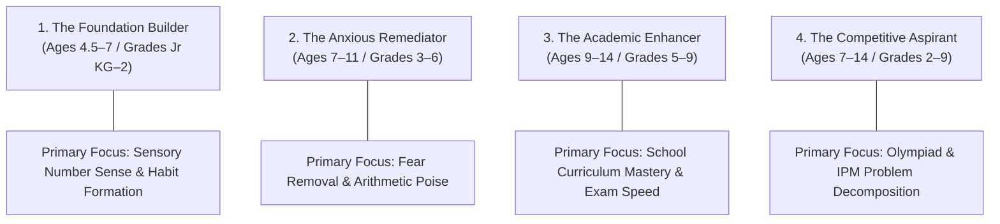
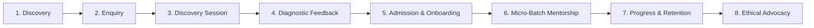
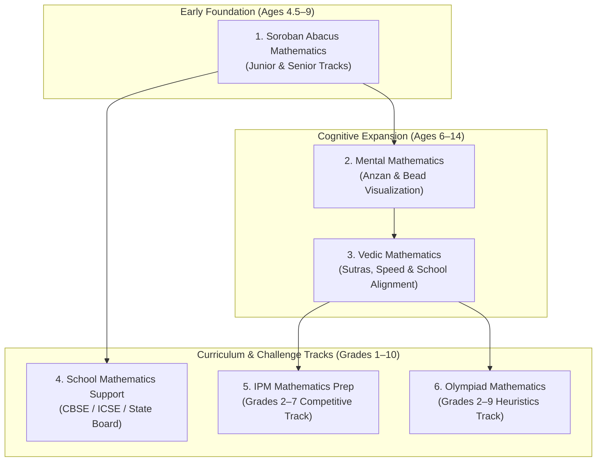
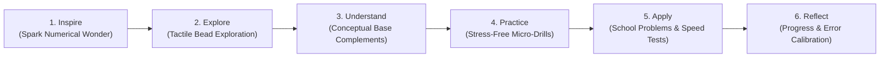
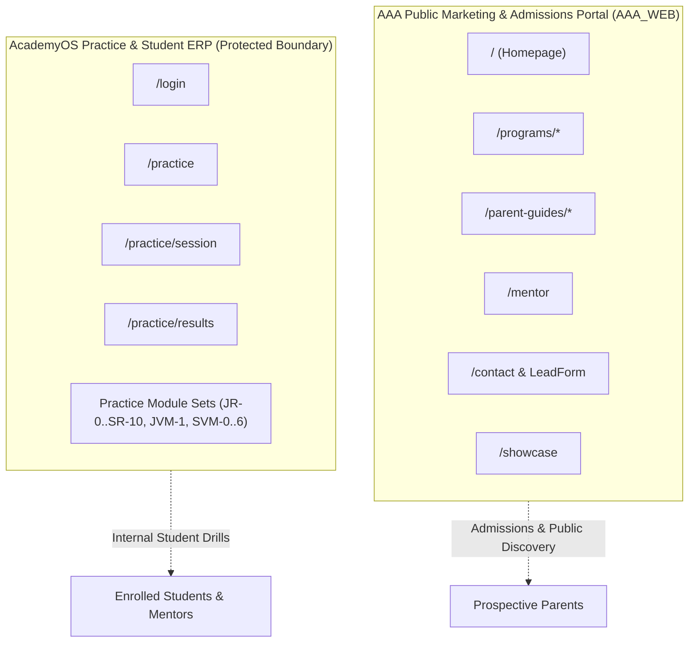

# AAA DIGITAL TRANSFORMATION — STAGE 2
# MASTER BUSINESS REQUIREMENTS DOCUMENT (BRD)

**Organization:** Arnav Abacus Academy (AAA), Wakad, Pune  
**Leadership:** Neha Patil (Founder & Academic Director), Nitin Patil (Operations & Technology Lead)  
**Center Address:** Flat No. 3, 1st Floor, Adv. Balaji Sagar Bungalow, Opp. Creative Cameo, Near Park Street, Behind Wisdom World School, Wakad, Pune 411057  
**Document Reference:** `docs/02_business_requirements/AAA_Stage2_Master_Business_Requirements_Document.md`  
**Governance Stage:** Stage 2 — Master Business Requirements Document (BRD) Umbrella Consolidation  
**Compilation Date:** November 03, 2026  
**Status:** 🟢 **FORMALLY RATIFIED & APPROVED BY AAA MANAGEMENT (Option 1 Ratification, Nov 03, 2026)**  

---

> [!IMPORTANT]
> **Implementation Scope Boundary & Governance Safeguards:**  
> This document consolidates the business requirements, pedagogical frameworks, and operating policies ratified across the five Stage 2 workstreams (WS-01 through WS-05). **Requirements approval does not constitute authorization for application code modification, website content updates, database schema changes, CRM deployment, or production release.** All implementation activities remain strictly paused until formal Stage 2 sign-off and subsequent stage-gate authorization during Stage 3 (Architecture & Design) and Stage 4 (Sprint Implementation). In compliance with `AGENTS.md`, zero personal data is collected or transmitted, and AcademyOS practice functionality remains protected.

---

## 1. Executive Summary

Arnav Abacus Academy (AAA) is an established, child-centric mathematical learning and cognitive development institution located in Wakad, Pune. Over years of dedicated operation under Founder and Academic Director **Neha Patil** (Master of Computer Applications, Certified Vedic Mathematics Educator, Certified Soroban Abacus Trainer), the academy has built an exceptional reputation among Pune families, evidenced by an authentic record of **74+ five-star Google Reviews** and an active student body exceeding **87 active learners** across more than **14 weekly micro-batches**.

This **Stage 2 Master Business Requirements Document (BRD)** serves as the authoritative, permanent baseline synthesizing the strategic, brand, customer journey, academic, marketing, and technological requirements formulated and ratified across five intensive workstreams:
* **WS-01:** Business Strategy, Operating Model & Strategic Objectives (10 Decisions)
* **WS-02:** Brand Architecture, Premium Positioning & Value Proposition (14 Decisions)
* **WS-03:** Parent Personas, Customer Experience & 8-Stage Journey (6 Decisions)
* **WS-04:** Academic Programmes, Child Development & AcademyOS Governance (14 Decisions)
* **WS-05:** Marketing Architecture, Admissions Funnel & Conversion Design (10 Decisions)

Together, these 54 ratified decisions define a cohesive business transformation: transitioning AAA from an informal neighborhood coaching center into Pune's premier mathematical thinking institution. The centerpiece of this transformation is the universal institutional mandate of **personalised learning in small batches, with a maximum of five students per batch**, delivered through the structured, six-stage **AAA Learning Model™** (*Inspire → Explore → Understand → Practice → Apply → Reflect*).

---

## 2. Business Context and Transformation Objectives

### 2.1 The Educational Landscape in Wakad and PCMC
Wakad and the surrounding Pimpri-Chinchwad Municipal Corporation (PCMC) corridor represent one of western India's most educationally ambitious suburban micro-markets. Home to major IT and engineering hubs (Hinjawadi Infotech Park), the parent community comprises educated professionals who place immense value on foundational cognitive development. Prominent schools in the immediate 0–3 km catchment—including Wisdom World School, EuroSchool Wakad, Akshara International School, and Mount Litera Zee School—emphasize rigorous academic and Olympiad performance.

However, the supplementary mathematics market in Wakad is heavily saturated with two flawed commercial paradigms:
1. **Mass Franchise Speed-Drilling Centers:** National commercial franchises operating batches of 12 to 20 students, relying on rigid, repetitive calculation drills that induce stress and burnout while neglecting conceptual reasoning.
2. **Unstructured Neighborhood Tuition:** Informal home tutors lacking standardized curricula, structured progression frameworks, or objective developmental observation.

### 2.2 Core Business Transformation Objectives
AAA's transformation initiative reconciles commercial growth with uncompromised pedagogical rigor across four core objectives:
1. **Institutionalize Premium Authority:** Elevate AAA's market perception from a basic coaching class to an elite, child-development-focused mathematical academy commanding parental trust.
2. **Deliver Verified Micro-Batch Mentorship:** Guarantee a strict ceiling of **at most 5 students per batch**, ensuring every child receives immediate educator feedback, emotional reassurance, and individualized pacing.
3. **Establish an Empirical Lead Conversion Engine:** Standardize the parent intake journey through the **AAA Personalised Learning Discovery Session**, converting high-intent local parents via transparent diagnostic observation rather than sales pressure.
4. **Architect Secure, Scalable Infrastructure (AcademyOS):** Establish strict privacy-by-design standards, zero-PII analytics telemetry, and decoupled student management systems aligned with India's Digital Personal Data Protection (DPDP) Act.

---

## 3. AAA Vision, Mission and Business Philosophy

### 3.1 Educational Philosophy
> *"Mathematics is the medium; developing confident, independent and thoughtful learners is the mission."*

At AAA, computational arithmetic is not the end goal; it is the cognitive gym through which a child develops lifelong intellectual poise, mental stamina, pattern discernment, and self-efficacy.

### 3.2 Vision Statement
To be Western India's most respected foundational mathematics academy, renowned for nurturing children who approach complex numerical and real-world challenges with calm confidence, joyful curiosity, and rigorous logical independence.

### 3.3 Mission Statement
To provide every child with a nurturing, mathematically rich micro-learning environment guided by certified educators, using tactile Soroban manipulation, elegant Vedic sutras, and structured problem decomposition to unlock intrinsic intellectual potential and eliminate mathematical anxiety.

### 3.4 Core Institutional Values
* **Pedagogical Empathy:** We meet each child at their current cognitive stage, celebrating individual growth without competitive shaming or public ranking.
* **Academic Integrity:** We reject marketing gimmicks, false speed multipliers, and unverified outcome guarantees; our claims are anchored in verified student competence.
* **Micro-Batch Poise:** We maintain an unwavering commitment to a maximum of 5 students per batch, protecting educator bandwidth and child focus.
* **Respectful Transparency:** We treat parents as collaborative partners, providing objective, constructive developmental observations.

---

## 4. Business Model and Operating Strategy

### 4.1 Delivery Channel Architecture (DEC-WS01-04)
AAA operates on an **Offline-First growth strategy**, prioritizing in-person, tactile classroom instruction at its physical center (Flat No. 3, 1st Floor, Adv. Balaji Sagar Bungalow, Wakad, Pune). 
* **Primary Channel:** Physical, in-center micro-batches serving the 0–3 km immediate Wakad catchment and 3–7 km secondary PCMC corridor. In-person delivery is essential for tactile Soroban bead manipulation and subtle behavioral observation.
* **Supporting Channel:** Live interactive online micro-batches serving relocating students and selective outstation families, retaining the identical 1:5 educator-to-student ceiling and structured curriculum.

### 4.2 Revenue Engine & Growth Strategy (DEC-WS01-05)
* **Primary Revenue Engine:** Direct-to-Consumer (B2C) monthly tuition fee enrollments for ongoing multi-year student cohorts across five core academic streams.
* **Secondary Revenue Engine:** Select institutional partnerships, school enrichment clubs, and accredited teacher training (`/teacher-franchise`), evaluated strictly on a case-by-case basis without diluting center resources.

### 4.3 Leadership & Governance Allocation (DEC-WS01-06)
* **Academic Leadership (Neha Patil):** Founder & Academic Director leads curriculum architecture, lesson plan design, educator moderation, diagnostic evaluations, and parent progress reviews.
* **Operational Leadership (Nitin Patil):** Operations & Technology Lead oversees physical facility management, inquiry triage, fee administration, marketing execution, and AcademyOS technical oversight.
* *Governance Boundary:* Progressive operational delegation is encouraged to enable scaling, while academic quality remains permanently under Neha Patil's direct governance.

### 4.4 Strategic Revenue & Capacity Ambition (DEC-WS01-08, DEC-WS01-09)
* **Near-Term Target (24–36 Months):** Scaled revenue ambition of **₹3.0 Lakh to ₹4.0 Lakh per month**, achieved through optimized center room utilization and batch fill rates.
* **Long-Term Horizon:** Long-term capacity ambition of **500+ active students** across physical center expansion and structured hybrid delivery channels.

---

## 5. Brand Positioning and Premium Value Proposition

### 5.1 Approved Brand Identity & Positioning (DEC-WS02-01)
* **Official Brand Name:** Arnav Abacus Academy (AAA)
* **Master Brand Positioning Statement:**  
  *“Arnav Abacus Academy – A Premium Mathematical Thinking & Child Development Academy.”*
* **Core Brand Slogan & Master H1:**  
  *“Beyond Calculation. Towards Confident Mathematical Thinking.”*
* **Master Brand Subheadline:**  
  *“At Arnav Abacus Academy, mathematics is the medium to develop confident, independent, and thoughtful young learners. Guided by certified educators in small batches with a maximum of five students per batch, our structured programmes provide personalised learning, closer individual guidance, and steady mathematical progress.”*

### 5.2 Brand Architecture: Monolithic Master Brand (DEC-WS02-03)
AAA enforces a **Branded House (Monolithic Master Brand)** architecture. All offerings—Soroban Abacus, Vedic Maths, Mental Maths, School Maths, IPM Prep, and Olympiad Maths—operate under the unified AAA umbrella. They are positioned as interconnected developmental programmes supporting children across progressive age brackets, rather than an unverified "10-year continuum".

### 5.3 Premium Value Proposition: Five Problem-Transformation Pillars (DEC-WS02-04)
AAA deliberately avoids competing on price, raw speed claims, or superficial gamification. Instead, public positioning centers on five fundamental cognitive and behavioral transformations:
1. **Mathematical Anxiety → Confident Numerical Joy:** Eliminating fear through sensory bead manipulation and step-by-step success.
2. **Fragmented Attention → Sustained Concentration:** Building 45 to 60 minutes of calm, uninterrupted task engagement.
3. **Mechanical Memorization → Deep Conceptual Insight:** Replacing rote algorithm recall with structural number sense and pattern logic.
4. **Careless Arithmetic Errors → Deliberate Verification Poise:** Cultivating self-checking reflexes and procedural discipline.
5. **Academic Hesitancy → Independent Intellectual Initiative:** Transforming passive listeners into self-directed problem solvers.

### 5.4 Ethical Differentiation Policy (DEC-WS02-14)
* AAA strictly prohibits citing unsupported competitor class-size figures (e.g., "mass franchises run 12–20 students") in marketing copy.
* AAA differentiates solely on its own verified operating realities: maximum 5 students per batch, certified founder mentorship, authentic 74+ five-star Google Reviews, and comprehensive diagnostic feedback.

---

## 6. Parent Personas and Target Segments

In accordance with **DEC-WS03-01**, AAA recognizes four qualitative, behavioral parent personas. These represent fluid, overlapping orientations rather than rigid stereotypes:

### 6.1 Persona 1: The Foundation Builder
* **Typical Demographics:** Parents of young children (Ages 4.5–7; Preschool to Grade 2); frequently working in IT/engineering.
* **Core Emotional Drive:** Seeking healthy, screen-free cognitive stimulation and early foundational confidence before formal school pressure begins.
* **Key Anxieties:** Fear of pushing the child too hard; skepticism of rigid commercial coaching centers.
* **AAA Value Alignment:** Soroban Abacus exploration, tactile bead manipulation, small micro-batches of at most 5, gentle and joyful encouragement.

### 6.2 Persona 2: The Anxious Remediator
* **Typical Demographics:** Parents of primary school children (Ages 7–11; Grades 3 to 6).
* **Core Emotional Drive:** Alarmed by developing math anxiety, homework tears, finger-counting dependencies, or careless calculation errors in school exams.
* **Key Anxieties:** Child falling behind; developing permanent self-doubt in STEM subjects.
* **AAA Value Alignment:** Patient diagnosis during the Discovery Session, individual pacing, psychological safety, eliminating finger-counting through mental visualization.

### 6.3 Persona 3: The Academic Enhancer
* **Typical Demographics:** Parents of upper primary and middle school students (Ages 9–14; Grades 5 to 9; CBSE/ICSE).
* **Core Emotional Drive:** Seeking academic excellence, higher exam verification speed, and advanced problem-solving efficiency to balance demanding school workloads.
* **Key Anxieties:** Time constraints; balancing extracurriculars with board syllabus preparation.
* **AAA Value Alignment:** Vedic Mathematics modular shortcuts, Mental Maths cross-multiplication, algebraic decomposition, exam checking strategies.

### 6.4 Persona 4: The Competitive Aspirant
* **Typical Demographics:** Parents of high-aptitude children (Ages 7–14; Grades 2 to 9) targeting competitive talent exams.
* **Core Emotional Drive:** Preparing for IPM (Institute for Promotion of Mathematics), SOF IMO, SilverZone, and government scholarship examinations.
* **Key Anxieties:** Commercial coaching centers offering generic drills without teaching non-routine problem decomposition.
* **AAA Value Alignment:** Rigorous competitive problem dissection, heuristic thinking, advanced Vedic sutra applications, voluntary tournament coaching.

---

## 7. End-to-End Parent and Student Journey

Pursuant to **DEC-WS03-02**, AAA establishes a unified, sequential **Eight-Stage Customer Journey Architecture**:

### Stage 1: Local Discovery & Trust Verification
* **Touchpoints:** Google Search ("abacus classes near me", "vedic maths wakad"), Google Business Profile (74+ reviews), school-gate parent word-of-mouth.
* **Friction Points:** Commercial skepticism, confusion between abacus and vedic math suitability.
* **AAA Standard:** Clean, hyper-local website messaging clearly articulating program age brackets and verified center credentials.

### Stage 2: Low-Friction Parent Enquiry
* **Touchpoints:** Website modal form (`LeadForm.tsx`), direct WhatsApp CTA (`+91 90219 24968`), phone calls.
* **Friction Points:** Excessive form fields, aggressive sales follow-up.
* **AAA Standard:** Minimum-necessary 4-field inquiry capture with dual consent; prompt human triage adhering to pilot response standards.

### Stage 3: The AAA Personalised Learning Discovery Session (DEC-WS02-08)
* **Touchpoints:** Physical visit to Balaji Sagar Bungalow center.
* **Format:** Comprehensive 45–90 minute exploratory session conducted free of charge, adapting dynamically to child comfort and engagement.
* **Operating Roles (Proposed Model):** Neha Patil conducts academic observation and bead interaction; Nitin Patil manages parent orientation, facility walkthrough, and logistical queries.

### Stage 4: Upfront Diagnostic Feedback & Programme Recommendation (DEC-WS02-09)
* **Touchpoints:** Immediate in-person consultation at completion of Discovery Session.
* **Deliverable:** The 11-point **"AAA Demo Observation & Learning Recommendation"** framework, categorizing findings into: (1) Demonstrated Strengths, (2) Observed Growth Areas, (3) Aspects to Explore, and (4) Structured Programme Recommendation.

### Stage 5: Formal Admission & Onboarding
* **Requirements:** Submission of enrollment form, collection of emergency contacts, allocation to a batch of at most 5 students, and issuance of official tuition fee receipt.
* **Deliverable:** Student Physical Starter Kit (Soroban Abacus tool, level workbooks, practice guide).

### Stage 6: Structured Classroom Mentorship
* **Format:** Weekly sessions adhering strictly to the **maximum of 5 students per batch** ceiling and The AAA Learning Model™.
* **Classroom Culture:** Nurturing, calm, tactile, emphasizing self-comparison and error celebration as learning moments.

### Stage 7: Parent Progress Communication & Retention (DEC-WS03-05, DEC-WS04-08)
* **Cadence:** Bi-monthly (once every two months) qualitative progress chats + milestone review upon completing curriculum levels + informal 2-minute pickup check-ins.
* **Standard:** Transparent evaluation against the child's own historical baseline; strictly zero public score ranking boards.

### Stage 8: Voluntary Advocacy & Community Referrals (DEC-WS03-06)
* **Cadence:** Invited organically following verified milestone achievements (level completions or parent satisfaction milestones).
* **Policy:** 100% voluntary and non-incentivized. Strictly zero referral discounts, gift hampers, or coercive review gating.

---

## 8. Academic Programme Architecture

Pursuant to **DEC-WS04-01**, AAA organizes its offerings into six interconnected academic programmes:

### 8.1 Programme 1: Soroban Abacus Mathematics
* **Target Audience:** Children aged 4.5 to 9 years (Preschool to Grade 4) — *historical working intake guideline, pending management diagnostic validation (`ACT-WS04-22`)*.
* **Pedagogical Core:** Concrete tactile manipulation of the Japanese 1:4 bead Soroban instrument. Develops base-5 and base-10 complement decomposition, sensory number sense, and two-handed finger dexterity.
* **Curriculum Structure:** Multi-level progression transitioning from Junior concrete exploration to Senior advanced multi-digit operations.

### 8.2 Programme 2: Mental Mathematics (Anzan)
* **Target Audience:** Children aged 6 to 14 years with foundational abacus experience — *working intake guideline, pending diagnostic validation (`ACT-WS04-22`)*.
* **Pedagogical Core:** Spatial bead visualization (Anzan) without physical instrument contact. Children build an internal mental Soroban, manipulating beads in their mind's eye to execute rapid calculations with calm precision.

### 8.3 Programme 3: Vedic Mathematics
* **Target Audience:** Students aged 9 to 14 years (Grades 5 to 9) — *historical working intake guideline, pending management diagnostic validation (`ACT-WS04-22`)*.
* **Pedagogical Core:** 16 foundational Sutras and 13 sub-sutras originating from ancient Indian mathematical traditions. Emphasizes one-line mental cross-multiplication, algebraic factoring, special base products, and universal verification methods (Digit Sums / Navasesh).

### 8.4 Programme 4: School Mathematics Support
* **Target Audience:** School students across Grades 1 to 10 (CBSE, ICSE, and Maharashtra State Board) — *working intake guideline*.
* **Pedagogical Core:** Remediation of school textbook topics, geometric decomposition, fraction operations, word problem logic, and systematic board exam preparation delivered in small micro-batches of at most 5.

### 8.5 Programme 5: IPM Mathematics Preparation
* **Target Audience:** High-aptitude students in Grades 2 to 7 preparing for the Institute for Promotion of Mathematics (IPM) examination — *working intake guideline*.
* **Pedagogical Core:** Non-routine problem decomposition, competitive speed drills, multi-step heuristic reasoning, and past-year paper dissection.

### 8.6 Programme 6: Olympiad Mathematics
* **Target Audience:** Motivated learners in Grades 2 to 9 targeting SOF IMO, SilverZone, and national mathematical talent contests — *working intake guideline*.
* **Pedagogical Core:** Advanced logical problem solving, combinatorics, spatial geometry, and pattern deduction beyond standard classroom curricula.

### 8.7 Programme Eligibility Governance & 9-Year-Old Crossover Proposal
Pursuant to **DEC-WS04-02**, while working intake age brackets are accepted as practical guidelines, exact cutoff boundaries, prerequisite grade checks, and diagnostic crossover rules are **deferred pending diagnostic intake rubric validation (`ACT-WS04-22`)**.
* **Governance Status:** Unapproved age ranges must not be presented to parents as final confirmed admission rules.
* **The 9-Year-Old Crossover Proposal:** The proposed diagnostic crossover evaluation during the Discovery Session (determining whether a 9-year-old enters Abacus or Vedic Maths based on tactile vs symbolic readiness) is classified strictly as an **operational proposal (`[PROPOSED STRATEGY]`)**, pending formal rubric authoring and management sign-off under `ACT-WS04-22`.

---

## 9. The AAA Learning Model™

Pursuant to **DEC-WS02-12** and **DEC-WS04-04**, all classroom micro-batches adhere to the structured, six-stage pedagogical progression:

$$\text{Inspire} \longrightarrow \text{Explore} \longrightarrow \text{Understand} \longrightarrow \text{Practice} \longrightarrow \text{Apply} \longrightarrow \text{Reflect}$$

### Stage 1: Inspire (05–10 Minutes)
* **Classroom Focus:** Eliminating arithmetic anxiety; welcoming students into a calm, focused mental space through numerical puzzles, visual riddles, or mental warm-up games.

### Stage 2: Explore (10–15 Minutes)
* **Classroom Focus:** Concrete, sensory engagement. Children manipulate physical Soroban beads or explore Vedic number arrangements tactilely before abstract rules are introduced.

### Stage 3: Understand (15–20 Minutes)
* **Classroom Focus:** Conceptual insight. The educator guides students to understand *why* complement formulas operate (e.g., $+4 = +5 - 1$ or $+9 = +10 - 1$), ensuring mathematics is never reduced to blind formulaic memorization.

### Stage 4: Practice (15–20 Minutes)
* **Classroom Focus:** Focused micro-drilling. Short bursts of 5 to 10 calculations where the educator observes hand positioning, bead flicking precision, and calculation rhythm in real time.

### Stage 5: Apply (10–15 Minutes)
* **Classroom Focus:** Real-world and academic transfer. Translating abacus beads or Vedic sutras into school word problems, mental dictation challenges, and exam verification techniques.

### Stage 6: Reflect (05–10 Minutes)
* **Classroom Focus:** Metacognitive awareness. Children review their work, celebrate personal speed or accuracy progress against their own previous baseline, analyze calculation slips calmly, and pack materials with pride.

---

## 10. Child Development and Observation Framework

Pursuant to **DEC-WS04-06**, AAA establishes two rigorous, child-protective frameworks governing development observation:

### 10.1 The Eight Child Development Intelligence Pillars
AAA maps student growth across exactly eight core developmental pillars:
1. **Spatial Visualization:** The capacity to generate, manipulate, and track mental bead arrays or geometric structures in the mind's eye without physical aids.
2. **Working Memory:** The active cognitive storage required to hold intermediate mathematical sums while processing subsequent calculation operations.
3. **Pattern Recognition:** Intuitive discernment of numerical symmetries, base-10 groupings, Vedic sutra structures, and sequences.
4. **Processing Speed:** The rate of accurate numerical information decoding, motor finger execution, and mental translation.
5. **Sustained Attention:** The ability to maintain calm, uninterrupted cognitive focus on multi-step problems without sensory distractibility.
6. **Cognitive Flexibility:** Mental adaptability to switch fluidly between calculation strategies (e.g., standard vertical addition versus complementary Vedic shortcuts).
7. **Executive Function:** Goal-directed planning, multi-step problem decomposition, impulse control, and organized workbook pacing.
8. **Mathematical Confidence:** Robust intrinsic self-belief, emotional resilience in the face of complex problems, and joyful participation in numerical discussions.

### 10.2 The Six Educational Observation Dimensions (Discovery Sessions)
During intake discovery sessions and routine classroom reviews, observation strictly evaluates learning readiness across the **exact six approved formal names**:
1. **Number Sense:** Intuitive grasp of quantity, place value, base-5 and base-10 groupings, and tactile bead visualization readiness without mechanical counting.
2. **Arithmetic Understanding:** Conceptual comprehension of addition and subtraction mechanics; understanding base complements versus rote fact memorization.
3. **Logical Approach:** How the child decomposes multi-step instructions, explores calculation pathways, and applies structural pattern logic.
4. **Learning Attitude:** The child's openness to unfamiliar tasks, receptivity to educator guidance, and willingness to self-correct without distress.
5. **Response and Engagement:** Sustained attention, attentive listening to multi-step instructions, visual tracking of bead arrays, and calm communication under gentle challenge.
6. **Interest and Learning Passion:** Natural mathematical curiosity, enthusiasm for bead manipulation or number patterns, and personal pride upon solving exercises.

### 10.3 Mandatory Non-Diagnostic Child Safeguards
* **Absolute Prohibition of Clinical Terminology:** AAA educators and marketing materials must **never** diagnose, label, or reference clinical conditions such as ADHD, ADD, Dyscalculia, or Dyslexia.
* **Prohibition of Composite IQ Scores:** No numerical IQ scores or medical-sounding developmental quotients may ever be assigned to a child.
* **Non-Diagnostic Reporting:** Progress updates celebrate educational effort, task focus, and arithmetic mastery, explicitly recognizing that focus or joyful smiling in class is not clinical evidence.

---

## 11. Assessment, Evidence and Progress Reporting

Pursuant to **DEC-WS04-07** and **DEC-WS04-08**, AAA establishes a structured evaluation framework anchored in educator mentorship, while preserving strict governance boundaries between established practice, approved principles, and proposed future specifications:

### 11.1 Four-Layer Assessment Architecture
* **Layer A: Daily Practice Performance:** Formative observations during batch micro-drills evaluating finger technique, speed rhythm, and bead positioning.
* **Layer B: Module Review Drills:** End-of-module checkpoint exercises evaluating computational accuracy and conceptual understanding.
* **Layer C: Formal Summative Level Evaluations:** Structured, written examination papers (Form A/B) administered at the completion of an academic level. *Governance Status:* Passing benchmarks (70% tool / 80% mental) and examination paper authoring are **approved in principle, with exact blueprints and evaluation rules deferred to Stage 3 Architecture / Pre-Implementation (`ACT-WS04-10`)**.
* **Layer D: Educator Moderation & Approval:** Final advancement sign-off by Neha Patil, ensuring the child possesses emotional confidence and technical mastery. *Governance Status:* Written moderation checklists are currently in development (`ACT-WS04-21`).

### 11.2 Four-Tier Certificate Governance
* **Tier 1 — Practice Achievement Records:** Digital progress summaries generated by practice software (`certificateGenerator.ts`). *Governance Status:* Re-labeling software-generated PDFs to explicitly distinguish them from accredited diplomas is **Approved with Conditions** (`DEC-WS04-07`, scheduled for Stage 4 implementation under `ACT-WS04-06`).
* **Tier 2 — Level Completion Milestone Certificates:** Physical academy certificates awarded upon passing Layer C formal evaluations. *Governance Status:* The milestone certificate issuance model, syllabus crosswalk, and evaluation rubrics are **approved in principle as a proposed framework**, pending physical syllabus mapping (`ACT-WS04-01`) and Stage 3 specifications.
* **Tier 3 — Programme Graduation Diplomas:** Formal certificates awarded upon completing an entire stream curriculum (e.g., Complete 8-Level Soroban Curriculum). *Governance Status:* **Proposed institutional framework** pending curriculum validation.
* **Tier 4 — Tournament & Competition Merit Honors:** Recognition for participation and achievement in external competitions (IPM, IMO). *Governance Status:* **Approved with conditions** (`DEC-WS04-09`), conditioned on annual competition charter review (`ACT-WS04-23`).

> [!IMPORTANT]
> **Certificate Safeguards & Entitlement Boundaries:**  
> 1. **Central Verification Ledger:** Database ledger specifications, QR verification endpoints, and revocation workflows are **deferred to Stage 3 Technical Architecture (`ACT-WS04-15`)**.
> 2. **Physical Signature Safeguard:** The requirement for physical, manual signatures by Neha Patil on diplomas is a **proposed governance safeguard** pending formal administrative resolution.
> 3. **No New Entitlements:** **This Master BRD consolidation does not introduce new academic assessment or certificate entitlements.** Progression and certification remain strictly tied to verified educator evaluation and curriculum completion.

### 11.3 Sustainable Progress Communication Model
* **Bi-Monthly Qualitative Updates:** Formal 10-minute individual progress discussions conducted once every two months, reviewing the child's development against their own previous baseline.
* **Pickup Check-Ins:** Informal 2-minute pickup conversations providing immediate reassurance.
* **Individual Self-Comparison Policy (DEC-WS02-10):** Absolute prohibition of public ranking boards, competitive score shaming, or comparative parent shaming.

---

## 12. Marketing and Local Acquisition Strategy

### 12.1 Hyper-Local Geographic Catchment (DEC-WS05-05)
AAA concentrates marketing, local SEO, and parent acquisition within the immediate **0–3 km Wakad catchment** as its primary operational focus, while welcoming students from the broader 3–7 km PCMC corridor (Pimple Saudagar, Hinjawadi, Tathawade, Thergaon):
* **Tier 1 (0–3 km Primary Focus):** Walking and short-driving distance from Balaji Sagar Bungalow (Park Street, Kaspate Vasti, Wisdom World environs).
* **Tier 2 (3–7 km Secondary Reach):** Broader PCMC suburban communities accessible by private vehicle.
* *Governance Clarification:* The 0–3 km zone represents an operational focus, not an exclusive boundary.

### 12.2 Google Business Profile & Ethical Social Proof (DEC-WS02-11, DEC-WS05-06)
* **Core Social Proof Anchor:** *"Trusted by families, with 74+ five-star Google Reviews."*
* **Periodic Audit Cadence:** Periodic reviews to verify genuine reviews and update review counts truthfully.
* **Ethical Review Policy:** 100% voluntary and non-incentivized. Zero cash discounts, fee waivers, or gifts in exchange for reviews.
* **Review Response Operational Target:** Proposed 48-hour response target pending management confirmation, ensuring zero child or parent personal data is disclosed in public responses.

### 12.3 Elimination of Speed Hyperbole (DEC-WS05-09)
* All historical marketing claims referencing multiplier speed claims (*"10x to 15x faster"*) are formally revoked and must be eliminated during Stage 4 copy refactoring.
* Positioning is replaced with verified educational outcomes: calculation poise, procedural error reduction, mental visualization stamina, and exam verification efficiency.

---

## 13. Website and Conversion Requirements

### 13.1 Universal Call-to-Action (CTA) Nomenclature (DEC-WS05-03)
All website marketing pages, navigation bars, and promotional buttons must standardize on verified, consistent nomenclature:
* **Primary Conversion CTA:** **“Book an AAA Personalised Learning Discovery Session”**
* **Primary Value Deliverable:** **“AAA Demo Observation & Learning Recommendation”**
* *Prohibitions:* Outdated, conflicting strings such as *"Book a Free Counselling Session"*, *"Book a 15-Minute Trial"*, or generic *"Free Demo Class"* are superseded.

### 13.2 Minimum-Necessary Lead Capture Form (DEC-WS05-04)
To maximize mobile completion rates, safeguard child privacy, and comply with DPDP guidelines, the primary lead generation form (`LeadForm.tsx`) must be restricted to exactly four input fields:
1. **Parent Full Name** (Required)
2. **Mobile / WhatsApp Number** (Required, validated 10-digit Indian mobile)
3. **Child Age Bracket OR School Grade** (One required via structured dropdown, not both)
4. **Programme of Primary Interest** (Optional dropdown: Abacus, Vedic Maths, Mental Maths, School Maths, Olympiad)

### 13.3 Dual Consent Architecture
* **Checkbox 1 (Mandatory Opt-In):** Explicit consent for AAA to contact the parent regarding their specific enquiry and Discovery Session booking.
* **Checkbox 2 (Optional Separate Opt-In):** Consent to receive academy updates, newsletters, and educational guides.
* *Unconditioned Submission Rule:* Declining promotional marketing must **never** block a parent from submitting an inquiry.

### 13.4 Banned Lead-Capture Data Fields
The following fields are strictly prohibited on public inquiry forms:
* Child exact Date of Birth (DOB) or Aadhaar/ID number.
* Child current school name.
* Residential street address.
* Clinical, behavioral, or special needs checkboxes.

---

## 14. Lead Management and Admissions Lifecycle

### 14.1 Structured Eight-Status Admissions Lifecycle (DEC-WS05-08)
To prevent lost leads and maintain complete visibility into the parent journey, all inquiries must transition through eight mutually exclusive statuses:

$$\text{1. New Enquiry} \longrightarrow \text{2. Contacted} \longrightarrow \text{3. Discovery Session Booked} \longrightarrow \text{4. Discovery Session Attended}$$
$$\begin{cases}
\longrightarrow \text{5. Admission Completed} \\
\longrightarrow \text{6. Decision Pending} \\
\longrightarrow \text{7. Closed – Not Proceeding} \\
\longrightarrow \text{8. Follow-up Later}
\end{cases}$$

### 14.2 Strict Definition of an Admission
* **`Admission Completed`** is recorded **ONLY upon formal student registration and verified payment of tuition/registration fees documented by an official fee receipt.**
* Expressions of interest, verbal agreements, slot reservations, or Discovery Session attendance must **never** be counted as admissions.

### 14.3 Enquiry Response Standard (DEC-WS03-03, DEC-WS05-07)
* **Standard:** Immediate automated acknowledgement upon submission, followed by personal human follow-up within **2 operating hours** during declared center hours.
* **Center Operating Window:** Monday–Saturday, 9:30 AM–7:30 PM is recorded as a **proposed operational target pending management confirmation** (`EVD-MKT-04`). The live window must be formally confirmed before pilot launch.
* **Classroom Teaching Priority:** Neha Patil's live classroom teaching hours strictly take priority over inquiry handling.

### 14.4 Lead Tracking Tooling Gate
* Permanent CRM selection is deferred.
* Operation of an interim lead register or spreadsheet is authorized **strictly after** completing mandatory prerequisites `ACT-WS05-05` (Legal/Privacy Review) and `ACT-WS05-06` (Security, Access Control & 2FA Assessment). WhatsApp must not remain the sole, unbacked record of admissions interactions.

---

## 15. Privacy, Consent and Data Governance Requirements

Pursuant to **DEC-WS03-04** and **DEC-WS04-14**, AAA implements comprehensive data privacy safeguards aligned with the Indian Digital Personal Data Protection (DPDP) Act:

### 15.1 Eight Facets of Minimum-Necessary Data Privacy
1. **Purpose Limitation:** Data is collected solely for responding to parent inquiries, scheduling discovery sessions, and administering student learning.
2. **Data Minimization:** No extraneous child personal data (DOB, school, clinical history) is collected at intake.
3. **Informed Consent:** Explicit, unbundled opt-in checkboxes for inquiry response versus marketing.
4. **Role-Based Access Control:** Strict segregation between administrative inquiry logs and classroom academic records.
5. **Retention & Deletion Rules:** Unconverted inquiry records are scheduled for automated purging after an approved retention period (90-day proposal pending legal sign-off). Admitted student records are maintained under statutory and academic retention schedules.
6. **Child Data Protection:** Children's personal phone numbers, email addresses, or photographic identities are never collected or displayed publicly without explicit parental consent.
7. **Zero Commercial Sharing:** Personal data is never sold, rented, or shared with third-party advertisers or commercial entities.
8. **Zero-PII Analytics Telemetry:** GA4 (`G-M2EL9MYSRL`) and Google Tag Manager telemetry strictly prohibit personal identifiers (parent names, phone numbers, email addresses) in event payloads, dataLayer pushes, or URL parameters.

### 15.2 Parent Statutory Data Rights
* Parents retain the right to inspect, correct, and request the deletion of their family's personal data.
* Standard operating procedures for fulfilling data subject requests must be formalized under `ACT-WS04-11`.

---

## 16. KPI, Attribution and Management Reporting Framework

Pursuant to **DEC-WS01-10** and **DEC-WS05-10**, AAA establishes a scientific, empirical admissions measurement framework:

### 16.1 The 17-Metric Admissions KPI Dictionary
1. **Gross Enquiries:** Total inquiries captured across web, WhatsApp, and phone.
2. **Qualified Enquiries:** Enquiries meeting geographic (Wakad/PCMC) and age eligibility criteria.
3. **Discovery Sessions Scheduled:** Number of sessions booked on the center calendar.
4. **Discovery Sessions Attended:** Number of families completing the in-person diagnostic.
5. **Paid Admissions Confirmed:** Verified enrollments backed by official fee receipts.
6. **Enquiry-to-Booking Rate:** $\frac{\text{Sessions Scheduled}}{\text{Qualified Enquiries}}$
7. **Booking-to-Attendance Rate:** $\frac{\text{Sessions Attended}}{\text{Sessions Scheduled}}$
8. **Attendance-to-Admission Rate (Diagnostic Conversion):** $\frac{\text{Paid Admissions}}{\text{Sessions Attended}}$
9. **Overall Funnel Conversion Rate:** $\frac{\text{Paid Admissions}}{\text{Qualified Enquiries}}$
10. **Average Response Time:** Time elapsed between inquiry receipt and human contact.
11. **Lead Source Attribution:** Enquiries categorized by channel (Organic Search, GBP, Referral, School Gate).
12. **Programme Interest Distribution:** Breakdown of interest across the 6 offerings.
13. **Active Student Census Roll:** Total paying students enrolled.
14. **Batch Utilization Rate:** Percentage of batch capacity utilized ($\le 5$ students/batch).
15. **Monthly Churn Rate:** Percentage of students discontinuing enrollment.
16. **Level Completion Rate:** Percentage of cohort advancing to the next curriculum level.
17. **Parent Retention / Renewal Rate:** Percentage of students renewing tuition terms.

### 16.2 Weekly Minimum Viable Dashboard (MVD — 6 Metrics)
For routine operational governance, management reviews six weekly indicators:
1. New Inquiries Received
2. Qualified Inquiries
3. Discovery Sessions Booked
4. Discovery Sessions Attended
5. Paid Admissions Confirmed
6. Pending Follow-Up Queue

### 16.3 Mathematical Calculation Rules
* All ratios define explicit numerators and denominators.
* Whenever the denominator is $0$ or unavailable, the calculation explicitly displays **`N/A`** (Not Applicable).
* Arbitrary numerical conversion quotas are strictly prohibited until a **4-week baseline logging period** is completed under approved registers.

---

## 17. AcademyOS and Existing Practice Portal Boundary

Pursuant to **DEC-WS04-10** and `AGENTS.md` Rule 3, strict architectural boundaries are maintained between the public admissions portal and the AcademyOS internal learning platform:

### 17.1 Boundary Protection Rules
* **No Direct Interference:** Public portal development must never modify, delete, redirect, or duplicate learning routes under `/login`, `/practice`, `/practice/session`, and `/practice/results`.
* **Zero Disruption to Active Students:** Practice drill question sets and student exercise flows must remain operational and stable during all marketing enhancements.
* **Decoupled Architecture:** AcademyOS enhancements, database migrations, and administrative tools belong to Stage 3 Architecture design and Stage 4 engineering, not public marketing sprints.

---

## 18. Non-Functional, Security and Accessibility Requirements

### 18.1 Technical Quality & Performance Standards
* **Core Web Vitals:** LCP < 2.5s, CLS < 0.1, INP < 200ms across all public routes.
* **Mobile-First Responsiveness:** Strict responsive layout verified from 320px to 4K displays without horizontal scrolling or touch-target clipping.
* **TypeScript Strictness:** Strict compilation (`tsc --noEmit`) with zero unchecked `any` escapes.

### 18.2 Ten Permanent AcademyOS Architecture Principles (DEC-WS04-10)
* **P-01: Sovereign Data Control:** Academy student records must be stored in secure, private, academy-controlled databases, not public third-party JSON blobs.
* **P-02: Permanent Student Identity:** Each child must have a unique, immutable Student ID (`AAA-STU-YYYY-XXXX`) supporting sibling relationships under a single parent account.
* **P-03: Relational Parent-Child Integrity:** Decoupling parent communication channels from individual student learning records.
* **P-04: Server-Side Authorization:** Access controls and administrative privileges must be verified server-side; client-side checks in browser code are prohibited.
* **P-05: Authenticated Administrative Operations:** All updates to student marks, levels, and attendance must require authenticated administrator credentials.
* **P-06: Tamper-Resistant Audit Trail:** Append-only audit logging of all administrative and credentialing actions.
* **P-07: Certified Progression Verification:** Certificate issuance backed by central ledger verification and secure online verification endpoints.
* **P-08: Data Minimization & Privacy-by-Design:** Collection restricted strictly to data necessary for education.
* **P-09: Secure Session Management:** Automated session timeouts, client cache clearing on sign-out, and encrypted local persistence.
* **P-10: Resilient Migration & Rollback:** Safe migration scripts guaranteeing zero data loss during future cloud cutover.

### 18.3 Accessibility (WCAG 2.1 AA)
* Explicit `<label htmlFor>` associations on all form elements.
* Accessible color contrast ratios ($\ge 4.5:1$ for normal text, $\ge 3:1$ for large headings).
* Discernible link and button text with explicit `aria-label` attributes where appropriate.

---

## 19. Business Rules and Operating Policies

1. **Batch Size Limit:** No batch shall exceed 5 students under any circumstances.
2. **Teaching Hours Priority:** Live classroom instruction takes precedence over marketing inquiries and administrative communications.
3. **Voluntary Competitions:** Participation in IPM and Olympiad competitions is 100% voluntary; no child shall be pressured to compete.
4. **Documentary Substantiation:** Every credential, degree, and affiliation claim displayed publicly must be verified against high-resolution archival scans in `docs/` (`VER-01`).
5. **No Speed Multipliers:** Marketing copy must never state that students calculate "10x to 15x faster".
6. **Parental Consent for Showcases:** No student photograph, project, or video may be published on `/showcase` or social channels without explicit written parental consent.
7. **No Unofficial Social Representation:** The personal Instagram handle `@lakshmi_narayan_1303` must not be represented as an official academy account.
8. **Cash Review Prohibition:** No financial incentives, fee discounts, or gifts may be offered for Google reviews.

---

## 20. Management Decisions and Approval Conditions

A total of **54 strategic decisions** across five workstreams have been formally ratified by AAA Management (Neha Patil & Nitin Patil). All 54 decisions are consolidated in the companion document [`AAA_Stage2_Master_Management_Decision_Register.md`](file:///c:/0-ATHARV2NITIN_Projects/AAA_WEB/docs/02_business_requirements/AAA_Stage2_Master_Management_Decision_Register.md).

### Summary Breakdown of Decisions by Workstream:
* **WS-01 Business Strategy:** 10 Decisions (7 Approved/Confirmed, 3 Proposed Strategies).
* **WS-02 Brand & Positioning:** 14 Decisions (All 14 Formally Approved/Confirmed).
* **WS-03 Customer Journey:** 6 Decisions (All 6 Approved: 3 Approved, 1 Approved as Pilot, 1 Approved as Principle, 1 Approved as Framework).
* **WS-04 Academic Programmes:** 14 Decisions (All 14 Ratified: 7 Approved with Conditions, 3 Approved as Pilot, 1 Approved, 3 Deferred Pending Pilot/Audit).
* **WS-05 Marketing & Conversion:** 10 Decisions (All 10 Ratified: 4 Approved, 4 Approved with Conditions, 1 Approved as Pilot, 1 Deferred).

---

## 21. Dependencies, Risks and Constraints

### 21.1 Cross-Workstream Dependencies
* Marketing messaging (`DEC-WS05-01`, `DEC-WS05-02`) directly depends on academic batch capacity (`DEC-WS04-11`) and premises audit (`ACT-WS04-08`).
* Public fee disclosure depends on finalization of the unified master fee schedule (`ACT-WS04-09`).
* Discovery Session booking flows depend on formal confirmation of center operating hours (`CONF-MKT-01`).

### 21.2 Project Risk Register
* **Risk 1 (Teaching Bandwidth Overload):** Risk of administrative and parent progress reporting overburdening Neha Patil's teaching hours. *Mitigation:* Bi-monthly reporting pilot (`ACT-WS04-13`) and operational delegation to Nitin Patil.
* **Risk 2 (Premises Seating Bottleneck):** Risk of batch scheduling exceeding physical room capacity at Balaji Sagar Bungalow. *Mitigation:* Hard facility audit gate (`ACT-WS04-08`).
* **Risk 3 (Data Privacy Non-Compliance):** Risk of unauthorized data collection under DPDP Act. *Mitigation:* Strict 4-field inquiry form (`DEC-WS05-04`) and mandatory legal review (`ACT-WS05-05`).

---

## 22. Open Actions and Evidence Requirements

A total of **39 formal executable actions** (29 from WS-04, 10 from WS-05) and **16 open information/dependency items** (from WS-01, WS-02, and WS-03) are actively tracked in the companion document [`AAA_Stage2_Master_Action_and_Evidence_Register.md`](file:///c:/0-ATHARV2NITIN_Projects/AAA_WEB/docs/02_business_requirements/AAA_Stage2_Master_Action_and_Evidence_Register.md).

### 22.1 Critical Hard Stage 2 Exit Gates
To establish an uncompromised operating and legal baseline before Stage 4 implementation, seven foundational gates must be executed. These represent a combination of **physical premises inspections, documentary archive collations, administrative ledger reconciliations, and academic policy reviews** (not merely physical audits):
1. `ACT-WS04-01`: **Physical Abacus Workbook Inventory & Module Crosswalk** (*Physical Inventory & Crosswalk Matrix*).
2. `ACT-WS04-02`: **Neha Patil Degree & Credential Archive (VER-01)** (*Documentary Scan Archive Collation*).
3. `ACT-WS04-03`: **Verified Active Student Census & Timetable Audit** (*Administrative Fee Ledger & Attendance Roll Reconciliation*).
4. `ACT-WS04-08`: **Facility Seating Capacity & Acoustic Feasibility Audit** (*Physical Premises Inspection at Balaji Sagar Bungalow*).
5. `ACT-WS04-09`: **Master Published Fee Schedule & Kit Pricing Schedule** (*Executive Commercial Pricing Policy Finalization*).
6. `ACT-WS04-22`: **Programme Eligibility & Grade Boundary Reconciliation** (*Academic Intake & Crossover Policy Reconciliation*).
7. `ACT-WS04-27`: **Institutional Affiliation & External Accreditation Evidence Dossier** (*Documentary Affiliation Archive Collation*).

### 22.2 Evidence Dependency Reconciliations
* **WS-04:** Exactly **29 empirical evidence items** (`EVD-ACAD-01..09`, `EVD-OPS-01..09`, `EVD-SEC-01..11`) are actively tracked, all of which remain open pending audit, blueprint authoring, or architecture design.
* **WS-05:** Exactly **7 empirical evidence items** (`EVD-MKT-01..07`) are cataloged in the authoritative register:
  - Six items remain open / pending validation: `EVD-MKT-01` (Competitor mystery audit), `EVD-MKT-02` (Search Console baseline), `EVD-MKT-03` (Mobile GA4 traffic baseline), `EVD-MKT-04` (Operating hours confirmation), `EVD-MKT-05` (Inquiry conversion baseline), and `EVD-MKT-07` (Lead webhook production verification).
  - One item is verified and confirmed: `EVD-MKT-06` (Google Business Profile 74+ review count baseline).
* **Consolidated Total:** Exactly **36 cataloged evidence items** across Stage 2, of which **35 items are actively open / pending validation** and 1 item is confirmed.
* **Lead Register Operational Prerequisites:** `ACT-WS05-05` (Privacy Notice & Retention Review) and `ACT-WS05-06` (Lead Tracking Tool Access & Security Assessment) are mandatory prerequisites that must be completed before operating any live interim lead register.

---

## 23. Implementation Boundaries and Stage-Gate Conditions

### 23.1 Five-Stage Delivery Lifecycle
In accordance with `AGENTS.md`, the AAA transformation follows a strict stage-gate governance model:
* **Stage 1: Discovery & Audit** — ✅ Closed & Verified.
* **Stage 2: Requirements Workshop** — 🟡 Consolidation Phase (Current Stage).
* **Stage 3: Architecture & Design** — ⏸️ Paused (Awaiting Stage 2 Master Approval).
* **Stage 4: Sprint Implementation** — ⏸️ Paused (Code, Website & Content Changes).
* **Stage 5: QA & Stage Sign-Off** — ⏸️ Paused (Verification & Production Cutover).

### 23.2 Strict Stage 2 Boundary Controls
* **Zero Code Modifications:** No changes to `src/`, `public/`, or package dependencies.
* **Zero Website Edits:** No publishing of new copy, forms, or H1 strings.
* **Zero CRM/Tooling Rollout:** No active data collection via new spreadsheets or third-party tools.
* **Zero Advertising Spend:** No paid search, social campaigns, or promotional spend.
* **Zero Deployments:** No Git merges, pushes to `main`, or production releases.

---

## 24. Appendices and Source References

### 24.1 Source Workstream Documents Consolidating This Baseline:
* `docs/02_business_requirements/AAA_Stage2_WS01_Business_Strategy.md`
* `docs/02_business_requirements/AAA_WS01_Management_Decision_Register.md`
* `docs/02_business_requirements/AAA_WS01_Open_Information_Register.md`
* `docs/02_business_requirements/AAA_Stage2_WS02_Brand_Positioning.md`
* `docs/02_business_requirements/AAA_WS02_Management_Decision_Register.md`
* `docs/02_business_requirements/AAA_WS02_Brand_Messaging_Architecture.md`
* `docs/02_business_requirements/AAA_Stage2_WS03_Parent_Personas_and_Customer_Journey.md`
* `docs/02_business_requirements/AAA_WS03_Management_Decision_Register.md`
* `docs/02_business_requirements/AAA_Stage2_WS03_Formal_Closure.md`
* `docs/02_business_requirements/AAA_Stage2_WS04_Academic_Programme_Architecture.md`
* `docs/02_business_requirements/AAA_WS04_Management_Decision_Register.md`
* `docs/02_business_requirements/AAA_WS04_Management_Action_and_Evidence_Tracker.md`
* `docs/02_business_requirements/AAA_Stage2_WS04_Formal_Closure.md`
* `docs/02_business_requirements/AAA_Stage2_WS05_Marketing_and_Conversion_Architecture.md`
* `docs/02_business_requirements/AAA_WS05_Management_Decision_Register.md`
* `docs/02_business_requirements/AAA_WS05_Open_Information_and_Evidence_Register.md`
* `docs/02_business_requirements/AAA_Stage2_WS05_Formal_Closure.md`
* `docs/02_business_requirements/AAA_Stage2_WS05_Closure_Verification_and_Stage3_Readiness.md`
* `AGENTS.md` (Permanent Agent Governance & Project Instructions)

---
*End of Master Business Requirements Document — Arnav Abacus Academy (AAA)*
