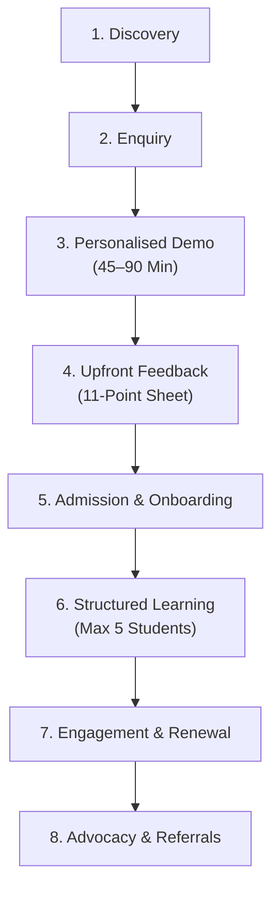

# AAA DIGITAL TRANSFORMATION — STAGE 2: WORKSTREAM 03 (WS-03)
# PARENT PERSONAS & CUSTOMER JOURNEY ARCHITECTURE
**Project:** Arnav Abacus Academy (AAA), Wakad, Pune  
**Role:** Lead Business Analyst, Customer Experience Strategist & Solution Architect  
**Governance Stage:** Stage 2 — Master Business Requirements Document (BRD) Workshop  
**Document Ref:** `docs/02_business_requirements/AAA_Stage2_WS03_Parent_Personas_and_Customer_Journey.md`  
**Date:** November 02, 2026 (Formally Ratified by Management)  
**Status:** 🟢 **FORMALLY CLOSED — REQUIREMENTS BASELINE APPROVED**  

---

## 1. Executive Summary & Workstream Context

This document establishes the approved **Workstream 03: Parent Personas & Customer Journey** requirements baseline within the AAA Master Business Requirements Document (BRD).

Following formal management review and ratification on **02 November 2026**, all six strategic decisions (DEC-WS03-01 through DEC-WS03-06) are **MANAGEMENT APPROVED** as the foundational requirements baseline for parent-facing workflows, admissions counselling, and digital experience design.

> [!IMPORTANT]
> **Implementation Governance Boundary:**  
> Management approval of this requirements baseline is strictly analytical and foundational. **Requirements approval is not implementation approval.** Zero application code, website copy, integrations, analytics configurations, or operational procedures shall be altered without subsequent formal implementation stage-gate authorization.

### Core Alignment with Approved Baselines:
* **Academic Mission:** *"Mathematics is the medium; developing confident, independent and thoughtful learners is the mission."* `[MANAGEMENT APPROVED]`
* **Central Brand Message:** *"Beyond Calculation. Towards Confident Mathematical Thinking."* `[MANAGEMENT APPROVED]`
* **Operating Differentiator:** Personalised learning in small batches, with a maximum of five students per batch, guided by certified educators. `[MANAGEMENT APPROVED]`
* **Entry Point Gateway:** Free 45–90 min "AAA Personalised Learning Discovery Session" conducted by Neha Patil & Nitin Patil with upfront 11-point parent feedback. `[MANAGEMENT APPROVED]`
* **Verified Social Proof:** Trusted by families, with 74+ five-star Google Reviews (verified live profile as of November 2026). `[MANAGEMENT APPROVED]`

---

## 2. Parent Persona Framework `[MANAGEMENT APPROVED]`

### Methodological Principles & Governance Qualifications:
1. **Behavioral Segments, Not Rigid Identities:** Personas represent flexible, overlapping behavioral orientations and learning needs. They are not permanent labels or rigid identities. A parent may exhibit characteristics of multiple personas depending on the child's age, specific subject struggles, and school transition points.
2. **Qualitative Analytical Constructs:** These personas are derived from qualitative operational experience, inquiry handling observations by Neha Patil and Nitin Patil, and local Wakad schooling demographics. They are **not** represented as mathematically validated statistical survey findings or quantitative market percentages.
3. **Indicative Age Ranges (`[PENDING VALIDATION]`):** All child age ranges listed below are indicative guidelines and remain explicitly subject to management's final confirmation of programme age structures.

```
                                 AAA PARENT PERSONA MATRIX
  ┌────────────────────────────────────────┬────────────────────────────────────────┐
  │ PERSONA 1: THE FOUNDATION BUILDER      │ PERSONA 2: THE ANXIOUS REMEDIATOR      │
  │ • Indicative Child Age: 4.5–7 Yrs*     │ • Indicative Child Age: 7–10 Yrs*      │
  │ • Core Need: Sensory Number Sense      │ • Core Need: Eliminate Fear & Slips    │
  │ • Relevant Stream: Soroban Abacus      │ • Relevant Stream: Abacus / Mental Math│
  ├────────────────────────────────────────┼────────────────────────────────────────┤
  │ PERSONA 3: THE ACADEMIC ENHANCER       │ PERSONA 4: THE COMPETITIVE ASPIRANT    │
  │ • Indicative Child Age: 10–14 Yrs*     │ • Indicative Child Age: 7–14 Yrs*      │
  │ • Core Need: Board Exam Speed & Steps  │ • Core Need: Non-Routine Problem Solving│
  │ • Relevant Stream: Vedic / School Maths│ • Relevant Stream: IPM & Olympiad Maths│
  └────────────────────────────────────────┴────────────────────────────────────────┘
  *Note: All age ranges classified as [PENDING VALIDATION] subject to program confirmation.
```

---

### Persona 1: "The Foundation Builder" (Early Cognitive & Focus Development)
* **Parent Aspirations:** Give the child a joyful, confident head start in cognitive development; nurture natural concentration and curiosity before formal school pressures mount.
* **Child's Likely Learning Needs:** Concrete, sensory number sense; transitioning from physical counting to visual pattern recognition; developing patience and sitting tolerance.
* **Parent Concerns & Anxieties:** Worried about child's short attention span, excessive digital screen exposure, restlessness, and risk of early mathematics fear.
* **Buying Motivations:** Structured brain development during early neuroplasticity windows; tangible non-digital cognitive engagement.
* **Admission Decision Factors:** Calm, caring mentor demeanor; hygienic, cheerful physical center close to home in Wakad; gentle non-threatening teaching style.
* **Expected Value from AAA:** Measurable improvement in sustained focus, cheerful number fluency, and elimination of finger counting.
* **Relevant Programmes:** Soroban Abacus Mathematics (Junior levels) `[PENDING VALIDATION]`.
* **Likely Objections & Mitigation:**
  - *Objection:* "Is 4.5 or 5 years too early for formal math coaching?"
  - *Mitigation:* Clarify that early levels are strictly play-based tactile bead exploration, fine-motor coordination, and spatial visualization, not stressful arithmetic drill.
* **Evidence Needed to Validate Persona:** Review of historical enrollment age distribution for Junior Abacus levels.

---

### Persona 2: "The Anxious Remediator" (Ending Calculation Hesitation & Homework Stress)
* **Parent Aspirations:** Restore the child's academic happiness and self-belief; eliminate daily homework arguments and test panic.
* **Child's Likely Learning Needs:** Alleviation of working memory overload; elimination of finger counting reliance; gentle diagnostic repair of arithmetic gaps.
* **Parent Concerns & Anxieties:** Child understands word problems conceptually but loses marks due to careless calculation errors, slow speed, or exam stress; guilt and exhaustion over evening homework battles.
* **Buying Motivations:** Urgent desire for a patient, small-batch environment where the child receives dedicated attention without shame or comparison.
* **Admission Decision Factors:** Small batch size (maximum 5 students per batch); empathetic, non-judgmental feedback during the discovery session; clear explanation of *why* the child makes slips.
* **Expected Value from AAA:** Rebuilt mathematical self-confidence, zero tears during school homework, and accurate calculation execution.
* **Relevant Programmes:** Soroban Abacus Mathematics, Mental Mathematics Foundation `[PENDING VALIDATION]`.
* **Likely Objections & Mitigation:**
  - *Objection:* "Will abacus methods confuse the steps taught in CBSE/ICSE school classes?"
  - *Mitigation:* Walk through AAA's conceptual bridging: school step-by-step presentation is fully maintained, while mental abacus acts as an internal visual verification check.
* **Evidence Needed to Validate Persona:** Log of common parent concerns voiced during initial telephone inquiries.

---

### Persona 3: "The Academic Enhancer" (School Board Speed & Step Foundations)
* **Parent Aspirations:** Help the child master middle-school mathematics (Class 5–10 CBSE, ICSE, State Board); secure high academic scores without expensive or stressful last-minute cramming.
* **Child's Likely Learning Needs:** Rapid calculation techniques, structured step presentation, algebraic problem decomposition, and systematic error verification.
* **Parent Concerns & Anxieties:** School math papers are increasingly lengthy; child runs out of time on exam papers due to messy, slow scrap calculations.
* **Buying Motivations:** Vedic mathematics shortcuts and structured school syllabus reinforcement that translate directly to higher marks on school report cards.
* **Admission Decision Factors:** Mentor credentials (MCA and certified Vedic educator); transparent alignment with school board rubrics; practical verification techniques.
* **Expected Value from AAA:** High calculation velocity, neat workspace calculation, and complete exam papers delivered within allotted time limits.
* **Relevant Programmes:** Vedic Mathematics, School Mathematics Foundation `[PENDING VALIDATION]`.
* **Likely Objections & Mitigation:**
  - *Objection:* "Can Vedic Maths formulas be written in CBSE or ICSE board exam papers?"
  - *Mitigation:* Emphasize that while board examiners require textbook steps for marking, Vedic sutras provide instant scratchpad computation and 100% verification confidence.
* **Evidence Needed to Validate Persona:** Inquiry records from parents of Grade 5–8 students inquiring about school board coaching.

---

### Persona 4: "The Competitive Aspirant" (Olympiad & Non-Routine Thinking Edge)
* **Parent Aspirations:** Nurture advanced logical reasoning, problem decomposition, and competitive readiness for IPM (Institute for Promotion of Mathematics) and SOF Olympiads.
* **Child's Likely Learning Needs:** Intellectual challenge; exposure to non-routine multi-step puzzles, combinatorics, pattern elimination, and time-management heuristics.
* **Parent Concerns & Anxieties:** Regular school math is repetitive and unchallenging; child is intellectually under-stimulated and bored in standard tuition classes.
* **Buying Motivations:** Giving a gifted child the cognitive edge and academic distinction needed for prestigious national and state competitions.
* **Admission Decision Factors:** Mentor track record with past tournament achievers; small-batch mentorship (max 5 students) allowing deep-dive analytical discussion.
* **Expected Value from AAA:** High-order thinking skills (HOTS), competition confidence, and tournament distinction without high-pressure burnout.
* **Relevant Programmes:** IPM & Olympiad Mathematics, Advanced Vedic Mathematics `[PENDING VALIDATION]`.
* **Likely Objections & Mitigation:**
  - *Objection:* "Will Olympiad preparation create unnecessary pressure and burn out my child?"
  - *Mitigation:* Reassure parents that AAA treats Olympiad math as an intellectual puzzle-solving adventure, prioritizing mathematical joy and strategic thinking over toxic score pressure.
* **Evidence Needed to Validate Persona:** Historical enrollment in IPM and Olympiad batches and tournament participation records.

---

## 3. The Eight-Stage Parent Customer Journey Architecture `[MANAGEMENT APPROVED]`

The sequential eight-stage parent customer journey is approved as the baseline operational framework:



> [!NOTE]
> **Operational Role Qualification:**  
> The role allocation between Neha Patil and Nitin Patil documented across the 8 stages represents an operating proposal and working model. It **does not independently constitute approval of permanent delegation** of academic or administrative authority.

---

### Stage 1: Discovery
* **Parent Objective:** Find an authoritative, trustworthy mathematics academy in Wakad/PCMC that addresses their child's specific developmental or academic needs.
* **Parent Questions & Expectations:** *"Is there an abacus or math academy near Wakad that genuinely focuses on child understanding rather than crowded commercial tuitions?"* Expects a professional, transparent digital front door.
* **Parent Emotions:** Curious, slightly skeptical, protective of child's well-being.
* **AAA Interaction:** Parent discovers AAA via hyper-local Google Search, Google Business Profile (74+ reviews), word-of-mouth school gate recommendations, or educational Parent Guides.
* **Responsible Role:** Digital presence managed by technical governance; local reputation maintained by academy excellence.
* **Communication Channel:** Google Search, Website (`/`, `/programs/*`, `/parent-guides/*`), Google Maps.
* **Information Required:** Academy center location (Balaji Sagar Bungalow, Wakad), programs offered, micro-batch principle, verified review count.
* **Potential Friction Points:** Slow website loading, intrusive aggressive pop-ups, exaggerated claims ("make your child a genius").
* **Desired Experience:** A calm, authoritative digital experience that clearly articulates *"Beyond Calculation. Towards Confident Mathematical Thinking."*
* **Success Measure:** Organic visit-to-enquiry conversion rate; time spent on educational Parent Guides.

---

### Stage 2: Enquiry
* **Parent Objective:** Make initial contact to inquire about program details, batch timings, and the free demo session.
* **Parent Questions & Expectations:** *"How do I schedule a visit? Will someone pressure me to enroll immediately? What information do I need to provide?"*
* **Parent Emotions:** Hesitant, cautious regarding high-pressure sales calls.
* **AAA Interaction:** Parent clicks "Book Free Learning Discovery Session" or messages via WhatsApp. AAA collects minimum necessary contact information with consent and privacy safeguards.
* **Responsible Role:** Primary: Nitin Patil / Center Coordinator; Escalation: Neha Patil (operating proposal).
* **Communication Channel:** WhatsApp direct link (`+91 90219 24968`), Website Lead Form, Direct Phone Call.
* **Information Required (Minimum Necessary Data):** Parent Name, Contact Phone/WhatsApp number, Child Age / Grade, School Curriculum, and primary math concern.
* **Potential Friction Points:** Delayed response to WhatsApp message, overly long form asking for sensitive personal or financial information.
* **Desired Experience:** Fast, warm, and professional response acknowledging the parent's concerns with empathy. Zero aggressive sales tactics.
* **Success Measure:** Lead-to-demo booking conversion rate; response time adherence within operating windows.

---

### Stage 3: AAA Personalised Learning Discovery Session
* **Parent Objective:** Bring the child to the center to observe the environment, meet the mentors, and see how the child responds to abacus/math activities.
* **Parent Questions & Expectations:** *"Will my child feel comfortable? Will they be judged or tested harshly? Who will actually be teaching them?"*
* **Parent Emotions:** Anxious at arrival; eager to see their child feel at ease.
* **AAA Interaction:** Free 45 to 90 minute in-depth session conducted directly by Academic Director **Neha Patil** and **Nitin Patil** `[MANAGEMENT APPROVED]`. Multi-sensory exploration across 6 educational dimensions (Number Sense, Arithmetic Understanding, Logical Approach, Attitude, Engagement, Passion).
* **Responsible Role:** Neha Patil (lead pedagogical mentor) & Nitin Patil (welcome & parent coordination).
* **Communication Channel:** In-person at Balaji Sagar Bungalow center (or live 1-on-1 video call for remote online families).
* **Information Required:** Child's prior exposure to math coaching, specific frustration triggers, favorite subjects.
* **Potential Friction Points:** Noisy or cramped environment, child feeling put on the spot or tested like a formal school exam.
* **Desired Experience:** A gentle, encouraging, and joyful educational experience. The child forgets their fear of math while sliding physical beads or solving patterns.
* **Success Measure:** Demo completion rate; observable positive shift in child's engagement during the session.

---

### Stage 4: Upfront Feedback and Programme Recommendation
* **Parent Objective:** Understand the educator's observations and receive an honest, informed recommendation on the best learning pathway for their child.
* **Parent Questions & Expectations:** *"What did you discover about my child? Is abacus right for them? What stream and level should they start with?"*
* **Parent Emotions:** Eager, appreciative of professional diagnostic clarity.
* **AAA Interaction:** Immediately following the demo, Neha Patil and Nitin Patil sit with the parents to present the 11-point **AAA Demo Observation & Learning Recommendation**. Transparently distinguishes what the child demonstrated, what was observed, what remains to be explored, and what is recommended.
* **Responsible Role:** Neha Patil & Nitin Patil.
* **Communication Channel:** In-person private consultation at center.
* **Information Required:** Educator observation notes, stream placement logic, recommended weekly timetable options.
* **Potential Friction Points:** Vague feedback ("your child is good"), harsh critical judgment ("your child is weak"), or rushing straight to fee payment.
* **Desired Experience:** Parents feel deeply heard and understood. They leave with a clear, constructive diagnostic understanding of their child's cognitive learning habits.
* **Success Measure:** Demo-to-enrollment commitment rate; parent feedback sentiment score.

---

### Stage 5: Admission and Onboarding
* **Parent Objective:** Complete enrollment, confirm the weekly batch slot (max 5 students), receive physical learning kits, and understand classroom expectations.
* **Parent Questions & Expectations:** *"What days will my child attend? What materials do they need? How do I pay tuition? What should we do at home?"*
* **Parent Emotions:** Confident, committed, relieved that a structured plan is in place.
* **AAA Interaction:** Transparent communication of batch timing, fee schedule, and material kit handoff (Soroban abacus, official workbooks, carrying pouch). Explanation of home micro-practice habits (10 mins/day).
* **Responsible Role:** Nitin Patil (administration & fee collection) & Neha Patil (batch level allocation).
* **Communication Channel:** Center reception desk, official WhatsApp confirmation, Welcome Information Sheet.
* **Information Required:** Confirmed batch timing slot, fee receipt details, parent consent for emergency contact.
* **Potential Friction Points:** Batch timing clashes, lack of physical workbook inventory, unexpected hidden kit fees.
* **Desired Experience:** Seamless, professional onboarding where the child feels proud holding their new abacus instrument and workbooks.
* **Success Measure:** Onboarding completion rate; first-month attendance consistency.

---

### Stage 6: Structured Learning and Progress
* **Parent Objective:** See their child attend weekly micro-batches consistently, practice without tears at home, and develop steady mathematical confidence.
* **Parent Questions & Expectations:** *"Is my child keeping up? Are they feeling confident? Are they practicing their finger-free visualization?"*
* **Parent Emotions:** Reassured, observant of subtle behavioral shifts at home and school.
* **AAA Interaction:** Small-batch teaching that enables closer individual attention, observation and personalised guidance, adhering strictly to a maximum of 5 students per batch. Instruction follows the AAA Learning Model™ (*Inspire → Explore → Understand → Practice → Apply → Reflect*).
* **Responsible Role:** Neha Patil (primary mentor) and certified academy educators.
* **Communication Channel:** Classroom sessions at center, student practice portal, regular informal pick-up/drop-off chats.
* **Information Required:** Individual student level progress tracking sheets, practice workbook completion records.
* **Potential Friction Points:** Batch exceeding 5 students (strictly prohibited), teacher turnover, rigid pacing that ignores a child's specific difficulties.
* **Desired Experience:** Child attends with excitement; homework battles at home cease; school teachers notice improved mental calculation speed and focus.
* **Success Measure:** Term attendance rate; individual milestone progression rate.

---

### Stage 7: Parent Engagement, Retention and Renewal
* **Parent Objective:** Receive transparent updates on child's progress, celebrate level completions, and plan the next learning stage.
* **Parent Questions & Expectations:** *"How much has my child improved? What is the next level? Should they continue to Vedic Maths or Olympiad coaching?"*
* **Parent Emotions:** Proud, validated in their educational investment.
* **AAA Interaction:** Structured milestone reviews assessing child strictly against their own prior progress. Formal presentation of Level Completion Certificates upon passing certified level evaluations. Seamless transition advice between interconnected streams.
* **Responsible Role:** Neha Patil (academic milestone reviews) & Nitin Patil (renewal scheduling).
* **Communication Channel:** In-person milestone discussions, WhatsApp progress summaries, Level Certification ceremonies.
* **Information Required:** Completed level exam papers, attendance records, next-level workbook readiness.
* **Potential Friction Points:** Lack of progress feedback leaving parents in the dark; aggressive renewal pressure.
* **Desired Experience:** Parents feel like respected academic partners. They see tangible evidence of their child's cognitive development and happily renew enrollment.
* **Success Measure:** Level-to-level retention rate; cross-stream progression rate (Abacus to Vedic/Olympiad).

---

### Stage 8: Advocacy and Referrals
* **Parent Objective:** Share their positive experience with family, friends, and school communities to help other children overcome math anxiety.
* **Parent Questions & Expectations:** *"How can I recommend Neha Ma'am to other parents at my child's school?"*
* **Parent Emotions:** Enthusiastic, grateful, active community champion.
* **AAA Interaction:** Voluntary, ethical advocacy: parents are invited to share genuine feedback on the Google Business Profile or participate in student achievement showcases with explicit written consent.
* **Responsible Role:** Nitin Patil (community engagement) & Neha Patil (parent fellowship).
* **Communication Channel:** Google Business Profile reviews, WhatsApp word-of-mouth, voluntary showcase spotlights.
* **Information Required:** Parent consent documentation for any photo/achievement quotes; verified Google Review submissions.
* **Potential Friction Points:** Mandatory or incentivized review requests that compromise ethical authenticity.
* **Desired Experience:** Spontaneous, heartfelt parent recommendations in school WhatsApp groups and society networks based purely on genuine child transformation.
* **Success Measure:** Volume of new word-of-mouth referral inquiries; growth in verified five-star Google Reviews.

---

## 4. Enquiry Response Standard `[MANAGEMENT APPROVED AS PILOT TARGET ONLY]`

Management has approved the inquiry response standard **as a pilot target only**, not an unconditional permanent Service Level Agreement (SLA).

### 4.1 Mandatory Pilot Qualifications:
* **Proposed Pilot Standards:** Immediate automated acknowledgment followed by human follow-up within two operating hours.
* **Validation Requirement:** Actual operating hours, pilot duration, administrative workload, and performance metrics must be validated before permanent adoption.
* **Founder Teaching Priority:** Neha Patil is actively engaged in classroom instruction during batch hours. Teaching sessions cannot and must not be interrupted to answer incoming phone calls or respond to WhatsApp inquiries. Classroom pedagogical focus always takes absolute priority over marketing response speed.
* **Transparent Weekend and Holiday Expectation Management:** Inquiries received outside center operating hours, during peak classroom sessions, on center rest days, or over national holidays must receive clear automated notices clarifying when personal human follow-up will occur.
* **Official Administrative Operating Hours (`[PENDING VALIDATION]`):** Official operating hours remain subject to operational timetable audit.

### 4.2 Pilot Structure (Option A with Two-Stage Delivery):
1. **Immediate Automated Acknowledgment (Instant):** Automated WhatsApp message confirming inquiry receipt and managing expectation transparently:  
   *"Hello! Thank you for contacting Arnav Abacus Academy, Wakad. We have received your inquiry for the AAA Personalised Learning Discovery Session. Our team will review your child's age/grade and connect with you personally within 2 hours during our operating hours."*
2. **Personal Human Direct Follow-up (Within 2 Operating Hours):** Nitin Patil connects directly with the parent to coordinate the discovery session timing.
3. **Pilot Evaluation Mechanism:** Response speed, lead conversion rates, and founder workload will be evaluated over a defined pilot before establishing any permanent operational SLA.

---

## 5. Minimum Necessary Data Privacy Principle `[MANAGEMENT APPROVED AS BUSINESS REQUIREMENTS PRINCIPLE]`

Management has approved the **Minimum Necessary Data Privacy Principle** as a business requirements principle:

> **"AAA collects only the minimum personal information necessary to respond to the parent, arrange the demo, and manage the admission enquiry, with appropriate consent, access control, and privacy safeguards."**

> [!IMPORTANT]
> **Subsequent Approval Requirement:**  
> Detailed privacy procedures, consent workflows, retention/deletion rules, role-based access controls, and technical enforcement mechanisms remain subject to subsequent design, validation, and implementation approval.

### 5.1 Eight Specific Privacy Facets:
1. **Purpose Limitation:** Contact details and child details collected during lead generation are used exclusively for scheduling the discovery demo and discussing admission suitability. They are never repurposed for general commercial marketing.
2. **Data Minimisation:** AAA restricts initial inquiry forms to essential fields only (parent name, phone/WhatsApp number, child age/grade, curriculum, and primary math concern). No superfluous personal or family details are requested.
3. **Informed Consent:** Lead forms and WhatsApp intake channels feature explicit consent notices explaining why data is being collected and how it will be processed.
4. **Role-Based Access Control:** Parent inquiry details and student records are accessible solely to authorized academy leadership (Neha Patil and Nitin Patil).
5. **Retention and Deletion Rules:** Inquiry records of parents who do not enroll are retained only for a reasonable follow-up window (e.g., 90 days `[PENDING VALIDATION]`) and purged upon request. Active student records are maintained securely during their enrolled tenure.
6. **Child Data Protection (Zero Sensitive Personal Data):** AAA strictly prohibits the collection of children's sensitive personal information, including Aadhaar numbers, biometric records, psychological assessments, financial records, or medical histories.
7. **Non-Disclosure & Zero Commercial Sharing:** Student and parent contact details are never rented, sold, bartered, or shared with third-party coaching centers, book publishers, or lead aggregators.
8. **Telemetry Privacy (Zero-PII GA4 Protocol):** Analytics telemetry (Google Analytics 4 `G-M2EL9MYSRL`) is strictly zero-PII compliant. Parent names, student names, phone numbers, email addresses, and form field entries are strictly excluded from event parameters, URLs, and dataLayer pushes.

### 5.2 Data Collection & Purpose Matrix:

| Stage | Data Field Collected | Legitimate Purpose | Storage & Access Control |
|---|---|---|---|
| **Enquiry** | Parent Name | Identification for respectful communication. | Restricted to center admin & leadership; never shared. |
| **Enquiry** | Parent WhatsApp / Mobile Phone | Contacting the parent to coordinate demo scheduling. | Stored in secure CRM / WhatsApp; zero-PII in analytics. |
| **Enquiry** | Child Age / Grade | Assessing developmental readiness for Abacus vs Vedic streams. | Used only for curriculum placement; zero public transmission. |
| **Enquiry** | School Board / Name (Optional) | Understanding curriculum context (CBSE, ICSE, State). | Informs academic bridging during demo. |
| **Enquiry** | Current Math Challenge (Optional) | Preparing educator for specific hesitation areas. | Internal observation context for Neha Patil only. |
| **Admission** | Student Full Name & Emergency Contact | Center attendance register, emergency safety, certificates. | Secure physical register & authenticated admin portal. |

---

## 6. Programme Schedule & Batch Frequency Framework `[PENDING VALIDATION]`

In strict adherence to governance safeguards, AAA **does not generalize two weekly sessions across every program**. Session frequencies are structured by stream requirements and subject to current timetable audit:

| Academic Stream | Indicative Session Cadence | Typical Session Duration | Operational Rationale | Confirmation Status |
|---|---|---|---|---|
| **Soroban Abacus Mathematics** | 2 sessions per week (or 1 double weekend block) | 1.0 to 1.5 hours per session | Tactile bead mechanics require regular weekly touchpoints to build sensory muscle memory. | `[PENDING VALIDATION against timetable]` |
| **Mental Mathematics** | 1 to 2 sessions per week | 1.0 hour per session | Focused mental agility drills combined with daily 10-minute home practice routines. | `[PENDING VALIDATION against timetable]` |
| **Vedic Mathematics** | 1 to 2 sessions per week | 1.5 hours per session | Intensive sutra exploration, algebraic verification, and pattern analysis for older students. | `[PENDING VALIDATION against timetable]` |
| **School Mathematics Foundation** | 2 to 3 sessions per week | 1.0 to 1.5 hours per session | Continuous board curriculum alignment, textbook problem-solving, and mock revision tests. | `[PENDING VALIDATION against timetable]` |
| **IPM & Olympiad Coaching** | 1 to 2 intensive sessions per week | 1.5 to 2.0 hours per session | Deep-dive problem decomposition, past paper analysis, and non-routine logic challenges. | `[PENDING VALIDATION against timetable]` |

---

## 7. Sustainable Parent Retention & Progress Communication Model `[MANAGEMENT APPROVED]`

Management has approved the **Progress Communication & Retention Model as a proposed framework, subject to operational capacity validation**:

```
                                 SUSTAINABLE RETENTION MODEL
  ┌────────────────────────────────────────┬────────────────────────────────────────┐
  │ 1. INFORMAL WEEKLY PICKUP TOUCHPOINTS  │ 2. LEVEL-COMPLETION MILESTONE REVIEWS  │
  │ • Duration: 2 minutes at center desk   │ • Frequency: End of each level (3–4 mo)│
  │ • Focus: Quick word of encouragement   │ • Focus: Formal evaluation certificate │
  │ • Admin Burden: Zero paperwork         │ • Admin Burden: Standardized template  │
  ├────────────────────────────────────────┼────────────────────────────────────────┤
  │ 3. BI-MONTHLY QUALITATIVE PROGRESS CHAT│ 4. ANNUAL ACADEMIC PATHWAY CONSULTATION│
  │ • Frequency: Once every two months     │ • Frequency: Annual review             │
  │ • Focus: Self-progress vs prior baseline│ • Focus: Transition to Vedic/Olympiad │
  │ • Admin Burden: ~10 mins per student   │ • Admin Burden: Strategic renewal chat │
  └────────────────────────────────────────┴────────────────────────────────────────┘
```

### Core Progress Evaluation Principles & Mandatory Qualifications:
* **Cadence Clarification:** "Bi-monthly" progress chats explicitly mean **once every two months**.
* **Self-Baseline Assessment:** Progress evaluations evaluate the child **strictly against their own previous baseline**, celebrating personal effort, calculation accuracy gains, and independent problem-solving habits.
* **Certificate Scope:** Certificates recognise programme completion milestones and **must not imply guaranteed developmental outcomes**.
* **Zero Public Rankings or Competitive Shaming:** AAA strictly rejects public child ranking boards, score comparisons, or punitive scoreboards that induce math anxiety.
* **Operational Capacity Qualification (`[PENDING VALIDATION]`):** Operational workload, tutor bandwidth, and scheduling feasibility remain subject to operational capacity validation during the ongoing timetable and census audit.

---

## 8. Ethical Parent Advocacy & Voluntary Referral Framework `[MANAGEMENT APPROVED]`

Management has approved the **Ethical Parent Advocacy & Referral Model**:
1. **Voluntary Google Reviews (74+ Verified Baseline):** After a child successfully completes their first level or demonstrates noticeable improvement, parents are politely invited to share their genuine feedback on Google Business Profile. Reviews must remain strictly voluntary and non-incentivised.
2. **Voluntary Parent Word-of-Mouth Referrals:** Recommendations across Wakad school communities (EuroSchool, Wisdom World, Akshara, Mount Litera) are cultivated organically by consistently delivering small-batch personal attention.
3. **Student Achievement Showcases with Documented Consent:** Competition winners and student progress stories are featured on `/showcase` strictly after obtaining appropriate documented parental consent. Showcases celebrate effort and inspiring cognitive growth.
4. **Strict Ethical Prohibitions:**
   - **No Review Incentives or Discounts:** AAA strictly prohibits offering tuition fee waivers, gifts, or discounts in exchange for positive online reviews.
   - **No Coercive Review Gating:** Parents are never pressured or obligated to leave a review as a condition of enrollment, certificates, or continued attendance.
   - **Zero Child Contact Disclosure:** Student contact details, phone numbers, home addresses, or school roll numbers are never published.

---

## 9. Formal Ratification Log: The Six WS-03 Decisions

The following table records the formal management ratification of all six WS-03 decisions on **02 November 2026**:

| Decision ID | Subject | Management Policy & Approved Scope | Approval Status | Date of Approval | Outstanding Dependencies |
|---|---|---|---|---|---|
| **DEC-WS03-01** | Persona Framework | Adopt 4 behavioural personas as flexible, overlapping segments. Age ranges remain pending validation. | **MANAGEMENT APPROVED** | 02 Nov 2026 | Age eligibility validation / WS-04 |
| **DEC-WS03-02** | Customer Journey Map | Adopt sequential 8-stage journey. Role allocation between Neha Patil & Nitin Patil is an operating proposal; does not constitute permanent delegation approval. | **MANAGEMENT APPROVED** | 02 Nov 2026 | Timetable audit / Batch scheduling |
| **DEC-WS03-03** | Inquiry Response Standard | Approved as pilot target only. Instant auto-ack + human follow-up within 2 operating hours. Teaching priority protected; weekend/holiday expectations managed. | **MANAGEMENT APPROVED (PILOT ONLY)** | 02 Nov 2026 | Official operating hours validation |
| **DEC-WS03-04** | Privacy Standard | Approved as business requirements principle. Embeds 8 privacy facets. Detailed privacy procedures and technical enforcement subject to subsequent approval. | **MANAGEMENT APPROVED (PRINCIPLE)** | 02 Nov 2026 | Technical privacy design / WS-05 / WS-06 |
| **DEC-WS03-05** | Progress Communication | Approved as proposed framework subject to operational capacity validation. Bi-monthly = once every 2 months. Certificates recognise milestones; no guaranteed outcomes. | **MANAGEMENT APPROVED (FRAMEWORK)** | 02 Nov 2026 | Workload capacity audit / Student census |
| **DEC-WS03-06** | Voluntary Advocacy | Reviews & referrals must remain voluntary and non-incentivised. Student showcases require appropriate documented parental consent. Zero child contact data published. | **MANAGEMENT APPROVED** | 02 Nov 2026 | Written consent template / WS-04 / WS-05 |

> [!NOTE]
> **Requirements Approval Scope Statement:**  
> Formal approval of DEC-WS03-01 through DEC-WS03-06 establishes the requirements baseline for Stage 2. It **does not constitute authorization** for code implementation, marketing publication, or production system deployment.
