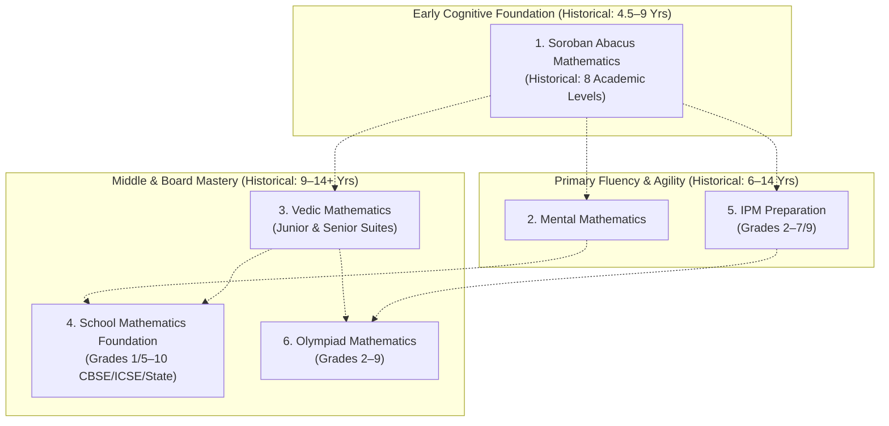

# AAA DIGITAL TRANSFORMATION — STAGE 2: WORKSTREAM 04 (WS-04)
# ACADEMIC PROGRAMME ARCHITECTURE
**Project:** Arnav Abacus Academy (AAA), Wakad, Pune  
**Role:** Lead Business Analyst, Academic Systems Architect & Child Development Framework Analyst  
**Governance Stage:** Stage 2 — Master Business Requirements Document (BRD) Workshop  
**Document Ref:** `docs/02_business_requirements/AAA_Stage2_WS04_Academic_Programme_Architecture.md`  
**Date:** November 02, 2026 (Final Quality-Controlled Baseline)  
**Status:** 🟡 **DOCUMENTATION QUALITY CONTROL COMPLETE — AWAITING MANAGEMENT VALIDATION**  

---

## 1. Executive Summary & Purpose

This document establishes the **Academic Programme Architecture** for Arnav Abacus Academy (AAA), Wakad, Pune, under **Workstream 04: Academic Programmes & Child Development (WS-04)**.

In strict accordance with Stage 2 governance baselines:
* **Core Brand Message:** *"Beyond Calculation. Towards Confident Mathematical Thinking."* `[MANAGEMENT APPROVED]`
* **Core Educational Philosophy:** *"Mathematics is the medium; developing confident, independent and thoughtful learners is the mission."* `[MANAGEMENT APPROVED]`
* **Operating Differentiator:** Personalised learning in small batches, with a maximum of five students per batch, guided by certified educators. `[MANAGEMENT APPROVED]`

This document connects AAA's academic offerings with pedagogical methodologies, learner eligibility boundaries, and developmental progression pathways. It explicitly reconciles software practice modules discovered in the practice engine with historical academic levels, maintaining strict differentiation between practice software, classroom curriculum, and formal academic certification.

---

## 2. Master Programme Architecture Overview

AAA delivers six distinct mathematics offerings:
1. **Soroban Abacus Mathematics**
2. **Vedic Mathematics**
3. **Mental Mathematics**
4. **School Mathematics Foundation**
5. **IPM (Institute for Promotion of Mathematics) Preparation**
6. **Olympiad Mathematics & Higher-Order Reasoning**

---

## 3. Programme-by-Programme Specifications

### 3.1 Programme 1: Soroban Abacus Mathematics
* **Academic Mission:** Develop photographic bead visualization (*Anzan*), base-10 numerical intuition, and calculation accuracy through the authentic Japanese 1:4 bead Soroban instrument, eliminating finger counting.
* **Intended Learner Group:** Early learners and primary school children (historical reference: 4.5–9 years; marketing copy references up to 14 years `[PENDING VALIDATION]`).
* **Entry Requirements:** Recognition of digits 0 to 9, object counting to 10, basic motor pinch grip, sitting stamina (~15 minutes).
* **Academic Level Structure vs. Software Practice Modules (`[RECONCILIATION NOTICE]`):**
  - *Academic Programme (Historical Management Reference):* **Eight progressive curriculum levels**, historically taking approximately 3 months per level.
  - *Software Practice Modules (Discovered in AcademyOS):* **14 practice modules** (`JR-0` to `JR-3`, `SR-1` to `SR-10`).
  - *Governing Rule:* Software practice modules are digital drill sets and do not automatically correspond 1:1 with academic curriculum levels. The formal academic level structure remains subject to management timetable and curriculum confirmation.
* **Teaching Methodology:** Dual-hand bead manipulation, oral dictation (*Yomiagezan*), flashcard drills, and gradual transition to internal Anzan mental visualization.
* **Assessment & Progression:** Multi-dimensional assessment: daily practice review, formative mechanics observation, and educator-approved level evaluation tests. A single test percentage does not determine progression.
* **Session Cadence:** `[PENDING VALIDATION against center timetable audit]`.

---

### 3.2 Programme 2: Vedic Mathematics
* **Academic Mission:** High-speed mental calculation shortcuts, algebraic pattern recognition, and rapid verification habits based on the 16 core Vedic Sutras and 13 Sub-sutras.
* **Intended Learner Group:** Middle and high school students (historical reference: 9–14 years; Class 5 to 10 `[PENDING VALIDATION]`).
* **Entry Requirements:** Working fluency with school arithmetic (times tables up to 9, multi-digit column addition, subtraction, multiplication, and basic division).
* **Curriculum vs. Software Modules (`[RECONCILIATION NOTICE]`):**
  - *Academic Curriculum Structure:* Modular topic suites covering sutras (*Urdhva Tiryagbhyam*, *Nikhilam*, *Paravartya*, *Beejank* checks). Exact number of academic levels pending curriculum audit.
  - *Software Practice Modules:* 8 software practice suites discovered in codebase (`JVM-1`, `SVM-0` to `SVM-6`).
* **Relationship to School Mathematics:** Vedic Maths at AAA acts as a speed catalyst and reverse-checking engine; it is taught alongside, and does not replace, standard school board step presentation.
* **Assessment & Progression:** Mental agility challenges, written sutra applications, *Beejank* verification audits, and comprehensive topic reviews.

---

### 3.3 Programme 3: Mental Mathematics
* **Academic Mission:** Rapid numerical reflexes, place-value intuition, mental estimation, and left-to-right calculation strategies.
* **Intended Learner Group:** Children in primary and middle school (historical reference: 6–14 years; proposed operational focus: 6–12 years `[PENDING VALIDATION]`).
* **Entry Requirements:** Familiarity with addition and subtraction within 20.
* **Curriculum Structure:** Modular agility tiers focusing on base-10 complements, doubling/halving, table agility, and mental word problems.
* **Assessment & Progression:** Auditory dictation rounds, timed written sprints, and error-pattern analysis.

---

### 3.4 Programme 4: School Mathematics Foundation
* **Academic Mission:** Conceptual foundation building, textbook syllabus mastery, and rigorous step-by-step writing discipline aligned with CBSE, ICSE, and Maharashtra State Board rubrics.
* **Intended Learner Group:** School students across primary and secondary grades (earlier marketing copy focused on Class 5–10; proposed scope includes Grades 1–10 `[PENDING VALIDATION]`).
* **Entry Requirements:** Enrollment in matching school grade; baseline diagnostic sheet.
* **Curriculum Structure:** Aligned chapter-by-chapter with school term syllabi, incorporating regular mock exams and step presentation modeling.
* **Assessment & Progression:** Chapter diagnostic tests, quarterly mock exams, and homework notebook reviews.

---

### 3.5 Programme 5: IPM (Institute for Promotion of Mathematics) Preparation
* **Academic Mission:** Specialized competitive mathematics training focusing on non-routine problem decomposition, pattern recognition, and competitive reasoning for the Maharashtra IPM competition.
* **Intended Learner Group:** High-curiosity students in primary and middle school (earlier references: Grades 2–9; proposed operational focus: Grades 2–7 `[PENDING VALIDATION]`).
* **Programme Classification & Relationship (`[GOVERNANCE RECONCILIATION]`):**
  - *Nature:* Can be offered as an independent competitive coaching programme or as a supplementary track for enrolled Abacus / School Math students.
  - *Operational Separation:* Dedicated mock paper sessions, separate test series materials, and distinct batch schedules and fee structures.
* **Teaching Methodology:** Heuristic decomposition, option elimination strategies, and past-paper simulation rounds.

---

### 3.6 Programme 6: Olympiad Mathematics & Higher-Order Reasoning
* **Academic Mission:** Advanced logical reasoning, Higher-Order Thinking Skills (HOTS), and tournament preparation for national/international mathematics Olympiads (SOF IMO, SilverZone, Unified Council).
* **Intended Learner Group:** Gifted and motivated students in Grades 2 to 9 `[PENDING VALIDATION]`.
* **Programme Classification & Relationship (`[GOVERNANCE RECONCILIATION]`):**
  - *Nature:* Supplementary high-performance track. Participation is strictly voluntary; students are not compelled to enter competitions.
  - *Operational Separation:* Separate syllabus timing (typically August–January), specialized mock papers, and distinct fee structure where applicable.
* **Teaching Methodology:** Socratic problem questioning, pattern extraction, combinatorics logic, and timed OMR response drills.

---

## 4. Summary of Governance Status

* **Core Academic Philosophy & Brand Promise:** `[MANAGEMENT APPROVED]`
* **Six-Programme Offering Architecture:** `[PROPOSED STRATEGY / PENDING VALIDATION]`
* **Eight-Level Abacus Academic Model:** `[HISTORICAL REFERENCE PENDING AUDIT]`
* **14 Abacus Practice Modules (`JR-0` to `SR-10`):** `[REPOSITORY-VERIFIED CAPABILITY]`
* **8 Vedic Practice Suites (`JVM-1`, `SVM-0` to `SVM-6`):** `[REPOSITORY-VERIFIED CAPABILITY]`
* **Micro-Batch Maximum of 5 Students Per Batch:** `[MANAGEMENT CONFIRMED]`
* **Programme Eligibility & Age Boundaries:** `[PENDING VALIDATION]`
* **Session Cadences & Timetable Feasibility:** `[PENDING VALIDATION against timetable audit]`
