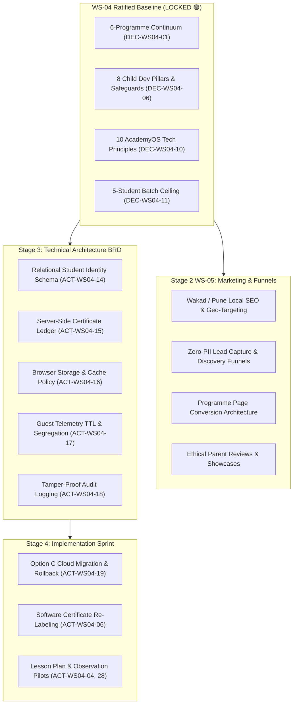

# AAA DIGITAL TRANSFORMATION — STAGE 2 MASTER BRD
# WORKSTREAM 04 (WS-04) CLOSURE VERIFICATION & WS-05 READINESS ASSESSMENT

**Project:** Arnav Abacus Academy (AAA), Wakad, Pune  
**Workstream:** WS-04 — Academic Programmes & Child Development  
**Stage:** Stage 2 — Master Business Requirements Document (BRD) Workshop  
**Document Ref:** `docs/02_business_requirements/AAA_Stage2_WS04_Closure_Verification_and_WS05_Readiness.md`  
**Date:** November 02, 2026  
**Auditor / Specialist:** Lead Business Analyst, Academic Systems Architect & Security Governance Specialist  
**Governance Authority:** Neha Patil (Founder & Academic Director) & Nitin Patil (Operations & Technology Lead)  
**Verification Result:** 🟢 **WORKSTREAM 04 FORMALLY RATIFIED & CLOSED — WS-05 READY WITH CONDITIONS**  

---

## 1. Executive Verification Result

This report constitutes an independent governance and documentation quality assurance audit of the management-ratified Workstream 04 (WS-04) baseline for Arnav Abacus Academy.

### Audit Summary:
1. **Management Ratification Verified:** The fourteen strategic governance and academic decisions (`DEC-WS04-01` to `DEC-WS04-14`) have been formally evaluated against the executive closure record (`AAA_Stage2_WS04_Formal_Closure.md`) and the master decision register (`AAA_WS04_Management_Decision_Register.md`). Both documents agree in scope, conditional terms, and accountable decision-makers without discrepancy.
2. **Nature of Management Approval:** Approval was formally recorded on November 02, 2026, through explicit in-session management instructions delivered by the authorized user representing AAA Management (Neha Patil & Nitin Patil), choosing Option B with zero overrides and confirming all four foundational baselines. No separate physical ink-signed or cryptographically certified document exists at this stage. This status is accurately documented as an explicit in-session executive determination.
3. **Traceability & Action Integrity:** All 29 carry-forward actions (`ACT-WS04-01` to `ACT-WS04-29`) and 29 empirical evidence items (`EVD-ACAD-01..09`, `EVD-OPS-01..09`, `EVD-SEC-01..11`) have been verified for uniqueness, accountability, and clear deliverables. Exactly zero actions have been prematurely marked complete; open dependencies are appropriately partitioned across Stage 2 follow-ups, Stage 3 architecture, and Stage 4 implementation.
4. **Foundational Baselines Grounded:** The approximate census (~87+ active paying students across ~14+ weekly micro-batches), physical center premises (Balaji Sagar Bungalow, Wakad), cloud sync transition strategy (Option C), and certificate re-labeling ("Practice Achievement Records") are consistently and factually recorded.
5. **Stage-Gate Determination:** WS-04 is **FORMALLY CLOSED**. The project is declared **READY WITH CONDITIONS** to initiate **Workstream 05 (WS-05): Marketing, Lead Generation & Conversion Architecture**.

---

## 2. Fourteen-Decision Reconciliation Matrix

The following table provides the exhaustive verification of all fourteen management determinations between the formal closure record (`AAA_Stage2_WS04_Formal_Closure.md`) and the master decision register (`AAA_WS04_Management_Decision_Register.md`):

| Decision ID & Title | Final Approved Status | Approved Scope | Conditions Attached | Deferred Matters | Accountable Decision-Maker | Approval Evidence & Date | Closure Doc Ref | Agreement Status |
|---|:---:|---|---|---|:---:|---|:---:|:---:|
| **DEC-WS04-01**<br>Six-Programme Master Architecture | **APPROVED WITH CONDITIONS** | The 6-programme portfolio (Soroban Abacus, Vedic Maths, Mental Maths, School Maths, IPM Prep, Olympiad Maths) is approved as the strategic offering continuum. | Detailed room allocation and batch timetable slots are conditioned on the facility capacity audit (`ACT-WS04-08`). | Physical room seating layouts and concurrent batch scheduling. | Neha Patil & Nitin Patil | Management Instruction (Nov 02, 2026) | `AAA_Stage2_WS04_Formal_Closure.md:35` | **100% Agree** |
| **DEC-WS04-02**<br>Programme Eligibility Reconciliation | **DEFERRED PENDING AUDIT** | Working age brackets (Abacus 4.5–9, Vedic 9–14, Mental 6–14, School Math Gr 1–10, IPM Gr 2–7, Olympiad Gr 2–9) approved as provisional intake guidelines. | Subject to student diagnostic intake log review. | Exact cutoff boundaries, diagnostic crossover rules, and 9-year-old assessment rubric (`ACT-WS04-22`). | Neha Patil | Management Instruction (Nov 02, 2026) | `AAA_Stage2_WS04_Formal_Closure.md:36` | **100% Agree** |
| **DEC-WS04-03**<br>Level Progression Reconciliation | **APPROVED WITH CONDITIONS** | Governance distinction approved: practice modules (`JR-0..SR-10`, `JVM-1`, `SVM-0..6`) represent digital drill sets, not accredited academic semesters. 8-level Abacus programme preserved as historical framework. | None on distinction itself; physical workbook crosswalk must be produced. | Physical printed workbook crosswalk (`ACT-WS04-01`) and written Vedic modular syllabus (`ACT-WS04-20`) deferred to Stage 3. | Neha Patil | Management Instruction (Nov 02, 2026) | `AAA_Stage2_WS04_Formal_Closure.md:37` | **100% Agree** |
| **DEC-WS04-04**<br>The AAA Learning Model™ Implementation | **APPROVED AS PILOT** | The 6-stage model (*Inspire → Explore → Understand → Practice → Apply → Reflect*) approved as institutional philosophy. 1-page standardized lesson plan templates approved for pilot. | Pilot limited to 2 batches; reviewed by Neha Patil prior to universal rollout. | Mandatory academy-wide lesson plan enforcement across all daily batches. | Neha Patil | Management Instruction (Nov 02, 2026) | `AAA_Stage2_WS04_Formal_Closure.md:38` | **100% Agree** |
| **DEC-WS04-05**<br>Twelve Competencies Framework | **DEFERRED PENDING PILOT** | 12 core mathematical competencies accepted in principle as pedagogical orientation. | Classroom observation rubrics must be piloted in 2 batches (`ACT-WS04-28`) and educator workload calibrated. | Formal institutional adoption across student progress report cards and website marketing. | Neha Patil | Management Instruction (Nov 02, 2026) | `AAA_Stage2_WS04_Formal_Closure.md:39` | **100% Agree** |
| **DEC-WS04-06**<br>Eight Child Dev Pillars & Safeguards | **APPROVED WITH CONDITIONS** | Exact 8 approved pillar names locked. Non-negotiable negative inference rules approved (zero ADHD/dyslexia labeling, zero composite IQ numbers, sitting focus/smiling alone is not clinical proof). | All marketing and parent communications must strictly adhere to non-diagnostic rules. | Concrete developmental measurement rubrics and reporting phrase guide (`ACT-WS04-29`) deferred to Stage 3. | Neha Patil | Management Instruction (Nov 02, 2026) | `AAA_Stage2_WS04_Formal_Closure.md:40` | **100% Agree** |
| **DEC-WS04-07**<br>Four-Layer Assessment & Certificates | **APPROVED WITH CONDITIONS** | Four-layer assessment architecture (Practice, Formative, Summative, Educator Approval) and four-tier certificate model approved in principle. In-software client PDFs re-labeled "Practice Achievement Records". | Client-side PDFs must not claim formal course completion or accredited diploma status. | Exact passing thresholds (70%/80%), physical evaluation paper blueprints (`ACT-WS04-10`), and server ledger architecture (`ACT-WS04-15`). | Neha Patil & Nitin Patil | Management Instruction (Nov 02, 2026) | `AAA_Stage2_WS04_Formal_Closure.md:41` | **100% Agree** |
| **DEC-WS04-08**<br>Sustainable Bi-Monthly Reporting | **APPROVED AS PILOT** | Bi-monthly qualitative written progress updates supplemented by 2-minute informal pickup chats approved as an operational pilot. | Pilot commences only after student census audit and consultation calendar time-budgeting (`ACT-WS04-13`). | Academy-wide mandatory reporting schedule and automated progress card distribution. | Neha Patil & Nitin Patil | Management Instruction (Nov 02, 2026) | `AAA_Stage2_WS04_Formal_Closure.md:42` | **100% Agree** |
| **DEC-WS04-09**<br>Voluntary Competition Policy | **APPROVED WITH CONDITIONS** | Voluntary participation in IPM and Olympiads approved as an absolute child-protection principle. Dedicated weekend batch slots and separate fee cards approved in principle. | Separate published fee cards (`ACT-WS04-09`) and competition calendar (`ACT-WS04-23`) conditioned on operational review. | Final tournament schedule and specific surcharge rates deferred to Stage 3 fee card. | Neha Patil | Management Instruction (Nov 02, 2026) | `AAA_Stage2_WS04_Formal_Closure.md:43` | **100% Agree** |
| **DEC-WS04-10**<br>Ten AcademyOS Technology Principles | **APPROVED** | 10 permanent technology-neutral architecture principles (P-01 to P-10) formally approved as mandatory non-negotiable constraints for Stage 3 BRD. | Zero code or schema changes in Stage 2. | Database vendor selection, relational table schemas, and hosting stack deferred to Stage 3 Architecture. | Nitin Patil | Management Instruction (Nov 02, 2026) | `AAA_Stage2_WS04_Formal_Closure.md:44` | **100% Agree** |
| **DEC-WS04-11**<br>Educator Standards & Micro-Batch Cap | **APPROVED WITH CONDITIONS** | Maximum 5 students per batch ceiling (DEC-WS02-05) reaffirmed. Certified educator mentoring standard approved. | Room seating layouts and simultaneous batch compliance conditioned on physical premises audit (`ACT-WS04-08`). | Educator academic moderation protocol (`ACT-WS04-21`) and staffing workload roster (`ACT-WS04-25`). | Neha Patil & Nitin Patil | Management Instruction (Nov 02, 2026) | `AAA_Stage2_WS04_Formal_Closure.md:45` | **100% Agree** |
| **DEC-WS04-12**<br>Programme-Wise Home Practice | **APPROVED AS PILOT** | Compulsory universal daily homework rejected. Programme-tailored daily practice guidance (10–15 mins/day) positioning parents as calm encouragers approved for pilot. | Tested with volunteer cohort (10 parents) via 1-page parent guides (`ACT-WS04-12`). | Mandatory parent onboarding rules and academy-wide home practice enforcement deferred pending pilot feedback. | Neha Patil | Management Instruction (Nov 02, 2026) | `AAA_Stage2_WS04_Formal_Closure.md:46` | **100% Agree** |
| **DEC-WS04-13**<br>Student Identity & Relational Structure | **APPROVED WITH CONDITIONS** | Core governance principles (one permanent Student ID per child, multi-programme attachment to single record, parent account linkage to multiple siblings) approved. | Sibling data isolation must be enforced without email collisions. | String format (`AAA-STU-YYYY-XXXX`) and relational database schemas (`ACT-WS04-14`) deferred to Stage 3 Architecture. | Nitin Patil | Management Instruction (Nov 02, 2026) | `AAA_Stage2_WS04_Formal_Closure.md:47` | **100% Agree** |
| **DEC-WS04-14**<br>AcademyOS Security & Consent Management | **APPROVED WITH CONDITIONS** | Privacy-by-design, auditable parental consent logging, and parental statutory data rights approved as mandatory requirements. Option C cloud migration path approved. | Production cutover, console OTP removal, and consent workflows scheduled for Stage 4 implementation following Stage 3 architecture and legal review. | Technical migration scripts, legal review of consent forms, and parent data rights SOP deferred to Stage 3/4. | Nitin Patil | Management Instruction (Nov 02, 2026) | `AAA_Stage2_WS04_Formal_Closure.md:48` | **100% Agree** |

---

## 3. Twenty-Nine-Action Verification Summary

An exhaustive review of `AAA_WS04_Management_Action_and_Evidence_Tracker.md` confirms:
- **Uniqueness:** All 29 action IDs (`ACT-WS04-01` to `ACT-WS04-29`) are unique, without duplicate IDs or numbering gaps.
- **Deliverables & Acceptance Criteria:** Every action has an explicit expected deliverable (e.g. PDF audit sheet, schema spec) and objective acceptance criteria.
- **Accountability:** Every action has an assigned responsible owner (`Neha Patil`, `Nitin Patil`, `Solution Architect`, or `Legal Counsel`).
- **Traceability:** Every action is linked to empirical evidence IDs (`EVD-ACAD`, `EVD-OPS`, `EVD-SEC`) and decision IDs (`DEC-WS04-xx`).
- **Execution Safeguard:** Exactly **zero actions are marked completed**. No action has authorized premature application code changes or unverified production modifications.

### Comprehensive Action Classification Table:

| Action ID | Action Title & Specific Deliverable | Accountable Owner | Related Decisions | Evidence Link | Six-Tier Governance Classification | Target Milestone |
|---|---|:---:|:---:|:---:|:---:|:---:|
| `ACT-WS04-01` | Abacus Physical Workbook Inventory & Crosswalk (`Abacus_Physical_Workbook_and_Module_Crosswalk_Matrix.pdf`) | Neha Patil [PROPOSED] | DEC-WS04-03 | EVD-ACAD-01, 02 | **B. Carried forward to Stage 3** | Stage 3 Input |
| `ACT-WS04-02` | Credential Verification Dossier (VER-01) (`AAA_VER01_Documentary_Credential_Dossier.pdf`) | Neha Patil [PROPOSED] | DEC-WS02-01 | VER-01 | **D. Legal or external evidence dependency** | Prior to Public Copy |
| `ACT-WS04-03` | Verified Active Student Census & Enrolment Roll (`AAA_Active_Student_Census_and_Batch_Distribution_Roll.xlsx`) | Nitin Patil [PROPOSED] | DEC-WS01-01, DEC-WS04-08 | EVD-OPS-01, 02 | **A. Open — Stage 2 follow-up** | Stage 2 Prerequisite |
| `ACT-WS04-04` | Master 1-Page Lesson Plan Pilot Templates (`AAA_Master_1Page_Lesson_Plan_Pilot_Templates.pdf`) | Neha Patil [PROPOSED] | DEC-WS04-04 | EVD-ACAD-06 | **F. Deferred by management** (Approved as 2-batch pilot) | Pre-Implementation |
| `ACT-WS04-05` | Cloud Data Sync Usage Audit & Options Brief (`AcademyOS_Cloud_Storage_Options_Assessment_Brief.pdf`) | Solution Architect [PROPOSED] | DEC-WS04-10, 14 | EVD-SEC-01, 02 | **B. Carried forward to Stage 3** | Stage 3 Input |
| `ACT-WS04-06` | Practice Certificate Software Re-Labeling Spec (`Practice_Certificate_Software_ReLabeling_Specification.pdf`) | Nitin Patil [PROPOSED] | DEC-WS04-07 | CERT-01 | **B. Carried forward to Stage 3** | Stage 3 Input |
| `ACT-WS04-07` | Parental Consent Notice & Consent Log Spec (`Parental_Consent_Notice_and_Consent_Log_Specification.pdf`) | Legal Counsel & Nitin Patil [PROPOSED] | DEC-WS04-14 | EVD-SEC-05, GAP-04 | **D. Legal or external evidence dependency** | Stage 3 Input |
| `ACT-WS04-08` | Physical Facility Seating & Acoustic Audit (`AAA_Premises_Facility_Capacity_Audit_Report.pdf`) | Nitin Patil [PROPOSED] | DEC-WS04-01, 11 | EVD-OPS-03 | **A. Open — Stage 2 follow-up** | Stage 2 Prerequisite |
| `ACT-WS04-09` | Master Published Tuition Fee Schedule (`AAA_Master_Published_Fee_Schedule_2026.pdf`) | Nitin Patil [PROPOSED] | DEC-WS01-03, DEC-WS04-09 | EVD-OPS-04, 05 | **A. Open — Stage 2 follow-up** | Stage 2 Prerequisite |
| `ACT-WS04-10` | Level 1 Summative Assessment Paper Form A/B (`AAA_Abacus_Level1_Evaluation_FormA_FormB.pdf`) | Neha Patil [PROPOSED] | DEC-WS04-07 | EVD-ACAD-07 | **C. Pre-implementation prerequisite for Stage 4** | Pre-Implementation |
| `ACT-WS04-11` | Written SOP for Parent Data Rights (`AAA_Parent_Data_Rights_Fulfillment_SOP.pdf`) | Nitin Patil & Legal [PROPOSED] | DEC-WS04-14 | EVD-SEC-06, GAP-07 | **D. Legal or external evidence dependency** | Pre-Implementation |
| `ACT-WS04-12` | Calm Home Practice Pilot Guidelines (`Calm_Home_Practice_Guide_for_Parents_Pilot.pdf`) | Neha Patil [PROPOSED] | DEC-WS04-12 | EVD-ACAD-08 | **F. Deferred by management** (Approved as 10-parent pilot) | Pre-Implementation |
| `ACT-WS04-13` | Bi-Monthly Reporting Workload & Calendar (`BiMonthly_Parent_Reporting_Calendar_and_Template.pdf`) | Neha Patil & Nitin Patil [PROPOSED] | DEC-WS04-08 | EVD-OPS-09 | **F. Deferred by management** (Approved as operational pilot) | Pre-Implementation |
| `ACT-WS04-14` | Relational Identity Architecture Spec (`Stage3_Relational_Identity_Architecture_Specification.pdf`) | Solution Architect [PROPOSED] | DEC-WS04-13 | EVD-SEC-03, GAP-03 | **B. Carried forward to Stage 3** | Stage 3 Input |
| `ACT-WS04-15` | Central Certificate Ledger Architecture (`Central_Certificate_Ledger_and_Revocation_Specification.pdf`) | Solution Architect & Neha Patil [PROPOSED] | DEC-WS04-07 | EVD-SEC-09, GAP-06 | **B. Carried forward to Stage 3** | Stage 3 Input |
| `ACT-WS04-16` | Browser Storage Security & Session Policy (`Browser_Storage_Security_and_Session_Policy_Specification.pdf`) | Solution Architect [PROPOSED] | DEC-WS04-10 | EVD-SEC-04, GAP-01 | **B. Carried forward to Stage 3** | Stage 3 Input |
| `ACT-WS04-17` | Guest Telemetry Segregation Spec (`Guest_Telemetry_Segregation_and_Lifecycle_Specification.pdf`) | Solution Architect [PROPOSED] | DEC-WS04-10 | EVD-SEC-03, GAP-02 | **B. Carried forward to Stage 3** | Stage 3 Input |
| `ACT-WS04-18` | Administrative Audit Logging Spec (`Administrative_Audit_Logging_Architecture_Specification.pdf`) | Solution Architect [PROPOSED] | DEC-WS04-10 | EVD-SEC-08 | **B. Carried forward to Stage 3** | Stage 3 Input |
| `ACT-WS04-19` | Data Migration, Integrity & Rollback Plan (`Student_Data_Migration_and_Rollback_Strategy.pdf`) | Solution Architect [PROPOSED] | DEC-WS04-10, 14 | EVD-SEC-11 | **C. Pre-implementation prerequisite for Stage 4** | Pre-Implementation |
| `ACT-WS04-20` | Vedic Modular Syllabus & Suite Crosswalk (`Vedic_Modular_Syllabus_and_Suite_Crosswalk.pdf`) | Neha Patil [PROPOSED] | DEC-WS04-03 | EVD-ACAD-03 | **B. Carried forward to Stage 3** | Stage 3 Input |
| `ACT-WS04-21` | Educator QA & Moderation Protocol (`AAA_Educator_Quality_Assurance_Protocol.pdf`) | Neha Patil [PROPOSED] | DEC-WS04-11 | EVD-ACAD-09 | **C. Pre-implementation prerequisite for Stage 4** | Pre-Implementation |
| `ACT-WS04-22` | Programme Eligibility Reconciliation Matrix (`AAA_Reconciled_Programme_Eligibility_Matrix.pdf`) | Neha Patil [PROPOSED] | DEC-WS04-02 | EVD-ACAD-04 | **F. Deferred by management** (Provisional ranges approved) | Stage 2 Prerequisite |
| `ACT-WS04-23` | IPM & Olympiad Annual Track Charter (`AAA_IPM_Olympiad_Track_Charter_and_Calendar.pdf`) | Neha Patil [PROPOSED] | DEC-WS04-09 | EVD-ACAD-05 | **A. Open — Stage 2 follow-up** | Stage 2 Prerequisite |
| `ACT-WS04-24` | Session Duration & Weekly Frequency Matrix (`AAA_Programme_Session_Duration_and_Frequency_Matrix.pdf`) | Neha Patil [PROPOSED] | DEC-WS04-01, 02 | EVD-OPS-06 | **A. Open — Stage 2 follow-up** | Stage 2 Prerequisite |
| `ACT-WS04-25` | Educator Staffing Roster & Workload Audit (`AAA_Educator_Staffing_Roster_and_Capacity_Analysis.pdf`) | Neha Patil & Nitin Patil [PROPOSED] | DEC-WS04-01, 11 | EVD-OPS-07 | **A. Open — Stage 2 follow-up** | Stage 2 Prerequisite |
| `ACT-WS04-26` | Institutional Data Retention Policy (`AAA_Institutional_Data_Retention_Policy.pdf`) | Management & Legal [PROPOSED] | DEC-WS04-14 | EVD-SEC-07, GAP-05 | **D. Legal or external evidence dependency** | Stage 3 Input |
| `ACT-WS04-27` | External Accreditation Evidence Dossier (`AAA_External_Accreditation_Evidence_Dossier.pdf`) | Neha Patil [PROPOSED] | DEC-WS04-07 | EVD-SEC-10 | **D. Legal or external evidence dependency** | Prior to Public Copy |
| `ACT-WS04-28` | Competencies Observation Rubric Pilot (`AAA_Competencies_Observation_Rubric_and_Pilot_Sheet.pdf`) | Neha Patil [PROPOSED] | DEC-WS04-05 | EVD-ACAD-06 | **F. Deferred by management** (Accepted in principle; pilot in 2 batches) | Pre-Implementation |
| `ACT-WS04-29` | Child Dev Reporting Phrase Guide (`AAA_Child_Development_Reporting_Phrase_Guide.pdf`) | Neha Patil [PROPOSED] | DEC-WS04-06 | EVD-ACAD-09 | **B. Carried forward to Stage 3** | Stage 3 Input |

---

## 4. Four Foundational Baseline Verifications

### 4.1 Student Census & Batches
- **Verified Record:** Operating baseline is documented strictly as approximately **87+ active paying students** across **14+ weekly micro-batches**.
- **Governance Discipline:** The figure is explicitly classified as a **management-confirmed approximate baseline**, not an audited nominal census.
- **Traceability:** The exact, audited student roll and fee reconciliation remains tracked under `ACT-WS04-03` (`EVD-OPS-01`). No commercial or financial projection in WS-04 has claimed unverified exact counts.

### 4.2 Physical Premises Attribution
- **Verified Record:** The academy premises address is documented with complete consistency across all registers:  
  *Flat No. 3, 1st Floor, Adv. Balaji Sagar Bungalow, Opp. Creative Cameo, Near Park Street, Behind Wisdom World School, Wakad, Pune 411057*.
- **Classification Separation:** Physical room square footage, usable seating layouts, simultaneous batch capacity, and educator availability are strictly distinguished from the address attribution and kept separately classified under `ACT-WS04-08` (`EVD-OPS-03`) and `ACT-WS04-25` (`EVD-OPS-07`).

### 4.3 Cloud-Sync Transition Strategy (Option C)
- **Verified Strategic Direction:** Option C is formally ratified: current practice software runs uninterrupted, while migration to an authenticated private database with full backup and rollback protocols is scheduled for Stage 4 implementation.
- **Discipline of Classifications:**
  1. *Approved Strategic Direction:* Option C (staged migration to authenticated private backend).
  2. *Current Source-Code Behaviour:* Client-side script `cloudSync.ts` constructs unauthenticated `GET`/`PUT` requests to `jsonblob.com` and serializes attempts to browser `localStorage`.
  3. *Production Cloud-Sync Status:* `[NOT TESTED]` — static repository audit only; live network calls and third-party provider traffic remain unprobed.
  4. *Future Architecture Requirements:* Authenticated private cloud database, TLS port 443, zero-PII telemetry, relational student identity (`P-01` to `P-10`).
  5. *Data Preservation & Migration Requirements:* Checksum verification scripts and historical attempt preservation mandated under `ACT-WS04-19`.
  6. *Rollback & Recovery Requirements:* Pre-migration snapshots and automated rollback routines mandated under `ACT-WS04-19`.
  7. *Separate Implementation Approval:* Strictly zero code changes in Stage 2 or Stage 3. Cutover requires explicit Stage 4 sign-off.
- **Non-Assertion Safeguard:** No document claims that migration has been executed or that the existing data service has been independently security-certified.

### 4.4 Practice Achievement Records vs. Formal Credentials
- **Verified Terminology:** Software-generated client-side PDF downloads in `PracticeResult.tsx` / `certificateGenerator.ts` are authorized to be re-labeled as **"Practice Achievement Records"**.
- **Four-Tier Hierarchy Enforced:**
  1. *Tier 1: Practice Achievement Record:* Digital certificate recognizing completion of practice drill sets. Issued client-side. Does not imply accredited course completion.
  2. *Tier 2: Course Level Completion Certificate:* Formal institutional credential awarded only upon passing summative Layer C assessments with written educator Layer D sign-off, registered in the central academy ledger.
  3. *Tier 3: Tournament Participation Certificate:* Academy recognition for participating in internal or external math challenges.
  4. *Tier 4: External Examination Certificate:* Accredited certificates issued directly by external competition authorities (IPM, SilverZone, SOF).
- **Non-Modification Safeguard:** No code changes to `certificateGenerator.ts` have been executed in Stage 2; specifications are carried forward to Stage 3 (`ACT-WS04-06`) for Stage 4 execution.

---

## 5. Privacy, Child Safeguards & Technical Governance Checks

All mandatory safeguards from `AGENTS.md` and ratified WS-04 decisions are confirmed intact:

1. **Exact 8 Child Development Pillar Names:**  
   Preserved verbatim: (1) Spatial Visualization, (2) Working Memory & Mental Storage, (3) Pattern Recognition, (4) Rapid Information Processing, (5) Sustained Attention & Focus, (6) Cognitive Flexibility, (7) Executive Function & Problem Solving, and (8) Self-Confidence & Mathematical Joy.
2. **Self-Baseline Progress Comparison:**  
   Child developmental progress is strictly evaluated against the child's own prior historical baseline. Comparative peer ranking in developmental reports is explicitly banned.
3. **Zero Composite IQ or Intelligence Scores:**  
   Zero overall "Child Intelligence Index", composite numerical developmental score, or algorithmic child ranking is permitted or referenced.
4. **Three Distinct Observation Perspectives:**  
   Parent observations, student self-reflection, and certified educator observations are structurally maintained as distinct, non-conflated data streams.
5. **Non-Diagnostic Safeguards:**  
   Strict prohibitions against clinical diagnosis (ADHD, dyscalculia, dyslexia labeling) and false claims (sitting focus or smiling alone is not medical proof of cognitive transformation) remain firmly embedded in `DEC-WS04-06` and `ACT-WS04-29`.
6. **Student Identity Principles vs Schema Proposals:**  
   The core principles (1 permanent ID per child, multi-programme attachment, sibling linkage) are clearly separated from the proposed string format (`AAA-STU-YYYY-XXXX`) and database schemas, which are appropriately deferred to Stage 3 Architecture (`ACT-WS04-14`).
7. **Zero-PII Telemetry & Data Rights:**  
   Google Analytics 4 (`G-M2EL9MYSRL`) and GTM telemetry remain strictly zero-PII compliant. Parental consent, data retention, access, correction, and deletion requirements are fully carried forward (`ACT-WS04-07`, `ACT-WS04-11`, `ACT-WS04-26`).
8. **No Unverified Breach Assertions:**  
   Repository inspection findings remain factual forensic observations without asserting unverified live breaches, leaks, or statutory violations.

---

## 6. Stage-Gate & Repository Integrity Report

An inspection of the workspace repository verifies adherence to technical discipline:

* **Current Git Branch:** `audit-redesign-remediation`
* **Current HEAD Commit:** `b14c64189fe5aa8e5421a548f41cd1a9626d73ef`
* **`git status --short` Output:**
  ```text
  ?? AGENTS.md
  ?? docs/
  ```
* **Tracked Application Code Changes:** **ZERO.** No tracked files have been modified, deleted, staged, or touched.
* **Integrity of Application Source:** `src/`, `public/`, `package.json`, `vite.config.ts`, `tsconfig.json`, and all routes remain pristine.
* **Repository State:** The repository is preserved at the historical baseline `b14c641`. Untracked files consist exclusively of the mandatory project governance instructions (`AGENTS.md`) and the Stage 1 & Stage 2 documentation suite (`docs/`). No commits, pushes, merges, or production deployments have occurred.

---

## 7. Remaining Discrepancies & Synchronizations Executed

During this independent review, four minor metadata and status discrepancies were identified across existing WS-04 documents and reconciled to reflect management's formal ratification:

1. **`AAA_WS04_Management_Action_and_Evidence_Tracker.md`:**
   - *Previous Status:* Header line 9 and line 479 indicated `WS-04 remains OPEN pending executive workshop execution`.
   - *Correction Executed:* Updated header to `🟢 OPERATIONAL ACTION & EVIDENCE INSTRUMENT — WS-04 RATIFIED & CLOSED; ACTIONS CARRIED FORWARD` and line 479 to `WS-04 is FORMALLY CLOSED per management ratification (AAA_Stage2_WS04_Formal_Closure.md); all 29 actions are actively tracked as carry-forward operational and architecture items.`
2. **`AAA_WS04_Management_Decision_Brief.md`:**
   - *Previous Status:* Header line 9 indicated `🟡 EXECUTIVE DECISION INSTRUMENT — ALL 14 DECISIONS PENDING MANAGEMENT DETERMINATION`.
   - *Correction Executed:* Updated header to `🟢 EXECUTIVE DECISION INSTRUMENT — REVIEWED & RATIFIED BY MANAGEMENT (NOV 02, 2026)`.
3. **`AAA_WS04_Open_Information_and_Evidence_Register.md`:**
   - *Previous Status:* Header line 8 indicated `🟡 DOCUMENTATION QUALITY CONTROL COMPLETE — AWAITING MANAGEMENT VALIDATION`.
   - *Correction Executed:* Updated header to `🟢 WORKSTREAM RATIFIED & CLOSED — OPEN ITEMS CARRIED FORWARD AS GOVERNANCE DEPENDENCIES`.
4. **`AAA_WS04_Security_Privacy_and_Certificate_Governance_Review.md`:**
   - *Previous Status:* Header line 9 indicated `🟡 DOCUMENTATION QUALITY CONTROL COMPLETE — AWAITING MANAGEMENT VALIDATION`.
   - *Correction Executed:* Updated header to `🟢 REVIEW COMPLETE & RATIFIED BY MANAGEMENT — FINDINGS CARRIED FORWARD TO STAGE 3/4`.

All underlying technical findings, evidence mappings, and management-approved decisions were preserved without substantive modification.

---

## 8. WS-05 Readiness Assessment

### Formal Stage-Gate Readiness Status: 🟢 **READY WITH CONDITIONS**

Workstream 05 (WS-05): **Marketing, Lead Generation & Conversion Architecture** is authorized to begin in Stage 2 Master BRD workshop mode.

### Justification:
- WS-05 is a discovery and requirements-definition workstream focusing on parent discovery funnels, Wakad/Pune local SEO architecture, enquiry capture workflows, conversion optimization, and analytics event specifications.
- The 29 open actions from WS-04 relate to internal classroom lesson plan pilots, physical premises capacity measurements, workbook audits, and backend database schemas. These operational and technical activities do **not** block marketing requirements discovery.
- Forcing full physical completion of all 29 internal operational actions before commencing marketing requirements would create artificial bottlenecks and paralyze project momentum.

### Mandatory WS-04 Constraints Governing WS-05:

To ensure marketing specifications remain strictly within approved boundaries, WS-05 must comply with the following five non-negotiable constraints:

1. **Approved Brand Positioning & Slogan:**  
   All WS-05 conversion and SEO architecture must anchor to the ratified brand positioning:  
   > **“Arnav Abacus Academy – A Premium Mathematical Thinking & Child Development Academy.”**  
   and approved website headline:  
   > **“Beyond Calculation. Towards Confident Mathematical Thinking.”**
2. **Strict Micro-Batch Marketing Slogan:**  
   Batch size must be marketed exclusively as **"maximum 5 students per batch"** (`DEC-WS02-05`, `DEC-WS04-11`).
3. **Six-Programme Offering Continuum:**  
   Website information architecture must represent the 6 programmes (Soroban Abacus, Vedic Maths, Mental Maths, School Maths, IPM Prep, Olympiad Maths) as an interconnected multi-year continuum (`DEC-WS04-01`).
4. **Non-Diagnostic Copy & Zero-PII Lead Capture:**  
   Lead capture forms must collect only minimum necessary contact data (parent name, mobile, child age/grade) without asking for school names, birthdates, or diagnostic details (`DEC-WS03-04`). Marketing copy must strictly avoid clinical terminology (ADHD, dyscalculia) or guaranteed IQ score claims (`DEC-WS04-06`).
5. **No Production Website Modifications:**  
   WS-05 deliverables must remain strictly analytical and documentation-only within `docs/02_business_requirements/`. Zero code changes or live marketing deployments are authorized.

---

## 9. Explicit Carry-Forward Dependencies

The following table summarizes the distribution of WS-04 dependencies into downstream stages:



### Handover Authorization:
* **Workstream 04 Audit:** Formally verified and verified internally consistent.
* **Next Authorized Activity:** Initiate **Stage 2 Workstream 05 (WS-05): Marketing, Lead Generation & Conversion Architecture** upon management instruction.
