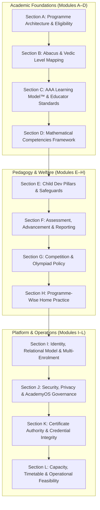

# AAA DIGITAL TRANSFORMATION — STAGE 2: WORKSTREAM 04 (WS-04)
# MANAGEMENT VALIDATION WORKSHOP PACK & DECISION WORKBOOK
**Project:** Arnav Abacus Academy (AAA), Wakad, Pune  
**Workstream:** WS-04 — Academic Programmes & Child Development  
**Role:** Lead Business Analyst, Academic Systems Architect & Security Governance Specialist  
**Governance Stage:** Stage 2 — Master Business Requirements Document (BRD) Workshop  
**Document Ref:** `docs/02_business_requirements/AAA_Stage2_WS04_Management_Validation_Workshop_Pack.md`  
**Date:** November 02, 2026 (Final Readiness & Completeness Review Baseline)  
**Status:** 🟡 **WORKSHOP PACK PREPARED — AWAITING MANAGEMENT PARTICIPATION**  

---

## 1. Executive Summary & Governance Ground Rules

This workshop pack provides the structured framework for the executive validation session between the Digital Transformation Team and AAA Leadership (**Neha Patil**, Founder & Academic Director, and **Nitin Patil**, Center Operations & Technology Lead).

### Mandatory Governance Ground Rules:
1. **Preservation of Approved Baselines:** All decisions approved in Stage 1, Stage 2 WS-01 (Business Strategy), Stage 2 WS-02 (Brand Positioning), and Stage 2 WS-03 (Parent Personas & Customer Journey) are strictly preserved. Previously ratified decisions will not be reopened without a documented operational dependency.
2. **Explicit Approval Boundary:** All fourteen decisions presented in this workbook remain **`NOT APPROVED`**. Requirements discovery and recommendations do **not** constitute implementation authorization.
3. **Strict Separation of Recommendation and Approval:** Antigravity recommendations are clearly labeled as recommendations. Management decision fields are provided unpopulated (`[ ____________________ ]`) to ensure independent leadership governance.
4. **No Direct Code Modifications:** Stage 2 is strictly a discovery, requirements definition, and governance workshop. No application code, configurations, database schemas, or live endpoints shall be modified during this stage.
5. **No Live Security Penetration:** Technical observations remain grounded in repository source code analysis. No unauthorized network requests, penetration tests, or live data manipulation shall be executed.
6. **Neutral Security & Privacy Classifications:** Unverified production exposures are strictly not described as confirmed breaches or active vulnerabilities. Findings distinguish source-code request logic from untested live transmission and provider controls.
7. **Identity Principles vs. Design Separation:** Architectural principles (e.g. permanent Student ID, multi-programme attachment) are separated from unapproved proposed designs (e.g. specific ID string formats, schema designs).

---

## 2. WS-04 Management Validation Workshop Agenda (Sections A through L)

The workshop is organized into twelve sequential thematic sections:

---

### Section A: Academic Programme Architecture & Eligibility
* **Core Focus:** Establishing AAA's master academic offerings as a six-programme interconnected continuum and finalizing age/grade boundaries.
* **Key Context:**
  - Six Offerings: (1) Soroban Abacus, (2) Vedic Maths, (3) Mental Maths, (4) School Maths Foundation, (5) IPM Prep, (6) Olympiad Maths.
  - Reconciling marketing copy discrepancies (Abacus listed as 4.5–9 in `data.ts` vs 4–14 in `ProgramAbacus.tsx`).
* **Key Input Artifacts:** `AAA_Stage2_WS04_Academic_Programme_Architecture.md`, `AAA_WS04_Programme_Eligibility_and_Level_Framework.md`.
* **Associated Decisions:** `DEC-WS04-01`, `DEC-WS04-02`.

---

### Section B: Abacus & Vedic Academic Level Mapping
* **Core Focus:** Reconciling the 14 Abacus software practice modules (`JR-0` to `SR-10`) and 8 Vedic suites (`JVM-1`, `SVM-0` to `SVM-6`) discovered in `AcademyOS` with the historical eight-level academic curriculum.
* **Key Context:**
  - Software modules represent question drill sets, not accredited academic semesters.
  - Preserving the eight-level Abacus programme as a management baseline pending physical workbook audit.
* **Key Input Artifacts:** `AAA_WS04_Programme_Eligibility_and_Level_Framework.md`.
* **Associated Decisions:** `DEC-WS04-03`.

---

### Section C: The AAA Learning Model™ Implementation & Educator Standards
* **Core Focus:** Operationalizing the 6-stage institutional teaching model (*Inspire → Explore → Understand → Practice → Apply → Reflect*) across daily classroom batches.
* **Key Context:**
  - Transitioning brand philosophy into standardized 1-page educator lesson plans.
  - Enforcing certified educator mentoring and strict adherence to a maximum of 5 students per batch.
* **Key Input Artifacts:** `AAA_WS04_Learning_Outcomes_and_Competency_Framework.md`, `AAA_WS04_Management_Decision_Register.md`.
* **Associated Decisions:** `DEC-WS04-04`, `DEC-WS04-11`.

---

### Section D: Mathematical Competencies & Learning Outcomes
* **Core Focus:** Formally adopting the Twelve Core Mathematical Competencies spanning foundational numeracy, computational fluency, higher-order reasoning, and dispositional confidence.
* **Key Context:**
  - Shifting student evaluation beyond mechanical speed and raw arithmetic accuracy.
  - Mapping primary and secondary competencies across all six academic offerings.
* **Key Input Artifacts:** `AAA_WS04_Learning_Outcomes_and_Competency_Framework.md`.
* **Associated Decisions:** `DEC-WS04-05`.

---

### Section E: Child Development Intelligence Layer™ & The Eight Approved Pillars
* **Core Focus:** Enforcing exact institutional pillar names and mandatory non-diagnostic pedagogical safeguards.
* **Key Context:**
  - Exact approved names: (1) Visualization, (2) Working Memory, (3) Pattern Recognition, (4) Processing Speed, (5) Attention, (6) Cognitive Flexibility, (7) Executive Function, (8) Confidence.
  - Strict non-diagnostic rules: Zero medical/clinical labeling (ADHD/dyslexia); zero composite "Child IQ" numbers.
  - Negative inference rule: Smiling or sitting tolerance is NOT proof of cognitive development.
* **Key Input Artifacts:** `AAA_WS04_Child_Development_and_Observation_Framework.md`.
* **Associated Decisions:** `DEC-WS04-06`.

---

### Section F: Assessment, Progression & Parent Reporting
* **Core Focus:** Establishing the Four-Layer Assessment Architecture (Layers A through D) and standardizing bi-monthly qualitative progress reporting.
* **Key Context:**
  - Multi-dimensional advancement: Practice performance + formative observation + summative milestone test + educator sign-off.
  - Reassessing historical 70%/80% thresholds as unvalidated working proposals.
  - Sustainable reporting model: Bi-monthly written qualitative updates to prevent founder burnout across 87+ students.
* **Key Input Artifacts:** `AAA_WS04_Assessment_and_Evidence_Framework.md`.
* **Associated Decisions:** `DEC-WS04-07`, `DEC-WS04-08`.

---

### Section G: Competition & Olympiad Preparation
* **Core Focus:** Formally defining the voluntary nature, scheduling, and fee structure of specialized tournament coaching (IPM, SOF IMO).
* **Key Context:**
  - Ensuring competition coaching remains voluntary enrichment with separate weekend batches and distinct fee cards.
  - Protecting younger and remedial students from competitive pressure.
* **Key Input Artifacts:** `AAA_Stage2_WS04_Academic_Programme_Architecture.md`, `AAA_WS04_Programme_Eligibility_and_Level_Framework.md`.
* **Associated Decisions:** `DEC-WS04-09`.

---

### Section H: Programme-Wise Home Practice Framework
* **Core Focus:** Replacing blanket homework expectations with a sustainable, programme-tailored practice model (10–15 minutes/day).
* **Key Context:**
  - Junior Abacus: 10 mins/day, 4–5 days/week; Senior Abacus: 15 mins/day; Vedic: 15 mins/day; School Math: 20–30 mins/day.
  - Positioning parents as calm encouragers rather than disciplinarians.
* **Key Input Artifacts:** `AAA_WS04_Assessment_and_Evidence_Framework.md`.
* **Associated Decisions:** `DEC-WS04-12`.

---

### Section I: Student Identity Architecture, Parent-Child Model & Multi-Enrolment
* **Core Focus:** Distinguishing core identity governance principles from proposed technical designs for supporting multiple siblings and multi-stream enrollments.
* **Approved Governance Principles:**
  1. **One Permanent Student ID:** Every enrolled child must have exactly one immutable permanent identifier that persists across all years and curriculum levels.
  2. **Multi-Programme Attachment:** Multiple academic streams (Abacus, Vedic, School Math, Olympiad) must attach to the same child record without creating duplicate student profiles.
  3. **Relational Parent-Child Association:** A parent/guardian account may relate to one or multiple children (siblings), maintaining clean data isolation.
  4. **Immutable Historical Continuity:** All practice attempts, assessment milestones, and certificates must remain permanently associated with the correct child.
* **Unapproved Proposed Designs (Pending Stage 3 Architecture):**
  - *Proposed ID Format:* Format `AAA-STU-YYYY-XXXX` is an unapproved working proposal, not an approved standard.
  - *Relational Entity Model:* Detailed database entity schemas and foreign key models are subject to Stage 3 architecture design.
  - *Authentication Architecture:* Session mechanics and parent portal authorization logic remain subject to Stage 3 specification.
* **Key Input Artifacts:** `AAA_WS04_AcademyOS_Requirements_and_Gap_Register.md`.
* **Associated Decisions:** `DEC-WS04-13`.

---

### Section J: Security, Privacy, Consent & AcademyOS Data Governance
* **Core Focus:** Reviewing evidence-based technical findings and establishing requirements for Stage 3 architectural design.
* **Precise Technical Distinctions:**
  - *Cloud Storage:* Source-code request logic identified in `src/lib/cloudSync.ts`; production transmission and provider-side access controls were **not tested** and have not yet been independently verified.
  - *Leaderboard UI:* Identifiable student performance information is rendered in the inspected component (`PracticeHub.tsx`); production accessibility and audience-level visibility remain **untested**.
  - *Authentication:* Client-side permission controls and simulated OTP fallback (`console.log`) identified in inspected source code; complete production server-side controls were not independently validated across external hosting layers.
  - *Remediation Planning:* Technical requirements are to be assessed during Stage 3 architecture design. Implementation requires separate management approval prior to Stage 4.
* **Key Input Artifacts:** `AAA_WS04_Security_Privacy_and_Certificate_Governance_Review.md`, `AAA_WS04_AcademyOS_Requirements_and_Gap_Register.md`.
* **Associated Decisions:** `DEC-WS04-10`, `DEC-WS04-14`.

---

### Section K: Certificate Authority, Accreditation Wording & Verification
* **Core Focus:** Establishing a Four-Tier Certificate Governance Model separating automated drill achievement from accredited academic diplomas.
* **Key Context:**
  - Category 1: Practice Drill Records (System-generated by AcademyOS template).
  - Category 2: Course Level Completion Certificates (Signed by Neha Patil & Academic Board).
  - Category 3: Competition Participation Certificates (AAA Leadership & Tournament Committee).
  - Category 4: External Examination Certificates (External Assessment Bodies, e.g. IPM Institute, SOF).
  - Accreditation text (*"INTERNATIONAL ABACUS & SPEED MATH OLYMPIAD ACCREDITATION"*) is kept **pending documentary verification**.
* **Key Input Artifacts:** `AAA_WS04_Assessment_and_Evidence_Framework.md`, `AAA_WS04_Security_Privacy_and_Certificate_Governance_Review.md`.
* **Associated Decisions:** `DEC-WS04-07`.

---

### Section L: Business Capacity, Educator Availability, Timetable & Operational Feasibility
* **Core Focus:** Reviewing physical room capacity, educator teaching bandwidth, and active batch schedules.
* **Operational Premises Verification:**
  - *Verified Management-Approved Location:* Flat No. 3, 1st Floor, Adv. Balaji Sagar Bungalow, Opp. Creative Cameo, Near Park Street, Behind Wisdom World School, Wakad, Pune 411057.
* **Distinction Between Batch Ceiling and Physical Seating Capacity:**
  - *Approved Batch Ceiling:* Maximum of 5 students per batch (`[MANAGEMENT APPROVED]` in DEC-WS02-05).
  - *Physical Room Seating Capacity:* Physical table and chair capacity per room (`[PENDING DOCUMENTARY AUDIT]`; cannot be inferred from batch policy).
  - *Room Count & Concurrent Batches:* Number of physically partitioned classroom areas available for simultaneous instruction (`[PENDING AUDIT]`).
  - *Educator Bandwidth:* Weekly teaching hours available between Neha Patil and assistant mentors (`[PENDING TIMETABLE AUDIT]`).
* **Key Input Artifacts:** `AAA_WS04_Open_Information_and_Evidence_Register.md`.
* **Associated Decisions:** `DEC-WS04-01`, `DEC-WS04-11`.

---

## 3. WS-04 Decision Review Workbook (DEC-WS04-01 to DEC-WS04-14)

### DEC-WS04-01: Six-Programme Master Offering Architecture
* **Decision ID:** `DEC-WS04-01`
* **Exact Decision Question:** Should AAA formally structure its academic offerings as a comprehensive six-programme interconnected continuum, and how should specialized competitive streams (IPM and Olympiad) be classified?
* **Current Approved Baseline:** Stage 1 baseline describes five offerings; marketing copy references six distinct tracks.
* **Proposed Options:**
  - *Option A:* Formally adopt the six interconnected programmes (Soroban Abacus, Vedic Maths, Mental Maths, School Maths, IPM Prep, Olympiad Maths). Classify IPM and Olympiad as specialized competitive/supplementary enrichment tracks with dedicated batch slots and separate fee structures.
  - *Option B:* Consolidate into three broad streams (Abacus, Vedic, School Math), treating Mental Math and competitions as informal classroom add-ons.
  - *Option C:* Retain current loose marketing descriptions without structured cross-programme progression pathways.
* **Antigravity Recommendation:** **RECOMMEND OPTION A.** Structured pathways prevent channel cannibalization and provide a multi-year learning roadmap for parents.
* **Business Implications:** Positions AAA as a complete math continuum; maximizes multi-year student lifetime value (LTV).
* **Academic Implications:** Ensures foundational arithmetic mastery precedes abstract or competitive problem solving.
* **Child-Protection & Privacy Implications:** Prevents enrolling younger students in overly demanding competitive tracks without prerequisite number sense.
* **Dependencies & Evidence Required:** Physical center room capacity and timetable audit at Balaji Sagar Bungalow (DEP-01).
* **Proposed Decision Owner:** Neha Patil & Nitin Patil [PROPOSED OWNER — AWAITING MANAGEMENT CONFIRMATION]
* **Approval Status:** **NOT APPROVED**
* **Management Decision Field:** `[ ____________________ ]` *(Pending Workshop Review)*
* **Conditions & Follow-up Actions:** Map room schedules to confirm all 6 programmes can run without timetable collision.

---

### DEC-WS04-02: Programme Eligibility & Age Boundary Reconciliation
* **Decision ID:** `DEC-WS04-02`
* **Exact Decision Question:** What formal learner eligibility standards, age brackets, and school grade boundaries should officially govern student admissions across programmes?
* **Current Approved Baseline:** Overlapping marketing copy references (e.g. Abacus listed as 4.5–9 in `data.ts` vs 4–14 in `ProgramAbacus.tsx`).
* **Proposed Options:**
  - *Option A:* Reconcile eligibility to: Soroban Abacus (4.5 to 9 years, primary core with remedial exceptions up to 11); Vedic Mathematics (9 to 14 years / Class 5 to 10); Mental Mathematics (6 to 14 years / Class 1 to 8); School Mathematics (Grades 1 to 10, primary focus Grades 4 to 10); IPM Preparation (Grades 2 to 7); Olympiad Mathematics (Grades 2 to 9). Resolve the 9-year crossover via diagnostic discovery session.
  - *Option B:* Enforce rigid chronological cut-offs with zero diagnostic exceptions.
  - *Option C:* Allow unrestricted parent-selected enrollment across all programmes regardless of age or grade.
* **Antigravity Recommendation:** **RECOMMEND OPTION A.** Respects cognitive developmental windows while accommodating individual readiness through diagnostic discovery sessions.
* **Business Implications:** Unifies website marketing copy, enquiry intake forms, and Google Ads landing pages.
* **Academic Implications:** Prevents cognitive mismatch, such as enrolling 5-year-olds in abstract Vedic mathematics.
* **Child-Protection & Privacy Implications:** Protects children from premature exposure to frustrating academic material beyond their developmental stage.
* **Dependencies & Evidence Required:** Intake form validation logic; discovery session diagnostic rubric.
* **Proposed Decision Owner:** Neha Patil [PROPOSED OWNER — AWAITING MANAGEMENT CONFIRMATION]
* **Approval Status:** **NOT APPROVED**
* **Management Decision Field:** `[ ____________________ ]` *(Pending Workshop Review)*
* **Conditions & Follow-up Actions:** Update all website intake forms and diagnostic discovery templates with reconciled age brackets.

---

### DEC-WS04-03: Abacus & Vedic Level Progression Reconciliation
* **Decision ID:** `DEC-WS04-03`
* **Exact Decision Question:** How should the 14 practice modules discovered in AcademyOS (`JR-0` to `SR-10`) and 8 Vedic suites (`JVM-1`, `SVM-0` to `SVM-6`) be reconciled with the historical eight-level academic curriculum?
* **Current Approved Baseline:** Management historically references an 8-level Abacus programme; practice software contains 14 modules.
* **Proposed Options:**
  - *Option A:* Force an immediate arbitrary 1:1 mapping between software modules and academic levels.
  - *Option B:* Strictly maintain the distinction between digital practice drill modules and formal academic levels. Preserve the eight-level Abacus programme as a historical management reference pending curriculum audit. Reconcile software modules as modular drill sets supporting formal levels without assuming automatic equivalency.
  - *Option C:* Deprecate the 8-level academic model and replace it entirely with the 14 software module codes.
* **Antigravity Recommendation:** **RECOMMEND OPTION B.** Avoids inventing unverified academic structures; preserves practice platform stability while allowing management to audit physical workbooks.
* **Business Implications:** Avoids parent confusion regarding whether online drill completion equals level graduation.
* **Academic Implications:** Ensures academic level advancement reflects comprehensive educator evaluation rather than software clicks.
* **Child-Protection & Privacy Implications:** Protects student confidence by ensuring bead manipulation mechanics are verified before advancement.
* **Dependencies & Evidence Required:** Physical printed workbook inventory audit and syllabus comparison by Neha Patil (DEP-02).
* **Proposed Decision Owner:** Neha Patil [PROPOSED OWNER — AWAITING MANAGEMENT CONFIRMATION]
* **Approval Status:** **NOT APPROVED**
* **Management Decision Field:** `[ ____________________ ]` *(Pending Workshop Review)*
* **Conditions & Follow-up Actions:** Complete workbook syllabus inventory mapping chapters to software practice module codes.

---

### DEC-WS04-04: The AAA Learning Model™ Implementation
* **Decision ID:** `DEC-WS04-04`
* **Exact Decision Question:** How should the approved institutional AAA Learning Model™ (*Inspire → Explore → Understand → Practice → Apply → Reflect*) be operationalized and monitored across daily classroom batches?
* **Current Approved Baseline:** The 6-stage model is approved as brand philosophy in Stage 2 WS-02; batch implementation remains unstandardized.
* **Proposed Options:**
  - *Option A:* Develop and deploy standardized 1-page educator lesson plan templates for each programme, ensuring all six pedagogical stages are consistently delivered in every 60-to-90-minute session.
  - *Option B:* Treat the model purely as a high-level marketing philosophy without structured classroom lesson planning.
  - *Option C:* Enforce rigid, timer-based stage transitions during classroom teaching.
* **Antigravity Recommendation:** **RECOMMEND OPTION A.** Translates brand promises into dependable educational quality across all batches and junior educators.
* **Business Implications:** Justifies premium tuition by demonstrating consistent, structured teaching methodology to parents.
* **Academic Implications:** Balances conceptual understanding (*Understand*), tool fluency (*Practice*), and reflection (*Reflect*).
* **Child-Protection & Privacy Implications:** Protects children from rote drilling marathons; dedicates time to positive self-reflection and emotional safety.
* **Dependencies & Evidence Required:** Sample 1-page lesson plans for Junior Abacus, Senior Abacus, and Vedic Math reviewed by Neha Patil.
* **Proposed Decision Owner:** Neha Patil [PROPOSED OWNER — AWAITING MANAGEMENT CONFIRMATION]
* **Approval Status:** **NOT APPROVED**
* **Management Decision Field:** `[ ____________________ ]` *(Pending Workshop Review)*
* **Conditions & Follow-up Actions:** Draft 1-page lesson plan templates and conduct pilot batch review.

---

### DEC-WS04-05: Twelve Mathematical Competencies Framework
* **Decision ID:** `DEC-WS04-05`
* **Exact Decision Question:** Should AAA formally adopt the 12-competency framework spanning foundational numeracy, computational fluency, higher-order reasoning, and dispositional confidence to govern learning outcomes?
* **Current Approved Baseline:** Unstructured evaluation; focus historically placed on calculation accuracy and speed.
* **Proposed Options:**
  - *Option A:* Formally adopt the 12 core competencies as the institutional evaluation standard, mapping primary and secondary focus areas across foundational, computational fluency, higher-order reasoning, and dispositional tiers.
  - *Option B:* Evaluate students solely on arithmetic accuracy and speed metrics.
  - *Option C:* Defer competency definitions until Stage 4 software engineering.
* **Antigravity Recommendation:** **RECOMMEND OPTION A.** Enables holistic student evaluation; reinforces AAA's differentiation as a child-development academy.
* **Business Implications:** Creates compelling qualitative value for parents who want more than repetitive speed drilling.
* **Academic Implications:** Provides mentors with a structured diagnostic language for tracking student problem-solving habits.
* **Child-Protection & Privacy Implications:** De-emphasizes speed-only pressure; validates diverse cognitive strengths (pattern recognition, reasoning, resilience).
* **Dependencies & Evidence Required:** Competency mapping matrix review and sign-off by Neha Patil.
* **Proposed Decision Owner:** Neha Patil [PROPOSED OWNER — AWAITING MANAGEMENT CONFIRMATION]
* **Approval Status:** **NOT APPROVED**
* **Management Decision Field:** `[ ____________________ ]` *(Pending Workshop Review)*
* **Conditions & Follow-up Actions:** Incorporate 12 competencies into educator observation sheets and bi-monthly parent talking points.

---

### DEC-WS04-06: Eight Approved Child Development Pillars & Safeguards
* **Decision ID:** `DEC-WS04-06`
* **Exact Decision Question:** What exact pillar names, definitions, and pedagogical safeguards should officially govern child development observation and parent progress reporting?
* **Current Approved Baseline:** Discovered brand documentation referenced 8 pillars; wording varied across marketing copy.
* **Proposed Options:**
  - *Option A:* Restore and enforce the exact approved pillar names: (1) Visualization, (2) Working Memory, (3) Pattern Recognition, (4) Processing Speed, (5) Attention, (6) Cognitive Flexibility, (7) Executive Function, and (8) Confidence. Codify non-negotiable negative inference rules (smiling, sitting focus, or participation alone is NOT proof of cognitive development; zero medical/clinical diagnoses; zero composite IQ numbers).
  - *Option B:* Use informal, interchangeable marketing terminology (e.g. Brain Index, Spatial Storage).
  - *Option C:* Remove child development reporting entirely and report only test scores.
* **Antigravity Recommendation:** **RECOMMEND OPTION A.** Protects institutional credibility; prevents misleading pseudoscientific claims while delivering structured qualitative value to parents.
* **Business Implications:** Establishes AAA as the authoritative cognitive math academy in Wakad; commands deep parental trust.
* **Academic Implications:** Aligns observation with sound developmental psychology principles.
* **Child-Protection & Privacy Implications:** Strictly prevents dangerous clinical misdiagnosis; eliminates public ranking shaming.
* **Dependencies & Evidence Required:** Documented observational rubric and negative inference guideline signed off by Neha Patil.
* **Proposed Decision Owner:** Neha Patil [PROPOSED OWNER — AWAITING MANAGEMENT CONFIRMATION]
* **Approval Status:** **NOT APPROVED**
* **Management Decision Field:** `[ ____________________ ]` *(Pending Workshop Review)*
* **Conditions & Follow-up Actions:** Embed negative inference rules into educator training and parent report templates.

---

### DEC-WS04-07: Four-Layer Assessment & Certificate Governance Architecture
* **Decision ID:** `DEC-WS04-07`
* **Exact Decision Question:** What assessment framework, blueprint design, passing criteria, and certificate governance policies should be officially established?
* **Current Approved Baseline:** Software contains client-side PDF diplomas with pseudo-random numbers (`AAA-INT-xxxxxx`); passing thresholds listed as 70%/80% in code.
* **Proposed Options:**
  - *Option A:* Adopt the four-layer assessment architecture (Layer A: Practice Performance, Layer B: Formative Assessment, Layer C: Summative Assessment, Layer D: Educator Approval). Reassess historical 70%/80% thresholds as unvalidated working proposals. Re-label software-generated PDFs as "Practice Achievement Records" and establish a central authoritative registry for official Course Level Completion Certificates.
  - *Option B:* Maintain current software mechanism where client-generated random verification codes serve as formal diplomas.
  - *Option C:* Make progression strictly automatic based on elapsed calendar time.
* **Antigravity Recommendation:** **RECOMMEND OPTION A.** Establishes academic rigor; prevents unverified certificate issuance; ensures progression reflects verified educator assessment.
* **Business Implications:** Protects academy reputation; eliminates counterfeit certificate risks.
* **Academic Implications:** Ensures foundational mastery before a student advances to complex multi-digit complements.
* **Child-Protection & Privacy Implications:** Prevents student distress caused by premature advancement into difficult levels.
* **Dependencies & Evidence Required:** Central certificate ledger design; sample level evaluation papers (Form A and Form B) reviewed by Neha Patil.
* **Proposed Decision Owner:** Neha Patil & Nitin Patil [PROPOSED OWNER — AWAITING MANAGEMENT CONFIRMATION]
* **Approval Status:** **NOT APPROVED**
* **Management Decision Field:** `[ ____________________ ]` *(Pending Workshop Review)*
* **Conditions & Follow-up Actions:** Design central certificate verification ledger for Stage 3; author sample Level 1 evaluation papers.

---

### DEC-WS04-08: Sustainable Bi-Monthly Reporting Model
* **Decision ID:** `DEC-WS04-08`
* **Exact Decision Question:** What reporting frequency and format should officially govern parent progress updates across AAA's active student body?
* **Current Approved Baseline:** Parent communication occurs informally at pickup; no standardized written progress schedule is operationalized.
* **Proposed Options:**
  - *Option A:* Standardize parent progress communication to bi-monthly (once every two months) qualitative reviews + Level Completion Milestone reports. Supplement with informal 2-minute pickup chats.
  - *Option B:* Enforce weekly written progress reports for every enrolled student.
  - *Option C:* Provide updates only upon parent request or annual renewal.
* **Antigravity Recommendation:** **RECOMMEND OPTION A.** Balances parent communication needs with founder teaching bandwidth across 87+ students.
* **Business Implications:** Sustains high parent satisfaction and retention without pulling leadership away from teaching.
* **Academic Implications:** Focuses reporting on genuine, observable developmental milestones.
* **Child-Protection & Privacy Implications:** Prevents constant, anxiety-inducing micromanagement of daily student drill scores.
* **Dependencies & Evidence Required:** Active student census audit (DEP-03); scheduling calendar.
* **Proposed Decision Owner:** Neha Patil & Nitin Patil [PROPOSED OWNER — AWAITING MANAGEMENT CONFIRMATION]
* **Approval Status:** **NOT APPROVED**
* **Management Decision Field:** `[ ____________________ ]` *(Pending Workshop Review)*
* **Conditions & Follow-up Actions:** Establish bi-monthly parent consultation calendar and 1-page reporting format.

---

### DEC-WS04-09: Voluntary Competition & Olympiad Policy
* **Decision ID:** `DEC-WS04-09`
* **Exact Decision Question:** How should tournament coaching (IPM, SOF IMO, national abacus competitions) be structured, scheduled, and billed relative to core academy tuition?
* **Current Approved Baseline:** Competition preparation is conducted informally alongside regular tuition.
* **Proposed Options:**
  - *Option A:* Classify competition preparation as strictly voluntary enrichment. Establish separate weekend scheduling, specialized study materials, and distinct fee cards, distinct from core monthly tuition.
  - *Option B:* Mandate competition participation for all enrolled students and bundle fees into standard tuition.
  - *Option C:* Discontinue specialized competition preparation entirely.
* **Antigravity Recommendation:** **RECOMMEND OPTION A.** Protects children from unwanted competitive pressure while providing an elite challenge track for highly motivated students.
* **Business Implications:** Creates a transparent, ethical revenue stream without hidden costs or parental surprises.
* **Academic Implications:** Dedicated problem-solving heuristics without diluting foundational curriculum pace.
* **Child-Protection & Privacy Implications:** Safeguards child emotional well-being; ensures no child feels inadequate for declining competition.
* **Dependencies & Evidence Required:** Annual competitive examination calendar (IPM, SOF IMO); room scheduling feasibility.
* **Proposed Decision Owner:** Neha Patil [PROPOSED OWNER — AWAITING MANAGEMENT CONFIRMATION]
* **Approval Status:** **NOT APPROVED**
* **Management Decision Field:** `[ ____________________ ]` *(Pending Workshop Review)*
* **Conditions & Follow-up Actions:** Publish competition annual schedule and separate fee card for IPM and Olympiad tracks.

---

### DEC-WS04-10: Ten AcademyOS Principles & Technology-Neutral Architecture Requirements
* **Decision ID:** `DEC-WS04-10`
* **Exact Decision Question:** What architectural principles and functional security specifications must govern future system enhancements to AcademyOS during Stage 3 architecture design?
* **Scope Boundary & Distinction from DEC-WS04-14:** This decision addresses the **permanent technology architecture principles** (P-01 to P-10) and defines technology-neutral functional requirements for the Stage 3 system blueprint. DEC-WS04-14 governs the separate operational scheduling, consent policies, parent data rights, and implementation sign-offs for Stage 4 engineering.
* **Current Approved Baseline:** AcademyOS boundary protection defined in `AGENTS.md` Rule 3; practice platform operates client-side.
* **Proposed Options:**
  - *Option A:* Formally codify the 10 technology principles (P-01 to P-10) as mandatory architecture constraints. Mandate that Stage 3 architecture specify technology-neutral functional requirements for: (1) authoritative server-side session authorization, (2) private database storage with student-level data segregation, (3) private self-baseline progress analytics replacing public leaderboards, and (4) secure cryptographic certificate verification.
  - *Option B:* Maintain current client-side localStorage and public third-party storage design indefinitely.
  - *Option C:* Authorize immediate code modifications to AcademyOS during Stage 2 without architecture design.
* **Antigravity Recommendation:** **RECOMMEND OPTION A.** Respects Stage 2 documentation-only boundaries; establishes strict, technology-neutral functional requirements for secure, private architecture in Stage 3 and Stage 4.
* **Business Implications:** Protects parent trust; ensures institutional technology meets professional security standards.
* **Academic Implications:** Aligns software functionality with educational philosophy (private self-baseline progress).
* **Child-Protection & Privacy Implications:** Mandates privacy-by-design and student data segregation in future system blueprints.
* **Dependencies & Evidence Required:** Stage 3 technical architecture specification (DEP-05, DEP-06).
* **Proposed Decision Owner:** Solution Architect [PROPOSED OWNER — AWAITING MANAGEMENT CONFIRMATION]
* **Approval Status:** **NOT APPROVED**
* **Management Decision Field:** `[ ____________________ ]` *(Pending Workshop Review)*
* **Conditions & Follow-up Actions:** Carry forward the 10 principles as mandatory non-negotiables for Stage 3 architectural design.

---

### DEC-WS04-11: Educator Standards & Micro-Batch Integrity
* **Decision ID:** `DEC-WS04-11`
* **Exact Decision Question:** What operational standards should govern teacher qualifications, pedagogical consistency, and batch size enforcement?
* **Current Approved Baseline:** Ratified decision DEC-WS02-05 establishes: *"Personalised learning in small batches, with a maximum of five students per batch."*
* **Proposed Options:**
  - *Option A:* Enforce strict adherence to maximum 5 students per batch, certified educator mentoring, continuous lesson planning, and structured observation logging.
  - *Option B:* Increase batch size limits to 8 or 10 students to maximize short-term classroom revenue.
  - *Option C:* Allow uncertified assistant tutors to lead primary batches without director oversight.
* **Antigravity Recommendation:** **RECOMMEND OPTION A.** Preserves AAA's core operating differentiator; sustains premium pricing power and parental trust in Wakad.
* **Business Implications:** Core market differentiator against commercial franchises with 15–20 student batches.
* **Academic Implications:** Enables immediate correction of finger-placement slips during abacus bead manipulation.
* **Child-Protection & Privacy Implications:** Ensures close adult supervision; eliminates student neglect in crowded classrooms.
* **Dependencies & Evidence Required:** Physical center room capacity (DEP-01); teacher accreditation verification (VER-01).
* **Proposed Decision Owner:** Neha Patil & Nitin Patil [PROPOSED OWNER — AWAITING MANAGEMENT CONFIRMATION]
* **Approval Status:** **NOT APPROVED**
* **Management Decision Field:** `[ ____________________ ]` *(Pending Workshop Review)*
* **Conditions & Follow-up Actions:** Audit physical batch timetable to ensure no active batch exceeds five students.

---

### DEC-WS04-12: Programme-Wise Home Practice Framework
* **Decision ID:** `DEC-WS04-12`
* **Exact Decision Question:** What official home practice guidelines should be recommended to parents across different programmes and age groups?
* **Current Approved Baseline:** Verbal recommendations given informally; homework friction occasionally reported.
* **Proposed Options:**
  - *Option A:* Reject universal blanket homework rules. Adopt a programme-tailored practice framework: Junior Abacus (10 mins/day, 4–5 days/week), Senior Abacus (15 mins/day, 5 days/week), Vedic (15 mins/day, 4–5 days/week), Mental Math (10 mins/day, 4–5 days/week), School Math (20–30 mins/day), IPM/Olympiad (20–30 mins/day, 3–4 days/week). Reframe parents as encouragers without pressure or conflict.
  - *Option B:* Mandate 30–45 minutes of daily practice across all programmes and penalize missed sessions.
  - *Option C:* Provide zero home practice guidance and leave study habits entirely to parental discretion.
* **Antigravity Recommendation:** **RECOMMEND OPTION A.** Nurtures daily arithmetic habit formation during short neuroplasticity windows without creating family conflict or tears.
* **Business Implications:** Positions AAA as a supportive educational partner rather than a stress-inducing vendor.
* **Academic Implications:** Anchors long-term memory consolidation through daily bite-sized micro-practice.
* **Child-Protection & Privacy Implications:** Eliminates parent-child homework tears; protects mathematical joy.
* **Dependencies & Evidence Required:** Parent onboarding guide; discovery session recommendation template.
* **Proposed Decision Owner:** Neha Patil [PROPOSED OWNER — AWAITING MANAGEMENT CONFIRMATION]
* **Approval Status:** **NOT APPROVED**
* **Management Decision Field:** `[ ____________________ ]` *(Pending Workshop Review)*
* **Conditions & Follow-up Actions:** Author 1-page "Calm Home Practice Guide for Parents" for onboarding kits.

---

### DEC-WS04-13: Student Identity Integrity, Parent-Child Relational Structure & Sibling Enrolments
* **Decision ID:** `DEC-WS04-13`
* **Exact Decision Question:** How should student and parent identities be governed to support siblings, multiple programme enrolments, and permanent longitudinal records without data collision?
* **Current Approved Baseline:** Codebase identifies users by a flat email string (`userEmail`), causing collisions if siblings share an email address.
* **Proposed Options:**
  - *Option A:* Formally adopt the core governance principles: (1) One permanent Student ID per enrolled child, (2) Multi-programme attachment to the single student record, (3) A parent entity that can associate with multiple sibling students, and (4) Immutable association of all historical records to the specific child. Refer specific ID formats (such as the proposed `AAA-STU-YYYY-XXXX`) and relational schemas to Stage 3 architecture design.
  - *Option B:* Continue using flat parent email addresses as the primary user key, requiring parents to create separate email accounts for each sibling.
  - *Option C:* Identify students by mobile phone number without parent account linkages.
* **Antigravity Recommendation:** **RECOMMEND OPTION A.** Eliminates sibling record overwrite risks; provides clean multi-year longitudinal tracking and seamless multi-programme enrollment.
* **Business Implications:** Enables accurate family billing, sibling discounts, and clean customer relationship management.
* **Academic Implications:** Preserves continuous academic history across multiple years and subjects.
* **Child-Protection & Privacy Implications:** Guarantees data isolation between siblings; prevents accidental exposure of one child's diagnostic remarks to another.
* **Dependencies & Evidence Required:** Relational entity schema specification during Stage 3 architecture.
* **Proposed Decision Owner:** Solution Architect [PROPOSED OWNER — AWAITING MANAGEMENT CONFIRMATION]
* **Approval Status:** **NOT APPROVED**
* **Management Decision Field:** `[ ____________________ ]` *(Pending Workshop Review)*
* **Conditions & Follow-up Actions:** Draft relational schema specifications in Stage 3 Architecture BRD.

---

### DEC-WS04-14: Privacy Remediation Priorities, Parental Consent Management & Statutory Rights Workflows
* **Decision ID:** `DEC-WS04-14`
* **Exact Decision Question:** How and when should operational privacy remediations, parental consent tracking, parent data rights (access/correction/deletion), and security fixes be prioritized and authorized?
* **Scope Boundary & Distinction from DEC-WS04-10:** DEC-WS04-10 establishes broad architecture principles. DEC-WS04-14 governs the **operational scheduling, consent governance, and parental rights fulfillment** workflows:
  1. Priority scheduling of Stage 4 implementation tasks (cloud storage cutover, console OTP removal).
  2. Operational workflows for parental data inspection, correction, and erasure ("Right to be Forgotten").
  3. Formal administrative policy for certificate verification and revocation.
  4. Capture and retention of explicit parental consent logs under applicable Indian data protection frameworks.
* **Current Approved Baseline:** Discovered technical baseline documented in `AAA_WS04_Security_Privacy_and_Certificate_Governance_Review.md`; zero code changes in Stage 2.
* **Proposed Options:**
  - *Option A:* Formally schedule privacy remediations and parental consent workflows for Stage 4 implementation following Stage 3 architecture sign-off: (1) Transition practice telemetry to an authenticated private database, (2) Implement explicit parental consent capture for digital practice tracking, (3) Establish documented administrative workflows for parental data access, correction, and deletion, (4) Implement certificate revocation procedures, and (5) Remove console OTP logging.
  - *Option B:* Defer operational privacy and consent workflows indefinitely until commercial enrollment reaches a future threshold.
  - *Option C:* Implement ad-hoc client-side script patches during Stage 2 without architectural design or legal review.
* **Antigravity Recommendation:** **RECOMMEND OPTION A.** Ensures structured, legal- and architecture-aligned remediation in Stage 3 and Stage 4; strictly respects Stage 2 documentation-only boundaries while resolving compliance gaps.
* **Business Implications:** Commands parental trust; protects academy against regulatory scrutiny and parent complaints.
* **Academic Implications:** Ensures academic practice records are processed ethically under clear parental authorization.
* **Child-Protection & Privacy Implications:** Directly addresses potential data-protection compliance gaps requiring legal review; establishes auditable consent and data erasure protocols.
* **Dependencies & Evidence Required:** Stage 3 Technical Architecture Document (DEP-05, DEP-06); legal review of consent language.
* **Proposed Decision Owner:** Solution Architect & Legal Counsel [PROPOSED OWNER — AWAITING MANAGEMENT CONFIRMATION]
* **Approval Status:** **NOT APPROVED**
* **Management Decision Field:** `[ ____________________ ]` *(Pending Workshop Review)*
* **Conditions & Follow-up Actions:** Mandate privacy, consent, and parental data rights specifications in Stage 3 Architecture BRD.

---

## 4. Consolidated Stage 1 / Stage 2 Evidence Dependency Register

This register brings forward all unresolved empirical evidence items across academic, operational, and security domains:

### 4.1 Academic Curriculum & Pedagogical Evidence

| Ref ID | Evidence Domain | Description of Required Evidence | Existing Evidence Found | Missing Evidence / Undocumented Area | Proposed Owner | Supported Decision | Current Status | Validation Milestone |
|---|---|---|---|---|---|:---:|:---:|:---:|
| **EVD-ACAD-01** | Abacus Workbook & Module Mapping | Complete mapping of physical workbook chapters to the 14 practice modules. | 14 modules in `practiceData.ts`. | Physical workbook inventory; chapter-to-module crosswalk. | Neha Patil | DEC-WS04-03 | Pending Audit | Prior to Stage 3 Architecture |
| **EVD-ACAD-02** | 8-Level Abacus Curriculum Validation | Documentary curriculum syllabus defining scope and objectives of the 8 academic levels. | Management historical reference. | Formal written syllabus document; level completion criteria. | Neha Patil | DEC-WS04-03 | Pending Validation | Prior to Stage 3 Copy |
| **EVD-ACAD-03** | Vedic Syllabus & 8-Suite Mapping | Mapping of 8 Vedic practice suites (`JVM-1`, `SVM-0` to `SVM-6`) to academic curriculum levels. | 8 practice suites in `practiceData.ts`. | Course structure linking suites to classroom semester units. | Neha Patil | DEC-WS04-03 | Pending Audit | Prior to Stage 3 Architecture |
| **EVD-ACAD-04** | Programme Eligibility Evidence | Empirical validation of entry age/grade cutoffs across all six programmes. | Age brackets in `data.ts` and page templates. | Diagnostic intake records showing age distribution of successful students. | Neha Patil | DEC-WS04-02 | Reconciled Proposal | Stage 2 Workshop Sign-Off |
| **EVD-ACAD-05** | IPM & Olympiad Track Classification | Institutional classification of IPM and Olympiad as voluntary supplementary enrichment. | Competition pages in codebase. | Written policy on voluntary enrollment and separate batching. | Neha Patil | DEC-WS04-09 | Proposed Strategy | Stage 2 Workshop Sign-Off |
| **EVD-ACAD-06** | Twelve Mathematical Competencies | Institutional rubric linking 12 competencies to curriculum evaluation sheets. | Competency matrix in WS-04 framework. | Educator classroom observation logbook format. | Neha Patil | DEC-WS04-05 | Proposed Strategy | Prior to Stage 4 Rollout |
| **EVD-ACAD-07** | Assessment Blueprints & Passing Marks | Standardized evaluation papers (Form A/B) and validated passing thresholds. | 70%/80% working proposals in code. | Validated pass marks; blueprint weighting across tool, mental, and dictation. | Neha Patil | DEC-WS04-07 | Working Proposal | Prior to Stage 4 Implementation |
| **EVD-ACAD-08** | Programme-Wise Home Practice | Empirical guidelines for daily micro-practice (10–15 mins/day). | Literature on Soroban neuroplasticity. | Written 1-page parent guide customized by programme. | Neha Patil | DEC-WS04-12 | Proposed Strategy | Stage 2 Workshop Sign-Off |
| **EVD-ACAD-09** | Educator Academic Quality Assurance | Peer review and moderation processes ensuring consistent grading across batches. | Solo founder supervision. | Documented moderation checklist for assistant teachers. | Neha Patil | DEC-WS04-11 | Pending Documentation | Prior to Stage 4 Onboarding |

---

### 4.2 Business, Facility & Operational Feasibility Evidence

| Ref ID | Evidence Domain | Description of Required Evidence | Existing Evidence Found | Missing Evidence / Undocumented Area | Proposed Owner | Supported Decision | Current Status | Validation Milestone |
|---|---|---|---|---|---|:---:|:---:|:---:|
| **EVD-OPS-01** | Active Student Census | Nominal verified count of currently paying students across all batches. | Operational estimate (>87 threshold). | Audited student nominal roll; active payment register. | Nitin Patil | DEC-WS01-01, DEC-WS04-08 | Pending Census Audit | Prior to Stage 3 Intake Design |
| **EVD-OPS-02** | Active Batch Count & Fill Rates | Verified count of active weekly batches, schedule slots, and student fill rates. | Operational estimate (>14 threshold). | Master weekly batch timetable showing students per batch. | Nitin Patil | DEC-WS01-01, DEC-WS04-11 | Pending Timetable Audit | Prior to Stage 3 Architecture |
| **EVD-OPS-03** | Physical Premises & Room Capacity | Floor layout and room-by-room seating capacity at Balaji Sagar Bungalow. | Address verified; 1st floor bungalow. | Physical room count; table/chair count; max concurrent student cap. | Nitin Patil | DEC-WS04-01, DEC-WS04-11 | Pending Facility Audit | Stage 2 Workshop Review |
| **EVD-OPS-04** | Master Programme Fee Card | Official published tuition fee card across all six academic offerings. | Indicative fee ranges in marketing. | Unified schedule showing tuition, registration, and exam fees. | Nitin Patil | DEC-WS01-03, DEC-WS04-09 | Pending Finalization | Prior to Stage 3 Public Copy |
| **EVD-OPS-05** | Books, Kits & Registration Charges | Itemized cost schedule for physical Soroban tools, workbooks, and uniform bags. | Historical kit distribution practice. | Standardized pricing sheet for student kits and workbook renewals. | Nitin Patil | DEC-WS01-03 | Pending Price Schedule | Prior to Stage 3 Intake Design |
| **EVD-OPS-06** | Session Duration & Weekly Frequency | Standard session length (60 vs 90 min) and weekly frequency (1x vs 2x) per track. | General classroom practice. | Formal operational matrix codifying session hours by level. | Neha Patil | DEC-WS04-01, DEC-WS04-02 | Pending Timetable Audit | Stage 2 Workshop Sign-Off |
| **EVD-OPS-07** | Educator Roster & Availability | Schedule of available teaching hours for Neha Patil and certified assistant mentors. | Neha Patil as lead educator. | Weekly educator roster confirming capacity for 6 concurrent streams. | Neha Patil & Nitin Patil | DEC-WS04-01, DEC-WS04-11 | Pending Roster Audit | Prior to Stage 3 Schedule |
| **EVD-OPS-08** | Parent Comms Operating Hours | Defined hours for phone inquiries and WhatsApp parent messaging. | Informal pickup and phone chats. | Formal operating policy (validating 2-hour pilot response standard). | Nitin Patil | DEC-WS03-03 | Pilot Proposal | Stage 2 Workshop Sign-Off |
| **EVD-OPS-09** | Parent Consultation Bandwidth | Time-budget calculation of founder hours required for bi-monthly progress reviews. | Proposed bi-monthly review model. | Schedule allocating 10 minutes per student every two months. | Neha Patil | DEC-WS04-08 | Proposed Strategy | Stage 2 Workshop Sign-Off |

---

### 4.3 Security, Privacy & Certificate Governance Evidence

| Ref ID | Evidence Domain | Description of Required Evidence | Existing Evidence Found | Missing Evidence / Undocumented Area | Proposed Owner | Supported Decision | Current Status | Validation Milestone |
|---|---|---|---|---|---|:---:|:---:|:---:|
| **EVD-SEC-01** | Cloud Provider Access Controls | Vendor technical documentation on default access restrictions for `jsonblob.com`. | Hardcoded URL string in `cloudSync.ts`. | Verified provider API configuration; administrative confirmation of usage. | Solution Architect | DEC-WS04-10, DEC-WS04-14 | Code Logic Identified | Prior to Stage 3 Architecture |
| **EVD-SEC-02** | Production Cloud-Sync Status | Confirmation of whether live student practice data is actively synchronized to cloud blob. | Network request logic in source code. | Administrative confirmation of whether live sync is actively utilized. | Nitin Patil | DEC-WS04-10, DEC-WS04-14 | Untested in Production | Prior to Stage 3 Architecture |
| **EVD-SEC-03** | Guest vs. Registered User Handling | Segregation and expiry rules for guest practice telemetry in storage. | Guest flag in `localStorage`. | Architectural specification segregating guest attempts from student records. | Solution Architect | DEC-WS04-10, DEC-WS04-13 | Control Not Found | Stage 3 Architecture Spec |
| **EVD-SEC-04** | Browser Storage & Logout Behavior | Audit of persistent keys remaining in `localStorage` following user logout. | Plaintext keys identified in code. | Client cache clearing policy; session timeout specifications. | Solution Architect | DEC-WS04-10, GAP-01 | Verified in Source Code | Stage 3 Architecture Spec |
| **EVD-SEC-05** | Parent Consent & Privacy Notices | Explicit parental consent checkboxes and privacy notices for practice data tracking. | General lead form disclaimer. | DPDP-aligned consent language; auditable timestamped consent logging. | Legal & Nitin Patil | DEC-WS04-14, GAP-04 | Compliance Review Needed | Prior to Stage 3 Forms |
| **EVD-SEC-06** | Parent Access, Correction & Deletion | Documented administrative workflow for handling parental data requests. | Informal verbal communication. | Written Standard Operating Procedure (SOP) for data access and erasure. | Nitin Patil | DEC-WS04-14, GAP-07 | Compliance Review Needed | Prior to Stage 4 Launch |
| **EVD-SEC-07** | Data Retention & Purging Schedule | Documented data retention policy and automated cleanup rules for student records. | Indefinite retention in code. | Formal data retention schedule defining archival and deletion timelines. | Management | DEC-WS04-14, GAP-05 | Policy Pending | Prior to Stage 3 Architecture |
| **EVD-SEC-08** | Administrative Audit Trails | Specifications for append-only audit logging of administrative changes to student data. | Client-side admin checks in code. | Server-side audit logging architecture specification. | Solution Architect | DEC-WS04-10 | Control Not Found | Stage 3 Architecture Spec |
| **EVD-SEC-09** | Certificate Authority & Signatures | Legal authorization document delegating signature usage for digital certificates. | Digitized signatures in web assets. | Board resolution or written director authorization for signature assets. | Neha Patil | DEC-WS04-07, CERT-01 | Asset Verified in Code | Prior to Stage 3 Implementation |
| **EVD-SEC-10** | Accreditation & External Affiliations | Archival documentary evidence supporting external accreditation wording. | Header text in `certificateGenerator.ts`. | Scanned copies of external affiliation agreements, if any exist. | Neha Patil | DEC-WS04-07 | Pending Verification | Prior to Stage 3 Copy |
| **EVD-SEC-11** | Data Migration, Recovery & Rollback | Procedures for safely migrating historical student attempts to a private database. | Flat local/blob JSON structure. | Data migration plan with backup, validation, and rollback protocols. | Solution Architect | DEC-WS04-10, DEC-WS04-14 | Strategy Required | Stage 4 Implementation Sprint |

---

## 5. WS-04 Closure Criteria Checklist

To achieve formal, stage-gated closure of Workstream 04, all following objective conditions must be fulfilled:

- [ ] **Closure Condition 1 (Exhaustive Decision Review):** Every one of the 14 management decisions (`DEC-WS04-01` to `DEC-WS04-14`) is formally **APPROVED**, **REJECTED**, or explicitly **DEFERRED** by AAA management.
- [ ] **Closure Condition 2 (Sign-off Attribution):** All approved decisions record the explicit approver name (`Neha Patil` or `Nitin Patil`) and timestamp.
- [ ] **Closure Condition 3 (Deferred Decision Governance):** Every deferred decision records a designated owner, specific required evidence, and a target review milestone (e.g. Stage 3 Workshop).
- [ ] **Closure Condition 4 (Academic Curriculum Validation):** The Six-Programme Architecture, reconciled age/grade eligibility brackets, and level progression rules have documented management sign-off.
- [ ] **Closure Condition 5 (Child Development Safeguards):** Non-diagnostic rules, negative inference discipline, and the eight approved pillar names are formally ratified.
- [ ] **Closure Condition 6 (Assessment & Certificate Rules):** The Four-Layer Assessment Model and Four-Tier Certificate Governance Model are formally approved.
- [ ] **Closure Condition 7 (Stage 3 Technology Requirements Accepted):** The 10 AcademyOS Technology Principles and security/privacy remediation specifications are accepted as inputs for Stage 3 architecture.
- [ ] **Closure Condition 8 (Outstanding Risks & Legal Handover):** Identified data protection and privacy considerations are formally documented and carried forward to legal/architectural review.
- [ ] **Closure Condition 9 (Draft Closure Document Prepared):** A formal `AAA_Stage2_WS04_Formal_Closure.md` document is drafted and reviewed, but **remains unsigned** until the workshop concludes.

---

## 6. WS-04 Management Action Tracker (Comprehensive Mapping)

Every outstanding decision, evidence dependency, and governance question is mapped to an actionable track:

| Action ID | Action Description | Target Deliverable | Proposed Owner | Dependencies | Target Milestone | Status | Related IDs |
|---|---|---|---|---|:---:|:---:|---|
| **ACT-WS04-01** | Inventory physical workbooks and map chapters to 14 Abacus modules. | Workbook Mapping Matrix | Neha Patil [PROPOSED] | Physical workbook access | Prior to Stage 3 Architecture | Pending Workshop | DEC-WS04-03, EVD-ACAD-01 |
| **ACT-WS04-02** | Secure archival scans of Neha Patil's MCA degree and Vedic certifications (VER-01). | Verified Credential PDF Archive | Neha Patil [PROPOSED] | Physical certificates | Prior to Stage 3 Public Copy | Pending Workshop | DEC-WS02-01, VER-01 |
| **ACT-WS04-03** | Compile audited active student census and weekly batch timetable. | Audited Census & Schedule Sheet | Nitin Patil [PROPOSED] | Attendance registers | Prior to Stage 3 Intake Design | Pending Workshop | DEC-WS01-01, EVD-OPS-01 |
| **ACT-WS04-04** | Draft 1-page educator lesson plan templates for The AAA Learning Model™. | Master Lesson Plan Template | Neha Patil [PROPOSED] | Pedagogical review | Prior to Stage 4 Educator Training | Pending Workshop | DEC-WS04-04 |
| **ACT-WS04-05** | Confirm administrative status of public cloud sync URL; authorize transition plan. | Cloud Storage Transition Brief | Nitin Patil & Architect [PROPOSED] | Codebase review | Stage 3 Architecture Sprint | Pending Workshop | DEC-WS04-10, EVD-SEC-01/02 |
| **ACT-WS04-06** | Authorize re-labeling of client PDF generator to "Practice Records". | Practice Certificate Update Spec | Nitin Patil [PROPOSED] | Management review | Stage 3 Specification | Pending Workshop | DEC-WS04-07, EVD-SEC-09 |
| **ACT-WS04-07** | Draft explicit parental consent checkbox and policy text for practice telemetry. | Parent Consent Intake Notice | Legal / Nitin Patil [PROPOSED] | DPDP review | Stage 3 Form Specifications | Pending Workshop | DEC-WS04-14, EVD-SEC-05 |
| **ACT-WS04-08** | Audit physical room seating capacity and room partitions at Balaji Sagar Bungalow. | Facility Capacity Specification | Nitin Patil [PROPOSED] | Physical room inspection | Prior to Stage 3 Scheduling | Pending Workshop | DEC-WS04-11, EVD-OPS-03 |
| **ACT-WS04-09** | Finalize master fee card across all 6 offerings, kits, and competition coaching. | Published Master Fee Card | Nitin Patil [PROPOSED] | Pricing review | Prior to Stage 3 Public Launch | Pending Workshop | DEC-WS01-03, EVD-OPS-04/05 |
| **ACT-WS04-10** | Draft sample Level 1 Summative Evaluation papers (Form A and Form B). | Level Evaluation Sample Papers | Neha Patil [PROPOSED] | Syllabus review | Prior to Stage 4 Assessment | Pending Workshop | DEC-WS04-07, EVD-ACAD-07 |
| **ACT-WS04-11** | Formulate Written SOP for handling parental data access, correction, and deletion. | Parent Data Rights SOP | Nitin Patil & Legal [PROPOSED] | DPDP guidelines | Prior to Stage 4 Launch | Pending Workshop | DEC-WS04-14, EVD-SEC-06 |
| **ACT-WS04-12** | Authorize 1-page "Calm Home Practice Guide for Parents" customized by programme. | Parent Home Practice Guide | Neha Patil [PROPOSED] | DEC-WS04-12 review | Prior to Stage 3 Onboarding | Pending Workshop | DEC-WS04-12, EVD-ACAD-08 |
| **ACT-WS04-13** | Establish bi-monthly parent consultation scheduling calendar and reporting format. | Bi-Monthly Reporting Calendar | Neha Patil & Nitin Patil [PROPOSED] | Census audit | Prior to Stage 3 Schedule | Pending Workshop | DEC-WS04-08, EVD-OPS-09 |
| **ACT-WS04-14** | Specify relational data schema supporting Permanent Student IDs and siblings. | Stage 3 Relational Data Spec | Solution Architect [PROPOSED] | DEC-WS04-13 review | Stage 3 Architecture BRD | Pending Workshop | DEC-WS04-13, EVD-SEC-03 |
| **ACT-WS04-15** | Formulate formal policy for certificate serial number verification and revocation. | Certificate Verification Policy | Neha Patil & Legal [PROPOSED] | DEC-WS04-07 review | Stage 3 Architecture BRD | Pending Workshop | DEC-WS04-07, EVD-SEC-09/10 |

---

## 7. Summary of Governance Affirmations

Prior to commencing the management workshop, the following baseline controls are affirmed:
1. **Zero Pre-Approvals:** No management decision has been pre-selected or marked approved.
2. **Zero Application Code Changes:** Repository application files (`src/`, `public/`, configuration) remain completely untouched.
3. **Zero Data Manipulation:** No live data migration, API probing, or network penetration has taken place.
4. **Zero Production Pushes:** No commits, branches, or deployments have been made to `main` or remote repositories.
5. **Stage-Gate Discipline:** WS-05 has not started; WS-04 remains open pending formal validation.

---

WS-04 MANAGEMENT VALIDATION WORKSHOP PACK PREPARED — AWAITING MANAGEMENT PARTICIPATION.
