# AAA MASTER BRD — STAGE 2 / WORKSTREAM 05 (WS-05)
# MARKETING, LEAD GENERATION & CONVERSION ARCHITECTURE
## Master Business Requirements Document & Management Validation Workshop Pack

**Project:** Arnav Abacus Academy (AAA), Wakad, Pune  
**Workstream:** WS-05 — Marketing, Lead Generation & Conversion Architecture  
**Stage:** Stage 2 — Master Business Requirements Document (BRD) Workshop  
**Document Ref:** `docs/02_business_requirements/AAA_Stage2_WS05_Marketing_and_Conversion_Architecture.md`  
**Date:** November 02, 2026 (Discovery Baseline)  
**Role:** Lead Business Analyst, Growth Marketing Strategist & Conversion Systems Architect  
**Governance Authority:** Neha Patil (Founder & Academic Director) & Nitin Patil (Operations & Technology Lead)  
**Governance Status:** 🟡 **DISCOVERY COMPLETE — MANAGEMENT VALIDATION WORKSHOP PACK PREPARED**  

---

## 1. Executive Summary & Purpose

This document serves as the **Master Architecture and Executive Workshop Pack** for **Workstream 05: Marketing, Lead Generation & Conversion Architecture (WS-05)** within the Arnav Abacus Academy (AAA) digital transformation initiative.

Following the formal closure of WS-04 (`AAA_Stage2_WS04_Closure_Verification_and_WS05_Readiness.md`), management authorized the initiation of WS-05 in documentation-only mode. This master architecture synthesizes the findings across six specialized discovery streams into a cohesive, evidence-led marketing and admissions framework:
1. **WS05-01:** Marketing Strategy & Parent Segmentation
2. **WS05-02:** Local Discovery, Google Business Profile & SEO
3. **WS05-03:** Website Conversion Architecture
4. **WS05-04:** Lead Capture & Lead Management
5. **WS05-05:** Discovery Session & Admission Conversion
6. **WS05-06:** Marketing Performance & KPI Architecture

---

## 2. Mandatory Prior-Stage Governance Baselines (Preserved Intact)

In strict compliance with `AGENTS.md` and management directives, all previously approved stage-gate decisions remain 100% locked and govern this architecture:

1. **Ratified Brand Positioning (`DEC-WS02-01`):**  
   > **“Arnav Abacus Academy – A Premium Mathematical Thinking & Child Development Academy.”**
2. **Ratified Website Headline & Subheadline (`DEC-WS02-02`):**  
   > **Headline:** *“Beyond Calculation. Towards Confident Mathematical Thinking.”*  
   > **Subheadline:** *“At Arnav Abacus Academy, mathematics is the medium to develop confident, independent, and thoughtful young learners. Guided by certified educators in small batches with a maximum of five students per batch, our structured programmes provide personalised learning, closer individual guidance, and steady mathematical progress.”*
3. **Ratified Micro-Batch Ceiling (`DEC-WS02-05`, `DEC-WS04-11`):**  
   > Strictly **“maximum of five students per batch.”** (All legacy "1:8" claims are identified for deprecation).
4. **Ratified Customer Journey (8 Stages) (`DEC-WS03-02`):**  
   > *Discovery → Enquiry → AAA Personalised Learning Discovery Session → Upfront Feedback & Recommendation → Admission & Onboarding → Structured Learning & Progress → Parent Engagement, Retention & Renewal → Advocacy & Referrals.*
5. **Ratified Demo Service Names (`DEC-WS03-02`, `DEC-WS04-07`):**  
   > 1. **AAA Personalised Learning Discovery Session**  
   > 2. **AAA Demo Observation & Learning Recommendation**
6. **Ratified Eight Child Development Pillars (`DEC-WS04-01`):**  
   > Preserved verbatim using exact approved names: (1) Visualization, (2) Working Memory, (3) Pattern Recognition, (4) Processing Speed, (5) Attention, (6) Cognitive Flexibility, (7) Executive Function, and (8) Confidence.
7. **Minimum Necessary Data Privacy Principle (`DEC-WS03-04`):**  
   > Initial inquiry forms collect only parent name, phone/WhatsApp, child age/grade, and programme. Zero child birthdates, zero school names, zero clinical checkboxes.
8. **Cloud-Sync Strategic Direction (`DEC-WS04-14`):**  
   > Option C locked: practice software continues uninterrupted; private authenticated backend migration scheduled for Stage 4. Practice client PDFs re-labeled *"Practice Achievement Records"*.

---

## 3. End-to-End Admissions Architecture Overview

```mermaid
flowchart TD
    subgraph Discovery ["1. Local Organic Discovery (WS05-02)"]
        D1["Google Business Profile (74+ 5-Star Reviews)"]
        D2["Hyper-Local SEO (Wakad 0-3km Catchment)"]
        D3["Authoritative Parent Guides (5 Guides)"]
    end

    subgraph Conversion ["2. High-Trust Website Conversion (WS05-03)"]
        C1["Homepage Zone: 'Beyond Calculation' Headline"]
        C2["Six-Programme Continuum (Ages 4.5 to 14)"]
        C3["Micro-Batch Proof: Maximum 5 Students/Batch"]
        C4["Primary CTA: 'Book Discovery Session'"]
    end

    subgraph Funnel ["3. Lead Management & Triage (WS05-04)"]
        F1["Zero-Friction Inbound: WhatsApp & 4-Field Form"]
        F2["Nitin Patil: Triage within 2 Operating Hours"]
        F3["Calendar Slot Confirmation & Location Pin"]
    end

    subgraph Session ["4. Discovery Session Conversion (WS05-05)"]
        S1["30-Min Tactile & Mental Exploration"]
        S2["Neha Patil: Evaluates 6 Observation Dimensions"]
        S3["Upfront Deliverable: Observation & Recommendation"]
        S4["Transparent Fee Schedule (Published Pricing)"]
    end

    subgraph Measurement ["5. Attribution & KPI Measurement (WS05-06)"]
        M1["Zero-PII Analytics Telemetry (GA4 G-M2EL9MYSRL)"]
        M2["17-Metric Admissions KPI Dictionary"]
        M3["Weekly Pulse & Monthly Management Reviews"]
    end

    Discovery --> Conversion --> Funnel --> Session --> Measurement
```

---

## 4. Workstream 05 Deliverables Inventory & Cross-Reference Register

The complete WS-05 documentation suite comprises nine specialized documents in `docs/02_business_requirements/`:

| Deliverable Ref | File Path | Focus Area & Strategic Scope | Document Status |
|---|---|---|:---:|
| **Master Architecture** | `AAA_Stage2_WS05_Marketing_and_Conversion_Architecture.md` | Master umbrella BRD, architecture synthesis, governance constraints, and executive workshop pack. | 🟡 Complete |
| **Strategy & Segmentation** | `AAA_WS05_Marketing_Strategy_and_Parent_Segmentation.md` | Catchment analysis (Wakad 0–3km), 4 persona alignments, competitive differentiation, parent objection handling. | 🟡 Complete |
| **Local Discovery & SEO** | `AAA_WS05_Local_Discovery_SEO_and_GBP_Requirements.md` | Google Business Profile (74+ reviews), hyper-local search intent, dynamic metadata, Schema.org JSON-LD. | 🟡 Complete |
| **Website Conversion** | `AAA_WS05_Website_Conversion_Requirements.md` | Component audit (`Home`, `Hero`, `LeadForm`), headline rollout, 1:8 deprecation, mobile thumb-zone, WCAG AA. | 🟡 Complete |
| **Lead Management** | `AAA_WS05_Lead_Management_and_Admissions_Funnel.md` | 6 lead lifecycle stages, 4-field privacy standard, 2-hour response SLA, anti-harassment limits, CRM strategy. | 🟡 Complete |
| **Discovery Session** | `AAA_WS05_Discovery_Session_and_Conversion_Framework.md` | 35-min session structure, 6 observation dimensions, upfront recommendation delivery, transparent fee counseling. | 🟡 Complete |
| **KPI & Attribution** | `AAA_WS05_Marketing_KPI_and_Attribution_Framework.md` | 17-metric KPI dictionary, formulas, multi-channel attribution, 3-tier review cadence, zero-PII telemetry. | 🟡 Complete |
| **Decision Register** | `AAA_WS05_Management_Decision_Register.md` | 10 formal decision sheets (`DEC-WS05-01` to `DEC-WS05-10`), all blank for executive determination. | 🟡 Complete |
| **Evidence Register** | `AAA_WS05_Open_Information_and_Evidence_Register.md` | Inventory of 10 requirements and 7 empirical evidence dependencies (`EVD-MKT-01..07`) under 8-tier taxonomy. | 🟡 Complete |

---

## 5. Management Validation Workshop Pack

This workshop pack is prepared for executive review by **Neha Patil** (Founder & Academic Director) and **Nitin Patil** (Center Operations & Technology Lead).

### 5.1 Matters Excluded from Immediate Approval (What CANNOT Be Approved Yet)
To prevent premature operational commitments, management is formally advised that the following matters **cannot be approved** during the Stage 2 workshop:
1. **Commercial Advertising Budgets & Ad Spend:** Zero paid digital advertising (Meta Ads, Google Ads) is recommended or authorized until organic local conversion baselines are established in Stage 4.
2. **Paid CRM SaaS Subscriptions:** Purchasing enterprise software licenses (HubSpot, Salesforce) is rejected for the boutique Wakad center; near-term lead management utilizes secure Google Sheets, transitioning to native AcademyOS in Stage 4.
3. **Immediate Code Modifications:** Zero changes to website copy, components, forms, or stylesheets are authorized during Stage 2. All updates must be scheduled as Stage 4 engineering deliverables.
4. **Arbitrary Admission Quotas:** Mandating fixed percentage conversion quotas without 60 days of empirical baseline data is rejected.

### 5.2 Ten Management Recommendations Summary (Advisory Only)

| Decision ID | Decision Subject | Antigravity Advisory Recommendation | Accountable Decision-Maker | Required Input / Dependency |
|---|---|---|:---:|---|
| **DEC-WS05-01** | Master Brand Positioning & Headline Rollout | **APPROVE WITH CONDITIONS** (Approve master brand positioning and headline across marketing touchpoints, with channel-appropriate adaptation) | Neha Patil & Nitin Patil | Stage 3 website copywriting sprint. |
| **DEC-WS05-02** | Micro-Batch Slogan Remediation (5-Student Cap) | **APPROVE** (Approve maximum five students per batch and removal of legacy 1:8 claims) | Nitin Patil & Neha Patil | Facility seating capacity audit (`ACT-WS04-08`). |
| **DEC-WS05-03** | Discovery Session Nomenclature Standardization | **APPROVE** (Approve standardised discovery-session CTA and service naming) | Neha Patil | Session duration validation (`ACT-WS05-01`). |
| **DEC-WS05-04** | Minimum Necessary Data Lead Form Standard | **APPROVE WITH CONDITIONS** (Approve minimum-necessary enquiry data with privacy, consent and retention conditions) | Nitin Patil | Legal review of consent text (`ACT-WS04-07`, `ACT-WS05-05`). |
| **DEC-WS05-05** | Hyper-Local Catchment Prioritization (Wakad Core) | **APPROVE WITH CONDITIONS** (Approve Wakad-first local acquisition strategy; treat 0–3 km as a hypothesis, not an exclusive catchment) | Nitin Patil | Local catchment audit (`ACT-WS05-08`). |
| **DEC-WS05-06** | Google Business Profile & Ethical Review Policy | **APPROVE** (Approve voluntary, non-incentivised review policy) | Nitin Patil & Neha Patil | Live review refresh schedule (`ACT-WS05-07`). |
| **DEC-WS05-07** | Inquiry Response Standard (2 Operating Hours) | **APPROVE AS PILOT** (Approve the two-operating-hour response standard as a pilot, subject to declared operating hours and workload) | Nitin Patil | Center operating hours confirmation (`EVD-MKT-04`). |
| **DEC-WS05-08** | Near-Term Lead Tracking Tooling Strategy | **DEFER** (Defer final spreadsheet/CRM selection until access, security, ownership, retention and backup requirements are documented) | Nitin Patil | Security & access assessment (`ACT-WS05-06`). |
| **DEC-WS05-09** | Elimination of Speed Hyperbole (10x-15x) | **APPROVE** (Approve removal of unsupported speed claims and evidence-led educational messaging) | Neha Patil | Pedagogical copy guidelines. |
| **DEC-WS05-10** | Admissions Funnel KPI Architecture & Cadence | **APPROVE WITH CONDITIONS / PILOT** (Approve KPI framework in principle; pilot a minimum viable dashboard and defer numerical targets) | Nitin Patil & Neha Patil | Baseline conversion audit (`ACT-WS05-03`, `ACT-WS05-10`). |

---

## 6. Repository Integrity & Code Boundary Verification

* **Git Branch:** `audit-redesign-remediation`
* **HEAD Commit:** `b14c64189fe5aa8e5421a548f41cd1a9626d73ef`
* **Modified Tracked Files:** **ZERO (0).**
* **Application Code State:** Completely pristine. `src/`, `public/`, `package.json`, `vite.config.ts`, and database configurations have not been modified.
* **Untracked Documentation State:** Untracked files consist exclusively of `AGENTS.md` and the `docs/` business requirements suite.

---

## 7. Stage Boundary & Stop Directive

With the delivery of this master architecture, the six discovery frameworks, the decision register, and the evidence register:
* **Workstream 05 Discovery Phase is COMPLETE.**
* **All 10 WS-05 decisions remain `NOT APPROVED` awaiting management workshop execution.**
* **Implementation, code alterations, marketing campaigns, and Stage 3 initiation remain STRICTLY PAUSED.**
* **Awaiting management review, workshop feedback, and formal stage-gate instructions.**
