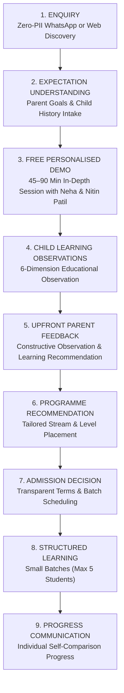

# AAA DIGITAL TRANSFORMATION — STAGE 2: WORKSTREAM 02 (WS-02)
# PREMIUM VALUE PROPOSITION & PARENT EXPERIENCE FRAMEWORK
**Project:** Arnav Abacus Academy (AAA), Wakad, Pune  
**Role:** Lead Business Analyst, Brand Strategy Consultant & Solution Architect  
**Governance Stage:** Stage 2 — Master Business Requirements Document (BRD) Workshop  
**Document Ref:** `docs/02_business_requirements/AAA_WS02_Premium_Value_Proposition.md`  
**Date:** November 02, 2026 (Final Quality Review & Consistency Reconciliation)  
**Status:** 🟢 **FINAL QUALITY REVISION COMPLETED — AWAITING FORMAL MANAGEMENT SIGN-OFF**  

---

## 1. Executive Summary & Value Narrative Shift

Conventional math tuitions compete on a transactional pitch: *"We cover syllabus exercises, teach shortcuts, and cost ₹X per month."* This invites price-shopping, high churn, and zero brand loyalty.

AAA establishes a **Transformation-Based Value Proposition** centered on what changes for the child and parent, rather than simply listing course syllabi. We lead with mathematical confidence, cognitive habits, and transparent parent communication, positioning tuition fees as a high-return cognitive investment.

---

## 2. Parent Problem vs. Desired Transformation Matrix `[PROPOSED STRATEGY]`

| # | Common Parent Struggle & Anxiety | Root Cognitive Cause | AAA Transformation Pathway | Observable Behavioral Shift in Child |
|---|---|---|---|---|
| **1** | **Finger Counting & Slow Speed:** Child counts on fingers for basic addition/subtraction; panics under time pressure. | Abstract numbers have no physical or visual reality in the child's mind. | **Soroban Bead Mechanics (Tactile Anchor):** Beads translate abstract digits into tangible spatial movements, transitioning to mental bead visualization. | Child calculates mentally with calm posture and visual number sense; fingers stay relaxed. |
| **2** | **"Silly" Calculation Slips:** Smart child understands concepts but loses marks due to arithmetic slips and messy scrap work. | Working memory overload: child attempts to hold intermediate numbers while writing complex multi-step problems. | **Working Memory Structuring (Vedic & Mental Math):** Decomposes calculations into systematic steps, mental scratchpads, and built-in verification checks. | Neat step-by-step presentation; systematic self-checking habits; arithmetic slips drop significantly. |
| **3** | **Math Hesitation & Exam Anxiety:** Child avoids math homework, claims "I hate math," and freezes during timed tests. | Negative emotional association formed by high-pressure rote drill repetition and early failure. | **The AAA Learning Model™ (Inspire & Explore Stages):** Low-stress gamified micro-drills, celebrating errors as learning steps, and small-batch reassurance. | Hesitation is replaced by curiosity; child approaches mathematical puzzles with interest and confidence. |
| **4** | **Short Attention Span & Distraction:** Child struggles to concentrate for more than 15 minutes; high screen fatigue and restlessness. | Undeveloped executive focus and lack of multi-sensory stimulation in passive school lectures. | **Multi-Sensory Mathematical Engagement:** Simultaneous visual scanning, auditory processing, and fine-motor tactile bead movement. | Child develops sustained concentration across 45–60 minute sessions, transferring focus to school studies. |
| **5** | **School Board Alignment Concerns:** Parent fears abacus methods will conflict with school board teachers demanding traditional steps. | Lack of conceptual grounding: child memorizes mechanical shortcuts without understanding base-10 logic. | **Integrated Conceptual Bridging:** AAA explicitly teaches school step-by-step presentation alongside mental speed verification checks. | Child excels in school exams by showing full formal steps, while using mental math to verify answers independently. |

---

## 3. The Nine Transformation Dimensions `[PROPOSED STRATEGY]`

In strict adherence to governance safeguards, **AAA does NOT promise guaranteed competitive ranks or claim unverified percentage jumps (e.g., "10x speed guaranteed in 30 days")**. Instead, we articulate value around nine observable, qualitative developmental dimensions:

1. **Mathematical Confidence:** Freedom from numerical fear; active participation in classroom discussions.
2. **Independent Thinking:** Solving word problems thoughtfully without immediately asking parents for answers.
3. **Sustained Attention & Focus:** Ability to maintain concentration through multi-step problem solving.
4. **Photographic Spatial Visualization:** Internally visualizing bead rods and number patterns without physical scrap paper.
5. **Working Memory Capacity:** Holding multi-digit intermediate values in mental storage with ease.
6. **Pattern Recognition:** Identifying arithmetic symmetries, base-10 complements, and Vedic shortcuts intuitively.
7. **Processing Accuracy & Speed:** Steady, unhurried execution that results in high-accuracy output.
8. **Problem-Solving Ability:** Approaching non-routine mathematical problems with patience and logical sequencing.
9. **Academic Discipline & Habits:** Establishing daily 10-minute micro-practice routines independently.

---

## 4. The Complete End-to-End Premium Parent Journey `[PROPOSED STRATEGY]`

A premium brand is defined by the integrity and consistency of every interaction across the parent lifecycle:

### 4.1 How This Differentiates AAA from Conventional Trial Classes
* **Conventional Trial Class:** The child is placed as an observer into a crowded, ongoing batch. The teacher pays minimal attention, and the parent is pressured with a generic sales pitch at the end.
* **AAA Personalised Demo:** 
  - **Dedicated Leadership Attention:** Conducted directly by Academic Director **Neha Patil** and **Nitin Patil** `[MANAGEMENT CONFIRMED]`.
  - **Generous Duration:** 45 minutes to 1.5 hours, calibrated to the child's interest, engagement, and learning passion `[MANAGEMENT CONFIRMED]`.
  - **Educational Focus:** Not a clinical test or high-pressure exam, but an interactive, encouraging exploration of how the child thinks.
  - **Immediate Parent Value:** Parents receive an upfront, evidence-based diagnostic consultation explaining how their child approaches numbers and where personalized support will unlock confidence.
  - **Completely Free:** Conducted as a free educational service without financial obligation `[MANAGEMENT CONFIRMED]`.

---

## 5. The Demo Assessment Framework (Educational Observations) `[MANAGEMENT CONFIRMED]`

During the demo session, Neha Patil and Nitin Patil observe the child across six qualitative educational dimensions:

### A. Number Sense
* Number recognition and familiarity.
* Understanding of quantities, magnitudes, and number relationships.
* Comfort and confidence when working with single and multi-digit values.
* Ability to identify numerical patterns and complements.

### B. Arithmetic Understanding
* Understanding of basic arithmetic operations (addition, subtraction, multiplication foundations).
* Ability to demonstrate operations using physical objects or beads.
* Conceptual understanding of *how* an answer is obtained, rather than rote formula regurgitation.
* Familiarity with mathematical concepts appropriate to the child's age and schooling exposure.

### C. Logical Approach
* How the child approaches an unfamiliar or non-routine problem.
* Whether the child attempts different strategies or freezes when stuck.
* Ability to follow a logical, step-by-step sequence.
* Ability to articulate and explain their thinking in their own words.

### D. Learning Attitude
* Willingness to participate actively in mathematical puzzles.
* Emotional response to mistakes, challenges, or unfamiliar tasks.
* Confidence in attempting new concepts without fear of being judged.
* Patience, persistence, and determination during problem decomposition.

### E. Response and Engagement
* Sustained attention and focus during interactive activities.
* Responsiveness to teacher instructions, gentle hints, and real-time feedback.
* Ability to engage comfortably and communicate with the educator.
* Willingness to explore, ask questions, and express curiosity.

### F. Interest and Learning Passion
* Natural curiosity toward numerical patterns.
* Enthusiasm and joy displayed during hands-on mathematical activities.
* Interest in learning faster or visual calculation methods.
* Willingness to continue exploring beyond the initial task.

> [!IMPORTANT]
> **Governance Safeguards for Demo Observations:**
> 1. These are **qualitative educational observations**, strictly avoiding clinical, psychiatric, or diagnostic medical claims.
> 2. Zero clinical labeling: Educators do not diagnose attention disorders (e.g., ADHD), dyslexia, or psychological conditions.
> 3. Zero overall "Child Intelligence Scores" or developmental rank numbers are generated.
> 4. The demo is never presented as a single-session definitive judgment of a child's lifelong intellectual capacity.

---

## 6. Post-Demo Upfront Parent Feedback Structure `[PROPOSED STRATEGY]`

Immediately following the demo, parents receive structured, constructive feedback formalized into the:

### **AAA Demo Observation & Learning Recommendation**
1. **Child & Session Details:** Child's name, age, schooling curriculum (CBSE/ICSE/State), and demo date/educators.
2. **Activities Demonstrated:** Specific Soroban bead mechanics, mental number puzzles, or Vedic patterns explored.
3. **Number Sense Observations:** What the child demonstrated regarding number recognition and quantity relationships.
4. **Arithmetic Understanding:** How the child grasped and executed basic operations.
5. **Logical Approach:** Problem-solving sequence, explanation clarity, and method exploration.
6. **Learning Attitude & Response:** Confidence, response to gentle guidance, and perseverance.
7. **Interest & Engagement:** Natural curiosity and enthusiasm observed during the session.
8. **Observed Strengths:** Concrete positive learning behaviors demonstrated by the child.
9. **Areas Where Learning Support May Be Useful:** Constructive identification of cognitive habits needing nurturing (e.g., transitioning from finger counting, organizing scrap work).
10. **Recommended Programme & Next Learning Step:** Clear recommendation of the appropriate stream (Abacus, Vedic, Mental, School, or Olympiad) and starting level.
11. **Educator Discussion:** Dialogue between Neha Patil/Nitin Patil and the parents answering specific questions and agreeing on learning goals.

### Crucial Feedback Distinctions:
The feedback sheet strictly and transparently separates four tiers of information:
- *What the child demonstrated:* Concrete tasks and problems attempted during the session.
- *What the educator observed:* Behavioral and cognitive engagement during problem solving.
- *What remains to be explored:* Areas requiring further observation during initial classroom sessions.
- *What is recommended:* Concrete next steps, stream placement, and practice pacing.

> **Tone Guideline:** Language must remain **evidence-based, encouraging, and constructive**. Strictly avoid labeling any child as "weak," "slow," "unintelligent," or "incapable."

---

## 7. Proposed Premium Service Name `[PROPOSED STRATEGY]`

To position this existing high-touch free experience appropriately in marketing copy, we evaluate:

### **"AAA Personalised Learning Discovery Session"**
* *Why it Works:* It highlights that the session is about **discovery and personalized understanding**, not a commercial sales demo or a stressful pass/fail test.
* *Governance Note:* Explicitly recognized as a premium brand positioning for the **existing free operating practice**, not a newly invented or paid service.

---

## 8. Summary of Open Decisions for Management

| Decision ID | Subject | Proposed Recommendation | Approval State |
|---|---|---|---|
| **DEC-WS02-04** | Value Narrative Shift | Center all marketing copy on the 5 Problem-Transformation pairs rather than raw course descriptions. | `[PROPOSED STRATEGY]` |
| **DEC-WS02-05** | Demo Name Evaluation | Formally adopt "AAA Personalised Learning Discovery Session" as the marketing name for the free demo. | `[PROPOSED STRATEGY]` |
| **DEC-WS02-06** | Demo Feedback Protocol | Ratify the 11-point "AAA Demo Observation & Learning Recommendation" parent feedback structure. | `[PROPOSED STRATEGY]` |
