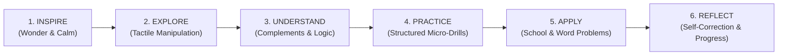

# AAA MASTER BRD — WORKSTREAM 04 (WS-04)
# LEARNING OUTCOMES & COMPETENCY FRAMEWORK
**Project:** Arnav Abacus Academy (AAA), Wakad, Pune  
**Role:** Lead Business Analyst, Academic Systems Architect & Child Development Framework Analyst  
**Governance Stage:** Stage 2 — Master Business Requirements Document (BRD) Workshop  
**Document Ref:** `docs/02_business_requirements/AAA_WS04_Learning_Outcomes_and_Competency_Framework.md`  
**Date:** November 02, 2026 (Final Quality-Controlled Baseline)  
**Status:** 🟡 **DOCUMENTATION QUALITY CONTROL COMPLETE — AWAITING MANAGEMENT VALIDATION**  

---

## 1. Executive Summary & Purpose

This document operationalizes the **AAA Learning Model™** and defines the **Twelve Core Mathematical Competencies** that govern curriculum delivery, lesson planning, and student progress tracking at Arnav Abacus Academy.

In alignment with AAA's prime educational philosophy:
> *"Mathematics is the medium; developing confident, independent and thoughtful learners is the mission."*

This framework ensures that teaching across all six offerings extends beyond mechanical calculation speed, cultivating durable cognitive habits, logical self-reliance, and mathematical confidence.

---

## 2. The AAA Learning Model™ (Six Structured Stages)

The AAA Learning Model™ is the pedagogical engine governing every classroom session:



> [!IMPORTANT]
> **Approved Philosophy vs. Implementation Consistency:**  
> While the AAA Learning Model™ is formally established as an institutional philosophy `[MANAGEMENT APPROVED]`, its day-to-day lesson plan consistency across batches and teachers is classified as `[PENDING VALIDATION]`. Structured lesson planning templates and educator training are required to ensure uniform delivery.

### Stage-by-Stage Pedagogical Breakdown:

| Stage # & Name | Teaching Purpose | Educator Activity | Student Activity | Evidence of Learning | Observable Outcome | Assessment Method |
|---|---|---|---|---|---|---|
| **1. INSPIRE** | Spark numerical curiosity, eliminate fear, and establish positive emotional safety. | Introduces a visual puzzle, intriguing pattern, or historical math riddle; establishes calm expectations. | Listens, observes, offers intuitive predictions without fear of error. | Relaxed facial affect, focused visual engagement, active participation. | Student expresses curiosity and willingness to attempt a new challenge. | Formative observation of student affect. |
| **2. EXPLORE** | Concrete tactile and visual exploration before formal rule introduction. | Demonstrates physical Soroban beads, dot patterns, or Vedic grids without imposing formulas. | Physically slides upper/lower beads, manipulates counters, or identifies geometric visual symmetries. | Tactile curiosity, exploring bead values, discovering number structures organically. | Student discovers that 5 can be represented with 1 upper bead on the Soroban. | Formative observation of physical tool manipulation. |
| **3. UNDERSTAND** | Conceptual mastery of mathematical logic, base-10 complements, and sutra rules. | Decomposes formulas explicitly (e.g., *Small Friend: `+4 = +5 - 1`*; *Vertically & Crosswise* grid logic). | Explains the "why" behind the bead move or Vedic sutra in their own words; demonstrates logic. | Accurate verbal articulation of complement or sutra rationale. | Student explains *why* the upper bead drops when adding 4 to 2 on the Soroban. | Socratic questioning; student-led step demonstration. |
| **4. PRACTICE** | Build motor memory, calculation accuracy, and working memory stamina through stress-free micro-drills. | Guides structured, bite-sized practice sets; monitors hand posture and bead technique in micro-batches (max 5). | Solves 10–20 targeted problems on physical instrument, moving progressively to Anzan mental visualization. | High first-attempt accuracy; smooth thumb/index bead flicks. | Reduction in pauses between rows; elimination of finger counting. | Timed micro-sprint sheets; accuracy-to-speed ratio tracking. |
| **5. APPLY** | Transfer mathematical agility to school exams, Olympiad word problems, and real-life estimation. | Presents multi-step school word problems, IPM puzzle decompositions, or board exam question formats. | Decomposes unfamiliar problems, selects appropriate technique, and computes answer. | Correct setup of non-routine problems; neat step presentation with rapid mental verification. | Student applies *Beejank* check to verify a 4-digit school multiplication problem independently. | Chapter mock tests; IPM/Olympiad past paper sections. |
| **6. REFLECT** | Internalize learning, celebrate self-improvement against prior baseline, and build meta-cognitive self-correction habits. | Facilitates error-log post-mortem; asks child to locate their own slips; awards milestone praise and certificates. | Audits own worksheet; identifies calculation slips without shame; records personal progress milestone. | Accurate self-diagnosis of calculation slips (e.g., "I forgot the carry-over bead on tens rod"). | Student views mistakes as informative feedback rather than personal failure. | Self-correction worksheets; educator-student reflection chat. |

---

## 3. The Twelve Core Mathematical Competencies

AAA evaluates student progress across 12 distinct mathematical competencies:

```
                          TWELVE MATHEMATICAL COMPETENCIES
  ┌─────────────────────────────────────┬─────────────────────────────────────┐
  │ FOUNDATIONAL NUMERACY (1–3)         │ COMPUTATIONAL FLUENCY (4–6)         │
  │ 1. Number Sense                     │ 4. Calculation Accuracy             │
  │ 2. Place Value Intuition            │ 5. Calculation Fluency & Speed      │
  │ 3. Arithmetic Conceptual Mastery    │ 6. Mental Calculation (Anzan/Mental)│
  ├─────────────────────────────────────┼─────────────────────────────────────┤
  │ HIGHER-ORDER REASONING (7–9)        │ META-COGNITIVE & DISPOSITIONAL(10–12│
  │ 7. Mathematical Reasoning           │ 10. Unfamiliar Problem Transfer     │
  │ 8. Pattern Recognition & Symmetry   │ 11. Mathematical Confidence         │
  │ 9. Logical Problem Decomposition    │ 12. Independent Learning & Resilience│
  └─────────────────────────────────────┴─────────────────────────────────────┘
```

### Competency Definitions & Observable Indicators:

1. **Number Sense:** Intuitive grasp of quantities, magnitudes, and number relationships. *Observable Indicator:* Child instantly recognizes numbers 1–9 on Soroban without counting individual beads.
2. **Place Value Intuition:** Deep understanding of base-10 structures across units, tens, hundreds, and thousands. *Observable Indicator:* Child smoothly navigates rod shifts on the abacus and grasps multi-digit decimal expansions.
3. **Arithmetic Conceptual Mastery:** Comprehension of addition, subtraction, multiplication, and division as complementary operations. *Observable Indicator:* Child understands division as repeated quotient subtraction and multiplication as repeated addition.
4. **Calculation Accuracy:** Ability to execute multi-step arithmetic operations with minimal mechanical slips. *Observable Indicator:* Consistently achieves high accuracy on practice worksheets under timed conditions.
5. **Calculation Fluency & Speed:** Effortless, unhesitating calculation velocity that frees cognitive working memory for higher-level problem decomposition. *Observable Indicator:* Completes direct addition rows within target time windows.
6. **Mental Calculation (Anzan & Mental Arithmetic):** Ability to compute multi-digit arithmetic purely internally through mental visualization or Vedic heuristics without external writing tools. *Observable Indicator:* Child visualizes internal Soroban rods and computes multi-digit sums with eyes closed.
7. **Mathematical Reasoning:** Capability to explain, justify, and prove mathematical relationships logically rather than reciting formulas. *Observable Indicator:* Child articulates why the *Nikhilam* base method works using base differences.
8. **Pattern Recognition & Symmetry:** Rapid identification of mathematical sequences, geometric symmetries, and numerical invariants. *Observable Indicator:* Instant recognition of square patterns, divisibility signatures, and arithmetic progressions in IPM problems.
9. **Logical Problem Decomposition:** Ability to break a complex, unfamiliar multi-step word problem into structured, solvable sequential parts. *Observable Indicator:* Deconstructs a lengthy Olympiad word problem into distinct given/to-find/method phases.
10. **Application to Unfamiliar Problems:** Transfer of learned calculation techniques to non-routine school tests, Olympiad logic puzzles, and daily life estimation. *Observable Indicator:* Child uses Vedic cross-multiplication to check their school exam paper independently.
11. **Mathematical Confidence:** Elimination of mathematics anxiety and avoidance behaviors; approaching math with pride and enthusiasm. *Observable Indicator:* Child volunteers to solve challenging problems on the classroom board without hesitation.
12. **Independent Learning & Resilience:** Persistence in the face of complex problems, self-directed daily micro-practice, and positive meta-cognitive self-correction. *Observable Indicator:* Child reviews a mistake, identifies the wrong bead move independently, and corrects it without educator prompting.

---

## 4. Programme-to-Competency Mapping Matrix

The matrix below maps the primary (`●`) and secondary (`○`) competency development across AAA's six offerings:

| Competency Dimension | 1. Soroban Abacus | 2. Vedic Maths | 3. Mental Maths | 4. School Maths | 5. IPM Prep | 6. Olympiad Maths |
|---|:---:|:---:|:---:|:---:|:---:|:---:|
| **1. Number Sense** | ● | ○ | ● | ● | ○ | ○ |
| **2. Place Value Intuition** | ● | ● | ● | ● | ○ | ○ |
| **3. Arithmetic Conceptual Mastery** | ● | ● | ● | ● | ● | ○ |
| **4. Calculation Accuracy** | ● | ● | ● | ● | ● | ● |
| **5. Calculation Fluency & Speed** | ● | ● | ● | ○ | ● | ● |
| **6. Mental Calculation (Anzan)** | ● | ● | ● | ○ | ● | ● |
| **7. Mathematical Reasoning** | ○ | ● | ○ | ● | ● | ● |
| **8. Pattern Recognition** | ● | ● | ● | ○ | ● | ● |
| **9. Logical Problem Decomposition** | ○ | ○ | ○ | ● | ● | ● |
| **10. Unfamiliar Problem Transfer** | ○ | ● | ○ | ● | ● | ● |
| **11. Mathematical Confidence** | ● | ● | ● | ● | ● | ● |
| **12. Independent Learning & Resilience** | ● | ● | ● | ● | ● | ● |

*Legend: ● = Primary Developmental Focus; ○ = Secondary Reinforcement Focus.*

---

## 5. Summary of Governance Status

* **AAA Learning Model™ Educational Philosophy:** `[MANAGEMENT APPROVED]`
* **Lesson Plan Consistency Across Batches:** `[PENDING VALIDATION]`
* **Twelve Core Mathematical Competencies Framework:** `[PROPOSED STRATEGY]`
* **Programme-to-Competency Mapping:** `[PROPOSED STRATEGY]`
