# AAA MASTER BRD — WORKSTREAM 04 (WS-04)
# MANAGEMENT ACTION & EVIDENCE TRACKER
**Project:** Arnav Abacus Academy (AAA), Wakad, Pune  
**Workstream:** WS-04 — Academic Programmes & Child Development  
**Role:** Lead Business Analyst, Academic Systems Architect & Security Governance Specialist  
**Governance Stage:** Stage 2 — Master Business Requirements Document (BRD) Workshop  
**Document Ref:** `docs/02_business_requirements/AAA_WS04_Management_Action_and_Evidence_Tracker.md`  
**Date:** November 02, 2026 (Ratified Edition)  
**Governance Status:** 🟢 **OPERATIONAL ACTION & EVIDENCE INSTRUMENT — WS-04 RATIFIED & CLOSED; ACTIONS CARRIED FORWARD**  

---

## 1. Executive Summary & Purpose

This tracker establishes a complete, bi-directional traceability instrument connecting:
1. **The Fourteen Strategic Decisions** (`DEC-WS04-01` to `DEC-WS04-14`).
2. **The Twenty-Nine Empirical Evidence Dependencies** (`EVD-ACAD-01..09`, `EVD-OPS-01..09`, `EVD-SEC-01..11`).
3. **The Prioritised Pending Action Plan** (`ACT-WS04-01` to `ACT-WS04-29`).

It resolves all previous weak mappings, separates Stage 2 governance gates from configurable Stage 3 requirements, and provides Neha Patil and Nitin Patil with an actionable, transparent roadmap for evidence collection and operational execution.

### Mandatory Governance Rules:
* All designated owners are marked as **`[PROPOSED]`** pending formal management confirmation.
* Actions are not marked completed until verifiable documentary evidence is produced and verified.
* No application code, database schema, or live configuration changes are authorized by this document.

---

## 2. Evidence-to-Decision-to-Action Traceability Matrix (All 29 Items)

Every empirical evidence item is mapped with full accountability, distinguishing verifiable facts from unverified claims:

### 2.1 Academic Curriculum & Pedagogical Evidence (9 Items)

| Evidence ID | What Must Be Established | Existing Source / Evidence Available | What Remains Unverified | Exact Deliverable Required | Related Decisions | Related Action ID | Accountable Owner | Dependency | Milestone Category | Current Status & Acceptance Criteria |
|---|---|---|---|---|---|---|---|---|---|---|
| **EVD-ACAD-01** | Alignment of 14 Abacus software modules to physical workbooks | 14 module drill sets in `src/data/practiceData.ts:9-1400` | Chapter-by-chapter mapping to physical workbooks; transition from Junior to Senior | Physical Workbook Crosswalk Matrix | DEC-WS04-03 | `ACT-WS04-01` | Neha Patil [PROPOSED] | Physical workbook access | Stage 2 Prerequisite | **Pending Audit:** Accepted when every module is mapped to physical book chapters. |
| **EVD-ACAD-02** | Documentary syllabus for 8-level Abacus academic curriculum | Historical management oral reference to 8 levels (~3 mo/level) | Written curriculum document defining prerequisites, tools, and competencies per level | Formal 8-Level Abacus Syllabus Document | DEC-WS04-03 | `ACT-WS04-01` | Neha Patil [PROPOSED] | Workbook audit | Stage 3 Input | **Pending Validation:** Accepted upon delivery of 8-level written syllabus. |
| **EVD-ACAD-03** | Vedic Mathematics modular syllabus and 8 practice suite mapping | 8 practice suites (`JVM-1`, `SVM-0..6`) in `practiceData.ts:1401+` | Academic semester grouping, sutra sequence, and school grade alignment | Vedic Modular Syllabus & Suite Crosswalk | DEC-WS04-03 | `ACT-WS04-20` | Neha Patil [PROPOSED] | Syllabus review | Stage 3 Input | **Pending Audit:** Accepted when 8 suites are mapped to modular course units. |
| **EVD-ACAD-04** | Empirical validation of student entry age and school grade boundaries | Age strings in `data.ts:13,35,57,79,101` and page files | Historical age distribution of successful students; diagnostic exception rules | Reconciled Eligibility & Grade Boundary Matrix | DEC-WS04-02 | `ACT-WS04-22` | Neha Patil [PROPOSED] | Intake log review | Stage 2 Prerequisite | **Reconciled Proposal:** Accepted upon sign-off on 4.5–9 Abacus & 9–14 Vedic boundaries. |
| **EVD-ACAD-05** | Voluntary classification and annual calendar for IPM and Olympiads | Competition pages in codebase (`ProgramIPM.tsx`, `ProgramOlympiad.tsx`) | Formal institutional policy confirming voluntary status; annual exam dates | IPM/Olympiad Annual Calendar & Track Charter | DEC-WS04-09 | `ACT-WS04-23` | Neha Patil [PROPOSED] | Academic review | Stage 2 Prerequisite | **Proposed Strategy:** Accepted when annual competition dates and voluntary policy are signed. |
| **EVD-ACAD-06** | Observational rubrics for Twelve Core Mathematical Competencies | 12 competencies defined in `AAA_WS04_Learning_Outcomes_and_Competency_Framework.md` | Educator observation log format; age calibration across primary/middle tiers | Competency Observation Rubric & Pilot Log | DEC-WS04-05 | `ACT-WS04-28` | Neha Patil [PROPOSED] | Competency matrix | Pre-Implementation | **Proposed Strategy:** Accepted upon educator pilot validation in 2 sample batches. |
| **EVD-ACAD-07** | Level evaluation paper blueprints, passing marks, and Form A/B papers | 70%/80% working proposals in software | Validated passing thresholds; weighted section blueprint (tool/mental/dictation) | Level 1 Evaluation Papers (Form A/B) & Scoring Key | DEC-WS04-07 | `ACT-WS04-10` | Neha Patil [PROPOSED] | Blueprint design | Pre-Implementation | **Working Proposal:** Accepted when sample Form A/B papers are authored and reviewed. |
| **EVD-ACAD-08** | Programme-specific daily micro-practice guidelines (10–15 mins/day) | International Soroban practice literature | Formal 1-page parent guides customized by programme; guidance for missed days | 1-Page Parent Practice Guide (By Programme) | DEC-WS04-12 | `ACT-WS04-12` | Neha Patil [PROPOSED] | Pedagogy review | Pre-Implementation | **Proposed Strategy:** Accepted when 1-page parent guidelines are published for onboarding. |
| **EVD-ACAD-09** | Educator academic moderation and grading consistency protocols | Single-founder oversight by Neha Patil | Peer review checklist ensuring uniform evaluation across future mentors | Educator Academic Moderation Protocol | DEC-WS04-11 | `ACT-WS04-21` | Neha Patil [PROPOSED] | Educator manual | Pre-Implementation | **Pending Documentation:** Accepted when written moderation checklist is approved. |

---

### 2.2 Business, Facility & Operational Feasibility Evidence (9 Items)

| Evidence ID | What Must Be Established | Existing Source / Evidence Available | What Remains Unverified | Exact Deliverable Required | Related Decisions | Related Action ID | Accountable Owner | Dependency | Milestone Category | Current Status & Acceptance Criteria |
|---|---|---|---|---|---|---|---|---|---|---|
| **EVD-OPS-01** | Exact active paying student census and enrolment distribution | Management estimate (>87 active paying students) | Exact verified nominal roll of paying students across all batches | Audited Active Student Census Roll | DEC-WS01-01, DEC-WS04-08 | `ACT-WS04-03` | Nitin Patil [PROPOSED] | Fee registers | Stage 2 Prerequisite | **Pending Census Audit:** Accepted upon nominal list reconciliation with fee collection. |
| **EVD-OPS-02** | Master weekly batch timetable and batch fill rates | Management estimate (>14 active weekly batches) | Detailed schedule slots, days of week, and student count per batch | Master Weekly Batch Timetable & Fill Audit | DEC-WS01-01, DEC-WS04-11 | `ACT-WS04-03` | Nitin Patil [PROPOSED] | Schedule sheets | Stage 2 Prerequisite | **Pending Timetable Audit:** Accepted when weekly batch timetable verifies ≤5 students/batch. |
| **EVD-OPS-03** | Room dimensions, seating capacity, partitions, and acoustic boundaries | Address attribution: Balaji Sagar Bungalow, Wakad | Room count, usable table seating, acoustic partitions, simultaneous batch cap | Facility Room & Seating Capacity Audit Report | DEC-WS04-01, DEC-WS04-11 | `ACT-WS04-08` | Nitin Patil [PROPOSED] | Physical inspection | Stage 2 Prerequisite | **Pending Facility Audit:** Accepted upon physical floorplan audit confirming max concurrent capacity. |
| **EVD-OPS-04** | Master published fee schedule across all 6 offerings | Indicative fee ranges in marketing copy | Official monthly tuition, registration, and competition coaching fees | Official Published Master Fee Schedule | DEC-WS01-03, DEC-WS04-09 | `ACT-WS04-09` | Nitin Patil [PROPOSED] | Pricing review | Stage 2 Prerequisite | **Pending Finalization:** Accepted when unified fee card is signed off by management. |
| **EVD-OPS-05** | Pricing schedule for physical Soroban tools, workbooks, and kits | Historical kit distribution practice | Itemized replacement and initial enrollment kit price list | Student Kit & Material Price Schedule | DEC-WS01-03 | `ACT-WS04-09` | Nitin Patil [PROPOSED] | Inventory cost | Stage 2 Prerequisite | **Pending Price Schedule:** Accepted when itemized kit price list is published. |
| **EVD-OPS-06** | Standard session duration and weekly frequency by programme | Informal classroom delivery practice | Formal operational matrix codifying session hours (60 vs 90 min) by level | Session Duration & Weekly Frequency Matrix | DEC-WS04-01, DEC-WS04-02 | `ACT-WS04-24` | Neha Patil [PROPOSED] | Timetable review | Stage 2 Prerequisite | **Pending Operational Matrix:** Accepted when timetable codifies hours across all 6 streams. |
| **EVD-OPS-07** | Weekly educator teaching roster, availability, and workload | Neha Patil as lead educator; assistant mentors mentioned | Teaching hours per week per mentor; capacity to deliver 6 streams | Educator Staffing Roster & Workload Analysis | DEC-WS04-01, DEC-WS04-11 | `ACT-WS04-25` | Neha Patil & Nitin Patil [PROPOSED] | Mentor agreements | Stage 2 Prerequisite | **Pending Roster Audit:** Accepted when weekly educator teaching roster is approved. |
| **EVD-OPS-08** | Official operating hours for parent phone and messaging communication | Informal pickup and phone communication | Defined operational hours testing 2-hour pilot response standard | Parent Communication Operating Policy | DEC-WS03-03 | `ACT-WS04-03` | Nitin Patil [PROPOSED] | Pilot results | Stage 2 Prerequisite | **Pilot Proposal:** Accepted upon publishing operating hours for parent inquiries. |
| **EVD-OPS-09** | Time-budget feasibility of founder hours for bi-monthly parent reporting | Proposed bi-monthly review model in WS-03/WS-04 | Dedicated hours allocated per student every 2 months (87+ students) | Bi-Monthly Consultation Time-Budget Schedule | DEC-WS04-08 | `ACT-WS04-13` | Neha Patil [PROPOSED] | Census audit | Stage 3 Input | **Proposed Strategy:** Accepted when consultation calendar confirms teaching time is safe. |

---

### 2.3 Security, Privacy & Certificate Governance Evidence (11 Items)

| Evidence ID | What Must Be Established | Existing Source / Evidence Available | What Remains Unverified | Exact Deliverable Required | Related Decisions | Related Action ID | Accountable Owner | Dependency | Milestone Category | Current Status & Acceptance Criteria |
|---|---|---|---|---|---|---|---|---|---|---|
| **EVD-SEC-01** | Technical access controls of public cloud storage provider | Hardcoded URL string in `src/lib/cloudSync.ts:27` | Remote provider authentication, private key enforcement, and API restrictions | Third-Party Cloud Endpoint Assessment Brief | DEC-WS04-10, DEC-WS04-14 | `ACT-WS04-05` | Solution Architect [PROPOSED] | Vendor technical documentation | Stage 3 Requirements Input | **Source Logic Identified:** Accepted upon provider security specification review. |
| **EVD-SEC-02** | Actual production usage of cloud storage endpoint | Source-code request construction logic | Confirmation of whether live student records are actively transmitted | Production Cloud-Sync Status Memorandum | DEC-WS04-10, DEC-WS04-14 | `ACT-WS04-05` | Nitin Patil [PROPOSED] | Runtime review | Stage 3 Requirements Input | **Production Use Unverified:** Accepted when management confirms active sync status. |
| **EVD-SEC-03** | Segregation and expiry rules for guest practice telemetry | Guest flag in `localStorage` (`GuestSampleGatewayModal.tsx`) | Segregation of guest data from enrolled student records in storage | Guest Telemetry Segregation Specification | DEC-WS04-10, DEC-WS04-13 | `ACT-WS04-17` | Solution Architect [PROPOSED] | Architecture review | Stage 3 Requirements Input | **Control Not Found:** Accepted upon Stage 3 data segregation specification. |
| **EVD-SEC-04** | Client cache clearing, session timeout, and post-logout behavior | Plaintext storage identified in `localStorage` | Cache clearing on logout; session expiration controls | Browser Storage Security & Cache Policy Spec | DEC-WS04-10, GAP-01 | `ACT-WS04-16` | Solution Architect [PROPOSED] | Codebase audit | Stage 3 Requirements Input | **Verified in Source Code:** Accepted upon Stage 3 browser storage security specification. |
| **EVD-SEC-05** | Legal compliance review of parental consent notices for digital telemetry | General lead form disclaimer on website | Specific opt-in consent for minor child practice logging (DPDP alignment) | Parental Consent Notice & Consent Log Spec | DEC-WS04-14, GAP-04 | `ACT-WS04-07` | Legal Counsel & Nitin Patil [PROPOSED] | DPDP guidelines | Legal / External Review | **Compliance Review Needed:** Accepted upon legal sign-off on consent form language. |
| **EVD-SEC-06** | Documented administrative SOP for parent data access, correction, and deletion | Informal verbal requests | Standard operating procedure for fulfilling parent statutory data rights | Parent Data Rights SOP (Access/Correction/Deletion) | DEC-WS04-14, GAP-07 | `ACT-WS04-11` | Nitin Patil & Legal [PROPOSED] | Legal review | Pre-Implementation | **Compliance Review Needed:** Accepted upon formal SOP adoption for data rights. |
| **EVD-SEC-07** | Documented data retention, archival, and automated cleanup policy | Indefinite retention in code and storage | Automated purging rules, archival timelines, and data minimization policy | Institutional Data Retention & Purging Policy | DEC-WS04-14, GAP-05 | `ACT-WS04-26` | Management / Legal [PROPOSED] | Compliance review | Stage 3 Requirements Input | **Policy Pending:** Accepted upon executive approval of data retention schedule. |
| **EVD-SEC-08** | Append-only administrative audit trail specifications | Client-side admin checks in `accessControl.ts` | Server-side tamper-resistant logging of admin permission changes | Administrative Audit Logging Architecture Spec | DEC-WS04-10 | `ACT-WS04-18` | Solution Architect [PROPOSED] | Architecture review | Stage 3 Requirements Input | **Control Not Found:** Accepted upon Stage 3 audit trail specification. |
| **EVD-SEC-09** | Written board resolution delegating digital signature asset usage | Digitized signatures in web assets (`certificateGenerator.ts`) | Formal authorization document authorising digital signature reproduction | Board Signature Authorization Resolution | DEC-WS04-07, CERT-01 | `ACT-WS04-15` | Neha Patil [PROPOSED] | Corporate records | Stage 3 Requirements Input | **Asset Verified in Code:** Accepted upon written director signature delegation memo. |
| **EVD-SEC-10** | Archival evidence supporting external accreditation wording | Header citing *"INTERNATIONAL ABACUS... ACCREDITATION"* | Documentary affiliation agreements or accreditation certificates | External Affiliation & Accreditation Dossier | DEC-WS04-07 | `ACT-WS04-27` | Neha Patil [PROPOSED] | Institutional files | Legal / External Review | **Pending Verification:** Accepted when verified affiliation certificates are attached. |
| **EVD-SEC-11** | End-to-end data migration, integrity verification, and rollback plan | Legacy flat attempts in localStorage and blob | Detailed migration scripts, schema validation, and rollback procedures | Data Migration, Verification & Rollback Plan | DEC-WS04-10, DEC-WS04-14 | `ACT-WS04-19` | Solution Architect [PROPOSED] | Architecture design | Pre-Implementation | **Strategy Required:** Accepted upon Stage 4 engineering review of rollback scripts. |

---

## 3. Prioritised Pending Action Register (ACT-WS04-01 to ACT-WS04-29)

Actions are organized into three sequential execution tiers. Crucially, Priority 1 actions establish operating facts, but do **not** freeze all Stage 3 work; configurable requirements can proceed in parallel:

```mermaid
flowchart TD
    subgraph P1 ["Priority 1: Current Operating Reality (Immediate Prerequisites)"]
        A1["ACT-WS04-01: Abacus Workbook Crosswalk"]
        A2["ACT-WS04-02: Credential Verification (VER-01)"]
        A3["ACT-WS04-03: Active Census & Schedule Audit"]
        A8["ACT-WS04-08: Facility Room Capacity Audit"]
        A9["ACT-WS04-09: Master Fee Card & Kit Prices"]
        A20["ACT-WS04-20: Vedic Syllabus Mapping"]
        A24["ACT-WS04-24: Session Duration Matrix"]
        A25["ACT-WS04-25: Educator Staffing Roster"]
        A27["ACT-WS04-27: Affiliation Dossier"]
    end

    subgraph P2 ["Priority 2: Academic & Parent Validation (Pilots & Blueprints)"]
        A4["ACT-WS04-04: Lesson Plan Pilot"]
        A10["ACT-WS04-10: Level Evaluation Papers"]
        A12["ACT-WS04-12: Home Practice Guide"]
        A13["ACT-WS04-13: Consultation Schedule"]
        A21["ACT-WS04-21: Educator Moderation Protocol"]
        A22["ACT-WS04-22: Eligibility Reconciliation Matrix"]
        A23["ACT-WS04-23: Competition Calendar Charter"]
        A28["ACT-WS04-28: Competencies Observation Pilot"]
        A29["ACT-WS04-29: Child Dev Reporting Guide"]
    end

    subgraph P3 ["Priority 3: AcademyOS, Privacy & Certificates (Stage 3/4 Specs)"]
        A5["ACT-WS04-05: Cloud Sync Options Brief"]
        A6["ACT-WS04-06: Practice Certificate Re-Label"]
        A7["ACT-WS04-07: Consent Notice & Log Spec"]
        A11["ACT-WS04-11: Parent Data Rights SOP"]
        A14["ACT-WS04-14: Relational Schema Spec"]
        A15["ACT-WS04-15: Certificate Ledger Spec"]
        A16["ACT-WS04-16: Browser Storage Policy"]
        A17["ACT-WS04-17: Guest Data Segregation Spec"]
        A18["ACT-WS04-18: Audit Logging Spec"]
        A19["ACT-WS04-19: Migration & Rollback Plan"]
        A26["ACT-WS04-26: Data Retention Policy"]
    end

    P1 -.-> P2
    P2 -.-> P3
```

---

### Priority 1: Current Operating Reality (Immediate Prerequisites)

#### ACT-WS04-01: Physical Abacus Workbook Inventory & 14-Module Crosswalk
* **Business Reason:** Prevents curriculum confusion by verifying how the 14 digital modules align with physical student workbooks.
* **Specific Task:** Audit printed workbook series; map chapter exercises to digital modules `JR-0` to `SR-10`; define 8 academic level boundaries.
* **Expected Deliverable:** `Abacus_Physical_Workbook_and_Module_Crosswalk_Matrix.pdf`.
* **Acceptance Criteria:** Every digital module has a documented physical workbook equivalent signed by Neha Patil.
* **Proposed Owner:** Neha Patil [PROPOSED] | **Required Support:** Nitin Patil.
* **Dependencies:** Physical access to academy workbook stocks | **Target Milestone:** Stage 2 Management Prerequisite.
* **Status:** Pending Workshop | **Related IDs:** `DEC-WS04-03`, `EVD-ACAD-01`, `EVD-ACAD-02`.
* **Management Approval Required Before Execution:** No (Operational Audit).

#### ACT-WS04-02: Neha Patil Degree & Professional Trainer Credential Archive (VER-01)
* **Business Reason:** Satisfies `AGENTS.md` Rule 6 (*No Fabricated Credentials*) before marketing copy is published.
* **Specific Task:** Secure physical degree certificates for MCA, Certified Vedic Educator, and Certified Soroban Trainer; produce certified archival scans.
* **Expected Deliverable:** `AAA_VER01_Documentary_Credential_Dossier.pdf`.
* **Acceptance Criteria:** High-resolution scans archived in internal verification registry; public claims verified.
* **Proposed Owner:** Neha Patil [PROPOSED] | **Required Support:** Nitin Patil.
* **Dependencies:** Physical certificate archive access | **Target Milestone:** Prior to Stage 3 Public Copy.
* **Status:** Pending Workshop | **Related IDs:** `DEC-WS02-01`, `VER-01`.
* **Management Approval Required Before Execution:** No (Administrative).

#### ACT-WS04-03: Verified Active Student Census & Enrolment Roll
* **Business Reason:** Establishes commercial baseline, validates >87 student threshold, and prevents revenue modeling on estimates.
* **Specific Task:** Perform nominal roll audit matching active student names against monthly fee collection receipts; record batch assignments.
* **Expected Deliverable:** `AAA_Active_Student_Census_and_Batch_Distribution_Roll.xlsx`.
* **Acceptance Criteria:** 100% reconciliation between student attendance rolls and fee receipts.
* **Proposed Owner:** Nitin Patil [PROPOSED] | **Required Support:** Neha Patil.
* **Dependencies:** Fee collection registers | **Target Milestone:** Stage 2 Management Prerequisite.
* **Status:** Pending Workshop | **Related IDs:** `DEC-WS01-01`, `EVD-OPS-01`, `EVD-OPS-02`.
* **Management Approval Required Before Execution:** No (Operational Audit).

#### ACT-WS04-08: Physical Facility Audit: Room Partitions, Usable Seating & Acoustic Feasibility
* **Business Reason:** Prevents over-enrolling batches beyond physical premises capacity at Balaji Sagar Bungalow.
* **Specific Task:** Inspect Flat No. 3 premises; measure usable square footage, table/chair seating capacity per room, partition acoustics, and simultaneous batch limit.
* **Expected Deliverable:** `AAA_Premises_Facility_Capacity_Audit_Report.pdf`.
* **Acceptance Criteria:** Signed facility capacity sheet defining maximum simultaneous batches and seating capacity.
* **Proposed Owner:** Nitin Patil [PROPOSED] | **Required Support:** Facility landlord/records.
* **Dependencies:** Premises inspection | **Target Milestone:** Stage 2 Management Prerequisite.
* **Status:** Pending Workshop | **Related IDs:** `DEC-WS04-01`, `DEC-WS04-11`, `EVD-OPS-03`.
* **Management Approval Required Before Execution:** No (Physical Inspection).

#### ACT-WS04-09: Master Tuition Fee Card, Kit Pricing & Registration Schedule
* **Business Reason:** Eliminates pricing ambiguity and publishes transparent fee cards for all 6 offerings.
* **Specific Task:** Document monthly tuition, registration kits, workbook replacements, and competition coaching fees.
* **Expected Deliverable:** `AAA_Master_Published_Fee_Schedule_2026.pdf`.
* **Acceptance Criteria:** Management-approved fee schedule covering all courses and surcharges.
* **Proposed Owner:** Nitin Patil [PROPOSED] | **Required Support:** Neha Patil.
* **Dependencies:** Cost of materials review | **Target Milestone:** Stage 2 Management Prerequisite.
* **Status:** Pending Workshop | **Related IDs:** `DEC-WS01-03`, `DEC-WS04-09`, `EVD-OPS-04`, `EVD-OPS-05`.
* **Management Approval Required Before Execution:** Yes (Executive Sign-Off).

#### ACT-WS04-20: Vedic Mathematics Modular Syllabus & Practice Suite Mapping Matrix
* **Business Reason:** Reconciles 8 Vedic software suites (`JVM-1`, `SVM-0..6`) into structured classroom course units.
* **Specific Task:** Map Vedic software topics to school grade levels (Class 5–10) and define topic modularization.
* **Expected Deliverable:** `Vedic_Modular_Syllabus_and_Suite_Crosswalk.pdf`.
* **Acceptance Criteria:** All 8 Vedic suites mapped to classroom semester topics.
* **Proposed Owner:** Neha Patil [PROPOSED] | **Required Support:** Solution Architect.
* **Dependencies:** `practiceData.ts` inspection | **Target Milestone:** Stage 3 Input.
* **Status:** Pending Workshop | **Related IDs:** `DEC-WS04-03`, `EVD-ACAD-03`.
* **Management Approval Required Before Execution:** No (Curriculum Mapping).

#### ACT-WS04-24: Programme-Wise Session Duration & Weekly Frequency Matrix
* **Business Reason:** Resolves operational contradictions regarding session length (60 vs 90 min) and weekly frequency.
* **Specific Task:** Codify session duration, days per week, and total teaching hours across all 6 streams.
* **Expected Deliverable:** `AAA_Programme_Session_Duration_and_Frequency_Matrix.pdf`.
* **Acceptance Criteria:** Matrix approved by Academic Director and aligned with timetable.
* **Proposed Owner:** Neha Patil [PROPOSED] | **Required Support:** Nitin Patil.
* **Dependencies:** Timetable audit | **Target Milestone:** Stage 2 Management Prerequisite.
* **Status:** Pending Workshop | **Related IDs:** `DEC-WS04-01`, `DEC-WS04-02`, `EVD-OPS-06`.
* **Management Approval Required Before Execution:** Yes (Executive Sign-Off).

#### ACT-WS04-25: Educator Staffing Roster, Availability & Teaching Workload Audit
* **Business Reason:** Validates whether existing educator staffing can sustain 6 programmes under a 5-student batch ceiling.
* **Specific Task:** Calculate total weekly teaching hours required; audit Neha Patil's teaching bandwidth and assistant educator availability.
* **Expected Deliverable:** `AAA_Educator_Staffing_Roster_and_Capacity_Analysis.pdf`.
* **Acceptance Criteria:** Workload model demonstrating teaching hours do not exceed safe sustainable limits.
* **Proposed Owner:** Neha Patil & Nitin Patil [PROPOSED] | **Required Support:** Assistant mentors.
* **Dependencies:** Census audit | **Target Milestone:** Stage 2 Management Prerequisite.
* **Status:** Pending Workshop | **Related IDs:** `DEC-WS04-01`, `DEC-WS04-11`, `EVD-OPS-07`.
* **Management Approval Required Before Execution:** Yes (Executive Sign-Off).

#### ACT-WS04-27: Institutional Affiliation & External Accreditation Evidence Dossier
* **Business Reason:** Verifies external accreditation claims (*"INTERNATIONAL ABACUS & SPEED MATH OLYMPIAD ACCREDITATION"*).
* **Specific Task:** Collate archival affiliation certificates or agreements supporting accreditation claims.
* **Expected Deliverable:** `AAA_External_Accreditation_Evidence_Dossier.pdf`.
* **Acceptance Criteria:** Affiliation status verified or copy revised to reflect independent academy status.
* **Proposed Owner:** Neha Patil [PROPOSED] | **Required Support:** Legal Counsel.
* **Dependencies:** Archival records | **Target Milestone:** Prior to Stage 3 Public Copy.
* **Status:** Pending Workshop | **Related IDs:** `DEC-WS04-07`, `EVD-SEC-10`.
* **Management Approval Required Before Execution:** No (Documentary Collation).

---

### Priority 2: Academic & Parent Validation (Pilots & Blueprints)

#### ACT-WS04-04: Master 1-Page Lesson Plan Pilot Templates (The AAA Learning Model™)
* **Business Reason:** Operationalizes the 6-stage model (*Inspire → Explore → Understand → Practice → Apply → Reflect*) across batches.
* **Specific Task:** Author 1-page lesson plan templates for Junior Abacus, Senior Abacus, and Vedic Maths; pilot in 2 batches.
* **Expected Deliverable:** `AAA_Master_1Page_Lesson_Plan_Pilot_Templates.pdf`.
* **Acceptance Criteria:** 2-week pilot completed and signed off by Neha Patil.
* **Proposed Owner:** Neha Patil [PROPOSED] | **Required Support:** Assistant educators.
* **Dependencies:** Pedagogical review | **Target Milestone:** Pre-Implementation.
* **Status:** Pending Workshop | **Related IDs:** `DEC-WS04-04`, `EVD-ACAD-06`.
* **Management Approval Required Before Execution:** Yes (Pilot Authorization).

#### ACT-WS04-10: Level 1 Summative Assessment Paper & Blueprint Design (Form A/B)
* **Business Reason:** Establishes objective passing benchmarks before awarding academic completion certificates.
* **Specific Task:** Draft Level 1 Form A and Form B evaluation papers, section weighting blueprints, and scoring keys.
* **Expected Deliverable:** `AAA_Abacus_Level1_Evaluation_FormA_FormB.pdf`.
* **Acceptance Criteria:** Evaluation papers reviewed and calibrated against physical syllabus.
* **Proposed Owner:** Neha Patil [PROPOSED] | **Required Support:** Examination board.
* **Dependencies:** Workbook crosswalk | **Target Milestone:** Pre-Implementation.
* **Status:** Pending Workshop | **Related IDs:** `DEC-WS04-07`, `EVD-ACAD-07`.
* **Management Approval Required Before Execution:** Yes (Academic Director Sign-Off).

#### ACT-WS04-12: Programme-Specific Calm Home Practice Pilot Guidelines
* **Business Reason:** Eliminates parent-child homework battles while nurturing daily arithmetic neuroplasticity (10–15 mins/day).
* **Specific Task:** Author 1-page parent guides customized by programme; pilot with 10 parent volunteers.
* **Expected Deliverable:** `Calm_Home_Practice_Guide_for_Parents_Pilot.pdf`.
* **Acceptance Criteria:** 10 parent feedback surveys collected; zero homework tears reported.
* **Proposed Owner:** Neha Patil [PROPOSED] | **Required Support:** Parent volunteers.
* **Dependencies:** DEC-WS04-12 review | **Target Milestone:** Pre-Implementation.
* **Status:** Pending Workshop | **Related IDs:** `DEC-WS04-12`, `EVD-ACAD-08`.
* **Management Approval Required Before Execution:** Yes (Executive Sign-Off).

#### ACT-WS04-13: Bi-Monthly Parent Progress Reporting Workload Analysis & Pilot Calendar
* **Business Reason:** Ensures 10-minute progress chats across 87+ students do not overburden founder teaching hours.
* **Specific Task:** Draft bi-monthly consultation calendar; create 1-page qualitative report card format; pilot in 1 batch.
* **Expected Deliverable:** `BiMonthly_Parent_Reporting_Calendar_and_Template.pdf`.
* **Acceptance Criteria:** Workload model confirms consultation time fits within designated operating hours.
* **Proposed Owner:** Neha Patil & Nitin Patil [PROPOSED] | **Required Support:** Operations.
* **Dependencies:** Census audit | **Target Milestone:** Pre-Implementation.
* **Status:** Pending Workshop | **Related IDs:** `DEC-WS04-08`, `EVD-OPS-09`.
* **Management Approval Required Before Execution:** Yes (Executive Sign-Off).

#### ACT-WS04-21: Educator Classroom Observation QA & Moderation Protocol
* **Business Reason:** Ensures consistent grading and developmental observation across multiple teachers.
* **Specific Task:** Formulate written checklist for peer review and grading moderation during evaluations.
* **Expected Deliverable:** `AAA_Educator_Quality_Assurance_Protocol.pdf`.
* **Acceptance Criteria:** Moderation protocol signed off by Neha Patil.
* **Proposed Owner:** Neha Patil [PROPOSED] | **Required Support:** Assistant mentors.
* **Dependencies:** Educator manual | **Target Milestone:** Pre-Implementation.
* **Status:** Pending Workshop | **Related IDs:** `DEC-WS04-11`, `EVD-ACAD-09`.
* **Management Approval Required Before Execution:** Yes (Academic Director Sign-Off).

#### ACT-WS04-22: Programme Eligibility & Grade Boundary Reconciliation Matrix
* **Business Reason:** Eliminates overlapping marketing claims and resolves the 9-year crossover between Abacus and Vedic Maths.
* **Specific Task:** Document entry age, prerequisite school grade, and diagnostic evaluation criteria across all 6 offerings.
* **Expected Deliverable:** `AAA_Reconciled_Programme_Eligibility_Matrix.pdf`.
* **Acceptance Criteria:** Unanimous sign-off on age boundaries and diagnostic crossover rules.
* **Proposed Owner:** Neha Patil [PROPOSED] | **Required Support:** Nitin Patil.
* **Dependencies:** Intake review | **Target Milestone:** Stage 2 Management Prerequisite.
* **Status:** Reconciled Proposal | **Related IDs:** `DEC-WS04-02`, `EVD-ACAD-04`.
* **Management Approval Required Before Execution:** Yes (Executive Sign-Off).

#### ACT-WS04-23: IPM & Olympiad Annual Competition Calendar & Track Charter
* **Business Reason:** Codifies voluntary enrichment status, exam schedules, and separate billing for competitive tracks.
* **Specific Task:** Collate annual dates for IPM, SOF IMO, and SilverZone; draft voluntary student registration charter.
* **Expected Deliverable:** `AAA_IPM_Olympiad_Track_Charter_and_Calendar.pdf`.
* **Acceptance Criteria:** Charter confirms voluntary participation and separate fee cards.
* **Proposed Owner:** Neha Patil [PROPOSED] | **Required Support:** Nitin Patil.
* **Dependencies:** Competition schedules | **Target Milestone:** Stage 2 Management Prerequisite.
* **Status:** Proposed Strategy | **Related IDs:** `DEC-WS04-09`, `EVD-ACAD-05`.
* **Management Approval Required Before Execution:** Yes (Executive Sign-Off).

#### ACT-WS04-28: Mathematical Competencies Observation Rubric & Age-Suitability Pilot
* **Business Reason:** Translates 12 competencies into observable classroom behaviors without excessive teacher paperwork.
* **Specific Task:** Design bite-sized observation checkboxes; test age-suitability in primary vs secondary batches.
* **Expected Deliverable:** `AAA_Competencies_Observation_Rubric_and_Pilot_Sheet.pdf`.
* **Acceptance Criteria:** Completed pilot observation sheets from 2 sample batches.
* **Proposed Owner:** Neha Patil [PROPOSED] | **Required Support:** Solution Architect.
* **Dependencies:** DEC-WS04-05 review | **Target Milestone:** Pre-Implementation.
* **Status:** Proposed Strategy | **Related IDs:** `DEC-WS04-05`, `EVD-ACAD-06`.
* **Management Approval Required Before Execution:** Yes (Pilot Authorization).

#### ACT-WS04-29: Child Development Observation Negative Inference Rules & Reporting Guide
* **Business Reason:** Prevents clinical overreach (ADHD/dyslexia labeling) and deceptive marketing claims.
* **Specific Task:** Formulate phrase guide for parent progress reports; codify non-negotiable negative inference rules.
* **Expected Deliverable:** `AAA_Child_Development_Reporting_Phrase_Guide.pdf`.
* **Acceptance Criteria:** Approved guide strictly banning clinical diagnosis and composite IQ numbers.
* **Proposed Owner:** Neha Patil [PROPOSED] | **Required Support:** Legal Counsel.
* **Dependencies:** DEC-WS04-06 review | **Target Milestone:** Stage 2 Management Prerequisite.
* **Status:** Proposed Strategy | **Related IDs:** `DEC-WS04-06`, `EVD-ACAD-09`.
* **Management Approval Required Before Execution:** Yes (Academic Director Sign-Off).

---

### Priority 3: AcademyOS, Privacy & Certificate Requirements (Stage 3/4 Specs)

#### ACT-WS04-05: Cloud Data Sync Usage Audit & Safe Storage Options Assessment
* **Business Reason:** Resolves public cloud endpoint risks while ensuring student practice data continuity.
* **Specific Task:** Audit code requests in `cloudSync.ts`; confirm whether production users actively query `jsonblob.com`; assess migration options.
* **Expected Deliverable:** `AcademyOS_Cloud_Storage_Options_Assessment_Brief.pdf`.
* **Acceptance Criteria:** Options brief evaluating data continuity, privacy, and rollback protocols.
* **Proposed Owner:** Solution Architect [PROPOSED] | **Required Support:** Nitin Patil.
* **Dependencies:** Code inspection | **Target Milestone:** Stage 3 Requirements Input.
* **Status:** Code Logic Identified | **Related IDs:** `DEC-WS04-10`, `DEC-WS04-14`, `EVD-SEC-01`, `EVD-SEC-02`.
* **Management Approval Required Before Execution:** No (Architecture Investigation).

#### ACT-WS04-06: Practice Drill Certificate Software Re-Labeling Specification
* **Business Reason:** Prevents client-generated PDF practice records from being misrepresented as accredited academic diplomas.
* **Specific Task:** Specify software changes in `certificateGenerator.ts` to re-label heading to "Practice Achievement Record".
* **Expected Deliverable:** `Practice_Certificate_Software_ReLabeling_Specification.pdf`.
* **Acceptance Criteria:** Technical specification drafted for Stage 4 implementation.
* **Proposed Owner:** Nitin Patil [PROPOSED] | **Required Support:** Solution Architect.
* **Dependencies:** DEC-WS04-07 review | **Target Milestone:** Stage 3 Requirements Input.
* **Status:** Pending Workshop | **Related IDs:** `DEC-WS04-07`, `CERT-01`.
* **Management Approval Required Before Execution:** Yes (Executive Sign-Off).

#### ACT-WS04-07: Parental Consent Notice Drafting & Auditable Consent Log Specification
* **Business Reason:** Addresses potential data-protection compliance gaps under Indian DPDP Act child-data rules.
* **Specific Task:** Draft explicit opt-in parental consent language for practice tracking; specify timestamped consent logging.
* **Expected Deliverable:** `Parental_Consent_Notice_and_Consent_Log_Specification.pdf`.
* **Acceptance Criteria:** Consent notice approved by legal counsel; technical logging schema defined.
* **Proposed Owner:** Legal Counsel & Nitin Patil [PROPOSED] | **Required Support:** Solution Architect.
* **Dependencies:** Legal review | **Target Milestone:** Stage 3 Requirements Input.
* **Status:** Compliance Review Needed | **Related IDs:** `DEC-WS04-14`, `EVD-SEC-05`, `GAP-04`.
* **Management Approval Required Before Execution:** Yes (Executive & Legal Sign-Off).

#### ACT-WS04-11: Written Standard Operating Procedure (SOP) for Parent Data Rights
* **Business Reason:** Establishes formal procedures for fulfilling parental requests for data inspection, correction, and erasure.
* **Specific Task:** Author administrative SOP and email templates for handling parent data correction and erasure ("Right to be Forgotten").
* **Expected Deliverable:** `AAA_Parent_Data_Rights_Fulfillment_SOP.pdf`.
* **Acceptance Criteria:** Written SOP approved by management and compliant with DPDP guidelines.
* **Proposed Owner:** Nitin Patil & Legal Counsel [PROPOSED] | **Required Support:** Operations.
* **Dependencies:** Legal review | **Target Milestone:** Pre-Implementation.
* **Status:** Compliance Review Needed | **Related IDs:** `DEC-WS04-14`, `EVD-SEC-06`, `GAP-07`.
* **Management Approval Required Before Execution:** Yes (Executive Sign-Off).

#### ACT-WS04-14: Student Identity Integrity & Relational Architecture Specification
* **Business Reason:** Eliminates data collision when siblings share a parent email address.
* **Specific Task:** Design relational data schema specifications linking 1 Parent Entity to multiple Student Entities; define Permanent Student ID rules.
* **Expected Deliverable:** `Stage3_Relational_Identity_Architecture_Specification.pdf`.
* **Acceptance Criteria:** Schema supports siblings, multiple course enrollments, and immutable history.
* **Proposed Owner:** Solution Architect [PROPOSED] | **Required Support:** Nitin Patil.
* **Dependencies:** DEC-WS04-13 review | **Target Milestone:** Stage 3 Requirements Input.
* **Status:** Pending Workshop | **Related IDs:** `DEC-WS04-13`, `EVD-SEC-03`, `GAP-03`.
* **Management Approval Required Before Execution:** No (Technical Design Deliverable).

#### ACT-WS04-15: Server-Side Certificate Ledger, Verification & Revocation Architecture
* **Business Reason:** Protects academy credentials against forgery by establishing online QR verification and revocation workflows.
* **Specific Task:** Specify database ledger for issued diplomas; define QR code verification endpoint and revocation procedures.
* **Expected Deliverable:** `Central_Certificate_Ledger_and_Revocation_Specification.pdf`.
* **Acceptance Criteria:** Specification defines cryptographic serial numbers and administrative revocation workflows.
* **Proposed Owner:** Solution Architect & Neha Patil [PROPOSED] | **Required Support:** Nitin Patil.
* **Dependencies:** DEC-WS04-07 review | **Target Milestone:** Stage 3 Requirements Input.
* **Status:** Pending Workshop | **Related IDs:** `DEC-WS04-07`, `EVD-SEC-09`, `GAP-06`.
* **Management Approval Required Before Execution:** Yes (Executive Sign-Off).

#### ACT-WS04-16: Browser Storage Security, Session Persistence & Logout Policy
* **Business Reason:** Mitigates data leakage on shared family or public computers.
* **Specific Task:** Specify client cache clearing on logout, encryption of sensitive local storage, and session inactivity timeouts.
* **Expected Deliverable:** `Browser_Storage_Security_and_Session_Policy_Specification.pdf`.
* **Acceptance Criteria:** Specification mandates clearing of permissions and attempts upon user sign-out.
* **Proposed Owner:** Solution Architect [PROPOSED] | **Required Support:** Nitin Patil.
* **Dependencies:** Codebase audit | **Target Milestone:** Stage 3 Requirements Input.
* **Status:** Verified in Source Code | **Related IDs:** `DEC-WS04-10`, `EVD-SEC-04`, `GAP-01`.
* **Management Approval Required Before Execution:** No (Technical Design Deliverable).

#### ACT-WS04-17: Guest Session Telemetry Segregation & Expiry Specification
* **Business Reason:** Prevents unverified guest attempt data from cluttering academic student datasets.
* **Specific Task:** Specify separate guest telemetry storage with automated 30-day time-to-live (TTL) purge logic.
* **Expected Deliverable:** `Guest_Telemetry_Segregation_and_Lifecycle_Specification.pdf`.
* **Acceptance Criteria:** Guest records isolated from enrolled student records with automated cleanup rules.
* **Proposed Owner:** Solution Architect [PROPOSED] | **Required Support:** Nitin Patil.
* **Dependencies:** Architecture review | **Target Milestone:** Stage 3 Requirements Input.
* **Status:** Control Not Found | **Related IDs:** `DEC-WS04-10`, `EVD-SEC-03`, `GAP-02`.
* **Management Approval Required Before Execution:** No (Technical Design Deliverable).

#### ACT-WS04-18: Administrative Accountability & Immutable Audit Logging Specification
* **Business Reason:** Ensures administrative changes to student marks, levels, and permissions are auditable.
* **Specific Task:** Specify append-only audit trail architecture recording administrator identity, timestamp, and modification details.
* **Expected Deliverable:** `Administrative_Audit_Logging_Architecture_Specification.pdf`.
* **Acceptance Criteria:** Tamper-resistant logging schema defined for all staff administrative actions.
* **Proposed Owner:** Solution Architect [PROPOSED] | **Required Support:** Nitin Patil.
* **Dependencies:** Architecture review | **Target Milestone:** Stage 3 Requirements Input.
* **Status:** Control Not Found | **Related IDs:** `DEC-WS04-10`, `EVD-SEC-08`.
* **Management Approval Required Before Execution:** No (Technical Design Deliverable).

#### ACT-WS04-19: Student Data Migration, Integrity Verification & Rollback Plan
* **Business Reason:** Guarantees zero data loss during future cutover from legacy browser/blob storage to private database.
* **Specific Task:** Draft migration scripts, checksum verification protocols, and emergency rollback procedures.
* **Expected Deliverable:** `Student_Data_Migration_and_Rollback_Strategy.pdf`.
* **Acceptance Criteria:** Rollback plan guarantees student practice history continuity under failure conditions.
* **Proposed Owner:** Solution Architect [PROPOSED] | **Required Support:** Nitin Patil.
* **Dependencies:** Architecture design | **Target Milestone:** Pre-Implementation.
* **Status:** Strategy Required | **Related IDs:** `DEC-WS04-10`, `DEC-WS04-14`, `EVD-SEC-11`.
* **Management Approval Required Before Execution:** Yes (Executive Sign-Off).

#### ACT-WS04-26: Data Retention, Archival & Automated Purge Policy Specification
* **Business Reason:** Prevents indefinite accumulation of children's records and complies with data minimization principles.
* **Specific Task:** Formulate formal data retention schedules defining active storage, archival timelines, and permanent purge procedures.
* **Expected Deliverable:** `AAA_Institutional_Data_Retention_Policy.pdf`.
* **Acceptance Criteria:** Formal policy approved by management and legal counsel.
* **Proposed Owner:** Management & Legal Counsel [PROPOSED] | **Required Support:** Solution Architect.
* **Dependencies:** Legal review | **Target Milestone:** Stage 3 Requirements Input.
* **Status:** Policy Pending | **Related IDs:** `DEC-WS04-14`, `EVD-SEC-07`, `GAP-05`.
* **Management Approval Required Before Execution:** Yes (Executive Sign-Off).

---

## 4. Operational Gate vs. Configurable Requirements Mapping

To prevent unnecessary project delays, the table below distinguishes between **Hard Stage 2 Exit Gates** (must be completed to close WS-04) and **Configurable Requirements** (can proceed in parallel during Stage 3 Architecture):

| Action ID | Action Subject | Classification | Justification & Stage Boundary |
|---|---|:---:|---|
| `ACT-WS04-01` | Abacus Workbook Crosswalk | **Hard Exit Gate** | Fundamental to curriculum positioning; website cannot describe courses accurately without it. |
| `ACT-WS04-02` | Credential Verification (VER-01) | **Hard Exit Gate** | `AGENTS.md` Rule 6 non-negotiable; public claims cannot launch without verified degree scans. |
| `ACT-WS04-03` | Active Census & Timetable Audit | **Hard Exit Gate** | Operating reality must be grounded; reporting and batch limits depend on verified figures. |
| `ACT-WS04-08` | Facility Seating Capacity Audit | **Hard Exit Gate** | Premises capacity at Balaji Sagar Bungalow limits maximum batch scheduling feasibility. |
| `ACT-WS04-09` | Master Fee Card Publishing | **Hard Exit Gate** | Admissions marketing and customer journey require clear published fee baselines. |
| `ACT-WS04-22` | Eligibility Reconciliation Matrix | **Hard Exit Gate** | Website information architecture and enquiry intake forms require clear age/grade cutoffs. |
| `ACT-WS04-24` | Session Duration Matrix | **Hard Exit Gate** | Core operating timetable requires formal confirmation of 60 vs 90 min session lengths. |
| `ACT-WS04-25` | Educator Staffing Workload Audit | **Hard Exit Gate** | Confirms whether founder teaching bandwidth can sustain 6 programmes concurrently. |
| `ACT-WS04-27` | Affiliation Evidence Dossier | **Hard Exit Gate** | Accreditation claims must be verified or removed from public copy before launch. |
| `ACT-WS04-29` | Child Dev Reporting Guide | **Hard Exit Gate** | Non-diagnostic safeguards must be formally locked before marketing copy is drafted. |
| `ACT-WS04-04` | Lesson Plan Pilot | **Configurable Req** | Classroom delivery tool; can be piloted in parallel during Stage 3 website design. |
| `ACT-WS04-05` | Cloud Storage Options Brief | **Configurable Req** | Architecture investigation input; does not delay website information architecture. |
| `ACT-WS04-06` | Practice Certificate Re-Label | **Configurable Req** | Software text change; scheduled for Stage 4 engineering sprint. |
| `ACT-WS04-07` | Parental Consent Language | **Configurable Req** | Legal drafting input for Stage 3 intake form specifications. |
| `ACT-WS04-10` | Evaluation Papers (Form A/B) | **Configurable Req** | Academic assessment tool; required prior to Level 1 student evaluations in Stage 4. |
| `ACT-WS04-11` | Parent Data Rights SOP | **Configurable Req** | Administrative procedure; required prior to operational go-live in Stage 4. |
| `ACT-WS04-12` | Calm Home Practice Guide | **Configurable Req** | Onboarding asset; can be drafted alongside Stage 3 parent guides. |
| `ACT-WS04-13` | Consultation Calendar | **Configurable Req** | Operational calendar; required prior to Stage 4 term start. |
| `ACT-WS04-14` | Relational Schema Spec | **Configurable Req** | Core deliverable of Stage 3 Technical Architecture. |
| `ACT-WS04-15` | Certificate Ledger Spec | **Configurable Req** | Core deliverable of Stage 3 Technical Architecture. |
| `ACT-WS04-16` | Browser Storage Security Spec | **Configurable Req** | Core deliverable of Stage 3 Technical Architecture. |
| `ACT-WS04-17` | Guest Telemetry Spec | **Configurable Req** | Core deliverable of Stage 3 Technical Architecture. |
| `ACT-WS04-18` | Audit Logging Spec | **Configurable Req** | Core deliverable of Stage 3 Technical Architecture. |
| `ACT-WS04-19` | Migration & Rollback Strategy | **Configurable Req** | Core deliverable of Stage 3 Technical Architecture. |
| `ACT-WS04-20` | Vedic Modular Syllabus | **Configurable Req** | Curriculum refinement; can proceed during Stage 3 syllabus writing. |
| `ACT-WS04-21` | Educator QA Protocol | **Configurable Req** | Teacher training document; required prior to assistant teacher onboarding. |
| `ACT-WS04-23` | Competition Track Charter | **Configurable Req** | Seasonal enrichment asset; required prior to competition registration cycle. |
| `ACT-WS04-26` | Data Retention Policy | **Configurable Req** | Management policy; can be ratified alongside Stage 3 Architecture BRD. |
| `ACT-WS04-28` | Competencies Pilot | **Configurable Req** | Pedagogical pilot; can run during Stage 3 architecture design. |

---

## 5. Summary of Governance Status

* **Total Empirical Evidence Dependencies:** 29 Items (100% Traceable to Actions & Decisions).
* **Total Executable Actions:** 29 Actions (9 Priority 1, 9 Priority 2, 11 Priority 3).
* **Total Strategic Decisions:** 14 Decisions (All 14 Mapped and Accountable).
* **Application Integrity:** Zero code, configuration, or database modifications in Stage 2.
* **Stage Status:** WS-04 is **FORMALLY CLOSED** per management ratification (`AAA_Stage2_WS04_Formal_Closure.md`); all 29 actions are actively tracked as carry-forward operational and architecture items.
