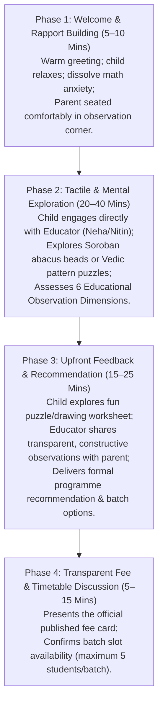

# AAA MASTER BRD — WORKSTREAM 05 (WS-05)
# DISCOVERY SESSION & ADMISSION CONVERSION FRAMEWORK
**Project:** Arnav Abacus Academy (AAA), Wakad, Pune  
**Role:** Lead Business Analyst, Educational Assessment Specialist & Conversion Architect  
**Governance Stage:** Stage 2 — Master Business Requirements Document (BRD) Workshop  
**Document Ref:** `docs/02_business_requirements/AAA_WS05_Discovery_Session_and_Conversion_Framework.md`  
**Date:** November 02, 2026 (Discovery Baseline)  
**Status:** 🟡 **DISCOVERY COMPLETE — PENDING MANAGEMENT VALIDATION**  

---

## 1. Executive Summary & Purpose

This document operationalizes **WS05-05: Discovery Session and Admission Conversion** for Arnav Abacus Academy (AAA), Wakad, Pune.

The **AAA Personalised Learning Discovery Session** is the pivotal educational milestone in the academy's admissions journey (`DEC-WS03-02`). Unlike commercial franchises that use "trial classes" to conduct aggressive sales pitches, AAA positions this session as an **in-depth pedagogical observation and consultative diagnostic**. Academic Director Neha Patil directly evaluates the child's numerical intuition, spatial dexterity, and calculation confidence in a supportive, zero-stress environment, delivering an **AAA Demo Observation & Learning Recommendation** to parents before any admission commitment is discussed.

---

## 2. Session Architecture & Governance Baselines

### 2.1 Approved Session Nomenclature, Role Allocation & Duration Reconciliation
* **Session Title:** **AAA Personalised Learning Discovery Session** `[MANAGEMENT CONFIRMED]`.
* **Written Deliverable:** **AAA Demo Observation & Learning Recommendation** `[MANAGEMENT CONFIRMED]`.
* **Cost to Parent:** **Free Session** (No diagnostic fee or obligation to enroll; approx 45–90 minutes adapting to child engagement and parent discussion) `[EXISTING DOCUMENTED PRACTICE]`.
* **Delivery Mode:** Offline classroom session at Balaji Sagar Bungalow, Wakad (Primary); or 1-on-1 live video assessment for relocated/remote families (Secondary) `[MANAGEMENT CONFIRMED]`.
* **Educator Role Allocation & Validation (Proposed Operating Model Only):**
  - *Proposed Operating Model:* 
    - **Neha Patil:** Academic observation, educational feedback, and programme recommendation.
    - **Nitin Patil:** Enquiry coordination, parent orientation, fee information, and operational logistics.
  - *Governance Boundary:* This division represents a **proposed operating model**, NOT an approved permanent delegation. Do not claim a permanent division of responsibilities unless confirmed by management. Do not narrow the historical record of who conducts sessions without supporting evidence (`ACT-WS05-01`).
* **Session Duration Reconciliation:**
  - *Documented Existing Practice:* A free session of approximately **45 to 90 minutes**, adapting dynamically to child engagement, calculation hesitation, emotional comfort, and parental dialogue `[EXISTING DOCUMENTED PRACTICE]`.
  - *Proposed Streamlined Workflow (35–45 Minutes):* Formulated as an operational efficiency proposal to structure the session into distinct phases (rapport building, bead exploration, parent consultation).
  - *Governance Boundary:* **The 35-minute duration remains strictly a proposal for evaluation, NOT an approved or guaranteed session duration.** Neha Patil and Nitin Patil must validate actual operational duration and session flow based on center practice before standardizing scheduling intervals (`ACT-WS05-01`).

### 2.2 Mandatory Non-Diagnostic Safeguards (`DEC-WS04-06` Baseline)
* **Educational Character Only:** The observation session assesses mathematical learning style, calculation strategy, and task engagement.
* **Strict Prohibitions:**
  - ❌ **Zero Clinical Labeling:** Certified educators must never diagnose or label children with ADHD, dyscalculia, dyslexia, or learning disabilities.
  - ❌ **Zero Numerical IQ Scoring:** No composite "Brain Score", numerical percentile ranking, or intelligence quotients are permitted.
  - ❌ **Zero Deficit Shaming:** Never tell parents their child is "behind" or "failing"; observations are framed constructively around self-baseline growth potential.

---

## 3. End-to-End Session Workflow & Timeline Reconciliation



> [!NOTE]
> **Operational Reality Notice:** While the proposed phased sequence provides structured timing blocks, actual sessions at Balaji Sagar Bungalow remain flexible (45–90 minutes total) to ensure children never feel rushed and parents receive thorough, unpressured guidance.

---

## 4. The Six Approved Educational Observation Dimensions

During Phase 2, the educator systematically evaluates the child across the exact six approved observation dimensions. These observations are strictly **educational and non-diagnostic**:

| Observation Dimension (Exact Approved Formal Name) | Child Development Pillar Alignment (Exact WS-04 Names) | Observable Classroom Behaviors (Pedagogical Description) | Pedagogical Significance (Assessment Description) |
|---|---|---|---|
| **1. Number Sense** | Pattern Recognition, Visualization | Intuitive grasp of quantity, place value, base-5 and base-10 groupings; bead visualization readiness without mechanical counting. | Identifies foundational numerical intuition and readiness for tactile Soroban manipulation. |
| **2. Arithmetic Understanding** | Working Memory | Conceptual understanding of addition/subtraction relationships; whether the child understands base complements vs memorizing rote facts. | Determines procedural stability and whether mental math unlearning is required. |
| **3. Logical Approach** | Cognitive Flexibility, Executive Function | How the child decomposes multi-step sums, explores alternative calculation paths, and applies shortcuts (e.g. Vedic sutra patterns). | Barometer of problem-solving adaptability and HOTS readiness. |
| **4. Learning Attitude** | Confidence | Openness to try unfamiliar bead or puzzle tasks; willingness to self-correct slips without embarrassment or distress. | Indicates emotional relationship with mathematics and resilience under challenge. |
| **5. Response and Engagement** | Attention | Attentive listening to multi-step instructions; sustained visual tracking of bead movements; auditory number recall. | Guides session pacing, batch dynamics, and individual encouragement style. |
| **6. Interest and Learning Passion** | Confidence | Spontaneous curiosity about number patterns; pride upon discovering solutions; eagerness to explore the next problem. | Primary catalyst for multi-year retention and independent thinking habits. |

---

## 5. Upfront Feedback & Written Recommendation Framework

At the conclusion of the session, the parent receives the **AAA Demo Observation & Learning Recommendation**. This consultation follows a three-part pedagogical structure:

### 5.1 Structure of the Oral Consultation:
1. **Highlighting Natural Strengths:** Begin by sharing specific, genuine positive behaviors observed in the child (e.g. *"Aarav showed remarkable spatial intuition when grouping beads in pairs"*).
2. **Transparent Diagnostic Observations:** Describe calculation friction points gently and constructively (e.g. *"We noticed he relies heavily on finger counting for numbers above 6, which creates cognitive fatigue in timed school tests"*).
3. **The Pedagogical Recommendation:** Recommend the specific programme, starting level, and weekly rhythm tailored to the child's needs.

### 5.2 Written Summary Template (Dispatched via WhatsApp within 12 Hours):
```text
Arnav Abacus Academy — Wakad, Pune
Personalised Learning Discovery Session Summary

Student Name: [Child First Name]
Observation Date: [Date]
Lead Mentor: Neha Patil (Academic Director)

1. Key Strengths Observed:
• [Strength 1: e.g. High enthusiasm for visual patterns and puzzle logic]
• [Strength 2: e.g. Excellent listening skills during multi-step instructions]

2. Focus Areas for Nurturing:
• [Area 1: e.g. Transitioning from finger-counting to visual bead storage]
• [Area 2: e.g. Building confidence in multi-digit addition complements]

3. Recommended Academic Pathway:
• Programme: Soroban Abacus Mathematics (Junior Track)
• Recommended Entry Level: Level 1 (Foundation Beads & Complements)
• Batch Format: Micro-Batch (Strictly Maximum 5 Students)
• Weekly Cadence: 2 Sessions/Week (60 Minutes Each)

Next Steps: Batch slots are allocated on a first-confirmed basis to maintain our 5-student cap. Let us know if you would like to secure the [Day/Time] slot.
```

---

## 6. Transparent Fee Communication & Ethical Conversion

To preserve trust and justify AAA's premium positioning in Wakad:
1. **Published Pricing Only (`DEC-WS01-03`, `ACT-WS04-09`):** Fees are presented directly from the official published master fee card. Zero fabricated surcharges or hidden examination fees.
2. **Value Justification:** Parents are explicitly shown that tuition covers:
   - Guaranteed **maximum 5 students per batch** (giving 3x more educator attention than commercial 15–20 student classes).
   - High-quality physical Soroban tool, student workbook kit, and practice portal access.
   - Ongoing qualitative progress updates from Academic Director Neha Patil.
3. **Zero High-Pressure Tactics:** Parents are never told *"This discount expires in 1 hour"* or *"Sign today to save 20%"*. AAA respects parental decision-making time.

---

## 7. Post-Session Follow-Up & Admission Onboarding

* **Day +1:** Send the written WhatsApp summary recommendation.
* **Day +3:** If the parent has not confirmed a batch slot, send a polite follow-up offering to answer any remaining questions about batch timings or school homework balance.
* **Day +7:** If no response, gently close the trial inquiry, keeping the slot open for waitlisted families.
* **Onboarding Handover:** Upon admission confirmation, Nitin Patil issues the official receipt, hands over the physical Soroban kit, assigns the student's permanent ID (`DEC-WS04-13`), and schedules the first class.

---

## 8. Governance & Evidence Traceability Summary

* **Dependencies Carried Forward:**
  - `ACT-WS04-08`: Facility seating capacity audit required to confirm physical trial room capacity.
  - `ACT-WS04-09`: Master fee schedule required before issuing written recommendations.
  - `ACT-WS04-22`: Programme eligibility reconciliation matrix required for border cases (9-year-olds).
* **Governance Status:** 🟡 **DOCUMENTATION COMPLETE — AWAITING MANAGEMENT VALIDATION IN WORKSHOP PACK**
