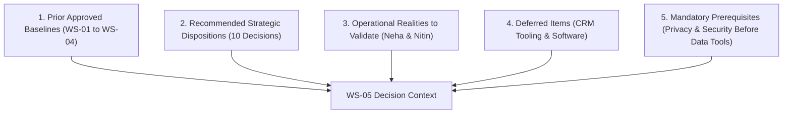

# ARNAV ABACUS ACADEMY (AAA), WAKAD, PUNE
# WORKSTREAM 05: MARKETING, LEAD GENERATION & CONVERSION ARCHITECTURE
# FINAL MANAGEMENT RECOMMENDATION & DECISION READINESS SUMMARY

**Project:** Arnav Abacus Academy (AAA) Business & Digital Transformation  
**Governance Stage:** Stage 2 — Master Business Requirements Document (BRD) Workshop  
**Document Ref:** `docs/02_business_requirements/AAA_WS05_Final_Management_Recommendation_Summary.md`  
**Date:** November 03, 2026 (Final Reconciled Brief)  
**Target Decision-Makers:** Neha Patil (Academic Director) & Nitin Patil (Operations Lead)  
**Governance Status:** 🟡 **RECONCILIATION COMPLETE — AWAITING FORMAL MANAGEMENT DETERMINATION**  

---

## 1. Executive Purpose & Governance Boundary

This executive summary reconciles the complete findings and recommendations of **Workstream 05 (WS-05): Marketing, Lead Generation & Conversion Architecture**. It provides Neha Patil and Nitin Patil with an evidence-grounded, balanced decision instrument to review, validate, and formally determine the ten strategic marketing decisions.

### Strict Governance Safeguards Applied:
* **Documentation Only:** Zero application code, configurations, database records, routes, or third-party marketing services have been modified.
* **Preservation of Approved Baselines:** All prior management decisions ratified in WS-01, WS-02, WS-03, and WS-04 remain fully preserved.
* **Separation of Advisory Recommendations from Approvals:** Antigravity provides clear recommendations, but **every actual decision outcome remains completely unpopulated (`[ ____________________ ]`)** awaiting explicit executive direction.
* **Implementation Separately Gated:** Approval of any requirement or policy in Stage 2 constitutes architectural authorization only; live production implementation is strictly deferred to Stage 4 following formal Stage 3 design approval.

---

## 2. Governance Classification of WS-05 Elements

To provide absolute clarity for executive review, all elements of WS-05 are categorized into five distinct governance buckets:

1. **Prior Approved Baselines:**
   - Master Brand Positioning: *“Arnav Abacus Academy – A Premium Mathematical Thinking & Child Development Academy”* (`DEC-WS02-01`).
   - Approved Website Headline: *“Beyond Calculation. Towards Confident Mathematical Thinking.”* (`DEC-WS02-02`).
   - Maximum batch cap of 5 students (`DEC-WS02-05`, `DEC-WS04-11`).
   - **The Eight Approved Child Development Pillars** (`DEC-WS04-01`):
     1. **Visualization**
     2. **Working Memory**
     3. **Pattern Recognition**
     4. **Processing Speed**
     5. **Attention**
     6. **Cognitive Flexibility**
     7. **Executive Function**
     8. **Confidence**
   - Zero-PII analytics protocol (`DEC-WS03-05`, `AGENTS.md` Rule 4).
2. **Recommended Strategic Dispositions:**
   - Advisory dispositions across all 10 decisions (4 Approve, 4 Approve with Conditions, 1 Approve as Pilot, 1 Defer).
3. **Operational Realities Requiring Founder Validation:**
   - Discovery session actual duration (~45–90 min historical free session) vs proposed 35–45 min sequence (`ACT-WS05-01`).
   - Discovery session responsibility model (proposed operating model, not an approved permanent delegation).
4. **Deferred Items:**
   - Permanent CRM selection and commercial SaaS integrations (deferred to Stage 4 AcademyOS evaluation).
   - Numerical conversion targets/quotas (deferred until completion of 4-week baseline logging).
5. **Mandatory Action Prerequisites:**
   - Legal/privacy review (`ACT-WS05-05`) and access/security assessment (`ACT-WS05-06`) must be signed off **before** any new lead register or spreadsheet process begins. (These are operational prerequisites to operating a new lead register, not prerequisites to WS-05 requirements BRD closure).

---

## 3. Master Management Ratification Matrix (10 Decisions)

The table below summarizes the ten strategic decisions, the existing codebase reality, the recommended management disposition, and the ratified determinations enacted by Neha Patil and Nitin Patil:

| Decision ID | Decision Subject | Codebase Baseline Fact | Antigravity Recommendation | Recommended Terms & Key Conditions | Decision-Maker | Management Determination |
|---|---|---|:---:|---|:---:|:---:|
| **DEC-WS05-01** | **Master Brand Positioning & Headline Rollout** | Hero renders exploratory headline (`Hero.tsx:55`) | **APPROVE WITH CONDITIONS** | Mandate approved positioning and headline across marketing touchpoints; allow channel-appropriate character-limit adaptations while preserving exact core meaning. | Neha Patil & Nitin Patil | 🟢 **APPROVED WITH CONDITIONS** *(Joint Direction of Neha Patil & Nitin Patil)* |
| **DEC-WS05-02** | **Micro-Batch Size Marketing Slogan (5-Student Cap)** | Codebase claims *"1:8 Micro-Batches"* (`Hero.tsx:69`, `data.ts:64`) | **APPROVE** | Universally mandate *"maximum of five students per batch"*; removal of legacy "1:8" claims from web copy, forms, and diagnostic PDFs is an approved requirement for a separately authorised implementation stage (Stage 4). Does not authorise editing assets now. | Nitin Patil & Neha Patil | 🟢 **APPROVED** *(Joint Direction of Neha Patil & Nitin Patil)* |
| **DEC-WS05-03** | **Discovery Session Nomenclature & 6 Dimensions** | Conflicting CTA strings (*"Free Demo"*, *"Counselling"*) | **APPROVE** | Standardize sitewide CTAs on **"Book an AAA Personalised Learning Discovery Session"** delivering **"AAA Demo Observation & Learning Recommendation"** across the **6 approved educational observation dimensions**. | Neha Patil | 🟢 **APPROVED** *(Joint Direction of Neha Patil & Nitin Patil)* |
| **DEC-WS05-04** | **Minimum Necessary Data Lead Capture Form** | Form collects 10+ fields and habits (`LeadForm.tsx:20-42`) | **APPROVE WITH CONDITIONS** | Restrict inquiry form to 4 fields (Parent Name, Mobile, Child Age Bracket OR Grade, Programme). Mandate dual consent; declining promotional communication must not block enquiry submission. Ban DOB, school, address, clinical data. 90-day retention is an unapproved proposal pending review. Privacy controls not technically implemented. | Nitin Patil | 🟢 **APPROVED WITH CONDITIONS** *(Joint Direction of Neha Patil & Nitin Patil)* |
| **DEC-WS05-05** | **Hyper-Local Geographic Catchment Prioritization** | Website offers generic/global options | **APPROVE WITH CONDITIONS** | Prioritize 0–3 km Wakad catchment as primary operational hypothesis and focus, without treating it as an exclusive boundary. Validate secondary PCMC catchment empirically. | Nitin Patil | 🟢 **APPROVED WITH CONDITIONS** *(Joint Direction of Neha Patil & Nitin Patil)* |
| **DEC-WS05-06** | **Google Business Profile & Ethical Review Policy** | 74+ reviews collected informally (`Home.tsx:31`) | **APPROVE** | Adopt 100% voluntary, non-incentivized review policy. No gifts or fee discounts. 48-hour response turnaround is a proposed operational target pending confirmation, with zero-PII protection. Treat 74+ count as a periodically refreshable baseline. | Nitin Patil & Neha Patil | 🟢 **APPROVED** *(Joint Direction of Neha Patil & Nitin Patil)* |
| **DEC-WS05-07** | **Inquiry Response Operating Service Standard** | `DEC-WS03-03` approved pilot target | **APPROVE AS PILOT** | Operationalize 2-operating-hour inquiry follow-up standard during declared center hours (Mon–Sat 9:30 AM – 7:30 PM is proposed pending confirmation; live window to be confirmed before launch). Protect founder classroom teaching hours as top priority. | Nitin Patil | 🟢 **APPROVED AS PILOT** *(Joint Direction of Neha Patil & Nitin Patil)* |
| **DEC-WS05-08** | **Near-Term Lead Tracking Tooling Strategy** | Uses browser `localStorage` / optional webhook | **DEFER** | Defer permanent CRM selection. Authorize interim lead management protocol **strictly after** completing mandatory prerequisites `ACT-WS05-05` and `ACT-WS05-06`. Enforce refined 8-status admissions lifecycle. WhatsApp must not be sole record. | Nitin Patil | 🟢 **DEFERRED** *(Joint Direction of Neha Patil & Nitin Patil)* |
| **DEC-WS05-09** | **Elimination of Speed Hyperbole (10x to 15x)** | Vedic math claims *"10x to 15x faster"* (`data.ts:38`) | **APPROVE** | Remove unverified multiplier claims in Stage 4 copy refactoring; replace with pedagogical messaging: mental calculation poise, procedural error reduction, and exam verification speed. | Neha Patil | 🟢 **APPROVED** *(Joint Direction of Neha Patil & Nitin Patil)* |
| **DEC-WS05-10** | **Admissions Funnel KPI Architecture & Cadence** | Ad-hoc manual inquiry tracking | **APPROVE WITH CONDITIONS / PILOT** | Adopt 17-metric KPI dictionary; pilot 6-metric weekly MVD. Enforce explicit numerators/denominators with `N/A` for zero denominator. Defer conversion targets until 4-week baseline logging is completed under approved registers. | Nitin Patil & Neha Patil | 🟢 **APPROVED WITH CONDITIONS / PILOT** *(Joint Direction of Neha Patil & Nitin Patil)* |

---

## 4. Key Operational Realities & Standards Detailed

### 4.1 Discovery Session: Operational Practice & Proposed Operating Model
* **Historical Operational Practice:** In actual classroom delivery at Balaji Sagar Bungalow, sessions are provided **free of charge, lasting approximately 45 to 90 minutes**, adapting pace dynamically to child engagement, emotional comfort, and parent discussion.
* **Streamlined Sequence Proposal (For Management Evaluation Only):** A structured 35–45 minute flow has been drafted (10 min rapport, 15 min tactile bead observation, 10 min parent consultation). This remains strictly an operational proposal for evaluation, not an approved or guaranteed session duration (`ACT-WS05-01`).
* **Session Responsibilities — Proposed Operating Model Only:**
  - *Neha Patil:* Academic observation, educational feedback, and programme recommendation.
  - *Nitin Patil:* Enquiry coordination, parent orientation, fee information, and operational logistics.
  - *Governance Boundary:* **This is recorded as a proposed operating model, NOT an approved permanent delegation.** Do not claim a permanent division of responsibilities unless confirmed by management. Do not narrow the historical record of who conducts sessions without supporting evidence.

### 4.2 The Six Approved Educational Observation Dimensions
In strict alignment with `DEC-WS04-04` and child privacy rules, observation during discovery sessions strictly evaluates learning readiness and mathematical thinking across the **exact six approved formal names** (never clinical pathology):
1. **Number Sense**  
   *Pedagogical Description:* Intuitive grasp of quantity, place value, base-5 and base-10 groupings, and tactile bead visualization readiness without mechanical counting.
2. **Arithmetic Understanding**  
   *Pedagogical Description:* Conceptual understanding of addition and subtraction mechanics; comprehension of base complements versus rote fact memorization.
3. **Logical Approach**  
   *Pedagogical Description:* How the child decomposes multi-step instructions, explores calculation pathways, and applies structural pattern logic.
4. **Learning Attitude**  
   *Pedagogical Description:* Child's openness to unfamiliar tasks, receptivity to educator guidance, and willingness to self-correct without distress.
5. **Response and Engagement**  
   *Pedagogical Description:* Sustained attention, attentive listening to multi-step instructions, visual tracking of bead arrays, and calm communication under gentle challenge.
6. **Interest and Learning Passion**  
   *Pedagogical Description:* Natural mathematical curiosity, enthusiasm for bead manipulation or number patterns, and personal pride upon solving exercises.

### 4.3 Minimum-Necessary Enquiry Structure & Privacy Safeguards
To comply with DPDP guidelines, protect child data, and eliminate mobile drop-off:
* **Initial Web Inquiry Form Fields (Strictly 4):**
  1. Parent Full Name (required)
  2. Mobile / WhatsApp Number (required)
  3. Child Age Bracket OR School Grade (one required, not both)
  4. Programme of Primary Interest (optional dropdown: Abacus, Vedic Math, Mental Math, School Math, Olympiad)
* **Dual Consent Architecture & Unconditioned Submission:**
  - *Inquiry Response Consent:* Mandatory opt-in for AAA to contact the parent regarding the specific enquiry.
  - *Promotional Updates Consent:* Strictly optional separate checkbox.
  - *Clarification:* **A parent declining promotional communication must still be fully able to submit an enquiry.** Submission must never be conditioned on promotional marketing consent.
* **Explicit Inclusions & Prohibitions:**
  - 🚫 **Banned at Inquiry Stage:** Exact date of birth, child Aadhaar/ID, school name, residential street address, clinical/developmental checkboxes.
  - ⚖️ **Retention Policy Status:** The proposed 90-day retention/deletion timeline is an **unapproved proposal pending legal review** (`ACT-WS05-05`). Unconverted enquiry records are strictly distinguished from admitted-student records (which carry separate statutory, academic, and financial/tax receipt retention obligations).
  - 🔒 **Technical Implementation Caveat:** Privacy controls are requirements to be designed and verified in Stage 3/4; they are **not currently technically implemented** in the web codebase.

### 4.4 Refined Admissions Lifecycle & Counting Governance
* **Structured Funnel Lifecycle:**
  $$\text{New Enquiry} \longrightarrow \text{Contacted} \longrightarrow \text{Discovery Session Booked} \longrightarrow \text{Discovery Session Attended}$$
  $$\begin{cases}
  \longrightarrow \text{Admission Completed} \\
  \longrightarrow \text{Decision Pending} \\
  \longrightarrow \text{Closed – Not Proceeding} \\
  \longrightarrow \text{Follow-up Later}
  \end{cases}$$
* **Admission Counting Criteria:**
  - **`Admission Completed`** is recorded **ONLY upon formal student registration and verified tuition/registration fee payment** documented by an official fee receipt.
  - **Prohibition:** An expression of interest, verbal agreement, slot reservation, or discovery session attendance alone **must never be counted as an admission**.
* **WhatsApp Governance & Historical Records:**
  - WhatsApp remains a primary communication channel, but **must not remain the sole, unbacked record** of admissions interactions.
  - Historical status records must be preserved where possible without altering application code or live operational data.
* **Tooling Gate:** No new spreadsheet or CRM integration is authorized until `ACT-WS05-05` (privacy review) and `ACT-WS05-06` (access control, 2FA, formula sanitization) are signed off.

### 4.5 Baseline Measurement Dependencies & Math Rules
* **Baseline Measurement Prerequisites:**
  - The proposed **four-week baseline collection period begins ONLY after** the enquiry register, access controls, privacy notice, and user responsibilities have been formally approved and established.
  - **Limitations of Historical Records:** Historical WhatsApp chat records and informal phone logs are unstandardized and incomplete (unlogged calls, untracked walk-ins, lost historical chats); they **cannot be used as a reliable conversion baseline without formally documenting these limitations**.
* **KPI Math Rules:**
  - All ratio and conversion metrics define explicit numerators and denominators.
  - Whenever the denominator is $0$ or unavailable, the calculation explicitly displays **`N/A`** (Not Applicable).
  - Weekly Minimum Viable Dashboard (6 Metrics): (1) New Inquiries Received, (2) Qualified Inquiries, (3) Discovery Sessions Booked, (4) Discovery Sessions Attended, (5) Paid Admissions Confirmed, (6) Pending Follow-Up Queue.

---

## 5. Workstream 05 Priority Action Register

> [!IMPORTANT]
> **Requirements Approval vs. Operational Implementation Boundary:**  
> The ten actions tabulated below represent operational implementation, evidence gathering, and administrative audits. **They are NOT all prerequisites for WS-05 business requirements document closure.** Management sign-off on WS-05 ratifies the architectural requirements and policies. In particular, `ACT-WS05-05` and `ACT-WS05-06` are operational prerequisites to commencing a new live lead-register process, not barriers to requirements approval. No action may be marked complete without verified evidence and explicit acceptance by its designated authority.

| Action ID | Action Title & Deliverable | Proposed Owner | Owner Status | Required Evidence | Dependencies | Priority | Due Date / Target Milestone | Completion Criteria | Evidence Acceptance Authority | Current Status |
|---|---|:---:|:---:|---|---|:---:|:---:|---|:---:|:---:|
| **ACT-WS05-01** | Discovery Session Duration Validation | Neha Patil | Pending Confirmation | Written memo (`Discovery_Session_Workflow_Validation_Memo.pdf`) | Observation log review | P1 | Stage 2 Workshop (Day 1) | Formal validation of actual duration (~45–90 min) vs proposed 35–45 min sequence and delivery roles. | Neha Patil (Academic Director) | Open — Pending Review |
| **ACT-WS05-02** | Lead-Source Baseline Analysis | Nitin Patil | Pending Confirmation | Tabulated report (`Historical_Lead_Source_Distribution_Report.xlsx`) | WhatsApp chat archives & phone logs | P1 | Stage 2 Workshop (Day 1) | Nominal categorization of last 50 inquiries by source with documented caveats. | Nitin Patil (Operations Lead) | Open — Pending Audit |
| **ACT-WS05-03** | Admission Conversion Baseline Reconciliation | Nitin Patil | Pending Confirmation | Reconciliation sheet (`Inquiry_to_Admission_Conversion_Baseline.xlsx`) | Active census roll (`ACT-WS04-03`) | P1 | Stage 2 Workshop (Day 3) | Calculated baseline CVR rates across booking, attendance, and paid admissions. | Nitin Patil & Neha Patil | Open — Pending Audit |
| **ACT-WS05-04** | Lost-Enquiry Reason Taxonomy Audit | Nitin Patil | Pending Confirmation | Classification memo (`Lost_Enquiry_Reason_Analysis_Memo.pdf`) | Historical follow-up logs | P2 | Prior to Stage 3 kickoff | Past un-enrolled inquiries classified into standard lost reason codes (`LOST-01..06`). | Nitin Patil (Operations Lead) | Open — Pending Review |
| **ACT-WS05-05** | Enquiry Privacy, Notice & Retention Review | Nitin Patil & Legal | Pending Confirmation | Specification document (`Enquiry_Form_Privacy_Notice_Specification.pdf`) | DEC-WS05-04 review | P1 | Prior to lead-register rollout | Legal review of 4-field form, dual consent text, and retention rule. **Operational prerequisite to new lead register.** | Nitin Patil & Legal Counsel | Open — Mandatory Prerequisite |
| **ACT-WS05-06** | Lead Tracking Tool Access & Security Assessment | Solution Architect | Pending Confirmation | Technical security assessment (`Lead_Tracking_Tool_Security_and_Access_Memo.pdf`) | Webhook review (`leadWebhook.ts`) | P1 | Stage 2 Workshop (Day 2) | Security, access control, 2FA, and formula sanitization verified. **Operational prerequisite to new lead register.** | Solution Architect & Nitin Patil | Open — Mandatory Prerequisite |
| **ACT-WS05-07** | Google Business Profile Refresh Protocol | Nitin Patil | Pending Confirmation | Verification schedule (`Google_Review_Verification_and_Refresh_Schedule.pdf`) | Google Business Profile access | P2 | Prior to Stage 3 kickoff | Quarterly audit cadence established verifying voluntary reviews and 74+ baseline. | Nitin Patil (Operations Lead) | Open — Baseline Verified |
| **ACT-WS05-08** | Local Catchment Validation & Cluster Audit | Nitin Patil | Pending Confirmation | Spatial analysis memo (`Wakad_Catchment_Student_Cluster_Analysis.pdf`) | Student address records (`ACT-WS04-03`) | P2 | Prior to Stage 3 kickoff | Coarse geographic cluster analysis validating 0–3 km operational hypothesis. | Nitin Patil (Operations Lead) | Open — Pending Audit |
| **ACT-WS05-09** | Competitor Claim Substantiation & Mystery Audit | Nitin Patil | Pending Confirmation | Mystery audit dossier (`Wakad_Math_Academy_Competitor_Benchmarking.pdf`) | Field observation | P2 | Prior to Stage 3 kickoff | Documented fee and batch size benchmarking across 3 franchise centers. | Nitin Patil (Operations Lead) | Open — Pending Audit |
| **ACT-WS05-10** | KPI Validation & Minimum Viable Dashboard Spec | Solution Architect | Pending Confirmation | Technical specification (`Admissions_MVD_Specification_and_Data_Rules.pdf`) | KPI framework review | P2 | Prior to Stage 3 kickoff | Detailed data-capture rules, 4-week baseline logging protocol, and MVD review template. | Solution Architect & Management | Open — Pending Review |

---

## 6. Management Ratification & Workstream Handover

On November 03, 2026, Neha Patil (Academic Director) and Nitin Patil (Operations Lead) formally enacted their joint management determinations on all ten WS-05 decisions:
* **Decisions Ratified:** `DEC-WS05-01` through `DEC-WS05-10` are formally ratified (4 Approved, 4 Approved with Conditions, 1 Approved as Pilot, 1 Deferred).
* **Open Actions Retained:** Exactly ten operational and evidence actions (`ACT-WS05-01` to `ACT-WS05-10`) are confirmed open for execution, with proposed owners (pending individual commitment confirmation) and milestone due dates.
* **Stage-Gate Boundaries Enforced:** Requirements approval authorizes architectural specifications only. Application code modifications, website content changes, CRM deployment, advertising expenditure, and Stage 3 initiation remain strictly paused pending formal Stage 2 master umbrella closure.
