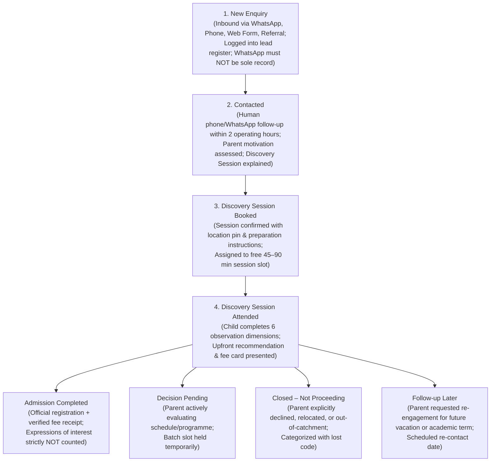

# AAA MASTER BRD — WORKSTREAM 05 (WS-05)
# LEAD MANAGEMENT & ADMISSIONS FUNNEL ARCHITECTURE
**Project:** Arnav Abacus Academy (AAA), Wakad, Pune  
**Role:** Lead Business Analyst, Operations Systems Architect & Lead Funnel Specialist  
**Governance Stage:** Stage 2 — Master Business Requirements Document (BRD) Workshop  
**Document Ref:** `docs/02_business_requirements/AAA_WS05_Lead_Management_and_Admissions_Funnel.md`  
**Date:** November 02, 2026 (Discovery Baseline)  
**Status:** 🟡 **DISCOVERY COMPLETE — PENDING MANAGEMENT VALIDATION**  

---

## 1. Executive Summary & Purpose

This document operationalizes **WS05-04: Lead Capture and Lead Management** for Arnav Abacus Academy (AAA), Wakad, Pune.

Admissions growth at AAA depends on personal trust, prompt educator responsiveness, and calm, non-pressuring counseling. This architecture establishes a transparent, ethical admissions funnel that guides prospective parents from their initial point of contact to enrollment while strictly safeguarding family privacy and eliminating lead leakage.

---

## 2. Current Lead Capture Mechanism & Codebase Evidence

Inspection of the repository identifies the existing digital inquiry workflows:

| Lead Capture Channel | Codebase Component / Logic | Data Fields Collected | Current Storage & Destination | Operational Reality & Gaps |
|---|---|---|---|---|
| **Website Lead Form** | `src/components/LeadForm.tsx:20-42` | Salutation, Parent Name, Student Name, Child Age, Programme, Country Code, Class Mode, Timezone, School Curriculum, Habits/Expectations Checklist | 1. Browser `localStorage` (`aaa_leads_history`) 2. Google Sheet Webhook (`leadWebhook.ts`) 3. Redirects to WhatsApp `wa.me/919021924968` | If user closes WhatsApp before sending message, lead is logged locally in browser but not centrally recorded unless webhook is active. |
| **Demo Booking Modal** | `src/components/DemoBookingModal.tsx:26-30` | Parent Name, Mobile Number, Child Age Group, Programme, Delivery Mode | Direct WhatsApp redirect: `wa.me/919021924968` | Does not persist to local storage; relies 100% on parent tapping "Send" in WhatsApp. |
| **Direct Phone Calls** | Click-to-call on `+91 90219 24968` (`Contact.tsx:99`, `Footer.tsx:160`) | Caller ID, verbal conversation | None in digital codebase | Logged manually on Nitin Patil's mobile device `[EXISTING DOCUMENTED PRACTICE]`. |
| **Parent Referrals / Walk-ins** | In-person visit to Balaji Sagar Bungalow | Verbal inquiry at center | Physical inquiry notebook `[EXISTING DOCUMENTED PRACTICE]` | Completely offline; requires manual data entry. |

---

## 3. Minimum Necessary Data Privacy Principle (DEC-WS03-04)

In compliance with the **Minimum Necessary Data Privacy Principle** ratified in `DEC-WS03-04`:
* *"Collect only minimum personal information necessary to respond, arrange demo, and manage admission enquiry, with consent, access control, and privacy safeguards."*

### 3.1 Permitted Initial Inquiry Fields: In-Depth Privacy & Governance Evaluation

In compliance with the **Minimum Necessary Data Privacy Principle** (`DEC-WS03-04`), every field collected on public discovery inquiry forms must be strictly justified:

| Field Name | Why It Is Needed | Mandatory or Optional? | Does a Less Intrusive Alternative Exist? | Consent & Privacy Notice Application | Who Can Access? | Where Is It Stored? | Retention & Deletion Protocol |
|---|---|:---:|---|---|---|---|---|
| **Parent Full Name** | Essential to address the parent respectfully, distinguish family records, and ensure accountability during communication. | **Required** | No. A salutation and name are required for human communication. | Covered by explicit form checkbox: *"I consent to AAA contacting me regarding this inquiry."* | Nitin Patil & Neha Patil exclusively. | Secure lead register (pending tool approval). | 90-day retention proposal is **unapproved pending privacy review** (`ACT-WS05-05`). |
| **Parent Mobile / WhatsApp Number** | Primary channel to respond to the inquiry, confirm session availability, send location pin, and deliver discovery recommendations. | **Required** | Email is less intrusive, but >90% of Wakad parents communicate via WhatsApp. Email causes extreme response delays. | Separate explicit opt-in checkboxes required: (1) Mandatory inquiry response consent; (2) Optional promotional updates consent. | Nitin Patil for triage; Neha Patil for trial scheduling. | Secure lead register; encrypted at rest on device. Zero third-party sharing. | 90-day retention proposal is **unapproved pending privacy review** (`ACT-WS05-05`). |
| **Child Age Bracket OR School Grade** | Required to determine initial academic suitability (e.g. Abacus 4.5–9 vs Vedic 9–14) and assign correct observation material. | **One Required (Not Both)** | **Yes. Collecting a coarse Age Bracket OR School Grade is far less intrusive than exact Date of Birth.** Date of birth is strictly banned at inquiry. | Covered by general discovery session inquiry consent. | Neha Patil & Nitin Patil. | Secure lead register. | Migrated to student profile upon admission; deleted upon parent request. |
| **Programme of Primary Interest** | Identifies the parent's core motivation (Abacus vs Vedic vs School Math vs Olympiad) to route the discovery session appropriately. | **Optional** (Defaults to "General Math Counseling" if unselected) | General inquiry checkbox. | Covered by general inquiry consent. | Neha Patil & Nitin Patil. | Secure lead register. | Used for initial session planning; updated during diagnostic discovery session. |

### 3.2 Mandatory Privacy, Consent & Telemetry Controls:
To prevent privacy overreach and ensure statutory data protection compliance:
1. **Dual-Consent Architecture & Independent Submission:**
   - *Consent A (Mandatory for Inquiry Response):* `[ ] I consent to Arnav Abacus Academy contacting me via phone/WhatsApp regarding this discovery session inquiry.`
   - *Consent B (Optional for Promotional Updates):* `[ ] I agree to receive occasional updates about mathematics workshops and academy news. (Optional - can unsubscribe anytime).`
   - *Clarification on Voluntary Consent:* Responding to a parent-initiated enquiry is strictly separated from optional promotional communication. **A parent declining promotional communication (leaving Consent B unchecked) must still be fully able to submit an enquiry.** Form submission must never be conditioned on promotional consent.
2. **Strictly Prohibited Fields at Inquiry Stage:**
   - ❌ **Child's exact Date of Birth:** (Collected only upon formal admission and age verification).
   - ❌ **School name or school branch:** (Collected verbally during academic counseling only if relevant to syllabus board).
   - ❌ **Home residential address or flat number:** (Collected only on official fee receipts upon enrollment).
   - ❌ **Medical, psychological, or clinical diagnosis checkboxes:** (ADHD, dyscalculia, etc. — strictly prohibited under `DEC-WS04-06`).
3. **Zero-PII Analytics Protocol:**
   - A parent contact detail (name, phone) collected under consent for inquiry response must **never be passed into Google Analytics 4 (`gtag`) or GTM (`dataLayer`)**, URLs, query parameters, or client console logs. Analytics telemetry is strictly zero-PII; operational enquiry data is legitimate contact processing. Do not claim that all enquiry data is PII-free.
4. **Governance Implementation & Retention Distinction:**
   - *Technical Implementation Caveat:* **Do not claim privacy controls or retention workflows are technically implemented.** They represent business and security requirements to be validated and engineered in Stage 3/4.
   - *Retention Differentiation:* The proposed 90-day retention period remains **unapproved and pending formal legal and privacy review** (`ACT-WS05-05`). Furthermore, unconverted enquiry records must be strictly distinguished from admitted-student records. Admitted students transition into active academic and administrative rolls with distinct statutory, academic, and financial/tax receipt retention obligations.

---

## 4. End-to-End Admissions Funnel Stages & Refined Lead Lifecycle

The admissions funnel defines the structured lifecycle, distinguishing initial progression from explicit terminal/post-discovery statuses:

### 4.1 Explicit Admissions Lifecycle Status Definitions & Admission Counting Criteria:
To ensure precise reporting and prevent distorted conversion metrics:
1. **`New Enquiry`:** Initial inbound parent contact received across any channel (web form, WhatsApp message, phone call, walk-in), awaiting triage.
2. **`Contacted`:** Human contact attempted or established within operating hours; academy overview and discovery session options shared.
3. **`Discovery Session Booked`:** Free 45–90 minute session confirmed for a specific date and time slot.
4. **`Discovery Session Attended`:** Child and parent have completed the observation session and received the oral/written recommendation.
5. **`Admission Completed`:** 
   - **Strict Counting Criteria:** An admission is recorded **ONLY upon formal student registration and verified payment of tuition/registration fees** documented by an official fee receipt. 
   - **Prohibition:** An expression of interest, verbal agreement to join, temporary slot hold, or discovery session attendance alone **must never be counted as an admission**.
6. **`Decision Pending`:** Post-session status where the family is reviewing timetables, consulting a spouse, or comparing options; follow-up scheduled.
7. **`Closed – Not Proceeding`:** Parent explicitly states they will not enroll, family has relocated, or requirements are out of academy scope; logged with standard lost-enquiry reason code (`LOST-01` to `LOST-06`).
8. **`Follow-up Later`:** Parent expressed positive intent but requested delayed enrollment for a subsequent academic term or vacation; assigned a specific calendar re-contact date.

> [!IMPORTANT]
> **Lead Record Authority Boundary & Historical Integrity:**  
> While WhatsApp is a primary communication tool, **WhatsApp chat archives must NOT be the only authoritative lead record**. Leads must be captured in a controlled register with defined ownership, backup, and access control. However, **no new spreadsheet or additional personal-data collection is authorized** until privacy, security, and access controls are formally approved under `DEC-WS05-08` and `ACT-WS05-06`. Historical status records must be preserved where possible without altering application code or live operational databases.

---

## 5. Response Time Standards & Follow-Up Cadence

### 5.1 Operating Response Time Standard (`DEC-WS03-03` Pilot Baseline)
* **Inquiry Acknowledgment:** Inbound WhatsApp inquiries receive an immediate automated or standardized greeting message confirming receipt.
* **Human Follow-Up Window:** **Within 2 operating hours** during official business hours (Mon–Sat 9:30 AM – 7:30 PM). Inquiries received after 7:30 PM are contacted by 10:30 AM the following morning `[PROPOSED STRATEGY]`.
* **Founder Teaching Priority Safeguard:** If Nitin Patil or Neha Patil is actively mentoring a micro-batch in the classroom, teaching attention is protected; inquiries are processed during scheduled inter-batch intervals.

### 5.2 Respectful Follow-Up Protocol (Anti-Spam & Anti-Harassment Rules)
Unlike commercial call centers that harass parents with daily unsolicited calls, AAA maintains an authoritative, educational demeanor:
* **Touchpoint 1 (Day 0):** Immediate phone call or personalized WhatsApp message to introduce the academy, answer initial questions, and propose trial dates.
* **Touchpoint 2 (Day 2):** If no response, send a gentle, helpful follow-up on WhatsApp sharing a relevant educational guide (e.g., *"Why Smart Children Make Silly Math Mistakes"* or *"Abacus vs. Vedic Maths"*).
* **Touchpoint 3 (Day 5):** Final courtesy check-in asking if the family would like to keep the inquiry active or pause for future terms.
* **Close / Nurture (Day 10):** If no reply is received after 3 polite touchpoints, the lead status is changed to **"Inactive / Paused"**. **Zero further unsolicited calls are permitted.**

---

## 6. Duplicate Inquiries, Sibling Tracking & Lead Ownership

1. **Lead Ownership Allocation:**
   - **Nitin Patil (Operations & Customer Experience):** Owns incoming call triage, WhatsApp response, calendar scheduling, attendance reminders, and fee invoicing.
   - **Neha Patil (Founder & Academic Director):** Owns the diagnostic evaluation, child interaction, pedagogical recommendation, and parent academic counseling.
2. **Duplicate Inquiries & Sibling Tracking:**
   - When a parent submits multiple inquiries for two siblings (e.g. an 5-year-old for Abacus and an 11-year-old for Vedic Maths), the system must link both children under a **single Parent Contact Record** (`DEC-WS04-13`).
   - Sibling records must never overwrite each other in the admissions register.

---

## 7. Lost-Lead Analysis & Taxonomy

When an inquiry does not convert into an admission, the reason must be categorized to guide future operational improvements:

| Lost-Lead Code | Category Description | Root Cause / Operational Insight | Remedial Action |
|---|---|---|---|
| **LOST-01** | **Timetable / Schedule Collision** | Academy batch days/times clash with school van, karate, or music classes | Analyze recurring time requests to optimize batch schedule under `ACT-WS04-03`. |
| **LOST-02** | **Fee / Budget Constraint** | Parent cannot afford premium micro-batch tuition (e.g., expects mass-class rates) | Reaffirm value proposition (maximum 5 kids per batch vs 25 in franchise); do not discount. |
| **LOST-03** | **Geographic Distance / Commute** | Family lives beyond practical travel radius (>7 km, e.g. Baner or Ravet) | Recommend online live batch option where appropriate. |
| **LOST-04** | **Developmental / Age Readiness** | Child is under 4.5 years and lacks bead grip dexterity | Invite parent to re-evaluate in 6 months; provide pre-math parent guide. |
| **LOST-05** | **Decided on Alternative / School Tuition** | Parent chose standard school syllabus homework tutor | Maintain cordial relationship; invite to future math workshops. |
| **LOST-06** | **Unresponsive / Ghosted** | Parent stopped responding after 3 contact attempts | Mark inactive; respect parent privacy. |

---

## 8. Comparative Evaluation of Temporary Lead Tracking Options

Management must determine how inquiries are tracked prior to Stage 4 AcademyOS private database deployment. Three operational architectures are evaluated:

| Governance Dimension | Option A: Restricted Spreadsheet *(Google Sheets + Apps Script Webhook)* | Option B: Existing Communication Workflow + Controlled Manual Register *(WhatsApp Chat Archive + Local Encrypted Log)* | Option C: Future AcademyOS / Native CRM *(Stage 4 Authenticated PostgreSQL / RBAC)* |
|---|---|---|---|
| **Ownership** | Nitin Patil owns the sheet under a dedicated academy Google Workspace account. | Nitin Patil owns the physical WhatsApp business account and manual logbook. | AAA Management (Neha Patil & Nitin Patil) directly owns the private cloud database. |
| **Access Restrictions** | Restricted exclusively to Nitin Patil's Google account; multi-factor authentication (2FA) enforced. | Physical device access PIN + biometric WhatsApp lock. Highly restricted to one phone. | Fine-grained role-based access control (Admin, Mentor) enforced at API layer. |
| **Data Minimisation** | Webhook stores only the 4 core fields + timestamp. Extra fields stripped automatically. | Collects only messages sent by parents; zero extraneous metadata stored. | Database schema strictly enforces minimum necessary data model (`DEC-WS03-04`). |
| **Duplicate Handling** | Basic conditional formatting flag on phone number; manual deduplication by Nitin Patil. | Visual check in WhatsApp thread history before calling. | Database enforces unique constraint on parent mobile + child relation (`DEC-WS04-13`). |
| **Follow-Up Tracking** | Status dropdown columns (New, Scheduled, Completed, Lost) updated manually. | WhatsApp chat labels (e.g., 'Discovery Booked', 'Pending Follow-up'). | Automated task reminders and calendar synchronization built into dashboard. |
| **Backup & Recovery** | Automated Google Drive version history + weekly encrypted offline backup export. | WhatsApp local/cloud backup (encrypted); risk of manual register damage. | Automated daily encrypted database snapshots with point-in-time recovery. |
| **Retention & Deletion** | Manual quarterly script or row deletion for records older than 90 days. | Manual chat clearance and log shredding upon parent request. | Automated time-to-live (TTL) and administrative deletion API (`ACT-WS04-11`). |
| **Operational Effort** | Low to moderate. Instant capture via webhook (`leadWebhook.ts`); manual status updates. | Moderate to high. Requires manual typing of notes from WhatsApp into a log. | Low daily effort once built; high upfront engineering build effort in Stage 4. |
| **Privacy & Security Implications** | Potential third-party cloud data hosting risk; requires formula injection sanitization. | Zero third-party web database exposure; relies entirely on device physical security. | Maximum security: zero third-party leakage, audit logging (`P-01` to `P-10`). |

### 8.1 Evidence-Led Strategic Recommendation (`DEC-WS05-08`)
* **Advisory Recommendation:** **DEFER FINAL SELECTION UNTIL ACCESS, SECURITY & RETENTION SPECIFICATIONS ARE RATIFIED.**
* *Interim Operational Guidance (Stage 2/3):* In the immediate term, AAA should utilize **Option B (Controlled Manual Register anchored in WhatsApp Business)** supplemented by a **strictly private, restricted Google Sheet (Option A)** accessible solely by Nitin Patil with 2FA enabled and formula sanitization enforced.
* *Long-Term Mandate (Stage 4):* Full migration to **Option C (Native AcademyOS Lead Dashboard)** during the Stage 4 engineering sprint, deprecating all external spreadsheets. No third-party enterprise CRM contracts (HubSpot, Salesforce) should be licensed.

---

## 9. Governance & Evidence Traceability Summary

* **Dependencies Carried Forward:**
  - `ACT-WS04-03`: Audited active census required to calibrate open batch slots.
  - `ACT-WS04-08`: Facility seating audit required before over-committing discovery session slots.
  - `ACT-WS04-09`: Master fee schedule required before quoting tuition to inquiries.
* **Governance Status:** 🟡 **DOCUMENTATION COMPLETE — AWAITING MANAGEMENT VALIDATION IN WORKSHOP PACK**
