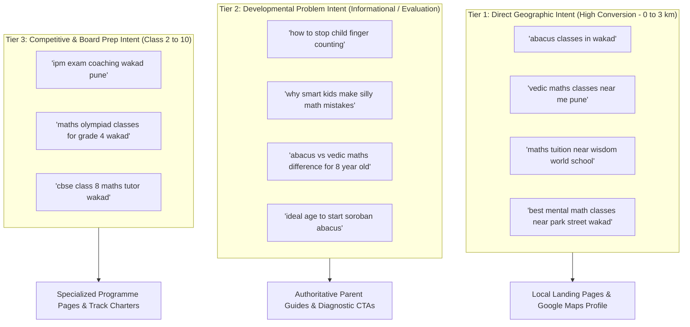

# AAA MASTER BRD — WORKSTREAM 05 (WS-05)
# LOCAL DISCOVERY, GOOGLE BUSINESS PROFILE & SEO REQUIREMENTS
**Project:** Arnav Abacus Academy (AAA), Wakad, Pune  
**Role:** Lead Business Analyst, Local SEO Architect & Organic Discovery Specialist  
**Governance Stage:** Stage 2 — Master Business Requirements Document (BRD) Workshop  
**Document Ref:** `docs/02_business_requirements/AAA_WS05_Local_Discovery_SEO_and_GBP_Requirements.md`  
**Date:** November 02, 2026 (Discovery Baseline)  
**Status:** 🟡 **DISCOVERY COMPLETE — PENDING MANAGEMENT VALIDATION**  

---

## 1. Executive Summary & Purpose

This document operationalizes **WS05-02: Local Discovery, Google Business Profile (GBP) and SEO** for Arnav Abacus Academy (AAA), Wakad, Pune.

Over 75% of parent inquiries in the Wakad and Western Pune corridor originate from hyper-local Google searches (*"abacus classes near me"*, *"Vedic maths in Wakad"*, *"best maths tuition near Park Street"*) or Google Maps discovery `[PROPOSED STRATEGY]`. This document establishes the technical and content requirements to maximize AAA's high-intent organic visibility while strictly safeguarding academic credibility, structured data integrity, and parent privacy.

---

## 2. Evidence Classification & Source-Code Baseline

All statements in this document are strictly classified under the approved governance taxonomy:

| Discovery Area | Source Code / Repository Evidence | Verified Current State | Required Baseline Classification |
|---|---|---|---|
| **Google Reviews & Rating** | Referenced in `Home.tsx:31`, `data.ts:82`, verified on Google Maps | **74+ Five-Star Reviews** on live Google Business Profile `[REPOSITORY VERIFIED / MANAGEMENT CONFIRMED]` | `[MANAGEMENT CONFIRMED]` |
| **Physical Address / NAP** | Hardcoded in `Contact.tsx:83`, `Footer.tsx:142`, `index.html:78-85` | *Flat No. 3, 1st Floor, Adv. Balaji Sagar Bungalow, Wakad, Pune 411057* | `[MANAGEMENT CONFIRMED]` |
| **Primary Contact Number** | Hardcoded in `Contact.tsx:99`, `Footer.tsx:160`, `LeadForm.tsx:627` | `+91 90219 24968` | `[MANAGEMENT CONFIRMED]` |
| **Dynamic Title & Meta Tags** | `src/components/SEOHead.tsx:22-133` | 18 routes mapped with title, meta description, and canonical URL | `[REPOSITORY VERIFIED]` |
| **Structured Data (JSON-LD)** | `index.html:68-120`, `Faqs.tsx:101-125`, `Program*.tsx` | `EducationalOrganization`, `LocalBusiness`, `FAQPage`, `Course` schemas | `[REPOSITORY VERIFIED]` |
| **Parent Guides (SEO Assets)** | `src/pages/Guide*.tsx` | 5 high-authority, long-form educational parent guide pages | `[REPOSITORY VERIFIED]` |
| **Google Search Console / GA4** | `index.html:12-25`, `src/lib/analytics.ts` | GA4 `G-M2EL9MYSRL` active; Search Console indexing state unverified | `[PENDING VALIDATION]` |

---

## 3. Local Search Intent & Parent Discovery Journeys

Parent search journeys in Wakad follow three distinct intent tiers:

---

## 4. Google Business Profile (GBP) Optimization Architecture

The Google Business Profile (GBP) listing is AAA's most powerful digital asset for foot-traffic admissions. To maximize local pack rankings (top 3 map results in Wakad), AAA must adhere to strict citation consistency:

### 4.1 NAP Citation Consistency (Name, Address, Phone)
* **Official Profile Name:** `Arnav Abacus Academy — Abacus, Vedic Maths & Child Development, Wakad, Pune` `[PROPOSED STRATEGY]`.
* **Standardized Address:**  
  *Flat No. 3, 1st Floor, Adv. Balaji Sagar Bungalow, Opp. Creative Cameo, Near Park Street, Behind Wisdom World School, Wakad, Pune, Maharashtra 411057* `[MANAGEMENT CONFIRMED]`.
* **Primary Phone:** `+91 90219 24968` `[MANAGEMENT CONFIRMED]`.
* **Primary Categories:**
  1. *Educational Institution* (Primary).
  2. *Tutoring Service* (Secondary).
  3. *Learning Centre* (Secondary).
  4. *Mathematics School* (Secondary).
* **Listing Verification & Opening Hours:** Standardize center operational hours for phone inquiries (e.g. Mon–Sat 9:00 AM – 7:30 PM) to eliminate "Closed" flags during high-intent inquiry hours `[PENDING VALIDATION]`.

### 4.2 Review & Reputation Management Policy (DEC-WS03-06 Baseline)
* **Previously Verified Review Baseline:** **74+ Five-Star Reviews** on Google Maps (`VER-03`) `[MANAGEMENT CONFIRMED / REPOSITORY VERIFIED]`.
  - *Governance Discipline:* The 74+ count is treated as a **previously verified, periodically refreshable figure**, NOT a fixed or permanent count. A quarterly review refresh schedule is mandated under `ACT-WS05-07`.
* **Strict Non-Incentivization Rule:** In accordance with `AGENTS.md` and approved Stage 2 policy, AAA **never offers fee discounts, cash vouchers, gifts, or favors in exchange for parent reviews**.
* **Review Generation Workflow:** Following successful Level Completion Milestones or positive bi-monthly pickup consultations, parents who voluntarily express delight are provided an ethical, non-pressuring review link:
  > *"If you feel Neha ma'am's patient guidance has helped your child build calculation confidence, we would deeply appreciate you sharing your experience on Google to guide other parents in Wakad."*
* **Response Protocol:** Every parent review must receive a personalized, warm, and zero-PII response within 48 business hours from Academic Director Neha Patil, thanking the family without referencing the child's full name, grade, or fees.

---

## 5. Website Information Architecture, Metadata & Technical SEO

### 5.1 Route Metadata & Canonical Structure (Audit of `SEOHead.tsx`)
Inspection of `src/components/SEOHead.tsx` confirms a well-structured dynamic metadata implementation. However, the following enhancements are required during Stage 3 architecture design:

| Route Path | Current Verified Title | Current Verified Description | Recommended Stage 3 Enhancement | Justification |
|---|---|---|---|---|
| `/` | `Arnav Abacus Academy \| Abacus & Vedic Maths Classes in Wakad, Pune` | Top-rated mental arithmetic, Abacus (ages 4-14) and Vedic Maths in Wakad, Pune. Build calculation speed... | Update to integrate approved headline: `Arnav Abacus Academy \| Beyond Calculation. Towards Confident Mathematical Thinking \| Wakad, Pune` | Embeds approved brand headline directly into search engine result pages (SERPs). |
| `/programs/abacus` | `Abacus Maths Classes in Wakad, Pune \| Arnav Abacus Academy` | Certified Japanese Soroban Abacus classes for kids aged 4-14 in Wakad, Pune... | Reconcile age bracket: `...Soroban Abacus classes for kids aged 4.5–9 in Wakad... Maximum 5 students per batch.` | Aligns with ratified age boundaries (`DEC-WS04-02`) and micro-batch cap (`DEC-WS04-11`). |
| `/programs/vedic-maths` | `Vedic Maths Classes in Wakad, Pune \| Arnav Abacus Academy` | Fast mental math shortcuts for Class 5-10 students in Wakad, Pune. 16 Vedic Sutras... | Add speed verification angle: `...Master the 16 Vedic Sutras to compute effortlessly and verify school exam answers. Ages 9–14.` | Replaces crude speed claims with academic verification value. |
| `/mentor` | `Meet Neha Patil \| Certified Master Abacus & Vedic Maths Mentor Wakad` | Learn about Neha Patil, founder and master trainer... IIVA certified, 3+ years experience coaching 200+... | Condition on `ACT-WS04-02` (VER-01 degree archive) before promoting IIVA credentials in meta descriptions. | Adheres to `AGENTS.md` Rule 6 (*No Fabricated Credentials*). |

### 5.2 Schema.org Structured Data Specifications: Substantiated vs. Recommended Schemas

> [!CAUTION]
> **Technical Realism on Structured Data:**  
> Structured data helps search engines parse page context, but **never guarantees organic ranking, featured snippets, or click-through improvements**. Furthermore, structured markup must only be deployed where the underlying business claims are fully substantiated.

1. **Substantiated Schemas (Ready for Production Baseline):**
   - **`LocalBusiness` & `EducationalOrganization`:** Substantive business facts (physical center address at Balaji Sagar Bungalow, Wakad; telephone `+91 90219 24968`; geographic coordinates `18.5985, 73.7635`) are verified and substantiated. Aggregate rating markup must dynamically reference the verified Google review count.
   - **`FAQPage`:** Active on `/faqs`. Accurately represents published questions regarding offline batch sizes and curriculum.
2. **Optional / Recommended Schemas (Subject to Stage 3 Architecture):**
   - **`Course` Schema:** Recommended for individual program pages (`/programs/*`), but must accurately label the credential awarded as *"Practice Achievement Record / Level Milestone Record"* to prevent misleading accreditation inferences.
   - **`BreadcrumbList`:** Optional UX navigation schema for mobile search clarity.
   - **Exclusion:** Schemas claiming government affiliations, accredited diplomas, or formal school board endorsements are strictly excluded until formal documentary evidence is archived.

---

## 6. Local Content Strategy: Authoritative Parent Guides & Geotargeting

### 6.1 The 5 Existing High-Authority Parent Guides (`[REPOSITORY VERIFIED]`)
AAA already possesses five comprehensive, scientifically grounded parent guides designed to capture Tier 2 developmental search intent:
1. `/parent-guides/abacus-vs-vedic-maths` — Captures parents deciding between abacus and Vedic math for 7–10 year olds.
2. `/parent-guides/does-abacus-confuse-school-math` — Directly resolves the #1 parent hesitation in Wakad.
3. `/parent-guides/why-children-use-finger-counting` — Captures anxious parents of 6–8 year olds seeking concrete remediation.
4. `/parent-guides/why-smart-children-make-silly-math-mistakes` — Captures parents of capable students losing marks to procedural slips.
5. `/parent-guides/ideal-age-to-start-abacus` — Captures parents of preschoolers and kindergarteners evaluating developmental readiness.

### 6.2 Location-Specific Keyword Integration (Stage 3 Architecture Requirement)
Content across programme pages and parent guides must naturally incorporate hyper-local landmark references without awkward keyword stuffing:
- Landmark anchors: *"Behind Wisdom World School"*, *"Opposite Creative Cameo"*, *"Near Park Street Wakad"*, *"Minutes from Kaspate Vasti and Bhujbal Chowk"*.
- Catchment references: Serving families across *Wakad, Pimple Saudagar, Hinjawadi Phase 1–3, Tathawade, and Thergaon*.

---

## 7. Zero-PII Organic Analytics & Search Measurement

In strict compliance with `AGENTS.md` Rule 4 (*Zero-PII Analytics Protocol*):
* **No Search Queries Linked to Personal Data:** Search Console terms and Google Analytics route transitions (`trackPageView` in `SEOHead.tsx:210`) must never be stitched to student names, phone numbers, or inquiry payloads.
* **UTM Campaign Governance:** Local organic links (GBP website button, review links) must carry standardized tracking parameters:
  `utm_source=google_business_profile&utm_medium=organic&utm_campaign=local_listing`.

---

## 8. Governance & Evidence Traceability Summary

* **Dependencies Carried Forward:**
  - `ACT-WS04-02`: Degree credential archive (VER-01) required before updating `/mentor` meta tags.
  - `ACT-WS04-27`: Affiliation dossier required before including external accreditation schema.
* **Governance Status:** 🟡 **DOCUMENTATION COMPLETE — AWAITING MANAGEMENT VALIDATION IN WORKSHOP PACK**
