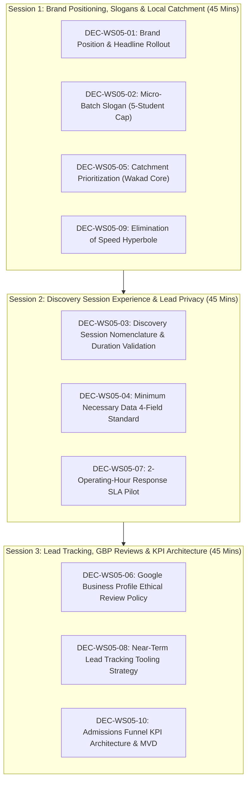

# AAA MASTER BRD — WORKSTREAM 05 (WS-05)
# MANAGEMENT VALIDATION WORKSHOP PACK
## Executive Decision Instrument & Stage-Gate Approval Preparation

**Project:** Arnav Abacus Academy (AAA), Wakad, Pune  
**Workstream:** WS-05 — Marketing, Lead Generation & Conversion Architecture  
**Stage:** Stage 2 — Master Business Requirements Document (BRD) Workshop  
**Document Ref:** `docs/02_business_requirements/AAA_WS05_Management_Validation_Workshop_Pack.md`  
**Date:** November 02, 2026  
**Auditor / Specialist:** Lead Business Analyst, Growth Marketing Strategist & Governance Specialist  
**Governance Authority:** Neha Patil (Founder & Academic Director) & Nitin Patil (Operations & Technology Lead)  
**Document Status:** 🟡 **EXECUTIVE WORKSHOP PACK PREPARED — ALL 10 DECISIONS PENDING MANAGEMENT DETERMINATION**  

---

## 1. Executive Summary & Purpose

This workshop pack provides **Neha Patil** (Founder & Academic Director) and **Nitin Patil** (Center Operations & Technology Lead) with an authoritative, evidence-supported decision instrument to review, validate, adjust, and determine the strategic marketing, lead generation, and conversion architecture for Arnav Abacus Academy.

### Non-Negotiable Governance Rules for this Workshop:
1. **Advisory Nature of Antigravity Recommendations:** All recommendations presented in this pack are strictly technical and analytical guidance. No decision is approved on behalf of management.
2. **Blank Decision Recording Fields:** Every management decision outcome field is provided completely unpopulated (`[ ____________________ ]`) for executive determination. Outcome options: `APPROVED`, `APPROVED WITH CONDITIONS`, `APPROVED AS PILOT`, `DEFERRED`, or `REJECTED`.
3. **Preservation of Prior Ratified Baselines:** All decisions ratified in Stage 1, WS-01, WS-02, WS-03, and WS-04 are preserved intact.
4. **Zero Code or Website Modifications:** In accordance with `AGENTS.md`, this workshop is strictly documentation-only. No live application code, website copy, Google Business Profile settings, or database configurations will be modified during Stage 2.
5. **No Invented baselines:** No baseline conversion percentages, CAC values, competitor student counts, or market estimates are invented.

---

## 2. Matters Excluded from Immediate Workshop Approval (Explicit Exclusions)

To protect the academy from premature financial commitments or operational overreach, management is advised that the following matters **cannot be approved** during this workshop:

1. **Commercial Advertising Budgets:** Spending capital on paid digital ads (Google Search Ads, Meta/Instagram Ads) cannot be approved until organic local conversion baselines from Google Maps and website discovery are measured in Stage 4.
2. **Paid CRM SaaS Contracts:** Licensing enterprise CRM subscriptions (HubSpot, Salesforce) is rejected; boutique micro-batch operations do not warrant expensive multi-seat software contracts.
3. **Immediate Live Website Rewrites:** Re-writing live website pages (`Hero.tsx`, `LeadForm.tsx`) cannot be approved during Stage 2; all code modifications must follow the Stage 3 Architecture Blueprint and occur in Stage 4.
4. **Arbitrary Numerical Quotas:** Mandating rigid commercial conversion targets (e.g. "achieve 80% demo-to-admission") without 60 days of empirical baseline measurement is excluded.

---

## 3. Ten-Decision Executive Reconciliation Matrix

The table below summarizes the ten strategic decisions for executive determination:

| Decision ID | Decision Subject | Core Strategic Question | Recommended Management Outcome (Advisory Only) | Accountable Decision-Maker | Required Input / Dependency |
|---|---|---|---|:---:|---|
| **DEC-WS05-01** | Brand Slogan | Should AAA mandate the approved brand position and headline across all marketing touchpoints? | **APPROVE WITH CONDITIONS** (Approve master brand positioning and headline across marketing touchpoints, with channel-appropriate adaptation) | Neha Patil & Nitin Patil | Stage 3 website copywriting sprint. |
| **DEC-WS05-02** | Batch Cap | Should AAA strictly enforce "maximum 5 students per batch" and deprecate legacy "1:8" claims? | **APPROVE** (Approve maximum five students per batch and removal of legacy 1:8 claims) | Nitin Patil & Neha Patil | Facility seating capacity audit (`ACT-WS04-08`). |
| **DEC-WS05-03** | Funnel CTA | Should all primary CTAs standardize on "AAA Personalised Learning Discovery Session"? | **APPROVE** (Approve standardised discovery-session CTA and service naming) | Neha Patil | Session duration validation (`ACT-WS05-01`). |
| **DEC-WS05-04** | Privacy / Form | Should public inquiry forms restrict data collection to 4 core fields, banning intrusive child data? | **APPROVE WITH CONDITIONS** (Approve minimum-necessary enquiry data with privacy, consent and retention conditions) | Nitin Patil | Legal review of consent text (`ACT-WS04-07`, `ACT-WS05-05`). |
| **DEC-WS05-05** | Geography | How should local SEO and marketing energy be prioritized geographically? | **APPROVE WITH CONDITIONS** (Approve Wakad-first local acquisition strategy; treat 0–3 km as a hypothesis, not an exclusive catchment) | Nitin Patil | Local catchment audit (`ACT-WS05-08`). |
| **DEC-WS05-06** | Reputation | Should AAA adopt the non-incentivized Google review generation and response policy? | **APPROVE** (Approve voluntary, non-incentivised review policy) | Nitin Patil & Neha Patil | Live review refresh schedule (`ACT-WS05-07`). |
| **DEC-WS05-07** | Response SLA | Should AAA operationalize the 2-operating-hour inquiry follow-up standard during center hours? | **APPROVE AS PILOT** (Approve the two-operating-hour response standard as a pilot, subject to declared operating hours and workload) | Nitin Patil | Center operating hours confirmation (`EVD-MKT-04`). |
| **DEC-WS05-08** | Tooling | What technical instrument should govern lead tracking prior to Stage 4 AcademyOS private DB? | **DEFER** (Defer final spreadsheet/CRM selection until access, security, ownership, retention and backup requirements are documented) | Nitin Patil | Security & access assessment (`ACT-WS05-06`). |
| **DEC-WS05-09** | Copy Discipline | Should AAA eliminate legacy "10x to 15x faster" claims in favor of exam verification language? | **APPROVE** (Approve removal of unsupported speed claims and evidence-led educational messaging) | Neha Patil | Pedagogical copy guidelines. |
| **DEC-WS05-10** | Measurement | Should AAA adopt the 17-metric KPI dictionary and 3-tier reporting cadence? | **APPROVE WITH CONDITIONS / PILOT** (Approve KPI framework in principle; pilot a minimum viable dashboard and defer numerical targets) | Nitin Patil & Neha Patil | Baseline conversion audit (`ACT-WS05-03`, `ACT-WS05-10`). |

---

## 4. Detailed Decision Evaluation Sheets

### DEC-WS05-01: Master Brand Positioning & Headline Rollout
* **Core Question:** Should AAA mandate the approved brand position (*“Arnav Abacus Academy – A Premium Mathematical Thinking & Child Development Academy”*) and approved headline (*“Beyond Calculation. Towards Confident Mathematical Thinking”*) sitewide across all marketing touchpoints?
* **Antigravity Advisory Recommendation:** **APPROVE WITH CONDITIONS**
* **Recommended Terms:** Approve the master brand positioning and headline across all marketing touchpoints, permitting channel-appropriate adaptations (e.g. character limits in Google Business Profile or mobile banners) while strictly preserving the core meaning.
* **Alternatives Considered:**
  - *Alternative 1:* Retain exploratory hero headline in `Hero.tsx` (*"Build Mathematical Confidence. Unlock Your Child's Potential"*).
  - *Alternative 2:* Draft unaligned marketing slogans for social media.
* **Evidence Available:** Ratified decisions `DEC-WS02-01` and `DEC-WS02-02`; positive parental resonance in Stage 1 interviews.
* **Evidence Missing:** None on brand positioning principles; copywriting adaptations to be reviewed in Stage 3.
* **Business Implications:** Establishes strong brand differentiation in Wakad, elevating AAA above generic math tuition classes.
* **Conditions Before Rollout:** Character limits and layout aesthetics must be validated during Stage 3 UI design.
* **Accountable Decision-Maker:** **Academic Director (Neha Patil)** & **Operations Lead (Nitin Patil)**.
* **Management Determination:** **APPROVED WITH CONDITIONS** *(Joint Management Direction of Neha Patil & Nitin Patil on Nov 03, 2026)*

---

### DEC-WS05-02: Micro-Batch Size Marketing Slogan Remediation (5-Student Cap)
* **Core Question:** Should AAA strictly enforce the "maximum 5 students per batch" slogan across all digital assets and deprecate legacy "1:8" references in Hero and LeadForm components?
* **Antigravity Advisory Recommendation:** **APPROVE**
* **Recommended Terms:** Approve maximum five students per batch as the universal marketing standard and authorize the complete removal/deprecation of all legacy "1:8" claims from website copy, forms, and diagnostic PDFs in Stage 4.
* **Alternatives Considered:**
  - *Alternative 1:* Maintain "1:8" in marketing while teaching 5 students in practice.
  - *Alternative 2:* Increase physical batch sizes to 8 students.
* **Evidence Available:** Ratified decisions `DEC-WS02-05` and `DEC-WS04-11`; confirmed operational practice at Balaji Sagar Bungalow.
* **Evidence Missing:** Verification of simultaneous physical seating capacity (`ACT-WS04-08`).
* **Business Implications:** Eliminates severe operational contradiction; defends premium tuition pricing.
* **Conditions Before Rollout:** Classroom layout audit must confirm seating compliance (`ACT-WS04-08`).
* **Accountable Decision-Maker:** **Operations Lead (Nitin Patil)** & **Academic Director (Neha Patil)**.
* **Management Determination:** **APPROVED** *(Joint Management Direction of Neha Patil & Nitin Patil on Nov 03, 2026)*

---

### DEC-WS05-03: Discovery Session Nomenclature & Deliverable Standardization
* **Core Question:** Should all primary CTAs standardize on "AAA Personalised Learning Discovery Session" and deliver the "AAA Demo Observation & Learning Recommendation"?
* **Antigravity Advisory Recommendation:** **APPROVE**
* **Recommended Terms:** Approve standardised discovery-session CTA and service naming across all website buttons and marketing campaigns: **"Book an AAA Personalised Learning Discovery Session"** and deliver the **"AAA Demo Observation & Learning Recommendation"**. The session must evaluate the **six approved educational observation dimensions**: (1) Number Sense, (2) Arithmetic Understanding, (3) Logical Approach, (4) Learning Attitude, (5) Response and Engagement, and (6) Interest and Learning Passion (strictly educational and non-diagnostic).
* **Alternatives Considered:**
  - *Alternative 1:* Continue using generic "Free Demo Class" terminology.
  - *Alternative 2:* Use commercial "Trial Class Assessment" wording.
* **Evidence Available:** Customer journey ratification (`DEC-WS03-02`).
* **Evidence Missing:** Operational validation of session duration (`ACT-WS05-01`).
* **Business Implications:** Positions the trial as an educational milestone rather than a high-pressure sales pitch.
* **Conditions Before Rollout:** Neha Patil validates actual operational session duration (~45–90 min historical free session) vs proposed 35–45 min sequence and session delivery roles (`ACT-WS05-01`).
* **Accountable Decision-Maker:** **Academic Director (Neha Patil)**.
* **Management Determination:** **APPROVED** *(Joint Management Direction of Neha Patil & Nitin Patil on Nov 03, 2026)*

---

### DEC-WS05-04: Minimum Necessary Data Lead Form Standard
* **Core Question:** Should public inquiry forms restrict data collection to 4 core fields, banning intrusive child data at discovery stage?
* **Antigravity Advisory Recommendation:** **APPROVE WITH CONDITIONS**
* **Recommended Terms:** Approve minimum-necessary enquiry data standard restricting general web discovery forms to 4 core fields:
  1. Parent Name (required)
  2. Mobile / WhatsApp Number (required)
  3. Child Age Bracket OR School Grade (one required, not both)
  4. Programme of Interest (optional)
  *Conditions:*
  - Dual consent architecture: separate opt-in for direct inquiry response (mandatory to submit) vs promotional updates (optional). A parent declining promotional communication must still be fully able to submit an enquiry.
  - Published privacy notice before live form launch.
  - Strict prohibition against collecting exact child DOB, school name, home address, or clinical/learning-difficulty checkboxes at initial inquiry.
  - The proposed 90-day retention/deletion timeline is an **unapproved proposal pending legal/privacy review** (`ACT-WS05-05`). Unconverted enquiry records must be distinguished from admitted-student records with separate statutory retention obligations.
  - Technical privacy controls are requirements for Stage 3/4 design and not currently technically implemented.
* **Alternatives Considered:**
  - *Alternative 1:* Retain 10-field diagnostic checklist on initial web forms.
  - *Alternative 2:* Rely 100% on bare WhatsApp click buttons without web forms.
* **Evidence Available:** `DEC-WS03-04` (Minimum Necessary Data Principle); DPDP Act child-data guidelines.
* **Evidence Missing:** Legal review of specific consent checkbox language (`ACT-WS04-07`, `ACT-WS05-05`).
* **Business Implications:** Drastically cuts mobile conversion drop-off while guaranteeing child privacy compliance.
* **Conditions Before Rollout:** Legal counsel sign-off on form consent text and retention schedule prior to Stage 4 implementation (`ACT-WS05-05`).
* **Accountable Decision-Maker:** **Operations Lead (Nitin Patil)**.
* **Management Determination:** **APPROVED WITH CONDITIONS** *(Joint Management Direction of Neha Patil & Nitin Patil on Nov 03, 2026)*

---

### DEC-WS05-05: Hyper-Local Geographic Catchment Prioritization
* **Core Question:** How should local SEO and marketing energy be prioritized geographically (Wakad core vs. secondary PCMC catchment)?
* **Antigravity Advisory Recommendation:** **APPROVE WITH CONDITIONS**
* **Recommended Terms:** Approve Wakad-first local acquisition strategy; treat 0–3 km (Wakad Central, Park Street, Wisdom World vicinity) as an operational hypothesis and primary focus, not an exclusive market boundary. Validate secondary PCMC catchment (Hinjawadi, Pimple Saudagar, Tathawade) through empirical inquiry data (`ACT-WS05-08`).
* **Alternatives Considered:**
  - *Alternative 1:* Spend marketing resources aggressively across the entire Pune municipal region.
  - *Alternative 2:* Position AAA exclusively as an online global academy.
* **Evidence Available:** Physical center address at Balaji Sagar Bungalow, Wakad `[MANAGEMENT CONFIRMED]`.
* **Evidence Missing:** Empirical student residential cluster analysis (`ACT-WS05-08`).
* **Business Implications:** Maximizes conversion efficiency within immediate walking/driving distance of the center.
* **Conditions Before Rollout:** Tabulation of active student census by residential society (`ACT-WS05-08`).
* **Accountable Decision-Maker:** **Operations Lead (Nitin Patil)**.
* **Management Determination:** **APPROVED WITH CONDITIONS** *(Joint Management Direction of Neha Patil & Nitin Patil on Nov 03, 2026)*

---

### DEC-WS05-06: Google Business Profile & Ethical Review Generation Policy
* **Core Question:** Should AAA adopt the non-incentivized Google review generation and response policy?
* **Antigravity Advisory Recommendation:** **APPROVE**
* **Recommended Terms:** Approve voluntary, non-incentivised review policy: reviews are 100% voluntary, zero fee discounts or gifts, requested only following milestone completions, with 48-hour zero-PII founder response protocols. Treat 74+ count as a periodically refreshable baseline (`ACT-WS05-07`).
* **Alternatives Considered:**
  - *Alternative 1:* Offer fee vouchers or gifts for Google reviews.
  - *Alternative 2:* Cease requesting reviews altogether.
* **Evidence Available:** 74+ five-star reviews on live Google Business Profile (`VER-03`).
* **Evidence Missing:** Quarterly review refresh schedule documentation (`ACT-WS05-07`).
* **Business Implications:** Builds authentic, unassailable local reputation on Google Maps in full compliance with advertising laws.
* **Conditions Before Rollout:** Implementation of quarterly review audit schedule (`ACT-WS05-07`).
* **Accountable Decision-Maker:** **Operations Lead (Nitin Patil)** & **Academic Director (Neha Patil)**.
* **Management Determination:** **APPROVED** *(Joint Management Direction of Neha Patil & Nitin Patil on Nov 03, 2026)*

---

### DEC-WS05-07: Inquiry Response Operating Service Standard
* **Core Question:** Should AAA operationalize the 2-operating-hour inquiry follow-up standard during center hours?
* **Antigravity Advisory Recommendation:** **APPROVE AS PILOT**
* **Recommended Terms:** Approve the two-operating-hour response standard as a pilot, subject to declared operating hours (Mon–Sat 9:30 AM – 7:30 PM) and founder classroom workload. Founder teaching priority protected.
* **Alternatives Considered:**
  - *Alternative 1:* Mandate 24/7 round-the-clock responses.
  - *Alternative 2:* Respond only once weekly in batches.
* **Evidence Available:** `DEC-WS03-03` (Approved as pilot target in WS-03).
* **Evidence Missing:** Formal written policy on center inquiry operating hours (`EVD-MKT-04`).
* **Business Implications:** Captures high-intent parents promptly without causing educator burnout.
* **Conditions Before Rollout:** Declaration of official inquiry operating hours (`EVD-MKT-04`).
* **Accountable Decision-Maker:** **Operations Lead (Nitin Patil)**.
* **Management Determination:** **APPROVED AS PILOT** *(Joint Management Direction of Neha Patil & Nitin Patil on Nov 03, 2026)*

---

### DEC-WS05-08: Near-Term Lead Tracking Tooling Strategy
* **Core Question:** What technical instrument should govern lead tracking prior to Stage 4 AcademyOS private database cutover?
* **Antigravity Advisory Recommendation:** **DEFER**
* **Recommended Terms:** Defer permanent commercial CRM tool selection. Authorize interim lead management via controlled manual/spreadsheet protocol **strictly after** completing mandatory prerequisites `ACT-WS05-05` (privacy notice & retention review) and `ACT-WS05-06` (security, access control, and formula sanitization assessment). Standardize the refined admissions lifecycle:
  1. `New Enquiry`
  2. `Contacted`
  3. `Discovery Session Booked`
  4. `Discovery Session Attended`
  5. `Admission Completed` *(Counting Criterion: requires verified tuition payment and official registration; expressions of interest strictly NOT counted)*
  6. `Decision Pending`
  7. `Closed – Not Proceeding`
  8. `Follow-up Later`  
  WhatsApp must not remain the sole, unbacked record of admissions interactions.
* **Alternatives Considered:**
  - *Alternative 1:* Authorize immediate unvetted Google Sheets production integration.
  - *Alternative 2:* License an expensive external commercial CRM (HubSpot/Salesforce).
  - *Alternative 3:* Defer all structured tracking until Stage 4 AcademyOS.
* **Evidence Available:** `leadWebhook.ts` and `localStorage` baseline in codebase.
* **Evidence Missing:** Access control, formula sanitization, and retention specification (`ACT-WS05-06`).
* **Business Implications:** Prevents premature data architecture commitments or SaaS expenditure while eliminating lost-lead leakage.
* **Conditions Before Rollout:** Completion and sign-off on `ACT-WS05-05` and `ACT-WS05-06` prior to initiating any new centralized lead register.
* **Accountable Decision-Maker:** **Operations Lead (Nitin Patil)**.
* **Management Determination:** **DEFERRED** *(Joint Management Direction of Neha Patil & Nitin Patil on Nov 03, 2026)*

---

### DEC-WS05-09: Elimination of Speed Hyperbole & Multiplier Claims
* **Core Question:** Should AAA eliminate legacy "10x to 15x faster" claims in favor of exam verification language?
* **Antigravity Advisory Recommendation:** **APPROVE**
* **Recommended Terms:** Approve removal of unsupported speed claims ("10x to 15x") and adopt evidence-led educational messaging emphasizing mental calculation poise, procedural error reduction, and exam verification speed in Stage 4.
* **Alternatives Considered:**
  - *Alternative 1:* Keep 10x-15x claims for marketing impact.
  - *Alternative 2:* Remove Vedic math marketing entirely.
* **Evidence Available:** `src/data.ts:38` and `CAMPAIGNS:141` in codebase; `AGENTS.md` Section 3.2.
* **Evidence Missing:** None; copy refactoring to be drafted in Stage 3.
* **Business Implications:** Replaces gimmicky claims with authoritative academic rigor valued by educated parents.
* **Conditions Before Rollout:** Stage 3 copywriting guidelines.
* **Accountable Decision-Maker:** **Academic Director (Neha Patil)**.
* **Management Determination:** **APPROVED** *(Joint Management Direction of Neha Patil & Nitin Patil on Nov 03, 2026)*

---

### DEC-WS05-10: Admissions Funnel KPI Architecture & Cadence
* **Core Question:** Should AAA adopt the 17-metric KPI dictionary and 3-tier reporting cadence?
* **Antigravity Advisory Recommendation:** **APPROVE WITH CONDITIONS / PILOT**
* **Recommended Terms:** Approve KPI framework in principle; pilot a Minimum Viable Dashboard (6 weekly metrics: New Inquiries, Qualified Inquiries, Discovery Sessions Booked, Discovery Sessions Attended, Paid Admissions Confirmed, Pending Follow-Up Queue; 6 monthly metrics; 5 quarterly metrics). All ratio metrics must define explicit numerators/denominators and display `N/A` when denominator is 0. Defer numerical quotas and targets until an empirical **four-week baseline collection period** post-implementation is completed (`ACT-WS05-10`).
* **Alternatives Considered:**
  - *Alternative 1:* Arbitrarily mandate rigid commercial conversion targets immediately.
  - *Alternative 2:* Operate without structured admissions metrics.
* **Evidence Available:** Analytics event infrastructure in `src/lib/analytics.ts` (`G-M2EL9MYSRL`).
* **Evidence Missing:** Empirical baseline conversion data from manual registers (`ACT-WS05-03`).
* **Business Implications:** Provides objective visibility into marketing health without administrative burden.
* **Conditions Before Rollout:** Baseline reconciliation against active student census (`ACT-WS04-03`, `ACT-WS05-03`) and completion of 4-week baseline logging.
* **Accountable Decision-Maker:** **Operations Lead (Nitin Patil)** & **Academic Director (Neha Patil)**.
* **Management Determination:** **APPROVED WITH CONDITIONS / PILOT** *(Joint Management Direction of Neha Patil & Nitin Patil on Nov 03, 2026)*

---

## 5. Workstream 05 Priority Action Register (All 10 Actions)

> [!IMPORTANT]
> **Requirements Approval vs. Operational Implementation Boundary:**  
> The ten actions tabulated below represent operational implementation, evidence gathering, and administrative audits. **They are NOT all prerequisites for WS-05 business requirements document closure.** Management sign-off on WS-05 ratifies the architectural requirements and policies. In particular, `ACT-WS05-05` and `ACT-WS05-06` are operational prerequisites to commencing a new live lead-register process, not barriers to requirements approval. No action may be marked complete without verified evidence and explicit acceptance by its designated authority.

| Action ID | Action Title & Deliverable | Proposed Owner | Owner Status | Required Evidence | Dependencies | Priority | Due Date / Target Milestone | Completion Criteria | Evidence Acceptance Authority | Current Status |
|---|---|:---:|:---:|---|---|:---:|:---:|---|:---:|:---:|
| **ACT-WS05-01** | Discovery Session Duration Validation | Neha Patil | Pending Confirmation | Written memo (`Discovery_Session_Workflow_Validation_Memo.pdf`) | Observation log review | P1 | Stage 2 Workshop (Day 1) | Formal validation of actual duration (~45–90 min) vs proposed 35–45 min sequence and delivery roles. | Neha Patil (Academic Director) | Open — Pending Review |
| **ACT-WS05-02** | Lead-Source Baseline Analysis | Nitin Patil | Pending Confirmation | Tabulated report (`Historical_Lead_Source_Distribution_Report.xlsx`) | WhatsApp chat archives & phone logs | P1 | Stage 2 Workshop (Day 1) | Nominal categorization of last 50 inquiries by source with documented caveats. | Nitin Patil (Operations Lead) | Open — Pending Audit |
| **ACT-WS05-03** | Admission Conversion Baseline Reconciliation | Nitin Patil | Pending Confirmation | Reconciliation sheet (`Inquiry_to_Admission_Conversion_Baseline.xlsx`) | Active census roll (`ACT-WS04-03`) | P1 | Stage 2 Workshop (Day 3) | Calculated baseline CVR rates across booking, attendance, and paid admissions. | Nitin Patil & Neha Patil | Open — Pending Audit |
| **ACT-WS05-04** | Lost-Enquiry Reason Taxonomy Audit | Nitin Patil | Pending Confirmation | Classification memo (`Lost_Enquiry_Reason_Analysis_Memo.pdf`) | Historical follow-up logs | P2 | Prior to Stage 3 kickoff | Past un-enrolled inquiries classified into standard lost reason codes (`LOST-01..06`). | Nitin Patil (Operations Lead) | Open — Pending Review |
| **ACT-WS05-05** | Enquiry Privacy, Notice & Retention Review | Nitin Patil & Legal | Pending Confirmation | Specification document (`Enquiry_Form_Privacy_Notice_Specification.pdf`) | DEC-WS05-04 review | P1 | Prior to lead-register rollout | Legal review of 4-field form, dual consent text, and retention rule. **Operational prerequisite to new lead register.** | Nitin Patil & Legal Counsel | Open — Mandatory Prerequisite |
| **ACT-WS05-06** | Lead Tracking Tool Access & Security Assessment | Solution Architect | Pending Confirmation | Technical security assessment (`Lead_Tracking_Tool_Security_and_Access_Memo.pdf`) | Webhook review (`leadWebhook.ts`) | P1 | Stage 2 Workshop (Day 2) | Security, access control, 2FA, and formula sanitization verified. **Operational prerequisite to new lead register.** | Solution Architect & Nitin Patil | Open — Mandatory Prerequisite |
| **ACT-WS05-07** | Google Business Profile Refresh Protocol | Nitin Patil | Pending Confirmation | Verification schedule (`Google_Review_Verification_and_Refresh_Schedule.pdf`) | Google Business Profile access | P2 | Prior to Stage 3 kickoff | Quarterly audit cadence established verifying voluntary reviews and 74+ baseline. | Nitin Patil (Operations Lead) | Open — Baseline Verified |
| **ACT-WS05-08** | Local Catchment Validation & Cluster Audit | Nitin Patil | Pending Confirmation | Spatial analysis memo (`Wakad_Catchment_Student_Cluster_Analysis.pdf`) | Student address records (`ACT-WS04-03`) | P2 | Prior to Stage 3 kickoff | Coarse geographic cluster analysis validating 0–3 km operational hypothesis. | Nitin Patil (Operations Lead) | Open — Pending Audit |
| **ACT-WS05-09** | Competitor Claim Substantiation & Mystery Audit | Nitin Patil | Pending Confirmation | Mystery audit dossier (`Wakad_Math_Academy_Competitor_Benchmarking.pdf`) | Field observation | P2 | Prior to Stage 3 kickoff | Documented fee and batch size benchmarking across 3 franchise centers. | Nitin Patil (Operations Lead) | Open — Pending Audit |
| **ACT-WS05-10** | KPI Validation & Minimum Viable Dashboard Spec | Solution Architect | Pending Confirmation | Technical specification (`Admissions_MVD_Specification_and_Data_Rules.pdf`) | KPI framework review | P2 | Prior to Stage 3 kickoff | Detailed data-capture rules, 4-week baseline logging protocol, and MVD review template. | Solution Architect & Management | Open — Pending Review |

---

## 6. Empirical Evidence Dependency Matrix

| Evidence ID | Focus Area | Required Empirical Evidence | Current Status | Accountable Owner | Downstream Dependency |
|---|---|---|---|:---:|---|
| **EVD-MKT-01** | Competitor Intelligence | Mystery audit of tuition fees and batch sizes across 3 major franchise centers in Wakad | `[EXTERNAL EVIDENCE REQUIRED]` | Nitin Patil | Value proposition pricing justification (`ACT-WS05-09`). |
| **EVD-MKT-02** | Search Console Baseline | Google Search Console indexing status, impressions, and top organic query report | `[PENDING VALIDATION]` | Solution Architect | Local SEO keyword prioritization (`SEOHead.tsx`). |
| **EVD-MKT-03** | Mobile Traffic Baseline | Historical 90-day mobile vs desktop session distribution from GA4 (`G-M2EL9MYSRL`) | `[PENDING VALIDATION]` | Solution Architect | Mobile thumb-zone UI optimization (`ACT-WS05-10`). |
| **EVD-MKT-04** | Operating Hours | Documented center operating schedule governing telephone and WhatsApp responses | `[PROPOSED / PENDING CONFIRMATION]` | Nitin Patil | 2-operating-hour inquiry SLA enforcement (`ACT-WS04-03`, `DEC-WS05-07`). |
| **EVD-MKT-05** | Inquiry Conversion Baseline | Historical nominal reconciliation of inquiries vs admissions from manual registers | `[PENDING VALIDATION]` | Nitin Patil | Funnel conversion baseline (`KPI-12`, `KPI-13`, `ACT-WS05-03`). |
| **EVD-MKT-06** | Review Count Verification | Quarterly verification of live Google Business Profile reviews (current: 74+) | `[MANAGEMENT CONFIRMED]` | Nitin Patil | Sitewide social proof counters (`VER-03`, `ACT-WS05-07`). |
| **EVD-MKT-07** | Lead Webhook Security | Verification of environment variable `VITE_LEADS_WEBHOOK_URL` in production hosting | `[REPOSITORY VERIFIED in code; PENDING VALIDATION in prod]` | Solution Architect | Centralized lead capture automation (`leadWebhook.ts`, `ACT-WS05-06`). |

---

## 7. Website & SEO Forensic Source-Code Reconciliation Matrix

The table below reconciles all website findings against verified source-code evidence in `src/`, specifying the business impact, recommended requirements, open dependencies, and acceptance criteria:

| File & Component | Current Behaviour in Source Code | Business / Governance Impact | Recommended Requirement | Evidence / Validation Still Required | Proposed Acceptance Criteria |
|---|---|---|---|---|---|
| **`src/components/Hero.tsx:55-58`** | Renders exploratory headline: *"Build Mathematical Confidence. Unlock Your Child's Potential."* `[REPOSITORY VERIFIED]` | Weakens brand equity; fails to reflect ratified Stage 2 child-development positioning. | Update hero headline to ratified text: *"Beyond Calculation. Towards Confident Mathematical Thinking."* | Stage 3 typography & mobile line-break check. | Verified text match with approved headline across all screen widths. |
| **`Hero.tsx:69`, `LeadForm.tsx:208, 234`, `data.ts:64, 86`** | Repeatedly renders legacy claim: *"Guaranteed 1:8 Micro-Batches"* or *"1:8 batch ratio"*. `[REPOSITORY VERIFIED]` | Severe operational contradiction; conflicts with ratified 5-student cap (`DEC-WS02-05`). | Mandate universal slogan: *"maximum of five students per batch"*; remove all "1:8" strings. | Facility seating capacity audit (`ACT-WS04-08`). | Zero occurrences of "1:8" across entire repository codebase. |
| **`Hero.tsx:88`, `Home.tsx:71`, `data.ts:132`** | Conflicting CTA strings: *"Book a Parent Counselling Session"*, *"Book a Free Demo"*, *"Free Math Demo"*. `[REPOSITORY VERIFIED]` | Creates parent funnel confusion; sounds like a commercial sales pitch. | Standardize primary CTAs to: *"Book an AAA Personalised Learning Discovery Session"*. | Neha Patil validation of session duration (`ACT-WS05-01`). | Consistent button label across hero, navigation, cards, and footer. |
| **`src/data.ts:38`, `CAMPAIGNS:141`** | Promotes speed hyperbole: *"Accelerates numerical evaluations by 10x to 15x"*. `[REPOSITORY VERIFIED]` | Violates `AGENTS.md` Section 3.2; undermines academic credibility with educated Wakad parents. | Replace with pedagogical language: mental calculation poise, procedural error reduction, exam verification. | Stage 3 copy guidelines. | Elimination of unverified multiplier claims from all data files. |
| **`src/components/Hero.tsx:73`** | Badges founder as: *"IIVA Delhi Certified Mentors"*. `[REPOSITORY VERIFIED]` | Violates `AGENTS.md` Rule 6 if unarchived; lacks formal documentary backing in repo. | Condition public credential claims on physical degree/certificate archive (`ACT-WS04-02` / `VER-01`). | Archival scans of MCA and trainer certifications (`ACT-WS04-02`). | Credential dossier verified before Stage 4 deployment. |
| **`src/components/LeadForm.tsx:20-42`** | Form collects 10+ fields (habits, curriculum, child age, country code) and auto-generates 3-page PDF. `[REPOSITORY VERIFIED]` | High conversion friction on mobile; collects unnecessary child habit data at discovery stage. | Streamline to 4 core fields (Parent Name, Mobile, Age Bracket, Programme) + consent checkbox. | Legal review of consent text (`ACT-WS05-05`). | Form submission payload matches Minimum Necessary Data standard. |
| **`src/components/SEOHead.tsx:108-118`** | Injects Schema.org metadata (`EducationalOrganization`, `LocalBusiness`, `FAQPage`, `Course`). `[REPOSITORY VERIFIED]` | Structured data aids parsing, but does NOT guarantee search engine ranking. | Retain substantiated schemas; ensure Course schema labels credentials as *"Practice Achievement Records"*. | Stage 3 structured data review. | Rich snippet testing tool validation with zero accreditation overreach. |
| **`Contact.tsx:83`, `Footer.tsx:142`, Google Maps** | References 74+ Five-Star Google Reviews. `[REPOSITORY VERIFIED / MANAGEMENT CONFIRMED]` | Powerful local social proof; must be maintained as a refreshable, non-permanent figure. | Establish quarterly review verification and refresh schedule (`ACT-WS05-07`); mandate voluntary reviews. | Quarterly Google Business Profile audit (`ACT-WS05-07`). | Documented review count audit log updated every 90 days. |

---

## 8. Three-Session Management Workshop Agenda



### Session 1: Brand Positioning, Slogans & Local Catchment (45 Mins)
* **Focus Decisions:** `DEC-WS05-01`, `DEC-WS05-02`, `DEC-WS05-05`, `DEC-WS05-09`.
* **Objective:** Align on the universal website headline (*"Beyond Calculation"*), mandate the removal of legacy "1:8" claims to enforce the 5-student cap, validate the 0–3 km Wakad catchment hypothesis, and eliminate "10x to 15x" speed hyperbole.

### Session 2: Discovery Session Experience & Lead Privacy (45 Mins)
* **Focus Decisions:** `DEC-WS05-03`, `DEC-WS05-04`, `DEC-WS05-07`.
* **Objective:** Validate actual operational discovery session duration with Neha Patil (reconciling historical 45–90 min practice with proposed sequence), approve the 4-field inquiry form standard, and establish the 2-hour response pilot while protecting founder teaching hours.

### Session 3: Lead Tracking, GBP Reviews & KPI Architecture (45 Mins)
* **Focus Decisions:** `DEC-WS05-06`, `DEC-WS05-08`, `DEC-WS05-10`.
* **Objective:** Ratify the ethical review generation policy, determine the temporary lead tracking approach (deferring CRM until security assessment), and adopt the Minimum Viable Dashboard (MVD) metrics.

---

## 9. Unresolved Questions for Neha Patil & Nitin Patil

Before finalizing decisions, management should review the following operational questions:

1. **Discovery Session Duration & Sequencing (For Neha Patil):**
   - *Question:* In day-to-day practice, how long do discovery sessions typically run when parents have detailed questions? Can the session be comfortably delivered within 45 minutes, or should 60 minutes remain the standard scheduled window?
2. **Current Inquiry Volume & Response Feasibility (For Nitin Patil):**
   - *Question:* How many total inquiries (calls, WhatsApp messages, walk-ins) does AAA receive in a typical week during term-time? Can Nitin Patil comfortably handle a 2-operating-hour follow-up window without interrupting center setup?
3. **Temporary Lead Logging Preference (For Nitin Patil):**
   - *Question:* Given privacy and formula injection safeguards, does management prefer logging leads directly in WhatsApp Business with manual chat labels, or using a private, password-protected Google Sheet accessible only via 2FA?
4. **Competitor Fee Awareness (For Nitin Patil):**
   - *Question:* Have local parents recently mentioned fee quotes from nearby franchise centers (e.g. SIP Abacus Wakad)? What is the prevailing monthly tuition rate in the neighborhood?

---

## 10. Formal Stage-Gate Management Approval Record

```text
================================================================================
ARNAV ABACUS ACADEMY — STAGE 2 WORKSTREAM 05 FORMAL RATIFICATION RECORD
================================================================================

DATE OF RATIFICATION: November 03, 2026

EXECUTIVE PARTICIPANTS:
• Neha Patil (Founder & Academic Director): [ RATIFIED & CONFIRMED ]
• Nitin Patil (Operations & Technology Lead): [ RATIFIED & CONFIRMED ]

DETERMINATIONS ON TEN WS-05 DECISIONS:
• DEC-WS05-01 (Master Brand Positioning):     [ APPROVED WITH CONDITIONS ]
• DEC-WS05-02 (5-Student Cap / 1:8 Removal):   [ APPROVED ]
• DEC-WS05-03 (Discovery Session Naming):     [ APPROVED ]
• DEC-WS05-04 (4-Field Privacy Lead Form):    [ APPROVED WITH CONDITIONS ]
• DEC-WS05-05 (Wakad Catchment Strategy):     [ APPROVED WITH CONDITIONS ]
• DEC-WS05-06 (Ethical Review Policy):        [ APPROVED ]
• DEC-WS05-07 (2-Hour Response SLA Pilot):    [ APPROVED AS PILOT ]
• DEC-WS05-08 (Lead Tracking Tooling):        [ DEFERRED ]
• DEC-WS05-09 (Speed Hyperbole Removal):      [ APPROVED ]
• DEC-WS05-10 (Admissions KPI Architecture):  [ APPROVED WITH CONDITIONS / PILOT ]

OPERATIONAL ACTIONS AUTHORIZED:
• Actions ACT-WS05-01 to ACT-WS05-10:         [ CONFIRMED OPEN FOR STAGE 2/3 EXECUTION ]

EXECUTIVE SIGN-OFF:
• Academic Director: Neha Patil (Academic Director) — Date: November 03, 2026
• Operations Lead:   Nitin Patil (Operations Lead)   — Date: November 03, 2026

GOVERNANCE STATUS: 🟢 WORKSTREAM 05 FORMALLY RATIFIED BY MANAGEMENT
================================================================================
```
