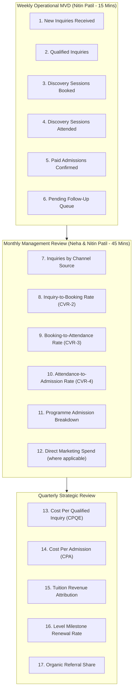
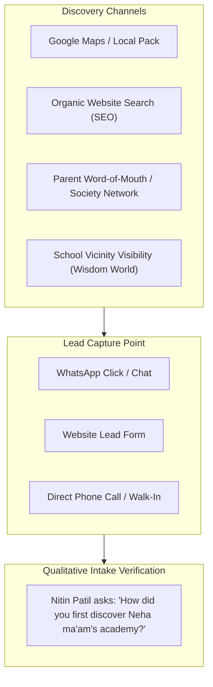

# AAA MASTER BRD — WORKSTREAM 05 (WS-05)
# MARKETING PERFORMANCE, ATTRIBUTION & KPI ARCHITECTURE
**Project:** Arnav Abacus Academy (AAA), Wakad, Pune  
**Role:** Lead Business Analyst, Marketing Analytics Architect & Performance Specialist  
**Governance Stage:** Stage 2 — Master Business Requirements Document (BRD) Workshop  
**Document Ref:** `docs/02_business_requirements/AAA_WS05_Marketing_KPI_and_Attribution_Framework.md`  
**Date:** November 02, 2026 (Discovery Baseline)  
**Status:** 🟡 **DISCOVERY COMPLETE — PENDING MANAGEMENT VALIDATION**  

---

## 1. Executive Summary & Purpose

This document operationalizes **WS05-06: Marketing Performance and KPI Architecture** for Arnav Abacus Academy (AAA), Wakad, Pune.

A sustainable admissions architecture requires objective, evidence-based performance tracking. This framework establishes an end-to-end measurement model spanning organic local discovery, website conversion, lead triage, discovery session attendance, and final enrollment.

In strict compliance with `AGENTS.md` and management instructions:
* **No Fabricated Baselines or Targets:** Historical percentage targets and vanity conversion metrics are explicitly excluded. AAA recommends a mandatory **four-week baseline collection period** following launch before establishing numerical targets or performance quotas.
* **Explicit Numerator/Denominator Logic & Zero Division Safeguard:** All ratio and percentage metrics define explicit mathematical numerators and denominators. When the denominator is zero ($0$) or data is unavailable, the reporting system must display **`N/A`** rather than zero or an error state.
* **Zero-PII Compliance:** All analytics metrics track aggregated volume, velocity, and conversion ratios. Personal identifiable information (parent names, student names, phone numbers) is never injected into analytics tools (`G-M2EL9MYSRL`).

## 2. Minimum Viable Dashboard (MVD) vs. Master KPI Inventory

To prevent administrative friction from overwhelming founder teaching time, AAA distinguishes between the **Full 17-Metric Reference Inventory** and an operational **Minimum Viable Dashboard (MVD)** piloted in Stage 2/3:

---

## 3. Comprehensive Marketing & Admissions KPI Dictionary & Limitations

### 3.1 Mathematical Rules & Baseline Collection Governance
1. **Division by Zero Safeguard:** For any ratio or percentage metric where the denominator is zero ($0$) or data is unavailable, the calculation must explicitly output **`N/A`** (Not Applicable) rather than zero or an error state.
2. **Four-Week Baseline Collection Period & Operational Prerequisites:** 
   - In accordance with management principles, no arbitrary conversion targets, percentage quotas, or commercial thresholds will be enforced until an empirical **four-week baseline collection period** is completed post-implementation.
   - **Prerequisite Governance:** This 4-week baseline collection period **begins ONLY after the enquiry register, access controls, privacy notice, and user responsibilities have been formally approved and established**.
   - **Limitation of Historical Records:** Historical WhatsApp chat records and informal phone logs are inherently incomplete, untagged, and unverified (due to unlogged calls, cross-device messaging, and untracked walk-ins). **They cannot be used as a reliable conversion baseline without formally documenting these limitations.** During the 4-week window, accurate counts for numerators and denominators will be established across all channels under controlled conditions.

### 3.2 Master 17-Metric Inventory with Explicit Numerators & Denominators

| Metric ID | KPI Metric Name | Frequency | Numerator | Denominator | Mathematical Formula & Zero-Division Rule | Primary Data Source | Owner | Reliable Baseline Exists? |
|---|---|:---:|---|---|---|---|:---:|:---:|
| **KPI-01** | **Local Discovery Impressions** | Monthly | Count of GBP views | N/A (Count) | $\text{Total GBP Views (Search + Maps)}$ | Google Business Profile | Nitin Patil | 🟡 Partial |
| **KPI-02** | **Website Total Sessions** | Weekly | Count of unique website visits | N/A (Count) | $\text{Unique Sessions in GA4}$ | GA4 (`G-M2EL9MYSRL`) | Solution Architect | 🟡 Partial |
| **KPI-03** | **Mobile Session Ratio** | Monthly | Mobile Sessions | Total Website Sessions | If $\text{Denom} = 0 \to \text{N/A}$; else $\frac{\text{Mobile Sessions}}{\text{Total Sessions}} \times 100$ | GA4 Device Category | Solution Architect | 🟡 Partial |
| **KPI-04** | **Total Inquiries Generated** | Weekly | Sum of all inbound inquiries | N/A (Count) | $\sum(\text{WhatsApp} + \text{Web Forms} + \text{Phone} + \text{Walk-ins})$ | Lead Tracker | Nitin Patil | 🔴 No |
| **KPI-05** | **Inquiry-to-Visitor Rate (CVR-1)** | Monthly | Total Inquiries | Website Sessions | If $\text{Denom} = 0 \to \text{N/A}$; else $\frac{\text{Total Inquiries}}{\text{Website Sessions}} \times 100$ | Lead Tracker & GA4 | Solution Architect | 🔴 No |
| **KPI-06** | **Qualified Inquiry Volume** | Weekly | Count of inquiries meeting age, catchment & intent | N/A (Count) | $\text{Count of Triage-Qualified Inquiries}$ | Lead Triage Register | Nitin Patil | 🔴 No |
| **KPI-07** | **Inquiry Qualification Rate** | Monthly | Qualified Inquiries | Total Inquiries | If $\text{Denom} = 0 \to \text{N/A}$; else $\frac{\text{Qualified Inquiries}}{\text{Total Inquiries}} \times 100$ | Lead Triage Register | Nitin Patil | 🔴 No |
| **KPI-08** | **Discovery Sessions Booked** | Weekly | Confirmed scheduled Discovery Sessions | N/A (Count) | $\text{Count of Confirmed Sessions Booked}$ | Discovery Calendar | Nitin Patil | 🔴 No |
| **KPI-09** | **Booking-to-Inquiry Rate (CVR-2)** | Monthly | Discovery Sessions Booked | Qualified Inquiries | If $\text{Denom} = 0 \to \text{N/A}$; else $\frac{\text{Discovery Sessions Booked}}{\text{Qualified Inquiries}} \times 100$ | Lead Tracker | Nitin Patil | 🔴 No |
| **KPI-10** | **Discovery Attendance Rate (CVR-3)** | Monthly | Discovery Sessions Attended | Discovery Sessions Booked | If $\text{Denom} = 0 \to \text{N/A}$; else $\frac{\text{Discovery Sessions Attended}}{\text{Discovery Sessions Booked}} \times 100$ | Center Attendance Sheet | Nitin Patil | 🔴 No |
| **KPI-11** | **Recommendations Delivered** | Monthly | AAA Feedback/Recommendations Issued | N/A (Count) | $\text{Count of Formal Recommendations Delivered}$ | Academic Consultation Log | Neha Patil | 🔴 No |
| **KPI-12** | **Admission Conversion Rate (CVR-4)** | Monthly | Paid Student Admissions | Discovery Sessions Attended | If $\text{Denom} = 0 \to \text{N/A}$; else $\frac{\text{Paid Student Admissions}}{\text{Discovery Sessions Attended}} \times 100$ | Fee Receipts & Register | Neha Patil & Nitin Patil | 🔴 No |
| **KPI-13** | **End-to-End Funnel Conversion** | Monthly | Paid Admissions | Total Inquiries | If $\text{Denom} = 0 \to \text{N/A}$; else $\frac{\text{Paid Admissions}}{\text{Total Inquiries}} \times 100$ | Admissions Master Roll | Nitin Patil | 🔴 No |
| **KPI-14** | **Programme Admission Share** | Quarterly | Admissions in Programme X | Total Admissions | If $\text{Denom} = 0 \to \text{N/A}$; else $\frac{\text{Admissions in Programme X}}{\text{Total Admissions}} \times 100$ | Student Enrollment Database | Neha Patil | 🟡 Partial |
| **KPI-15** | **Customer Acquisition Cost (CAC)** | Quarterly | Direct Marketing Spend | Total Paid Admissions | If $\text{Denom} = 0 \to \text{N/A}$; else $\frac{\text{Direct Marketing Spend}}{\text{Total Paid Admissions}}$ | Expense Ledger | Nitin Patil | 🔴 No |
| **KPI-16** | **Level Milestone Renewal Rate** | Quarterly | Students Continuing to Next Level | Students Completing Current Level | If $\text{Denom} = 0 \to \text{N/A}$; else $\frac{\text{Students Continuing Level}}{\text{Students Completing Level}} \times 100$ | Student Progress Registry | Neha Patil | 🔴 No |
| **KPI-17** | **Organic Referral Ratio** | Quarterly | Admissions from Parent Referrals | Total Admissions | If $\text{Denom} = 0 \to \text{N/A}$; else $\frac{\text{Admissions from Referrals}}{\text{Total Admissions}} \times 100$ | Admissions Source Field | Nitin Patil | 🔴 No |

---

## 4. Multi-Channel Attribution Modeling & Critical Limitations

### 4.1 Last Non-Direct Touch Attribution Model
To evaluate discovery channels, AAA tracks the last non-direct marketing interaction prior to inquiry submission (e.g. Google Maps, Organic Search, Parent Referral):

### 4.2 Known Limitations of the Attribution Model:
Before management ratifies this model, the following technical and operational limitations must be recognized:
1. **Word-of-Mouth Distortion:** A parent often hears about AAA from a society neighbor (true primary touchpoint), but later searches "Arnav Abacus Academy Wakad" on Google Maps to find the phone number. A digital-only attribution model would incorrectly credit Google Maps instead of word-of-mouth.
2. **Cross-Device Disconnection:** A mother may discover the academy on an office laptop, discuss it with her husband in the evening, and send a WhatsApp message from a different mobile phone. Digital analytics cannot connect these touchpoints without intrusive tracking cookies.
3. **Qualitative Intake Essential:** Therefore, digital GA4 attribution must **always be validated by Nitin Patil's direct verbal discovery question at intake**: *"How did you first learn about our academy?"*
3. `Source: Society Network (Society Name, e.g. Park Street)`
4. `Source: School Peer (School Name, e.g. EuroSchool)`
5. `Source: Direct Walk-In`

---

## 5. Reporting Cadence & Executive Review Governance

To prevent data reporting from consuming valuable founder teaching hours, reporting is structured in three concise operational cycles:

1. **Weekly Operational Pulse (15-Minute Monday Check-in):**
   - Nitin Patil reviews: Total Inquiries, Discovery Sessions Scheduled for the week, Open Follow-Ups, and Batch Slot Availability.
2. **Monthly Admissions Review (45-Minute Management Review):**
   - Neha Patil and Nitin Patil evaluate: Month-to-date Admissions, Enquiry-to-Admission Conversion Rate (`CVR-4`), Programme Distribution, and Lost-Lead Patterns.
3. **Quarterly Strategic Health Review:**
   - Evaluates Level Milestone Renewal Rates (`KPI-16`), Organic Referral Ratio (`KPI-17`), Google Reviews Growth, and Facility Utilization at Balaji Sagar Bungalow.

---

## 6. Zero-PII Telemetry & Data Quality Standards

In strict accordance with `AGENTS.md` Rule 4 and Rule 5:
* **Analytics Event Schema:** GA4 events (`programme_view`, `whatsapp_click`, `enquiry_form_submit`, `demo_request`, `counselling_book`) pass exclusively categorical parameters (`program`, `deliveryMode`, `sourceCampaign`, `clickSource`).
* **Audit Trail:** Any modification to student enrollment counts or fee receipt logs in the administrative register requires verified documentation.
* **No Premature Targets:** Targets will not be arbitrarily mandated until 60 days of empirical baseline data has been collected post-Stage 4 implementation.

---

## 7. Governance & Evidence Traceability Summary

* **Dependencies Carried Forward:**
  - `ACT-WS04-03`: Audited active census roll required to calculate true baseline retention.
  - `ACT-WS04-09`: Master fee schedule required to establish revenue attribution models.
* **Governance Status:** 🟡 **DOCUMENTATION COMPLETE — AWAITING MANAGEMENT VALIDATION IN WORKSHOP PACK**
