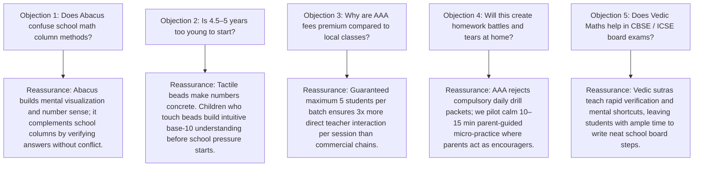
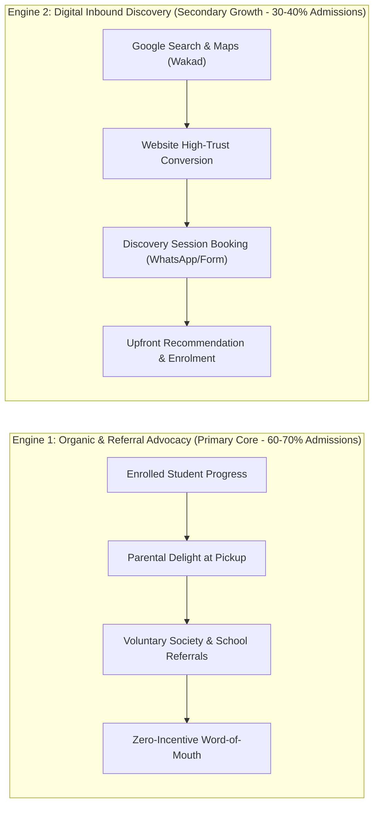

# AAA MASTER BRD — WORKSTREAM 05 (WS-05)
# MARKETING STRATEGY & PARENT SEGMENTATION ARCHITECTURE
**Project:** Arnav Abacus Academy (AAA), Wakad, Pune  
**Role:** Lead Business Analyst, Growth Marketing Strategist & Conversion Systems Architect  
**Governance Stage:** Stage 2 — Master Business Requirements Document (BRD) Workshop  
**Document Ref:** `docs/02_business_requirements/AAA_WS05_Marketing_Strategy_and_Parent_Segmentation.md`  
**Date:** November 02, 2026 (Discovery Baseline)  
**Status:** 🟡 **DISCOVERY COMPLETE — PENDING MANAGEMENT VALIDATION**  

---

## 1. Executive Summary & Purpose

This document operationalizes **WS05-01: Marketing Strategy and Parent Segmentation** within the Stage 2 Master BRD framework for Arnav Abacus Academy (AAA), Wakad, Pune.

In accordance with the stage-gate directive, this strategy translates the approved foundational baselines from WS-01 (Business Strategy), WS-02 (Brand Positioning), WS-03 (Parent Personas & Customer Journey), and WS-04 (Academic Continuum) into a structured, sustainable admissions acquisition engine.

### Core Strategic Mandate:
* **Mission-Driven Growth:** The marketing strategy focuses strictly on acquiring qualified parent inquiries that lead to genuine developmental transformation, rejecting vanity clicks, aggressive commercial hard-sells, or deceptive outcome guarantees.
* **Preservation of Approved Positioning:**
  > **Brand Position:** *“Arnav Abacus Academy – A Premium Mathematical Thinking & Child Development Academy.”*  
  > **Headline:** *“Beyond Calculation. Towards Confident Mathematical Thinking.”*  
  > **Subheadline:** *“At Arnav Abacus Academy, mathematics is the medium to develop confident, independent, and thoughtful young learners. Guided by certified educators in small batches with a maximum of five students per batch, our structured programmes provide personalised learning, closer individual guidance, and steady mathematical progress.”*
* **Micro-Batch Constraint:** Batch size is communicated exclusively as **"maximum 5 students per batch"** (`[MANAGEMENT CONFIRMED]`, `DEC-WS02-05`, `DEC-WS04-11`), reinforcing exclusivity, deep teacher attention, and premium pricing power in Wakad.

---

## 2. Evidence Classification Taxonomy

In compliance with project governance instructions, all factual assertions and strategic recommendations in this document are categorized under the approved eight-tier taxonomy:
1. `[MANAGEMENT CONFIRMED]` — Formally confirmed by Neha Patil or Nitin Patil.
2. `[EXISTING DOCUMENTED PRACTICE]` — Grounded in documented operational or historical center records.
3. `[REPOSITORY VERIFIED]` — Confirmed through line-by-line inspection of workspace repository source code.
4. `[EXTERNAL EVIDENCE REQUIRED]` — Market, competitor, or demographic fact requiring empirical external research.
5. `[HISTORICAL REFERENCE]` — Earlier marketing statement or promotional text pending empirical re-verification.
6. `[PROPOSED STRATEGY]` — Formulated growth recommendation awaiting executive workshop determination.
7. `[PENDING VALIDATION]` — Operational assumption requiring center timetable or financial audit.
8. `[REQUIRES SEPARATE IMPLEMENTATION APPROVAL]` — Actionable execution deferred to Stage 4.

---

## 3. Geographic Catchment Architecture & Evidence Validation

AAA operates an offline center located at:  
*Flat No. 3, 1st Floor, Adv. Balaji Sagar Bungalow, Opp. Creative Cameo, Near Park Street, Behind Wisdom World School, Wakad, Pune 411057* `[MANAGEMENT CONFIRMED]`.

### 3.1 Catchment Tiers: Operational Hypotheses vs. Validated Boundaries

> [!IMPORTANT]
> **Governance Notice on Geographic Boundaries:**  
> The 0–3 km radius is treated as a **strategic operational priority and working hypothesis**, NOT an empirically locked or exclusive market boundary. Final catchment boundaries will be validated using historical inquiry origin logs and student residential clusters (`ACT-WS05-08`).

1. **Tier 1: Primary Local Catchment (Wakad Core — Proposed Working Radius 0–3 km / 5–12 min drive):**
   - *Micro-Markets:* Wakad Central (Datta Mandir Road, Kaspate Vasti, Bhujbal Chowk, Shankar Kalat Nagar), Park Street / Wisdom World School vicinity (walking catchment), Choudhary Park, Vishnu Dev Nagar, Pink City Road, Kalewadi Phata.
   - *Working Hypothesis:* Parents prioritize daily walking or short driving distance for young children (Ages 4.5–9). High density of IT families enrolled in nearby CBSE/ICSE institutions (Wisdom World, EuroSchool, Mount Litera, Akshara).
   - *Target Programme Focus:* Soroban Abacus, Junior Mental Maths, Primary School Maths.
2. **Tier 2: Secondary PCMC Catchment (Pimpri-Chinchwad Tech Corridor — 3–7 km / 12–25 min drive):**
   - *Micro-Markets:* Hinjawadi (Phases 1–3 residential clusters — Megapolis, Blue Ridge, Life Republic), Pimple Saudagar (Roseland Residency, Kunal Icon Road, Planet Millennium), Tathawade, Punawale, Ravet, Thergaon.
   - *Working Hypothesis:* Parents in this zone are willing to travel 15–25 minutes specifically for specialized weekend batches, Vedic Mathematics, or advanced competitive exam coaching (IPM/Olympiad).
   - *Target Programme Focus:* Vedic Mathematics (Ages 9–14), IPM & Olympiad Coaching (Grades 2–9), Senior School Maths.
3. **Tier 3: Extended Pune & Online Enrichment Catchment:**
   - *Scope:* Broader Pune municipal areas (Baner, Aundh, Balewadi) and non-local/NRI students.
   - *Strategic Policy:* Offline classroom education at Balaji Sagar Bungalow remains the core business (~87+ students across ~14+ weekly batches). Online live video batches serve as secondary enrichment for relocated students or NRI referrals, subject to identical curriculum rigor and the strict 5-student cap `[PROPOSED STRATEGY]`.

### 3.2 Empirical Evidence Required to Validate Geographic Catchments (`ACT-WS05-08`)
To convert these geographic hypotheses into validated operational models, the following evidence must be audited:
1. *Historical Inquiry Origin Log:* Tabulating pickup locations and residential societies from manual inquiry registers.
2. *Student Residence Area Analysis:* Mapping active student census (`ACT-WS04-03`) at society/locality level (strictly without collecting or storing flat numbers or precise geolocation).
3. *Admission Conversion by Distance:* Measuring drop-off rates between initial inquiry and discovery session attendance by commute distance.
4. *Commute & Travel Feasibility:* Evaluating peak evening traffic bottlenecks (e.g. Hinjawadi flyover, Dange Chowk) impacting 5:00 PM batch arrivals.
5. *Programme Demand by Locality:* Checking whether older Vedic/Olympiad students travel further than early Abacus learners.

---

## 4. Persona-to-Programme Mapping & Value Proposition Alignment

The four ratified parent personas (`DEC-WS03-01`) reflect diverse parental motivations and anxieties. The table below links each persona to their optimal academic programme, primary emotional trigger, and marketing value proposition:

| Parent Persona | Typical Child Profile | Primary Academic Programme Fit | Primary Emotional & Psychological Trigger | AAA Differentiated Value Proposition | Key Reassurance Required |
|---|---|---|---|---|---|
| **Foundation Builder** | Ages 4.5–7; Kindergarten to Grade 2; curious, energetic | **Soroban Abacus** (Primary) & Early Mental Math | Wants to build a strong, lifelong math foundation early; fears future school struggle; values sensory, screen-free learning | *"Cultivating spatial visualization and concrete number sense before abstract school formulas create anxiety."* | "Will not overwhelm young child"; fun, tactile bead interaction; maximum 5 kids per batch. |
| **Anxious Remediator** | Ages 7–11; Grade 2 to Grade 6; hesitant, finger-counting, slow | **Soroban Abacus** (Junior/Senior) & **School Maths Foundation** | Urgent parental anxiety over poor school test scores, homework tears, finger-counting dependency, and loss of confidence | *"Eliminating fear and silly calculation slips through patient, non-judgmental micro-batch coaching."* | Safe, zero-ridicule environment; no public ranking or shaming; direct founder attention; steady self-baseline progress. |
| **Academic Enhancer** | Ages 9–14; Grade 5 to Grade 9; average to good student | **Vedic Mathematics** & **School Maths Foundation** | Wants child to transition from good to top-tier; frustrated by slow speed and laborious scrap work in timed school exams | *"Mastering the 16 Vedic sutras to compute with effortless speed, verify answers instantly, and ace school exams."* | "Complements CBSE/ICSE board methods"; neat step-by-step presentation; verified exam verification checks. |
| **Competitive Aspirant** | Ages 7–14; Grade 2 to Grade 9; quick learner, math enthusiast | **IPM & Olympiad Mathematics** (Voluntary Track) | Ambitious parent seeking state/national competition exposure, Higher Order Thinking Skills (HOTS), and elite intellectual challenge | *"Decomposing complex non-routine Olympiad puzzles through rigorous problem-solving discipline."* | Real past-year paper drills; option elimination logic; voluntary, non-coercive competition participation (`DEC-WS04-09`). |

---

## 5. Competitive Landscape & Educational Differentiation

To establish AAA as the authoritative center in Wakad, marketing messaging must articulate four clear competitive boundaries, strictly distinguishing documented facts from strategic positioning assumptions:

### 5.1 Documented Facts vs. Strategic Positioning Assumptions

| Educational Category | Documented Public Industry Facts | Strategic AAA Positioning Hypothesis | Evidence Required to Substantiate (`ACT-WS05-09`) |
|---|---|---|---|
| **Commercial Franchise Chains** *(e.g., SIP Abacus, UCMAS)* | • National franchise network model. • Standardized published batch guidelines typically allow 12–20 students per class. • Periodic multi-center competitive speed exams. | • AAA's strict **maximum 5 students per batch** (`DEC-WS02-05`) provides substantially more individual teacher observation time per session. • Founder-led mentorship avoids variable franchisee teaching quality. | Mystery audit of local Wakad franchise centers to verify actual current batch sizes, teacher turnover, and pricing. |
| **Pure Online EdTech Platforms** *(e.g., Cuemath, Bhanzu)* | • Screen-based digital interfaces. • Algorithmic gamified practice drills. • Remote instructor delivery. | • Physical Soroban bead manipulation anchored at a local center builds screen-free tactile memory. • In-person founder accountability at pickup builds deeper parental trust. | Review of published parent feedback on screen fatigue and drop-out rates in online math programs. |
| **Local Private Tuition** *(Neighborhood home tutors)* | • Informal homework-help centers. • Mixed grade batches without specialized abacus equipment. | • Structured 6-stage pedagogy (The AAA Learning Model™) and interconnected multi-year curriculum pathway. | Audit of local neighborhood tuition offerings in Park Street / Wakad area. |

---

## 6. Overcoming Core Parent Objections & Trust Architecture

Marketing copy and discovery session counseling must proactively address the five most prevalent parent hesitations:

---

## 7. Acquisition Channel Architecture: Word-of-Mouth vs. Digital Inbound

Admissions growth at AAA is structured across two complementary acquisition engines:

### 7.1 The Organic Advocacy Engine (DEC-WS03-06 Baseline)
- **Principle:** Parent referrals must remain 100% voluntary, authentic, and non-incentivized. AAA does not offer cash rewards, tuition discounts, or referral bounties for recommending friends `[MANAGEMENT CONFIRMED]`.
- **Operational Mechanism:** Trust is earned through bi-monthly qualitative progress updates (`DEC-WS04-08`), transparent 2-minute pickup chats, and noticeable student calculation poise, triggering natural word-of-mouth in residential societies (Park Street, Roseland, Blue Ridge, etc.).

### 7.2 The Digital Inbound Engine
- **Search Intent Capture:** Parents searching *"abacus classes near me"*, *"Vedic maths Wakad"*, or *"maths tuition Wisdom World School"* are directed to high-trust local landing pages.
- **Low-Friction Educational Onboarding:** Conversion centers on booking the **AAA Personalised Learning Discovery Session** rather than demanding immediate enrollment or tuition payment upfront.

---

## 8. B2C Core Admissions vs. Secondary Educational Initiatives

1. **B2C Academy Admissions (Primary Focus — 90% Energy):**
   - Direct parent enrollment across the six core programmes at the Wakad center.
   - Micro-batch scheduling maximizing facility utilization during after-school (4:00 PM – 8:00 PM) and weekend (9:00 AM – 1:00 PM) windows `[PENDING TIMETABLE AUDIT]`.
2. **Secondary Educational Initiatives (Exploratory / Non-Core — 10% Energy):**
   - *Preschool / Society Workshops:* Weekend interactive "Maths Wonder" workshops for residential societies in Wakad/Pimple Saudagar to educate parents on early childhood number sense `[PROPOSED STRATEGY]`.
   - *Teacher Training / Franchise Opportunities (`/teacher-franchise` route in code):* In accordance with `AGENTS.md` boundaries, teacher training is restricted to secondary documentation; the public portal `AAA_WEB` serves admissions first and foremost.

---

## 9. Governance & Evidence Traceability Summary

* **Dependencies Carried Forward:**
  - `ACT-WS04-02`: Degree credential archive (VER-01) required prior to publishing educator profiles in marketing copy.
  - `ACT-WS04-03`: Audited census roll required prior to projecting commercial capacity.
  - `ACT-WS04-08`: Premises seating audit required to establish simultaneous batch limits.
  - `ACT-WS04-09`: Master fee card required to ensure transparent pricing communication.
  - `ACT-WS04-27`: Affiliation dossier required prior to displaying accreditation badges.
* **Governance Status:** 🟡 **DOCUMENTATION COMPLETE — AWAITING MANAGEMENT VALIDATION IN WORKSHOP PACK**
