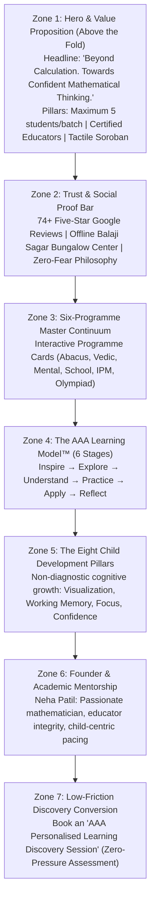

# AAA MASTER BRD — WORKSTREAM 05 (WS-05)
# WEBSITE CONVERSION ARCHITECTURE & UX REQUIREMENTS
**Project:** Arnav Abacus Academy (AAA), Wakad, Pune  
**Role:** Lead Business Analyst, UX Conversion Architect & Performance Specialist  
**Governance Stage:** Stage 2 — Master Business Requirements Document (BRD) Workshop  
**Document Ref:** `docs/02_business_requirements/AAA_WS05_Website_Conversion_Requirements.md`  
**Date:** November 02, 2026 (Discovery Baseline)  
**Status:** 🟡 **DISCOVERY COMPLETE — PENDING MANAGEMENT VALIDATION**  

---

## 1. Executive Summary & Purpose

This document operationalizes **WS05-03: Website Conversion Architecture** for Arnav Abacus Academy (AAA), Wakad, Pune.

A code-level forensic inspection of the existing website components (`Home.tsx`, `Hero.tsx`, `LeadForm.tsx`, `DemoBookingModal.tsx`, `Programs.tsx`, `data.ts`) was conducted to evaluate how effectively the current digital presence converts visiting parents into qualified inquiries. 

The audit reveals strong foundational engineering (fast client-side routing, responsive tailwind styling, dynamic SEO management), but identifies several critical copy, positioning, and conversion-funnel misalignments against the management-approved Stage 2 baselines. This document details the functional and architectural requirements needed to eliminate conversion friction, establish deep parental trust, and prepare specifications for Stage 3 design and Stage 4 implementation.

---

## 2. Forensic Audit of Existing Website Components

The table below contrasts the **verified current code baseline** against the **management-ratified Stage 2 requirements**:

| Component / File Path | Current Verified Implementation in Code | Ratified Governance Requirement | Severity of Misalignment | Architectural Remediation Required |
|---|---|---|:---:|---|
| **Homepage Hero Headline** (`src/components/Hero.tsx:55-58`) | *"Build Mathematical Confidence. Unlock Your Child's Potential."* `[REPOSITORY VERIFIED]` | **Approved Headline:** *"Beyond Calculation. Towards Confident Mathematical Thinking."* | **Critical (Brand Equity)** | Update hero heading text in Stage 4 to reflect ratified brand position. |
| **Micro-Batch Size Claim** (`Hero.tsx:69`, `LeadForm.tsx:208, 234`, `data.ts:64, 86`) | Repeatedly claims **"Guaranteed 1:8 Micro-Batches"** or **"1:8 ratio"** `[REPOSITORY VERIFIED]` | **Strict Ratified Cap:** *"Personalised learning in small batches, with a maximum of five students per batch."* (`DEC-WS02-05`, `DEC-WS04-11`) | **High (Operational Conflict)** | Replace all "1:8" references across Hero, LeadForm, and data files with "maximum 5 students per batch". |
| **Primary CTA Nomenclature** (`Hero.tsx:88`, `Home.tsx:71`, `data.ts:132`) | Calls to action inconsistently labeled: *"Book a Parent Counselling Session"*, *"Book a Free Demo"*, *"Free Math Demo"* | **Approved Service Names:** 1. *AAA Personalised Learning Discovery Session* 2. *AAA Demo Observation & Learning Recommendation* | **High (Funnel Clarity)** | Standardize sitewide primary CTAs to: *"Book a Personalised Learning Discovery Session"*. |
| **Hero Credential Badging** (`Hero.tsx:73`) | Displays badge: *"IIVA Delhi Certified Mentors"* `[REPOSITORY VERIFIED]` | Must be substantiated via archival degree scan under `ACT-WS04-02` (VER-01) prior to marketing claim | **Medium (Governance Rule 6)** | Archive physical certificates before launching renewed public copy. |
| **Speed Hyperbole in Data** (`src/data.ts:38`, `CAMPAIGNS:141`) | Claims: *"Accelerates numerical evaluations by 10x to 15x"* `[REPOSITORY VERIFIED]` | `AGENTS.md` Section 3.2 bans hyperbolic gimmicks and unsubstantiated multiplier claims | **Medium (Pedagogical Tone)** | Refactor copy to emphasize mental calculation agility, procedural error elimination, and exam verification speed. |
| **LeadForm PDF Generation** (`LeadForm.tsx:74-494`) | Auto-generates a 3-page diagnostic PDF mentioning old 1:8 batch sizes, child psychology claims, and informal quiz questions | Diagnostic rubric should align with the ratified 6-stage model and 8 child development pillars | **Medium (Conversion Friction)** | Align PDF diagnostic worksheet with approved 4-layer assessment and non-diagnostic guidelines. |

---

## 3. High-Trust Homepage Conversion Funnel Architecture

To maximize conversions from local parents in Wakad, the homepage layout must be structured as a reassuring, educational narrative across seven conversion zones:

---

## 4. Discovery Session Conversion vs. Traditional "Sales Pitch"

Commercial tutoring franchises use "free demo classes" as aggressive sales pitches where parents are pressured to sign long-term contracts. In contrast, AAA differentiates by structuring the session as an **educational consultation**:

### 4.1 Value Proposition & Duration Reconciliation:
* **Session Nomenclature:** **AAA Personalised Learning Discovery Session** `[MANAGEMENT CONFIRMED]`.
* **Deliverable to Parent:** **AAA Demo Observation & Learning Recommendation** `[MANAGEMENT CONFIRMED]`.
* **Session Duration Reconciliation:**
  - *Documented Operational Reality:* Historical sessions conducted by Neha Patil typically last **45 to 90 minutes**, depending on the child's calculation hesitation and depth of parental discussion `[EXISTING DOCUMENTED PRACTICE]`.
  - *Proposed Streamlined Workflow (35–45 Mins):* A proposed phased sequence (5–10 min rapport, 20–40 min bead exploration, 15–25 min parent counsel). **The 35-minute duration is strictly a proposed workflow for discussion, NOT an approved or guaranteed session ceiling.** Operational validation by Neha Patil is required (`ACT-WS05-01`).
* **Session Experience:**
  1. *Child Experience:* A relaxed, tactile bead exploration or Vedic pattern puzzle where the child experiences math as playful and non-threatening.
  2. *Parent Experience:* Neha Patil directly observes the child's calculation habits (e.g. finger counting, subvocalization, anxiety under timing) and provides immediate, constructive feedback.
  3. *Zero-Pressure Commitment:* Parents are under no obligation to enroll; they leave with an objective diagnostic understanding of their child's number sense.

---

## 5. Mobile Usability & Thumb-Zone Conversion Standards

Over 75% of discovery in Wakad occurs on mobile smartphones during evening pickup or commute hours `[PROPOSED STRATEGY]`. In compliance with `AGENTS.md` Technical Standards:

1. **Responsive Viewport Coverage:** Full layout verification across 320px (iPhone SE), 375px/390px (iPhone 13/14), 412px (Android standard), and up to 4K desktop screens without horizontal overflow or text clipping.
2. **Thumb-Zone Sticky Conversion Bar (Mobile View):**
   - On mobile screens, implement a persistent bottom floating action bar with two high-contrast actions:
     - *Primary Action (65% width):* **"Book Discovery Session"** (opens high-speed booking modal).
     - *Secondary Action (35% width):* **"WhatsApp Neha Ma'am"** (initiates direct chat on `+91 90219 24968`).
3. **Touch Target Dimensions:** All interactive buttons, form selects, and accordion headers must possess a minimum clickable touch target of **44px × 44px** with at least 8px spacing between tap targets.

---

## 6. Technical Performance & Accessibility (WCAG 2.1 AA)

To satisfy `AGENTS.md` Section 4 standards:

### 6.1 Core Web Vitals Targets:
* **Largest Contentful Paint (LCP) < 2.5s:** Preload font files (`Outfit`, `Plus Jakarta Sans`); lazy-load below-the-fold interactive playgrounds (`InteractiveAbacus.tsx`, `VedicMathDemo.tsx`).
* **Cumulative Layout Shift (CLS) < 0.1:** Explicit aspect-ratio attributes on all images, icons, and dynamic modals to prevent layout jumps during hydration.
* **Interaction to Next Paint (INP) < 200ms:** Decouple heavyweight PDF generation (`jsPDF`) and animations from primary click handlers.

### 6.2 Accessibility Compliance (WCAG 2.1 AA):
* **Contrast Ratios:** Text-to-background contrast must exceed **4.5:1** for standard body text and **3.0:1** for large headings. Slate-900 on white (#FFFDF9) provides an elite 14.8:1 ratio.
* **Form Field Labels:** Every input field in `LeadForm.tsx` and `DemoBookingModal.tsx` must possess explicit `<label htmlFor="...">` associations and `aria-required="true"` attributes.
* **Screen Reader Accessibility:** All decorative SVG icons must carry `aria-hidden="true"`; interactive icon buttons must have explicit `aria-label` tags.

---

## 7. Privacy, Consent & Zero-PII Telemetry in Conversion

In strict accordance with `AGENTS.md` and ratified decisions `DEC-WS03-04` and `DEC-WS04-14`:

1. **Enquiry Data vs. Analytics Separation:**
   - Parent contact details (name, phone number) submitted to book a discovery session are collected strictly under parent consent for communication purposes.
   - These contact details must **never** be passed into Google Analytics 4 (`gtag`) or Google Tag Manager (`dataLayer`). GA4 events (`trackDemoRequest`, `trackCounsellingBook`) must transmit only anonymized metadata: `{ program: "abacus", deliveryMode: "offline", sourceCampaign: "hero_cta" }`.
2. **Anti-Spam & Formula Injection Safeguards:**
   - Preserve existing bot honeypots (`botHoneypot` in `LeadForm.tsx:25`) and spreadsheet formula sanitization (`sanitizeForGoogleSheets` in `leadWebhook.ts:58-68`).
3. **Explicit Consent Checkbox:**
   - Add a clear, transparent consent checkbox on all lead capture forms:
     > `[X] I agree to be contacted by Arnav Abacus Academy via phone/WhatsApp regarding this discovery session inquiry.`

---

## 8. Governance & Evidence Traceability Summary

* **Dependencies Carried Forward:**
  - `ACT-WS04-06`: Software re-labeling of student PDF certificates carried to Stage 4.
  - `ACT-WS04-08`: Facility seating capacity audit required before promising physical trial slots.
* **Governance Status:** 🟡 **DOCUMENTATION COMPLETE — AWAITING MANAGEMENT VALIDATION IN WORKSHOP PACK**
