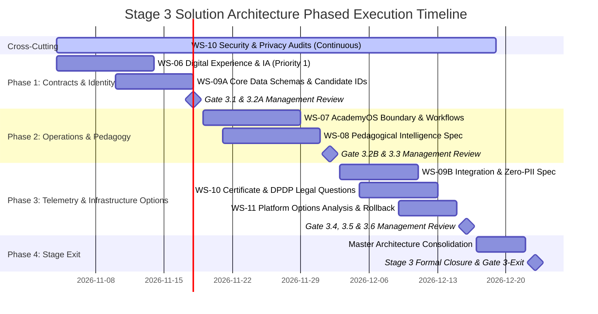
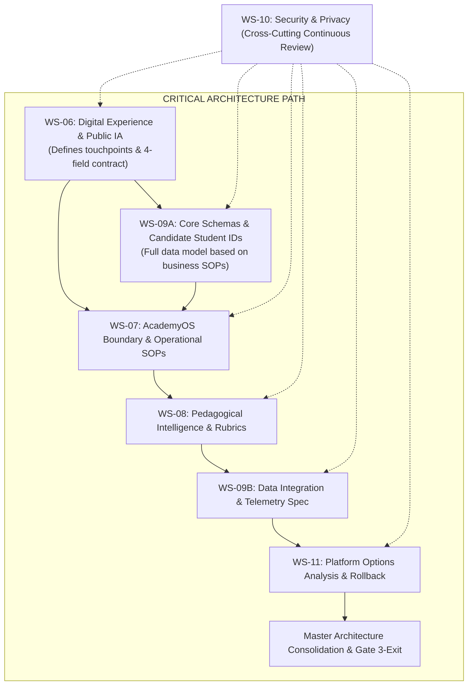

# ARNAV ABACUS ACADEMY (AAA) — STAGE 3 SOLUTION ARCHITECTURE
# ARCHITECTURE EXECUTION ROADMAP & DELIVERY SCHEDULE

**Project:** Arnav Abacus Academy (AAA), Wakad, Pune  
**Document Reference:** `AAA-S3-GOV-008`  
**Stage:** Stage 3 — Architecture & Design  
**Governance Authority:** Neha Patil (Academic Director) & Nitin Patil (Operations & Technology Lead)  
**Baseline Date:** 03 November 2026  
**Status:** 🟢 **ACTIVE EXECUTION ROADMAP — PROVISIONALLY ENDORSED VIA MGT-DET-S3-03**  

---

## 1. Executive Summary & Purpose

The **Stage 3 Architecture Execution Roadmap** defines the end-to-end phased timeline, critical path dependencies, resource assignments, and deliverable milestones required to complete the solution architecture across all six architecture workstreams (WS-06 through WS-11).

In strict adherence to Stage 3 governance:
- **Zero source code modifications** to `src/`, `public/`, or package manifests shall take place during Stage 3.
- All timeline durations (including the 10-working-day target for WS-06) are recorded as **provisional planning estimates** subject to capacity confirmation by workstream owners, **not as guaranteed deadlines**.
- **Privacy and security (WS-10)** operate as continuous cross-cutting controls across all phases.

---

## 2. Architecture Phasing Strategy

### 2.1 Phase Breakdown & Focus

| Phase | Phase Focus | Primary Workstreams | Primary Deliverables | Target Gate |
| :--- | :--- | :--- | :--- | :--- |
| **Cross-Cutting** | **Continuous Privacy & Threat Audit** | **WS-10** | Threat modeling, DPDP legal questions, data classification register, consent audit frameworks. | **Ongoing across all gates** |
| **Phase 1** | **Experience Contracts & Identity Core** | **WS-06 & WS-09A** | Public sitemap, 30-route preservation matrix, 11-area UX wireframes, 4-field max modal contract, Candidate Student ID options analysis. | **Gate 3.1 & Gate 3.2A** |
| **Phase 2** | **Boundary Protection & Pedagogical Models** | **WS-07 & WS-08** | AcademyOS functional interface spec, Practice session boundary contract, 6-Dimension & 8-Pillar rubrics, Micro-batch scheduler. | **Gate 3.2B & Gate 3.3** |
| **Phase 3** | **Integration, Telemetry & Platform Options** | **WS-09B, WS-10 & WS-11** | Zero-PII GTM/GA4 dataLayer spec, Lead tracking options analysis, Practice Achievement Records & Certificate options, Hosting options analysis. | **Gate 3.4, 3.5 & 3.6** |
| **Phase 4** | **Master Consolidation & Stage-Gate Exit** | **Master Architecture** | Comprehensive Master Solution Architecture Document, Full Requirements Traceability sign-off, Stage 4 Handover Charter. | **Gate 3-Exit** |

---

## 3. Workstream Execution Plans & Milestones

### 3.1 WS-06: Digital Experience & Website Architecture (PRIORITY WORKSTREAM)
- **Objective:** Design the public conversion architecture, user journeys, responsive mobile-first wireframes, navigation taxonomy, and discovery booking flow across all 11 scope areas.
- **Estimated Planning Duration:** 10 Working Days (recorded as a planning estimate pending owner and capacity confirmation by Nitin Patil & Neha Patil; not a guaranteed deadline).
- **Lead Responsible:** Nitin Patil (UX/IA), Neha Patil (Pedagogical Copy / Tone).
- **Core Deliverables:**
  1. Complete Public Site Architecture & Visual Sitemap (preserving all 30 audited repository routes).
  2. Mobile-First Wireframe Specifications (320px to 4K).
  3. Enquiry Capture Flow Architecture (Four-field maximum concept: Parent Name, Mobile/WhatsApp, Child Grade/Age, Programme optional).
  4. Parent Diagnostic Booking Experience Spec (Honoring ~45–90 min session practice & free offering; not guaranteed duration).
  5. Exact Copy Specification Document (Enforcing approved H1, brand positioning, and micro-batch standard).
- **Gate Checkpoint:** **Gate 3.1 (Digital Experience & Public IA Gate)**.

### 3.2 WS-07: AcademyOS Boundary & Operational Architecture
- **Objective:** Establish structural boundary contracts and operational SOPs isolating public admissions from internal AcademyOS practice sessions while shielding founder teaching hours.
- **Estimated Planning Duration:** 10 Working Days.
- **Lead Responsible:** Nitin Patil (Tech/Ops), Neha Patil (Academic Timetables).
- **Core Deliverables:**
  1. AcademyOS Route Isolation & Authentication Boundary Architecture (`/login`, `/practice/*`).
  2. Operational Triage SOPs protecting founder teaching hours.
  3. Micro-Batch Allocation Rules ($\le 5$ students cap).
  4. Attendance and Student Lifecycle SOPs.
- **Gate Checkpoint:** **Gate 3.2B (AcademyOS Boundary Gate)**.

### 3.3 WS-08: Pedagogical Intelligence & Diagnostic Model Architecture
- **Objective:** Formalize computational and qualitative models for the 6 Observation Dimensions, 8 Intelligence Pillars, and diagnostic recommendation engine.
- **Estimated Planning Duration:** 10 Working Days.
- **Lead Responsible:** Neha Patil (Sole Academic Authority), Nitin Patil (Data Structures).
- **Core Deliverables:**
  1. Six Observation Dimensions Scoring Engine & Rubric Data Structures.
  2. Eight Intelligence Pillars Assessment Mapping Matrix.
  3. Diagnostic Placement Rubric for 9-year-old candidates (proposed framework; not an approved admission rule).
  4. Standardized 1-Page Lesson Plan Template across 6 stages.
- **Gate Checkpoint:** **Gate 3.3 (Pedagogical Intelligence Model Gate)**.

### 3.4 WS-09A & WS-09B: Data Architecture & Integration Architecture
- **Objective:** Define data schemas, student identity rules, zero-PII analytics integration, and lead tracking options analysis.
- **Estimated Planning Duration:** WS-09A: 8 Working Days; WS-09B: 8 Working Days.
- **Lead Responsible:** Nitin Patil.
- **Core Deliverables:**
  1. Candidate Student Identifier Analysis (`AAA-STU-YYYY-XXXX` vs alternatives).
  2. Comprehensive Relational Schema Spec from business processes (1:N Parent-to-Student, 1:N Student-to-Course).
  3. Proposed Zero-PII Telemetry & Data Classification Spec (assessing indirect identifiers: IPs, cookies, query parameters).
  4. Lead Ingestion Tooling Options Analysis & Input Sanitization Spec.
- **Gate Checkpoint:** **Gate 3.2A (Part A) & Gate 3.4 (Part B)**.

### 3.5 WS-10: Security, Privacy & Certificate Architecture (CONTINUOUS CROSS-CUTTING)
- **Objective:** Architect privacy compliance (DPDP Act legal questions), student certificate verification options, and parental consent infrastructure.
- **Estimated Planning Duration:** Continuous across Stage 3; dedicated synthesis 8 Working Days.
- **Lead Responsible:** Nitin Patil & Qualified Legal Counsel (Neha Patil for Diplomas).
- **Core Deliverables:**
  1. DPDP Legal Questions & Data Classification Register.
  2. Parental Consent Logging & Data Rights SOP.
  3. Practice Achievement Records & Certificate Verification Options Spec.
  4. Browser Storage Security & Session Policy.
- **Gate Checkpoint:** **Gate 3.5 (Security & Certification Gate)**.

### 3.6 WS-11: Platform Infrastructure, Hosting & Options Analysis
- **Objective:** Conduct rigorous technology options analysis evaluating frontend frameworks, hosting topologies, private sovereign databases, and deployment pipelines while benchmarking against the existing React 19/Vite baseline.
- **Estimated Planning Duration:** 6 Working Days.
- **Lead Responsible:** Nitin Patil.
- **Core Deliverables:**
  1. Technology Options Analysis & Hosting Evaluation Memo (React 19/Vite vs alternatives).
  2. API Contracts & Decoupled Service Spec.
  3. Data Migration Integrity & Rollback Strategy.
- **Gate Checkpoint:** **Gate 3.6 (Platform Hosting Gate)**.

---

## 4. Critical Path & Dependency Flow

---

## 5. RACI Responsibility Assignment Matrix

| Workstream / Deliverable | Neha Patil (Academic Director) | Nitin Patil (Operations & Tech Lead) | Architecture Agent (Antigravity) | Qualified Legal Counsel |
| :--- | :---: | :---: | :---: | :---: |
| **Stage 3 Governance & Charter** | **A** | **A** | **R** | **C** |
| **WS-06: Digital Experience & Website IA** | **A** (Copy/Tone) | **A** (UX/IA) | **R** | **C** (Privacy) |
| **WS-07: AcademyOS Boundary** | **C** (Timetables) | **A** (Tech/Ops) | **R** | **I** |
| **WS-08: Pedagogical Intelligence Model** | **A** (Sole Authority) | **C** (Data Specs) | **R** | **I** |
| **WS-09A: Identity & Core Schemas** | **C** | **A** | **R** | **C** (Privacy) |
| **WS-09B: Integrations & Zero-PII Telemetry** | **I** | **A** | **R** | **C** (Privacy) |
| **WS-10: Security & Certification Architecture** | **A** (Diplomas) | **A** (Tech/Ops) | **R** | **A** (Legal Qs) |
| **WS-11: Platform Infrastructure Options** | **I** | **A** | **R** | **I** |
| **Stage 3 Master Architecture Closure (Gate 3-Exit)** | **A** | **A** | **R** | **C** |

*R = Responsible for drafting specification; A = Accountable / Formal Sign-Off Authority; C = Consulted; I = Informed.*

---
*End of Architecture Execution Roadmap & Workstream Delivery Schedule (AAA-S3-GOV-008)*
