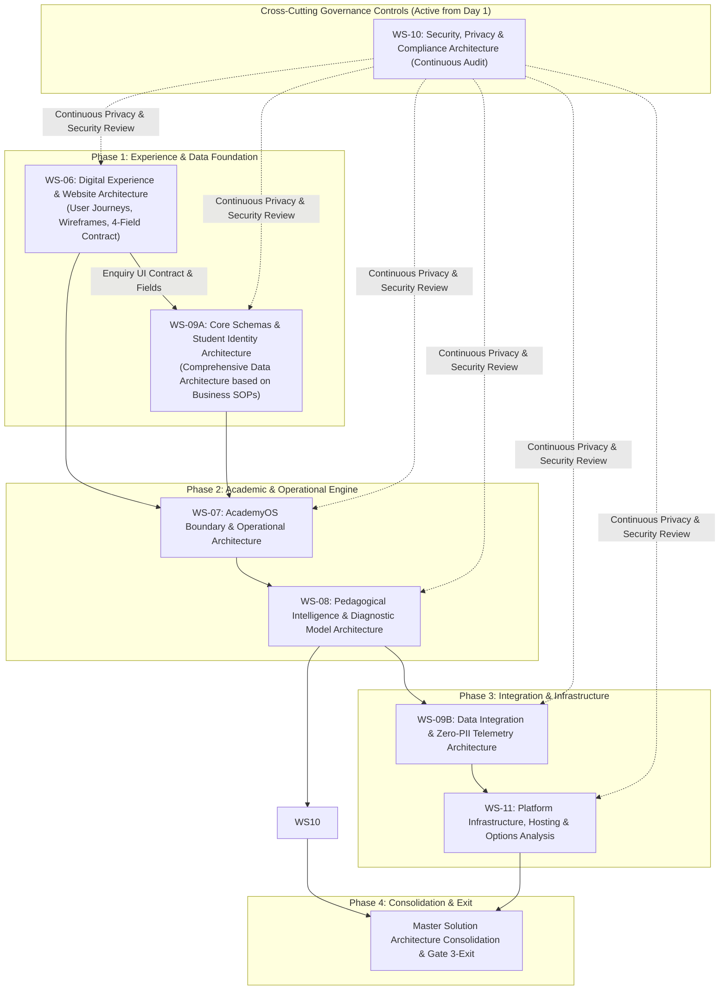

# ARNAV ABACUS ACADEMY (AAA) — STAGE 3 SOLUTION ARCHITECTURE
# ARCHITECTURE & DESIGN CHARTER

**Project:** Arnav Abacus Academy (AAA), Wakad, Pune  
**Leadership:** Neha Patil (Founder & Academic Director), Nitin Patil (Operations & Technology Lead)  
**Governance Stage:** Stage 3 — Architecture & Design  
**Previous Stage:** Stage 2 — Business Requirements (Formally Ratified & Closed on 03 Nov 2026)  
**Management Authority:** Formally Ratified by Neha Patil (Academic Director) & Nitin Patil (Operations & Technology Lead) on 03 November 2026 via `MGT-DET-S3-01` (Gate 3.0B Passed); WS-06 Commencement Formally Authorized via `MGT-DET-S3-02`  
**Document Ref:** `docs/03_solution_architecture/AAA_Stage3_Architecture_and_Design_Charter.md`  
**Date:** November 03, 2026  
**Status:** 🟢 **ACTIVE GOVERNANCE CHARTER — GATE 3.0B RATIFIED & WS-06 DRAFTING AUTHORIZED**  

---

> [!IMPORTANT]
> **Implementation Scope Boundary & Non-Negotiable Safeguards:**  
> This Charter governs the architectural design, operational processes, academic modeling, and integration specifications for Stage 3. **Architecture authorization does NOT permit application source-code modifications, website content publication, live lead CRM activation, practice portal modifications, infrastructure migration, or production releases.** Stage 3 is strictly restricted to architectural design, component wireframing, data schema authoring, options analysis, and formal decision engineering. All seven Stage 4 Hard Gates remain strictly active and blocking.

---

## 1. Executive Summary & Management Mandate

Following the formal ratification of the Stage 2 Master Business Requirements Document (BRD) by AAA Management (**Neha Patil**, Founder & Academic Director, and **Nitin Patil**, Operations & Technology Lead) under **Option 1 Full Management Ratification**, overall Stage 3 Architecture & Design commencement was authorized on 03 November 2026.

The objective of Stage 3 is to translate the 43 consolidated specifications (37 ratified functional business requirements across 8 modules and 6 architectural requirements), 54 ratified management decisions, and 5 endorsed cross-workstream conflict resolutions into a robust, secure, scalable, and parent-centric technical and operational architecture.

### The Governing Philosophy:
> *"Architecture decisions must be evidence-based, technology-neutral until justified, privacy-conscious, and aligned with AAA's approved business and academic requirements."*

Technology at AAA is strictly the enabler of human mentorship and academic excellence. All architectural models formulated in Stage 3 must protect classroom teaching bandwidth, guarantee micro-batch integrity ($\le 5$ students/batch), eliminate computational anxiety, and command parental trust in Wakad and the wider Pune region.

---

## 2. Mandatory Architecture Principles & Non-Negotiable Boundaries

All Stage 3 architecture deliverables and decisions must strictly adhere to the permanent safeguards defined in `AGENTS.md` and the ratified Stage 2 Master BRD:

### 2.1 Technology Neutrality & Existing Application Baseline
* **Current Technology Baseline:** The active application baseline is built upon **React 19, TypeScript, React Router v7, and Vite**. This constitutes the verified, stable foundation of the public portal and AcademyOS.
* **Proposed Architecture Options (NOT Approved Technology Decisions):**
  The following technical mechanisms are classified strictly as **proposed architectural options** undergoing evaluation, **not** approved decisions or implementation mandates:
  - Next.js framework migration or Edge hosting topologies.
  - Google Sheets CRM webhook ingestion or third-party CRM platforms.
  - Google Tag Manager (GTM) telemetry and event architectures.
  - Cryptographic / QR-based certificate verification mechanisms.
  - CI/CD pipeline automation designs.
  - Performance budgets and disaster recovery SLAs.
* **Mandatory Options-Analysis Requirement:** Prior to recommending any framework, hosting, CRM, or infrastructure migration, the architecture team must produce a formal **Technology Options Analysis** documenting:
  1. Current state and operational baseline.
  2. Concrete business and academic need.
  3. Comprehensive options considered (including maintaining current React/Vite baseline).
  4. Detailed advantages and disadvantages of each option.
  5. Migration effort, resource demands, and financial cost implications.
  6. Security, data protection, and privacy implications.
  7. Backward compatibility with existing functionality and zero disruption to student sessions.
  8. Evidence-based architectural recommendation.
  9. Explicit designated approval authority (Neha Patil and/or Nitin Patil).
* **Explicit Prohibition:** **No technology migration is approved by this Charter or Stage 3 initiation.**

### 2.2 AcademyOS Route & Functional Boundary Protection (`AGENTS.md` Rule 3)
* The internal student learning platform and ERP functionality under `/login`, `/practice`, `/practice/session`, and `/practice/results` represents active classroom infrastructure.
* Architecture designs must not break, overwrite, or redirect existing student practice sessions, module sets (`JR-0..SR-10`, `JVM-1`, `SVM-0..6`), or drill engines without explicit management sign-off.
* Public marketing portal enhancements (`AAA_WEB`) must remain structurally and operationally decoupled from the active learning engine.

### 2.3 Sovereign Student Identity Architecture (`DEC-WS04-13`)
* **Candidate Format Status:** The format `AAA-STU-YYYY-XXXX` is treated strictly as a **candidate format** subject to architecture review, options analysis, and management determination.
* **Core Identity Principles:**
  1. *One permanent Student ID per child:* Assigned upon enrollment and retained across the child's multi-year journey at AAA.
  2. *Multi-programme linkage:* A single student identity links cleanly to multiple concurrent or sequential programs without duplicate records or overwrites.
  3. *Separate sibling identities:* Siblings sharing the same parent contact information must retain strictly separate student identities and segregated academic records.
  4. *Duplicate prevention:* Robust matching logic preventing accidental duplicate student profiles.
  5. *Historical record preservation:* Complete historical continuity of practice attempts, assessment baselines, and milestone achievements.
  6. *Privacy preservation:* Zero public exposure of unnecessary personal identifiers; IDs must be pseudonymous and non-revealing of sensitive personal traits.
* **Alternative Formats:** Multiple candidate formats (e.g., random UUIDs, deterministic alphanumeric sequences, hashed opaque keys) will be formally compared against privacy, scalability, and operational usability criteria in WS-09A.

### 2.4 Privacy, Telemetry & Data Classification Architecture (`AGENTS.md` Rule 4, `DEC-WS03-04`)
* **Enquiry Form Minimum Data Contract (Four-Field Maximum Concept):**
  Intake is governed by the ratified WS-05 data minimization principle:
  1. *Parent Name* — Required.
  2. *Parent Mobile / WhatsApp* — Required.
  3. *Child Age Bracket OR Grade* — At least one required (either age bracket or school grade is sufficient).
  4. *Programme of Interest* — Optional.
  - *Maximum Concept Clarification:* This is a **four-field maximum concept**, meaning prospective parents are never presented with more than 4 intake inputs, and completing all four is not mandatory to submit an enquiry.
  - *Consent Separation:* Enquiry submission and transactional response communication must be strictly segregated from optional promotional marketing communication consent. Declining promotional consent must never block enquiry submission.
  - *Strict Data Prohibitions:* Absolutely zero collection of exact child date of birth (DOB), school name, residential address, or clinical/developmental history at the initial enquiry stage.
  - *Privacy Notice & Retention Governance:* Form privacy notices, retention schedules, and client-side sanitization remain subject to formal privacy and qualified legal review.
* **Zero-PII Telemetry as a Design Objective:**
  Zero-PII telemetry is an **architectural design objective requiring rigorous data-flow validation**, not an assumed property.
  - *Assessment of Potential Identifiers:* Telemetry architectures must assess and mitigate risks from potential indirect identifiers, including IP addresses, browser/device fingerprints, tracking cookies, URL query parameters, and third-party analytics metadata.
  - *Prohibited Telemetry Fields:* Under no circumstances shall child names, parent mobile numbers, exact DOBs, school names, residential addresses, or identifiable academic performance scores be sent into analytics tools (GA4 `G-M2EL9MYSRL`, GTM, or third-party trackers).
  - *Data Flow & Classification Framework:* Architecture specifications must map: (1) Data collected; (2) Business/educational purpose; (3) Storage destination; (4) Access permissions (RBAC); (5) Retention and purge schedules; (6) Consent and opt-out mechanisms; (7) Third-party data processors; (8) Deletion and incident response protocols.
  - *Legal Compliance Safeguard:* Architectural designs shall **not** claim legal compliance or anonymity merely by referencing the Digital Personal Data Protection (DPDP) Act 2023. Explicit legal questions must be formulated for formal qualified legal counsel review.

### 2.5 Academic Intelligence Architecture & Programme Portfolio
* **Programme Portfolio Grouping Status:**
  The six programme areas (Abacus Mathematics, Vedic Mathematics, Mental Mathematics, School Mathematics, IPM Mathematics, Olympiad Mathematics) represent AAA's **current portfolio grouping only**.
  - *Academic Validation Pending:* The architecture acknowledges that not all six programmes have independently validated curriculum structures, level progressions, or formal eligibility criteria. These remain subject to formal academic authoring and validation by **Neha Patil**.
  - *Zero Speculative Rules:* Architectural designs must not publish, assume, or invent rigid age eligibility rules.
* **Discovery Session Operational Reality:**
  - The free Discovery Session practice of **approximately 45–90 minutes, depending on child engagement and parent discussion**, is preserved as the documented operational practice.
  - It must **not** be represented or advertised as a fixed, guaranteed duration.
  - All representations must use the approved service name (*Discovery Session*) and cite the approved six educational observation dimensions.
* **Preservation of Approved Pedagogical Frameworks:**
  - The **AAA Learning Model™** sequence is immutable: *Inspire → Explore → Understand → Practice → Apply → Reflect*.
  - The **Eight Child Development Intelligence Pillars** are immutable: *Spatial Visualization, Working Memory & Mental Storage, Pattern Recognition, Rapid Information Processing, Sustained Attention & Focus, Cognitive Flexibility, Executive Function & Problem Solving, Self-Confidence & Mathematical Joy*.
  - The **Six Educational Observation Dimensions** are immutable: *Number Sense, Arithmetic Understanding, Logical Approach, Learning Attitude, Response and Engagement, Interest and Learning Passion*.
* **Multi-Dimensional Evaluation Separation:** Architectural models must clearly distinguish and segregate:
  1. *Academic performance* (verified drill accuracy, syllabus progression, objective calculation metrics).
  2. *Teacher observation* (qualitative classroom behavioral and engagement notes using approved rubrics).
  3. *Parent feedback* (qualitative home engagement and parent observation reports).
  4. *Child self-reflection* (student personal goal-setting and reflective responses).
* **Strict Non-Diagnostic Safeguards:**
  - Absolutely **zero overall Child Intelligence Scores (CIS)**, composite IQ numbers, or algorithmic capability ratings.
  - Absolutely **zero public rankings**, competitive scoreboards, or score comparisons between children.
  - Absolutely **zero clinical, psychological, or pathological labels** (e.g., ADHD, Dyscalculia, ADD).
  - Absolutely **zero unsupported developmental claims** or speed hyperbole (e.g., "10x–15x faster").
  - Progress must evaluate each child strictly against **their own previous evidence and baseline**.
* **Academic Governance Authority:** **Neha Patil (Founder & Academic Director)** retains absolute, exclusive academic governance authority over all pedagogical definitions, curriculum structures, assessment rubrics, and the interpretation of developmental observations.

### 2.6 Certificate & Practice Record Architecture (`DEC-WS04-07`)
* **Approved Software Terminology:** In-software generated PDF certificates from digital practice sessions remain strictly designated as **"Practice Achievement Records"**.
* **Proposed Architecture Classifications:** Central database ledgers, online QR verification endpoints, cryptographic verification algorithms, revocation workflows, and milestone diploma eligibility criteria are classified as **proposed architecture options** and **pending academic governance decisions**.
* **Accreditation Safeguards:** Architecture specifications must not imply university, government, or external institutional accreditation, nor create unearned certificate entitlements. Milestone certificates evaluate verified physical curriculum completion and Layer C summative evaluations only.

---

## 3. Stage 3 Architecture Workstream Structure & Cross-Cutting Controls

Stage 3 is organized into six interconnected architecture workstreams:

### 3.1 Workstream Definitions & Scope Division:
* **WS-06: Digital Experience & Website Architecture:** Defines public user journeys, information architecture, wireframes, canonical route preservation, and the enquiry form UI contract.
* **WS-09A: Core Schemas & Student Identity Architecture:** Defines the comprehensive student, parent, programme, and relationship data architecture based on approved academic and business operational processes. **WS-09A does NOT derive the full AcademyOS schema solely from the enquiry form.**
* **WS-07: AcademyOS Boundary & Operational Architecture:** Boundary isolation protecting internal learning routes (`/login`, `/practice/*`), batch scheduling SOPs, admissions triage, and teaching protection workflows.
* **WS-08: Pedagogical Intelligence & Diagnostic Model Architecture:** Observational rubrics for 6 dimensions and 8 pillars, diagnostic intake tools, lesson plan architectures, and self-baseline evaluation engines.
* **WS-09B: Data Integration & Zero-PII Telemetry Architecture:** Zero-PII analytics schemas, webhook data contracts, formula sanitization, and options analysis for interim lead tracking.
* **WS-10: Security, Privacy & Certificate Architecture (Continuous Cross-Cutting):** DPDP legal question formulation, parental consent logging, data flow classification, Practice Achievement Record standards, and central ledger/verification options.
* **WS-11: Platform Infrastructure, Hosting & Options Analysis:** Options analysis for hosting, build verification, performance budgets, and operational rollback strategies.

---

## 4. Workstream Sequencing, Dependencies & WS-06 Initiation

### 4.1 Dependency Sequencing Clarification
1. **WS-06 Initiates First:** WS-06 is the initial active workstream. It establishes the public information architecture, responsive wireframes, parent user journey, and the 4-field inquiry interface contract.
2. **WS-06 to WS-09A Division:** WS-06 produces the explicit input data contracts for prospective parent inquiries. WS-09A then designs the complete relational data model spanning enrolled students, parent entities, sibling linkages, and multi-course enrollments.
3. **WS-10 as a Cross-Cutting Control:** Security and privacy reviews (WS-10) operate as cross-cutting architectural controls from Day 1 across every workstream.
4. **Pre-Closure Validation:** Every workstream deliverable must undergo formal dependency and risk validation before being submitted for gate review.

### 4.2 Comprehensive Scope of WS-06 (Digital Experience & Website Architecture)
WS-06 encompasses eleven mandatory architecture and design areas:
1. **Parent Discovery & Local Search Journey:** Mapping prospective parent search intent across Wakad, Hinjawadi, and PCMC.
2. **Website Information Architecture & Route Inventory:** Establishing the public page hierarchy based on an exhaustive audit of all 30 repository route definitions and 1 legacy redirect handler in `src/App.tsx`.
3. **Programme Discovery & Comparison:** Clear presentation of the 6 programme areas as AAA's current portfolio grouping.
4. **Approved Premium Positioning & Trust Architecture:** Seamless integration of ratified master website H1 verbatim (*"Beyond Calculation. Towards Confident Mathematical Thinking."*), approved subheadline (*"At Arnav Abacus Academy, mathematics is the medium to develop confident, independent, and thoughtful young learners. Guided by certified educators in small batches with a maximum of five students per batch, our structured programmes provide personalised learning, closer individual guidance, and steady mathematical progress."*), founder credentials (`VER-01`), verified 74+ reviews, and ethical differentiation.
5. **Discovery Session Booking & Enquiry Conversion:** UX architecture for scheduling the free 45–90 minute Discovery Session and diagnostic consultation.
6. **Parent Communication Expectations:** Defining clear messaging regarding response turnaround (2-hour target during Mon–Sat 9:30 AM–7:30 PM; teaching hours prioritized).
7. **Mobile-First Responsive Wireframes:** Low-fidelity and high-fidelity wireframe blueprints optimized for mobile thumb-zone operation (320px to 4K).
8. **Comprehensive Accessibility Acceptance Criteria (WCAG 2.1 AA Mapped):**
   - Proposed conformance target: **WCAG 2.1 AA**, subject to formal automated and manual assistive technology testing.
   - *Keyboard Operation:* Full navigation via keyboard alone (WCAG 2.1.1, 2.1.2) with logical focus order (WCAG 2.4.3).
   - *Visible Focus:* High-contrast visible focus outline ($\ge 3:1$ contrast against background; WCAG 2.4.7, 1.4.11). Focus not obscured.
   - *Screen Readers:* Accessible labels, instructions, semantic landmarks (`<header>`, `<nav>`, `<main>`, `<footer>`), and live region form announcements (WCAG 1.1.1, 1.3.1, 3.3.2, 4.1.2, 4.1.3).
   - *Headings & Landmarks:* Semantic landmark regions (`<header>`, `<nav>`, `<main>`, `<footer>`), valid page language (WCAG 3.1.1), and descriptive headings (WCAG 2.4.6 Level AA). The strictly single-`h1` convention is an **AAA content and architectural standard**, not a standalone WCAG AA requirement.
   - *Form Error Identification & Recovery:* Accessible error states with descriptions linked via `aria-describedby` (WCAG 3.3.1, 3.3.3).
   - *Text Zoom & Reflow:* Layout reflows up to 200% zoom (WCAG 1.4.4) and at 320px width without horizontal scroll (WCAG 1.4.10).
   - *Contrast:* Text contrast $\ge 4.5:1$ (WCAG 1.4.3); UI components $\ge 3:1$ (WCAG 1.4.11).
   - *Accessible Modals:* Focus trapping within open dialogs, Escape key dismiss, background inerting (`aria-hidden="true"`), and focus restoration on close.
   - *Reduced Motion:* Respects `prefers-reduced-motion: reduce` preference (classified as a WCAG 2.3.3 **AAA-level additional preference**, not a mandatory Level AA requirement).
   - *Touch Target Sizing:* $\ge 48\times 48\text{px}$ touch targets enforced as an **AAA usability design preference** (not a substitute for WCAG standards).
9. **SEO & Existing URL Preservation:** Complete preservation of search equity across all audited canonical paths and dynamic patterns.
10. **Analytics & Privacy Boundaries:** Strict zero-PII client-side boundary specifications for all marketing touchpoints.
11. **Future Integration Requirements:** Defining interface contracts and event schemas for future data flows without implementing live integrations.

### 4.3 Planning Duration & Capacity Confirmation
* The target duration of **10 working days** for WS-06 is formally recorded as a **provisional planning estimate**.
* Final duration and sprint scheduling remain subject to explicit owner and capacity confirmation by Nitin Patil and Neha Patil.

---

## 5. Architecture Decision Governance & Classifications

Every architectural choice evaluated in Stage 3 must be formally logged in the **Architecture Decision Register (ADR)** under one of seven governance classifications:

1. `[EXISTING APPROVED REQUIREMENT]` — Directly inherited from the ratified Stage 2 Master BRD.
2. `[PROPOSED ARCHITECTURE DECISION]` — Formulated technical or structural solution awaiting review.
3. `[REQUIRES MANAGEMENT APPROVAL]` — Policy, financial, or strategic choice requiring executive determination by Neha Patil or Nitin Patil.
4. `[REQUIRES ACADEMIC VALIDATION]` — Pedagogical rubric, lesson plan, or evaluation paper requiring sign-off by Neha Patil (Academic Director).
5. `[REQUIRES PRIVACY/LEGAL VALIDATION]` — Consent language, data retention rule, or DPDP notice requiring qualified legal counsel review.
6. `[DEFERRED]` — Non-blocking decision intentionally scheduled for subsequent phases.
7. `[REJECTED]` — Explored alternative rejected due to complexity, security risk, or pedagogical mismatch.

*Governance Rule:* No proposal becomes an approved architecture decision merely because it appears in an architectural document. Every decision requires explicit options analysis, risk evaluation, and formal management sign-off.

---

## 6. Stage 4 Implementation Prohibition & Hard Stage Gates

Stage 4 (Sprint Implementation: Source Code Modifications, Website Content Publication, CRM Deployment, Infrastructure Migration) remains **STRICTLY PROHIBITED** until the following conditions are fully satisfied:

1. Formal management sign-off on **Gate 3-Exit (Master Solution Architecture Closure)**.
2. Independent verification and evidence sign-off for the **Seven Stage 2 Hard Gates**:
   - `S4-HG-01` (`ACT-WS04-01`): Physical Abacus Workbook & 14-Module Crosswalk Matrix signed off by Neha Patil.
   - `S4-HG-02` (`ACT-WS04-02`): Skill-Pillar Diagnostic Rubrics signed off by Neha Patil.
   - `S4-HG-03` (`ACT-WS04-03`): Student Assessment Scoring Engine signed off by Neha Patil & Nitin Patil.
   - `S4-HG-04` (`ACT-WS04-08`): Physical Facility Safety, Seating Capacity & Accessibility Audit signed off by Nitin Patil.
   - `S4-HG-05` (`ACT-WS04-09`): Physical Learning Aids & Bead Material Quality Evidence signed off by Neha Patil.
   - `S4-HG-06` (`ACT-WS04-22`): Data Privacy Assessment & Parental Consent Architecture signed off by Nitin Patil & Legal.
   - `S4-HG-07` (`ACT-WS04-27`): Student Certificate Verification Architecture signed off by Nitin Patil.
3. Explicit written management authorization from Neha Patil and Nitin Patil to commence Stage 4.

---
*End of Stage 3 Architecture & Design Charter — Arnav Abacus Academy (AAA)*
