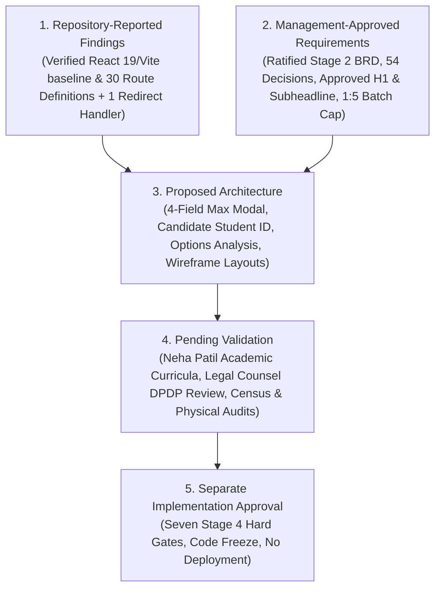
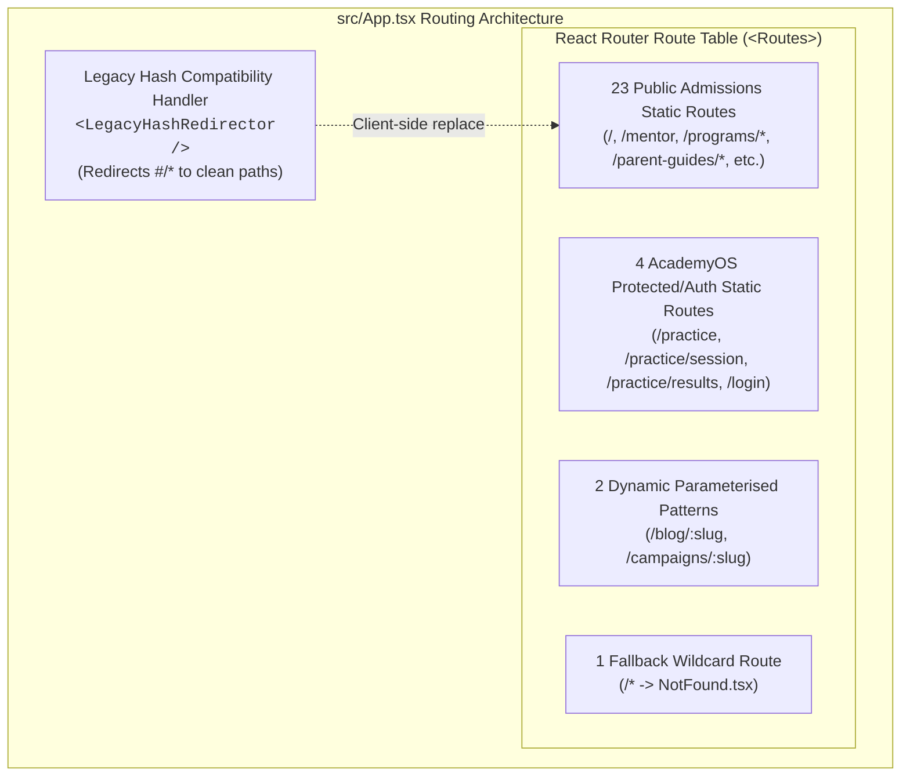
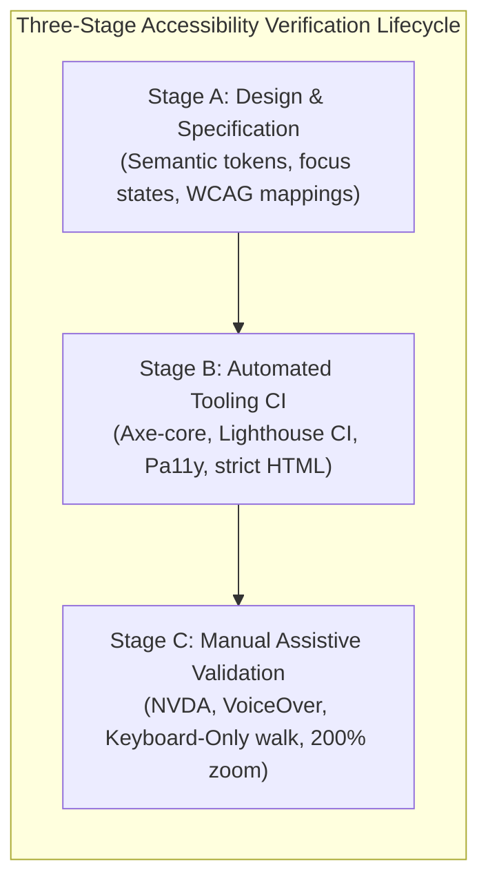
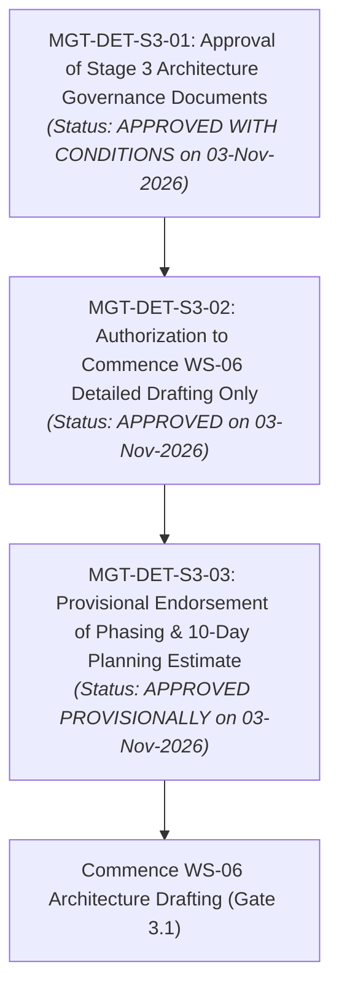

# ARNAV ABACUS ACADEMY (AAA) — STAGE 3 SOLUTION ARCHITECTURE
# FINAL WS-06 MANAGEMENT APPROVAL PACK

**Project:** Arnav Abacus Academy (AAA), Wakad, Pune  
**Document Reference:** `AAA-S3-PACK-001`  
**Stage:** Stage 3 — Architecture & Design  
**Governance Authority:** Neha Patil (Academic Director) & Nitin Patil (Operations & Technology Lead)  
**Baseline Date:** 03 November 2026  
**Git Branch:** `audit-redesign-remediation`  
**Baseline Commit:** `b14c64189fe5aa8e5421a548f41cd1a9626d73ef`  
**Status:** 🟢 **FORMALLY RATIFIED & SIGNED OFF BY MANAGEMENT (03 NOVEMBER 2026)**  

---

> [!IMPORTANT]
> **Implementation Scope Boundary & Governance Safeguards:**  
> This Approval Pack prepares Workstream 06 (WS-06: Digital Experience & Website Architecture) for formal management determination. **Architecture authorization does NOT permit application source-code modifications, website content publication, live lead CRM activation, practice portal modifications, infrastructure migration, or production releases.** Stage 3 is strictly restricted to architectural design, component wireframing, data schema authoring, options analysis, and formal decision engineering. All seven Stage 4 Hard Gates remain strictly active and blocking.

---

## 1. Concise Correction History & Governance Hierarchy

To provide management with absolute clarity regarding the evolution and status of Stage 3 specifications, this pack records the recent reconciliation history and classifies all findings into five distinct governance categories:

### 1.1 Five-Tier Governance Classification Matrix

| Tier | Governance Category | Current Scope & Authority | Governing Baseline / Status |
|:---:|---|---|---|
| **Tier 1** | **Repository-Reported Findings** | **Active Codebase Reality:** React 19, TypeScript, React Router v7, Vite. 30 React Router `<Route>` definitions + 1 client-side legacy hash compatibility handler.  **Existing Integration References in Source Code:** 1. *Google Apps Script Lead Webhook:* Dispatches lead payloads via `fetch` (`mode: "no-cors"`) to an endpoint configured via `VITE_LEADS_WEBHOOK_URL` (`src/lib/leadWebhook.ts`, `LeadForm.tsx`, etc.). 2. *EmailJS Verification:* References EmailJS SDK/API for student OTPs using `VITE_EMAILJS_*` keys (`src/lib/AuthContext.tsx`). 3. *WhatsApp Direct Links:* Deep links to `https://wa.me/919021924968` pre-filling inquiry messages (`FloatingCTA.tsx`, `LeadForm.tsx`, etc.). 4. *Google Analytics 4:* Initializes measurement ID `G-M2EL9MYSRL` and dispatches page/event telemetry (`src/lib/analytics.ts`). 5. *JSONBlob Cloud Persistence:* Hardcoded endpoints pointing to `https://jsonblob.com/api/jsonBlob/...` for student practice attempts and success stories (`src/lib/cloudSync.ts`, `src/lib/successStories.ts`).  **Factual Architectural Distinctions:** - *CRM Products:* No commercial enterprise SaaS CRM (e.g., HubSpot, Zoho) is identified; an interim Google Sheets webhook integration exists in code. - *External Persistence:* Client-side `localStorage`, public unauthenticated `jsonblob.com` endpoints, and Google Sheets via Apps Script. - *Operational Status:* Source-code integration references exist, but their live operational status in production builds has not been independently verified via live network probes. - *Provider-Side Security:* Access permissions, IAM scopes, script execution permissions, and spreadsheet sharing controls remain unverified on the provider side. | Audited directly from repository source files. Factually reconciled baseline. |
| **Tier 2** | **Management-Approved Requirements** | Ratified Stage 2 Master BRD (43 specifications, 54 decisions, 5 conflict resolutions). Ratified website H1 and subheadline verbatim. Maximum 5 students per batch. Approved 8 development pillars, 6 observation dimensions, and 6-stage AAA Learning Model™. Mon–Sat 9:30 AM–7:30 PM hours (`CONF-MKT-01`). 48-hr review target (`CONF-MKT-02`). 39 action commitments accepted (`CONF-MKT-03`). | Formally authorized by Neha Patil & Nitin Patil under Option 1 (03 Nov 2026). Non-negotiable. |
| **Tier 3** | **Proposed Architecture** | Minimum necessary enquiry form (four-field maximum concept). Candidate Student ID format (`AAA-STU-YYYY-XXXX`). Technology neutrality framework and 9-point Options Analysis structure. WS-06 mobile-first wireframe blueprints. Proposed zero-PII telemetry data classification. | Draft architectural proposals. **Zero approved migrations.** Awaiting Gate 3.0B & Gate 3.1. |
| **Tier 4** | **Pending Validation** | Full academic curriculum levels and progression for all 6 portfolio streams (pending Neha Patil). Diagnostic crossover rubric for 9-year-olds (proposed framework; pending Neha Patil). DPDP statutory compliance and 90-day lead retention schedule (pending qualified legal counsel review). Physical premises seating audit and student census roll reconciliation. | Scheduled operational dependencies. **Not approved policies or admission rules.** |
| **Tier 5** | **Separate Implementation Approval** | Writing production code in `src/`, modifying JSX/TSX templates, changing routes, activating CRM pipelines, deploying builds to hosting providers. | **STRICTLY PROHIBITED.** Blocked by 7 Stage 4 Hard Gates. Requires separate written management sign-off. |

---

## 2. Restoration of Ratified Brand Messaging

In strict accordance with `DEC-WS02-13` ratified in Stage 2, all conflicting headline formulations (including *"Building Mathematical Thinkers & Confident Learners in Wakad."*) have been completely excised and replaced across all Stage 3 governance documents with the verbatim approved copy:

### Ratified Master Website Headline (H1):
> **"Beyond Calculation. Towards Confident Mathematical Thinking."**

### Ratified Master Website Subheadline:
> **"At Arnav Abacus Academy, mathematics is the medium to develop confident, independent, and thoughtful young learners. Guided by certified educators in small batches with a maximum of five students per batch, our structured programmes provide personalised learning, closer individual guidance, and steady mathematical progress."**

*Governance Rule:* No alternative or "approved-looking" brand headline variants shall be introduced in any architectural wireframe, copy specification, or metadata blueprint.

---

## 3. Audited Repository Route Inventory & Reconciliation

An exhaustive audit of `src/App.tsx` establishes that the repository contains **30 React Router `<Route>` definitions** within `<Routes>`, plus **1 client-side legacy hash compatibility handler** mounted within `<Router>`.

Route preservation is formally defined as **preserving verified existing public URL behavior, dynamic parameter resolution, error fallbacks, and legacy hash redirects—not merely matching a numerical count.**

### Complete Reconciled Routing Inventory Table:

| # | Route / Pattern | Route Type | Purpose | Current Behaviour | Canonical URL Treatment | Required Preservation Behaviour | Proposed Validation Method |
|:---:|---|:---:|---|---|---|---|---|
| **1** | `/` | Static | Homepage | Renders `Home.tsx` | Self-referential canonical | Preserve root brand entry | Route compile & DOM render test |
| **2** | `/mentor` | Static | Founder Profile | Renders `Mentor.tsx` | Canonical `/mentor` | Preserve founder trust equity | Click navigation & SEO title check |
| **3** | `/programs` | Static | Programme Hub | Renders `Programs.tsx` | Canonical `/programs` | Preserve category rank | Link verification across cards |
| **4** | `/programs/abacus` | Static | Abacus Programme | Renders `ProgramAbacus.tsx` | Canonical `/programs/abacus` | Preserve core commercial SEO | Content & breadcrumb check |
| **5** | `/programs/vedic-maths` | Static | Vedic Maths | Renders `ProgramVedicMaths.tsx` | Canonical `/programs/vedic-maths` | Preserve Vedic search equity | Content & breadcrumb check |
| **6** | `/programs/school-maths` | Static | School Maths | Renders `ProgramSchoolMaths.tsx` | Canonical `/programs/school-maths` | Preserve CBSE/ICSE search equity | Content & breadcrumb check |
| **7** | `/programs/mental-maths` | Static | Mental Maths | Renders `ProgramMentalMaths.tsx` | Canonical `/programs/mental-maths` | Preserve speed drill equity | Content & breadcrumb check |
| **8** | `/programs/ipm-olympiad` | Static | IPM & Olympiad | Renders `ProgramIpmOlympiad.tsx` | Canonical `/programs/ipm-olympiad` | Preserve competitive math equity | Content & breadcrumb check |
| **9** | `/parent-guides/abacus-vs-vedic-maths` | Static | Parent Guide | Renders `GuideAbacusVsVedicMaths.tsx` | Canonical `/parent-guides/...` | Preserve long-tail trust equity | Guide cross-link test |
| **10** | `/parent-guides/does-abacus-confuse-school-math` | Static | Myth-Busting Guide | Renders `GuideDoesAbacusConfuseSchoolMath.tsx` | Canonical `/parent-guides/...` | Preserve objection handling | Guide cross-link test |
| **11** | `/parent-guides/why-children-use-finger-counting` | Static | Developmental Guide | Renders `GuideWhyChildrenUseFingerCounting.tsx` | Canonical `/parent-guides/...` | Preserve early math search rank | Guide cross-link test |
| **12** | `/parent-guides/why-smart-children-make-silly-math-mistakes` | Static | Accuracy Guide | Renders `GuideWhySmartChildrenMakeSillyMathMistakes.tsx` | Canonical `/parent-guides/...` | Preserve conversion guide equity | Guide cross-link test |
| **13** | `/parent-guides/ideal-age-to-start-abacus` | Static | Age Readiness Guide | Renders `GuideIdealAgeToStartAbacus.tsx` | Canonical `/parent-guides/...` | Preserve admissions search rank | Guide cross-link test |
| **14** | `/contact` | Static | Location & Admissions | Renders `Contact.tsx` | Canonical `/contact` | Preserve Google Map Pack / NAP | Form render & NAP consistency |
| **15** | `/showcase` | Static | Achievement Wall | Renders `Showcase.tsx` | Canonical `/showcase` | Preserve student proof wall | Tab state & photo grid check |
| **16** | `/gallery` | Static (Alias) | Photo Gallery Alias | Renders `Showcase defaultTab="gallery"` | Canonical `/showcase` | Preserve gallery deep link | Query parameter / tab test |
| **17** | `/blog` | Static | Insights Hub | Renders `Blog.tsx` | Canonical `/blog` | Preserve content marketing hub | Article grid & pagination check |
| **18** | `/news` | Static | Centre News | Renders `NewsEvents.tsx` | Canonical `/news-events` | Preserve announcement equity | Component render test |
| **19** | `/news-events` | Static (Alias) | News Alias | Renders `NewsEvents.tsx` | Canonical `/news-events` | Preserve legacy announcement URL | Link parity check |
| **20** | `/worksheets` | Static | Worksheet Vault | Renders `WorksheetVault.tsx` | Canonical `/worksheets` | Preserve download search rank | Download asset link check |
| **21** | `/teacher-franchise` | Static | Franchise Hub | Renders `TeacherFranchise.tsx` | Canonical `/teacher-franchise` | Preserve B2B search equity | Lead form check |
| **22** | `/faqs` | Static | Academy FAQs | Renders `Faqs.tsx` | Canonical `/faqs` | Preserve FAQPage Schema | Schema validator & accordion check |
| **23** | `/brochure` | Static | Course Brochure | Renders `InteractiveBrochure.tsx` | Canonical `/brochure` | Preserve digital brochure asset | Viewer rendering test |
| **24** | `/practice` | Static (Protected) | AcademyOS Hub | Renders `PracticeHub.tsx` inside `ProtectedRoute` | `noindex, nofollow` | Maintain zero public search exposure | Auth state boundary check |
| **25** | `/practice/session` | Static (Protected) | Drill Engine | Renders `PracticeSession.tsx` inside `ProtectedRoute` | `noindex, nofollow` | Maintain zero public search exposure | Session state & drill test |
| **26** | `/practice/results` | Static (Protected) | Practice Results | Renders `PracticeResult.tsx` inside `ProtectedRoute` | `noindex, nofollow` | Maintain zero public search exposure | Score persistence check |
| **27** | `/login` | Static | AcademyOS Auth | Renders `Login.tsx` | `noindex, nofollow` | Maintain secure student access | Auth form validation test |
| **28** | `/blog/:slug` | Dynamic Parameter | Article Content | Renders `BlogPostDetail.tsx` matching `:slug` | Canonical `/blog/:slug` | Preserve article deep search equity | Valid slug render & invalid 404 test |
| **29** | `/campaigns/:slug` | Dynamic Parameter | Admissions Landing | Renders `CampaignPage.tsx` matching `:slug` | `noindex` or canonical campaign | Preserve targeted ad campaigns | Campaign slug resolution test |
| **30** | `*` | Wildcard Fallback | 404 Fallback | Renders `NotFound.tsx` | Handled via React Router | Soft 404 prevention & custom UX | Non-existent URL request test |
| **Handler** | `/#/*` | Hash Compatibility | Legacy Redirector | `LegacyHashRedirector` component replaces hash | Redirects to clean path | Prevents broken parent bookmarks | Hash URL browser test |

*Reconciliation Summary:* Exactly **30 React Router route definitions** (27 static + 2 dynamic + 1 wildcard) + **1 client-side legacy hash compatibility handler** = 31 total routing mechanisms. All 31 are formally accounted for and scheduled for strict preservation.

---

## 4. Comprehensive Accessibility Acceptance Criteria (WCAG 2.1 AA Mapped)

The proposed accessibility conformance target is **WCAG 2.1 Level AA**, subject to formal automated and manual assistive technology testing. Conformance cannot be claimed until empirical validation is conducted.

### Detailed WCAG Success Criteria Mapping:

| Accessibility Area | WCAG 2.1 AA Success Criteria | Architectural Specification & Test Requirement | Verification Method |
|---|:---:|---|---|
| **Keyboard Navigation** | **2.1.1 Keyboard** (Level A) **2.1.2 No Keyboard Trap** (Level A) | Every interactive element (buttons, links, form inputs, modal controls) must be 100% operable via keyboard alone (`Tab`, `Shift+Tab`, `Enter`, `Space`, arrow keys). Absolutely zero keyboard focus traps. | Manual keyboard-only walkthrough without mouse. |
| **Logical Focus Order** | **2.4.3 Focus Order** (Level A) | Focus order must follow the logical reading sequence of the DOM. Banners $\rightarrow$ Navigation $\rightarrow$ Main Content $\rightarrow$ Footers. | Tab sequence inspection in Chrome DevTools. |
| **Visible Focus Indicators** | **2.4.7 Focus Visible** (Level A) **1.4.11 Non-text Contrast** (Level AA) | High-contrast visible focus outline ($\ge 3:1$ contrast against adjacent background) around all focused elements. Focus outlines must not be suppressed (`outline: none` prohibited without explicit replacement). Focus must not be obscured by sticky headers or floating CTAs. | Visual focus audit during keyboard tabbing. |
| **Screen-Reader Labels & Controls** | **1.1.1 Non-text Content** (Level A) **4.1.2 Name, Role, Value** (Level A) | All non-text content possesses meaningful `alt` text. Interactive controls have discernible text or explicit `aria-label`. Dynamic state changes (accordions, tabs) expose `aria-expanded` and `aria-selected`. | NVDA (Windows) and VoiceOver (macOS/iOS) screen-reader inspection. |
| **Live Form Announcements** | **4.1.3 Status Messages** (Level AA) | Asynchronous form submission status (loading, success, error) communicated to assistive tech via `aria-live="polite"` regions without moving focus unnecessarily. | Screen reader announcement verification on submit. |
| **Semantic Structure & Headings** | **1.3.1 Info & Relationships** (Level A) **2.4.6 Headings & Labels** (Level AA) | Proper HTML5 landmark elements (`<header>`, `<nav>`, `<main>`, `<footer>`, `<aside>`). Headings and labels describe topic or purpose (WCAG 2.4.6 Level AA). The **strictly single-H1 convention** is formally codified as an **AAA internal content and architecture standard**, not a standalone WCAG AA conformance requirement. | DOM outline and Axe Accessibility tree inspection. |
| **Page Language** | **3.1.1 Language of Page** (Level A) | Root document declares valid default language attribute (`<html lang="en">`). | Automated HTML validation check. |
| **Form Error Recovery** | **3.3.1 Error Identification** (Level A) **3.3.3 Error Suggestion** (Level AA) | Validation errors identified in text and programmatically linked to inputs using `aria-invalid="true"` and `aria-describedby="[error-id]"`. Form errors suggest specific corrective actions. | Intentional invalid input submission testing. |
| **Accessible Modal Dialogs** | **2.1.2 No Keyboard Trap** (Level A) **2.4.3 Focus Order** (Level A) | Modals trap keyboard focus internally while active. Background content set to `aria-hidden="true"`. Pressing `Escape` dismisses the modal. Focus returns to triggering CTA upon closure. | Modal focus trapping and Escape key audit. |
| **Text Resizing & Reflow** | **1.4.4 Resize Text** (Level AA) **1.4.10 Reflow** (Level AA) | Content resizes up to 200% without loss of functionality. Layout reflows into a single column at 320px width without requiring two-dimensional scrolling. | Browser zoom at 200% and 320px viewport emulation. |
| **Color Contrast** | **1.4.3 Contrast (Minimum)** (Level AA) | Text contrast $\ge 4.5:1$ for body copy and $\ge 3:1$ for large text ($\ge 18\text{pt}$ or bold $\ge 14\text{pt}$). Non-text UI contrast $\ge 3:1$. | Automated contrast scanning via Axe and Colour Contrast Analyser. |
| **Reduced Motion** | **2.3.3 Animation from Interactions** (Level AAA / Additional Preference) | Identified as an **AAA-level additional preference**, NOT a mandatory WCAG 2.1 Level AA requirement. UI respects operating system `prefers-reduced-motion: reduce` preference, disabling decorative transitions, parallax, or auto-scrolling. | Emulated CSS media query testing in DevTools. |
| **Touch Target Sizing** | *AAA Design Preference* | Touch targets $\ge 48\times 48\text{px}$ enforced as an **AAA usability design preference**. (Explicitly clarified: this is an internal design standard, not a substitute for WCAG success criteria). | Mobile touch target bounding box measurement. |

---

## 5. Mandatory Boundary & Safeguard Verification

All Stage 3 governance documents adhere to the following approved operational boundaries:

1. **Four-Field Maximum Enquiry Contract:**
   - *Field 1:* Parent Name — Required.
   - *Field 2:* Parent Mobile / WhatsApp — Required.
   - *Field 3:* Child Age Bracket OR School Grade — At least one required.
   - *Field 4:* Programme of Interest — Optional.
   - *Consent:* Transactional communication strictly unbundled from optional marketing consent. Declining promotional consent never blocks enquiry submit.
   - *Data Exclusions:* Zero collection of child DOB, school name, residential address, or clinical history.
2. **Programme Portfolio Status:** Six programme areas represent current portfolio grouping only, pending formal curriculum validation by Neha Patil; zero invented age rules.
3. **Discovery Session Operational Reality:** Documented practice of approximately 45–90 minutes, free of charge, adapting to child engagement and parent discussion. Not a guaranteed fixed duration. Approved service name and 6 observation dimensions enforced.
4. **Continuous Cross-Cutting WS-10 Governance:** Threat modeling, DPDP legal question formulation, and consent auditing operate continuously from Day 1 across all workstreams.
5. **WS-06 vs WS-09A Boundary:** WS-06 defines public user touchpoints and enquiry UI contracts. WS-09A defines the comprehensive relational data model based on approved business SOPs (**not** derived solely from the enquiry form).
6. **ADR Classification Integrity:** Zero premature approvals. ADR-06 is a proposed framework (not an admission rule); ADR-11 is a proposed schedule (not an approved retention policy); ADR-12 remains deferred.
7. **Action & Gate Integrity:** 14 open management confirmations, 39 active Stage 2 actions, and 7 Stage 4 hard gates remain strictly open and blocking.

---

## 6. Formal Management Determinations Record (03 November 2026)

The following three determinations were formally executed and signed off by **Neha Patil** (Academic Director) and **Nitin Patil** (Operations & Technology Lead):

### Formal Management Determinations Table:

| Ref | Subject | Ratified Management Determination & Binding Mandates | Ratification Status |
| :--- | :--- | :--- | :---: |
| **MGT-DET-S3-01** | **Approval of Stage 3 Architecture Governance Framework** | **APPROVED WITH CONDITIONS:** Approves Documents `AAA-S3-GOV-001` through `AAA-S3-GOV-008` as the governing baseline for Stage 3 (passing Gate 3.0B).  *Binding Conditions:* 1. Preserve approved AAA brand positioning, H1 (*"Beyond Calculation. Towards Confident Mathematical Thinking."*), and subheadline verbatim. 2. Preserve existing React 19/Vite technology baseline unless a future architecture decision is separately approved. 3. Treat Student ID format as candidate format, not approved standard. 4. Preserve verified route inventory (30 React Router routes + 1 legacy redirect handler) and URL behaviour. 5. Maintain four-field maximum enquiry data contract and separate optional marketing consent. 6. Maintain WCAG 2.1 AA as proposed accessibility target, subject to testing. 7. Preserve documented Discovery Session practice (~45–90 min free practice) and academic validation boundaries. 8. Continue WS-10 privacy and security governance across all workstreams. | **RATIFIED & CLOSED** (03-Nov-2026) |
| **MGT-DET-S3-02** | **Authorization to Commence WS-06 Detailed Drafting** | **APPROVED:** Authorizes commencement of WS-06 — Digital Experience & Website Architecture.  *Authorised Deliverables:* 1. Website Information Architecture and Sitemap. 2. Component Hierarchy and Layout Blueprints. 3. Mobile Thumb-Zone and Conversion Flow Specification. 4. Local SEO Metadata and Route Preservation Specification. 5. Copy and Messaging Specification.  *Strict Safeguard:* This authorisation does not permit production code changes, website publication, live CRM activation, integrations, data migration or deployment. | **RATIFIED & ACTIVE** (03-Nov-2026) |
| **MGT-DET-S3-03** | **Provisional Endorsement of Execution Phasing & Estimate** | **APPROVED PROVISIONALLY:** Endorses proposed four-phase execution roadmap and ten-working-day planning estimate for WS-06.  *Binding Clarification:* The estimate is provisional and subject to resource availability, academic review, operational dependencies and cross-workstream governance. It is formally recorded as a planning estimate, **not a guaranteed delivery deadline**. | **RATIFIED PROVISIONALLY** (03-Nov-2026) |

### 6.1 Additional Management Conditions Formally Bound:
1. WS-10 must prioritise assessment of existing external integrations, data flows, student information exposure and provider-side access controls.
2. The four enquiry data fields must remain distinct from optional consent controls.
3. No new CRM, storage platform, Student ID standard or migration may be selected without separate approval.
4. All academic programme eligibility, curriculum and diagnostic rules remain subject to Neha's validation.
5. All seven Stage 4 hard gates remain active until separately evidenced and approved.
6. All outstanding Stage 2 actions (39 items) and management confirmations (14 items) retain their current status.
7. No source-code modification, deployment, publication, merge or push is authorised by this approval.

### 6.2 Formal Management Confirmation Sign-Off Record:
- **Neha Patil — Academic Director:** Approved MGT-DET-S3-01, MGT-DET-S3-02, and MGT-DET-S3-03 subject to the conditions above (03 November 2026).
- **Nitin Patil — Operations & Technology Lead:** Approved MGT-DET-S3-01, MGT-DET-S3-02, and MGT-DET-S3-03 subject to the conditions above (03 November 2026).
- **Joint Management Outcome:** Stage 3 Architecture Governance approved. WS-06 detailed architecture drafting authorised. Production implementation remains frozen pending separate approval and closure of applicable Stage 4 hard gates.

---

## 7. Stage 4 Implementation Restrictions

1. **Seven Hard Stage 2 Exit Gates Remain Blocking:**
   - `S4-HG-01` (`ACT-WS04-01`): Physical Abacus Workbook & 14-Module Crosswalk Matrix signed off by Neha Patil.
   - `S4-HG-02` (`ACT-WS04-02`): Skill-Pillar Diagnostic Rubrics signed off by Neha Patil.
   - `S4-HG-03` (`ACT-WS04-03`): Student Assessment Scoring Engine signed off by Neha Patil & Nitin Patil.
   - `S4-HG-04` (`ACT-WS04-08`): Physical Facility Safety, Seating Capacity & Accessibility Audit signed off by Nitin Patil.
   - `S4-HG-05` (`ACT-WS04-09`): Physical Learning Aids & Bead Material Quality Evidence signed off by Neha Patil.
   - `S4-HG-06` (`ACT-WS04-22`): Data Privacy Assessment & Parental Consent Architecture signed off by Nitin Patil & Legal.
   - `S4-HG-07` (`ACT-WS04-27`): Student Certificate Verification Architecture signed off by Nitin Patil.
2. **Code & Production Freeze:**
   - Zero modifications to source files in `src/`, static assets in `public/`, or configuration manifests.
   - Zero website publication, zero CRM activation, zero migrations, and zero production releases.
   - Zero git commits, pushes, or merges.

---

## 8. Repository Integrity Verification

- **Git Branch:** `audit-redesign-remediation`
- **Baseline Commit:** `b14c64189fe5aa8e5421a548f41cd1a9626d73ef`
- **Tracked Files Diff:** `git diff --stat` returns **0 files changed, 0 insertions, 0 deletions**.
- **Untracked Additions:** Restricted strictly to `AGENTS.md` and documentation files under `docs/`.
- **Application Code Status:** **100% untouched and clean**.
- **Implementation Freeze Enforced:** Detailed WS-06 architectural drafting is formally authorised under `MGT-DET-S3-02`. All application code modifications in `src/`, website publication, CRM activation, integrations, migrations, and deployments remain strictly prohibited pending separate approval and closure of applicable Stage 4 hard gates.

---
*End of Final WS-06 Management Approval Pack (AAA-S3-PACK-001)*
