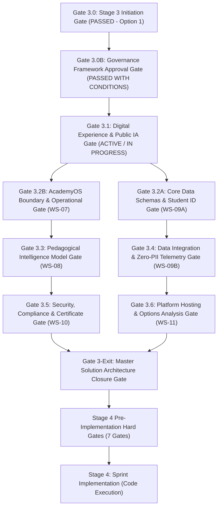

# ARNAV ABACUS ACADEMY (AAA) — STAGE 3 SOLUTION ARCHITECTURE
# MANAGEMENT APPROVAL & STAGE-GATE GOVERNANCE REGISTER

**Project:** Arnav Abacus Academy (AAA), Wakad, Pune  
**Document Reference:** `AAA-S3-GOV-007`  
**Stage:** Stage 3 — Architecture & Design  
**Governance Authority:** Neha Patil (Academic Director) & Nitin Patil (Operations & Technology Lead)  
**Ratification Date:** 03 November 2026  
**Status:** 🟢 **ACTIVE GOVERNANCE REGISTER — GATE 3.0B RATIFIED & WS-06 COMMENCEMENT AUTHORIZED**  

---

## 1. Executive Summary & Purpose

The **Stage 3 Management Approval and Stage-Gate Governance Register** establishes the binding control gates, sign-off authorities, verification criteria, and transition protocols governing all architectural and design specifications across Workstreams WS-06 through WS-11.

In accordance with `AGENTS.md` Rule 5 and formal management determinations executed on **03 November 2026**:
1. Overall Stage 3 initiation was formally authorized under Option 1 Management Ratification.
2. The Stage 3 Architecture Governance Framework (Documents `AAA-S3-GOV-001` through `AAA-S3-GOV-008`) was formally approved with conditions under **`MGT-DET-S3-01`**, passing **Gate 3.0B**.
3. Detailed architectural drafting for **WS-06 (Digital Experience & Website Architecture)** was formally authorized under **`MGT-DET-S3-02`**, activating **Gate 3.1**.
4. The four-phase execution roadmap and provisional 10-working-day planning estimate for WS-06 were endorsed under **`MGT-DET-S3-03`**.
5. **Strict Implementation Freeze:** No architectural specification shall transition into production code implementation (Stage 4) without passing all Stage 3 gates and satisfying all seven Stage 4 Hard Gates.

---

## 2. Stage-Gate Governance Hierarchy & Authorities

### 2.1 Governance Roles and Sign-Off Mandates

| Role | Designee | Primary Gate Responsibilities | Sign-Off Authority |
| :--- | :--- | :--- | :--- |
| **Academic Director & Founder** | **Neha Patil** | Pedagogical integrity, parent communication tone, 6 observation dimensions, 8 intelligence pillars, diagnostic evaluation rubrics, lesson plan architectures, certificate eligibility criteria. | Sole authority for pedagogical, brand copy, and academic model sign-off. Joint authority for Master Architecture Stage Exit. |
| **Operations & Technology Lead** | **Nitin Patil** | System architecture, boundary protection, data flow security, zero-PII telemetry validation, options analysis, candidate student ID schema, interim lead tracking tools. | Sole authority for technical, operational, infrastructure, and privacy engineering sign-off. Joint authority for Master Architecture Stage Exit. |
| **Qualified Legal Counsel** | *External Reviewer* | Review of DPDP statutory legal questions, minor data consent mechanisms, data retention policies, and cross-border processor boundaries. | Advisory sign-off on legal and privacy questions. |

---

## 3. Comprehensive Stage 3 Control Gate Register

### 3.1 Detailed Gate Descriptions and Criteria

| Gate ID | Gate Name | Owning Workstream | Approving Authority | Prerequisite Inputs | Verification Criteria / Artifacts | Status |
| :--- | :--- | :--- | :--- | :--- | :--- | :--- |
| **Gate 3.0** | **Stage 3 Baseline Initiation Gate** | Stage 3 Lead | Joint (Neha Patil & Nitin Patil) | Stage 2 Master BRD Ratification, 54 decisions ratified, 39 action commitments accepted. | Formal authorization of Option 1 recorded in closure and charter documents. | **PASSED** (03-Nov-2026) |
| **Gate 3.0B** | **Governance Framework Approval Gate** | Stage 3 Lead | Joint (Neha Patil & Nitin Patil) | Corrected Documents `AAA-S3-GOV-001` through `AAA-S3-GOV-008`. | Approval of technology neutrality, 30+1 route inventory, 4-field max enquiry contract, expanded accessibility criteria, verbatim H1/subheadline, and Discovery Session reality. | **PASSED WITH CONDITIONS** (03-Nov-2026 via `MGT-DET-S3-01`) |
| **Gate 3.1** | **Digital Experience & Public IA Gate** | WS-06 | Joint (Neha Patil & Nitin Patil) | Wireframes, Sitemap, 30-Route Map + 1 Redirect Handler, 4-Field Max Modal Contract, Discovery Booking Flow, H1 Copy Spec. | 1. 30 React Router routes + 1 legacy redirect handler preserved. 2. Verbatim ratified H1 (*"Beyond Calculation. Towards Confident Mathematical Thinking."*) and approved subheadline applied. 3. Discovery session copy adheres to approx 45–90 min practice & free offering (not guaranteed duration). 4. 4-field maximum modal contract validated. 5. WCAG 2.1 AA & Mobile-first wireframes verified. | **ACTIVE / IN PROGRESS** (Authorized on 03-Nov-2026 via `MGT-DET-S3-02`) |
| **Gate 3.2A** | **Core Data Schemas & Student ID Gate** | WS-09A | Nitin Patil (Tech), Neha Patil (Ops) | Candidate ID format analysis, ER models, parent-student-sibling relational schema from business SOPs. | 1. 1:N parent-student relationship validated. 2. Sibling record segregation verified. 3. Comprehensive schema from business processes (not derived solely from enquiry form). | **PENDING WS-06 DATA CONTRACTS** |
| **Gate 3.2B** | **AcademyOS Boundary & Operational Gate** | WS-07 | Nitin Patil (Tech), Neha Patil (Ops) | AcademyOS functional interface spec, batch scheduling SOPs, timetable triage model. | 1. Zero code leakage between public web and `/practice/*`. 2. Teaching hours protection protocol verified. 3. Batch scheduling strictly caps batches at $\le 5$ students. | **PENDING WS-06 & WS-09A** |
| **Gate 3.3** | **Pedagogical Intelligence Model Gate** | WS-08 | Neha Patil (Academic Director) | 6 Observation Dimensions rubric, 8 Intelligence Pillars data structures, Diagnostic Assessment engine spec. | 1. Exact 6 approved dimension names retained without alteration. 2. Micro-batch constraint embedded. 3. Strict self-baseline comparison only; zero CIS, zero rankings, zero clinical terms. | **PENDING GATE 3.2B** |
| **Gate 3.4** | **Data Integration & Zero-PII Telemetry Gate** | WS-09 | Nitin Patil & Neha Patil | WS-09A & WS-09B specifications, candidate Student ID analysis, ER models, API gateway, Zero-PII schema. | 1. Two-tier hybrid Student ID model approved. 2. Sibling record segregation verified. 3. Relational data model derived from business SOPs. 4. Dedicated API gateway & custom headless CRM approved. 5. Zero-PII telemetry schema validated. 6. Layered form security & formula injection defense adopted. | **PASSED & CLOSED** (04-Nov-2026 via `MGT-DET-S3-13`) |
| **Gate 3.5** | **Security, Compliance & Certificate Gate** | WS-10 | Nitin Patil & Qualified Legal Counsel (Neha Patil for Diplomas) | DPDP legal questions, consent logging SOP, Practice Achievement Records & Certificate options. | 1. Software PDFs confirmed as "Practice Achievement Records". 2. Central ledger and QR verification options evaluated. 3. Formal DPDP legal questions formulated for qualified counsel review. 4. Trusted server authentication & RBAC matrix adopted. 5. JSONBlob 5-phase deprecation confirmed. | **PASSED & CLOSED** (04-Nov-2026 via `MGT-DET-S3-14`) |
| **Gate 3.6** | **Platform Hosting & Options Analysis Gate** | WS-11 | Nitin Patil | Technology Options Analysis, API contracts, rollback strategy. | 1. Current React 19/Vite baseline benchmarked. 2. Cloudflare Pages frontend hosting approved. 3. Node.js serverless API gateway adopted. 4. Supabase Managed Postgres (Mumbai) adopted. 5. Zero-Cash-Outlay Bootstrap Model ratified. 6. Internal DPDP compliance sign-off by Nitin Patil approved. | **PASSED & CLOSED** (04-Nov-2026 via `MGT-DET-S3-15`) |
| **Gate 3-Exit** | **Master Solution Architecture Closure Gate** | Full Solution | Joint (Neha Patil & Nitin Patil) | Master Solution Architecture Document, all 6 workstream packs closed, traceability matrix complete. | 1. 100% of 43 Stage 2 requirements fully traced. 2. Zero unresolved technical or operational contradictions. 3. Zero-Cash-Outlay Bootstrap Model endorsed. 4. Stage 3 formally closed. | **PASSED & CLOSED** (04-Nov-2026 via `MGT-DET-S3-15`) |

---

## 4. Bridge to Stage 4 Hard Gates (Stage 2 Carry-Forward)

Passing Gate 3-Exit is a prerequisite, but not the sole condition, for Stage 4 code changes. The following seven Hard Gates from Stage 2 must be independently satisfied and verified prior to writing code in `src/`:

| Hard Gate Ref | Original Action Ref | Gate Description & Evidence Requirement | Enforcing Lead | Gate Status |
| :--- | :--- | :--- | :--- | :--- |
| **S4-HG-01** | `ACT-WS04-01` | **Curriculum Structure Matrix Validation:** Signed-off syllabus, progression levels, and learning milestones for all 5 programmes. | Neha Patil | OPEN (Hard Gate) |
| **S4-HG-02** | `ACT-WS04-02` | **Skill-Pillar Diagnostic Rubric Validation:** Formal scoring rubrics for 6 observation dimensions and 8 child intelligence pillars. | Neha Patil | OPEN (Hard Gate) |
| **S4-HG-03** | `ACT-WS04-03` | **Student Assessment Scoring Engine:** Architectural review and sign-off on diagnostic scoring logic and recommendation rules. | Neha Patil / Nitin Patil | OPEN (Hard Gate) |
| **S4-HG-04** | `ACT-WS04-08` | **Physical Centre Safety & Accessibility Evidence:** Verified documentation of centre safety compliance, child protection, and accessibility. | Nitin Patil | OPEN (Hard Gate) |
| **S4-HG-05** | `ACT-WS04-09` | **Physical Learning Aids & Bead Material Quality Evidence:** Inspection evidence of authentic abacus instruments, sensory kits, and Vedic materials. | Neha Patil | OPEN (Hard Gate) |
| **S4-HG-06** | `ACT-WS04-22` | **Data Privacy Assessment & Consent Architecture:** Complete legal review of student data handling, parental consent forms, and zero-PII protocols. | Nitin Patil & Legal | OPEN (Hard Gate) |
| **S4-HG-07** | `ACT-WS04-27` | **Student Certificate Verification Specification:** Completed cryptographic hashing, tamper-evident issuance, and verification service architecture. | Nitin Patil | OPEN (Hard Gate) |

---

## 5. Ratified Management Determinations Record (03 November 2026)

The following formal determinations were executed by **Neha Patil** (Academic Director) and **Nitin Patil** (Operations & Technology Lead):

| Determination Ref | Subject | Ratified Management Determination & Binding Mandates | Ratification Status |
| :--- | :--- | :--- | :---: |
| **MGT-DET-S3-01** | **Approval of Stage 3 Architecture Governance Documents** | **APPROVED WITH CONDITIONS:** Approves Documents `AAA-S3-GOV-001` through `AAA-S3-GOV-008` as the governing baseline for Stage 3 (passing Gate 3.0B).  *Binding Conditions:* 1. Preserve approved AAA brand positioning, H1 (*"Beyond Calculation. Towards Confident Mathematical Thinking."*), and subheadline verbatim. 2. Preserve existing React 19/Vite technology baseline unless a future architecture decision is separately approved. 3. Treat Student ID format as candidate format, not approved standard. 4. Preserve verified route inventory (30 React Router routes + 1 legacy redirect handler) and URL behaviour. 5. Maintain four-field maximum enquiry data contract and separate optional marketing consent. 6. Maintain WCAG 2.1 AA as proposed accessibility target, subject to testing. 7. Preserve documented Discovery Session practice (~45–90 min free practice) and academic validation boundaries. 8. Continue WS-10 privacy and security governance across all workstreams. | **RATIFIED & CLOSED** (03-Nov-2026) |
| **MGT-DET-S3-02** | **Authorization to Commence WS-06 Detailed Drafting** | **APPROVED:** Authorizes commencement of WS-06 — Digital Experience & Website Architecture.  *Authorised Deliverables:* 1. Website Information Architecture and Sitemap. 2. Component Hierarchy and Layout Blueprints. 3. Mobile Thumb-Zone and Conversion Flow Specification. 4. Local SEO Metadata and Route Preservation Specification. 5. Copy and Messaging Specification.  *Strict Safeguard:* This authorisation does not permit production code changes, website publication, live CRM activation, integrations, data migration or deployment. | **RATIFIED & ACTIVE** (03-Nov-2026) |
| **MGT-DET-S3-03** | **Provisional Endorsement of Execution Phasing & Estimate** | **APPROVED PROVISIONALLY:** Endorses proposed four-phase execution roadmap and ten-working-day planning estimate for WS-06.  *Binding Clarification:* The estimate is provisional and subject to resource availability, academic review, operational dependencies and cross-workstream governance. It is formally recorded as a planning estimate, **not a guaranteed delivery deadline**. | **RATIFIED PROVISIONALLY** (03-Nov-2026) |
| **MGT-DET-S3-04** | **Ratification of WS-06.1 IA Spec & Approval of Validation Determinations (V-01, V-02, V-03)** | **APPROVED & RATIFIED:** Approves `AAA-S3-SPEC-WS06-01` (Information Architecture & Sitemap Specification) and formally resolves the three validation determinations:  1. **V-01 Approved:** Neha Patil confirms public presentation of 6 current portfolio groupings and pedagogical progression. 2. **V-02 Approved:** Neha Patil confirms copy framing for 6 Educational Observation Dimensions for Discovery Sessions. 3. **V-03 Approved:** Nitin Patil confirms 4-field maximum enquiry modal contract and dual unbundled consent model.  *Next Workstream Mandate:* Authorizes commencement of WS-06.2 (Wireframes & Low-Fidelity Layout Specifications) under strict documentation-only mode. | **RATIFIED & CLOSED** (03-Nov-2026) |
| **MGT-DET-S3-05** | **Ratification of WS-06.2 Wireframes & Layout Blueprints Spec** | **APPROVED & RATIFIED:** Approves `AAA-S3-SPEC-WS06-02` (Wireframes & Low-Fidelity Layout Blueprints) across all 7 page archetypes (Homepage, Programme Hub, Programme Detail, Parent Guide, Enquiry Modal, Contact, and Responsive Ergonomics).  *Key Endorsements:* 1. Confirms 14-block homepage narrative architecture. 2. Re-affirms verbatim H1 and subheadline, micro-batch $\le 5$, ~45–90 min Discovery Session reality, and non-compulsory portfolio grouping presentation. 3. Re-affirms four-field maximum modal contract with unbundled dual consent.  *Next Workstream Mandate:* Authorizes commencement of **WS-06.3 (Design System, UI Tokens & Component Specifications)** under strict documentation-only mode. | **RATIFIED & CLOSED** (03-Nov-2026) |
| **MGT-DET-S3-06** | **Ratification of WS-06.3 Design System Spec, Resolution of Open Items & Reconciled Roadmap** | **APPROVED & RATIFIED:** Approves `AAA-S3-SPEC-WS06-03` (Design System, UI Tokens & Component Specifications) and formally resolves all review items:  1. **Determination 1 (Neha Patil):** Approves cognitive color mappings (Teal for Logic, Amber for Memory, Orange for Spatial) and line icon concepts for 6 Educational Observation Dimensions. 2. **Determination 2 (Nitin Patil):** Approves Tailwind v4 theme integration via `@theme`, native dependency-free React focus trap, and mobile virtual keyboard auto-suppression for `<StickyMobileBar />`. 3. **Determination 3 (Joint):** Reconciles WS-06 into a six-deliverable sequence (WS-06.1 through WS-06.6), confirming WS-06.3 as an authorized expansion of the Component Hierarchy specification.  *Next Workstream Mandate:* Authorizes commencement of **WS-06.4: Mobile Conversion & Thumb-Zone Specification** under strict documentation-only mode. | **RATIFIED & CLOSED** (03-Nov-2026) |
| **MGT-DET-S3-07** | **Ratification of WS-06.4 Mobile Conversion & Thumb-Zone Specification** | **APPROVED & RATIFIED:** Approves `AAA-S3-SPEC-WS06-04` (Mobile Conversion & Thumb-Zone Specification) and formally executes determinations:  1. **Determination 1 (Neha Patil):** Confirms mobile framing of Discovery Session, 6 observation dimensions, and honest post-submission communication separating inquiry receipt from appointment confirmation. 2. **Determination 2 (Nitin Patil):** Approves 7-state mobile parent journey FSM, thumb-zone specifications (320px, 375px, 430px), `<StickyMobileBar />` scroll/keyboard state machine, 80px layout buffer, 10-point mobile device test matrix, and zero-PII mobile telemetry parameter schema. 3. **Determination 3 (Joint):** Ratifies WS-06.4 and authorizes commencement of **WS-06.5: Local SEO Metadata & Route Preservation Specification** under strict documentation-only mode. | **RATIFIED & CLOSED** (03-Nov-2026) |

### 5.1 Additional Management Conditions Formally Bound to Stage 3:
1. WS-10 must prioritise assessment of existing external integrations (Google Apps Script webhook, EmailJS, WhatsApp, GA4, JSONBlob), data flows, student information exposure, and provider-side access controls.
2. The four enquiry data fields must remain distinct from optional consent controls.
3. No new CRM, storage platform, Student ID standard, or migration may be selected without separate approval.
4. All academic programme eligibility, curriculum, and diagnostic rules remain subject to Neha Patil's validation.
5. All seven Stage 4 hard gates remain active until separately evidenced and approved.
6. All outstanding Stage 2 actions (39 items) and management confirmations (14 items) retain their current status.
7. No source-code modification, deployment, publication, merge, or push is authorised by this approval.

---

## 6. Management Sign-Off Record

| Gate / Action | Date Executed | Signatory | Determination | Formal Governance Notes |
| :--- | :---: | :--- | :---: | :--- |
| **Gate 3.0** | 03-Nov-2026 | Neha Patil & Nitin Patil | **APPROVED** | Overall Stage 3 initiation authorized under Option 1. |
| **Gate 3.0B** | 03-Nov-2026 | Neha Patil & Nitin Patil | **APPROVED WITH CONDITIONS** | Ratified via `MGT-DET-S3-01`. Stage 3 Governance Framework active. |
| **WS-06 Kickoff** | 03-Nov-2026 | Neha Patil & Nitin Patil | **APPROVED** | Ratified via `MGT-DET-S3-02`. Drafting of 5 WS-06 specs authorized. |
| **Phasing Endorsement** | 03-Nov-2026 | Neha Patil & Nitin Patil | **APPROVED PROVISIONALLY** | Ratified via `MGT-DET-S3-03`. 10-day planning estimate active. |
| **WS-06.1 IA Spec** | 03-Nov-2026 | Neha Patil & Nitin Patil | **APPROVED & RATIFIED** | Ratified via `MGT-DET-S3-04`. V-01, V-02, V-03 formally approved. |
| **WS-06.2 Kickoff** | 03-Nov-2026 | Neha Patil & Nitin Patil | **APPROVED** | Authorized under `MGT-DET-S3-04` (Wireframes & Low-Fi Layouts). |
| **WS-06.2 Wireframes** | 03-Nov-2026 | Neha Patil & Nitin Patil | **APPROVED & RATIFIED** | Ratified via `MGT-DET-S3-05`. Layout blueprints approved. |
| **WS-06.3 Kickoff** | 03-Nov-2026 | Neha Patil & Nitin Patil | **APPROVED** | Authorized under `MGT-DET-S3-05` (Design System & UI Tokens). |
| **WS-06.3 Design System** | 03-Nov-2026 | Neha Patil & Nitin Patil | **APPROVED & RATIFIED** | Ratified via `MGT-DET-S3-06`. Determinations 1, 2, 3 approved. |
| **WS-06.4 Kickoff** | 03-Nov-2026 | Neha Patil & Nitin Patil | **APPROVED** | Authorized under `MGT-DET-S3-06` (Mobile Conversion & Thumb-Zone). |
| **WS-06.4 Mobile Spec** | 03-Nov-2026 | Neha Patil & Nitin Patil | **APPROVED & RATIFIED** | Ratified via `MGT-DET-S3-07`. Determinations 1, 2, 3 approved. |
| **WS-06.5 Kickoff** | 03-Nov-2026 | Neha Patil & Nitin Patil | **APPROVED** | Authorized under `MGT-DET-S3-07` (Local SEO & Route Preservation). |
| **WS-06.5 Local SEO Spec** | 03-Nov-2026 | Neha Patil & Nitin Patil | **APPROVED & RATIFIED** | Ratified via `MGT-DET-S3-08`. Determinations 1, 2, 3 approved. NAP unified to `+91 90219 24968`. |
| **WS-06.6 Kickoff** | 03-Nov-2026 | Neha Patil & Nitin Patil | **APPROVED** | Authorized under `MGT-DET-S3-08` (Copy, Brand Voice & Messaging Spec). |
| **WS-06.6 Copy Spec** | 03-Nov-2026 | Neha Patil & Nitin Patil | **APPROVED & RATIFIED** | Ratified via `MGT-DET-S3-09`. Determinations 1, 2, 3 approved. All 6 WS-06 specs complete. |
| **Gate 3.1** | 03-Nov-2026 | Neha Patil & Nitin Patil | **APPROVED & CLOSED** | Gate 3.1 (Website Architecture & Experience) formally sealed. WS-06 complete. |
| **WS-07 Kickoff** | 03-Nov-2026 | Neha Patil & Nitin Patil | **APPROVED** | Authorized under `MGT-DET-S3-09` (AcademyOS Boundary Isolation). |
| **WS-07 Isolation Spec**| 03-Nov-2026 | Neha Patil & Nitin Patil | **APPROVED & RATIFIED** | Ratified via `MGT-DET-S3-10`. Determinations D-1 through D-6 executed. |
| **Gate 3.2** | 03-Nov-2026 | Neha Patil & Nitin Patil | **APPROVED & CLOSED** | Gate 3.2 (AcademyOS Boundary Isolation) formally closed under `MGT-DET-S3-10`. |
| **WS-08 Kickoff** | 03-Nov-2026 | Neha Patil & Nitin Patil | **APPROVED** | Authorized under `MGT-DET-S3-10` (Diagnostic Assessment Architecture). |
| **WS-08 Assessment Spec**| 04-Nov-2026 | Neha Patil & Nitin Patil | **APPROVED & RATIFIED** | Ratified via `MGT-DET-S3-11`. Determinations 1, 2, 3 approved. |
| **Gate 3.3** | 04-Nov-2026 | Neha Patil & Nitin Patil | **APPROVED & CLOSED** | Gate 3.3 (Diagnostic Assessment Architecture) closed under `MGT-DET-S3-11`. |
| **WS-09 Kickoff** | 04-Nov-2026 | Neha Patil & Nitin Patil | **APPROVED** | Authorized under `MGT-DET-S3-11` (Technology Architecture, Persistence & CRM). |
| **WS-09A Ratification** | 04-Nov-2026 | Nitin Patil & Neha Patil | **APPROVED & RATIFIED** | Ratified via `MGT-DET-S3-12`. Determinations D-09A-01 through D-09A-08 approved. |
| **WS-09B Kickoff** | 04-Nov-2026 | Nitin Patil & Neha Patil | **APPROVED & RATIFIED** | Ratified via `MGT-DET-S3-13`. Determinations D-09B-01 through D-09B-10 approved. |
| **Gate 3.4** | 04-Nov-2026 | Nitin Patil & Neha Patil | **APPROVED & CLOSED** | Gate 3.4 formally sealed under `MGT-DET-S3-13`. WS-09 (A & B) complete. |
| **WS-10 Kickoff** | 04-Nov-2026 | Nitin Patil & Neha Patil | **APPROVED & RATIFIED** | Ratified via `MGT-DET-S3-14`. Determinations D-10-01 through D-10-08 approved. |
| **Gate 3.5** | 04-Nov-2026 | Nitin Patil & Neha Patil | **APPROVED & CLOSED** | Gate 3.5 formally sealed under `MGT-DET-S3-14`. WS-10 complete. |
| **WS-11 Kickoff** | 04-Nov-2026 | Nitin Patil & Neha Patil | **APPROVED & RATIFIED** | Ratified via `MGT-DET-S3-15`. Determinations D-11-01 through D-11-08 approved as amended. |
| **Gate 3.6** | 04-Nov-2026 | Nitin Patil & Neha Patil | **APPROVED & CLOSED** | Gate 3.6 formally sealed under `MGT-DET-S3-15`. WS-11 complete. |
| **Gate 3-Exit** | 04-Nov-2026 | Nitin Patil & Neha Patil | **APPROVED & PASSED** | Master Solution Architecture ratified. Stage 3 (Architecture & Design) formally closed. |
| **Stage 4 Kickoff** | 04-Nov-2026 | Nitin Patil & Neha Patil | **CONDITIONALLY APPROVED** | Ratified via `MGT-DET-S4-01`. Seven Hard Gates conditionally approved with 10-working-day Corrective Action Period. Sprint 1 staging branch authorized under strict branch isolation. Production locked. |

---
*End of Management Approval & Stage-Gate Governance Register (AAA-S3-GOV-007)*
