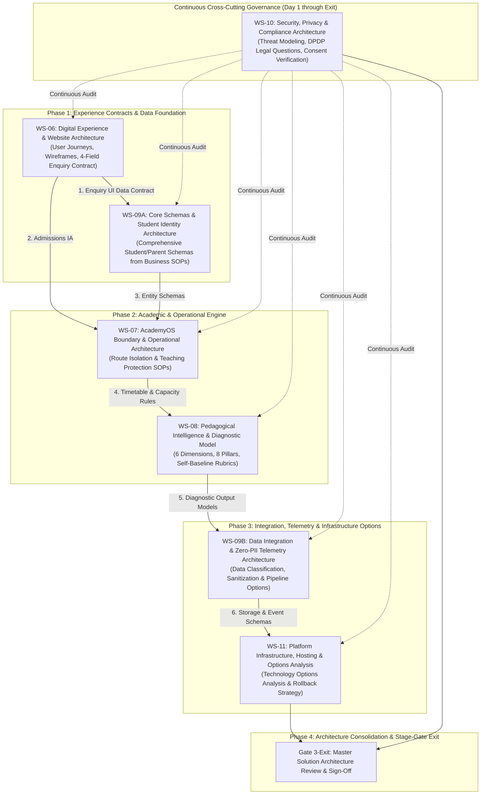

# ARNAV ABACUS ACADEMY (AAA) — STAGE 3 SOLUTION ARCHITECTURE
# WORKSTREAM & DEPENDENCY PLAN

**Project:** Arnav Abacus Academy (AAA), Wakad, Pune  
**Leadership:** Neha Patil (Founder & Academic Director), Nitin Patil (Operations & Technology Lead)  
**Governance Stage:** Stage 3 — Architecture & Design  
**Previous Stage:** Stage 2 — Business Requirements (Ratified & Closed on 03 Nov 2026)  
**Management Authority:** Formally Ratified by Neha Patil & Nitin Patil on 03 November 2026 via `MGT-DET-S3-01`; WS-06 Detailed Drafting Authorized via `MGT-DET-S3-02`  
**Document Ref:** `docs/03_solution_architecture/AAA_Stage3_Workstream_and_Dependency_Plan.md`  
**Date:** November 03, 2026  
**Status:** 🟢 **ACTIVE GOVERNANCE BASELINE — WORKSTREAM PLAN RATIFIED & WS-06 COMMENCED**  

---

## 1. Executive Summary & Purpose

This document establishes the operational, technical, and governance definitions for the six Stage 3 architecture workstreams (WS-06 through WS-11). It details the scope, boundaries, inputs, deliverables, decision points, and entry/exit criteria for each workstream, and formalizes their sequential and cross-cutting dependency architecture.

---

## 2. Workstream Dependency Architecture & Phasing Model

To eliminate circular dependencies and ensure rigorous quality assurance, Stage 3 is structured into sequential phases underpinned by **continuous cross-cutting security and privacy governance (WS-10)**:

### 2.1 Critical Dependency Rules & Division of Responsibilities
1. **WS-06 Scope Boundary:** WS-06 defines public user journeys, information architecture, mobile-first wireframes, canonical route preservation, and the enquiry form UI contract.
2. **WS-09A Scope Boundary:** WS-09A defines the complete student, parent, programme, and relationship data architecture based on approved academic and operational business processes. **WS-09A does NOT derive the full AcademyOS data schema solely from the 4-field enquiry contract.**
3. **WS-10 as a Cross-Cutting Control:** Security, privacy, and data protection reviews (WS-10) are **not** late-stage activities. WS-10 actively audits every workstream from inception (form privacy in WS-06, identity pseudonyms in WS-09A, boundary isolation in WS-07, diagnostic confidentiality in WS-08).
4. **Pre-Closure Verification:** Before any workstream is submitted for gate approval, all upstream and cross-cutting dependencies must be formally verified.

---

## 3. Audited Repository Route Inventory

An exhaustive code audit of `src/App.tsx` identified **30 React Router route definitions** (27 static route definitions, 2 dynamic parameterised patterns, and 1 wildcard fallback route), plus **1 client-side legacy hash compatibility handler** (`<LegacyHashRedirector />`). All 31 routing behaviors must be strictly preserved during Stage 3:

| # | Route / Pattern | Type | Current Purpose | Proposed Destination | Redirect Req. | Canonical Treatment | SEO & Search Implications | Validation Method |
|:---:|---|:---:|---|---|:---:|---|---|---|
| 1 | `/` | Static | Public Homepage | Preserved (`Home.tsx`) | None | Self-referential canonical | Core branded organic search entry | Route compile & crawl check |
| 2 | `/mentor` | Static | Founder & Leadership Profile | Preserved (`Mentor.tsx`) | None | Canonical `/mentor` | Founder trust & credential equity | Navigation click test |
| 3 | `/programs` | Static | Programme Continuum Hub | Preserved (`Programs.tsx`) | None | Canonical `/programs` | High-intent category keyword rank | Sub-route link check |
| 4 | `/programs/abacus` | Static | Abacus Programme Detail | Preserved (`ProgramAbacus.tsx`) | None | Canonical `/programs/abacus` | Core commercial search equity | Breadcrumb & link test |
| 5 | `/programs/vedic-maths` | Static | Vedic Maths Detail | Preserved (`ProgramVedicMaths.tsx`) | None | Canonical `/programs/vedic-maths` | Secondary commercial search equity | Breadcrumb & link test |
| 6 | `/programs/school-maths` | Static | School Maths Support | Preserved (`ProgramSchoolMaths.tsx`) | None | Canonical `/programs/school-maths` | CBSE/ICSE curriculum search equity | Breadcrumb & link test |
| 7 | `/programs/mental-maths` | Static | Mental Maths Speed Drills | Preserved (`ProgramMentalMaths.tsx`) | None | Canonical `/programs/mental-maths` | Rapid arithmetic search equity | Breadcrumb & link test |
| 8 | `/programs/ipm-olympiad` | Static | IPM & Olympiad Coaching | Preserved (`ProgramIpmOlympiad.tsx`) | None | Canonical `/programs/ipm-olympiad` | High-performing competitive search | Breadcrumb & link test |
| 9 | `/parent-guides/abacus-vs-vedic-maths` | Static | Educational Comparison Guide | Preserved (`GuideAbacusVsVedicMaths.tsx`) | None | Canonical `/parent-guides/...` | Long-tail search & parent trust | Guide cross-link test |
| 10 | `/parent-guides/does-abacus-confuse-school-math` | Static | Myth-Busting Parent Guide | Preserved (`GuideDoesAbacusConfuseSchoolMath.tsx`) | None | Canonical `/parent-guides/...` | Objection handling & search rank | Guide cross-link test |
| 11 | `/parent-guides/why-children-use-finger-counting` | Static | Developmental Guide | Preserved (`GuideWhyChildrenUseFingerCounting.tsx`) | None | Canonical `/parent-guides/...` | Early childhood math search equity | Guide cross-link test |
| 12 | `/parent-guides/why-smart-children-make-silly-math-mistakes` | Static | Cognitive Accuracy Guide | Preserved (`GuideWhySmartChildrenMakeSillyMathMistakes.tsx`) | None | Canonical `/parent-guides/...` | High-intent parent conversion guide | Guide cross-link test |
| 13 | `/parent-guides/ideal-age-to-start-abacus` | Static | Age Readiness Guide | Preserved (`GuideIdealAgeToStartAbacus.tsx`) | None | Canonical `/parent-guides/...` | Admissions timing search equity | Guide cross-link test |
| 14 | `/practice` | Static (Protected) | AcademyOS Student Practice Hub | Preserved (`PracticeHub.tsx`) | Auth required | `noindex, nofollow` | Internal app — zero SEO exposure | Session boundary test |
| 15 | `/practice/session` | Static (Protected) | AcademyOS Interactive Drills | Preserved (`PracticeSession.tsx`) | Auth required | `noindex, nofollow` | Internal app — zero SEO exposure | Active drill test |
| 16 | `/practice/results` | Static (Protected) | AcademyOS Practice Results | Preserved (`PracticeResult.tsx`) | Auth required | `noindex, nofollow` | Internal app — zero SEO exposure | Score storage test |
| 17 | `/login` | Static | AcademyOS Student/Teacher Auth | Preserved (`Login.tsx`) | None | `noindex, nofollow` | Portal login; zero search equity | Auth form test |
| 18 | `/contact` | Static | Centre Address & Admissions | Preserved (`Contact.tsx`) | None | Canonical `/contact` | Local Map Pack & address equity | NAP consistency check |
| 19 | `/showcase` | Static | Student Achievement Wall | Preserved (`Showcase.tsx`) | None | Canonical `/showcase` | Social proof & photo gallery | Tab switcher test |
| 20 | `/gallery` | Static | Direct Alias to Showcase Gallery | Preserved (`Showcase defaultTab="gallery"`) | None (Internal Alias) | Canonical `/showcase` | Legacy bookmark preservation | Query param / tab test |
| 21 | `/blog` | Static | Insights & Articles Hub | Preserved (`Blog.tsx`) | None | Canonical `/blog` | Content marketing organic rank | Pagination & grid test |
| 22 | `/blog/:slug` | Dynamic Parameter | Individual Article Content | Preserved (`BlogPostDetail.tsx`) | Dynamic 404 on invalid | Canonical `/blog/:slug` | Deep informational search equity | Dynamic slug test |
| 23 | `/news` | Static | Centre Announcements | Preserved (`NewsEvents.tsx`) | None | Canonical `/news-events` | Local events & news equity | Link parity test |
| 24 | `/news-events` | Static | Centre Announcements Alias | Preserved (`NewsEvents.tsx`) | None | Canonical `/news-events` | Legacy URL search equity | Link parity test |
| 25 | `/worksheets` | Static | Printable Worksheet Vault | Preserved (`WorksheetVault.tsx`) | None | Canonical `/worksheets` | High-intent download search equity | Download link test |
| 26 | `/teacher-franchise` | Static | Educator Training Info | Preserved (`TeacherFranchise.tsx`) | None | Canonical `/teacher-franchise` | B2B franchise search equity | Inquiry form test |
| 27 | `/faqs` | Static | Comprehensive Academy FAQs | Preserved (`Faqs.tsx`) | None | Canonical `/faqs` | FAQPage Schema structured data | Accordion state test |
| 28 | `/brochure` | Static | Interactive Course Brochure | Preserved (`InteractiveBrochure.tsx`) | None | Canonical `/brochure` | Digital brochure conversion asset | Viewer test |
| 29 | `/campaigns/:slug` | Dynamic Parameter | Targeted Admissions Landing | Preserved (`CampaignPage.tsx`) | Dynamic 404 on invalid | `noindex` or canonical campaign | Paid search landing performance | Campaign slug test |
| 30 | `*` | Wildcard Fallback | 404 Not Found Handling | Preserved (`NotFound.tsx`) | None | Handled via React Router | Soft 404 prevention | Broken route test |
| — | `/#/*` | Hash Handler | Legacy Hash Redirector | Clean URL (`replace: true`) | Client redirect | Resolves to clean path | Prevents broken parent bookmarks | Hash navigation test |

---

## 4. Detailed Workstream Specifications

### 4.1 WS-06: Digital Experience & Website Architecture (INITIAL WORKSTREAM)

* **1. Business Objective:** Architect a premium, mobile-first, zero-friction public web experience (`AAA_WEB`) commanding parental trust in Wakad, Hinjawadi, and PCMC, eliminating arithmetic anxiety, and maximizing inquiry conversion through transparent diagnostic scheduling.
* **2. Comprehensive Scope (11 Architectural Areas):**
  1. *Parent Discovery & Local Search Journey:* Mapping prospective parent discovery across search, maps, and local community referrals in Wakad.
  2. *Website Information Architecture & Sitemap:* Structuring the complete public site hierarchy while preserving all 30 audited route patterns.
  3. *Programme Discovery & Comparison:* Clear presentation of the 6 programme areas as AAA's current portfolio grouping. (Acknowledging that full curriculum levels and progression remain subject to academic validation by Neha Patil).
  4. *Approved Premium Positioning & Trust Architecture:* Embedding ratified master website H1 verbatim (*"Beyond Calculation. Towards Confident Mathematical Thinking."*), approved subheadline (*"At Arnav Abacus Academy, mathematics is the medium to develop confident, independent, and thoughtful young learners. Guided by certified educators in small batches with a maximum of five students per batch, our structured programmes provide personalised learning, closer individual guidance, and steady mathematical progress."*), founder credentials (`VER-01`), verified 74+ reviews, and ethical non-disparagement standards.
  5. *Discovery Session Booking & Enquiry Conversion:* Conversion architecture for the free Discovery Session (documented practice of approximately 45–90 minutes depending on child engagement and parent discussion; not a guaranteed fixed duration).
  6. *Parent Communication Expectations:* Clear UX disclosure of operating hours (Mon–Sat 9:30 AM–7:30 PM), 2-hour response target during business hours, and teaching hours protection.
  7. *Mobile-First Responsive Wireframes:* Detailed wireframe specifications (320px to 4K) prioritizing mobile thumb-zone usability.
  8. *Comprehensive Accessibility Acceptance Criteria (WCAG 2.1 AA Mapped):*
     - Conformance Target: **WCAG 2.1 AA** (subject to automated and manual assistive technology testing).
     - *Keyboard Operation:* Full navigation via keyboard alone (WCAG 2.1.1, 2.1.2) with logical focus order (WCAG 2.4.3).
     - *Visible Focus:* High-contrast visible focus outline ($\ge 3:1$ contrast against background; WCAG 2.4.7, 1.4.11). Focus not obscured by sticky elements.
     - *Screen Readers:* Accessible labels, instructions and live region announcements (WCAG 1.1.1, 1.3.1, 3.3.2, 4.1.2, 4.1.3).
     - *Headings & Landmarks:* Semantic landmark regions (`<header>`, `<nav>`, `<main>`, `<footer>`), valid page language (WCAG 3.1.1), and descriptive headings (WCAG 2.4.6 Level AA). The strictly single-`h1` convention is an **AAA content and architectural standard**, not a standalone WCAG AA requirement.
     - *Form Error Recovery:* Accessible error identification and recovery suggestions linked via `aria-describedby` (WCAG 3.3.1, 3.3.3).
     - *Text Resizing & Reflow:* Resilient layout up to 200% zoom (WCAG 1.4.4) and reflow without horizontal scrolling at 320px (WCAG 1.4.10).
     - *Contrast:* Text contrast $\ge 4.5:1$ (large text $\ge 3:1$; WCAG 1.4.3); UI components $\ge 3:1$ (WCAG 1.4.11).
     - *Accessible Modals:* Focus trapping within open dialogs, Escape key dismissal, background inerting (`aria-hidden="true"`), and focus restoration on close.
     - *Reduced Motion:* Respects `prefers-reduced-motion: reduce` preference (classified as a WCAG 2.3.3 **AAA-level additional preference**, not a mandatory Level AA requirement).
     - *Touch Targets:* $\ge 48\times 48\text{px}$ touch targets enforced as an **AAA usability design preference** (not a substitute for WCAG conformance).
  9. *SEO & Existing URL Preservation:* Complete preservation of search equity across all 30 audited paths and dynamic instances.
  10. *Analytics & Privacy Boundaries:* Design objective of zero-PII telemetry; risk assessment of indirect identifiers (IPs, cookies, query parameters).
  11. *Future Integration Requirements:* Defining interface contracts and event schemas for future data flows without implementing live integrations.
* **3. Enquiry Form Data Contract (Four-Field Maximum Concept):**
  - *Field 1:* Parent Name (Required).
  - *Field 2:* Parent Mobile / WhatsApp (Required).
  - *Field 3:* Child Age Bracket OR School Grade (At least one required).
  - *Field 4:* Programme of Interest (Optional).
  - *Consent:* Transactional communication consent separated from optional marketing consent.
  - *Data Exclusions:* Zero collection of child DOB, school name, residential address, or clinical history.
* **4. Architecture Deliverables:**
  - `AAA_WS06_Information_Architecture_and_Sitemap_Spec.md`
  - `AAA_WS06_Component_Hierarchy_and_Layout_Blueprints.md`
  - `AAA_WS06_Mobile_ThumbZone_and_Conversion_Flow_Spec.md`
  - `AAA_WS06_Local_SEO_Metadata_and_Route_Preservation_Spec.md`
  - `AAA_WS06_Copy_and_Messaging_Specification.md`
* **5. Measurable Acceptance Criteria:**
  - Complete route preservation verified against all 30 audited repository paths.
  - Wireframes verify compliant touch targets ($\ge 48\text{px}$) and zero horizontal scrolling from 320px to 4K.
  - Enquiry form specification collects strictly up to 4 fields with unbundled dual consent.
  - Copy specification incorporates ratified H1 (*"Beyond Calculation. Towards Confident Mathematical Thinking."*), approved subheadline verbatim, and micro-batch standard ("maximum of five students per batch") with zero discrepancies.
* **6. Planning Duration:** Target 10 working days (recorded as a planning estimate pending owner and capacity confirmation by Nitin Patil and Neha Patil).
* **7. Gate Checkpoint:** **Gate 3.1 (Digital Experience & Public IA Gate)**.

---

### 4.2 WS-07: AcademyOS Boundary & Operational Architecture

* **1. Business Objective:** Design operational workflows, batch scheduling rules, and functional interface boundaries protecting the active AcademyOS practice portal while shielding founder teaching hours.
* **2. Scope & Boundary Protection:**
  - *In-Scope:* AcademyOS route boundary isolation (`/login`, `/practice/*`), batch scheduling SOPs adhering to the $\le 5$ student ceiling, inquiry triage workflows, discovery session operational handoffs, and attendance/billing lifecycle SOPs.
  - *Boundary Protection Rule:* Zero modification or disruption to active student drill engines, session states, or practice modules. Decoupled API contracts between public web and internal tools.
* **3. Source Requirements:** `REQ-STRAT-01`, `REQ-STRAT-04`, `REQ-STRAT-05`, `REQ-ACAD-06`, `REQ-JOUR-04..06`, `REQ-TECH-02`.
* **4. Architecture Deliverables:**
  - `AAA_WS07_AcademyOS_Route_Boundary_and_Interface_Contract.md`
  - `AAA_WS07_Admissions_and_Enquiry_Operating_Process_Spec.md`
  - `AAA_WS07_Batch_Scheduling_and_Room_Allocation_Rules.md`
  - `AAA_WS07_Student_Lifecycle_and_Attendance_Workflow_Spec.md`
* **5. Measurable Acceptance Criteria:**
  - Operational triage model demonstrably protects Neha Patil's classroom hours during active batches.
  - Batch allocation algorithms strictly block booking beyond 5 students per batch and physical room seating limits.
* **6. Approving Authority:** Nitin Patil (Operations & Tech Lead) & Neha Patil (Academic Director).
* **7. Gate Checkpoint:** **Gate 3.2B (AcademyOS Boundary Gate)**.

---

### 4.3 WS-08: Pedagogical Intelligence & Diagnostic Model Architecture

* **1. Business Objective:** Formalize computational and qualitative models for the 6 Observation Dimensions, 8 Intelligence Pillars, diagnostic placement rubrics, and lesson plan architectures.
* **2. Pedagogical Safeguards & Governance:**
  - *Academic Authority:* Neha Patil retains exclusive academic authority over all rubrics, definitions, and developmental interpretations.
  - *Multi-Dimensional Evaluation Separation:* Models must strictly separate academic performance, teacher observations, parent feedback, and child self-reflection.
  - *Non-Diagnostic Safeguards:* Zero Child Intelligence Scores (CIS), zero public rankings, zero clinical/pathological diagnoses, and zero unsupported developmental claims. Evaluation compares each child strictly against their own historical baseline.
* **3. Source Requirements:** `REQ-PED-01..05`, `REQ-ACAD-01..04`, `REQ-ACAD-07`, `REQ-JOUR-03`.
* **4. Architecture Deliverables:**
  - `AAA_WS08_Learning_Model_Lesson_Plan_Architecture.md`
  - `AAA_WS08_Child_Development_Observation_and_Rubrics_Spec.md`
  - `AAA_WS08_Diagnostic_Intake_and_Crossover_Rubric_Spec.md`
  - `AAA_WS08_Level1_Summative_Assessment_Blueprint_and_Keys.md`
* **5. Measurable Acceptance Criteria:**
  - Retains the exact approved names of the 6 Observation Dimensions and 8 Intelligence Pillars.
  - Diagnostic intake rubric evaluates tactile vs abstract readiness for 9-year-olds without rigid barriers.
  - Assessment reporting specifications enforce self-baseline comparison only.
* **6. Approving Authority:** Neha Patil (Academic Director).
* **7. Gate Checkpoint:** **Gate 3.3 (Pedagogical Intelligence Model Gate)**.

---

### 4.4 WS-09A & WS-09B: Data & Integration Architecture

* **1. WS-09A: Core Data Schemas & Student Identity Architecture:**
  - *Identity Principles:* One permanent ID per child; multi-programme linkage; sibling separation; duplicate prevention; historical continuity; privacy protection (no public exposure of sensitive data).
  - *Candidate Format Analysis:* Evaluate candidate format `AAA-STU-YYYY-XXXX` alongside alternative formats (UUID, hashed alphanumeric, sequential-prefixed) against privacy, scalability, and operational usability criteria.
  - *Comprehensive Data Architecture:* WS-09A defines the complete relational schema (Student, Parent, Course Enrollment, Attendance, Billing) based on verified business processes, **not** derived solely from the 4-field enquiry contract.
* **2. WS-09B: Data Integration & Zero-PII Telemetry Architecture:**
  - *Zero-PII Telemetry Validation:* DataLayer event schemas capturing funnel progression without collecting or transmitting child names, parent phone numbers, exact DOBs, school names, or academic performance. Assess risks from indirect identifiers (IPs, cookies, query parameters).
  - *Options Analysis for Lead Ingestion:* Formal technology options analysis evaluating interim spreadsheet tracking vs lightweight sovereign API endpoints.
  - *Input Sanitization:* Rigorous specifications for anti-XSS and anti-formula/CSV injection sanitization.
* **3. Source Requirements:** `REQ-PRIV-03..05`, `REQ-TECH-01`, `REQ-TECH-03`.
* **4. Architecture Deliverables:**
  - `AAA_WS09_Permanent_Student_Identity_and_Candidate_Format_Options.md`
  - `AAA_WS09_Entity_Relationship_and_Relational_Schema_Spec.md`
  - `AAA_WS09_Zero_PII_Telemetry_and_Data_Classification_Spec.md`
  - `AAA_WS09_Lead_Capture_Data_Contracts_and_Webhook_Spec.md`
* **5. Approving Authority:** Nitin Patil (Operations & Technology Lead).
* **6. Gate Checkpoint:** **Gate 3.2A (Part A) & Gate 3.4 (Part B)**.

---

### 4.5 WS-10: Security, Privacy & Certificate Architecture (CONTINUOUS CROSS-CUTTING)

* **1. Business Objective:** Architect comprehensive privacy safeguards, DPDP legal question formulation, parental consent tracking, Practice Achievement Record standards, and tamper-evident certificate options.
* **2. Core Governance Specifications:**
  - *DPDP Compliance & Legal Review:* Formulation of formal legal questions regarding minor data consent, retention limits, and data subject rights for qualified legal review.
  - *Data Classification & Flow Register:* Complete mapping of data collected, purpose, destination, access permissions, retention schedules, and breach response protocols.
  - *Certificate Architecture:* Retain "Practice Achievement Records" for software PDFs. Classify central ledgers, online QR verification, and cryptographic signing as proposed architectural options. No implied external accreditation.
* **3. Source Requirements:** `REQ-ACAD-05`, `REQ-PRIV-02`, `REQ-PRIV-03`, `REQ-PRIV-06`, `REQ-TECH-04`, `REQ-TECH-05`.
* **4. Architecture Deliverables:**
  - `AAA_WS10_DPDP_Legal_Questions_and_Data_Classification_Spec.md`
  - `AAA_WS10_Parental_Consent_Logging_and_Data_Rights_SOP.md`
  - `AAA_WS10_Practice_Achievement_Records_and_Certificate_Options_Spec.md`
  - `AAA_WS10_Browser_Storage_Security_and_Session_Policy.md`
* **5. Approving Authority:** Nitin Patil & Qualified Legal Counsel (Neha Patil for certificate eligibility).
* **6. Gate Checkpoint:** **Gate 3.5 (Security & Certification Gate)**.

---

### 4.6 WS-11: Platform Infrastructure, Hosting & Options Analysis

* **1. Business Objective:** Conduct rigorous technology options analysis evaluating frontend frameworks, edge hosting, private sovereign databases, and deployment pipelines while retaining the existing React 19/Vite baseline.
* **2. Mandatory Options-Analysis Requirements:**
  - Produce comprehensive comparative evaluations (Current State, Business Need, Options Considered, Pros/Cons, Migration Effort/Cost, Security/Privacy, Compatibility, Recommendation, Approval Authority) for:
    1. Frontend hosting topology (Existing static Vite hosting vs Edge / Next.js).
    2. Sovereign database selection (PostgreSQL / Supabase / SQLite sovereign vs legacy cloud endpoints).
    3. CI/CD automation & build verification standards.
  - *Explicit Constraint:* No infrastructure migration is approved by this specification.
* **3. Source Requirements:** `REQ-TECH-01`, `REQ-TECH-03`, `REQ-TECH-06`.
* **4. Architecture Deliverables:**
  - `AAA_WS11_Technology_Options_Analysis_and_Hosting_Evaluation.md`
  - `AAA_WS11_API_Contracts_and_Decoupled_Service_Spec.md`
  - `AAA_WS11_Data_Migration_Integrity_and_Rollback_Strategy.md`
* **5. Approving Authority:** Nitin Patil (Operations & Technology Lead).
* **6. Gate Checkpoint:** **Gate 3.6 (Platform Hosting Gate)**.

---

## 5. Phase-Wise Execution Timeline & Deliverables Summary

| Phase | Workstreams Active | Focus & Core Deliverables | Pre-requisites & Dependencies | Target Gate |
|:---:|---|---|---|:---:|
| **Cross-Cutting** | **WS-10** | Continuous threat modeling, data classification, and DPDP legal question review. | Active across all workstreams from Day 1. | **All Gates** |
| **Phase 1** | **WS-06 & WS-09A** | WS-06 IA, 30-route inventory, wireframes, 4-field contract $\rightarrow$ feeds WS-09A student identity models & candidate format analysis. | Management approval to initiate WS-06. Continuous WS-10 privacy audit. | **Gate 3.1 & Gate 3.2A** |
| **Phase 2** | **WS-07 & WS-08** | AcademyOS boundary contracts, batch scheduling rules, 6-dimension & 8-pillar pedagogical rubrics. | Phase 1 UI contracts and identity schemas. Continuous WS-10 privacy audit. | **Gate 3.2B & Gate 3.3** |
| **Phase 3** | **WS-09B, WS-10 & WS-11** | Zero-PII data classification, DPDP legal questions, certificate options analysis, hosting technology options analysis. | Phase 2 operational and academic models. Continuous WS-10 privacy audit. | **Gate 3.4, 3.5 & 3.6** |
| **Phase 4** | **Master Architecture** | Comprehensive Master Solution Architecture consolidation, 100% requirements traceability sign-off, Stage 4 gate audit. | Completion of all Phase 1–3 workstreams and gate approvals. | **Gate 3-Exit** |

---
*End of Stage 3 Workstream & Dependency Plan — Arnav Abacus Academy (AAA)*
