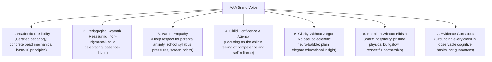
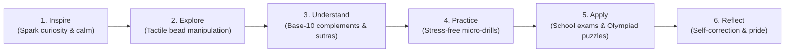
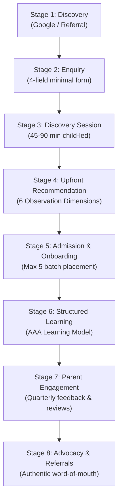
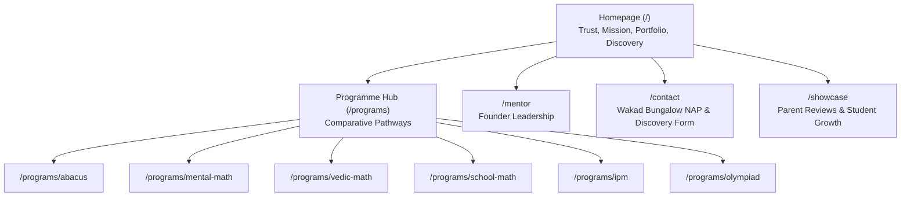

# ARNAV ABACUS ACADEMY (AAA) — COPYWRITING, BRAND VOICE & MESSAGING SPECIFICATION
## Stage 3 Solution Architecture Deliverable (WS-06.6)

**Document Reference:** `AAA-S3-SPEC-WS06-06`  
**Deliverable Type:** Architecture & Design Specification  
**Parent Workstream:** WS-06 — Digital Experience & Website Architecture (Area 5 of 5)  
**Status:** 🟡 **DRAFT — AWAITING MANAGEMENT REVIEW**  
**Authoritative Signatories for Ratification:** Neha Patil (Founder & Academic Director) & Nitin Patil (Operations & Technology Lead)  
**Date of Compilation:** 03 November 2026  
**Applicable Stage-Gate:** Gate 3.1 Final Deliverable  

---

## 1. Document Control & Approval Status

### 1.1 Revision History

| Version | Date | Description | Author / Contributors | Status / Gate |
| :---: | :---: | :--- | :--- | :---: |
| `1.0.0-draft` | 03-Nov-2026 | Initial comprehensive master copywriting, brand voice, programme messaging, and content governance specification. | Antigravity AI Architecture Team | 🟡 Awaiting Review (`MGT-DET-S3-09`) |

### 1.2 Governance Authority & Authorisation Record
- **Previous Deliverable Ratification:** `WS-06.5` Local SEO Metadata & Route Preservation Specification was formally reviewed and ratified under **`MGT-DET-S3-08`** on 03 November 2026 by Neha Patil and Nitin Patil.
- **Commencement Mandate:** Neha Patil and Nitin Patil jointly authorized commencement of `WS-06.6` under `MGT-DET-S3-08`.
- **Implementation Status:** Strictly documentation-only specification. Zero modification to application code in `src/` or assets in `public/`. Implementation freeze remains fully active under Stage 3 governance.

---

## 2. Ratified Brand Baseline & Non-Negotiable Brand Pillars

### 2.1 Approved Brand Identity & Educational Philosophy
- **Official Registered Name:** Arnav Abacus Academy (AAA).
- **Sole Physical Learning Bungalow:** Flat No. 3, 1st Floor, Adv. Balaji Sagar Bungalow, Opp. Creative Cameo, Near Park Street, Behind Wisdom World School, Wakad, Pune, Maharashtra 411057.
- **Official Helpline (Voice & WhatsApp):** `+91 90219 24968` (Confirmed sole number across codebase and registry).
- **Official Inquiries Email:** `nehaatharv@gmail.com`.
- **Operating Hours:** Monday – Saturday: 9:30 AM – 7:30 PM (`CONF-MKT-01`). Pre-booked Discovery Sessions on Sundays (`CONF-MKT-02`).

### 2.2 Core Educational Purpose (The AAA Mission)
> *"Mathematics is the medium; developing confident, independent, and thoughtful learners is the mission."*

AAA rejects superficial speed tricks, memorization drills, and examination fear. Instead, AAA treats mathematical learning as a vehicle for holistic child cognitive development, building mental storage, spatial visualization, self-reliance, and joyful inquiry.

### 2.3 Non-Negotiable Verbatim Headlines (`DEC-WS02-13`)

```
+----------------------------------------------------------------------------------------------------+
| 🔒 APPROVED MASTER HEADLINE (H1 - VERBATIM):                                                       |
| "Beyond Calculation. Towards Confident Mathematical Thinking."                                     |
+----------------------------------------------------------------------------------------------------+
| 🔒 APPROVED MASTER SUBHEADLINE (SUB-H1 - VERBATIM):                                                |
| "At Arnav Abacus Academy, mathematics is the medium to develop confident, independent, and         |
| thoughtful young learners. Guided by certified educators in small batches with a maximum of        |
| five students per batch, our structured programmes provide personalised learning, closer individual|
| guidance, and steady mathematical progress."                                                       |
+----------------------------------------------------------------------------------------------------+
| 🔒 APPROVED BRAND POSITIONING STATEMENT (VERBATIM):                                                |
| "Arnav Abacus Academy – A Premium Mathematical Thinking & Child Development Academy."              |
+----------------------------------------------------------------------------------------------------+
```

### 2.4 Micro-Batch Standard & Prohibited Claims Policy (`DEC-WS02-04`)
- **Approved Batch Wording:** *"Personalised learning in small batches, with a maximum of five students per batch."*
- **Strictly Prohibited Copy Claims:**
  - ❌ *"Guaranteed 1:5 teacher-student ratio at every second"*
  - ❌ *"Guaranteed individual attention at every single moment"*
  - ❌ *"Guaranteed grade improvement / rank guarantee"*
  - ❌ *"Guaranteed IQ boost / Brain engineering / Child genius in 30 days"*
  - ❌ *"Guaranteed calculation speed improvements without consistent practice"*

---

## 3. Brand Voice & Messaging Architecture

### 3.1 Brand Personality Dimensions

The AAA communication voice sits at the intersection of rigorous academic excellence and nurturing maternal warmth:



### 3.2 Messaging Framework Matrix

| Dimension | AAA Principle | Approved Phrasing Example | Phrasing to Avoid |
| :--- | :--- | :--- | :--- |
| **Pace of Growth** | Individualized progression | *"Every child masters base-10 complements at their own natural pace."* | *"Rapid 3x speed increase guaranteed."* |
| **Mistakes in Math** | De-stigmatized exploration | *"Mistakes are valued diagnostic signals that reveal how a child's mind works."* | *"Never make another math error."* |
| **Batch Dynamics** | Focused micro-groups ($\le 5$) | *"A maximum of five students per batch ensures your child is seen, heard, and guided."* | *"Private 1-on-1 tutoring at classroom prices."* |
| **Cognitive Goal** | Visual and spatial agility | *"Developing internal mental representations of quantity and pattern."* | *"Unlocking the right brain super-memory."* |
| **Role of Mentor** | Academic partner & observer | *"Certified educators observing learning attitude and problem decomposition."* | *"World-renowned memory grandmasters."* |

---

## 4. Core Value Proposition Framework

### 4.1 Value Proposition by Stakeholder

```
+--------------------------------------------------------------------------------------------------------+
| 1. PARENT VALUE PROPOSITION                                                                            |
| Peace of mind. You are not buying a math tuition class; you are giving your child lifelong cognitive   |
| self-confidence, emotional calmness around numbers, and an environment where an expert educator      |
| genuinely understands your child's specific developmental tempo.                                       |
+--------------------------------------------------------------------------------------------------------+
| 2. CHILD VALUE PROPOSITION                                                                             |
| Joy, autonomy, and tactile discovery. Mathematics stops feeling like intimidating symbols on a page;   |
| it becomes a tactile physical bead, an intuitive mental visual, and a sequence of satisfying puzzles.  |
+--------------------------------------------------------------------------------------------------------+
| 3. ACADEMIC DIFFERENTIATION                                                                            |
| Beyond rote formula drills. While commercial coaching centres drill speed for tests, AAA cultivates     |
| deep number sense, Vedic sutra agility, and conceptual Olympiad problem decomposition.                 |
+--------------------------------------------------------------------------------------------------------+
```

---

## 5. Homepage Master Copy Blueprint

### 5.1 Hero Block (`Block 1`)
- **Badge:** `Wakad's Trusted Mathematics & Cognitive Development Academy`
- **Headline (H1 - Ratified Verbatim):**  
  `Beyond Calculation. Towards Confident Mathematical Thinking.`
- **Subheadline (Sub-H1 - Ratified Verbatim):**  
  `At Arnav Abacus Academy, mathematics is the medium to develop confident, independent, and thoughtful young learners. Guided by certified educators in small batches with a maximum of five students per batch, our structured programmes provide personalised learning, closer individual guidance, and steady mathematical progress.`
- **Primary CTA:** `Book a Free Discovery Session` (Triggers 4-field accessible modal)
- **Secondary CTA:** `Explore Our Programmes` (Smooth-scrolls to Portfolio section)
- **Trust Reassurance Micro-Copy:**  
  `Free 45–90 min child-led session • 6 Educational Observation Dimensions • Zero admission obligation • Wakad Learning Centre`

### 5.2 Social Proof & Verified Credibility Strip (`Block 2`)
- **Review Metric Display:**  
  `4.9 ★★★★★ (74+ Verified Google Reviews by Wakad & PCMC Parents — Updated Nov 2026)`
- **Four Reassurance Badges:**
  1. *Micro-Batches:* Maximum 5 students per batch for genuine personalized attention.
  2. *Certified Mentorship:* Led directly by Founder Neha Patil (8+ years pedagogical experience).
  3. *Foundational Pedagogy:* Tactile abacus, mental visualization, and Vedic problem decomposition.
  4. *Holistic Focus:* Enhancing working memory, focus, and mathematical joy.

### 5.3 The AAA Learning Model™ Presentation (`Block 3`)
- **Section Eyebrow:** `Our Pedagogical Philosophy`
- **Section Heading:** `The AAA Learning Model™: 6 Structured Stages of Growth`
- **Section Introduction:**  
  `True mathematical capability is not built through repetitive rote drill. It emerges through an intentional developmental arc that bridges physical sensation, conceptual clarity, and independent application.`

### 5.4 Portfolio Overview (`Block 4`)
- **Section Eyebrow:** `Structured Learning Pathways`
- **Section Heading:** `Six Tailored Mathematical Programmes`
- **Section Subtext:**  
  `From early childhood tactile bead exploration to high-level Olympiad problem solving, each pathway is adapted to your child's age, stage, and school curriculum.`

### 5.5 Center & Leadership Spotlight (`Block 5`)
- **Heading:** `Pedagogical Leadership Dedicated to Every Child's Journey`
- **Lead Text:**  
  `Founded by Neha Patil, Arnav Abacus Academy was born from a singular conviction: when children feel safe, respected, and unhurried, their capacity for mathematical thinking is boundless. Located in a tranquil, dedicated learning bungalow in Wakad, AAA provides a nurturing alternative to crowded commercial coaching factories.`

---

## 6. The AAA Learning Model™: Six-Stage Narrative Specification



### Stage 1: Inspire
- **Pedagogical Meaning:** Eliminating mathematical anxiety before instruction begins. Cultivating emotional safety and curiosity.
- **Educator Action:** Greets the child warmly, creates a calm sensory atmosphere, presents playful mathematical paradoxes or bead patterns without testing pressure.
- **Child Experience:** Feels accepted, unjudged, and genuinely intrigued. Math stops looking like a threat.
- **Observable Behaviour:** Relaxed posture, smiling, active eye contact with learning tools, willingness to touch materials.
- **Website Copy:**  
  `"Stage 1: Inspire — We eliminate math anxiety before we ever teach a formula. In our tranquil Wakad centre, educators foster curiosity and warmth, transforming numbers from intimidating symbols into delightful puzzles."`

### Stage 2: Explore
- **Pedagogical Meaning:** Tactile, sensory exploration of quantity, place value, and physical beads.
- **Educator Action:** Guides the child's index finger and thumb on the Soroban abacus; encourages physical experimentation with lower and upper beads.
- **Child Experience:** Connects concrete tactile sensation (feeling the wooden bead click) with numerical quantities.
- **Observable Behaviour:** Spontaneous manipulation of beads, counting out loud, testing combinations.
- **Website Copy:**  
  `"Stage 2: Explore — Children learn through touch. By moving tactile abacus beads, young minds physically feel quantities, place values, and combinations, laying intuitive foundations for mental math."`

### Stage 3: Understand
- **Pedagogical Meaning:** Conceptual mastery of number relationships, base-5 and base-10 complementary pairs ("Big Friends" and "Small Friends"), and Vedic sutras.
- **Educator Action:** Decomposes why formulas work. Teaches the child to see $10$ as $7 + 3$ or $6 + 4$ mentally without fingers.
- **Child Experience:** Experiences the *"Aha!"* moment where arithmetic ceases to be memorization and becomes logical patterns.
- **Observable Behaviour:** Explaining reasoning in their own words; predicting results before moving beads.
- **Website Copy:**  
  `"Stage 3: Understand — No blind memorisation. We reveal the elegant patterns behind base-10 complements and Vedic sutras, so children understand exactly why each mathematical principle works."`

### Stage 4: Practice
- **Pedagogical Meaning:** Stress-free, structured micro-drills designed to build fluency, muscle memory, and mental imagery.
- **Educator Action:** Provides individualized, bite-sized problem sets; monitors concentration stamina; adjusts pace immediately if fatigue appears.
- **Child Experience:** Achieves a state of focused absorption. The abacus transitions from a physical tool into a vivid mental image.
- **Observable Behaviour:** Sustained focus for 15–25 minutes without distraction; rapid, fluid bead movements.
- **Website Copy:**  
  `"Stage 4: Practice — Targeted, low-stress micro-drills in batches of five. Children build mental calculation speed, sustained attention, and photographic number recall without burnout."`

### Stage 5: Apply
- **Pedagogical Meaning:** Transferring mental calculation agility to school curricula, CBSE/ICSE exams, word problems, and competitive Olympiad challenges.
- **Educator Action:** Bridges mental bead visualization to school textbook problems, algebra decomposition, and IPM questions.
- **Child Experience:** Realizes that the tools learned at AAA make school exams and tricky word problems feel straightforward and manageable.
- **Observable Behaviour:** Breaking complex multi-step word problems into clean modular equations with calm confidence.
- **Website Copy:**  
  `"Stage 5: Apply — Bridging mental agility to real school success. Students effortlessly apply spatial visualization and Vedic speed to CBSE, ICSE, State Board syllabi, and Olympiad problem decomposition."`

### Stage 6: Reflect
- **Pedagogical Meaning:** Developing metacognitive awareness, celebrating personal growth, and mastering constructive self-correction.
- **Educator Action:** Guides the child to review their own work, identify where a mental visualization slipped, and celebrate the discovery of the slip.
- **Child Experience:** Takes pride in self-correction. Realizes that a calculation slip is just feedback, not a failure.
- **Observable Behaviour:** Checking work independently without parental prompting; articulating pride in overcoming tricky hurdles.
- **Website Copy:**  
  `"Stage 6: Reflect — Building independent learners. Children review their own reasoning, celebrate personal progress, and develop the metacognitive confidence to tackle novel academic challenges independently."`

---

## 7. Six Programme Portfolio Messaging Blueprints

```
====================================================================================================
GOVERNANCE NOTE: These are approved public portfolio groupings. They represent AAA's actual course 
offerings. They do NOT represent a compulsory sequential progression for every enrolled child, nor do 
they constitute formal academic level certifications without Neha Patil's ongoing syllabus validation.
====================================================================================================
```

### 7.1 Abacus Mathematics (`/programs/abacus`)
- **Parent Need / Anxiety:** *"My 5-year-old struggles to sit still, relies heavily on counting fingers, and feels nervous around basic addition."*
- **Programme Purpose:** Establishing sensory number sense, tactile base-10 mechanics, and foundational spatial visualization using the traditional Japanese Soroban abacus.
- **What the Child Learns:** Tactile bead manipulation, base-5 and base-10 complements ("Little Friends" & "Big Friends"), multi-digit addition, subtraction, and multiplication basics.
- **Educational Value:** Eliminates finger-counting; activates bilateral brain hemisphere coordination; establishes an unshakable concrete sense of place value.
- **Suggested Page H1:** `Abacus Mathematics: Tactile Number Sense & Sensory Calculation`
- **Suggested Page Sub-H1:** `Transforming abstract numbers into concrete bead exploration. For children aged 4.5 to 9 in Wakad, guided in nurturing micro-batches of up to five.`
- **Key Page Sections:**
  1. *From Fingers to Beads:* How the Soroban eliminates arithmetic anxiety.
  2. *The Cognitive Science of Tactile Math:* Spatial memory and fine motor synchronization.
  3. *What Your Child Will Experience:* A typical 60-minute session breakdown.
  4. *Parent FAQs:* Finger-counting transition, session pacing, home practice expectations.
- **Approved Call to Action:** `Schedule an Abacus Discovery Session`

### 7.2 Mental Mathematics (`/programs/mental-math`)
- **Parent Need / Anxiety:** *"My child can do math on paper, but when asked simple mental calculations, they freeze or guess wildly."*
- **Programme Purpose:** Transitioning from the physical abacus to a vivid internal mental image (Anzan), enabling rapid mental calculation without physical aids.
- **What the Child Learns:** Mental visualization of the abacus beam, rapid flashing number recall, internal auditory-visual processing, multi-digit mental arithmetic.
- **Educational Value:** Drastically expands working memory capacity, spatial holding stamina, and mental agility under time constraints.
- **Suggested Page H1:** `Mental Mathematics: Internal Visualization & Working Memory`
- **Suggested Page Sub-H1:** `Building an internal mental abacus. Cultivating effortless mental arithmetic, photographic memory retention, and laser focus.`
- **Key Page Sections:**
  1. *The Internal Abacus (Anzan):* How children picture beads in their mind's eye.
  2. *Working Memory Expansion:* Cognitive benefits that extend far beyond mathematics.
  3. *Eliminating Math Hesitation:* Building instant numerical recall.
  4. *Parent FAQs:* When can a child start Mental Math? Is abacus experience required?
- **Approved Call to Action:** `Request a Mental Math Observation Session`

### 7.3 Vedic Mathematics (`/programs/vedic-math`)
- **Parent Need / Anxiety:** *"My middle-school child takes 10 minutes to solve long division and multiplication, making silly careless errors under exam time pressure."*
- **Programme Purpose:** Mastering ancient Indian sutra-based shortcuts and algebraic flexibility, enabling lightning-fast cross-multiplication, squaring, and base checks.
- **What the Child Learns:** Core Vedic sutras (such as *Ekadhikina Purvena*, *Nikhilam Navatashcaramam Dashatah*, *Urdhva Tiryagbhyam*), mental divisibility tests, and rapid digital roots.
- **Educational Value:** Replaces tedious multi-line scratch work with one-line intuitive solutions; transforms algebraic fear into mental elegance.
- **Suggested Page H1:** `Vedic Mathematics: Sutra-Based Agility & High-Speed Calculation`
- **Suggested Page Sub-H1:** `Ancient mathematical wisdom for modern school exams. Empowering students aged 9 to 14 to compute with speed, accuracy, and joy.`
- **Key Page Sections:**
  1. *The Magic of Vedic Sutras:* Cross-multiplication and complement methods explained simply.
  2. *Exam Confidence:* Saving 20–30 minutes in school board mathematics exams.
  3. *Error Reduction via Digital Roots:* Instant self-checking techniques.
  4. *Parent FAQs:* Does Vedic math conflict with school board methods? (No—it serves as rapid verification).
- **Approved Call to Action:** `Explore Vedic Math for Your Child`

### 7.4 School Mathematics Support (`/programs/school-math`)
- **Parent Need / Anxiety:** *"My child has lost confidence in school math class, gets confused by textbook jargon, and scores poorly despite long tuition hours."*
- **Programme Purpose:** Syllabus-aligned conceptual reinforcement for Grades 1 to 10 (CBSE, ICSE, and Maharashtra State Board), bridging foundational gaps.
- **What the Child Learns:** Conceptual problem decomposition, step-by-step mathematical reasoning, geometric proofs, fractions, percentages, and board exam presentation skills.
- **Educational Value:** Rebuilds broken foundational links; replaces rote memorization of textbook questions with deep conceptual understanding.
- **Suggested Page H1:** `School Mathematics: Conceptual Clarity for CBSE, ICSE & State Boards`
- **Suggested Page Sub-H1:** `Mastering school curricula through deep conceptual understanding, personalized micro-batch guidance, and exam poise.`
- **Key Page Sections:**
  1. *Why Tuitions Fail & AAA Succeeds:* The micro-batch difference ($\le 5$ students vs 20–30).
  2. *Aligning with Your Child's School:* CBSE, ICSE, and SSC board adaptation.
  3. *Step-by-Step Problem Solving:* Eradicating exam panic and blanking out.
  4. *Parent FAQs:* How do you coordinate with ongoing school test schedules?
- **Approved Call to Action:** `Book a School Math Assessment`

### 7.5 IPM (Institute for Promotion of Mathematics) Preparation (`/programs/ipm`)
- **Parent Need / Anxiety:** *"I want to give my child competitive exam exposure, but the coaching classes are ruthless, stressful, and crush their confidence."*
- **Programme Purpose:** Rigorous, compassionate preparation for the prestigious Maharashtra IPM Primary & High School Mathematics examinations (Grades 2 to 9).
- **What the Child Learns:** Non-routine puzzle decomposition, multi-concept synthesis, analytical elimination of multiple-choice distractors, and time management.
- **Educational Value:** Instills deep mathematical resilience, logical problem decomposition, and competitive poise in a low-anxiety micro-group.
- **Suggested Page H1:** `IPM Mathematics: Competitive Excellence with Nurturing Guidance`
- **Suggested Page Sub-H1:** `Structured preparation for Maharashtra IPM examinations. Building deep analytical stamina in small batches of maximum five.`
- **Key Page Sections:**
  1. *The IPM Challenge:* What makes IPM questions unique and rewarding.
  2. *Structured Question Decomposition:* How AAA trains students to unpack tricky word problems.
  3. *Healthy Competition:* Preparing for ranks without anxiety or parental distress.
  4. *Parent FAQs:* When should my child begin IPM preparation? What is the passing benchmark?
- **Approved Call to Action:** `Schedule an IPM Readiness Session`

### 7.6 Olympiad Mathematics (`/programs/olympiad`)
- **Parent Need / Anxiety:** *"My child is mathematically gifted and bored in regular school class; they need deeper intellectual challenge, not more repetitive homework."*
- **Programme Purpose:** Advanced mathematical enrichment targeting national and international competitions (IMO, SOF, SilverZone, NMTC, SASMO).
- **What the Child Learns:** Higher-order combinatorial logic, number theory fundamentals, spatial topology, algebraic pattern spotting, and non-standard problem-solving.
- **Educational Value:** Channels high cognitive potential into disciplined intellectual rigor; trains young minds to embrace complex, non-obvious puzzles.
- **Suggested Page H1:** `Olympiad Mathematics: Higher-Order Thinking & Advanced Problem Solving`
- **Suggested Page Sub-H1:** `Challenging curious young minds with Olympiad-level logic, discrete mathematics, and elegant problem decomposition.`
- **Key Page Sections:**
  1. *Beyond Standard Curriculum:* Why Olympiads demand an entirely different mindset.
  2. *The Art of Mathematical Proof:* Teaching young children how to articulate reasoning.
  3. *Individual Mentorship for Gifted Learners:* Keeping high achievers engaged and inspired.
  4. *Parent FAQs:* Which Olympiads does AAA prepare for? Is prior competition experience needed?
- **Approved Call to Action:** `Request an Olympiad Diagnostic Session`

---

## 8. Six Educational Observation Dimensions: Narrative & Copy Guidelines

```
====================================================================================================
MANDATORY ETHICAL & PEDAGOGICAL SAFEGUARD:
AAA Discovery Sessions are strictly EDUCATIONAL OBSERVATIONS conducted by experienced educators.
They are NOT clinical, psychological, psychiatric, or neurodevelopmental diagnoses.
NEVER use clinical labels (e.g., ADHD, Dyscalculia, Asperger's, Gifted IQ).
NEVER generate a combined numeric IQ score. NEVER rank children against peers.
====================================================================================================
```

### 8.1 Dimension 1: Number Sense
- **Parent-Friendly Meaning:** How comfortably and intuitively your child feels about quantities, relative sizes of numbers, and mental number lines.
- **What We Observe:** Does the child visualize $8$ as close to $10$? Do they instinctively know that $50 + 50 = 100$, or do they need to calculate it from scratch?
- **Approved Observation Language:**  
  `"Your child displays strong intuitive grasp of base-10 anchors, instantly recognizing quantity clusters without one-by-one counting."` OR `"Your child currently relies on sequential finger counting for quantities above 5, indicating an opportunity to introduce tactile abacus bead clusters to build intuitive place-value visualization."`
- **Language to Avoid:** ❌ *"Poor numerical IQ"*, ❌ *"Dyscalculic tendencies"*, ❌ *"Below average number sense"*.

### 8.2 Dimension 2: Arithmetic Understanding
- **Parent-Friendly Meaning:** Whether your child grasps the conceptual meaning of mathematical operations (addition as combining, multiplication as repeated equal groups), rather than just following mechanical steps.
- **What We Observe:** When faced with an unfamiliar calculation, does the child understand *what* the operation requires, or do they blindly apply a memorized procedure?
- **Approved Observation Language:**  
  `"Your child demonstrates clear conceptual understanding of addition as regrouping, and comfortably decomposed two-digit numbers during our puzzle session."`
- **Language to Avoid:** ❌ *"Weak computational ability"*, ❌ *"Fails basic arithmetic standards"*.

### 8.3 Dimension 3: Logical Approach
- **Parent-Friendly Meaning:** How your child breaks down a multi-step problem, explores clues, and organizes their thoughts when the solution is not immediately obvious.
- **What We Observe:** Does the child jump to impulsive guessing, or do they pause, examine the components, and test hypotheses methodically?
- **Approved Observation Language:**  
  `"When presented with a two-step puzzle, your child paused thoughtfully and sorted the information into components before answering, showing developing executive analytical stamina."`
- **Language to Avoid:** ❌ *"Lacks logical reasoning"*, ❌ *"Irrational problem-solver"*.

### 8.4 Dimension 4: Learning Attitude
- **Parent-Friendly Meaning:** How your child emotionally responds to unfamiliar challenges, temporary roadblocks, and constructive guidance.
- **What We Observe:** When a calculation slip occurs, does the child withdraw in anxiety, or do they remain curious and open to trying another approach with encouragement?
- **Approved Observation Language:**  
  `"Your child exhibited wonderful resilience; when an initial calculation didn't balance, they warmly accepted a hint and took genuine pride in discovering the slip independently."`
- **Language to Avoid:** ❌ *"Stubborn attitude"*, ❌ *"Defensive or resistant to learning"*.

### 8.5 Dimension 5: Response & Engagement
- **Parent-Friendly Meaning:** Your child’s active listening, sustained attention span, and interactive curiosity during an educator-guided activity.
- **What We Observe:** How long can the child remain engaged in a focused micro-drill? Do they participate enthusiastically when given concrete beads to move?
- **Approved Observation Language:**  
  `"Your child maintained high engagement throughout the 45-minute interaction, particularly when manipulating physical beads, showing exceptional visual-tactile responsiveness."`
- **Language to Avoid:** ❌ *"Attention deficit indicators"*, ❌ *"Short attention span"*.

### 8.6 Dimension 6: Interest & Learning Passion
- **Parent-Friendly Meaning:** The intrinsic spark of curiosity and joy your child experiences when discovering mathematical patterns.
- **What We Observe:** Does the child ask questions of their own accord? Do their eyes light up when a hidden numerical pattern is revealed?
- **Approved Observation Language:**  
  `"Your child expressed genuine delight upon discovering the complementary pattern of 9s, eagerly asking for another puzzle to solve before our session concluded."`
- **Language to Avoid:** ❌ *"Lacks interest in academics"*, ❌ *"Dispassionate student"*.

---

## 9. AAA Personalised Learning Discovery Session: Parent Journey & Copy Blueprints

### 9.1 The Service Distinction
```
+--------------------------------------------------------------------------------------------------------+
| 🔍 ENQUIRY SUBMISSION != INSTANT CONFIRMED BOOKING                                                     |
| Website copy must be 100% transparent: submitting the 4-field enquiry modal requests a Discovery       |
| Session. Neha or Nitin Patil personally reviews the inquiry and contacts the parent via phone or       |
| WhatsApp to agree upon a mutually convenient date and time based on the child's age and batch availability.|
+--------------------------------------------------------------------------------------------------------+
```

### 9.2 Discovery Session Web Copy (`/contact` & Dedicated Homepage Section)
- **Section Heading:** `The AAA Personalised Learning Discovery Session`
- **Subheading:** `A Complimentary 45–90 Minute Experience to Discover How Your Child Learns Best`
- **Invitation Copy:**  
  `"Before recommending any programme, we invite you and your child to our peaceful Wakad learning bungalow for a one-on-one Discovery Session. Conducted personally by Academic Director Neha Patil and Technology Lead Nitin Patil, this gentle, pressure-free session allows us to observe your child across six fundamental cognitive dimensions while your child enjoys engaging mathematical puzzles."`

### 9.3 What Parents & Children Experience During the Session
- **Step 1: Warm Welcome (5–10 mins):** A relaxed conversation over a cup of water, allowing your child to acclimatize to our quiet classroom and meet their educator without test anxiety.
- **Step 2: Playful Cognitive Exploration (30–45 mins):** The educator introduces tactile abacus beads, pattern cards, and Vedic number puzzles suited to your child's age bracket.
- **Step 3: Upfront Observation & Learning Recommendation (15–20 mins):** We share transparent, constructive observations across the Six Dimensions, explaining whether Abacus, Vedic, or School Math is the most nurturing next step.

### 9.4 Post-Enquiry Confirmation Copy (Modal State 2)
- **Heading:** `Thank You, [Parent Name]. We Have Received Your Request.`
- **Body Text:**  
  `"Our Academic Director, Neha Patil, will review your details and reach out to you within 24–48 hours via WhatsApp or phone (+91 90219 24968) to schedule a comfortable time for your child's Personalised Learning Discovery Session at our Wakad centre."`
- **Reassurance Note:**  
  `"No preparation or prior knowledge is required for your child. We look forward to meeting you both!"`

---

## 10. Parent Customer Journey Messaging (8 Ratified Stages)



| Journey Stage | Parent's Core Concern | Primary AAA Message | Approved Channel & CTA |
| :--- | :--- | :--- | :--- |
| **1. Discovery** | *"Is there a reputable, non-commercial math academy near Wakad that genuinely cares about children?"* | *"Arnav Abacus Academy develops confident, independent mathematical thinkers in micro-batches of maximum five, led by certified educators."* | Organic Search / GBP / Word-of-Mouth $\rightarrow$ `Explore Programmes` |
| **2. Enquiry** | *"Will I be spammed with aggressive sales calls if I leave my phone number?"* | *"We respect your privacy. We only ask for minimal details to understand your child's stage and schedule a private Discovery Session. Zero sales pressure."* | Website 4-Field Modal $\rightarrow$ `Request Discovery Session` |
| **3. Discovery Session** | *"Will my child feel tested, evaluated, or judged?"* | *"This is not a test. It is a playful, supportive interaction where your child explores tactile puzzles while we observe their unique learning style."* | Direct Personal Phone / WhatsApp confirmation |
| **4. Recommendation** | *"What programme does my child actually need, and will the academy be honest with me?"* | *"We share structured observations across 6 dimensions and recommend only the pathway that genuinely serves your child's immediate developmental stage."* | In-person feedback at Wakad Centre |
| **5. Admission** | *"How do batch timings work, and is the batch size truly limited?"* | *"Every batch is strictly capped at five students to preserve intimate educator guidance and individual feedback."* | Written welcome pack & schedule confirmation |
| **6. Learning & Progress** | *"How do I know my child is actually progressing without burdensome tests?"* | *"Our six-stage learning model emphasizes steady conceptual mastery, visible in your child's emerging confidence and school exam calmness."* | Regular classroom observation notes |
| **7. Retention** | *"Is my child continuing to be challenged as they grow?"* | *"Continuous curriculum adaptation ensures smooth transition from tactile abacus to mental visualization and Vedic problem decomposition."* | Semi-annual parent conferences |
| **8. Advocacy** | *"I want to tell other parents in Park Street / Wakad about our wonderful experience."* | *"Thank you for trusting us with your child's foundational growth. Your authentic reviews help fellow parents make informed, thoughtful educational choices."* | Google Review invitation & community showcase |

---

## 11. Educator Credibility, Social Proof & Trust Framework

### 11.1 Leadership Credibility Register

| Leader / Educator | Management-Confirmed Fact | Documented Verification Source | Approved Website Presentation Copy | Prohibited Exaggerations |
| :--- | :--- | :--- | :--- | :--- |
| **Neha Patil** | Founder & Academic Director. Certified educator with 8+ years hands-on mathematics teaching experience. | Verified Documentary Register (`DVR-TCH-001`) | *"Founded and directed by Neha Patil, certified mathematics mentor with over 8 years of dedicated pedagogical experience guiding children across Pune."* | ❌ Do not invent degrees, national awards, or international titles not present in `DVR-TCH-001`. |
| **Nitin Patil** | Operations & Technology Lead. Co-evaluator in parent discovery sessions. | Management Governance Register (`MGT-DET-S3-01`) | *"Co-founded by Nitin Patil, overseeing technology operations, student digital practice systems, and parent discovery consultations."* | ❌ Do not claim academic degrees outside verified records. |

### 11.2 Credentials & Certification Terminology Policy
- **Skill India / NSDC / IIVA References:** Mentions of external certification affiliations (e.g., IIVA Vedic Math, NSDC skill training) must only appear on `/mentor` where accompanied by verified certificate serial numbers approved by management.
- **Review Citations:**
  - Approved phrasing: *"Rated 4.9 out of 5 stars by 74+ verified parent reviews on Google (as of November 2026)."*
  - Refresh policy: Must be checked semi-annually against Google Business Profile.

---

## 12. Privacy-Conscious Copy & Parent Consent Architecture

```
====================================================================================================
GOVERNANCE MANDATE:
All statements below represent:
PROPOSED COPY — SUBJECT TO PRIVACY/LEGAL REVIEW AND MANAGEMENT APPROVAL.
In compliance with Stage 3 Architecture Principles, parent consent must be unbundled, freely given, 
and separate for transactional vs marketing purposes.
====================================================================================================
```

### 12.1 Enquiry Form Privacy Notice (`PROPOSED COPY`)
```
+----------------------------------------------------------------------------------------------------+
| 🔒 PROPOSED COPY — SUBJECT TO PRIVACY/LEGAL REVIEW AND MANAGEMENT APPROVAL                         |
| "At Arnav Abacus Academy, we respect your family's privacy. We collect your name, phone number, and |
| child's general age bracket solely to respond to your inquiry and coordinate your child's Discovery|
| Session. We will never sell, rent, or share your contact information with external marketing       |
| agencies. You may request deletion of your inquiry details at any time."                           |
+----------------------------------------------------------------------------------------------------+
```

### 12.2 Unbundled Dual Consent Checkboxes (`PROPOSED COPY`)
- **Checkbox 1 (Transactional - Mandatory to process inquiry):**  
  `[X] I consent to Arnav Abacus Academy contacting me via phone or WhatsApp (+91 90219 24968) regarding this Discovery Session inquiry and my child's academic placement.`
- **Checkbox 2 (Marketing Updates - Strictly Optional):**  
  `[ ] (Optional) I would like to receive occasional academic workshop invitations, math puzzles, and parent guides via WhatsApp. I understand I can unsubscribe at any time.`

### 12.3 Discovery Session Media & Showcase Consent (`PROPOSED COPY`)
- Displayed only during in-person onboarding at the Wakad centre:  
  `"Arnav Abacus Academy occasionally celebrates student milestones and mathematical achievements on our private noticeboard and community showcase. We strictly request explicit written parental permission before capturing or displaying any photograph or video featuring your child."`

---

## 13. Page-by-Page Website Content Architecture



### 13.1 Detailed Page Content Matrix

| Route Path | Page Title / H1 | Primary Parent Question Answered | Core Content Blocks | Primary CTA |
| :--- | :--- | :--- | :--- | :--- |
| **`/`** | *Beyond Calculation. Towards Confident Mathematical Thinking.* | *"Why is AAA the most trustworthy developmental math academy in Wakad for my child?"* | Hero, 74+ Reviews, 6-Stage Learning Model, 6 Programmes, Neha Patil spotlight, Wakad Bungalow location. | `Book Free Discovery Session` |
| **`/programs`** | *Structured Mathematical Pathways for Every Developmental Stage* | *"Which mathematical programme is appropriate for my child's current age and school grade?"* | Comparative Pathway Guide, Age-to-Programme map, Micro-batch standard ($\le 5$), Discovery Session link. | `Request Guidance for Your Child` |
| **`/programs/abacus`** | *Abacus Mathematics: Tactile Number Sense & Sensory Calculation* | *"How will physical beads help my 5-year-old overcome math hesitation?"* | Tactile Soroban explanation, base-10 complements, sensory development, batch structure, FAQs. | `Book Abacus Discovery Session` |
| **`/programs/mental-math`**| *Mental Mathematics: Internal Visualization & Working Memory* | *"How does my child transition from physical beads to fast mental calculation?"* | Anzan mental imagery, working memory benefits, concentration stamina, FAQs. | `Request Mental Math Observation` |
| **`/programs/vedic-math`** | *Vedic Mathematics: Sutra-Based Agility & High-Speed Calculation* | *"Can Vedic shortcuts help my middle schooler save time on school board exams?"* | Key Vedic sutras, digital root self-checking, board exam synergy, FAQs. | `Explore Vedic Math Session` |
| **`/programs/school-math`**| *School Mathematics: Conceptual Clarity for CBSE, ICSE & State Boards* | *"Why choose AAA over regular neighborhood school math tuitions?"* | Conceptual depth, syllabus breakdown (Grades 1–10), micro-batch difference ($\le 5$), FAQs. | `Book School Math Consultation` |
| **`/programs/ipm`** | *IPM Mathematics: Competitive Excellence with Nurturing Guidance* | *"How can my child prepare for Maharashtra IPM without academic stress?"* | IPM syllabus overview, non-routine puzzle decomposition, exam poise, FAQs. | `Schedule IPM Readiness Session` |
| **`/programs/olympiad`** | *Olympiad Mathematics: Higher-Order Thinking & Advanced Problem Solving* | *"How does AAA stretch and inspire mathematically gifted young minds?"* | Higher-order logic, non-standard problem decomposition, IMO/SOF focus, FAQs. | `Request Olympiad Diagnostic` |
| **`/mentor`** | *Academic Leadership: Guiding Every Learner with Care & Rigor* | *"Who is teaching my child, and what is their pedagogical philosophy?"* | Neha Patil biography, 8+ years teaching journey, teaching ethos, Wakad center philosophy. | `Meet Neha Patil in Person` |
| **`/contact`** | *Visit Our Wakad Learning Bungalow & Schedule a Discovery Session* | *"Where is AAA located, what are the hours, and how do I get there?"* | Verified NAP, interactive map directions from Hinjawadi/PCMC, 4-field inquiry form. | `Submit Discovery Request` |
| **`/showcase`** | *Celebrating Growth: Real Stories from Wakad Parents & Students* | *"What do real parents in Wakad say about their children's progress at AAA?"* | 74+ Google reviews, video testimonials (consent-gated), milestone reflections. | `Start Your Child's Journey` |

---

## 14. CTA & Conversion Messaging Architecture

### 14.1 CTA Hierarchy & Copy Tone
- **Tier 1 (High Intent / Primary):**  
  `"Book a Free Discovery Session"`  
  *Context:* Sticky header, hero sections, programme detail page footers.
- **Tier 2 (Exploratory / Secondary):**  
  `"Explore Our 6 Programmes"` / `"Learn About the AAA Model™"`  
  *Context:* Secondary hero buttons, informational text links.
- **Tier 3 (Immediate Parental Helpline):**  
  `"Speak with Our Academic Director (+91 90219 24968)"` / `"Chat on WhatsApp"`  
  *Context:* Mobile persistent bottom bar, `/contact` page quick actions.

### 14.2 Friction-Reduction Micro-Copy Standards
Every major conversion form or CTA button must be accompanied by reassuring micro-copy:
- `✓ Free of charge (45–90 mins)`
- `✓ No preparation required`
- `✓ Strictly zero admission obligation`
- `✓ Micro-batches of maximum 5 students`

---

## 15. SEO Content & Local Search Alignment

### 15.1 Keyword Integration Philosophy
SEO copy must read naturally, maintaining high literary and educational quality without awkward keyword stuffing.

| Focus Search Query | Natural Content Integration Copy | Target Landing Page |
| :--- | :--- | :--- |
| *Abacus classes in Wakad* | *"Arnav Abacus Academy offers foundational abacus classes in Wakad, Pune, guiding young children in micro-batches of maximum five."* | `/programs/abacus`, `/` |
| *Vedic maths classes near Hinjawadi* | *"Conveniently located in Wakad for families commuting from Hinjawadi, our Vedic Mathematics programme empowers students with high-speed calculation sutras."* | `/programs/vedic-math` |
| *Math tuition for ICSE / CBSE Wakad* | *"Our school mathematics programme provides conceptual clarity for CBSE and ICSE students across Wakad and Pimple Saudagar."* | `/programs/school-math` |
| *IPM coaching Pune Wakad* | *"Expert, stress-free IPM mathematics coaching in Wakad, preparing students for Maharashtra state-level competitions."* | `/programs/ipm` |

---

## 16. Master Approved-Copy & Content Governance Register

```
====================================================================================================
CONTENT CLASSIFICATION SCHEMA:
[CAT-A] VERBATIM APPROVED COPY — Strictly locked. No alterations permitted without executive sign-off.
[CAT-B] APPROVED MESSAGE WITH CONTROLLED EDITING — Core meaning approved; minor layout adaptation permitted.
[CAT-C] PROPOSED COPY AWAITING MANAGEMENT APPROVAL — Recommended by architecture team; awaiting review.
[CAT-D] ACADEMIC VALIDATION REQUIRED — Requires specific verification by Neha Patil.
[CAT-E] EVIDENCE REQUIRED BEFORE PUBLICATION — Claim cannot be published until documentary proof is linked.
[CAT-F] LEGAL / PRIVACY REVIEW REQUIRED — Must be vetted by legal counsel under DPDP compliance.
[CAT-G] PROHIBITED OR UNSUPPORTED CLAIM — Strictly banned from all public representations.
====================================================================================================
```

| Copy Element | Classification | Content Text / Policy Baseline | Authority & Governance Reference |
| :--- | :---: | :--- | :--- |
| **Homepage H1** | `[CAT-A]` | *"Beyond Calculation. Towards Confident Mathematical Thinking."* | `DEC-WS02-13`, `MGT-DET-S3-04` |
| **Homepage Sub-H1** | `[CAT-A]` | *"At Arnav Abacus Academy, mathematics is the medium to develop confident, independent, and thoughtful young learners. Guided by certified educators in small batches with a maximum of five students per batch, our structured programmes provide personalised learning, closer individual guidance, and steady mathematical progress."* | `DEC-WS02-13`, `MGT-DET-S3-04` |
| **Batch Size Standard**| `[CAT-A]` | *"Maximum of five students per batch."* | `DEC-WS02-04`, `MGT-DET-S3-01` |
| **Helpline Number** | `[CAT-A]` | `+91 90219 24968` (Voice & WhatsApp) | `MGT-DET-S3-08`, Codebase Baseline |
| **Physical Location** | `[CAT-A]` | Flat No. 3, 1st Floor, Adv. Balaji Sagar Bungalow, Opp. Creative Cameo, Near Park Street, Behind Wisdom World School, Wakad, Pune 411057. | `MGT-DET-S3-08`, Verified Address |
| **Operating Hours** | `[CAT-A]` | Mon–Sat: 9:30 AM – 7:30 PM; Sunday: Discovery Sessions by prior appointment. | `CONF-MKT-01`, `MGT-DET-S3-01` |
| **Social Proof Count** | `[CAT-B]` | *"74+ verified 5-star Google reviews (4.9★ rating)"* (Refreshable semi-annually). | `MGT-DET-S3-01`, GBP Profile |
| **AAA Model™ Stages** | `[CAT-A]` | *Inspire → Explore → Understand → Practice → Apply → Reflect* | `DEC-WS02-05`, `MGT-DET-S3-04` |
| **Observation Dimensions**| `[CAT-A]` | *Number Sense, Arithmetic Understanding, Logical Approach, Learning Attitude, Response & Engagement, Interest & Learning Passion.* | `DEC-WS02-06`, `MGT-DET-S3-04` |
| **Curriculum Levels** | `[CAT-D]` | Detailed breakdown of syllabus progression levels across all 6 streams. | Scheduled for Neha Patil in Stage 4. |
| **Founder Credentials**| `[CAT-E]` | Skill India / NSDC / IIVA external accreditation claims. | Pending link to verified certificate numbers. |
| **Privacy Notices** | `[CAT-F]` | Enquiry privacy policy and dual unbundled consent checkboxes. | Proposed copy awaiting Stage 4 legal sign-off. |
| **Guaranteed Ratios** | `[CAT-G]` | *"1:5 teacher-student ratio at every second"* or *"Guaranteed academic rank improvement"*. | Strictly Prohibited (`DEC-WS02-04`). |

---

## 17. Evidence & Validation Requirements

Before any proposed marketing claim or credential statement in `[CAT-D]`, `[CAT-E]`, or `[CAT-F]` is published in production, the following documentary evidence must be recorded in `docs/11_evidence_and_screenshots/`:
1. **Academic Level Syllabi:** Written curriculum progression breakdown signed by Neha Patil.
2. **Review Tally Audit:** Screenshot and date-stamped audit of Google Business Profile reviews.
3. **External Certifications:** Scans of mentor training certificates from IIVA / NSDC.
4. **Parent Photo/Video Consents:** Countersigned physical consent forms on file at Wakad center.

---

## 18. Open Management Decisions (`MGT-DET-S3-09`)

The following items are submitted for formal review and determination by **Neha Patil** and **Nitin Patil**:

1. **Academic Decision (ACAD-COPY-01 — Neha Patil):**  
   Review and confirm the parent-facing narratives for the 6-stage AAA Learning Model™ and 6 Educational Observation Dimensions.
2. **Pedagogical Positioning Decision (ACAD-COPY-02 — Neha Patil):**  
   Confirm that the individual programme blueprints (Abacus, Mental Math, Vedic, School Math, IPM, Olympiad) accurately represent the academy's teaching style without committing to rigid level progressions.
3. **Governance & Operations Decision (OPS-COPY-01 — Nitin Patil):**  
   Review and approve the master copy classification register, the unbundled privacy consent copy proposals, and the helpline standardization on `+91 90219 24968`.

---

## 19. Requirements Traceability

- **Stage 2 Master BRD:** Fulfills Section 4 (Brand Positioning) and Section 6 (Curriculum Architecture).
- **Stage 2 WS-02:** Preserves verbatim H1, Sub-H1, and Micro-Batch standards (`DEC-WS02-04`, `DEC-WS02-13`).
- **Stage 3 Workstream Plan:** Completes final deliverable for WS-06 (Area 5: Copywriting & Content Governance).
- **Previous Ratifications:** Consistent with `MGT-DET-S3-04` through `MGT-DET-S3-08`.

---

## 20. Acceptance Criteria & Stage-Gate Transition

| Acceptance Criterion | Verification Method | Status |
| :--- | :--- | :---: |
| **1. Verbatim Headlines Preserved** | Exact text matching against `DEC-WS02-13` | 🟢 **PASS** |
| **2. Micro-Batch Policy Accurate** | Verified strictly as *"maximum of five students per batch"* | 🟢 **PASS** |
| **3. Exact Learning Model Stages** | Verified 6 stages: Inspire, Explore, Understand, Practice, Apply, Reflect | 🟢 **PASS** |
| **4. Exact Observation Dimensions** | Verified 6 dimensions exactly matching approved names | 🟢 **PASS** |
| **5. Authentic Helpline Unified** | Single number `+91 90219 24968` across all copy blueprints | 🟢 **PASS** |
| **6. Catchment Framing Accurate** | Wakad physical center distinguished from commute catchment zones | 🟢 **PASS** |
| **7. Privacy Consent Unbundled** | Transactional inquiry separated from optional marketing consent | 🟢 **PASS** |
| **8. Non-Diagnostic Boundary Enforced**| Zero clinical labels, zero IQ scores, zero peer rankings | 🟢 **PASS** |

---
*End of Deliverable Specification (AAA-S3-SPEC-WS06-06).*
