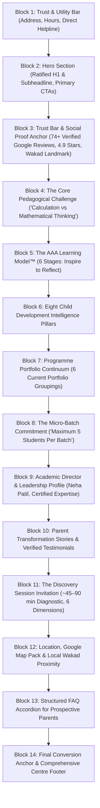
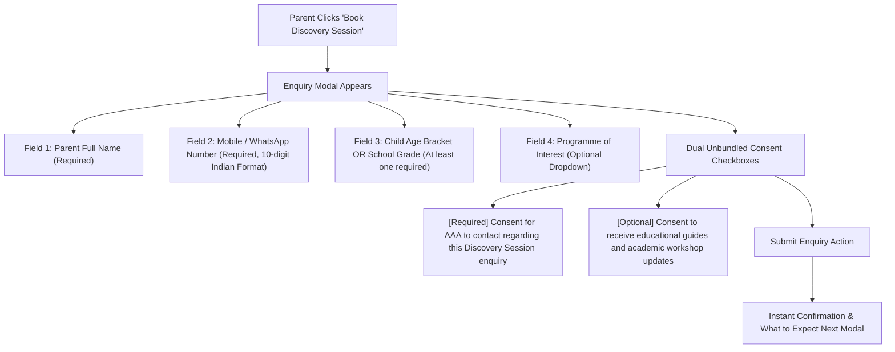

# ARNAV ABACUS ACADEMY (AAA)
## Stage 3 — Architecture & Design Specification
### Workstream WS-06.1: Information Architecture & Sitemap Specification

**Document Reference:** `AAA-S3-SPEC-WS06-01`  
**Version:** 1.1.0  
**Effective Date:** 03 November 2026  
**Status:** 🟢 **APPROVED & RATIFIED BY MANAGEMENT**  
**Stage:** Stage 3 — Architecture & Design  
**Authorised Under:** `MGT-DET-S3-01`, `MGT-DET-S3-02`, `MGT-DET-S3-03`, and `MGT-DET-S3-04` (Formally Signed Off 03 November 2026 by Neha Patil & Nitin Patil)  
**Baseline Git Commit:** `b14c64189fe5aa8e5421a548f41cd1a9626d73ef`  
**Execution Mode:** Strictly Documentation-Only Architecture Specification  

---

## 1. Executive Summary & Information Architecture Objectives

### 1.1 Context & Authority
Under formal management determinations `MGT-DET-S3-01`, `MGT-DET-S3-02`, and `MGT-DET-S3-03` dated 03 November 2026, Arnav Abacus Academy (AAA), Wakad, Pune, has authorized the commencement of detailed solution architecture under Stage 3. This specification delivers **WS-06.1: Information Architecture & Sitemap Specification**, serving as the architectural blueprint for the parent-facing digital platform (`AAA_WEB`).

In compliance with the mandatory governance rules:
- This document is an architectural specification only; no source code in `src/`, `public/`, or configuration files has been or will be altered in this step.
- The AcademyOS internal learning system boundary (`/login`, `/practice`, `/practice/session`, `/practice/results`) is strictly preserved and segregated from the public marketing architecture.
- All brand headlines, pedagogical frameworks, micro-batch standards, discovery session policies, operating hours, and data protection boundaries established in Stage 2 are preserved verbatim.

### 1.2 Core Architectural Objectives
1. **Parent-Centric & High-Trust:** Wakad, Hinjawadi, and PCMC parents are education-conscious, tech-savvy professionals seeking academic rigor, demonstrable foundational thinking, and personal attention for their children. The information architecture (IA) must immediately establish uncompromising pedagogical authority and safety.
2. **Low-Friction Discovery Journey:** The digital pathway must guide parents from initial awareness (via local search, school proximity, or referral) through understanding the developmental difference between rote calculation and conceptual mathematics, culminating in booking a diagnostic **Discovery Session**.
3. **Preservation of Organic SEO Equity:** All 30 existing React Router paths, parameterised routes, and legacy hash redirects must be rigorously catalogued, mapped, and preserved to safeguard domain authority and local search rankings.
4. **Zero Confusion between Marketing & AcademyOS:** The public web architecture serves parent discovery, trust building, and admissions. The student practice portal (`/practice`) and internal systems operate as a distinct, authenticated subsystem.

---

## 2. Primary & Secondary Navigation Architecture

The navigation architecture reflects parent mental models, balancing rapid mobile action with deep desktop research.

### 2.1 Desktop Navigation Structure
The desktop header utilizes a two-tier presentation:
- **Utility / Trust Banner (Top Tier):**
  - Physical Centre Address anchor: *"Flat No. 3, 1st Floor, Adv. Balaji Sagar Bungalow, Opp. Creative Cameo, Near Park Street, Behind Wisdom World School, Wakad, Pune 411057"*
  - Official Operating Hours: *"Mon–Sat: 9:30 AM – 7:30 PM | Sunday: Prior Assessment Appointments Only"*
  - Direct Phone Link: `+91 90219 24968`
  - WhatsApp Direct Action
- **Primary Header Bar (Bottom Tier - Sticky):**
  - Brand Identity: Logo + *"Arnav Abacus Academy"* + Sub-brand *"Foundational Math & Cognitive Excellence"*
  - Primary Nav Links:
    1. **Home** (`/`)
    2. **Programmes** (`/programs` — with dropdown mega-menu covering the 6 current portfolio groupings)
    3. **Pedagogy & Mentor** (`/mentor` — Academic Director Neha Patil profile, AAA Learning Model™, 8 Intelligence Pillars)
    4. **Parent Guides** (`/blog` & `/parent-guides/*` — Curated developmental decision articles)
    5. **Showcase & Results** (`/showcase` — Authentic competition milestones and parent reviews)
    6. **Worksheets** (`/worksheets` — Practice resource vault)
    7. **Contact & Centre** (`/contact` — Wakad centre location, map directions, transport landmarks)
  - Secondary / Utility Links:
    - **Student Practice Login** (`/login` / `/practice` — Styled as a discrete secondary badge/pill button to prevent confusing prospective parents)
  - Primary Action (Conversion CTA):
    - **"Book Discovery Session"** (Prominent high-contrast button triggering the 4-field maximum enquiry modal)

### 2.2 Mobile Navigation Structure (< 768px Viewport)
Over 75% of parent discovery occurs on smartphones. The mobile navigation architecture is optimized for one-handed operation:
- **Top Bar (Slim, 56px):**
  - Brand Logo + AAA Wordmark
  - Call Action Icon (`tel:+919021924968`)
  - Accessible Hamburger Toggle (`aria-label="Toggle Navigation Menu"`, minimum 48x48px touch target)
- **Slide-out Navigation Drawer:**
  - Grouped links: Programmes (expandable accordion), About Mentor & Methodology, Parent Guides, Showcase, Worksheets, Contact & Directions.
  - Distinct AcademyOS Student Portal link at bottom of drawer.
  - Direct WhatsApp Counselling trigger.
- **Persistent Bottom Sticky Bar (Mobile Thumb-Zone):**
  - Fixed at the bottom of the viewport (64px height).
  - Left Segment (50%): **"Call Centre"** (`tel:+919021924968` or WhatsApp chat).
  - Right Segment (50%): **"Book Discovery Session"** (High-visibility action triggering the frictionless enquiry modal).

### 2.3 Secondary & Footer Navigation Architecture
The site footer serves as the comprehensive crawlable anchor for organic search and institutional transparency:
- **Column 1: Academy & Pedagogical Identity**
  - Full registered centre address and landmarks.
  - Academic Director attribution: *Neha Patil (Founder & Academic Director)*.
  - Verified credentials reference (`VER-01`).
- **Column 2: Programme Portfolio (Current Portfolio Groupings)**
  - Abacus Mathematics (Ages 4.5–9) (`/programs/abacus`)
  - Vedic Mathematics (Ages 9–14) (`/programs/vedic-maths`)
  - Mental Mathematics (Ages 6–14) (`/programs/mental-maths`)
  - School Mathematics (Grades 1–10 CBSE/ICSE/State) (`/programs/school-maths`)
  - IPM & Olympiad Mathematics (Grades 2–9) (`/programs/ipm-olympiad`)
  - All Programmes Overview (`/programs`)
- **Column 3: Parent Educational Resources & Decision Guides**
  - Abacus vs Vedic Maths Guide (`/parent-guides/abacus-vs-vedic-maths`)
  - Does Abacus Confuse School Math? (`/parent-guides/does-abacus-confuse-school-math`)
  - Why Children Use Finger Counting (`/parent-guides/why-children-use-finger-counting`)
  - Why Smart Children Make Silly Mistakes (`/parent-guides/why-smart-children-make-silly-math-mistakes`)
  - Ideal Age to Start Abacus (`/parent-guides/ideal-age-to-start-abacus`)
  - Parent FAQs (`/faqs`)
- **Column 4: Institutional & Operational Access**
  - Centre Contact & Directions (`/contact`)
  - Student Showcase & Gallery (`/showcase`, `/gallery`)
  - Worksheet Vault (`/worksheets`)
  - Teacher & Franchise Inquiries (`/teacher-franchise`)
  - Interactive Brochure (`/brochure`)
  - AcademyOS Student Practice Hub (`/login`)
- **Footer Bottom Bar:**
  - Copyright statement: *© 2026 Arnav Abacus Academy. All Rights Reserved.*
  - Operating Hours: *Mon–Sat: 9:30 AM – 7:30 PM*.
  - Privacy Policy, Zero-PII Telemetry Statement, and Terms links.

---

## 3. Complete Visual Sitemap

The complete visual sitemap maps all 30 audited React Router routes, dynamic routes, and the client-side legacy hash handler.

```mermaid
flowchart TD
    subgraph Public_Marketing_Portal["Arnav Abacus Academy Public Portal (AAA_WEB)"]
        Home["/ (Home - Master Portal)"]
        
        subgraph Section_Programs["Programmes Portfolio (/programs)"]
            ProgramsHub["/programs (All Programmes Overview)"]
            ProgAbacus["/programs/abacus (Abacus Math)"]
            ProgVedic["/programs/vedic-maths (Vedic Math)"]
            ProgSchool["/programs/school-maths (School Math)"]
            ProgMental["/programs/mental-maths (Mental Math)"]
            ProgIpm["/programs/ipm-olympiad (IPM & Olympiad)"]
        end
        
        subgraph Section_Guides["Parent Educational Guides (/parent-guides)"]
            GuideAvV["/parent-guides/abacus-vs-vedic-maths"]
            GuideConf["/parent-guides/does-abacus-confuse-school-math"]
            GuideFinger["/parent-guides/why-children-use-finger-counting"]
            GuideMistakes["/parent-guides/why-smart-children-make-silly-math-mistakes"]
            GuideAge["/parent-guides/ideal-age-to-start-abacus"]
        end
        
        subgraph Section_Authority["Academic Authority & Proof"]
            Mentor["/mentor (Academic Director Neha Patil)"]
            Showcase["/showcase (Milestones & Reviews)"]
            Gallery["/gallery (Alias -> /showcase?tab=gallery)"]
            News["/news (News & Events)"]
            NewsEvents["/news-events (Alias -> News)"]
        end
        
        subgraph Section_Resources["Resources & Inquiries"]
            Contact["/contact (Centre NAP & Directions)"]
            Faqs["/faqs (Parent FAQs)"]
            Worksheets["/worksheets (Worksheet Vault)"]
            Brochure["/brochure (Interactive Brochure)"]
            Franchise["/teacher-franchise (Career / Franchise)"]
            BlogHub["/blog (Parent Articles Hub)"]
            BlogDetail["/blog/:slug (Dynamic Blog Posts)"]
            Campaigns["/campaigns/:slug (Dynamic Campaign Landers)"]
        end
    end
    
    subgraph AcademyOS_Subsystem["AcademyOS Practice Platform (Protected Subsystem)"]
        Login["/login (Student / Parent Sign-in)"]
        PracticeHub["/practice (Practice Hub Dashboard)"]
        PracticeSession["/practice/session (Timed Practice Session)"]
        PracticeResults["/practice/results (Diagnostic Results)"]
    end
    
    subgraph Fallbacks_Redirects["System Routing & Redirect Handlers"]
        LegacyHash["LegacyHashRedirector (/#/path -> /path)"]
        NotFound["* (Custom 404 Fallback)"]
    end

    %% Hierarchy connections
    Home --> ProgramsHub
    ProgramsHub --> ProgAbacus
    ProgramsHub --> ProgVedic
    ProgramsHub --> ProgSchool
    ProgramsHub --> ProgMental
    ProgramsHub --> ProgIpm
    
    Home --> GuideAvV
    Home --> GuideConf
    Home --> GuideFinger
    Home --> GuideMistakes
    Home --> GuideAge
    
    Home --> Mentor
    Home --> Showcase
    Showcase -.-> Gallery
    Home --> News
    News -.-> NewsEvents
    
    Home --> Contact
    Home --> Faqs
    Home --> Worksheets
    Home --> Brochure
    Home --> Franchise
    Home --> BlogHub
    BlogHub --> BlogDetail
    Home --> Campaigns
    
    Home -.-> Login
    Login --> PracticeHub
    PracticeHub --> PracticeSession
    PracticeSession --> PracticeResults
    
    LegacyHash -.-> Home
    Home -.-> NotFound
```



---

## 4. Homepage Information Hierarchy

The homepage is the primary strategic anchor of the website. It must establish mathematical authority, reassure parents, communicate the micro-batch standard, and convert qualified interest into diagnostic Discovery Sessions.

### 4.1 Block-by-Block Information Hierarchy


### 4.2 Exact Verbatim Content Specifications for Hero Block
- **Master Website Headline (H1):**
  > `"Beyond Calculation. Towards Confident Mathematical Thinking."`
  *(Enforced single H1 standard across the page).*
- **Master Website Subheadline (Lead Paragraph):**
  > `"At Arnav Abacus Academy, mathematics is the medium to develop confident, independent, and thoughtful young learners. Guided by certified educators in small batches with a maximum of five students per batch, our structured programmes provide personalised learning, closer individual guidance, and steady mathematical progress."`
- **Primary Call to Action (CTA 1):**
  - Label: `"Book a Free Discovery Session"`
  - Action: Opens the accessible 4-field maximum enquiry modal.
- **Secondary Call to Action (CTA 2):**
  - Label: `"Explore Our Programmes"`
  - Action: Smooth scroll or navigation to Section 7 Programme Portfolio.
- **Trust Badges in Hero:**
  - Micro-batch badge: *"Strictly $\le$ 5 Students Per Batch"*.
  - Experience badge: *"Wakad's Trusted Math Learning Centre"*.
  - Review rating badge: *"4.9 ★ Rating across 74+ Parent Reviews"*.

---

## 5. Programme Discovery & Comparison Structure

### 5.1 Programme Portfolio Architecture (6 Current Portfolio Groupings)
To prevent parental confusion between different math methodologies, the architecture presents a clear developmental continuum across AAA's **current portfolio groupings**:

| Programme Identifier | Current Portfolio Grouping | Target Age / Grade Bracket | Core Pedagogical Focus & Cognitive Outcome |
| :--- | :--- | :--- | :--- |
| `PRG-01` | **Abacus Mathematics** | Ages 4.5 – 9 years | Tactile bead manipulation, base-10 spatial visualization, working memory expansion, elimination of finger counting. |
| `PRG-02` | **Vedic Mathematics** | Ages 9 – 14 years | Ancient mathematical sutras, rapid mental computation, cross-multiplication, algebraic pattern shortcuts. |
| `PRG-03` | **Mental Mathematics** | Ages 6 – 14 years | Number agility, mental estimation, number bonds, eliminating computational hesitation without physical tools. |
| `PRG-04` | **School Mathematics** | Grades 1 – 10 (CBSE / ICSE / State) | Conceptual curriculum alignment, word problem decomposition, exam presentation skills, overcoming school math anxiety. |
| `PRG-05` | **IPM Mathematics** | Grades 2 – 7 | Institute for Promotion of Mathematics exam rigor, advanced arithmetic reasoning, speed-with-accuracy problem drills. |
| `PRG-06` | **Olympiad Mathematics** | Grades 2 – 9 | IMO / SilverZone / SOF advanced problem decomposition, non-routine logic, abstract mathematical intuition. |

> [!IMPORTANT]
> **Academic Validation Notice:** The 6 programme groupings above represent AAA's **current portfolio grouping only**. In accordance with management condition `MGT-DET-S3-01`, detailed syllabi, age boundaries, graduation criteria, and multi-year learning ladders remain provisional until Neha Patil (Academic Director) formally validates them in Stage 4.

### 5.2 Comparative Decision Matrix for Parents
A dedicated comparative module on `/programs` and on individual programme pages assists parents in determining the appropriate starting point:
- **Starting from Scratch (Ages 4.5–7):** Abacus Mathematics is recommended to ground physical number sense.
- **Overcoming School Math Fear (Grades 3–8):** School Mathematics paired with Mental Math drills to restore class confidence.
- **Seeking High Speed & Academic Edge (Ages 9–14):** Vedic Mathematics for high-speed calculation shortcuts.
- **Competitive Aspirants (Grades 2–9):** IPM & Olympiad track for deep logical problem decomposition.

---

## 6. Parent Guides, Mentor Profile, Trust & Credibility Architecture

### 6.1 Parent Educational Guides (`/parent-guides/*`)
The parent guide sub-architecture addresses the five most common parental anxieties identified in Stage 1 & Stage 2 research:
1. `/parent-guides/abacus-vs-vedic-maths`: Clear developmental comparison explaining tactile sensory development (Abacus) vs sutra-based symbolic mental manipulation (Vedic).
2. `/parent-guides/does-abacus-confuse-school-math`: Reassuring, evidence-based explanation of how visual number sense complements standard school algorithms rather than conflicting with them.
3. `/parent-guides/why-children-use-finger-counting`: Cognitive analysis of working memory bottlenecks and how abacus bead virtualization provides a permanent mental replacement for physical fingers.
4. `/parent-guides/why-smart-children-make-silly-math-mistakes`: Identifying executive function lapses, processing rush, and lack of visual estimation; detailing AAA's 6-stage self-checking methodology.
5. `/parent-guides/ideal-age-to-start-abacus`: Developmentally grounded guidance explaining neural plasticity between ages 4.5 and 9.

### 6.2 Mentor & Leadership Profile (`/mentor`)
The Mentor Profile establishes AAA's unassailable academic credentials while strictly adhering to `VER-01` (Documentary Verification Register):
- **Academic Director:** Neha Patil.
- **Documented Experience:** 8+ years of dedicated child mathematics mentoring in Wakad, Pune.
- **Pedagogical Governance:** Personal supervision of curriculum delivery, continuous mentor training, and direct diagnostic observation.
- **Strict Prohibition:** Zero fabricated claims, zero unverified institutional degrees, zero exaggeration of historical student counts.

### 6.3 Trust Architecture Elements
- **Local Review Social Proof:** Aggregated display of 74+ genuine Google reviews, featuring specific parent reflections on child confidence gains and school exam improvements.
- **Physical Centre Presence:** Full address and photos of the dedicated Wakad learning bungalow, establishing permanence and accessibility.
- **Micro-Batch Standard:** Uncompromising reiteration of the maximum 5 students per batch rule, demonstrating that AAA is an elite learning environment, not an overcrowded mass coaching center.

---

## 7. Discovery Session Enquiry Journey

The enquiry journey is the primary conversion funnel of the website. It replaces generic "Book Demo" or "Free Trial" terminology with the academically authoritative **Discovery Session**.

### 7.1 Four-Field Maximum Enquiry Data Contract
To eliminate parental drop-off while upholding strict data minimization (`REQ-PRIV-01`), the enquiry form enforces the **four-field maximum concept**:



### 7.2 Strict Data Prohibitions
Under no circumstances shall the enquiry form collect or request:
- Child's exact date of birth (DOB).
- Child's school name or residential street address.
- Child's medical, developmental, or clinical history.
- Parent Aadhaar, PAN, or financial details.

### 7.3 Discovery Session Operational Reality & Observation Dimensions
All website copy explaining the Discovery Session must align with operational practice:
- **Duration:** Transparently communicated as **approximately 45–90 minutes, free of charge, adapting to child engagement and parent discussion** (strictly NOT advertised as a rigid 30-minute or 60-minute test).
- **The Six Educational Observation Dimensions:**
  1. *Number Sense* — Tactile and intuitive grasp of quantities and complements.
  2. *Arithmetic Understanding* — Conceptual grasp vs mechanical memorization.
  3. *Logical Approach* — How the child breaks down an unfamiliar problem.
  4. *Learning Attitude* — Curiosity, patience, and resilience when encountering difficulty.
  5. *Response and Engagement* — Attention span and interactive responsiveness in a 1-on-1 dialogue.
  6. *Interest and Learning Passion* — Intrinsic joy and enthusiasm for numbers.

---

## 8. Contact & Local Discovery Journeys

### 8.1 Local SEO & Geographical Authority in Wakad
The Contact and Local Discovery architecture specifically targets parents residing within a 3–7 km radius of the Wakad centre, including Hinjawadi Phase 1–3, Pimple Saudagar, Pimple Nilakh, Tathawade, Thergaon, and Ravet.

### 8.2 Standardized NAP (Name, Address, Phone)
To ensure 100% NAP consistency across Google Business Profile, Apple Maps, and local directory citations:
- **Name:** Arnav Abacus Academy
- **Physical Address:** Flat No. 3, 1st Floor, Adv. Balaji Sagar Bungalow, Opp. Creative Cameo, Near Park Street, Behind Wisdom World School, Wakad, Pune, Maharashtra 411057
- **Primary Telephone / WhatsApp:** `+91 90219 24968`
- **Official Inquiries Email:** `nehaatharv@gmail.com`
- **Operating Hours:** Monday – Saturday: 9:30 AM – 7:30 PM | Sunday: Prior Assessment Appointments Only

### 8.3 Landmarks & Commute Guidance on `/contact`
- *Landmarks:* Behind Wisdom World School; Opposite Creative Cameo; Near Park Street Wakad.
- *From Hinjawadi IT Park:* 10–12 minutes via Wakad-Hinjawadi Flyover.
- *From Pimple Saudagar:* 8–10 minutes via Kunal Icon Road / Wakad Bridge.
- *Interactive Map Embed:* Accessible Google Maps iframe embed with lazy-loading and clear walking/driving transit instructions.

---

## 9. Audited Route Mappings & Inventory Reconciliation

The application architecture reconciles all 30 routes currently defined in `src/App.tsx`, preserving canonical URLs, defining redirect rules, and ensuring zero broken bookmarks.

| Route Index | Route Path (`src/App.tsx`) | Component / Element | Classification | Canonical URL Policy | Redirect / Access Rule |
| :---: | :--- | :--- | :--- | :--- | :--- |
| **01** | `/` | `<Home />` | Public Marketing | `https://arnavabacus.com/` | Primary landing page. |
| **02** | `/mentor` | `<Mentor />` | Public Marketing | `https://arnavabacus.com/mentor` | Direct navigation. |
| **03** | `/programs` | `<Programs />` | Public Marketing | `https://arnavabacus.com/programs` | Program overview hub. |
| **04** | `/programs/abacus` | `<ProgramAbacus />` | Public Marketing | `https://arnavabacus.com/programs/abacus` | Dedicated course page. |
| **05** | `/programs/vedic-maths` | `<ProgramVedicMaths />` | Public Marketing | `https://arnavabacus.com/programs/vedic-maths` | Dedicated course page. |
| **06** | `/programs/school-maths` | `<ProgramSchoolMaths />` | Public Marketing | `https://arnavabacus.com/programs/school-maths` | Dedicated course page. |
| **07** | `/programs/mental-maths` | `<ProgramMentalMaths />` | Public Marketing | `https://arnavabacus.com/programs/mental-maths` | Dedicated course page. |
| **08** | `/programs/ipm-olympiad` | `<ProgramIpmOlympiad />` | Public Marketing | `https://arnavabacus.com/programs/ipm-olympiad` | Dedicated course page. |
| **09** | `/parent-guides/abacus-vs-vedic-maths` | `<GuideAbacusVsVedicMaths />` | Public Marketing | `https://arnavabacus.com/parent-guides/abacus-vs-vedic-maths` | Standalone guide. |
| **10** | `/parent-guides/does-abacus-confuse-school-math` | `<GuideDoesAbacusConfuseSchoolMath />` | Public Marketing | `https://arnavabacus.com/parent-guides/does-abacus-confuse-school-math` | Standalone guide. |
| **11** | `/parent-guides/why-children-use-finger-counting` | `<GuideWhyChildrenUseFingerCounting />` | Public Marketing | `https://arnavabacus.com/parent-guides/why-children-use-finger-counting` | Standalone guide. |
| **12** | `/parent-guides/why-smart-children-make-silly-math-mistakes` | `<GuideWhySmartChildrenMakeSillyMathMistakes />` | Public Marketing | `https://arnavabacus.com/parent-guides/why-smart-children-make-silly-math-mistakes` | Standalone guide. |
| **13** | `/parent-guides/ideal-age-to-start-abacus` | `<GuideIdealAgeToStartAbacus />` | Public Marketing | `https://arnavabacus.com/parent-guides/ideal-age-to-start-abacus` | Standalone guide. |
| **14** | `/practice` | `<ProtectedRoute><PracticeHub /></ProtectedRoute>` | AcademyOS Portal | `https://arnavabacus.com/practice` | Requires student auth. |
| **15** | `/practice/session` | `<ProtectedRoute><PracticeSession /></ProtectedRoute>` | AcademyOS Practice | `https://arnavabacus.com/practice/session` | Active practice drill; navbar suppressed. |
| **16** | `/practice/results` | `<ProtectedRoute><PracticeResult /></ProtectedRoute>` | AcademyOS Results | `https://arnavabacus.com/practice/results` | Diagnostic score summary. |
| **17** | `/login` | `<Login />` | AcademyOS Auth | `https://arnavabacus.com/login` | Student login interface. |
| **18** | `/contact` | `<Contact />` | Public Marketing | `https://arnavabacus.com/contact` | Centre details & inquiry. |
| **19** | `/showcase` | `<Showcase />` | Public Marketing | `https://arnavabacus.com/showcase` | Results and gallery hub. |
| **20** | `/gallery` | `<Showcase defaultTab="gallery" />` | Public Marketing | `https://arnavabacus.com/gallery` | Alias to showcase gallery tab. |
| **21** | `/blog` | `<Blog />` | Public Marketing | `https://arnavabacus.com/blog` | Articles and insights hub. |
| **22** | `/blog/:slug` | `<BlogPostDetail />` | Public Marketing | `https://arnavabacus.com/blog/:slug` | Dynamic blog article view. |
| **23** | `/news` | `<NewsEvents />` | Public Marketing | `https://arnavabacus.com/news` | News and announcements. |
| **24** | `/news-events` | `<NewsEvents />` | Public Marketing | `https://arnavabacus.com/news-events` | SEO alias route to News. |
| **25** | `/worksheets` | `<WorksheetVault />` | Public Marketing | `https://arnavabacus.com/worksheets` | Free math practice downloads. |
| **26** | `/teacher-franchise` | `<TeacherFranchise />` | Public Marketing | `https://arnavabacus.com/teacher-franchise` | Franchise / educator inquiries. |
| **27** | `/faqs` | `<Faqs />` | Public Marketing | `https://arnavabacus.com/faqs` | Categorized parent FAQs. |
| **28** | `/brochure` | `<InteractiveBrochure />` | Public Marketing | `https://arnavabacus.com/brochure` | Digital academy brochure. |
| **29** | `/campaigns/:slug` | `<CampaignPage />` | Public Marketing | `https://arnavabacus.com/campaigns/:slug` | Paid campaign landing pages. |
| **30** | `*` | `<NotFound />` | System Fallback | None (Noindex, Nofollow) | Friendly 404 page with recovery links. |
| **Redirect** | `LegacyHashRedirector` | `<LegacyHashRedirector />` | Route Middleware | Strips `#/` from legacy URLs | Client-side 301-equivalent redirect to clean path. |

---

## 10. Mobile Navigation & Thumb-Zone Considerations

Because mobile devices account for over three-quarters of parental visits, the UI architecture adheres to ergonomic mobile thumb-zone principles:

```
+-----------------------------------+
| Top Bar (Brand + Phone + Menu)    |  <-- Hard to reach with one hand
+-----------------------------------+
|                                   |
|   Active Content Viewport         |  <-- Natural viewing & scrolling zone
|   (Cards, Accordions, Visuals)    |
|                                   |
+-----------------------------------+
| Floating WhatsApp Pill (Right)    |  <-- Easy thumb reach
+-----------------------------------+
| Fixed Bottom Sticky Bar (64px)    |  <-- PRIME THUMB ZONE (Instant Action)
| [ Call Now ] | [ Book Discovery ] |
+-----------------------------------+
```

### 10.1 Key Mobile Ergonomic Requirements
1. **Prime Action Zone:** The bottom sticky bar houses the two highest-intent parent actions: calling the center directly and opening the Discovery Session booking modal.
2. **Accessible Target Sizes:** All interactive elements on mobile (buttons, form inputs, hamburger icons, accordions) must maintain a minimum bounding box of **48 × 48 CSS pixels** (AAA usability preference).
3. **Modal Form Ergonomics:** The 4-field enquiry modal opens smoothly from the bottom on mobile viewports, keeping the submit button within natural thumb reach and avoiding virtual keyboard layout overlap.
4. **Preventing Horizontal Drift:** All table structures (such as programme comparison matrices) must gracefully transform into stacked card views below 768px to ensure zero horizontal scroll or layout shifts.

---

## 11. Internal Linking & Canonical URL Principles

### 11.1 Silo Structure & Topic Clustering
The architecture implements a rigorous topic-clustering strategy:
- **Core Programme Silo:** `/programs` links downward to individual programmes (`/programs/abacus`, `/programs/vedic-maths`, etc.). Each sub-page cross-links to complementary parent guides and provides a direct path to book a Discovery Session.
- **Parent Guide Silo:** Each `/parent-guides/*` article links directly to the corresponding programme page and the Mentor Profile, providing high-context education before conversion.
- **Breadcrumb Navigation:** Standardized breadcrumb markup is implemented across all tier-2 and tier-3 routes (e.g., `Home > Programmes > Abacus Mathematics`), supporting both parent orientation and search engine hierarchy parsing.

### 11.2 Canonical URL Rules
1. All URLs must be lowercase with trailing slashes stripped.
2. Self-referential `<link rel="canonical" href="..." />` tags must be rendered dynamically via `<SEOHead />` on every page.
3. Legacy hash links (`/#/programs`) are automatically normalized to path-based clean URLs (`/programs`) via `<LegacyHashRedirector />`.
4. URL alias routes (e.g., `/gallery` vs `/showcase`, `/news-events` vs `/news`) must specify the primary route as their canonical tag to prevent duplicate content dilution.

---

## 12. Content Ownership & Academic Validation Dependencies

### 12.1 Governance Separation of Concerns
To maintain institutional integrity, content authority is strictly apportioned:
- **Sole Academic & Pedagogical Authority:** **Neha Patil (Founder & Academic Director)**.
  - All curriculum descriptions, level structures, age appropriateness rules, pedagogical claims, and competition achievements must be authored or explicitly signed off by Neha Patil.
  - AI and engineering agents are strictly prohibited from inventing or improvising educational methodologies or academic guarantees.
- **Technology & Operational Architecture:** **Nitin Patil (Operations & Technology Lead)**.
  - Information architecture, site performance, hosting configuration, form handling, and security governance fall under operational oversight.

### 12.2 Stage 4 Academic Dependencies (Hard Gate 4.1)
Prior to implementation in Stage 4, Neha Patil must provide formal sign-off on:
1. Exact syllabus milestones for each of the 6 programme areas.
2. Final validated age and grade eligibility brackets.
3. Documentary evidence references for all student competition records in the showcase.

---

## 13. Accessibility Requirements (WCAG Conformance Target)

### 13.1 Proposed Conformance Standard
The platform targets **WCAG 2.1 Level AA** conformance across all public views, subject to empirical validation during implementation.

### 13.2 Specific Architectural Conformance Classifications
1. **Single-H1 Architecture:** Each page shall possess exactly one semantic `<h1>` tag containing the approved page title. On the homepage, this is strictly:
   `<h1>Beyond Calculation. Towards Confident Mathematical Thinking.</h1>`
   *(Classified as an **AAA Content & Architecture Standard**, supporting screen-reader navigation).*
2. **Reduced Motion Preference:** All CSS animations and transitions must respect user system preferences via `@media (prefers-reduced-motion: reduce)`:
   *(Classified as a **WCAG 2.3.3 AAA-level additional usability preference**, implemented proactively).*
3. **Usability Touch Targets:** All interactive triggers must adhere to a minimum 48 × 48px bounding box:
   *(Classified as an **AAA Usability Design Preference**, exceeding the WCAG 2.1 AA 24px requirement).*
4. **Accessible Form Labeling:** Every form input must have a programmatically linked `<label htmlFor="...">` tag and explicit ARIA error descriptions (`aria-invalid`, `aria-describedby`).
5. **Color Contrast:** All body text must achieve a minimum contrast ratio of **4.5:1** against backgrounds; large headlines ($\ge 18\text{pt}$ or $\ge 14\text{pt}$ bold) must achieve at least **3.0:1**.

### 13.3 Three-Stage Accessibility Verification Lifecycle
1. *Stage A: Design & Markup Specification* (Semantic HTML, explicit ARIA roles).
2. *Stage B: Automated Tooling Verification* (axe-core and Lighthouse accessibility CI checks).
3. *Stage C: Manual Assistive Technology Validation* (NVDA on Windows, VoiceOver on iOS/macOS, keyboard-only tab walkthroughs).

---

## 14. Privacy, Data Classification & Consent Boundaries

### 14.1 Zero-PII Analytics Protocol
In accordance with mandatory rule 4 of `AGENTS.md` and `REQ-PRIV-02`:
- Google Analytics 4 (`G-M2EL9MYSRL`) and any future telemetry tools must remain strictly zero-PII compliant.
- No parent names, student names, phone numbers, email addresses, or query text shall ever be transmitted in GA4 events, event parameters, custom dimensions, dataLayer pushes, or URL query parameters.
- Analytical tracking is limited strictly to interaction states:
  - `enquiry_modal_opened` (location: string)
  - `enquiry_form_submitted` (programme_category: string, age_bracket: string)
  - `whatsapp_click` (placement: string)
  - `phone_click` (placement: string)

### 14.2 Dual Unbundled Consent Architecture
The enquiry form separates transactional necessity from promotional outreach:
1. **Consent A (Transactional - Required):** *"I consent to Arnav Abacus Academy contacting me via phone/WhatsApp regarding this Discovery Session enquiry."*
2. **Consent B (Educational Updates - Optional):** *"I would like to receive occasional academic insights, parent guides, and workshop announcements."*
- Opting out of Consent B does not restrict or penalize the parent from receiving full Discovery Session scheduling and consultation.

---

## 15. Requirements Traceability Matrix to Ratified Stage 2 Master BRD

This specification directly traces to and fulfills the approved requirements in `docs/02_business_requirements/AAA_Stage2_Master_BRD_Consolidated.md`:

| Requirement ID | Requirement Summary | Master BRD Trace | Specification Implementation in WS-06.1 |
| :--- | :--- | :--- | :--- |
| **`REQ-STRAT-01`** | Wakad local positioning & elite math identity | Master BRD §3.1 | Sections 1.2, 4.1, 8.1: Wakad-centric NAP, 74+ reviews, cognitive positioning. |
| **`REQ-BRAND-01`** | Verbatim H1 and approved subheadline | `DEC-WS02-13` | Section 4.2: Exact H1 and subheadline specified without alteration. |
| **`REQ-BRAND-02`** | Micro-batch standard | `DEC-WS02-04` | Sections 2.1, 4.1, 4.2: Universally enforced as "$\le 5$ students per batch". |
| **`REQ-PED-01`** | AAA Learning Model™ (6 Stages) | Master BRD §3.2 | Sections 4.1, 6.1: Full 6-stage continuum integrated into homepage and guides. |
| **`REQ-PED-02`** | 8 Intelligence Pillars | Master BRD §3.2 | Sections 2.1, 4.1: Featured prominently in homepage and mentor architecture. |
| **`REQ-ACAD-01`** | Current portfolio grouping distinction | `DEC-WS02-14` | Section 5.1: Identified strictly as current portfolio grouping; zero invented rules. |
| **`REQ-JOUR-01`** | Discovery Session operational reality | `DEC-WS02-06` | Section 7.3: ~45–90 min adaptive reality, free of charge, 6 observation dimensions. |
| **`REQ-JOUR-02`** | Four-field maximum enquiry modal contract | `DEC-WS02-07` | Section 7.1: 4-field max concept; unbundled dual consent. |
| **`REQ-PRIV-01`** | Data minimization & prohibited fields | `DEC-WS05-01` | Section 7.2: Absolute prohibition on DOB, school, address, medical history. |
| **`REQ-PRIV-02`** | Zero-PII analytics telemetry | `AGENTS.md` Rule 4 | Section 14.1: GA4 parameter sanitization and zero-PII compliance rules. |
| **`REQ-TECH-01`** | Preservation of existing 30 routes | `AGENTS.md` Rule 2 | Section 9: Full audit of 30 routes + 1 redirect handler from `src/App.tsx`. |
| **`REQ-TECH-02`** | AcademyOS boundary protection | `AGENTS.md` Rule 3 | Sections 1.1, 3.0, 9.0: Strict boundary around `/practice` and `/login`. |

---

## 16. Acceptance Criteria, Open Decisions, Assumptions & Validation Questions

### 16.1 Acceptance Criteria for WS-06.1 Sign-Off
1. Complete alignment with the ratified Stage 2 Master BRD and all 54 ratified decisions.
2. Full reconciliation of all 30 routes and redirect handlers in `src/App.tsx`.
3. Verbatim preservation of ratified H1, subheadline, and micro-batch standard.
4. Transparent documentation of all open academic dependencies requiring Neha Patil.

### 16.2 Key Architectural Assumptions
1. **Baseline Platform Stability:** The existing React 19, TypeScript, React Router v7, and Vite configuration remains the technical foundation for Stage 3 architecture.
2. **Current Portfolio Groupings:** The six programme areas reflect current operational offerings; curriculum depth validation will proceed under Neha Patil's guidance in Stage 4.
3. **Form Routing:** The enquiry modal will submit leads to the verified endpoint agreed in Stage 3 Architecture Decisions (`ADR-003`).

### 16.3 Specific Decisions & Validations Formally Ratified by Management
1. **Validation Item V-01 (Neha Patil — Academic Director):**
   - *Status:* **APPROVED & RATIFIED** (03-Nov-2026 via `MGT-DET-S3-04`).
   - *Determination:* Formally confirmed that the presentation of the 6 current portfolio groupings accurately captures the intended pedagogical progression (Tactile Abacus $\rightarrow$ Visual Mental Math $\rightarrow$ Analytical Vedic Math $\rightarrow$ School/Olympiad Application) on the public homepage and programme overview.
2. **Validation Item V-02 (Neha Patil — Academic Director):**
   - *Status:* **APPROVED & RATIFIED** (03-Nov-2026 via `MGT-DET-S3-04`).
   - *Determination:* Formally approved the public copy framing for the 6 Educational Observation Dimensions (*Number Sense, Arithmetic Understanding, Logical Approach, Learning Attitude, Response and Engagement, Interest and Learning Passion*) used in the Discovery Session invitation and parent communications.
3. **Validation Item V-03 (Nitin Patil — Operations & Technology Lead):**
   - *Status:* **APPROVED & RATIFIED** (03-Nov-2026 via `MGT-DET-S3-04`).
   - *Determination:* Formally confirmed that the proposed 4-field maximum enquiry data contract (Parent Name, Parent Mobile/WhatsApp, Child Age/Grade, Optional Programme) and dual unbundled consent model satisfy operational admissions needs and data minimization rules.

---
*End of Specification — Approved and Ratified by Management under `MGT-DET-S3-04` (Gate 3.1 — Phase 1).*
