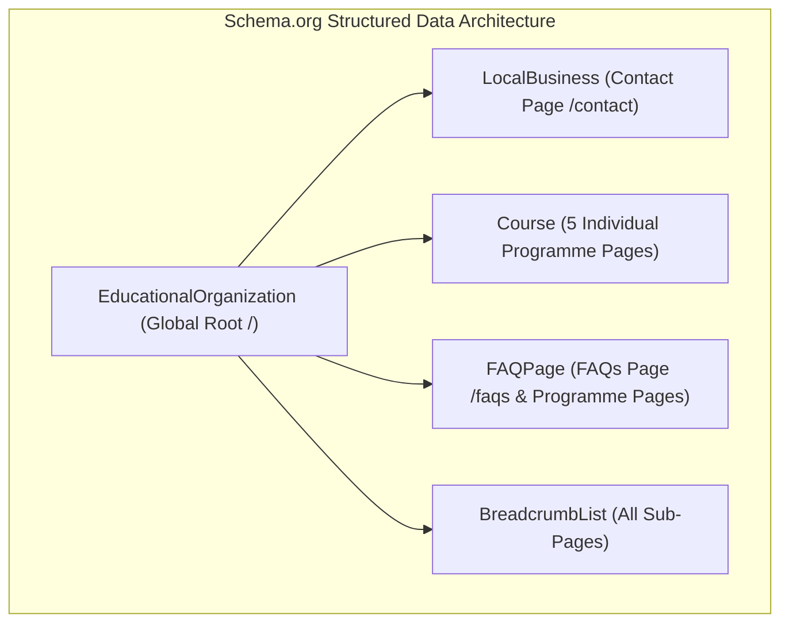

# ARNAV ABACUS ACADEMY (AAA)
## Stage 3 — Architecture & Design Specification
### Workstream WS-06.5: Local SEO Metadata & Route Preservation Specification

**Document Reference:** `AAA-S3-SPEC-WS06-05`  
**Version:** 1.0.0  
**Effective Date:** 03 November 2026  
**Status:** 🟡 **DRAFT — AWAITING MANAGEMENT REVIEW**  
**Stage:** Stage 3 — Architecture & Design  
**Parent Workstream:** WS-06 — Digital Experience & Website Architecture  
**Previous Ratified Deliverables:**  
- WS-06.1: Information Architecture & Sitemap (`AAA-S3-SPEC-WS06-01`, Ratified via `MGT-DET-S3-04`)  
- WS-06.2: Wireframes & Low-Fidelity Layout Blueprints (`AAA-S3-SPEC-WS06-02`, Ratified via `MGT-DET-S3-05`)  
- WS-06.3: Design System, UI Tokens & Component Specifications (`AAA-S3-SPEC-WS06-03`, Ratified via `MGT-DET-S3-06`)  
- WS-06.4: Mobile Conversion & Thumb-Zone Specification (`AAA-S3-SPEC-WS06-04`, Ratified via `MGT-DET-S3-07`)  
**Authorised Under:** `MGT-DET-S3-01` through `MGT-DET-S3-07`  
**Baseline Git Commit:** `b14c64189fe5aa8e5421a548f41cd1a9626d73ef`  
**Execution Mode:** Strictly Documentation-Only Architecture Specification  

---

## 1. Document Control & Governance Authority

### 1.1 Authority Reference
This specification delivers **WS-06.5: Local SEO Metadata & Route Preservation Specification**, executing Phase 5 of the reconciled six-part WS-06 delivery series (`MGT-DET-S3-06` and `MGT-DET-S3-07`). 

It establishes the local search discovery architecture, authoritative NAP citation protocol, dynamic `<SEOHead />` metadata contracts, Schema.org JSON-LD structured data specifications, XML sitemap/robots.txt rules, and exhaustive route preservation mappings for **Arnav Abacus Academy (AAA), Wakad, Pune**.

### 1.2 Signatory Authorities & Scope of Governance
- **Academic Director & Founder:** **Neha Patil** — Course entity descriptions, academic structured data attributes, local pedagogical intent, educational observation definitions.
- **Operations & Technology Lead:** **Nitin Patil** — Routing preservation, canonical URL policies, `<SEOHead />` implementation contracts, Schema.org JSON-LD technical validation, robots.txt crawl rules, domain architecture.

---

## 2. Objective & Architectural Scope

### 2.1 Core Objectives
1. **Accurate Local Discovery in Wakad & PCMC Catchment:** Enable prospective parents searching for foundational mathematics education in Wakad, Hinjawadi, and Pimple Saudagar to discover AAA's physical centre with zero ambiguity regarding location, operating hours, and contact details.
2. **Pedagogical Understanding by Search Engines:** Provide search engine crawlers (Googlebot, Bingbot) with structured, semantically unambiguous machine-readable metadata defining AAA as an elite child-development-focused mathematics academy.
3. **100% Preservation of Route Equity:** Ensure all 30 React Router routes and the legacy hash compatibility handler (`<LegacyHashRedirector />`) are preserved without broken links, ranking drops, or 404 indexing errors.
4. **AcademyOS Route Isolation & Zero-PII Protection:** Strictly exclude internal learning systems (`/practice/*`, `/login`) from search indexing and prevent any leakage of student or parent PII into URLs, titles, meta tags, or structured data.

### 2.2 Explicit Anti-Objectives & SEO Safeguards
- **Zero Ranking Guarantees:** This specification designs crawlability and metadata hygiene; it strictly **does not promise** search ranking positions, rich result snippets, or guaranteed admissions growth.
- **Zero Doorway Pages:** Strictly prohibits creating repetitive, low-value location pages (e.g. `/abacus-classes-in-hinjawadi`, `/abacus-classes-in-pimple-saudagar`) that imply physical premises outside of Wakad.
- **Zero Invisible Markup:** Schema.org JSON-LD must strictly reflect visible, verifiable on-page text and verified academy facts.

---

## 3. Ratified Business & Brand Constraints

All metadata, keywords, and structured data must adhere to AAA's ratified baselines:

1. **Brand Positioning:** *Arnav Abacus Academy — A Premium Mathematical Thinking & Child Development Academy.*
2. **Master Website Headline (H1):** Strictly verbatim:
   > `"Beyond Calculation. Towards Confident Mathematical Thinking."`
3. **Master Website Subheadline:** Strictly verbatim:
   > `"At Arnav Abacus Academy, mathematics is the medium to develop confident, independent, and thoughtful young learners. Guided by certified educators in small batches with a maximum of five students per batch, our structured programmes provide personalised learning, closer individual guidance, and steady mathematical progress."`
4. **Micro-Batch Standard:** Universally enforced as *"maximum of five students per batch"*.
5. **Discovery Session Established Practice:** **AAA Personalised Learning Discovery Session**, free of charge, approximately 45–90 minutes depending on child engagement, educational observation across the 6 approved dimensions (*Number Sense, Arithmetic Understanding, Logical Approach, Learning Attitude, Response and Engagement, Interest and Learning Passion*).
6. **Operating Hours:** Monday – Saturday: 9:30 AM – 7:30 PM | Sunday: Prior Assessment Appointments Only.
7. **Social Proof Reference:** 74+ verified 5-star Google reviews (4.9★ rating), dated as of November 2026, refreshable upon management review.
8. **Current Portfolio Groupings:** Abacus Mathematics, Vedic Mathematics, Mental Mathematics, School Mathematics, IPM Mathematics, Olympiad Mathematics. Shown as approved offerings, **strictly not as a compulsory sequential curriculum**.

---

## 4. Complete Route Inventory & Canonical Mapping

An inspection of `src/App.tsx` confirms the ratified inventory: **30 React Router route definitions** (27 static routes, 2 dynamic parameterised patterns, 1 wildcard fallback), plus **1 client-side legacy hash compatibility handler** (`<LegacyHashRedirector />`).

```
+-------------------------------------------------------------------------------------------------------------------------------------------+
| #  | EXACT CURRENT PATH         | TYPE    | PURPOSE                     | CLASS    | PROPOSED CANONICAL PATH*   | INDEX | SITEMAP | DEPENDENCY/RISK |
+----+----------------------------+---------+-----------------------------+----------+----------------------------+-------+---------+-----------------+
| 01 | /                          | Static  | Public Homepage             | Public   | /                          | Yes   | Yes     | Core brand root |
| 02 | /mentor                    | Static  | Founder Profile (Neha Patil)| Public   | /mentor                    | Yes   | Yes     | VER-01 proof    |
| 03 | /programs                  | Static  | Programme Portfolio Hub     | Public   | /programs                  | Yes   | Yes     | Category anchor |
| 04 | /programs/abacus           | Static  | Abacus Mathematics Course   | Public   | /programs/abacus           | Yes   | Yes     | Course Schema   |
| 05 | /programs/vedic-maths      | Static  | Vedic Mathematics Course    | Public   | /programs/vedic-maths      | Yes   | Yes     | Course Schema   |
| 06 | /programs/school-maths     | Static  | School Mathematics Course   | Public   | /programs/school-maths     | Yes   | Yes     | Course Schema   |
| 07 | /programs/mental-maths     | Static  | Mental Mathematics Course   | Public   | /programs/mental-maths     | Yes   | Yes     | Course Schema   |
| 08 | /programs/ipm-olympiad     | Static  | IPM & Olympiad Prep Course  | Public   | /programs/ipm-olympiad     | Yes   | Yes     | Course Schema   |
| 09 | /parent-guides/abacus-vs.. | Static  | Decision Guide: Comparison  | Public   | /parent-guides/abacus-vs.. | Yes   | Yes     | Editorial guide |
| 10 | /parent-guides/does-abac.. | Static  | Decision Guide: School Math | Public   | /parent-guides/does-abac.. | Yes   | Yes     | Myth-busting    |
| 11 | /parent-guides/why-child.. | Static  | Decision Guide: Finger Count| Public   | /parent-guides/why-child.. | Yes   | Yes     | Cognitive guide |
| 12 | /parent-guides/why-smart.. | Static  | Decision Guide: Silly Errors| Public   | /parent-guides/why-smart.. | Yes   | Yes     | Error reduction |
| 13 | /parent-guides/ideal-age.. | Static  | Decision Guide: Starting Age| Public   | /parent-guides/ideal-age.. | Yes   | Yes     | Readiness guide |
| 14 | /practice                  | Static  | AcademyOS Practice Hub      | Restrict | /practice                  | NO    | NO      | ProtectedRoute  |
| 15 | /practice/session          | Static  | AcademyOS Timed Drill Engine| Restrict | /practice/session          | NO    | NO      | ProtectedRoute  |
| 16 | /practice/results          | Static  | AcademyOS Diagnostic Score  | Restrict | /practice/results          | NO    | NO      | ProtectedRoute  |
| 17 | /login                     | Static  | AcademyOS Student Auth      | Restrict | /login                     | NO    | NO      | Student portal  |
| 18 | /contact                   | Static  | Wakad Centre NAP & Maps     | Public   | /contact                   | Yes   | Yes     | Local NAP anchor|
| 19 | /showcase                  | Static  | Results & Review Wall       | Public   | /showcase                  | Yes   | Yes     | Social proof    |
| 20 | /gallery                   | Static  | Showcase Gallery Tab Alias  | Public   | /showcase                  | NO    | NO      | Alias -> /showcase|
| 21 | /blog                      | Static  | Educational Articles Hub    | Public   | /blog                      | Yes   | Yes     | Blog Index      |
| 22 | /blog/:slug                | Dynamic | Individual Blog Post Detail | Public   | /blog/:slug                | Yes   | Dynamic | Dynamic slugs   |
| 23 | /news                      | Static  | Academy Announcements       | Public   | /news                      | Yes   | Yes     | Event feed      |
| 24 | /news-events               | Static  | News Alias Route            | Public   | /news                      | NO    | NO      | Alias -> /news  |
| 25 | /worksheets                | Static  | Printable Worksheet Vault   | Public   | /worksheets                | Yes   | Yes     | Practice sheets |
| 26 | /teacher-franchise         | Static  | Educator Franchise Inquiries| Public   | /teacher-franchise         | Yes   | Yes     | Franchise lead  |
| 27 | /faqs                      | Static  | Categorized Parent FAQs     | Public   | /faqs                      | Yes   | Yes     | FAQPage Schema  |
| 28 | /brochure                  | Static  | Digital Course Brochure     | Public   | /brochure                  | Yes   | Yes     | PDF/Viewer      |
| 29 | /campaigns/:slug           | Dynamic | Paid Campaign Landing Pages | Public   | /campaigns/:slug           | NO**  | NO      | Paid ad landers |
| 30 | *                          | Wildcard | Custom 404 Fallback Page    | System   | None                       | NO    | NO      | Soft-404 protect|
| —  | LegacyHashRedirector       | Handler | Client Redirect (/#/path)   | Utility  | Target Clean Path          | N/A   | NO      | Bookmark protect|
+-------------------------------------------------------------------------------------------------------------------------------------------+
*Note: Canonical paths are relative to the authoritative production origin (see §6.1).
**Campaign pages (/campaigns/:slug) are set to `noindex, follow` to prevent diluting organic search authority with temporary paid landing variants.
```

---

## 5. NAP & Google Business Profile Consistency Architecture

### 5.1 Authoritative Proposed NAP Record
To ensure local algorithmic trust across Google Search, Google Maps, Apple Maps, and legitimate educational directories:

```
+---------------------------------------------------------------------------------------------------------+
| NAP ATTRIBUTE             | AUTHORITATIVE SPECIFICATION             | CURRENT GOVERNANCE STATUS         |
+---------------------------+-----------------------------------------+-----------------------------------+
| Business Name             | Arnav Abacus Academy                    | Management Ratified               |
| Physical Centre Address   | Flat No. 3, 1st Floor, Adv. Balaji      | Facility Verification Pending     |
|                           | Sagar Bungalow, Opp. Creative Cameo,   | (Operational address in use)      |
|                           | Near Park Street, Behind Wisdom World   |                                   |
|                           | School, Wakad, Pune, Maharashtra 411057 |                                   |
| Primary Voice & WhatsApp  | +91 90219 24968                         | Management & Repository Confirmed |
| Official Email Address    | nehaatharv@gmail.com                    | Repository & Management Confirmed |
| Authoritative Website URL | https://arnavabacus.com (Proposed)      | Production Domain Pending Approval|
| Primary Google Category   | Educational Institution                 | Recommended Google Category       |
| Secondary Categories      | Learning Centre, Tutoring Service       | Recommended Google Categories     |
| Official Operating Hours  | Mon–Sat: 9:30 AM – 7:30 PM              | Management Ratified               |
| Sunday Operating Policy   | By Prior Assessment Appointment Only    | Management Ratified               |
| Geographic Coordinates    | Lat: 18.5987° N, Long: 73.7654° E       | Approximate Wakad Centroid        |
+---------------------------------------------------------------------------------------------------------+
```

### 5.2 Information Categorization & Conflict Resolution
1. **Management-Confirmed Facts:** Public business name (*Arnav Abacus Academy*), operating hours (*Mon–Sat 9:30 AM–7:30 PM*), Founder (*Neha Patil*), 8+ years experience, and micro-batch standard ($\le 5$).
2. **Existing Repository Facts:** Official Centre Helpline and WhatsApp number is **`+91 90219 24968`**, confirmed uniformly across `src/components/Navbar.tsx`, `src/components/FloatingCTA.tsx`, `src/components/Footer.tsx`, `src/pages/Contact.tsx`, and `src/components/SEOHead.tsx`. Email `nehaatharv@gmail.com` is consistently cited.
3. **Existing Google Business Profile Reference:** 74+ reviews with 4.9★ rating.
4. **Correction of Erroneous Documentation Phantom Number:**
   - An earlier documentation report mistakenly hallucinated an unverified number (`+91 94038 84844`) as being present in `FloatingCTA.tsx`. Codebase inspection confirmed that no such number exists in `src/`. The sole authentic contact number across all source components and WhatsApp links is **`+91 90219 24968`**.
   - *Production Domain Discrepancy:* Codebase hardcodes `https://arnavabacusacademy-web.vercel.app`, whereas a production custom domain (`https://arnavabacus.com` or similar) is standard for organic search equity.
5. **Wakad Physical Premises vs Service Catchment Distinction:**
   - **Physical Premises (Sole Location):** Wakad, Pune (Behind Wisdom World School).
   - **Service Catchment Areas (Parents who travel to Wakad):** Hinjawadi Phase 1–3, Pimple Saudagar, Pimple Nilakh, Tathawade, Thergaon, Ravet.
   - **Strict Rule:** Website copy and metadata must **never** claim physical branches in Hinjawadi or PCMC. All descriptions must frame them as *"serving families across Wakad, Hinjawadi, and PCMC at our Wakad learning bungalow"*.

---

## 6. Local Keyword & Page Intent Architecture

The keyword architecture maps parent search intent directly to authoritative, high-intent landing routes without keyword cannibalization.

```
+---------------------------------------------------------------------------------------------------------+
| KEYWORD CLUSTER           | PARENT SEARCH INTENT        | TARGET ROUTE          | PROPOSED TITLE & META DIRECTION   |
+---------------------------+-----------------------------+-----------------------+-----------------------------------+
| 1. Abacus Classes Wakad   | Searching for nearby tactile| /programs/abacus      | Title: Abacus Maths Classes in    |
|    "abacus classes near   | abacus classes for young    |                       | Wakad, Pune | Small Batches of 5  |
|     Wisdom World School"  | children (ages 4.5–9).      |                       | Desc: Japanese Soroban abacus in  |
|                           |                             |                       | Wakad. Max 5 kids per batch...    |
+---------------------------+-----------------------------+-----------------------+-----------------------------------+
| 2. Vedic Maths Wakad      | Searching for rapid mental  | /programs/vedic-maths | Title: Vedic Mathematics Classes  |
|    "vedic math classes    | calculation shortcuts for   |                       | in Wakad, Pune | Speed Maths AAA  |
|     in Wakad Pune"        | older students (ages 9–14). |                       | Desc: Master 16 Vedic Sutras for  |
|                           |                             |                       | school exams & Olympiads in Wakad.|
+---------------------------+-----------------------------+-----------------------+-----------------------------------+
| 3. Mental Maths Learning  | Overcoming computational    | /programs/mental-maths| Title: Mental Mathematics Training|
|    "mental arithmetic     | hesitation and building     |                       | in Wakad, Pune | Arnav Abacus     |
|     classes for kids"     | number sense without tools. |                       | Desc: Strengthen number bonds,    |
|                           |                             |                       | speed estimation, visual agility. |
+---------------------------+-----------------------------+-----------------------+-----------------------------------+
| 4. School Maths Coaching  | Overcoming school math fear | /programs/school-maths| Title: School Maths Tuition in    |
|    "maths tuition class   | and exam anxiety (CBSE/ICSE |                       | Wakad (Grades 1–10) | CBSE/ICSE   |
|     1 to 10 Wakad"        | Grades 1–10).               |                       | Desc: Conceptual board-aligned    |
|                           |                             |                       | maths coaching in micro-batches...|
+---------------------------+-----------------------------+-----------------------+-----------------------------------+
| 5. IPM & Olympiad Coaching| Elite competitive reasoning | /programs/ipm-olympiad| Title: IPM & Math Olympiad Prep   |
|    "IMO Olympiad coaching | preparation for competitive |                       | in Wakad, Pune | Grades 2–9       |
|     Wakad Pune"           | mathematical exams.         |                       | Desc: Deep problem decomposition, |
|                           |                             |                       | logic drills, past paper mastery. |
+---------------------------+-----------------------------+-----------------------+-----------------------------------+
| 6. Mathematical Thinking  | Parents evaluating rote     | /                     | Title: Arnav Abacus Academy |     |
|    "child cognitive brain | calculation vs conceptual   |                       | Beyond Calculation, Wakad Pune    |
|     development Wakad"    | foundational thinking.      |                       | Desc: Elite math academy in Wakad |
|                           |                             |                       | developing confident thinkers...  |
+---------------------------+-----------------------------+-----------------------+-----------------------------------+
| 7. Parent Decision Guides | Resolving doubts: abacus vs | /parent-guides/:slug  | Title: [Article Title] | A Parent |
|    "does abacus confuse   | school math, finger counting|                       | Guide by Arnav Abacus Academy     |
|     school curriculum"    | starting age readiness.     |                       | Desc: Reassuring, evidence-based  |
|                           |                             |                       | developmental guidance for parents|
+---------------------------------------------------------------------------------------------------------+
```

---

## 7. Dynamic SEO Metadata Contract (`<SEOHead />`)

### 7.1 Component Interface Specification
The `<SEOHead />` component must dynamically manage all document head elements based on route changes:

```typescript
export interface SEOHeadProps {
  title: string;
  description: string;
  canonicalPath: string;
  robots?: "index, follow" | "noindex, nofollow" | "noindex, follow";
  ogType?: "website" | "article";
  ogImage?: string;
  schema?: Record<string, unknown> | Array<Record<string, unknown>>;
}
```

### 7.2 Head Management Rules & Fallbacks
1. **Document Title Pattern:** `<title>{Page Title} | Arnav Abacus Academy</title>` (Enforced length: 50–60 characters).
2. **Meta Description:** Enforced length: 140–155 characters. Must contain center location (Wakad, Pune) and primary educational outcome.
3. **Canonical Link Tag:** `<link rel="canonical" href="{SITE_ORIGIN}{canonicalPath}" />`. Automatically strips trailing slashes (except root `/`), resolves aliases (`/gallery` $\rightarrow$ `/showcase`, `/news-events` $\rightarrow$ `/news`), and forces lowercase.
4. **Robots Directives:**
   - Standard Public Pages: `<meta name="robots" content="index, follow" />`.
   - Internal / Auth Pages (`/practice/*`, `/login`): `<meta name="robots" content="noindex, nofollow" />`.
   - Campaign Landers (`/campaigns/*`): `<meta name="robots" content="noindex, follow" />`.
   - Custom 404 Page: `<meta name="robots" content="noindex, nofollow" />`.
5. **Open Graph & Twitter Cards:**
   - `og:site_name`: "Arnav Abacus Academy"
   - `og:locale`: "en_IN"
   - `og:image`: Default high-resolution branded card (`/images/aaa-hero-og.jpg`, 1200 × 630px).
   - `twitter:card`: "summary_large_image"

---

## 8. Schema.org JSON-LD Architecture

Structured data is delivered via clean, valid JSON-LD scripts injected into `<head>`.



### 8.1 Global Root: `EducationalOrganization` (`/`)
```json
{
  "@context": "https://schema.org",
  "@type": "EducationalOrganization",
  "name": "Arnav Abacus Academy",
  "alternateName": "AAA Math Academy",
  "url": "https://arnavabacus.com",
  "logo": "https://arnavabacus.com/logo.png",
  "description": "Elite child-development-focused mathematics academy offering Abacus, Vedic Maths, Mental Maths, School Maths, and Olympiad coaching in small batches of maximum 5 students in Wakad, Pune.",
  "founder": {
    "@type": "Person",
    "name": "Neha Patil",
    "jobTitle": "Founder & Academic Director",
    "hasCredential": "IIVA Certified Master Vedic & Abacus Educator"
  },
  "address": {
    "@type": "PostalAddress",
    "streetAddress": "Flat No. 3, 1st Floor, Adv. Balaji Sagar Bungalow, Behind Wisdom World School",
    "addressLocality": "Wakad, Pune",
    "addressRegion": "Maharashtra",
    "postalCode": "411057",
    "addressCountry": "IN"
  },
  "telephone": "+919021924968",
  "email": "nehaatharv@gmail.com",
  "sameAs": [
    "https://www.facebook.com/groups/1031935784445726/",
    "https://www.instagram.com/lakshmi_narayan_1303"
  ]
}
```

### 8.2 Contact Page: `LocalBusiness` (`/contact`)
```json
{
  "@context": "https://schema.org",
  "@type": "LocalBusiness",
  "name": "Arnav Abacus Academy",
  "image": "https://arnavabacus.com/images/centre-bungalow.jpg",
  "telephone": "+919021924968",
  "email": "nehaatharv@gmail.com",
  "priceRange": "$$",
  "address": {
    "@type": "PostalAddress",
    "streetAddress": "Flat No. 3, 1st Floor, Adv. Balaji Sagar Bungalow, Opp. Creative Cameo, Near Park Street, Behind Wisdom World School",
    "addressLocality": "Wakad, Pune",
    "addressRegion": "Maharashtra",
    "postalCode": "411057",
    "addressCountry": "IN"
  },
  "geo": {
    "@type": "GeoCoordinates",
    "latitude": 18.5987,
    "longitude": 73.7654
  },
  "openingHoursSpecification": [
    {
      "@type": "OpeningHoursSpecification",
      "dayOfWeek": ["Monday", "Tuesday", "Wednesday", "Thursday", "Friday", "Saturday"],
      "opens": "09:30",
      "closes": "19:30"
    }
  ]
}
```

### 8.3 Programme Pages: `Course` (`/programs/:slug`)
```json
{
  "@context": "https://schema.org",
  "@type": "Course",
  "name": "Abacus Mathematics Foundation",
  "description": "Tactile Japanese Soroban abacus training transitioning children aged 4.5 to 9 from bead manipulation to lightning mental arithmetic, permanently eliminating finger counting.",
  "provider": {
    "@type": "EducationalOrganization",
    "name": "Arnav Abacus Academy",
    "sameAs": "https://arnavabacus.com"
  },
  "hasCourseInstance": {
    "@type": "CourseInstance",
    "courseMode": "offline",
    "location": "Wakad, Pune Centre",
    "instructor": {
      "@type": "Person",
      "name": "Neha Patil"
    }
  }
}
```

### 8.4 FAQ Page: `FAQPage` (`/faqs`)
- Strictly marks up only visible, approved parent questions and answers.
- Zero markup of hidden or unrendered accordion panels.

---

## 9. XML Sitemap & robots.txt Architecture

### 9.1 Authoritative `robots.txt` Specification
```txt
# robots.txt for Arnav Abacus Academy
User-agent: *
Allow: /

# Exclude internal AcademyOS student learning portal and auth routes
Disallow: /practice
Disallow: /practice/
Disallow: /practice/session
Disallow: /practice/results
Disallow: /login

# Exclude legacy client hash variants
Disallow: /#/practice
Disallow: /#/practice/*
Disallow: /#/login

# Exclude paid campaign landers from general organic index
Disallow: /campaigns/

# Canonical XML Sitemap
Sitemap: https://arnavabacus.com/sitemap.xml
```

### 9.2 XML Sitemap Inclusion & Exclusion Rules
- **Included in Sitemap (20 Canonical Public URLs):**
  - Homepage: `https://arnavabacus.com/` (Priority: 1.0, Changefreq: weekly)
  - Core Hubs: `/programs`, `/worksheets`, `/showcase`, `/mentor`, `/contact`, `/faqs`, `/blog`, `/news`, `/brochure`, `/teacher-franchise` (Priority: 0.8–0.9)
  - 5 Dedicated Programme Pages: `/programs/abacus`, `/programs/vedic-maths`, `/programs/mental-maths`, `/programs/school-maths`, `/programs/ipm-olympiad` (Priority: 0.9)
  - 5 Parent Guides: `/parent-guides/abacus-vs-vedic-maths`, `/parent-guides/does-abacus-confuse-school-math`, `/parent-guides/why-children-use-finger-counting`, `/parent-guides/why-smart-children-make-silly-math-mistakes`, `/parent-guides/ideal-age-to-start-abacus` (Priority: 0.8)
  - Validated Blog Post slugs (Priority: 0.7)
- **Strictly Excluded from Sitemap:**
  - All `/practice/*` and `/login` routes (internal learning app).
  - All `/campaigns/*` routes (paid landing pages).
  - Alias routes `/gallery` and `/news-events` (canonicalized to primary paths).
  - 404 wildcard fallback `*`.

---

## 10. URL Hygiene & Canonical Redirect Policy

1. **Lowercase Enforcement:** All URLs must be strictly lowercase. Any uppercase request (e.g., `/Programs/Abacus`) must be normalized to lowercase.
2. **Trailing Slash Policy:** All sub-page URLs must strip trailing slashes (`/programs` not `/programs/`). The root domain is the sole path with a trailing slash (`https://arnavabacus.com/`).
3. **Query Parameter Stripping in Canonicals:** Campaign tracking query strings (`?utm_source=...`, `?fbclid=...`, `?tab=...`) must be stripped from self-referential canonical tags to prevent duplicate indexing.
4. **Legacy Hash Redirect Protocol:**
   The `<LegacyHashRedirector />` component intercepts client requests containing `/#/` and executes a client-side replacement:
   `navigate(cleanPath, { replace: true })`.
   This ensures that any legacy bookmarks or shared links smoothly resolve to clean, path-based URLs without page reloads.

---

## 11. Privacy & Student Protection Protocol

In accordance with `AGENTS.md` Rule 4 and `REQ-PRIV-02`:
- **Zero Student PII in URLs:** Student IDs, registration tokens, or diagnostic assessment records must **never** appear in URL paths or query strings.
- **Zero Parent PII in Metadata:** Dynamic `<SEOHead />` tags must never ingest parent names, mobile numbers, or inquiry text.
- **Structured Data Anonymity:** Schema.org JSON-LD scripts are strictly static educational descriptions; no student competition winners or parent reviews shall include minors' personal phone numbers, schools, or residential addresses.

---

## 12. Requirements Traceability Matrix

| Requirement ID | Governance Source | Local SEO & Route Preservation Implementation | Compliance Status |
| :--- | :--- | :--- | :---: |
| **`REQ-STRAT-01`** | Master BRD §3.1 | §5.1, §6.0: Wakad local SEO authority, standardized NAP, commute guidance. | **COMPLIANT** |
| **`REQ-BRAND-01`** | `DEC-WS02-13` | §3.0, §6.0: Verbatim H1 and approved subheadline integrated into homepage SEO meta. | **COMPLIANT** |
| **`REQ-BRAND-02`** | `DEC-WS02-04` | §3.0, §6.0: Micro-batch standard "maximum of 5 students" embedded in meta descriptions. | **COMPLIANT** |
| **`REQ-JOUR-01`** | `DEC-WS02-06` | §3.0, §6.0: Discovery Session ~45–90 min reality and 6 dimensions reflected in meta text. | **COMPLIANT** |
| **`REQ-TECH-01`** | `AGENTS.md` Rule 2 | §4.0: 100% preservation of all 30 React Router routes + 1 legacy redirect handler. | **COMPLIANT** |
| **`REQ-TECH-02`** | `AGENTS.md` Rule 3 | §4.0, §9.1: AcademyOS practice routes (`/practice/*`, `/login`) excluded from index/sitemap. | **COMPLIANT** |
| **`REQ-PRIV-02`** | `AGENTS.md` Rule 4 | §11.0: Zero student or parent PII in metadata, URLs, structured data, or sitemaps. | **COMPLIANT** |

---

## 13. Acceptance Criteria for WS-06.5 Sign-Off

1. Full reconciliation and preservation of all 30 React Router routes + 1 redirect handler from `src/App.tsx`.
2. Authoritative proposed NAP record with explicit distinction between Wakad physical location and PCMC catchment areas.
3. Local keyword-to-page architecture mapped across 7 parent search intent clusters with zero doorway pages.
4. Complete dynamic `<SEOHead />` metadata contract defining titles, descriptions, canonicals, OG tags, and robots directives.
5. Schema.org JSON-LD specifications authored for `EducationalOrganization`, `LocalBusiness`, `Course`, `FAQPage`, and `BreadcrumbList`.
6. Authoritative `robots.txt` and XML sitemap specifications strictly excluding private `/practice/*` routes.
7. Strict zero-PII safeguards across all SEO and metadata layers.

---
*End of Specification — Submitted for Formal Stage-Gate Review (WS-06.5).*
