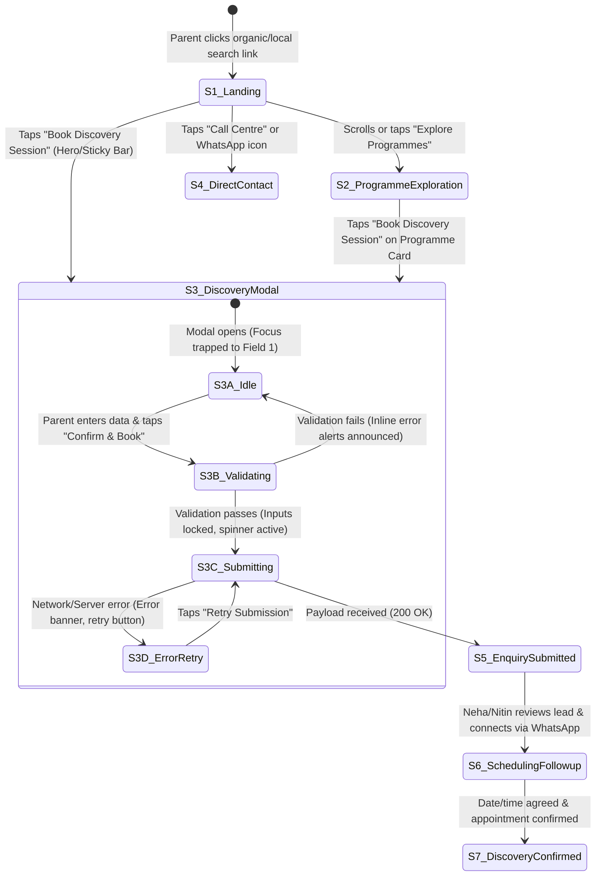
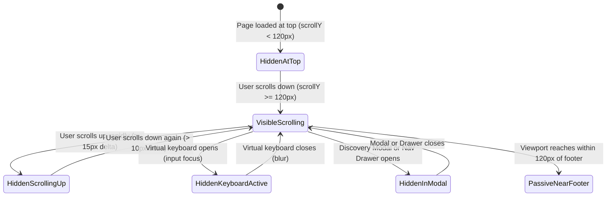

# ARNAV ABACUS ACADEMY (AAA)
## Stage 3 — Architecture & Design Specification
### Workstream WS-06.4: Mobile Conversion & Thumb-Zone Specification

**Document Reference:** `AAA-S3-SPEC-WS06-04`  
**Version:** 1.1.0  
**Effective Date:** 03 November 2026  
**Status:** 🟢 **APPROVED & RATIFIED BY MANAGEMENT (`MGT-DET-S3-07`)**  
**Stage:** Stage 3 — Architecture & Design  
**Parent Workstream:** WS-06 — Digital Experience & Website Architecture  
**Previous Ratified Deliverables:**  
- WS-06.1: Information Architecture & Sitemap (`AAA-S3-SPEC-WS06-01`, Ratified via `MGT-DET-S3-04`)  
- WS-06.2: Wireframes & Low-Fidelity Layout Blueprints (`AAA-S3-SPEC-WS06-02`, Ratified via `MGT-DET-S3-05`)  
- WS-06.3: Design System, UI Tokens & Component Specifications (`AAA-S3-SPEC-WS06-03`, Ratified via `MGT-DET-S3-06`)  
**Authorised Under:** `MGT-DET-S3-01` through `MGT-DET-S3-07` (Formally Signed Off 03 November 2026 by Neha Patil & Nitin Patil)  
**Baseline Git Commit:** `b14c64189fe5aa8e5421a548f41cd1a9626d73ef`  
**Execution Mode:** Strictly Documentation-Only Architecture Specification  

---

## 1. Document Control & Governance Authority

### 1.1 Approval & Governance Reference
This specification delivers **WS-06.4: Mobile Conversion & Thumb-Zone Specification**, executing Phase 4 of the reconciled six-part WS-06 delivery series (`MGT-DET-S3-06`). 

It directly operationalizes the ratified Information Architecture (`WS-06.1`), Wireframe Blueprints (`WS-06.2`), and Design System & UI Tokens (`WS-06.3`) into an implementation-ready mobile conversion architecture tailored for smartphone viewports.

### 1.2 Signatory Authorities & Governance Scope
- **Academic Director & Founder:** **Neha Patil** — Educational positioning, observation dimensions, parent reassurance framing, Discovery Session description.
- **Operations & Technology Lead:** **Nitin Patil** — Mobile thumb-zone ergonomics, sticky bar state machine, modal UX, keyboard handling, privacy-controlled analytics.

---

## 2. Purpose & Architectural Scope

### 2.1 Core Purpose
Over **75% of parent discovery and engagement** occurs on mobile smartphones (iOS Safari and Android Chrome). Prospective parents navigating the AAA website from Wakad, Hinjawadi, Pimple Saudagar, and surrounding Pune localities are typically time-constrained, working professionals seeking foundational academic quality for their children.

This specification defines the complete end-to-end mobile user journey, ergonomic thumb-zone layout models, sticky navigation behaviors, accessible navigation drawers, and four-field enquiry capture workflows.

### 2.2 Pedagogical & Conversational Mission
The mobile conversion architecture is engineered for **clarity, reassurance, and transparency**, strictly rejecting dark patterns, countdown timers, fake scarcity counters, or aggressive sales tactics. Its sole mission is to:
1. Communicate AAA's core educational philosophy: *"Mathematics is the medium; developing confident, independent and thoughtful learners is the mission."*
2. Present the six current portfolio groupings clearly without imposing an arbitrary sequential curriculum.
3. Demystify the **AAA Personalised Learning Discovery Session** as a constructive, low-stress observational consultation.
4. Enable parents to submit a qualified diagnostic inquiry in under 45 seconds using a four-field maximum modal contract.
5. Provide clear, honest post-submission communication setting expectations for personal scheduling follow-up.

---

## 3. Ratified Design & Business Constraints

Every state and interaction in this specification strictly adheres to the following binding baselines:

1. **Master Website Headline (H1):** Strictly verbatim:
   > `"Beyond Calculation. Towards Confident Mathematical Thinking."`
2. **Master Website Subheadline:** Strictly verbatim:
   > `"At Arnav Abacus Academy, mathematics is the medium to develop confident, independent, and thoughtful young learners. Guided by certified educators in small batches with a maximum of five students per batch, our structured programmes provide personalised learning, closer individual guidance, and steady mathematical progress."`
3. **Micro-Batch Standard:** Universally enforced as *"maximum of five students per batch"*.
4. **Service Naming & Established Practice:**
   - Approved Service Name: **AAA Personalised Learning Discovery Session**.
   - Established Operational Practice: **Free session, usually around 45–90 minutes, depending on the child's interest and engagement, conducted by Neha Patil and Nitin Patil**.
   - Scope: **Educational observation, strictly not a clinical, psychological, or medical diagnosis**.
   - Six Approved Observation Dimensions: *1. Number Sense, 2. Arithmetic Understanding, 3. Logical Approach, 4. Learning Attitude, 5. Response and Engagement, 6. Interest and Learning Passion*.
   - Zero claims of guaranteed admissions, fixed session durations, or miraculous academic transformation.
5. **Enquiry Modal Data Contract (Four-Field Maximum):**
   - *Field 1:* Parent Name (Required).
   - *Field 2:* Mobile / WhatsApp Number (Required, 10-digit Indian format).
   - *Field 3:* Child Age Bracket OR School Grade (At least one required).
   - *Field 4:* Programme of Interest (Optional).
   - *Unbundled Dual Consent:* Transactional communication consent is required; promotional educational updates consent is optional. Declining promotional consent never restricts enquiry submission.
   - *Data Exclusions:* Zero collection of exact child DOB, school name, residential address, or clinical history.
6. **Social Proof Caveat:** Verified Google Reviews reference is maintained as **74+ verified 5-star reviews (4.9★ rating)**, explicitly dated as of November 2026 and designated as refreshable upon management review.
7. **AcademyOS Boundary:** Zero modification of authenticated student practice platform interfaces (`/practice/*`, `/login`).

---

## 4. Mobile Parent Journey & State-Transition Model

The mobile user journey is modeled as a seven-state finite state machine (FSM). It guides prospective parents from initial landing through inquiry submission to direct scheduling expectations.



### 4.1 Detailed State-by-State Definitions

#### State S1: Mobile Landing & Positioning (Viewport Entry)
- **Parent Objective:** Quickly determine whether AAA is a credible, high-quality math learning academy in Wakad suitable for their child.
- **Information Presented:** Top navigation bar (Logo, Call icon, Menu drawer trigger), Hero Section with verbatim H1 and subheadline, micro-batch badge ($\le 5$), 74+ review trust rating anchor, and dual hero CTAs.
- **Primary Action:** Tapping `"Book a Free Discovery Session"` (opens modal).
- **Secondary Action:** Tapping `"Explore Our Programmes ->"` (smooth scroll to Section 7) or tapping `"Call Centre"` on the bottom sticky bar.
- **Data Required:** None.
- **Validation & Recovery:** If network assets fail, fallback typography and cached SVG icons render instantly.
- **Privacy-Controlled Analytics Event:** `mobile_landing_viewed` (Attributes: `viewport_width`, `referrer_domain_category`). Zero PII.

---

#### State S2: Programme Exploration (Cognitive Fit)
- **Parent Objective:** Understand which mathematical stream suits their child's age, grade, and developmental needs.
- **Information Presented:** Six current portfolio groupings (Abacus, Vedic, Mental, School Maths, IPM, Olympiad) presented in swipeable card stacks with clear age ranges, core tools, and developmental focus. Academic validation disclaimer displayed.
- **Primary Action:** Tapping `"Explore Curriculum"` on a specific programme card (navigates to `/programs/:slug`).
- **Secondary Action:** Tapping `"Book Free Discovery Session"` directly on a programme card (opens modal with programme pre-selected in Field 4).
- **Data Required:** None.
- **Privacy-Controlled Analytics Event:** `mobile_programme_card_tapped` (Attributes: `programme_slug`). Zero PII.

---

#### State S3: Discovery Session Enquiry Modal (Intake Funnel)
- **Parent Objective:** Submit an inquiry for a free observational session without getting bogged down in lengthy paperwork.
- **Information Presented:** Modal dialog overlay with title, subtitle explaining established practice (~45–90 min, free, Wakad centre), 4 input fields, dual unbundled consent checkboxes, and zero-spam guarantee.
- **Primary Action:** Tapping `"Confirm & Book Discovery Session"`.
- **Secondary Action:** Tapping `"Close [X]"` or tapping outside the modal (closes dialog and returns focus to triggering element).
- **Sub-States & Recovery:**
  - *S3A (Idle):* Clean form state, focus trapped on Field 1.
  - *S3B (Validating):* Client-side validation checks 10-digit mobile number, parent name presence, and age/grade selection. If invalid, inline error messages appear with `aria-describedby` announcements.
  - *S3C (Submitting):* Submit button transitions to disabled state with accessible spinner: *"Submitting your enquiry securely..."*. Idempotency key locks duplicate requests.
  - *S3D (Error / Retry):* If the request times out (5-second threshold), the form remains populated (no data lost), an error alert is announced (`role="alert"`), and a `"Retry Submission"` button and direct WhatsApp fallback link are displayed.
- **Privacy-Controlled Analytics Events:**
  - `mobile_modal_opened` (Attributes: `source_trigger`).
  - `mobile_modal_validation_failed` (Attributes: `error_field_name`).
  - `mobile_modal_submitted` (Attributes: `programme_category`, `age_bracket_selected`). Zero parent or child PII.

---

#### State S5: Enquiry Submitted (Client Confirmation)
- **Parent Objective:** Receive immediate, unambiguous confirmation that their enquiry was transmitted successfully and understand exact next steps.
- **Information Presented:** Checkmark icon, personalized thank-you message (using parent first name only on client display), clear timeline notice: *"Our Academic Director, Neha Patil, will connect with you via WhatsApp/phone within 24 hours to schedule your child's personalized Discovery Session"*, session overview, and physical centre address.
- **Primary Action:** Tapping `"Open WhatsApp for Instant Scheduling ->"` (optional direct parent outreach).
- **Secondary Action:** Tapping `"Close Window"` (dismisses modal, returns to landing page).
- **Crucial Boundary Distinction:**
  > [!IMPORTANT]
  > **Enquiry Submitted $\ne$ Confirmed Appointment:**  
  > The confirmation view explicitly communicates: *"Enquiry Received — Awaiting Schedule Confirmation"*. It does **NOT** represent an appointment as confirmed, nor does it guarantee slot availability. Live scheduling is handled personally by Neha Patil or Nitin Patil.

---

#### States S6 & S7: Operational Scheduling & Formal Confirmation (Manual / Future System)
- **State S6 (Scheduling Follow-up):** Neha Patil or Nitin Patil reviews the lead in the admissions ledger, assesses student age/grade and batch capacity ($\le 5$), and initiates direct 1-on-1 contact via phone or WhatsApp.
- **State S7 (Discovery Confirmed):** Upon mutual agreement on date and time, the parent receives the final appointment confirmation and commute instructions directly from center management.
- *Technical Note:* No automated booking engine, real-time calendar picker, SMS gateway, or backend slot allocation is implemented or assumed. Any such capability remains a future architectural option requiring separate authorization.

---

## 5. Thumb-Zone & Viewport Ergonomics

### 5.1 Smartphone Viewport Archetypes
To ensure physical one-handed reachability across the mobile spectrum, three canonical widths are specified:
1. **Compact Mobile (320px):** iPhone SE (1st gen), compact Android models. Minimal horizontal real estate (12px outer padding, single column, stacked actions).
2. **Standard Mobile (375px – 390px):** iPhone 13/14/15/16, Samsung Galaxy S-series. Primary baseline (16px outer padding, full thumb-zone optimization).
3. **Large Mobile (428px – 430px):** iPhone Pro Max / Plus, Samsung Galaxy Ultra. Extended thumb-zone reach (20px outer padding, expanded card padding).

### 5.2 Ergonomic Thumb-Zone Mapping (Natural One-Handed Use)

```
+--------------------------------------------+  <-- HARD TO REACH (Top 25% of Viewport)
| [=] ARNAV ABACUS                [Call] [WA]|      Requires hand re-grip or two hands.
+--------------------------------------------+      Used ONLY for static header brand,
|                                            |      drawer toggle, and secondary icons.
|           READING & BROWSING ZONE          |
|                                            |  <-- NATURAL VIEWING ZONE (Middle 45%)
|       - Hero Headline & Subheadline        |      Optimal for reading headlines,
|       - 74+ Reviews Trust Bar              |      scanning programme cards, and
|       - Programme Continuum Cards          |      viewing observation dimensions.
|                                            |
+--------------------------------------------+  <-- PRIME THUMB ZONE (Bottom 30%)
| [Floating WhatsApp Pill]                   |      Effortless thumb sweep area.
+--------------------------------------------+      Houses primary conversion triggers,
| PERSISTENT BOTTOM STICKY BAR (64px)        |      modal form submit buttons, and
| [ Call Centre (50%) ] [ Book Free (50%) ]  |      direct telephone actions.
+--------------------------------------------+
| [iOS Home Bar / Android Navigation Indicator] <-- SYSTEM SAFE AREA (16px - 34px bottom)
+--------------------------------------------+
```

### 5.3 Viewport Ergonomic Specifications Matrix

```
+---------------------------------------------------------------------------------------------------------+
| METRIC / FEATURE        | 320px (Compact Mobile)   | 375px (Standard Mobile)  | 430px (Large Mobile)     |
+-------------------------+--------------------------+--------------------------+--------------------------+
| Outer Horizontal Gutter | 12px fluid               | 16px fluid               | 20px fluid               |
| Content Column Max      | 296px                    | 343px                    | 390px                    |
| Minimum Tap Target      | 48 × 48px (Strict)       | 48 × 48px (Strict)       | 48 × 48px (Strict)       |
| Form Field Height       | 48px                     | 50px                     | 52px                     |
| Form Field Spacing      | 14px vertical gap        | 16px vertical gap        | 18px vertical gap        |
| Button Action Sizing    | Full-width (100%)        | Full-width (100%)        | Full-width (100%)        |
| Sticky Bottom Bar       | 60px height + safe-area  | 64px height + safe-area  | 64px height + safe-area  |
| Safe Area Bottom Inset  | env(safe-area-inset-bottom, 12px) | env(safe-area-inset-bottom, 16px) | env(safe-area-inset-bottom, 34px) |
| Modal Presentation      | Bottom-sheet (96% width) | Bottom-sheet (92% width) | Centered / Sheet (400px) |
| Hero Typography (H1)    | 24px (1.50rem) / 30px lh | 28px (1.75rem) / 34px lh | 32px (2.00rem) / 38px lh |
| Body Typography         | 15px (0.9375rem)         | 16px (1.00rem)           | 16px (1.00rem)           |
+---------------------------------------------------------------------------------------------------------+
```

---

## 6. Sticky Mobile Action Bar (`<StickyMobileBar />`)

The persistent bottom bar is the primary conversion anchor on mobile devices. It provides immediate, thumb-reachable access to the two highest-intent parent actions without intruding upon reading flow.

### 6.1 State Machine & Behavioral Rules



### 6.2 Detailed Interaction Specifications

1. **Initial Visibility Threshold:**  
   The sticky bar remains hidden while the parent is exploring the top Hero block (`scrollY < 120px`) to prevent cluttering the initial brand impression and hero CTAs. Once the user scrolls past 120px, the bar smoothly slides up (`transform: translateY(0)` with `transition: transform 250ms cubic-bezier(0.16, 1, 0.3, 1)`).
2. **Scroll Direction Dynamics:**  
   - Scrolling Down: Bar remains visible, reinforcing the instant conversion trigger.
   - Rapid Scrolling Up ($> 15\text{px}$ delta): Bar gently hides (`transform: translateY(100%)`) to maximize readable screen area while the parent re-reads higher sections.
3. **Virtual Keyboard Auto-Suppression (Critical Safeguard):**  
   Whenever any `<input>`, `<textarea>`, or `<select>` element receives focus on screens $< 768\text{px}$, the sticky bar dynamically hides (`display: none` or `transform: translateY(120%)`). This completely eliminates mobile keyboard layout collisions and prevents obscuring form fields or submit buttons.
4. **Modal & Drawer Inerting:**  
   When the Discovery Session Modal or Mobile Navigation Drawer opens, the sticky bar is aria-hidden (`aria-hidden="true"`) and visually hidden to prevent double-layering interactive elements.
5. **Content Overlap Buffer:**  
   The primary page layout container (`<main>`) includes a mandatory bottom padding buffer of `80px` (`pb-20` in Tailwind) plus system safe-area insets (`padding-bottom: calc(5rem + env(safe-area-inset-bottom, 0px))`). This guarantees that no text, card, or footer link is ever obscured by the persistent bar.
6. **Reduced Motion Adaptation:**  
   When `prefers-reduced-motion: reduce` is detected, all slide animations are replaced with instant visibility toggling (`opacity: 1` vs `opacity: 0`, duration 0ms).

---

## 7. Mobile Navigation Drawer Specification

### 7.1 Drawer Architecture & Accessible Dialog Pattern
The mobile navigation drawer provides a structured, accessible site directory without overwhelming the user:

- **Trigger:** Accessible hamburger button on top bar (`<button aria-expanded="false" aria-controls="mobile-nav-drawer" aria-label="Open main navigation menu">`).
- **Container Structure:** Rendered as an accessible off-canvas panel (`role="dialog" aria-modal="true" aria-label="Site Navigation"`).
- **Backdrop:** Semi-transparent dark overlay (`bg-slate-950/60 backdrop-blur-sm`). Tapping the backdrop closes the drawer.
- **Keyboard & Screen-Reader Focus Management:**
  1. Opening the drawer immediately traps keyboard focus within the panel. Focus lands on the first navigation link or the close button (`[X]`).
  2. Pressing `Escape` closes the drawer immediately and restores focus to the hamburger trigger button.
  3. When open, background elements (`<main>`, `<footer>`) receive `aria-hidden="true"` and `inert`.
- **Gesture Accessibility:** While touch swiping to the left can optionally dismiss the drawer, **gestures are strictly never the sole means of navigation**. An explicit, accessible close button with a minimum 48 × 48px touch bounding box is prominently fixed at the top right.

### 7.2 Menu Hierarchy & Accordion Behavior
- **Primary Section 1: Programmes Portfolio (Expandable Accordion):**
  - All Programmes Overview (`/programs`)
  - Abacus Mathematics (Ages 4.5–9)
  - Vedic Mathematics (Ages 9–14)
  - Mental Mathematics (Ages 6–14)
  - School Mathematics (Grades 1–10)
  - IPM & Olympiad Mathematics (Grades 2–9)
- **Primary Section 2: Methodology & Authority:**
  - About Academic Director Neha Patil (`/mentor`)
  - Student Showcase & Milestones (`/showcase`)
  - Parent Decision Guides (`/blog` & `/parent-guides/*`)
  - Free Worksheet Vault (`/worksheets`)
- **Primary Section 3: Centre Contact & Directions:**
  - Wakad Centre Location & Hours (`/contact`)
  - Parent FAQs (`/faqs`)
- **Separated Subsystem Anchor:**
  - Discrete, distinct link to **AcademyOS Student Practice Login** (`/login`), clearly styled as an existing student utility to prevent confusing prospective parents.

---

## 8. Discovery Session Enquiry Flow & Form Ergonomics

### 8.1 Single-Column Mobile Layout
The modal form strictly follows a linear single-column vertical flow, eliminating multi-column horizontal truncation on narrow displays.

```
+-------------------------------------------------------------+
|  [X Close Modal (48x48px)]                                  |
|                                                             |
|  BOOK A COMPLIMENTARY DISCOVERY SESSION                     |
|  Approx. 45–90 Minutes • Free of Charge • Wakad Centre      |
|                                                             |
|  Parent Full Name *                                         |
|  +-------------------------------------------------------+  |
|  | Priya Sharma                                          |  |
|  +-------------------------------------------------------+  |
|                                                             |
|  Mobile / WhatsApp Number *                                 |
|  +-------------------------------------------------------+  |
|  | +91  |  98765 43210                                   |  |
|  +-------------------------------------------------------+  |
|  (We will send confirmation details & directions via WA)    |
|                                                             |
|  Child Age Bracket OR School Grade * (Choose at least one)  |
|  +-------------------------------------------------------+  |
|  | Select Age Bracket (e.g., Ages 4.5 – 6 Years)      [v]|  |
|  +-------------------------------------------------------+  |
|  -- OR --                                                   |
|  +-------------------------------------------------------+  |
|  | Select School Grade (e.g., Grade 1 to Grade 10)    [v]|  |
|  +-------------------------------------------------------+  |
|                                                             |
|  Programme of Interest (Optional)                           |
|  +-------------------------------------------------------+  |
|  | Undecided / Open Assessment                        [v]|  |
|  +-------------------------------------------------------+  |
|                                                             |
|  CONSENT & PRIVACY NOTICE                                   |
|  [X] * [REQUIRED] I consent to AAA contacting me via        |
|      phone/WhatsApp regarding this Discovery Session.       |
|                                                             |
|  [ ] [OPTIONAL] I would like to receive occasional math     |
|      insights and parent guides. (Unsubscribe anytime).     |
|                                                             |
|  +-------------------------------------------------------+  |
|  | CONFIRM & BOOK DISCOVERY SESSION                      |  |
|  +-------------------------------------------------------+  |
|                                                             |
|  🔒 Zero-Spam Guarantee: Details never shared. Zero PII     |
|     trackers. We do not collect sensitive child records.    |
+-------------------------------------------------------------+
```

### 8.2 Input Optimization & Auto-Formatting Rules
1. **Parent Name:** `type="text"`, `autocomplete="name"`, auto-capitalization enabled (`autocapitalize="words"`). Minimum length: 2 characters.
2. **Mobile Number:** `type="tel"`, `inputmode="numeric"`, `pattern="[0-9]{10}"`, `autocomplete="tel"`. Auto-strips leading `+91` or `0` if pasted, formatting cleanly as a 10-digit Indian mobile number.
3. **Child Age / Grade:** Structured dropdowns with clear optical separation between early childhood brackets (Ages 4.5–6, 7–9, 10–12, 13–14) and school grade bands (Grades 1–2, 3–5, 6–8, 9–10). Selecting either one fulfills the requirement.
4. **Inline Error Handling:** Errors appear directly below the erroneous input with an explicit red icon and descriptive text. Inputs receive `aria-invalid="true"` and `aria-describedby="field-error-id"`. Screen readers announce errors via `aria-live="polite"`.

---

## 9. Confirmation & Post-Submission Mobile Experience

### 9.1 Honest Communication Model
To maintain parental trust, the confirmation view clearly separates inquiry submission from appointment scheduling.

```
+-------------------------------------------------------------+
|  [Checkmark Icon in Emerald Circle]                         |
|                                                             |
|  DISCOVERY SESSION REQUEST RECEIVED                         |
|                                                             |
|  Thank you, Priya!                                          |
|                                                             |
|  We have received your enquiry for your child.              |
|                                                             |
|  WHAT HAPPENS NEXT:                                         |
|  1. Personal Review: Neha Patil (Academic Director) will    |
|     personally review your child's age bracket.             |
|  2. Direct Scheduling: We will reach out via WhatsApp or    |
|     phone within 24 hours to schedule a mutually convenient |
|     session time.                                           |
|  3. What to Expect at the Session:                          |
|     - Approx. 45–90 minutes of stress-free math games.      |
|     - Observational review across 6 number dimensions.      |
|     - Constructive discussion on your child's confidence.   |
|                                                             |
|  CENTRE LOCATION:                                           |
|  Arnav Abacus Academy, Flat 3, Balaji Sagar Bungalow,       |
|  Behind Wisdom World School, Wakad, Pune 411057.            |
|                                                             |
|  [ Open WhatsApp for Instant Scheduling -> ]                |
|  [ Close Confirmation Window ]                              |
+-------------------------------------------------------------+
```

---

## 10. Mobile Conversion Content & Trust Building

### 10.1 Trust Elements Stack on Mobile
To overcome initial skepticism on mobile screens without clutter:
1. **Micro-Batch Standard:** Prominently badges *"Strictly $\le$ 5 Students Per Batch"* in the hero section and directly above programme card grids.
2. **Local Google Reviews Social Proof:** Dated and refreshable trust badge: *"4.9 ★ Rating across 74+ Verified Google Reviews (As of Nov 2026)"*.
3. **Verified Physical Presence:** Clear Wakad landmarks (*Behind Wisdom World School, Opposite Creative Cameo, Near Park Street*) displayed in the contact preview, establishing immediate physical permanence.
4. **Authentic Academic Authority:** Founder profile highlighting Neha Patil's 8+ years of dedicated mentoring in Wakad, with verified IIVA certification (`VER-01`) and zero unverified degree claims.

---

## 11. Accessibility Requirements & Multi-Device Test Matrix

### 11.1 Proposed Conformance Target
The mobile experience targets **WCAG 2.1 Level AA** compliance across all smartphone viewports.

### 11.2 Comprehensive Multi-Device Test Matrix
The following test scenarios must be executed during Stage 4 implementation before code is merged:

```
+---------------------------------------------------------------------------------------------------------+
| TEST ID | SCENARIO DESCRIPTION          | VIEWPORT | DEVICE / BROWSER     | ACCEPTANCE CRITERIA / EVIDENCE  |
+---------+-------------------------------+----------+----------------------+---------------------------------+
| MOB-01  | 320px Compact Layout & Reflow | 320px    | iPhone SE / Safari   | Zero horizontal scroll; text    |
|         |                               |          |                      | wraps cleanly; buttons 100% w.  |
| MOB-02  | Virtual Keyboard Overlap      | 375px    | iPhone 14 / Safari   | Sticky bar auto-hides; active   |
|         |                               |          |                      | input remains fully visible.    |
| MOB-03  | Android Virtual Keyboard      | 412px    | Pixel 7 / Chrome     | visualViewport resize handled;  |
|         |                               |          |                      | submit CTA not obstructed.      |
| MOB-04  | Touch Target Bounding Box     | 375px    | Automated axe-core   | All interactive targets measure |
|         |                               |          |                      | >= 48 x 48 CSS pixels.          |
| MOB-05  | Modal Keyboard Focus Trap     | 375px    | Hardware Keyboard    | Tab/Shift+Tab trapped in modal; |
|         |                               |          |                      | Escape closes and restores focus|
| MOB-06  | Nav Drawer Screen-Reader      | 375px    | iOS VoiceOver        | Announces "Site Navigation";    |
|         |                               |          |                      | expanded/collapsed states clear.|
| MOB-07  | Inline Form Error Announce    | 375px    | Android TalkBack     | Errors announced via aria-live; |
|         |                               |          |                      | focus shifts to first invalid.  |
| MOB-08  | Orientation Change            | 375->667 | Landscape Safari     | Layout reflows; modal fits max- |
|         |                               |          |                      | height 85vh with scroll.        |
| MOB-09  | Reduced Motion Override       | 375px    | prefers-reduced-mot  | Sticky bar & modal open with 0ms|
|         |                               |          |                      | transition; zero animation jank.|
| MOB-10  | Sticky Bar Safe Area Padding  | 430px    | iPhone 15 Pro Max    | Bar accounts for 34px bottom    |
|         |                               |          |                      | home bar; 80px body buffer safe.|
+---------------------------------------------------------------------------------------------------------+
```

---

## 12. Privacy-Conscious Analytics Proposal

In strict compliance with `AGENTS.md` Rule 4 and `REQ-PRIV-02`, telemetry is strictly zero-PII:

### 12.1 Proposed Mobile Journey Telemetry Events

| Event Name | Business Purpose | Permitted Data Attributes | Prohibited Data (Zero-PII) |
| :--- | :--- | :--- | :--- |
| `mobile_landing_view` | Track mobile reach | `viewport_category` (e.g., `compact_320`, `std_375`, `large_430`), `orientation` | Parent name, phone, IP address, exact location. |
| `mobile_programme_view` | Assess course interest | `programme_slug` (e.g., `abacus`, `vedic-maths`) | Child name, parent ID, search queries. |
| `mobile_sticky_bar_click`| Measure thumb-zone efficacy| `action_type` (`call_click` vs `book_click`) | Phone number dialed, parent identity. |
| `mobile_modal_open` | Funnel drop-off analysis | `trigger_location` (`hero`, `sticky_bar`, `card`) | Any parent or child attributes. |
| `mobile_modal_submit` | Conversion tracking | `programme_selected`, `age_bracket_selected` | Parent name, mobile number, child DOB/grade text. |
| `mobile_whatsapp_click` | Direct inquiry tracking | `placement` (`nav_drawer`, `confirmation_screen`) | WhatsApp phone number, message payload. |

> [!CAUTION]
> **Metadata Exposure Assessment:**  
> Indirect identifiers (such as raw IP addresses, complete user-agent strings, or referrers carrying personal query parameters) must be stripped or anonymized at the serverless gateway before forwarding to Google Analytics 4 (`G-M2EL9MYSRL`). Telemetry must never be described as "anonymous" unless IP masking and zero-cookie regimes are technically verified.

---

## 13. Acceptance Criteria for WS-06.4 Sign-Off

1. Complete specification of the 7-state mobile parent journey and FSM transitions.
2. Viewport ergonomic layouts defined across 320px, 375px, and 430px widths.
3. Behavior of `<StickyMobileBar />` fully documented, including scroll thresholds, keyboard suppression, and 80px bottom padding buffers.
4. Mobile Navigation Drawer specified with WAI-ARIA dialog attributes, keyboard traps, and non-gesture-only close actions.
5. Four-field maximum enquiry modal contract preserved with unbundled dual consent and zero sensitive child data collection.
6. Honest confirmation state clearly distinguishing enquiry receipt from appointment scheduling.
7. Multi-device test matrix covering 10 concrete mobile accessibility and usability scenarios.

---

## 14. Dependencies & Items Requiring Neha Patil & Nitin Patil

### 14.1 Academic Director Review — Neha Patil
1. Confirm that the mobile confirmation copy (*"Our Academic Director, Neha Patil, will connect with you via WhatsApp/phone within 24 hours"*) accurately represents operational intake procedures.
2. Confirm that the mobile presentation of the 6 Educational Observation Dimensions provides sufficient reassurance without cluttering small screens.

### 14.2 Operations & Technology Lead Review — Nitin Patil
1. Confirm that the dynamic virtual keyboard listener strategy (`window.visualViewport.resize` + `focusin`/`focusout`) satisfies browser compatibility standards.
2. Confirm the zero-PII event parameter schema for mobile analytics events.

---

## 15. Requirements Traceability to Stage 2 and Stage 3

| Requirement ID | Stage 2 / Stage 3 Reference | Mobile Specification Section | Compliance Status |
| :--- | :--- | :--- | :---: |
| **`REQ-STRAT-01`** | Master BRD §3.1 | §2.1, §10.1: Wakad local SEO authority, 74+ reviews, physical bungalow landmarks. | **COMPLIANT** |
| **`REQ-BRAND-01`** | `DEC-WS02-13` | §3.0, §4.1: Verbatim H1 and approved subheadline integrated into mobile hero. | **COMPLIANT** |
| **`REQ-BRAND-02`** | `DEC-WS02-04` | §3.0, §10.1: Micro-batch standard "maximum of 5 students" universally badged. | **COMPLIANT** |
| **`REQ-JOUR-01`** | `DEC-WS02-06` | §3.0, §4.1, §9.1: ~45–90 min free Discovery Session reality, 6 observation dimensions. | **COMPLIANT** |
| **`REQ-JOUR-02`** | `DEC-WS02-07`, `MGT-DET-S3-04` | §3.0, §8.1: Four-field maximum enquiry modal contract with unbundled dual consent. | **COMPLIANT** |
| **`REQ-PRIV-01`** | `DEC-WS05-01` | §3.0, §8.1: Absolute exclusion of exact child DOB, school name, address, medical data. | **COMPLIANT** |
| **`REQ-PRIV-02`** | `AGENTS.md` Rule 4 | §12.0: Zero-PII analytics telemetry and metadata exposure safeguards. | **COMPLIANT** |
| **`REQ-TECH-01`** | `AGENTS.md` Rule 2 | §7.2: Full preservation of audited 30-route inventory and legacy hash redirector. | **COMPLIANT** |
| **`REQ-TECH-02`** | `AGENTS.md` Rule 3 | §2.1, §7.2: AcademyOS practice portal (`/practice/*`, `/login`) strictly isolated. | **COMPLIANT** |

---

## 16. Management Ratification & Workstream Authorization (`MGT-DET-S3-07`)

On 03 November 2026, Neha Patil (Founder & Academic Director) and Nitin Patil (Operations & Technology Lead) formally reviewed and signed off on this specification under **`MGT-DET-S3-07`**:
- **Determination 1 (Neha Patil):** Formally approved the mobile framing of the AAA Personalised Learning Discovery Session, the 6 Educational Observation Dimensions, and the honest post-submission communication separating inquiry receipt from appointment confirmation.
- **Determination 2 (Nitin Patil):** Formally approved the 7-state mobile parent journey, the thumb-zone specifications across 320px/375px/430px viewports, the `<StickyMobileBar />` state machine with keyboard auto-suppression, the 10-point device testing matrix, and the zero-PII telemetry schema.
- **Determination 3 (Joint):** Formally ratified `WS-06.4` and authorized immediate commencement of **WS-06.5 (Local SEO Metadata & Route Preservation Specification)**.

---
*End of Specification — Approved and Ratified by Management under `MGT-DET-S3-07`.*
