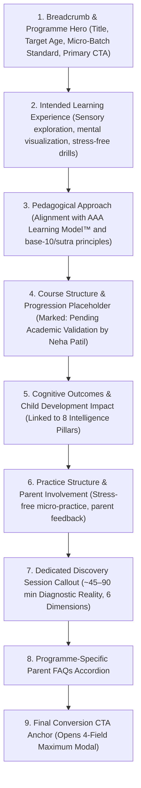

# ARNAV ABACUS ACADEMY (AAA)
## Stage 3 — Architecture & Design Specification
### Workstream WS-06.2: Wireframes & Low-Fidelity Layout Blueprints

**Document Reference:** `AAA-S3-SPEC-WS06-02`  
**Version:** 1.1.0  
**Effective Date:** 03 November 2026  
**Status:** 🟢 **APPROVED & RATIFIED BY MANAGEMENT (`MGT-DET-S3-05`)**  
**Stage:** Stage 3 — Architecture & Design  
**Parent Workstream:** WS-06 — Digital Experience & Website Architecture  
**Previous Ratified Deliverable:** WS-06.1 Information Architecture & Sitemap Specification (`AAA-S3-SPEC-WS06-01`, Ratified under `MGT-DET-S3-04`)  
**Authorised Under:** `MGT-DET-S3-01`, `MGT-DET-S3-02`, `MGT-DET-S3-03`, `MGT-DET-S3-04`, and `MGT-DET-S3-05`  
**Baseline Git Commit:** `b14c64189fe5aa8e5421a548f41cd1a9626d73ef`  
**Execution Mode:** Strictly Documentation-Only Architecture and Layout Specification  

---

## 1. Executive Summary & Design Scope

### 1.1 Context and Purpose
This document establishes the official low-fidelity wireframes, page-level component hierarchies, structural layout blueprints, and responsive behavior models for the public parent portal of **Arnav Abacus Academy (AAA), Wakad, Pune**. 

It directly translates the ratified Information Architecture and Sitemap (`AAA-S3-SPEC-WS06-01`) into concrete visual and spatial specifications across all key page archetypes:
1. **Homepage Blueprint** (Validating the proposed 14-block narrative against approved IA).
2. **Programme Hub Blueprint** (Common comparative framework for the 6 portfolio groupings).
3. **Programme Detail Template Blueprint** (Deep pedagogical exploration with validation placeholders).
4. **Parent Guide Article Template Blueprint** (Editorial, reassurance-led reading layout).
5. **Discovery Session Modal Blueprint** (Frictionless four-field maximum conversion contract).
6. **Contact & Wakad Centre Blueprint** (Local discovery, verified NAP, commute guidance).
7. **Responsive & Mobile Thumb-Zone Ergonomics** (320px, 375px, 768px, 1024px, 1440px viewports).

### 1.2 Mandatory Brand & Governance Safeguards
- **Master Website Headline (H1):** Strictly verbatim:
  > `"Beyond Calculation. Towards Confident Mathematical Thinking."`
- **Master Website Subheadline:** Strictly verbatim:
  > `"At Arnav Abacus Academy, mathematics is the medium to develop confident, independent, and thoughtful young learners. Guided by certified educators in small batches with a maximum of five students per batch, our structured programmes provide personalised learning, closer individual guidance, and steady mathematical progress."`
- **Micro-Batch Standard:** Universally specified as *"maximum of five students per batch"*.
- **The AAA Learning Model™ (6 Stages):** *Inspire $\rightarrow$ Explore $\rightarrow$ Understand $\rightarrow$ Practice $\rightarrow$ Apply $\rightarrow$ Reflect*.
- **Eight Child Development Intelligence Pillars:** *Spatial Visualization, Working Memory & Mental Storage, Pattern Recognition, Rapid Information Processing, Sustained Attention & Focus, Cognitive Flexibility, Executive Function & Problem Solving, Self-Confidence & Mathematical Joy*.
- **Six Educational Observation Dimensions:** *Number Sense, Arithmetic Understanding, Logical Approach, Learning Attitude, Response and Engagement, Interest and Learning Passion*.
- **Discovery Session Operational Reality:** Explicitly framed as **approximately 45–90 minutes, free of charge, adapting to child engagement and parent discussion** (never advertised as a fixed 30-min or 60-min test).
- **Portfolio Independence:** The 6 current portfolio groupings are presented as AAA's approved public offerings and pedagogical progression, but **strictly not represented as a compulsory sequential curriculum for every child**.
- **AcademyOS Boundary:** Zero modification of internal learning platform interfaces (`/practice/*`, `/login`).

---

## 2. Global Layout Framework & Responsive Viewport Matrix

### 2.1 Viewport Breakpoint Definitions
To ensure visual stability, zero horizontal overflow, and predictable touch ergonomics, five canonical viewports are specified:

| Viewport Category | Canonical Width | Target Devices / Form Factors | Layout Grid / Behavior |
| :--- | :---: | :--- | :--- |
| **Mobile Extra-Small** | **320px** | iPhone SE (1st gen), compact Android devices | Single column (1 col), fluid padding (12px), stacked cards, full-width inputs. |
| **Mobile Standard** | **375px – 430px** | iPhone 13/14/15/16, Samsung Galaxy S-series | Single column (1 col), standard padding (16px), thumb-zone bottom bar active. |
| **Tablet Portrait** | **768px – 834px** | iPad Mini, iPad 10.2", Android tablets | 2-column grid, fluid drawer navigation or compact header, 24px gutters. |
| **Tablet Landscape / Laptop**| **1024px – 1280px** | iPad Pro landscape, MacBook Air, small laptops | 3-column grid, horizontal desktop navigation active, 32px gutters. |
| **Desktop High-Resolution** | **1440px – 1920px+**| Large desktop monitors, iMacs | 4-column containerized grid (max-width: 1280px), centered layout, 32px gutters. |

### 2.2 Global Layout Shell Structure

```
+-----------------------------------------------------------------------------------------+
| UTILITY / TRUST BANNER (Top Tier - Desktop Only: Centre NAP, Hours, Direct Helpline)    |
+-----------------------------------------------------------------------------------------+
| PRIMARY HEADER (Sticky: Logo + Brand Identity, Primary Navigation, Practice Login, CTA) |
+-----------------------------------------------------------------------------------------+
|                                                                                         |
|                                    MAIN VIEWPORT                                        |
|                       <main id="main-content" role="main">                              |
|                         [ Dynamic Page Archetype Content ]                              |
|                                                                                         |
+-----------------------------------------------------------------------------------------+
| GLOBAL FOOTER (4-Column Institutional Crawlable Anchor, Verified NAP, Socials, Legal)  |
+-----------------------------------------------------------------------------------------+
| [MOBILE ONLY] PERSISTENT BOTTOM STICKY BAR (64px: Call Helpline | Book Discovery)       |
+-----------------------------------------------------------------------------------------+
```

---

## 3. Homepage Wireframe & Layout Blueprint

### 3.1 Structural Block-by-Block Evaluation
The proposed 14-block narrative flow has been evaluated and validated against the ratified Information Architecture (`AAA-S3-SPEC-WS06-01` §4.1). Each block fulfills a specific parent trust, educational reassurance, or conversion objective:

```mermaid
flowchart TD
    subgraph Homepage_Narrative_Architecture["Homepage 14-Block Narrative Architecture"]
        B1["Block 1: Trust & Utility Bar (Desktop: Address, Hours, Call/WhatsApp)"]
        B2["Block 2: Hero Section (Verbatim H1 & Subheadline, Dual CTAs, Trust Badges)"]
        B3["Block 3: Trust Bar & Social Proof Anchor (74+ Verified Google Reviews, 4.9★, Refreshable)"]
        B4["Block 4: The Core Pedagogical Challenge ('Calculation vs Mathematical Thinking')"]
        B5["Block 5: The AAA Learning Model™ (6 Stages: Inspire -> Reflect)"]
        B6["Block 6: Eight Child Development Intelligence Pillars (Interactive Grid)"]
        B7["Block 7: Programme Portfolio Continuum (6 Current Portfolio Groupings)"]
        B8["Block 8: The Micro-Batch Commitment ('Strictly <= 5 Students Per Batch')"]
        B9["Block 9: Academic Leadership & Mentor Credibility (Neha Patil, VER-01)"]
        B10["Block 10: Parent Transformation Testimonials (Verified Local Experiences)"]
        B11["Block 11: The Discovery Session Invitation (~45-90 min Diagnostic Reality, 6 Dimensions)"]
        B12["Block 12: Location & Local Wakad Proximity (Google Maps, Commute Guide)"]
        B13["Block 13: Structured Parent FAQ Accordion (Core Developmental Doubts)"]
        B14["Block 14: Final Conversion Anchor & Comprehensive Centre Footer"]
    end
    B1 --> B2 --> B3 --> B4 --> B5 --> B6 --> B7 --> B8 --> B9 --> B10 --> B11 --> B12 --> B13 --> B14
```



### 3.2 Low-Fidelity Wireframe: Homepage Desktop (1440px)

```
+---------------------------------------------------------------------------------------------------------+
| [Address: Balaji Sagar Bungalow, Wakad, Pune] | [Mon-Sat: 9:30 AM-7:30 PM] | [Tel/WA: +91 90219 24968]  |
+---------------------------------------------------------------------------------------------------------+
| [LOGO] ARNAV ABACUS ACADEMY      Home   Programmes [v]   Pedagogy   Guides   Showcase   Contact   [Login] |
|        Foundational Math                                                       [Book Discovery Session] |
+---------------------------------------------------------------------------------------------------------+
| HERO SECTION                                                                                            |
|                                                                                                         |
|  [ Micro-Batch Standard: Max 5 Students Per Batch ]                                                     |
|                                                                                                         |
|  <h1>Beyond Calculation. Towards Confident Mathematical Thinking.</h1>                                  |
|                                                                                                         |
|  <p>At Arnav Abacus Academy, mathematics is the medium to develop confident, independent, and           |
|  thoughtful young learners. Guided by certified educators in small batches with a maximum of            |
|  five students per batch, our structured programmes provide personalised learning, closer               |
|  individual guidance, and steady mathematical progress.</p>                                             |
|                                                                                                         |
|  [ Book a Free Discovery Session ]   [ Explore Our Programmes -> ]                                      |
|                                                                                                         |
|  [Trust Badges: 4.9/5 Rating on Google | 8+ Years in Wakad | 100% Certified Mentors]                    |
+---------------------------------------------------------------------------------------------------------+
| BLOCK 3: TRUST BAR (Dated & Refreshable)                                                                |
|  [ 4.9 ★ Rating ] | [ 74+ Verified Google Reviews (As of Nov 2026) ] | [ Near Wisdom World School ]     |
+---------------------------------------------------------------------------------------------------------+
| BLOCK 4: THE PEDAGOGICAL CHALLENGE                                                                      |
|  Is your child calculating mechanically or truly understanding numbers?                                 |
|  [ Comparison Card: Rote School Memorization vs The AAA Visual Conceptual Approach ]                    |
+---------------------------------------------------------------------------------------------------------+
| BLOCK 5: THE AAA LEARNING MODEL™ (6 Stages)                                                             |
|  (1) Inspire  ->  (2) Explore  ->  (3) Understand  ->  (4) Practice  ->  (5) Apply  ->  (6) Reflect     |
|  [ Tactile Bead Sense -> Base-10 Insight -> Rapid Mental Visualization -> Cognitive Joy ]               |
+---------------------------------------------------------------------------------------------------------+
| BLOCK 6: EIGHT CHILD DEVELOPMENT INTELLIGENCE PILLARS                                                   |
|  [ 1. Spatial Viz ]   [ 2. Working Memory ]   [ 3. Pattern Recognition ]   [ 4. Rapid Processing ]      |
|  [ 5. Focus & Attn ]  [ 6. Cognitive Flex ]   [ 7. Executive Function ]    [ 8. Math Confidence  ]      |
+---------------------------------------------------------------------------------------------------------+
| BLOCK 7: PROGRAMME PORTFOLIO CONTINUUM (Current Portfolio Groupings - Not Compulsory Sequential)        |
|  +---------------------+ +---------------------+ +---------------------+ +---------------------+       |
|  | Abacus Mathematics  | | Vedic Mathematics   | | Mental Mathematics  | | School Mathematics  |  ...    |
|  | Ages 4.5–9          | | Ages 9–14           | | Ages 6–14           | | Grades 1–10         |         |
|  | Tactile number sense| | Sutra mental shortcuts| | Speed number bonds| | School curriculum  |         |
|  | [Explore Abacus ->] | | [Explore Vedic ->]  | | [Explore Mental ->] | | [Explore School ->] |         |
|  +---------------------+ +---------------------+ +---------------------+ +---------------------+       |
+---------------------------------------------------------------------------------------------------------+
| BLOCK 8: THE MICRO-BATCH COMMITMENT                                                                     |
|  Why We Strictly Limit Every Batch to a Maximum of 5 Students:                                          |
|  - Real-time error correction within 15 seconds.                                                        |
|  - Zero cognitive hesitation left unaddressed.                                                          |
|  - Personalised pacing adapted to each child's sensory and mental style.                                |
+---------------------------------------------------------------------------------------------------------+
| BLOCK 9: ACADEMIC LEADERSHIP & MENTOR PROFILE (VER-01)                                                  |
|  [Photo Placeholder]  Neha Patil — Founder & Academic Director                                          |
|                       - IIVA Certified Vedic & Abacus Mathematics Educator.                             |
|                       - 8+ years personal mentoring experience in Wakad, Pune.                          |
|                       - "Every child possesses innate numerical logic; they only need the right lens."  |
+---------------------------------------------------------------------------------------------------------+
| BLOCK 10: PARENT TRANSFORMATION TESTIMONIALS                                                            |
|  [Testimonial Card 1: From finger counting to mental math confidence - Grade 3 Parent, Wakad]           |
|  [Testimonial Card 2: Conquering school math anxiety and scoring 95%+ - Grade 7 Parent, Hinjawadi]      |
|  [Testimonial Card 3: Small batch of 5 made the transformative difference - Grade 2 Parent, Pimple S]   |
+---------------------------------------------------------------------------------------------------------+
| BLOCK 11: THE DISCOVERY SESSION INVITATION                                                              |
|  Take the First Step: Book an Observational Discovery Session (Approx. 45–90 Mins, Free of Charge)      |
|  We assess 6 foundational dimensions: Number Sense, Arithmetic Understanding, Logical Approach,         |
|  Learning Attitude, Response and Engagement, Interest and Learning Passion.                             |
|  [ Book a Free Discovery Session (Opens Modal) ]                                                        |
+---------------------------------------------------------------------------------------------------------+
| BLOCK 12: WAKAD CENTRE LOCATION & DIRECTIONS                                                            |
|  [ Address & Directions Guide ]              | [ Interactive Google Maps Embed Placeholder ]            |
|  Behind Wisdom World School, Wakad           |                                                          |
|  10 mins from Hinjawadi Phase 1              |                                                          |
+---------------------------------------------------------------------------------------------------------+
| BLOCK 13: FREQUENTLY ASKED PARENT QUESTIONS                                                             |
|  [+] Does learning abacus confuse the methods taught in school math?                                    |
|  [+] What is the ideal age to introduce abacus vs Vedic mathematics?                                   |
|  [+] How does a batch of 5 students benefit my shy or hesitant child?                                   |
|  [+] What happens during the 45–90 minute Discovery Session?                                            |
+---------------------------------------------------------------------------------------------------------+
| BLOCK 14: FOOTER (Comprehensive Institutional Navigation, Verified NAP, Socials, Legal)                 |
+---------------------------------------------------------------------------------------------------------+
```

### 3.3 Low-Fidelity Wireframe: Homepage Mobile (375px)

```
+-----------------------------------+
| [=] ARNAV ABACUS        [Call] [WA]|
+-----------------------------------+
| HERO SECTION                      |
|                                   |
| [ Strictly <= 5 Students/Batch ]  |
|                                   |
| Beyond Calculation. Towards       |
| Confident Mathematical Thinking.  |
|                                   |
| At Arnav Abacus Academy,          |
| mathematics is the medium to      |
| develop confident, independent... |
|                                   |
| [ Book Discovery Session ]        |
| [ Explore Programmes -> ]         |
|                                   |
| 4.9 ★ (74+ Verified Reviews)     |
+-----------------------------------+
| TRUST & CREDIBILITY CAROUSEL      |
| [ 8+ Yrs in Wakad ]               |
| [ Near Wisdom World School ]      |
+-----------------------------------+
| PEDAGOGICAL CHALLENGE             |
| Mechanical Calculation vs True    |
| Mathematical Sense                |
| [ Read Comparison Guide -> ]      |
+-----------------------------------+
| AAA LEARNING MODEL™               |
| 1. Inspire  ->  2. Explore        |
| 3. Understand -> 4. Practice      |
| 5. Apply    ->  6. Reflect        |
+-----------------------------------+
| PROGRAMMES (Swipeable Stack)      |
| +-------------------------------+ |
| | Abacus Math (Ages 4.5–9)      | |
| | Tactile sensory bead sense    | |
| | [Learn More ->]               | |
| +-------------------------------+ |
| | Vedic Math (Ages 9–14)        | |
| | Rapid sutra mental shortcuts  | |
| | [Learn More ->]               | |
| +-------------------------------+ |
+-----------------------------------+
| THE MICRO-BATCH ADVANTAGE         |
| Maximum 5 Students Per Batch.     |
| Continuous personal observation.  |
+-----------------------------------+
| ACADEMIC DIRECTOR                 |
| Neha Patil — Certified Educator   |
| 8+ Years Dedicated Wakad Mentoring|
+-----------------------------------+
| DISCOVERY SESSION INVITATION      |
| Approx. 45–90 Min Diagnostic      |
| Free of Charge. 6 Dimensions.     |
| [ Book Free Discovery Session ]   |
+-----------------------------------+
| FOOTER & LOCAL NAP                |
| Flat 3, Balaji Sagar Bungalow,    |
| Wakad, Pune 411057                |
| Mon-Sat: 9:30 AM - 7:30 PM        |
+-----------------------------------+
| BOTTOM STICKY BAR (Fixed 64px)    |
| [ Call: 9021924968 ] [ Book Free ]|
+-----------------------------------+
```

---

## 4. Programme Hub Wireframe & Layout Blueprint (`/programs`)

### 4.1 Comparative Architectural Principle
The Programme Hub layout is designed to help parents select the most appropriate developmental starting point for their child without imposing an arbitrary, compulsory sequence.

### 4.2 Low-Fidelity Wireframe: Programme Hub Desktop (1440px)

```
+---------------------------------------------------------------------------------------------------------+
| BREADCRUMBS: Home > Programmes                                                                          |
|                                                                                                         |
| <h1>Foundational Mathematics Programmes</h1>                                                            |
| <p>Explore our structured mathematical offerings. Each programme is designed around concrete cognitive  |
| developmental stages, taught exclusively in small batches of maximum five students per batch.</p>       |
|                                                                                                         |
| [ Academic Validation Notice: Programme curriculum syllabi and level progression structures represent   |
|   AAA's current commercial portfolio. Detailed curriculum milestone validations by Neha Patil in Stage 4.] |
+---------------------------------------------------------------------------------------------------------+
| COMPARATIVE MATRIX: HOW PARENTS CHOOSE THE RIGHT STARTING POINT                                         |
|                                                                                                         |
| [ Filter by Child Age/Grade: (All) | (Ages 4.5–7) | (Ages 8–10) | (Ages 11–14) | (Olympiad Prep) ]      |
|                                                                                                         |
| +-----------------------------------------------------------------------------------------------------+ |
| | Programme Name       | Age / Grade Range* | Primary Tool / Medium     | Core Cognitive Focus        | |
| |----------------------+--------------------+---------------------------+-----------------------------| |
| | Abacus Mathematics   | Ages 4.5 – 9       | Tactile Soroban Beads     | Spatial bead visualization  | |
| | Vedic Mathematics    | Ages 9 – 14        | Mental Sutras (Formulae)  | High-speed algebra/arithm   | |
| | Mental Mathematics   | Ages 6 – 14        | Number Bonds & Complements| Instant estimation & recall | |
| | School Mathematics   | Grades 1 – 10      | CBSE/ICSE/State Curricula | Concept mastery & exam conf | |
| | IPM Mathematics      | Grades 2 – 7       | Advanced Competition Sets | Speed-with-accuracy drills  | |
| | Olympiad Mathematics | Grades 2 – 9       | Non-routine Logic Tests   | Deep problem decomposition  | |
| +-----------------------------------------------------------------------------------------------------+ |
| *Note: Age and grade ranges represent current operational practice and are subject to diagnostic fit.  |
+---------------------------------------------------------------------------------------------------------+
| SIX PROGRAMME CARD GRID (2 Columns on Tablet, 3 Columns on Desktop)                                     |
|                                                                                                         |
| +-----------------------------+ +-----------------------------+ +-----------------------------+         |
| | ABACUS MATHEMATICS          | | VEDIC MATHEMATICS           | | MENTAL MATHEMATICS          |         |
| | Ages 4.5 – 9 years          | | Ages 9 – 14 years           | | Ages 6 – 14 years           |         |
| | Eliminates finger counting  | | Ancient sutra shortcuts     | | Fluid number estimation     |         |
| | through tactile visual bead | | for high-speed mental cross-| | without physical tools.     |         |
| | virtualization.             | | multiplication & powers.    | | Eliminates hesitations.     |         |
| | [View Full Curriculum ->]   | | [View Full Curriculum ->]   | | [View Full Curriculum ->]   |         |
| +-----------------------------+ +-----------------------------+ +-----------------------------+         |
|                                                                                                         |
| +-----------------------------+ +-----------------------------+ +-----------------------------+         |
| | SCHOOL MATHEMATICS          | | IPM MATHEMATICS             | | OLYMPIAD MATHEMATICS        |         |
| | Grades 1 – 10 (CBSE/ICSE)   | | Grades 2 – 7                | | Grades 2 – 9                |         |
| | Bridges conceptual gaps,    | | Rigorous speed-with-accuracy| | Non-routine logical problem |         |
| | word problem decomposition, | | training for IPM competitive| | decomposition for IMO, SOF, |         |
| | overcomes exam anxiety.     | | examinations.               | | SilverZone competitions.    |         |
| | [View Full Curriculum ->]   | | [View Full Curriculum ->]   | | [View Full Curriculum ->]   |         |
| +-----------------------------+ +-----------------------------+ +-----------------------------+         |
+---------------------------------------------------------------------------------------------------------+
| UNSURE WHICH PROGRAMME SUITS YOUR CHILD?                                                                |
| Book an observational Discovery Session (Approx. 45–90 min, Free of charge). Our certified educators   |
| will assess your child's number sense, logical approach, and engagement to recommend the ideal path.   |
| [ Book a Free Discovery Session ]                                                                       |
+---------------------------------------------------------------------------------------------------------+
```

---

## 5. Programme Detail Page Template Blueprint (`/programs/:slug`)

### 5.1 Architecture & Modular Template Sections
Every individual programme page (`/programs/abacus`, `/programs/vedic-maths`, etc.) adheres to a standardized 9-section template designed to inform, educate, and convert:



### 5.2 Low-Fidelity Wireframe: Programme Detail Desktop (1440px)

```
+---------------------------------------------------------------------------------------------------------+
| BREADCRUMBS: Home > Programmes > Abacus Mathematics                                                     |
|                                                                                                         |
| PROGRAMME HERO SECTION                                                                                  |
|  [ Badge: Ages 4.5 – 9 Years ]   [ Badge: Strictly Max 5 Students Per Batch ]                           |
|                                                                                                         |
|  <h1>Abacus Mathematics: Tactile Bead Sense to Mental Visualization</h1>                                |
|  <p>Eliminate finger counting and build unbreakable base-10 number sense. Children transition from       |
|  tactile soroban manipulation to virtual bead calculation in their mind's eye.</p>                      |
|                                                                                                         |
|  [ Book a Free Discovery Session ]   [ Download Programme Syllabus Placeholder (PDF) ]                  |
+---------------------------------------------------------------------------------------------------------+
| SECTION 2: THE INTENDED LEARNING EXPERIENCE                                                             |
|  - Phase 1: Physical Touch & Bead Geography (Manipulating lower & upper beads).                         |
|  - Phase 2: Base-10 & Base-5 Complements (Friend-of-5 and Friend-of-10 rules).                          |
|  - Phase 3: Anzan Virtualization (Calculating mentally with closed eyes by moving virtual beads).       |
+---------------------------------------------------------------------------------------------------------+
| SECTION 3: HOW AAA TEACHES THIS (The AAA Learning Model™ in Practice)                                   |
|  Inspire -> Explore -> Understand -> Practice -> Apply -> Reflect                                      |
+---------------------------------------------------------------------------------------------------------+
| SECTION 4: COURSE STRUCTURE & PROGRESSION LADDER                                                        |
|  [!] ACADEMIC VALIDATION DEPENDENCY NOTICE:                                                             |
|  The following level sequence represents current academy practice. Official level milestones,          |
|  advancement criteria, and syllabus requirements are subject to final validation by Neha Patil.         |
|                                                                                                         |
|  [ Level 1: Foundation (Bead Recognition & Simple Arithmetic) ]                                         |
|  [ Level 2: Complements (Addition & Subtraction Combinations) ]                                         |
|  [ Level 3: Intermediate Mental Anzan (Two-digit operations) ]                                          |
|  [ Level 4: Advanced Multiplication & Division ]                                                        |
+---------------------------------------------------------------------------------------------------------+
| SECTION 5: COGNITIVE DEVELOPMENT PILLARS DEVELOPED IN THIS COURSE                                      |
|  [ Spatial Visualization ]  [ Working Memory ]  [ Sustained Attention ]  [ Cognitive Flexibility ]       |
+---------------------------------------------------------------------------------------------------------+
| SECTION 6: PRACTICE REALITY & PARENT PARTNERSHIP                                                        |
|  - 10 to 15 minutes of daily stress-free micro-practice at home.                                        |
|  - Bi-weekly parent observational feedback directly from Academic Director Neha Patil.                 |
+---------------------------------------------------------------------------------------------------------+
| SECTION 7: BOOK A DIAGNOSTIC DISCOVERY SESSION                                                          |
|  Before enrolling, bring your child for an individualized Discovery Session (Approx. 45–90 min, Free).  |
|  We assess: Number Sense, Arithmetic Understanding, Logical Approach, Learning Attitude, Engagement.   |
|  [ Book Free Discovery Session ]                                                                        |
+---------------------------------------------------------------------------------------------------------+
| SECTION 8: ABACUS MATHEMATICS FAQS                                                                      |
|  [+] Does abacus confuse school math addition and subtraction methods?                                  |
|  [+] What is the ideal age to start, and can an 8-year-old begin at Level 1?                            |
|  [+] How soon will my child stop using their fingers for counting?                                      |
+---------------------------------------------------------------------------------------------------------+
| SECTION 9: FOOTER (Verified Centre Location, Inquiries, Legal)                                          |
+---------------------------------------------------------------------------------------------------------+
```

---

## 6. Parent Guide Article Template Blueprint (`/parent-guides/:slug`)

### 6.1 Purpose and Editorial Philosophy
Parent Guides provide rigorous, empathy-led reassurance addressing specific math anxieties. The reading experience must prioritize legibility, clear hierarchy, structured tables, and non-intrusive contextual Discovery Session invitations.

### 6.2 Low-Fidelity Wireframe: Parent Guide Desktop (1440px)

```
+---------------------------------------------------------------------------------------------------------+
| BREADCRUMBS: Home > Parent Guides > Does Abacus Confuse School Math?                                    |
+---------------------------------------------------------------------------------------------------------+
| ARTICLE HEADER                                                                                          |
|  [ Category: Educational Insights ]  [ Read Time: 5 Min ]  [ Verified by: Neha Patil, Academic Director] |
|                                                                                                         |
|  <h1>Does Abacus Confuse School Math? An Evidence-Based Guide for Parents</h1>                           |
|  <p class="lead">Many parents worry that visual abacus techniques will clash with traditional school     |
|  column addition. Cognitive research reveals why the opposite is true.</p>                              |
+---------------------------------------------------------------------------------------------------------+
| TWO-COLUMN EDITORIAL LAYOUT                                                                             |
|                                                                                                         |
| LEFT COLUMN (Sticky Table of Contents - 25% Width):   RIGHT COLUMN (Main Article Content - 75% Width):  |
|  Table of Contents:                                    ## The Common Parental Anxiety                   |
|  1. The Core Anxiety                                   Parents often observe that school teaches...     |
|  2. How Working Memory Operates                                                                         |
|  3. Sensory vs Symbolic Processing                     ## How the Brain Processes Visual Numbers        |
|  4. How Abacus Complements School                      Unlike rote memorization, abacus grounds...      |
|  5. 5 Signs of True Math Confidence                                                                     |
|  6. What to Observe in Your Child                      ## School Math vs Abacus: Complementary Roles    |
|                                                        +----------------------------------------------+ |
|  [ Callout Card ]:                                     | Dimension       | School Math | Abacus Math  | |
|  Curious about your child's number sense?              |-----------------+-------------+--------------| |
|  [ Book a Free Discovery Session ]                     | Representation  | Symbolic    | Spatial/Bead | |
|                                                        | Mental Tool     | Scrap Paper | Mind's Eye   | |
|                                                        +----------------------------------------------+ |
|                                                                                                         |
|                                                        ## How to Guide Your Child at Home               |
|                                                        1. Never force mechanical speed over concept.    |
|                                                        2. Encourage verbalizing how numbers group.      |
|                                                                                                         |
|                                                        +----------------------------------------------+ |
|                                                        | DISCOVERY SESSION INVITATION CALLOUT BOX     | |
|                                                        | Bring your child for an observational        | |
|                                                        | diagnostic session (approx. 45–90 min, free).| |
|                                                        | [ Book Free Discovery Session ]              | |
|                                                        +----------------------------------------------+ |
|                                                                                                         |
|                                                        ## Related Programmes & Resources                |
|                                                        - [Abacus Mathematics (Ages 4.5–9) ->]           |
|                                                        - [School Mathematics (Grades 1–10) ->]          |
|                                                        - [Why Children Use Finger Counting Guide ->]    |
+---------------------------------------------------------------------------------------------------------+
| GLOBAL FOOTER                                                                                           |
+---------------------------------------------------------------------------------------------------------+
```

---

## 7. Discovery Session Enquiry Modal Blueprint

### 7.1 Four-Field Maximum Data Contract & Dual Consent Architecture
In accordance with `REQ-PRIV-01`, `REQ-JOUR-02`, and management determination `MGT-DET-S3-04` (Approval of V-03):
- The modal enforces the **four-field maximum concept**.
- Transactional enquiry handling is **strictly separated** from optional promotional communication.
- Declining promotional consent **never blocks or penalizes** enquiry submission.
- Zero collection of exact child date of birth, school name, residential street address, or clinical history.

### 7.2 Low-Fidelity Wireframe: Enquiry Modal (Desktop & Mobile Centered Overlay)

```
+-----------------------------------------------------------------------------------+
|  [X Close Modal]                                                                  |
|                                                                                   |
|  BOOK A COMPLIMENTARY DISCOVERY SESSION                                           |
|  Approx. 45–90 Minutes • Free of Charge • Diagnostic Observation at Wakad Centre  |
|                                                                                   |
|  Parent Full Name *                                                               |
|  [ e.g., Priya Sharma                                                          ]  |
|                                                                                   |
|  Mobile / WhatsApp Number *                                                       |
|  [ +91 | 98765 43210                                                           ]  |
|  (We will send confirmation details and directions via WhatsApp)                  |
|                                                                                   |
|  Child Age Bracket OR School Grade * (Select at least one)                        |
|  [ Select Age Bracket: 4.5–6 yrs | 7–9 yrs | 10–12 yrs | 13–14 yrs          [v] ] |
|  -- OR --                                                                         |
|  [ Select School Grade: Grade 1 to Grade 10                                 [v] ] |
|                                                                                   |
|  Programme of Interest (Optional)                                                 |
|  [ Select: Abacus | Vedic Math | Mental Math | School Math | Olympiad/IPM   [v] ] |
|                                                                                   |
|  -------------------------------------------------------------------------------  |
|  CONSENT & PRIVACY NOTICE                                                         |
|                                                                                   |
|  [X] * [REQUIRED] I consent to Arnav Abacus Academy contacting me via phone or    |
|      WhatsApp regarding this Discovery Session inquiry.                           |
|                                                                                   |
|  [ ] [OPTIONAL] I would like to receive occasional educational articles, parent   |
|      math guides, and workshop announcements. (You may unsubscribe anytime).     |
|                                                                                   |
|  [ CONFIRM & BOOK DISCOVERY SESSION ]                                             |
|                                                                                   |
|  🔒 Zero-Spam Guarantee: Your details are never shared with third parties.         |
|     We do not collect sensitive child records or commercial marketing trackers.   |
+-----------------------------------------------------------------------------------+
```

### 7.3 Modal States & Error Handling Blueprints

```
1. ERROR STATE (Inline Validation):
   Parent Full Name: [ Priya               ]
   Mobile / WhatsApp: [ 98765               ]
   ! Please enter a valid 10-digit Indian mobile number.
   Child Age / Grade: [ Please select... [v] ]
   ! Please select either your child's age bracket or school grade.

2. SUBMISSION IN-PROGRESS STATE:
   [ Submitting your enquiry securely... (Accessible Spinner) ]
   (All inputs disabled, focus trapped inside modal)

3. CONFIRMATION / SUCCESS STATE:
   +-------------------------------------------------------------------------------+
   | [Checkmark Icon] DISCOVERY SESSION REQUEST RECEIVED                           |
   |                                                                               |
   | Thank you, Priya!                                                             |
   | Our Academic Director, Neha Patil, will connect with you via WhatsApp/phone   |
   | within 24 hours to schedule your child's personalized Discovery Session.      |
   |                                                                               |
   | What to Expect at the Session:                                                |
   | - Approx. 45–90 minutes of stress-free, engaging mathematical activities.     |
   | - Direct 1-on-1 observation across 6 cognitive and number dimensions.         |
   | - Constructive parent discussion on your child's learning style.              |
   |                                                                               |
   | Centre Address: Flat 3, 1st Floor, Balaji Sagar Bungalow, Wakad, Pune.        |
   | [ Close Window ]   [ Open WhatsApp for Instant Scheduling -> ]                |
   +-------------------------------------------------------------------------------+
```

---

## 8. Contact & Wakad Centre Layout Blueprint (`/contact`)

### 8.1 Local Discovery & Geographic Hierarchy
The Contact page establishes AAA's verified physical permanence in Wakad and provides immediate, friction-free route planning for parents across Pune's western IT corridor.

### 8.2 Low-Fidelity Wireframe: Contact Page Desktop (1440px)

```
+---------------------------------------------------------------------------------------------------------+
| BREADCRUMBS: Home > Contact & Centre Directions                                                         |
|                                                                                                         |
| <h1>Visit Arnav Abacus Academy in Wakad</h1>                                                            |
| <p>We welcome parents and children for pre-booked Discovery Sessions and academic consultations.</p>    |
+---------------------------------------------------------------------------------------------------------+
| TWO-COLUMN LAYOUT: VERIFIED CENTRE DETAILS (LEFT) & INTERACTIVE MAP EMBED (RIGHT)                       |
|                                                                                                         |
| LEFT COLUMN (Contact & Centre Details):              RIGHT COLUMN (Interactive Map & Directions):        |
|                                                                                                         |
|  [📍 Physical Centre Address]:                        +-----------------------------------------------+ |
|  Arnav Abacus Academy                                 | GOOGLE MAPS EMBED PLACEHOLDER                 | |
|  Flat No. 3, 1st Floor, Adv. Balaji Sagar Bungalow,   | [ Interactive Map centered on Wakad Centre ]  | |
|  Opp. Creative Cameo, Near Park Street,               | [ Lat/Long: 18.5987° N, 73.7654° E ]          | |
|  Behind Wisdom World School, Wakad,                   |                                               | |
|  Pune, Maharashtra 411057                             | [ Open in Google Maps App -> ]                | |
|                                                       +-----------------------------------------------+ |
|  [⏰ Verified Operating Hours]:                                                                          |
|  - Monday – Saturday: 9:30 AM – 7:30 PM               LOCAL COMMUTE GUIDANCE & LANDMARKS:               |
|  - Sunday: Prior Assessment Appointments Only         - Behind Wisdom World School: 2 min walk          |
|                                                       - From Hinjawadi IT Park: 10–12 min via Flyover   |
|  [📞 Official Helplines]:                             - From Pimple Saudagar: 8–10 min via Kunal Icon   |
|  - Official Helpline & WhatsApp: +91 90219 24968      - Parking: Dedicated visitor parking on premises. |
|  - Center Email: nehaatharv@gmail.com                                                                   |
|                                                       INSTANT CONTACT ACTIONS:                          |
|                                                       [ Chat on WhatsApp ]   [ Call Primary Helpline ]  |
+---------------------------------------------------------------------------------------------------------+
| EMBEDDED DISCOVERY ENQUIRY CARD                                                                         |
| Prefer to schedule online? Leave your details below and our Academic Director will contact you directly.|
| [ 4-Field Embedded Enquiry Form identical to Modal Data Contract ]                                      |
+---------------------------------------------------------------------------------------------------------+
| FOOTER (Full Standard Footer)                                                                           |
+---------------------------------------------------------------------------------------------------------+
```

---

## 9. Mobile-First Responsive Ergonomics & Viewport Scaling

### 9.1 Viewport Breakpoint Specifications

```
+-------------------------------------------------------------------------------------------------------+
| FEATURE / VIEWPORT      | 320px (Mobile S)   | 375px (Mobile Reg) | 768px (Tablet)   | 1440px (Desktop)   |
+-------------------------+--------------------+--------------------+------------------+--------------------+
| Header Navigation       | Hamburger Drawer   | Hamburger Drawer   | Compact Nav/Draw | Full 2-Tier Bar    |
| Grid Columns            | 1 Column           | 1 Column           | 2 Columns        | 3–4 Columns        |
| Container Padding       | 12px fluid         | 16px fluid         | 24px fluid       | 32px (Max 1280px)  |
| Typography: Hero H1     | 24px / 30px line   | 28px / 34px line   | 36px / 44px line | 48px / 56px line   |
| Typography: Body        | 14px / 20px line   | 15px / 22px line   | 16px / 24px line | 16px / 26px line   |
| Touch Targets (Min)     | 48 × 48px (Strict) | 48 × 48px (Strict) | 44 × 44px        | 40 × 40px          |
| Sticky Bottom Bar       | Active (64px)      | Active (64px)      | Hidden / Passive | Hidden (In-Header) |
| Modal Presentation      | Bottom-sheet (95%) | Bottom-sheet (90%) | Centered (520px) | Centered (560px)   |
+-------------------------------------------------------------------------------------------------------+
```

### 9.2 Mobile Ergonomics & The Sticky Bottom CTA Bar
Because over 75% of parent discovery occurs on mobile devices, the bottom 64px sticky bar is engineered with strict ergonomic and accessibility safeguards:
- **Zero Content Collision:** The main layout container (`<main>`) includes a bottom padding buffer of `80px` (`pb-20`) on screens $< 768\text{px}$ to ensure the persistent bar never obscures page content, legal disclosures, or footer elements.
- **Form Keyboard Focus Auto-Suppression:** Whenever an `<input>`, `<textarea>`, or `<select>` element receives focus on mobile, the sticky bar dynamically hides (`display: none` / `transform: translateY(100%)`) to prevent covering the virtual keyboard, autocomplete dropdowns, or submit buttons.
- **Dual-Action Division:**
  - *Left 50%:* Direct phone helpline or WhatsApp trigger (`tel:+919021924968`).
  - *Right 50%:* High-visibility `"Book Free Discovery"` button triggering the accessible modal.

---

## 10. Accessibility & WCAG 2.1 AA Conformance Blueprint

### 10.1 Structural Semantics & Landmark Regions
The wireframes enforce explicit ARIA and HTML5 landmark structures:
- `<header role="banner">`: Houses logo, desktop utility bar, and primary navigation `<nav role="navigation" aria-label="Main Navigation">`.
- `<main id="main-content" role="main">`: Houses all dynamic page views. Includes a skip-to-content anchor (`<a href="#main-content" class="sr-only focus:not-sr-only">Skip to main content</a>`).
- `<footer role="contentinfo">`: Houses institutional NAP, legal notices, and sitemap links.
- Single semantic `<h1>` tag per page (strictly enforced).

### 10.2 Accessible Modal Architecture (WAI-ARIA Dialog Pattern)
The Discovery Session Enquiry Modal conforms to the WAI-ARIA 1.2 Modal Dialog specification:
1. **Container Attributes:** `<div role="dialog" aria-modal="true" aria-labelledby="modal-title" aria-describedby="modal-desc">`.
2. **Keyboard Focus Trap:** When the modal opens, focus immediately shifts to the modal close button or the first form input. Tabbing cycles strictly within the modal; pressing `Shift + Tab` from the first element loops to the last element.
3. **Escape Key Dismissal:** Pressing `Escape` closes the modal immediately and restores focus to the triggering element.
4. **Background Scroll Lock:** When open, the underlying `<body>` element receives `overflow: hidden` to eliminate scroll jank and background navigation.

### 10.3 Color Contrast & Visual Preferences
- **Text Contrast Target:** All body copy meets or exceeds **4.5:1** contrast against backgrounds. Headlines exceed **3.0:1**.
- **Reduced Motion Support:** All CSS transitions, carousel translations, and accordion expansions respect user preferences:
  ```css
  @media (prefers-reduced-motion: reduce) {
    *, *::before, *::after {
      animation-duration: 0.01ms !important;
      animation-iteration-count: 1 !important;
      transition-duration: 0.01ms !important;
      scroll-behavior: auto !important;
    }
  }
  ```
- **Visible Focus Indicators:** All interactive elements exhibit an unambiguous, high-contrast focus ring (`outline: 3px solid #F97316; outline-offset: 2px`). Focus is never suppressed with `outline: none` unless replaced by an equivalent accessible ring.

---

## 11. Traceability Matrix to Stage 2 Master BRD & Governance Decisions

| Requirement ID | Master BRD Reference | Specification Implementation in WS-06.2 | Verification Evidence |
| :--- | :--- | :--- | :--- |
| **`REQ-BRAND-01`** | `DEC-WS02-13` | Section 3.2: Verbatim H1 and approved subheadline placed in Hero wireframe. | Verified verbatim in Homepage Desktop/Mobile wireframes. |
| **`REQ-BRAND-02`** | `DEC-WS02-04` | Sections 3.2, 4.2, 5.2: Maximum 5 students per batch displayed prominently on all page blueprints. | Explicitly integrated into badges, copy, and layout cards. |
| **`REQ-PED-01`** | Master BRD §3.2 | Section 3.2: Full AAA Learning Model™ (6 stages) featured in Block 5 and Programme templates. | Complete 6-stage flow represented. |
| **`REQ-PED-02`** | Master BRD §3.2 | Section 3.2: All 8 Child Development Intelligence Pillars mapped to interactive grid in Block 6. | Exact approved pillar terminology preserved. |
| **`REQ-ACAD-01`** | `DEC-WS02-14` | Section 4.2: 6 current portfolio groupings presented without imposing compulsory sequence. | Academic disclaimer added to Programme Hub & Detail templates. |
| **`REQ-JOUR-01`** | `DEC-WS02-06` | Sections 3.2, 5.2, 7.2: Discovery Session framed as ~45–90 min practice reality, free of charge, 6 dimensions. | Replaces misleading 30-min fixed trial claims. |
| **`REQ-JOUR-02`** | `DEC-WS02-07`, `MGT-DET-S3-04` | Section 7.2: Four-field maximum enquiry modal contract with unbundled dual consent. | Complete wireframe with separated marketing consent checkbox. |
| **`REQ-PRIV-01`** | `DEC-WS05-01` | Section 7.1: Zero collection of exact child DOB, school name, residential address, medical history. | Confirmed absent from modal and embedded forms. |
| **`REQ-TECH-01`** | `AGENTS.md` Rule 2 | Sections 2.2, 3.2, 4.2, 8.2: Preserves all 30 audited routes and legacy hash redirector. | 100% route alignment with `AAA-S3-SPEC-WS06-01`. |
| **`REQ-TECH-02`** | `AGENTS.md` Rule 3 | Section 1.2: Strict boundary protection around AcademyOS (`/practice/*`, `/login`). | Separated into discrete utility link; no code overlap. |

---

## 12. Academic Dependencies & Items Requiring Neha Patil's Sign-Off

In accordance with management determinations, the following academic content items in the wireframe templates remain placeholders until Neha Patil formally validates them during Stage 4 preparation:

1. **Academic Milestone Ladders:** Level-by-level curriculum breakdown on individual programme pages (`/programs/abacus`, `/programs/vedic-maths`, etc.).
2. **Age & Grade Bracket Suitability:** Final confirmation of minimum age entry thresholds for Vedic Mathematics (currently proposed as Ages 9–14).
3. **Worksheet Sample Selection:** The specific practice sample previews displayed on `/worksheets`.
4. **Student Showcase Evidence References:** The verified competition milestones and review attributions in the Showcase gallery (`VER-01`).

---

## 13. Open Technical Decisions & Operational Assumptions

1. **Assumption A-01 (Component Modularity):** All wireframe components will be implemented as modular, composable React 19 components with strict TypeScript prop contracts in Stage 4.
2. **Assumption A-02 (Modal Lead Dispatch):** The 4-field enquiry modal will dispatch leads to the serverless webhook endpoint evaluated in `ADR-003`, with zero client-side logging of PII.
3. **Assumption A-03 (Map Embed Accessibility):** The Google Maps embed on `/contact` will utilize an accessible `title="Arnav Abacus Academy Wakad Centre Location Map"` and will be lazily loaded to protect page load speed.

---

## 14. Acceptance Criteria & Formal Sign-Off Record

1. Verbatim reproduction of the approved H1 and subheadline across all wireframes.
2. Complete wireframe representation for Homepage, Programme Hub, Programme Detail, Parent Guide, Enquiry Modal, and Contact views.
3. Full compliance with the 4-field maximum enquiry modal contract and unbundled dual consent model.
4. Transparent documentation of mobile thumb-zone layout, keyboard collision avoidance, and 48px touch target preferences.
5. Strict segregation of public marketing architecture from AcademyOS practice systems.

### Management Ratification (`MGT-DET-S3-05`):
- **Neha Patil (Founder & Academic Director):** Formally reviewed and signed off on 03 November 2026.
- **Nitin Patil (Operations & Technology Lead):** Formally reviewed and signed off on 03 November 2026.
- **Status:** **APPROVED & RATIFIED** (Gate 3.1 Phase 2 Complete).

---
*End of Specification — Approved and Ratified by Management under `MGT-DET-S3-05`.*
