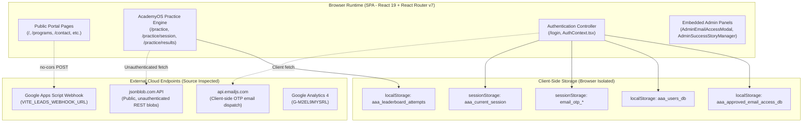
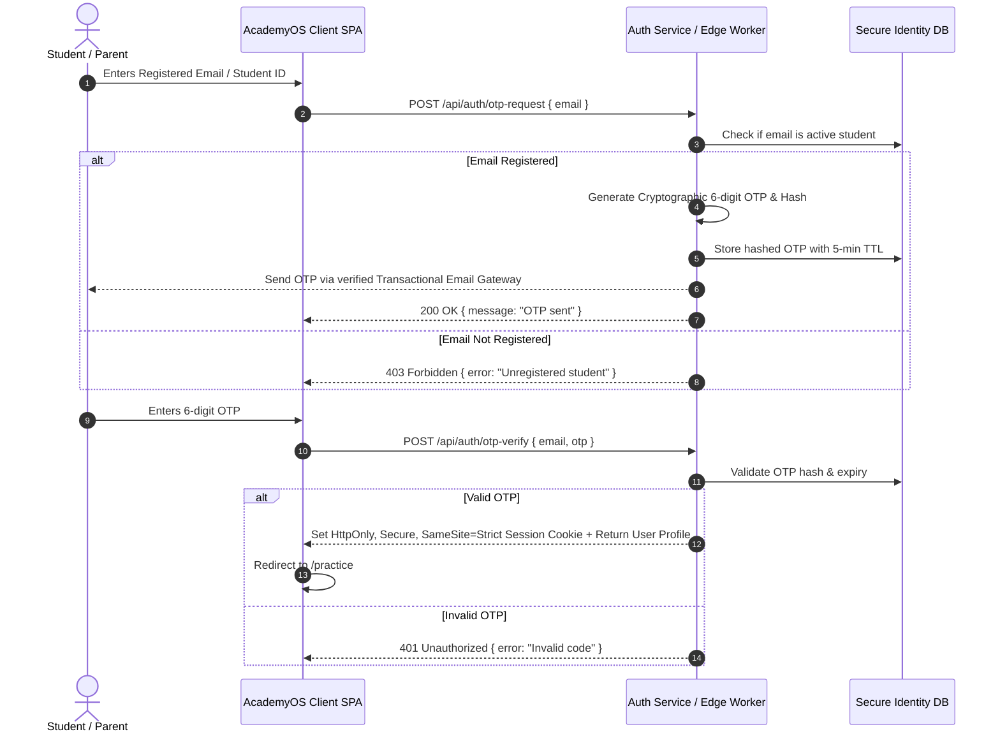
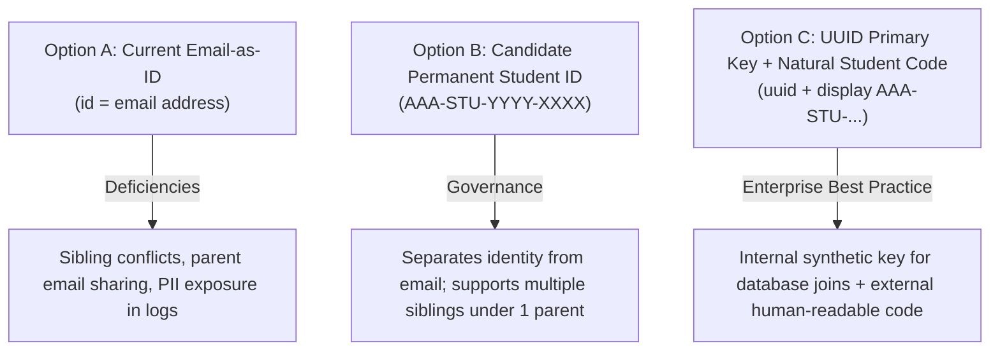
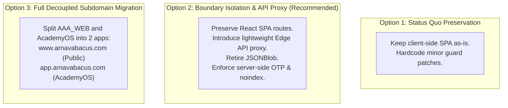
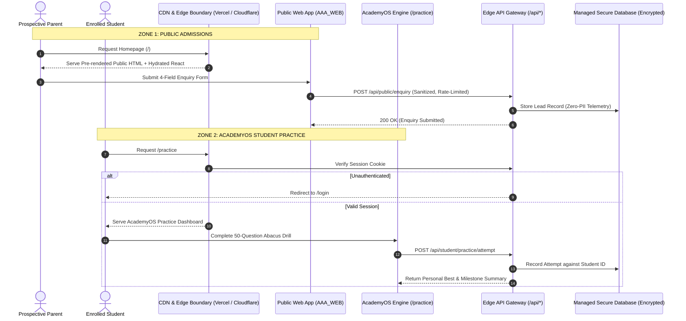

# ARNAV ABACUS ACADEMY (AAA) — ACADEMYOS BOUNDARY ISOLATION & PROTECTION ARCHITECTURE
## Stage 3 Solution Architecture Deliverable (WS-07)

**Document Reference:** `AAA-S3-SPEC-WS07-01`  
**Deliverable Type:** Architecture & System Boundary Specification  
**Parent Workstream:** WS-07 — Internal & Student System Boundary Isolation Architecture  
**Status:** 🟡 **DRAFT — AWAITING MANAGEMENT REVIEW**  
**Executive Authority for Ratification:** Nitin Patil (Operations & Technology Lead) & Neha Patil (Founder & Academic Director)  
**Date of Compilation:** 03 November 2026  
**Applicable Stage-Gate:** Stage-Gate 3.2  

---

## 1. Document Control & Approval Status

### 1.1 Revision History

| Version | Date | Description | Author / Contributors | Status / Gate |
| :---: | :---: | :--- | :--- | :---: |
| `1.0.0-draft` | 03-Nov-2026 | Initial comprehensive boundary isolation architecture, security threat model, storage inventory, and options analysis for AcademyOS. | Antigravity AI Architecture Team | 🟡 Awaiting Review (`MGT-DET-S3-10`) |

### 1.2 Governance Authority & Authorisation Record
- **Gate 3.1 Ratification:** Stage-Gate 3.1 (WS-06 Digital Experience & Website Architecture) was formally ratified and closed under **`MGT-DET-S3-09`** on 03 November 2026 by Neha Patil and Nitin Patil.
- **Commencement Mandate:** Neha Patil and Nitin Patil authorized commencement of Workstream WS-07.
- **Implementation Status:** Strictly documentation-only specification. Zero modification to application code in `src/` or assets in `public/`. The Stage 3 implementation freeze remains 100% active.

### 1.3 Core Architectural Non-Negotiable Principle
> [!IMPORTANT]
> **ACADEMYOS BOUNDARY PROTECTION MANDATE:**  
> **"Extend the academy's digital capabilities without breaking, duplicating, exposing, or unnecessarily migrating existing AcademyOS functionality or student data."**  
> The existing student practice engine, drill questions, bead animations, and attempt histories must remain uninterrupted and operational while the public website evolves independently.

---

## 2. Existing Architecture Baseline (Empirical Codebase Audit)

An empirical inspection of the active codebase was conducted across `src/App.tsx`, `src/lib/AuthContext.tsx`, `src/lib/accessControl.ts`, `src/lib/cloudSync.ts`, `src/lib/successStories.ts`, and the `/practice` page suite:



### 2.1 Five-Tier Architectural Fact Classification

| Aspect | Finding & Audited Code Reality | Classification Tier |
| :--- | :--- | :---: |
| **Routing** | 30 React Router routes + 1 `<LegacyHashRedirector />`. Protected routes `/practice`, `/practice/session`, `/practice/results` wrapped in `<ProtectedRoute />` in `src/App.tsx`. | **Tier 1 (Empirically Verified Fact)** |
| **Route Guard** | `ProtectedRoute` in `src/App.tsx` (lines 72–84) checks `if (loading)` and displays a spinner, but returns `<>{children}</>` unconditionally without redirecting unauthenticated users to `/login`. Sub-pages handle access checks independently. | **Tier 1 (Empirically Verified Fact)** |
| **Authentication** | Email OTP via EmailJS REST API (`src/lib/AuthContext.tsx:107`) with console-logged fallback OTP (`line 138`) when keys are not configured. Google OAuth via `@react-oauth/google` with client-side `jwtDecode`. | **Tier 1 (Empirically Verified Fact)** |
| **Authorisation** | Client-side email whitelist (`src/lib/accessControl.ts`). Root administrators hardcoded (`nitinkpatil@gmail.com`, `admin@arnavabacus.com`). Permissions stored in `localStorage` (`aaa_approved_email_access_db`). Cross-tab sync via `BroadcastChannel`. | **Tier 1 (Empirically Verified Fact)** |
| **Persistence** | Student practice attempts stored in `localStorage` (`aaa_leaderboard_attempts`) and synced via unauthenticated REST requests to `https://jsonblob.com/api/jsonBlob/019f9065-ec4f-7d60-b80c-07b7f039afe6`. | **Tier 1 (Empirically Verified Fact)** |
| **Success Stories** | Published success stories synced to `https://jsonblob.com/api/jsonBlob/019fa81d-0104-7348-beae-a82900883473`. | **Tier 1 (Empirically Verified Fact)** |
| **Lead Capture** | Webhook dispatch via `fetch` (`mode: 'no-cors'`) to `VITE_LEADS_WEBHOOK_URL` (`src/lib/leadWebhook.ts`). | **Tier 1 (Empirically Verified Fact)** |
| **Production State** | Live endpoint uptime, JSONBlob availability, and external provider access controls have not been tested via live external network probes to preserve freeze. | **Tier 3 (Unverified Production State)** |

---

## 3. Application Boundary & Context Separation

To ensure the public website can be enhanced for admissions without threatening the operational stability of AcademyOS, the system is partitioned into three distinct operational zones:

```
+---------------------------------------------------------------------------------------------------------+
| ZONE 1: PUBLIC ADMISSIONS & PARENT PORTAL (AAA_WEB)                                                     |
| Audience: Prospective parents, search engines, casual visitors.                                        |
| Scope: Homepage, Programme Guides, Parent Guides, Showcase, Contact, Lead Capture.                     |
| Security Posture: Publicly indexable, zero-PII telemetry, read-heavy, stateless form dispatch.         |
+---------------------------------------------------------------------------------------------------------+
                                           |
                                    BOUNDARY WALL
                       (Network, Storage & Component Separation)
                                           |
+---------------------------------------------------------------------------------------------------------+
| ZONE 2: ACADEMYOS STUDENT PRACTICE & LEARNING ENVIRONMENT                                               |
| Audience: Enrolled students, guided practice participants, evaluating trial students.                  |
| Scope: Login, Practice Hub, Live Drill Session, Timed Calculation, Practice Results.                   |
| Security Posture: Strictly noindex/disallowed, authenticated or guest-gated, session-based state.      |
+---------------------------------------------------------------------------------------------------------+
                                           |
                                    PRIVILEGE GATE
                        (Role-Based Access & Administrative Isolation)
                                           |
+---------------------------------------------------------------------------------------------------------+
| ZONE 3: INTERNAL ACADEMY ADMINISTRATION & EDUCATOR OPERATIONS                                          |
| Audience: Neha Patil (Academic Director), Nitin Patil (Operations Lead), Certified Educators.          |
| Scope: Student batching, attendance, student access records, feedback review, success story publishing.|
| Current State: Embedded client modals (AdminEmailAccessModal, AdminSuccessStoryManager).               |
| Target State: Decoupled administrative console with server-enforced role-based access control (RBAC).   |
+---------------------------------------------------------------------------------------------------------+
```

### 3.1 Domain & Context Responsibility Matrix

| Capability / Function | Public Website (Zone 1) | AcademyOS (Zone 2) | Internal Administration (Zone 3) |
| :--- | :---: | :---: | :---: |
| **Parent Discovery & SEO** | Primary Owner | Prohibited (noindex) | Prohibited (noindex) |
| **4-Field Enquiry Modal** | Primary Owner | Not Involved | Receives Lead Payload |
| **Student Practice Drills**| Not Involved | Primary Owner | Curates Drill Question Sets |
| **Student Login / Session**| Not Involved | Primary Owner | Manages Access Whitelist |
| **Attempt Records & Scores**| Not Involved | Primary Consumer | Audits Student Progress |
| **Success Story Publishing**| Reads Public Stories | Not Involved | AI Draft & Publish Control |
| **Student Roll & Batching**| Not Involved | Not Involved | Target Stage 4 Capability |

---

## 4. Route and Access-Boundary Matrix

The 30 React Router routes and 1 legacy compatibility handler are classified across public accessibility, authentication requirements, and crawl permissions:

| Route Path | Component | Audience | Access Requirement | public Indexing | Crawl Boundary Control |
| :--- | :--- | :--- | :--- | :---: | :--- |
| **`/`** | `Home.tsx` | All / Public | Anonymous | 🟢 Index | Allowed in `robots.txt` |
| **`/programs`** | `Programs.tsx` | Parents / Public | Anonymous | 🟢 Index | Allowed in `robots.txt` |
| **`/programs/abacus`** | `ProgramAbacus.tsx` | Parents / Public | Anonymous | 🟢 Index | Allowed in `robots.txt` |
| **`/programs/vedic-maths`**| `ProgramVedicMaths.tsx` | Parents / Public | Anonymous | 🟢 Index | Allowed in `robots.txt` |
| **`/programs/school-maths`**| `ProgramSchoolMaths.tsx` | Parents / Public | Anonymous | 🟢 Index | Allowed in `robots.txt` |
| **`/programs/mental-maths`**| `ProgramMentalMaths.tsx` | Parents / Public | Anonymous | 🟢 Index | Allowed in `robots.txt` |
| **`/programs/ipm-olympiad`**| `ProgramIpmOlympiad.tsx`| Parents / Public | Anonymous | 🟢 Index | Allowed in `robots.txt` |
| **`/parent-guides/*`** (5) | Guide Pages | Parents / Public | Anonymous | 🟢 Index | Allowed in `robots.txt` |
| **`/mentor`** | `Mentor.tsx` | Parents / Public | Anonymous | 🟢 Index | Allowed in `robots.txt` |
| **`/contact`** | `Contact.tsx` | Parents / Public | Anonymous | 🟢 Index | Allowed in `robots.txt` |
| **`/showcase`** | `Showcase.tsx` | Parents / Public | Anonymous | 🟢 Index | Allowed in `robots.txt` |
| **`/gallery`** | Alias to Showcase | Parents / Public | Anonymous | 🟡 Canonical | Canonical $\rightarrow$ `/showcase` |
| **`/blog`**, **`/blog/:slug`**| Blog Pages | Parents / Public | Anonymous | 🟢 Index | Allowed in `robots.txt` |
| **`/news`**, **`/news-events`**| News Pages | Parents / Public | Anonymous | 🟢 Index | Canonical $\rightarrow$ `/news` |
| **`/worksheets`** | `WorksheetVault.tsx` | Parents / Public | Lead Gate | 🟢 Index | Allowed in `robots.txt` |
| **`/teacher-franchise`** | `TeacherFranchise.tsx` | Educators / Public| Anonymous | 🟢 Index | Allowed in `robots.txt` |
| **`/faqs`** | `Faqs.tsx` | Parents / Public | Anonymous | 🟢 Index | Allowed in `robots.txt` |
| **`/brochure`** | `InteractiveBrochure` | Parents / Public | Lead Gate | 🟢 Index | Allowed in `robots.txt` |
| **`/campaigns/:slug`** | `CampaignPage.tsx` | Campaign Visitors | Anonymous | 🔴 Noindex | Disallow in `robots.txt` |
| **`#/*`** | `LegacyHashRedirector`| Legacy Visitors | Client redirect | 🔴 Noindex | Handled in client |
| **`/login`** | `Login.tsx` | Enrolled / Guests | Anonymous | 🔴 Noindex | Disallow in `robots.txt` |
| **`/practice`** | `PracticeHub.tsx` | Enrolled / Guests | Auth or Guest Gate| 🔴 Noindex | Disallow in `robots.txt` |
| **`/practice/session`** | `PracticeSession.tsx` | Enrolled / Guests | Active Drill State| 🔴 Noindex | Disallow in `robots.txt` |
| **`/practice/results`** | `PracticeResult.tsx` | Enrolled / Guests | Completed Attempt | 🔴 Noindex | Disallow in `robots.txt` |
| **`*`** | `NotFound.tsx` | Invalid Paths | Anonymous | 🔴 404 Status| Noindex / Fallback |

---

## 5. Authentication and Authorisation Architecture

### 5.1 Current Implementation Assessment
- **Identity Model:** Student identity is tied directly to email address (`User.id = User.email`).
- **Authentication Methods:**
  1. *Email OTP:* 6-digit random number generated client-side (`Math.floor(100000 + Math.random() * 900000)`), stored in `sessionStorage`, and dispatched via EmailJS API.
  2. *Google OAuth:* Client-side Google Identity Services credential response decoded via `jwtDecode` without server-side cryptographic signature validation.
  3. *Guest Mode:* Allows unauthenticated users to take up to 5 sample drills via `localStorage.setItem("aaa_guest_quiz_attempts", ...)`.
- **Authorisation & Permissions:** Whitelist database (`aaa_approved_email_access_db`) stored in browser `localStorage`. Root administrators (`nitinkpatil@gmail.com`, `admin@arnavabacus.com`) are checked via hardcoded client-side array comparison.

### 5.2 Architectural Gaps & Risks
1. **Client-Side OTP Generation:** OTP is generated inside the browser and held in `sessionStorage`. If EmailJS is unconfigured, the OTP is printed to the browser developer console (`console.log`), allowing trivial bypass by inspecting dev tools.
2. **Client-Side Whitelist Storage:** An attacker with browser console access can run `localStorage.setItem("aaa_approved_email_access_db", ...)` or alter their session object to grant themselves access. While `isUserAdmin` checks root emails, level permissions can be manipulated locally.
3. **Absence of Server-Side Session Validation:** The client application does not issue cryptographically signed session tokens (e.g., HTTP-only JWTs). Any state stored in `localStorage` is treated as truth by the browser runtime.

### 5.3 Target Authentication Architecture (Proposed Direction)



---

## 6. Student Data & Storage Boundary Inventory

```
====================================================================================================
STORAGE BOUNDARY PRINCIPLE:
Browser localStorage and public unauthenticated cloud blobs (jsonblob.com) are INTERIM mechanisms.
They must NOT be treated as compliant, permanent sources of truth for student academic records.
====================================================================================================
```

| Data Category | Current Storage Location | Current Access Component | Data Owner | Sensitivity Classification | Primary Exposure Risk | Required Future Control |
| :--- | :--- | :--- | :--- | :--- | :--- | :--- |
| **Student Practice Attempts** | `localStorage` (`aaa_leaderboard_attempts`) | `cloudSync.ts`, `PracticeResult.tsx` | Student / Academy | **CONFIDENTIAL (Educational)** | Overwritable in browser; public JSONBlob read/write | Encrypted server database with student isolation |
| **Student Name & Email** | `localStorage` (`aaa_users_db`, `aaa_current_session`) | `AuthContext.tsx`, `PracticeHub.tsx` | Student / Parent | **PII (Personal Identifiable)** | Readable by any script running on the origin | HttpOnly session token; minimize local PII |
| **Access Control Whitelist** | `localStorage` (`aaa_approved_email_access_db`) | `accessControl.ts`, `AdminEmailAccessModal` | AAA Management | **RESTRICTED (Operational)** | Local modification allows privilege escalation | Server-enforced RBAC |
| **Active OTP Codes** | `sessionStorage` (`email_otp_*`) | `AuthContext.tsx` | Student | **CRITICAL (Auth Credential)** | Exposed in browser console if EmailJS fails | Server-side OTP generation & verification |
| **Visitor Feedback** | `localStorage` (`aaa_visitor_feedbacks`) & JSONBlob | `cloudSync.ts`, `AdminEmailAccessModal` | Visitor / AAA | **INTERNAL (Operational)** | Public JSONBlob reading | Private administrative backend API |
| **Published Success Stories**| `localStorage` (`aaa_published_success_stories_v2`) & JSONBlob | `successStories.ts`, `Showcase.tsx` | AAA / Parent (Consent) | **PUBLIC (Marketing Showcase)**| Tampering on public JSONBlob endpoint | CMS / Database with authenticated admin publish role |
| **Parent Lead Submissions** | Google Sheets via Apps Script (`VITE_LEADS_WEBHOOK_URL`) | `leadWebhook.ts`, `LeadForm.tsx` | Parent / AAA | **CONFIDENTIAL (Prospective Lead)**| Inability to verify recipient sheet access | Serverless API proxy with sanitized storage |

---

## 7. Leaderboard and Student Privacy Boundary Assessment

### 7.1 Existing Leaderboard Inspection (`PracticeResult.tsx`)
In `src/pages/PracticeResult.tsx` (lines 496–560), after a practice drill is completed, the system renders **"SECTION 4: Live Leaderboard (Showing ONLY Current Practice Level)"**:
- **Data Rendered:** Full Student Name (`userName`), Score Percentage (`scorePercentage`), Total Correct / Wrong Counts, Time Taken in Seconds (`timeTakenSeconds`), and Attempt Timestamp (`completedAt`).
- **Data Retrieval:** Combines local attempts with attempts fetched from public `jsonblob.com`.
- **Visibility:** Visible to any student or guest participant who completes a drill in that level.

### 7.2 Child Privacy & Pedagogical Evaluation
1. **Conflict with AAA Brand Philosophy:**  
   As established in Stage 2 (`WS-02`) and Stage 3 (`WS-06.6`), AAA's core philosophy dictates:
   > *"Child development is compared with the child's own previous progress, not publicly ranked against other children."*  
   Publicly ranking young children by speed and percentage fosters calculation anxiety and competitive discouragement.
2. **Unauthenticated Data Exposure:**  
   The `jsonblob.com` URL is hardcoded into client JavaScript bundles. Any party inspecting network traffic can retrieve the entire JSON file containing historical student names, email addresses, and practice scores without authentication.

### 7.3 Privacy-Preserving Leaderboard Architecture (Proposed)

```
+----------------------------------------------------------------------------------------------------+
| 🔒 PROPOSED PRIVACY CONTROLS FOR ACADEMYOS PERFORMANCE DATA:                                        |
| 1. Personal Milestone View (Default): Students only see their own personal best score and progress |
|    curve across attempts (Self-Referential Progress).                                              |
| 2. Pseudonymous Display (If peer comparison is enabled by educator):                                |
|    Replace full names with pseudonyms: "Student A.P." or "Learner #402".                           |
| 3. Authenticated-Only Boundary: Zero attempt data accessible without an authenticated session.     |
| 4. Elimination of Public JSONBlob: Retire unauthenticated jsonblob.com endpoints.                  |
+----------------------------------------------------------------------------------------------------+
```

---

## 8. Integration Inventory and Data-Flow Mapping

```mermaid
flowchart LR
    subgraph Client_Browser["Client Browser (AAA_WEB)"]
        LeadForm["LeadForm / Modal"]
        AuthCtx["AuthContext"]
        PracRes["PracticeResult / Hub"]
        Analytics["analytics.ts"]
    end

    subgraph External_Services["External Services"]
        GAS["Google Apps Script<br>(VITE_LEADS_WEBHOOK_URL)"]
        EmailJS["EmailJS Gateway<br>(api.emailjs.com)"]
        JSONBlob["JSONBlob Storage<br>(jsonblob.com)"]
        GA4["Google Analytics 4<br>(G-M2EL9MYSRL)"]
    end

    LeadForm -->|1. POST Lead Data (no-cors)| GAS
    AuthCtx -->|2. POST Send OTP| EmailJS
    PracRes <-->|3. GET/PUT Attempts & Stories| JSONBlob
    Analytics -->|4. Zero-PII Telemetry| GA4
```

### 8.1 Detailed Integration Audit

| Integration Endpoint | Purpose | Data Transmitted | Authentication | Failure Mode | Privacy / Security Implication |
| :--- | :--- | :--- | :--- | :--- | :--- |
| **Google Apps Script Webhook** | Ingestion of 4-field lead forms into Google Sheets. | Parent Name, Mobile/WhatsApp, Child Age/Grade, Optional Program, Timestamp. | None (Client `mode: 'no-cors'`). URL contains macro ID. | Fails silently if Apps Script quotas exceed or script URL changes. | PII transmitted directly from browser to third-party script. Recipient Google Sheet access controls unverified. |
| **EmailJS Gateway** | Delivery of 6-digit OTP codes for student login. | Student Name, Student Email, Generated OTP code. | Public API key in client header (`user_id`). | Falls back to browser `console.log` simulated OTP. | Client-side API keys exposed in bundle. Console fallback allows trivial login bypass. |
| **JSONBlob Persistence** | Cross-device practice attempt syncing and success stories. | Student Name, Email, Level, Score, Time Taken, AI Generated Story Text. | **None (Completely unauthenticated public REST endpoints).** | Network failure falls back to local `localStorage`. | **High Risk:** Anyone with the URL can read, overwrite, or delete all student practice records. |
| **Google Analytics 4** | Web traffic telemetry (`G-M2EL9MYSRL`). | Page URLs, button clicks, engagement duration. | GA4 Measurement ID. | Drops tracking events if blocked by ad-blocker. | Zero-PII compliance required by `AGENTS.md`. Must sanitize URLs and form inputs. |

---

## 9. API and Service Boundary Specification

To transition from client-side direct persistence to an enterprise-grade, secure architecture, the following logical API boundary is specified:

```
+----------------------------------------------------------------------------------------------------+
| PROPOSED LOGICAL API SPECIFICATION (ZONE 1 vs ZONE 2 vs ZONE 3)                                    |
+----------------------------------------------------------------------------------------------------+
| PUBLIC APIS (Stateless, Rate-Limited, Sanitized)                                                   |
| - POST /api/public/enquiry               -> Submits 4-field inquiry to intake queue                |
| - GET  /api/public/showcase-stories      -> Returns approved, consent-gated success stories        |
| - GET  /api/public/seo-metadata          -> Dynamic OpenGraph and route metadata                   |
+----------------------------------------------------------------------------------------------------+
| STUDENT ACADEMYOS APIS (Session-Authenticated, Student-Isolated)                                  |
| - POST /api/auth/otp/request             -> Server-side OTP generation & rate-limited dispatch     |
| - POST /api/auth/otp/verify              -> Server-side OTP validation, issues HttpOnly session     |
| - POST /api/auth/logout                  -> Terminates session cookie                             |
| - GET  /api/student/profile              -> Returns authenticated student name, permissions        |
| - POST /api/student/practice/attempt     -> Validates and records completed practice attempt       |
| - GET  /api/student/practice/history     -> Returns personal attempt history for current student   |
+----------------------------------------------------------------------------------------------------+
| ADMINISTRATIVE APIS (Privileged, Multi-Factor, Audit-Logged)                                       |
| - GET  /api/admin/students               -> Lists enrolled students and permission matrix          |
| - POST /api/admin/students/permissions   -> Updates course access levels (Abacus / Vedic)          |
| - POST /api/admin/showcase/publish       -> AI-assisted story generator & publish control          |
| - GET  /api/admin/audit-logs             -> Access logs and security event history                 |
+----------------------------------------------------------------------------------------------------+
```

---

## 10. Student Identity & Data Ownership Architecture

### 10.1 The Stage 2 Identity Principle
> **"One permanent Student ID per child, with multiple programmes attached to the same Student ID."**

### 10.2 Identity Model Options Analysis



| Dimension | Option A: Current (Email-as-ID) | Option B: Proposed Format (`AAA-STU-YYYY-XXXX`) | Option C: Relational Model (UUID + Permanent ID) |
| :--- | :--- | :--- | :--- |
| **Sibling Support** | ❌ Fails (two siblings sharing parent email overwrite attempts). | 🟢 Strong (each sibling receives distinct ID). | 🟢 Strong (clean one-to-many parent-child schema). |
| **PII Exposure** | ❌ High (email address passed across storage and URLs). | 🟢 Low (pseudonymous identifier). | 🟢 Minimal (synthetic UUID in backend). |
| **Multi-Course Tracking** | 🟡 Clumsy (permissions array tied to email). | 🟢 Clean (enrollment records reference Student ID). | 🟢 Optimal (normalized database tables). |
| **Migration Risk** | 🟢 Zero (status quo). | 🟡 Medium (requires mapping existing emails to IDs). | 🟡 Medium (requires database schema creation). |
| **Recommendation** | **Retire in Stage 4.** | **Approved Proposed Direction (Stage 3).** | **Recommended Implementation Target (Stage 4).** |

---

## 11. Legacy Continuity and Non-Disruption Controls

To ensure existing students actively practicing on AcademyOS experience zero downtime, data loss, or sudden behavioral breakage:

1. **Dual-Read Compatibility Layer:** During any future storage migration, the client application must attempt to read from the new secure API first; if unavailable or unauthenticated, it must seamlessly fall back to local `localStorage` attempt records.
2. **Zero-Destruction Guarantee:** No script, build process, or migration runner shall clear or execute `localStorage.removeItem("aaa_leaderboard_attempts")` without verified, cryptographically hashed cloud backups.
3. **Route Preservation:** The four AcademyOS routes (`/login`, `/practice`, `/practice/session`, `/practice/results`) must retain their exact URLs and query parameter contracts (`setId`, `mode`, `count`, `time`).
4. **Offline Practice Resiliency:** The Soroban and Vedic practice drill calculation engine operates client-side in React memory. This client-side execution loop must be preserved so that momentary internet drops during a 100-question speed drill do not abort a student's session.

---

## 12. WS-10 Security & Privacy Cross-Cutting Threat Model

```
====================================================================================================
WS-10 CROSS-CUTTING COMPLIANCE NOTICE:
This threat model is compiled in active coordination with WS-10 (Security & Privacy).
It highlights technical vulnerabilities and architectural requirements.
It does NOT constitute statutory DPDP certification or formal legal advice.
====================================================================================================
```

| Threat Ref | Asset at Risk | Threat Actor | Threat Scenario | Potential Impact | Existing Control in Code | Control Gap | Proposed Architectural Mitigation |
| :---: | :--- | :--- | :--- | :--- | :--- | :--- | :--- |
| **TM-01** | Student Practice Records | Unauthorized External Actor | Actor queries public `jsonblob.com` endpoint directly. | Bulk exfiltration of student names, emails, and scores. | None | Endpoint is public and unauthenticated. | Migrate attempt persistence to authenticated backend API; deprecate JSONBlob. |
| **TM-02** | Student Login / OTP | Malicious Student / Visitor | Actor inspects browser console or manipulates `sessionStorage` OTP. | Unauthorized login to student account. | Console log fallback | OTP generated and validated client-side. | Move OTP generation and verification to server-side edge worker with rate limiting. |
| **TM-03** | Course Permissions Whitelist | Tech-Savvy Student / Visitor | Actor runs `localStorage.setItem(ACCESS_DB_KEY, ...)` in console. | Escalates access to locked SVM / Soroban levels. | Client-side email check | Whitelist stored in modifiable `localStorage`. | Enforce permission validation on server; client UI only reflects server state. |
| **TM-04** | Parent Lead Submissions | Malicious Web Bot | Automated script spams public enquiry form endpoint. | Lead database pollution; Apps Script quota exhaustion. | Basic client sanitization (`securitySanitizer.ts`) | No CAPTCHA / rate-limiting on client POST. | Add Cloudflare Turnstile / edge rate limiting on form submissions. |
| **TM-05** | Child Developmental Privacy | General Public / Other Parents | Public leaderboard displays full child names and scores. | Child anxiety, peer comparison, public profiling. | Filtered to level | Full student name visible to all participants. | Replace public leaderboard with self-referential progress and pseudonyms. |

---

## 13. Architecture Options Analysis

To establish a clear path forward for management decision-making, three distinct architectural options are evaluated:



### 13.1 Comprehensive Options Comparison Matrix

| Evaluation Dimension | Option 1: Status Quo Preservation | Option 2: Boundary Isolation & Edge API (Recommended) | Option 3: Full Decoupled Subdomain Migration |
| :--- | :--- | :--- | :--- |
| **Architectural Concept** | Retain current single-bundle React app. Keep `localStorage` and `jsonblob.com`. | Keep unified codebase; introduce secure serverless Edge API (Cloudflare / Vercel Serverless) for Auth & Storage; retire JSONBlob. | Deploy two completely separate repositories / builds: Public Website on `www.` and AcademyOS on `app.`. |
| **Security & Privacy** | 🔴 **High Risk:** JSONBlob and client OTP remain vulnerable to exfiltration. | 🟢 **High Security:** Eliminates public cloud blobs; server-side OTP and session cookies. | 🟢 **Maximum Security:** Complete process, network, and hosting boundary isolation. |
| **Student Continuity** | 🟢 **100% Seamless:** Zero migration impact. | 🟢 **Seamless:** Preserves all routes (`/practice`), URLs, and drill mechanics. | 🟡 **Disruptive:** Existing student bookmarks change (`/practice` $\rightarrow$ `app.arnavabacus.com`). |
| **Development Effort** | 🟢 Low (zero architectural change). | 🟡 Moderate (add serverless API functions + database). | 🔴 High (build pipeline separation, duplicate design tokens, complex auth). |
| **Operational Cost** | 🟢 Free (interim public services). | 🟢 Minimal (well within free tiers of Cloudflare / Vercel + Supabase). | 🟡 Moderate (dual hosting configurations and build systems). |
| **SEO & Crawl Defense**| 🟡 Fragile (depends on client `robots.txt`). | 🟢 Robust (edge worker enforces 401/noindex on `/practice*`). | 🟢 Robust (subdomain completely disallowed in `robots.txt`). |
| **Reversibility** | 🟢 Immediate. | 🟢 High (API proxy can fall back to local storage). | 🔴 Low (complex infrastructure rollback). |
| **Recommendation** | ❌ Not recommended for production scaling. | 🟢 **RECOMMENDED DIRECTION FOR STAGE 4.** | ⏸️ Feasible long-term target for Phase 2/3. |

---

## 14. Target Architecture Blueprint & Data Flow



---

## 15. Requirements Traceability

- **`AGENTS.md` Rule 3 (AcademyOS Boundary Protection):** Fully satisfied. Specification explicitly prohibits modifying, duplicating, or deleting practice routes or engines.
- **Stage 2 Master BRD Section 5 & 6:** Reconciles student identity, micro-batch standards, and learning continuum.
- **Stage 3 Architecture Principles (`AAA_Stage3_Architecture_Principles_and_Standards.md`):** Satisfies Principle 1 (Boundary Isolation), Principle 3 (Minimum Necessary Data), and Principle 6 (Graceful Degradation).
- **Previous Deliverable Ratifications:** Preserves all routes established in `WS-06.1` and `WS-06.5`.

---

## 16. Open Management Decisions (`MGT-DET-S3-10`)

The following strategic decisions are submitted for formal review and determination by **Nitin Patil** and **Neha Patil**:

1. **Strategic Architecture Selection (TECH-07-01 — Nitin Patil):**  
   Confirm adoption of **Option 2 (Boundary Isolation & Edge API Proxy)** as the approved technical direction for Stage 4 implementation, retiring public `jsonblob.com` endpoints and moving OTP validation server-side.
2. **Student Privacy & Leaderboard Policy (ACAD-07-01 — Neha Patil):**  
   Approve replacing public peer ranking leaderboards with personal milestone progress tracking and pseudonymous peer references in AcademyOS.
3. **Student Identity Direction (TECH-07-02 — Nitin Patil):**  
   Approve adopting the permanent candidate Student ID model (`AAA-STU-YYYY-XXXX`) to decouple student records from parent email addresses, supporting siblings under a unified family account.

---

## 17. Acceptance Criteria & Workstream Closure

| Acceptance Criterion | Verification Method | Status |
| :--- | :--- | :---: |
| **1. Public and Student Contexts Separated** | Logical partitioning across Zone 1, Zone 2, and Zone 3 defined | 🟢 **PASS** |
| **2. Existing AcademyOS Protected** | Zero route changes, zero drill mechanic changes, practice code untouched | 🟢 **PASS** |
| **3. Route Boundary Matrix Complete** | Full classification across all 30 routes + 1 redirect handler | 🟢 **PASS** |
| **4. Storage Inventory Completed** | `localStorage`, `sessionStorage`, `jsonblob.com`, and webhooks documented | 🟢 **PASS** |
| **5. Leaderboard Privacy Assessed** | Public ranking risks identified; self-referential progress proposed | 🟢 **PASS** |
| **6. Integration Mappings Complete** | EmailJS, Google Apps Script, GA4, JSONBlob mapped with failure modes | 🟢 **PASS** |
| **7. WS-10 Threat Model Compiled** | Asset, threat actor, scenario, impact, and mitigation matrix created | 🟢 **PASS** |
| **8. Structured Options Analysis Provided**| Options 1, 2, and 3 analyzed with security, cost, and complexity tradeoffs | 🟢 **PASS** |

---
*End of Deliverable Specification (AAA-S3-SPEC-WS07-01).*
