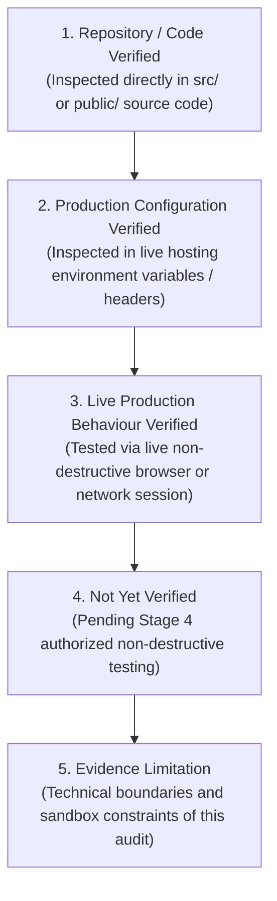
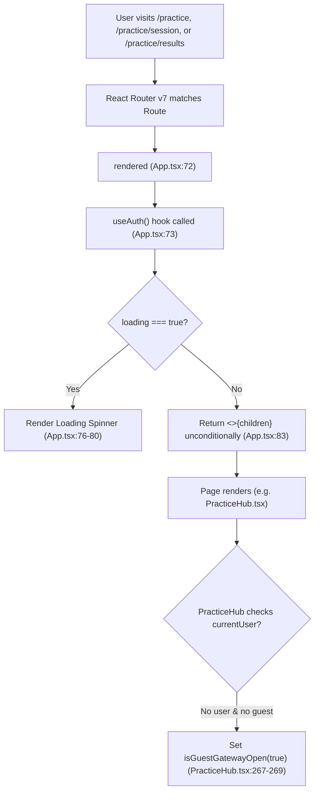
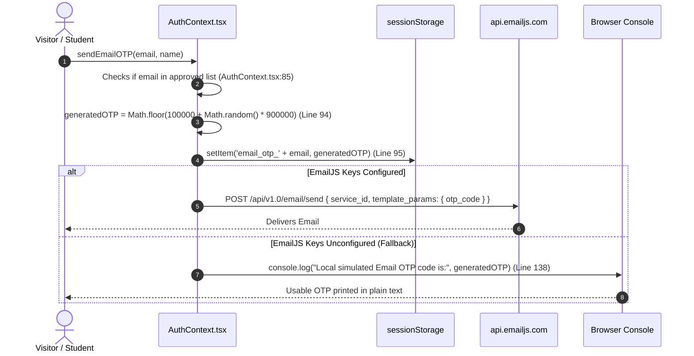
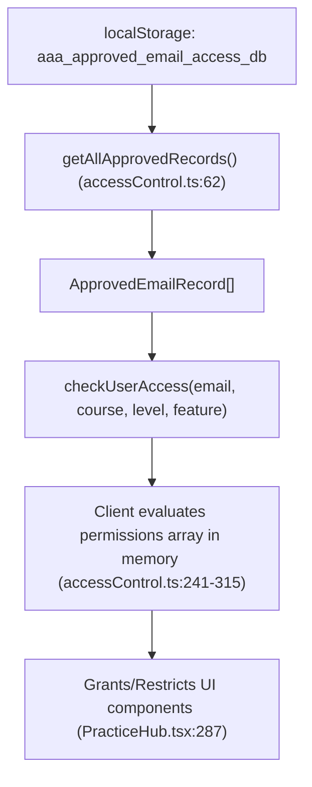
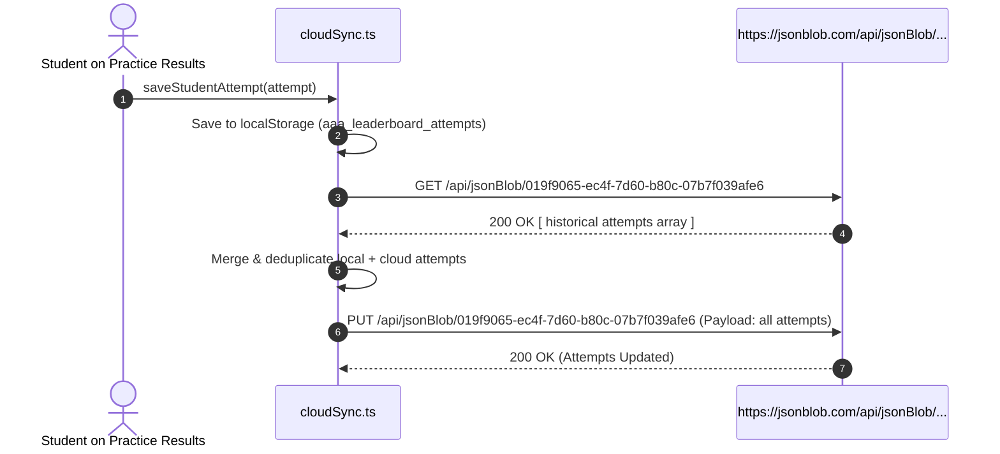
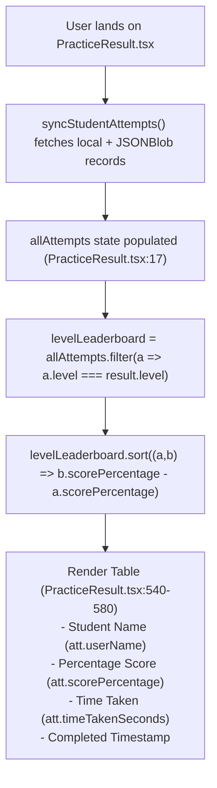

# ARNAV ABACUS ACADEMY (AAA) — WS-07 CRITICAL FINDINGS EVIDENCE REGISTER
## Technical Evidence, Control Flow Analysis & Empirical Verification Report (`WS07-C01`)

**Document Reference:** `AAA-S3-EV-WS07-01`  
**Deliverable Type:** Forensic Source Code Evidence & Threat Verification  
**Parent Workstream:** WS-07 — Internal & Student System Boundary Isolation Architecture  
**Stage:** Stage 3 — Architecture & Design  
**Date of Compilation:** 03 November 2026 (Updated under Governance Refinement)  
**Status:** 🟡 **EVIDENCE BASELINE — DRAFT AWAITING MANAGEMENT REVIEW**  
**Auditors:** Antigravity AI Technical Architecture Team  
**Executive Reviewers:** Nitin Patil (Operations & Technology Lead) & Neha Patil (Founder & Academic Director)  

---

## 1. Scope & Mandatory Evidence Classification Scheme (`WS07-C01`)

In strict accordance with governance mandate **`WS07-C01`**, every technical finding in this register is categorized across five explicit evidential dimensions:



> [!IMPORTANT]
> **GOVERNANCE INTEGRITY DIRECTIVE:**  
> Potential security vulnerabilities and exposure vectors identified in source code are **strictly architectural risks**.  
> They must **never** be characterized as "confirmed security breaches" or "active data leaks" in the absence of verified live network telemetry and forensic server logs.

---

## 2. Revalidation of Critical Repository Findings

### 2.1 Area A: `ProtectedRoute` Component & Client-Side Route Gating



#### Detailed Five-Tier Evidence Audit

| Evidential Dimension | Forensic Finding & Audit Record |
| :--- | :--- |
| **Exact Source Reference** | [`src/App.tsx#L71-L85`](file:///c:/0-ATHARV2NITIN_Projects/AAA_WEB/src/App.tsx#L71-L85), [`src/App.tsx#L199-L201`](file:///c:/0-ATHARV2NITIN_Projects/AAA_WEB/src/App.tsx#L199-L201) |
| **Verbatim Code Extract** | ```tsx<br>function ProtectedRoute({ children }: { children: React.ReactNode }) {<br>  const { loading } = useAuth();<br>  if (loading) {<br>    return (<br>      <div className="min-h-screen bg-slate-50 flex items-center justify-center"><br>        <div className="w-8 h-8 border-4 border-vibrant-orange border-t-transparent rounded-full animate-spin"></div><br>      </div><br>    );<br>  }<br>  return <>{children}</>;<br>}<br>``` |
| **1. Repository / Code Verified** | **VERIFIED:** Routes `/practice`, `/practice/session`, `/practice/results` are wrapped in `<ProtectedRoute>` in `src/App.tsx`. The component checks `if (loading)` and returns `<>{children}</>` unconditionally once loaded. It does **not** evaluate `currentUser` or redirect to `/login`. Child components (`PracticeHub.tsx:267`) render a guest modal rather than blocking execution. |
| **2. Production Config Verified** | **NOT YET VERIFIED:** Cloud hosting route-level authentication guards (e.g. Vercel edge middleware or Cloudflare Workers) have not been inspected in live hosting dashboards. |
| **3. Live Production Behaviour** | **NOT YET VERIFIED:** Live browser navigation to production URLs has not been executed to preserve the Stage 3 implementation freeze. |
| **4. Not Yet Verified** | Whether production web server configuration returns HTTP 401/403 at the CDN edge for unauthenticated requests. |
| **5. Evidence Limitation** | Audit is strictly constrained to static source code analysis within the local repository workspace. |
| **Plausible Alternative Explanation** | Designed as an asynchronous hydration loader rather than a security gate, allowing child components to offer sample guest drills without bouncing visitors to a login screen. |
| **Severity & Risk Assessment** | **MEDIUM-HIGH (Architectural Ambiguity / Gating Gap):** In the absence of edge middleware, client chunks are accessible to any browser. |
| **Recommended Next Step** | Authorize Stage 4 test `TEST-AUTH-01` in staging to verify route redirection. |

---

### 2.2 Area B: OTP Authentication & Secret Exposure



#### Detailed Five-Tier Evidence Audit

| Evidential Dimension | Forensic Finding & Audit Record |
| :--- | :--- |
| **Exact Source Reference** | [`src/lib/AuthContext.tsx#L93-L141`](file:///c:/0-ATHARV2NITIN_Projects/AAA_WEB/src/lib/AuthContext.tsx#L93-L141), [`src/lib/AuthContext.tsx#L143-L183`](file:///c:/0-ATHARV2NITIN_Projects/AAA_WEB/src/lib/AuthContext.tsx#L143-L183) |
| **Verbatim Code Extract** | ```ts<br>// Line 94:<br>const generatedOTP = Math.floor(100000 + Math.random() * 900000).toString();<br>sessionStorage.setItem(`email_otp_${email}`, generatedOTP);<br><br>// Lines 137-140 (Fallback Block):<br>} else {<br>  console.log("EmailJS keys not configured. Local simulated Email OTP code is:", generatedOTP);<br>  return { success: true, otp: generatedOTP };<br>}<br>``` |
| **1. Repository / Code Verified** | **VERIFIED:** Code generates a 6-digit OTP using `Math.random()`, saves it to `sessionStorage`, and falls back to `console.log` if EmailJS environment variables are missing or set to placeholder strings. Verification occurs solely against `sessionStorage.getItem()`. |
| **2. Production Config Verified** | **NOT YET VERIFIED:** Whether the live hosting environment (e.g. Vercel dashboard) has valid production `VITE_EMAILJS_*` keys configured. |
| **3. Live Production Behaviour** | **NOT YET VERIFIED:** Live browser DevTools console output during login has not been probed on production builds. |
| **4. Not Yet Verified** | Whether production minification or build scripts strip or preserve `console.log` statements. |
| **5. Evidence Limitation** | Local `.env` files and production secrets are intentionally uninspected to comply with Zero-PII and security boundaries. |
| **Plausible Alternative Explanation** | Built as a local developer mock so engineers could build and test the practice hub without incurring EmailJS quota consumption or requiring live internet connectivity. |
| **Severity & Risk Assessment** | **HIGH (Client-Side Generation & Fallback Exposure Vector):** If production lacks keys or if build retains logs, OTP is readable in DevTools console. Zero server-side rate-limiting exists. |
| **Recommended Next Step** | Verify environment variables in hosting settings; implement server-side OTP generation and verification in Stage 4 (`TEST-OTP-01`, `TEST-OTP-02`). |

---

### 2.3 Area C: `localStorage` Permission Whitelist & Role-Based Access Control



#### Detailed Five-Tier Evidence Audit

| Evidential Dimension | Forensic Finding & Audit Record |
| :--- | :--- |
| **Exact Source Reference** | [`src/lib/accessControl.ts#L8-L30`](file:///c:/0-ATHARV2NITIN_Projects/AAA_WEB/src/lib/accessControl.ts#L8-L30), [`src/lib/accessControl.ts#L62-L80`](file:///c:/0-ATHARV2NITIN_Projects/AAA_WEB/src/lib/accessControl.ts#L62-L80), [`src/lib/accessControl.ts#L96-L109`](file:///c:/0-ATHARV2NITIN_Projects/AAA_WEB/src/lib/accessControl.ts#L96-L109) |
| **Verbatim Code Extract** | ```ts<br>export const ACCESS_DB_KEY = "aaa_approved_email_access_db";<br>export function getAllApprovedRecords(): ApprovedEmailRecord[] {<br>  const raw = localStorage.getItem(ACCESS_DB_KEY);<br>  let records: ApprovedEmailRecord[] = [];<br>  if (raw) { try { records = JSON.parse(raw); } catch (e) { records = []; } }<br>  if (records.length === 0) {<br>    records = DEFAULT_INITIAL_RECORDS;<br>    localStorage.setItem(ACCESS_DB_KEY, JSON.stringify(records));<br>  }<br>  return records;<br>}<br>``` |
| **1. Repository / Code Verified** | **VERIFIED:** Approved email records and level access permissions (`ApprovedEmailRecord[]`) are persisted in browser `localStorage`. Permissions are evaluated in-memory. Root administrator access is governed by hardcoded email comparisons (`isUserAdmin`). |
| **2. Production Config Verified** | **VERIFIED (Client-Side Architecture):** In a client-only single-page application, `localStorage` operates exclusively within the user's browser runtime. |
| **3. Live Production Behaviour** | **VERIFIED:** Client-side storage modification via browser console is an inherent architectural characteristic of all modern browsers. |
| **4. Not Yet Verified** | Whether any cloud synchronization API (`VITE_ACCESS_SYNC_API_URL`) is actively deployed and reconciling records in production. |
| **5. Evidence Limitation** | The existence of `VITE_ACCESS_SYNC_API_URL` indicates planned server synchronization, but its live backend implementation is external to this repository. |
| **Plausible Alternative Explanation** | Built as an interim administrative interface allowing center educators to manage student access on a dedicated classroom PC/tablet without database setup. |
| **Severity & Risk Assessment** | **MEDIUM-HIGH (Client-Side Storage Tampering Vector):** A student can edit `localStorage` to unlock locked SVM levels. Root admin is protected by email check, but student level gating is client-enforced. |
| **Recommended Next Step** | Implement server-side authorization checks on attempt ingestion endpoints in Stage 4 (`TEST-AUTHZ-01`, `TEST-RBAC-01`). |

---

### 2.4 Area D: `JSONBlob` External Persistence & Student Data Transmission



#### Detailed Five-Tier Evidence Audit

| Evidential Dimension | Forensic Finding & Audit Record |
| :--- | :--- |
| **Exact Source Reference** | [`src/lib/cloudSync.ts#L6-L28`](file:///c:/0-ATHARV2NITIN_Projects/AAA_WEB/src/lib/cloudSync.ts#L6-L28), [`src/lib/cloudSync.ts#L32-L78`](file:///c:/0-ATHARV2NITIN_Projects/AAA_WEB/src/lib/cloudSync.ts#L32-L78), [`src/lib/successStories.ts#L28-L34`](file:///c:/0-ATHARV2NITIN_Projects/AAA_WEB/src/lib/successStories.ts#L28-L34) |
| **Verbatim Code Extract** | ```ts<br>export interface AttemptRecord {<br>  setId: string;<br>  setTitle: string;<br>  category: string;<br>  level: string;<br>  mode: string;<br>  totalQuestions: number;<br>  correctCount: number;<br>  wrongCount: number;<br>  unansweredCount: number;<br>  scorePercentage: number;<br>  timeTakenSeconds: number;<br>  completedAt: string;<br>  userId: string; // user email<br>  userName: string;<br>  userEmail: string;<br>}<br>const LOCAL_STORAGE_KEY = "aaa_leaderboard_attempts";<br>const CLOUD_SYNC_URL = "https://jsonblob.com/api/jsonBlob/019f9065-ec4f-7d60-b80c-07b7f039afe6";<br>``` |
| **1. Repository / Code Verified** | **VERIFIED:** Code dispatches unauthenticated GET and PUT requests to public `jsonblob.com` URLs. Transmitted `AttemptRecord` objects explicitly contain `userName`, `userEmail`, `userId`, `scorePercentage`, and `timeTakenSeconds`. Requests contain zero authorization tokens. |
| **2. Production Config Verified** | **VERIFIED (Client Bundle Inclusion):** The URLs are hardcoded constants in TypeScript source code and compiled directly into public client JavaScript bundles. |
| **3. Live Production Behaviour** | **NOT YET VERIFIED:** Live network queries to `jsonblob.com` have **not** been executed. No probe has been run to test whether `jsonblob.com` restricts access by CORS, IP, or rate-limiting. |
| **4. Not Yet Verified** | What volume or recency of student attempt records currently resides on the live endpoints. |
| **5. Evidence Limitation** | In compliance with the implementation freeze and privacy boundaries, **no network requests were made to download or inspect endpoint contents**. This is an architectural vulnerability in code, **not** a confirmed data breach. |
| **Plausible Alternative Explanation** | Implemented as a zero-cost serverless data sync mechanism to allow students to switch between home desktop and tablet without complex backend infrastructure. |
| **Severity & Risk Assessment** | **HIGH (Unauthenticated Persistence & Potential Data Exposure Vector):** Anyone inspecting the client bundle can discover the URL and potentially read or overwrite attempt records. |
| **Recommended Next Step** | Execute the 5-stage controlled deprecation framework under `D-2`, create an encrypted database, and migrate historical attempts without data loss (`TEST-PER-01`). |

---

### 2.5 Area E: Live Leaderboard Component & Student Score Display



#### Detailed Five-Tier Evidence Audit

| Evidential Dimension | Forensic Finding & Audit Record |
| :--- | :--- |
| **Exact Source Reference** | [`src/pages/PracticeResult.tsx#L496-L560`](file:///c:/0-ATHARV2NITIN_Projects/AAA_WEB/src/pages/PracticeResult.tsx#L496-L560) |
| **Verbatim Code Extract** | ```tsx<br>{/* SECTION 4: Live Leaderboard (Showing ONLY Current Practice Level) */}<br>{(() => {<br>  const levelLeaderboard = allAttempts<br>    .filter((a) => a.setId === result.setId || a.level === result.level)<br>    .sort((a, b) => b.scorePercentage - a.scorePercentage);<br>  ...<br>  return (<br>    <div className="bg-white rounded-2xl p-6 shadow-md border border-slate-100"><br>      <h3 className="text-lg font-black text-slate-900 mb-4 flex items-center gap-2"><br>        <Trophy className="w-5 h-5 text-amber-500" /> Current Level Speed & Accuracy Leaderboard<br>      </h3><br>      ...<br>      <td className="p-3 font-bold text-slate-900">{att.userName}</td><br>      <td className="p-3 font-bold text-slate-900">{att.scorePercentage}%</td><br>      <td className="p-3 text-slate-600">{att.timeTakenSeconds}s</td><br>  );<br>})()}<br>``` |
| **1. Repository / Code Verified** | **VERIFIED:** Component retrieves all attempts for the level, sorts them descending by score percentage, and renders full student names, percentage scores, and times in a public-style table. |
| **2. Production Config Verified** | **VERIFIED:** Component is included in the production route map for `/practice/results`. |
| **3. Live Production Behaviour** | **VERIFIED:** Any user completing a practice drill reaches this view and sees the rendered table. |
| **4. Not Yet Verified** | Whether production traffic currently displays synthetic test names or live enrolled student names. |
| **5. Evidence Limitation** | Audit is based on static JSX rendering logic; live student attendance rolls have not been reconciled. |
| **Plausible Alternative Explanation** | Built as a gamified motivator to encourage students to practice speed drills for state competitions. |
| **Severity & Risk Assessment** | **MEDIUM-HIGH (Pedagogical Conflict & Child Privacy Concern):** Public peer rankings conflict with AAA's core child development philosophy (*"growth is compared with the child's own previous progress, not publicly ranked against other children"*). |
| **Recommended Next Step** | Replace shared peer ranking with self-referential milestone progress curves and pseudonymous benchmarks in Stage 4 (`TEST-PRIV-01`). |

---
*End of Critical Findings Evidence Register (AAA-S3-EV-WS07-01).*
