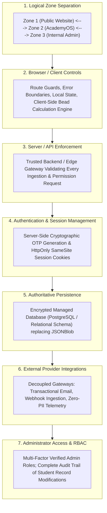
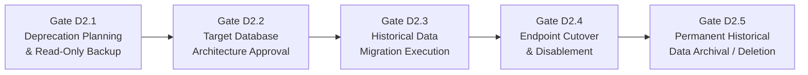

# ARNAV ABACUS ACADEMY (AAA) — WS-07 MANAGEMENT VALIDATION & AMENDMENT REPORT
## Architectural Refinement, Options Modularization & Governance Alignment (`WS07-C03`)

**Document Reference:** `AAA-S3-VAL-WS07-02`  
**Parent Workstream:** WS-07 — Internal & Student System Boundary Isolation Architecture  
**Stage:** Stage 3 — Architecture & Design  
**Compilation Date:** 03 November 2026 (Updated under Governance Refinement)  
**Status:** 🟡 **DRAFT — AWAITING MANAGEMENT REVIEW (Gate 3.2 Remains Open)**  
**Executive Authority:** Nitin Patil (Operations & Technology Lead) & Neha Patil (Founder & Academic Director)  

---

## 1. Purpose of This Amendment Report

This report evaluates and refines the architectural proposals submitted under Deliverable `AAA-S3-SPEC-WS07-01`. 

In response to management review, this report:
1. Disentangles overarching architectural principles from specific vendor implementations (preventing premature provider lock-in).
2. De-couples the architecture into seven distinct operational layers.
3. Establishes a phased, five-step governance gate for the deprecation and migration of `jsonblob.com`.
4. Defines mandatory architecture principles for historical data preservation, reconciliation, and rollback (`WS07-C03`).
5. Refines the Student ID schema options analysis while preserving `AAA-STU-YYYY-XXXX` strictly as a candidate format.
6. Codifies the pedagogical privacy policy governing student practice results and leaderboards.
7. Replaces the bundled 3-item determination form with six discrete, granular management decisions (`D-1` through `D-6`).

---

## 2. Decoupled Architecture Layers & Technology Neutrality

Earlier drafts presented "Option 2" as a bundled recommendation combining Edge API Proxies, Vercel Serverless, and Supabase. To ensure technology neutrality and preserve management authority, the system architecture is explicitly partitioned across seven independent layers:



### 2.1 Layer Responsibilities & Isolation Boundaries

| Architectural Layer | Core Responsibility | Current Implementation | Target Architectural State | Governing Workstream |
| :--- | :--- | :--- | :--- | :---: |
| **1. Logical Zone Separation** | Strict boundary between public marketing, student practice, and administration. | Single React bundle; mixed routes in `App.tsx`. | Three decoupled functional zones with explicit network boundaries. | **WS-07** |
| **2. Browser / Client Controls** | Responsive UI rendering, interactive Soroban bead physics, client-side timers. | Unconditional `ProtectedRoute`; local state. | Route guards redirect unauthenticated users; client calculation loop preserved. | **WS-07** |
| **3. Server / API Enforcement** | Validating identity, permissions, and request rates before executing operations. | Absent (direct client-to-third-party calls). | Stateless API gateway enforcing server-side authorization. | **WS-07 / WS-09** |
| **4. Auth & Session Management** | Issuing and verifying tamper-proof session tokens; secure OTP dispatch. | Client `Math.random()` + EmailJS + console fallback. | Server-generated OTP with 5-min TTL + HttpOnly SameSite cookies. | **WS-07 / WS-10** |
| **5. Authoritative Persistence** | Durable, encrypted, ACID-compliant storage for student attempts and profiles. | Browser `localStorage` + unauthenticated `jsonblob.com`. | Encrypted database with student-level isolation and automated backups. | **WS-09** |
| **6. External Integrations** | Isolating external webhooks, email relays, and analytics tools. | Hardcoded endpoints in client bundle chunks. | Server-side proxy relays preventing API key and secret exposure. | **WS-07 / WS-10** |
| **7. Administrator Access** | Guarding student rolls, course permissions, and success story publishing. | In-memory modal with hardcoded email array. | Server-enforced RBAC with immutable audit logging. | **WS-07 / WS-11** |

> [!IMPORTANT]
> **WS-11 INFRASTRUCTURE & HOSTING DECOUPLING RULE:**  
> The specific cloud hosting provider (e.g. Vercel Serverless vs. Cloudflare Pages/Workers vs. AWS Amplify/Lambda vs. self-hosted VPS) is **strictly deferred to WS-11 (Platform Infrastructure & Hosting)**.  
> WS-07 establishes the architectural requirements; WS-11 evaluates the infrastructure vendors.

---

## 3. Five-Stage JSONBlob Deprecation & Data Preservation Framework (`WS07-C03`)



### 3.1 Architecture Principles for Data Preservation & Rollback (`WS07-C03`)

In accordance with `WS07-C03`, the following six architectural principles govern all persistence transitions:

1. **Historical Student-Attempt Preservation:** Every completed calculation drill, personal score percentage, elapsed time, and completion timestamp recorded in `localStorage` or `jsonblob.com` represents an enrolled child's authentic learning milestone. No attempt record shall be dropped, truncated, or discarded.
2. **Pre-Migration Record Reconciliation:** Before any data is imported into a new database, an automated reconciliation script must cross-reference raw attempt records against the verified student enrollment roll (`DVR-STU-001`) to distinguish genuine student attempts from synthetic development tests or automated crawler submissions.
3. **Cryptographic Backup & Restoration Guarantee:** Prior to initiating any migration, a complete, immutable snapshot of all endpoints must be exported to an encrypted offline cold archive. The archive must be verified via SHA-256 cryptographic checksums, and a formal restoration test must be executed in a sandboxed staging environment.
4. **Tested Two-Way Rollback Architecture:** The client-side application must deploy a **dual-read compatibility layer**. If the new database API encounters downtime, high latency, or authentication errors, the client application must gracefully fall back to local browser storage without displaying white-screen application crashes or aborting active student drills.
5. **Duplicate & Missing Record Detection:** The migration pipeline must execute deterministic deduplication algorithms based on compound keys (`completedAt` + `userId` + `setId`). If records with identical timestamps have conflicting scores, both records must be flagged for manual review rather than silently overwritten.
6. **Data Integrity & Schema Validation:** Post-migration validation must run automated row-count and checksum comparisons between the cold export and the destination database. Migration shall not be deemed successful until 100% of verified historical attempt records are confirmed readable by the student results component.

> [!CAUTION]
> **GOVERNANCE RESTRICTION ON STORAGE OPERATIONS:**  
> In compliance with the Stage 3 implementation freeze:  
> **No data migration, database provisioning, backup extraction, endpoint modification, or data deletion is authorized by this specification.**

### 3.2 Migration Readiness Checklist (11 Mandatory Prerequisites)

No migration script shall run and no endpoint shall be disabled until all eleven items are verified and countersigned:

- [ ] **1. Complete Data Inventory:** Comprehensive audit of all JSON records currently hosted on endpoints `019f9065...` and `019fa81d...`.
- [ ] **2. Data Ownership Classification:** Categorization of records into student attempt logs, visitor feedback, and published success stories.
- [ ] **3. Cryptographic Cold Export:** Full JSON export downloaded and stored in an encrypted offline archive with SHA-256 hash verification.
- [ ] **4. Data Reconciliation:** Cross-referencing records against known enrolled students to filter test data and spam attempts.
- [ ] **5. Duplicate Resolution Protocol:** Explicit programmatic rules to handle duplicate timestamp/email records without data loss.
- [ ] **6. Historical Record Preservation:** Guarantee that existing students' drill personal bests and timestamps are accurately transferred to the new database.
- [ ] **7. Target Access Control Verification:** Verification that the replacement database enforces strict authentication before data ingestion.
- [ ] **8. Privacy Impact Assessment:** Verification that the migration does not transmit unencrypted PII over insecure transit layers.
- [ ] **9. Regression & Compatibility Testing:** Verification that the dual-read compatibility layer works seamlessly across desktop and mobile.
- [ ] **10. Tested Rollback Protocol:** Documented, tested procedure to revert client code back to local caching in the event of database failure.
- [ ] **11. Final Executive Sign-Off:** Written authorization from Nitin Patil and Neha Patil prior to endpoint termination.

---

## 4. Student Identity Architecture & Sibling Governance

### 4.1 Ratified Core Principle
> **"One permanent Student ID per child, with multiple programmes attached to the same Student ID."**

### 4.2 Candidate Format Evaluation: `AAA-STU-YYYY-XXXX`

The format `AAA-STU-YYYY-XXXX` (e.g., `AAA-STU-2026-0001`) is preserved strictly as a **candidate design proposal**. A comprehensive options analysis evaluates its structural viability:

```
+---------------------------------------------------------------------------------------------------------+
| CANDIDATE STUDENT ID EVALUATION: AAA-STU-YYYY-XXXX                                                      |
+---------------------------------------------------------------------------------------------------------+
| 1. Uniqueness & Allocation: Deterministic sequence prefixed by academy code (AAA) and enrollment year   |
|    (YYYY), followed by a 4-digit sequential counter (XXXX). Eliminates collision across academic years.  |
| 2. Sibling Support: Multiple children under one family share parent contact info (WhatsApp/Email), but  |
|    receive distinct Student IDs (e.g., Sibling 1 = AAA-STU-2025-0012, Sibling 2 = AAA-STU-2026-0004).   |
| 3. Historical Record Mapping: Existing students identified by email will be mapped to permanent IDs      |
|    during Stage 4 data reconciliation without overwriting historical attempt timestamps.                |
| 4. Multi-Programme Attachment: Course enrollments (Abacus, Vedic, IPM) link to the Student ID foreign   |
|    key rather than duplicating student records.                                                         |
| 5. Privacy & Minimization: Student IDs serve as pseudonymous public tokens for classroom displays,       |
|    keeping full legal names, phone numbers, and home addresses decoupled from client logs.              |
+---------------------------------------------------------------------------------------------------------+
```

---

## 5. Child Development Privacy & Leaderboard Reform Policy

### 5.1 The Pedagogical Imperative
AAA’s educational philosophy establishes that mathematical learning is a journey of personal empowerment, not public comparison. Exposing a 6-year-old child's calculation speed or percentage score on a public leaderboard can trigger acute math anxiety, demotivation, and parental friction.

### 5.2 Target Privacy Policy for AcademyOS
1. **Zero Public Developmental Rankings:** No public or unauthenticated leaderboards will exist on any page.
2. **Self-Referential Progress First:** The primary feedback rendered to a child is their **Personal Growth Curve** (e.g., *"You answered 4 more questions correctly than last week!"*).
3. **Pseudonymisation vs. Anonymisation Safeguard:**
   - *Technical Distinction:* Replacing a child's name with "Student A.P." or "Learner #402" is **pseudonymisation**, NOT true anonymisation.
   - *Governance Rule:* Because pseudonymous data can still be linked back to an identifiable child by instructors or peers, it remains subject to strict internal data protection protocols.
4. **Consent-Gated Public Showcases:** Any public display of student achievement (e.g., on `/showcase`) requires prior explicit, written parental consent.

---

## 6. Workstream Roadmap Reconciliation & Visibility

The Stage 3 delivery roadmap is confirmed intact:

| Workstream | Domain Scope | Gate | Status |
| :--- | :--- | :---: | :---: |
| **`WS-06`** | Digital Experience & Website Architecture (Specs 06.1–06.6) | Gate 3.1 | 🟢 **RATIFIED & CLOSED** (`MGT-DET-S3-09`) |
| **`WS-07`** | AcademyOS Boundary Isolation & Protection Architecture | Gate 3.2 | 🟡 **DRAFT — AWAITING REVIEW (Gate 3.2 Open)** |
| **`WS-08`** | Diagnostic Assessment & Learning Recommendation Architecture | Gate 3.3 | 🔒 **QUEUED** (Requires WS-07 Ratification) |
| **`WS-09`** | Technology Architecture, Data Persistence & CRM Strategy | Gate 3.4 | 🔒 **QUEUED** (Requires WS-07 Ratification) |
| **`WS-10`** | Privacy, Security & Zero-PII Compliance Architecture | Cross-Cutting | 🔄 **ACTIVE CROSS-CUTTING AUDIT** |
| **`WS-11`** | Commercial Readiness, Franchise & Platform Infrastructure | Gate 3.5 | 🔒 **QUEUED** (Retains Hosting & Platform Scope) |

---
*End of Management Validation & Amendment Report (AAA-S3-VAL-WS07-02).*
