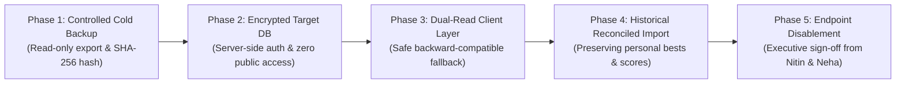

# ARNAV ABACUS ACADEMY (AAA) — WS-07 RISK & OPEN ISSUE REGISTER
## Comprehensive Risk Management, Threat Evaluation & JSONBlob Governance Log (`WS07-C02`)

**Document Reference:** `AAA-S3-RSK-WS07-01`  
**Deliverable Type:** Risk Register & Open Issue Governance Log  
**Parent Workstream:** WS-07 — Internal & Student System Boundary Isolation Architecture  
**Stage:** Stage 3 — Architecture & Design  
**Date of Compilation:** 03 November 2026  
**Status:** 🟡 **DRAFT LOG — AWAITING FORMAL MANAGEMENT REVIEW**  
**Executive Reviewers:** Nitin Patil (Operations & Technology Lead) & Neha Patil (Founder & Academic Director)  

---

## 1. Executive Summary & Purpose

This register formalizes the risk evaluation, threat mitigation, and issue tracking protocols for Workstream WS-07. 

In strict adherence to governance correction **`WS07-C02`**, this document:
1. Formulates a dedicated risk management entry for external `jsonblob.com` persistence references.
2. Documents technical risks without performing live network probes or exposing private endpoint contents.
3. Categorizes risks by severity, likelihood, risk owner, and urgency.
4. Defines the mandatory evidentiary artifacts required for risk mitigation and closure in Stage 4.

---

## 2. Formal Risk Entry: JSONBlob External Persistence (`RSK-07-01`)

```
====================================================================================================
FORMAL RISK RECORD: RSK-07-01
Asset at Risk: Student Practice Histories, Personal Names & Contact Email Addresses
Category: External Persistence & Unauthenticated Cloud Data Exposure
Responsible Risk Owner: Nitin Patil (Operations & Technology Lead)
Current Risk Classification: HIGH (Severity: HIGH | Likelihood: HIGH | Urgency: HIGH)
====================================================================================================
```

### 2.1 Description of the Risk & Mechanism
In `src/lib/cloudSync.ts` (lines 24–78) and `src/lib/successStories.ts` (lines 28–34), student attempt histories and visitor feedback are synchronized across devices using hardcoded REST endpoints pointing to `https://jsonblob.com/api/jsonBlob/019f9065-ec4f-7d60-b80c-07b7f039afe6` and `https://jsonblob.com/api/jsonBlob/019fa81d-0104-7348-beae-a82900883473`.

- **Potential Exposure Mechanism:** In client-side single-page applications, all JavaScript bundles are publicly downloaded by the user's browser. An external actor inspecting bundle chunks or browser network activity can discover the exact `jsonblob.com` URLs.
- **Endpoint Access-Control Reality:** Source code inspection confirms that HTTP GET and PUT requests sent to these endpoints contain **zero authentication headers, bearer tokens, or API credentials**.
- **Data Fields Transmitted in Code:** The `AttemptRecord` interface explicitly maps:
  1. `userName` (Student full name)
  2. `userEmail` (Student contact email)
  3. `userId` (Assigned email identifier)
  4. `setId` & `setTitle` (Course practice set)
  5. `level` (Enrolled curriculum level)
  6. `scorePercentage` & `timeTakenSeconds` (Performance metrics)
  7. `completedAt` (Timestamp of drill)

### 2.2 Strict Governance Constraints (What Has NOT Been Done)
> [!IMPORTANT]
> **NO UNAUTHORIZED NETWORK PROBING OR DESTRUCTIVE TESTING:**  
> In accordance with the Stage 3 implementation freeze:  
> 1. **Zero external network requests** have been made to `jsonblob.com` during this audit.  
> 2. **No private endpoint contents** have been downloaded, inspected, or published in documentation.  
> 3. **The endpoints have NOT been disabled, modified, or deleted.**  
> This finding documents an architectural vulnerability identified in source code; it does **not** assert that a public breach or data compromise has occurred in production.

### 2.3 Containment Strategy & Recommended Staged Remediation
The containment of `RSK-07-01` must follow the ratified **5-Stage Controlled Deprecation Framework**:



### 2.4 Evidence Required for Risk Closure
Risk `RSK-07-01` shall remain in status **OPEN** until the following four documentary artifacts are captured in `docs/11_evidence_and_screenshots/`:
1. **Cold Backup Hash Verification:** Cryptographic checksum of offline export file.
2. **Target Database Access Audit:** Automated penetration test confirming new endpoint requires valid HttpOnly session cookies.
3. **Data Reconciliation Sign-Off:** Written verification from Neha Patil that historical attempt records are preserved without data loss.
4. **Endpoint Termination Evidence:** HTTP 404/410 response dump verifying deprecation of the `jsonblob.com` endpoints following verified cutover.

---

## 3. Comprehensive WS-07 Risk & Open Issue Log

| Risk / Issue ID | Summary Title | Threat Ref | Severity | Likelihood | Risk Owner | Current Governance Status | Required Remediation Milestone |
| :---: | :--- | :---: | :---: | :---: | :---: | :---: | :--- |
| **RSK-07-01** | **JSONBlob Unauthenticated Data Transmission** | `TM-01` | **HIGH** | **HIGH** | Nitin Patil | 🟡 **OPEN (Under Review)** | Phase 1–5 Controlled Deprecation in Stage 4 (`D-2`). |
| **RSK-07-02** | **Console Secret Disclosure in OTP Fallback** | `TM-02` | **HIGH** | **MEDIUM** | Nitin Patil | 🟡 **OPEN (Under Review)** | Migrate OTP generation to serverless Edge API in Stage 4 (`D-1`). |
| **RSK-07-03** | **Client-Side Permission Tampering via LocalStorage** | `TM-03` | **MEDIUM** | **HIGH** | Nitin Patil | 🟡 **OPEN (Under Review)** | Enforce server-side RBAC token verification on API routes (`D-1`). |
| **RSK-07-04** | **Unauthenticated Route Loading in ProtectedRoute** | `TM-03` | **MEDIUM** | **HIGH** | Nitin Patil | 🟡 **OPEN (Under Review)** | Update `ProtectedRoute` to enforce `<Navigate to="/login" replace />` (`D-1`). |
| **RSK-07-05** | **Sibling Account Collision under Email-as-ID** | `TM-03` | **MEDIUM** | **MEDIUM** | Nitin Patil | 🟡 **OPEN (Under Review)** | Adopt permanent Student ID model (`AAA-STU-YYYY-XXXX`) (`D-3`, `D-5`). |
| **RSK-07-06** | **Pedagogical Conflict in Public Live Leaderboard** | `TM-05` | **MEDIUM** | **HIGH** | Neha Patil | 🟡 **OPEN (Under Review)** | Replace public ranking with personal progress curves & pseudonyms (`D-4`). |
| **RSK-07-07** | **Inability to Audit Provider-Side Access on Google Sheets** | `TM-04` | **LOW** | **MEDIUM** | Nitin Patil | 🟡 **OPEN (Under Review)** | Verify IAM roles and sharing permissions on lead destination sheet in Stage 4. |

---

## 4. Urgency & Action Plan Summary

```
+----------------------------------------------------------------------------------------------------+
| 🔒 MANAGEMENT RISK MITIGATION MANDATE:                                                             |
| - No interim patch shall be deployed directly to production to "quick-fix" these findings.         |
| - The Stage 3 implementation freeze must be strictly maintained to prevent regressions.            |
| - Full remediation of RSK-07-01 through RSK-07-06 will occur through disciplined engineering in     |
|   Stage 4 Sprint Implementation, governed by Stage-Gate 4.0 entry criteria.                       |
+----------------------------------------------------------------------------------------------------+
```

---
*End of WS-07 Risk & Open Issue Register (AAA-S3-RSK-WS07-01).*
