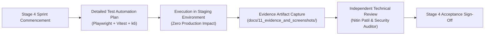

# ARNAV ABACUS ACADEMY (AAA) — WS-07 SECURITY REQUIREMENT-TO-TEST TRACEABILITY MATRIX
## Stage 4 Verification Test Suite Blueprint (`WS07-C04`)

**Document Reference:** `AAA-S3-TRC-WS07-01`  
**Deliverable Type:** Architecture-to-Implementation Verification Matrix  
**Parent Workstream:** WS-07 — Internal & Student System Boundary Isolation Architecture  
**Stage:** Stage 3 — Architecture & Design  
**Date of Compilation:** 03 November 2026  
**Status:** 🟡 **DRAFT SPECIFICATION — PROPOSED STAGE 4 TEST SUITE (UNEXECUTED)**  
**Executive Reviewers:** Nitin Patil (Operations & Technology Lead) & Neha Patil (Founder & Academic Director)  

---

## 1. Scope & Verification Mandate

In strict compliance with governance correction **`WS07-C04`**, this document defines the formal requirement-to-test traceability matrix for all architectural security and boundary isolation controls specified in WS-07.

> [!WARNING]
> **GOVERNANCE NOTICE — TESTS ARE UNEXECUTED PROPOSALS:**  
> In compliance with the Stage 3 implementation freeze, **none of the tests listed below have been executed or passed**.  
> This document establishes the mandatory test contracts, expected behaviors, evidence artifacts, and acceptance criteria that must be verified during Stage 4 before any production deployment.

---

## 2. Requirement-to-Test Traceability Matrix

The twelve security domains specified in `AAA-S3-SPEC-WS07-01` are mapped to formal verification test cases:

| Domain Ref | Security Requirement | Architecture Control | Proposed Stage 4 Test Procedure | Expected Result | Evidence Required for Acceptance | Acceptance Criterion | Test Status |
| :---: | :--- | :--- | :--- | :--- | :--- | :--- | :---: |
| **TRC-01** | **Authentication Boundary** | Client requests to `/practice/*` must require valid session credentials. | `TEST-AUTH-01`: Send unauthenticated HTTP GET requests to `/practice`, `/practice/session`, and `/practice/results` in clean browser profile without cookies/storage. | Client is redirected to `/login` via server/route guard; zero practice drill assets or attempt records rendered. | Playwright automated redirect assertion log + HTTP 302/client navigate trace. | Unauthenticated requests cannot load student dashboard or practice state. | 🔒 **QUEUED (Stage 4)** |
| **TRC-02** | **OTP Lifecycle & Generation** | 6-digit OTP codes must be generated cryptographically on a trusted server with 5-minute TTL. | `TEST-OTP-01`: Dispatch `POST /api/auth/otp/request` for test student email. Inspect client console, network response body, and local storage. | Response contains generic status (`{ success: true }`); OTP code is absent from client memory and only delivered via verified email/SMS provider. | Burp Suite / Chrome DevTools response payload export showing zero OTP disclosure. | Usable OTP is never exposed in client bundle, network response, or console log. | 🔒 **QUEUED (Stage 4)** |
| **TRC-03** | **OTP Throttling & Anti-Brute Force** | OTP validation endpoint must enforce rate-limiting and maximum retry counts. | `TEST-OTP-02`: Dispatch 6 consecutive incorrect OTP attempts to `POST /api/auth/otp/verify` for the same account within 60 seconds. | 6th attempt returns HTTP 429 (Too Many Requests); OTP is invalidated; account enters temporary 15-minute lock. | Automated API test log showing HTTP 429 response code and lock status. | Brute-force guessing of 6-digit code space is computationally infeasible. | 🔒 **QUEUED (Stage 4)** |
| **TRC-04** | **Session Management & Token Storage** | Session tokens must be stored in HttpOnly, Secure, SameSite=Strict cookies. | `TEST-SESS-01`: Authenticate student; execute `document.cookie` in browser DevTools console. Inspect cookie storage attributes. | `document.cookie` returns empty string; session cookie has `HttpOnly: true`, `Secure: true`, `SameSite: Strict`. | Chrome DevTools Storage pane screenshot + curl `-I` response header dump. | Session tokens are inaccessible to client-side JavaScript, mitigating XSS token theft. | 🔒 **QUEUED (Stage 4)** |
| **TRC-05** | **Server-Side Authorization** | Course and level permissions must be validated server-side on drill attempt ingestion. | `TEST-AUTHZ-01`: Tamper with client `localStorage` to claim `SVM-6` access on an account registered only for `SR-1`. Submit completed attempt. | Server evaluates authenticated user session against database permissions; rejects attempt with HTTP 403 Forbidden. | Server audit log showing permission mismatch rejection + HTTP 403 response. | Client-side storage manipulation cannot escalate student level permissions. | 🔒 **QUEUED (Stage 4)** |
| **TRC-06** | **Role-Based Access Control (RBAC)** | Administrative tools (`AdminEmailAccessModal`, story publishing) must require verified admin role. | `TEST-RBAC-01`: Send authenticated student session request to `POST /api/admin/students/permissions` or `/api/admin/showcase/publish`. | Server verifies user role; non-admin session is rejected with HTTP 403; access attempt logged in audit trail. | Server security event log recording unauthorized admin attempt with IP and timestamp. | Student credentials cannot invoke privileged administrative operations. | 🔒 **QUEUED (Stage 4)** |
| **TRC-07** | **Student Data Isolation** | Student attempt records must be segregated; students must never read peers' raw attempt data. | `TEST-DATA-01`: Student A queries `GET /api/student/practice/history?studentId=STUDENT-B`. | Server enforces session-to-identity binding; returns HTTP 403 Forbidden or returns only Student A's own records. | Automated API test assertion log verifying query parameter tampering failure. | Horizontal privilege escalation between students is completely blocked. | 🔒 **QUEUED (Stage 4)** |
| **TRC-08** | **Persistence Security & Ingestion** | Public unauthenticated cloud storage (e.g. `jsonblob.com`) must be retired; attempts stored in encrypted DB. | `TEST-PER-01`: Send unauthenticated GET/PUT requests to new practice attempt persistence endpoints. | Request rejected with HTTP 401 Unauthorized; zero student attempt records returned. | curl network dump showing strict authentication requirement on API routes. | No student data or practice history is accessible without active session credentials. | 🔒 **QUEUED (Stage 4)** |
| **TRC-09** | **Leaderboard & Child Privacy** | Public peer rankings must be removed; student sees self-referential progress and pseudonyms. | `TEST-PRIV-01`: Complete drill in guest mode and student mode; inspect DOM on `/practice/results`. | No public peer table rendered; display shows personal progress curve; any peer benchmarks use pseudonyms. | Automated DOM snapshot asserting absence of peer full names and percentage rank tables. | Zero public ranking or peer comparison of individual children's scores. | 🔒 **QUEUED (Stage 4)** |
| **TRC-10** | **Parent/Student Access Boundaries** | Parent contact data must remain separate from student practice session runtime. | `TEST-BOUND-01`: Query student practice session API payload; inspect returned JSON fields. | Payload contains only Student ID, enrolled levels, and attempt metrics; parent phone, email, and billing omitted. | Network payload audit verifying absence of parent PII in practice session context. | Minimum Necessary Data Principle strictly enforced in student execution contexts. | 🔒 **QUEUED (Stage 4)** |
| **TRC-11** | **Rate Limiting & Abuse Prevention** | Public enquiry forms and auth endpoints must defend against automated spam and volumetric attacks. | `TEST-RATE-01`: Dispatch 50 concurrent `POST /api/public/enquiry` submissions from single IP within 10 seconds. | Edge gateway throttles requests after 5 submissions; returns HTTP 429; triggers CAPTCHA challenge. | Load-testing tool (k6/artillery) execution report demonstrating edge rate limiting. | Public intake endpoints are protected from automated quota exhaustion and spam pollution. | 🔒 **QUEUED (Stage 4)** |
| **TRC-12** | **Security Audit Logging** | Security-critical events (login failures, permission changes, data exports) must be logged immutably. | `TEST-AUDIT-01`: Trigger failed login, administrative level change, and student export; inspect audit table. | Immutable audit log record created with timestamp, actor ID, action type, IP address, and outcome. | Database query export of `security_audit_logs` table showing complete event trail. | Forensic accountability for all authentication, authorization, and administrative actions. | 🔒 **QUEUED (Stage 4)** |

---

## 3. Stage 4 Test Execution Governance

### 3.1 Execution Prerequisites
1. All tests must be executed in an isolated **Staging Environment** before production deployment.
2. No testing script shall send synthetic or automated traffic against production endpoints.
3. Test evidence logs, screenshots, and response dumps must be sanitized to ensure zero PII is committed to the repository.
4. Final sign-off on test results must be executed by **Nitin Patil** (Operations & Technology Lead) before Gate 4.0 approval.

---
*End of Stage 4 Security Requirement Traceability Matrix (AAA-S3-TRC-WS07-01).*
