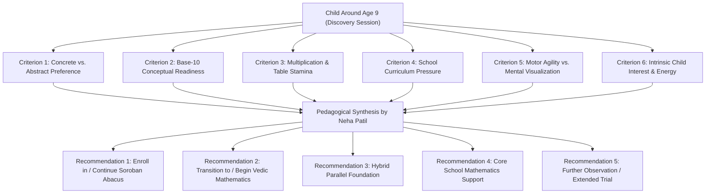
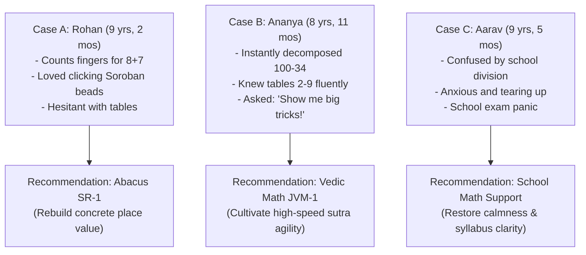

# ARNAV ABACUS ACADEMY (AAA) — AGE-NINE PROGRAMME CROSSOVER FRAMEWORK
## Stage 3 Solution Architecture Deliverable (WS-08.4)

**Document Reference:** `AAA-S3-SPEC-WS08-04`  
**Deliverable Type:** Academic Diagnostic & Curriculum Pathway Framework  
**Parent Workstream:** WS-08 — Diagnostic Assessment & Learning Recommendation Architecture  
**Stage:** Stage 3 — Architecture & Design  
**Date of Compilation:** 04 November 2026  
**Status:** 🟡 **DRAFT — AWAITING ACADEMIC VALIDATION BY NEHA PATIL**  
**Executive Authority:** Neha Patil (Founder & Academic Director) & Nitin Patil (Operations & Technology Lead)  

---

## 1. Executive Summary & Purpose

Children around age nine (approximately Grade 3 to Grade 4) stand at a pivotal cognitive crossroad in foundational mathematics:
- They are physically mature enough to manipulate the Soroban abacus with fine motor speed.
- Simultaneously, their emerging abstract reasoning capabilities make them receptive to mental sutras, algebraic patterns, and high-speed Vedic calculation techniques.

The purpose of this framework is to establish an **objective, multi-factorial educational decision architecture** for children aged 8.5 to 10. 

```
+----------------------------------------------------------------------------------------------------+
| 🔒 NON-NEGOTIABLE ACADEMIC CROSSOVER PRINCIPLES:                                                   |
| 1. Chronological Age is NEVER the Sole Criterion: Placing a child in Vedic Math solely because     |
|    they turned 9, or keeping them in Abacus solely because they are 8, is strictly unpedagogical.  |
| 2. No Mandatory Sequential Progression: Children do NOT have to complete Abacus before entering    |
|    Vedic Math; nor must all Abacus students transition to Vedic Math.                              |
| 3. Multi-Pathway Outcomes: The framework supports five distinct pedagogical recommendations.       |
| 4. Academic Authority: All decision logic remains subject to validation by Neha Patil.             |
+----------------------------------------------------------------------------------------------------+
```

---

## 2. Multi-Factorial Diagnostic Evaluation Matrix

Rather than relying on age or school grade, the educator evaluates the 9-year-old child across **six developmental diagnostic criteria**:



### 2.1 Diagnostic Criteria Breakdown

| Diagnostic Criterion | Diagnostic Indicator Favoring Abacus | Diagnostic Indicator Favoring Vedic Math | Diagnostic Indicator Favoring School Math / Other |
| :--- | :--- | :--- | :--- |
| **1. Concrete vs. Abstract** | Learns best through physical touch, moving physical objects, tactile sensory feedback. | Easily manipulates numbers mentally; enjoys spotting abstract rules and symbolic patterns. | Struggling with basic school textbook questions and word problems. |
| **2. Base-10 Readiness** | Relies on finger counting; lacks intuitive sense of 10-complements; needs concrete place-value rods. | Secure with place value; instinctively knows complements ($7+3, 6+4, 100-24$). | Significant foundational gaps; confuses addition with multiplication. |
| **3. Table Stamina** | Still developing basic addition/subtraction fluency ($\le 20$). | Knows basic single-digit tables ($2$ to $9$) reasonably well; ready for multi-digit tricks. | Blanking out during timed school class tests. |
| **4. School Pressures** | Parent desires long-term concentration, spatial memory, and focus stamina without rush. | Parent and student need immediate time-saving shortcuts for Grade 4/5 exams. | Child is failing or scoring low on current school CBSE/ICSE exams. |
| **5. Motor & Visual Agility**| Strong fine motor dexterity; excited by tactile wooden beads. | Prefers writing quick one-line answers; finds physical bead clicking repetitive. | Reluctant to write or touch tools; high test anxiety. |
| **6. Child Voice (`VOX`)** | *"I love moving these wooden beads; it feels like a puzzle game!"* | *"Show me that cool trick to multiply big numbers in my head!"* | *"I just want to understand what my school teacher is asking."* |

---

## 3. The Five Legitimate Pedagogical Recommendation Outcomes

```
====================================================================================================
PROPOSED CROSSOVER DECISION MATRIX — SUBJECT TO NEHA PATIL'S ACADEMIC VALIDATION
====================================================================================================
```

### Outcome 1: Recommend Soroban Abacus Mathematics
* **Primary Profile:** 9-year-old child with developing Number Sense, persistent finger counting, high sensory responsiveness to physical manipulatives, and parent seeking long-term concentration and spatial memory development.
* **Educational Rationale:** Moving beads gives the child an unbreakable concrete representation of base-10 quantities, eliminating calculation anxiety before introducing high-speed mental shortcuts.
* **Starting Module:** Senior Abacus Level 1 (`SR-1` / `SR-2`).

### Outcome 2: Recommend Vedic Mathematics
* **Primary Profile:** 9-year-old child with secure single-digit addition/subtraction, familiarity with multiplication tables up to 9, strong mental abstraction, and a desire for speed and exam efficiency.
* **Educational Rationale:** The child has already outgrown concrete tactile beads and is intellectually stimulated by algebraic shortcuts, digital root checks, and one-line cross-multiplication.
* **Starting Module:** Junior Vedic Math Level 1 (`JVM-1` / `SVM-0`).

### Outcome 3: Recommend School Mathematics Reinforcement
* **Primary Profile:** 9-year-old child experiencing severe confusion with current school board curriculum (CBSE/ICSE Grade 3–4), struggling with textbook word-problem comprehension and fractions.
* **Educational Rationale:** Specialized speed shortcuts (Abacus or Vedic) risk adding cognitive overload if the child does not yet grasp basic school syllabus concepts. Reinforcing foundational curriculum in a micro-batch of five must precede speed training.
* **Starting Module:** School Mathematics Primary Support (Grade 3/4 CBSE/ICSE).

### Outcome 4: Recommend IPM / Olympiad Foundation
* **Primary Profile:** 9-year-old child with exceptional Number Sense, instant multi-digit decomposition, rapid pattern spotting, high curiosity, and boredom with routine school arithmetic.
* **Educational Rationale:** The child requires intellectual stretch through non-routine problem solving, combinatorial logic, and competitive exam decomposition rather than repetitive calculation drills.
* **Starting Module:** IPM Grade 3/4 Foundations / Olympiad Primary Logic.

### Outcome 5: Recommend Further Observation / Extended Trial Session
* **Primary Profile:** Child presented significant shyness, extreme test anxiety, or acute fatigue during the Discovery Session, preventing clear evaluation across the six dimensions.
* **Educational Rationale:** It is academically irresponsible to make a definitive multi-year curriculum placement based on an inconclusive, anxiety-compromised interaction.
* **Action Plan:** Invite child for a complimentary 30-minute informal playful session on a weekend morning before finalizing recommendations.

---

## 4. Case Study Scenarios for Mentor Alignment



---

## 5. Decision Governance & Sign-Off Requirement

No crossover recommendation for an enrolled student or discovery candidate shall be communicated to parents without the explicit, documented sign-off of **Neha Patil (Founder & Academic Director)**.

---
*End of Age-Nine Programme Crossover Framework (AAA-S3-SPEC-WS08-04).*
