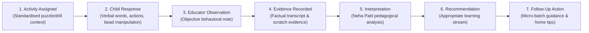
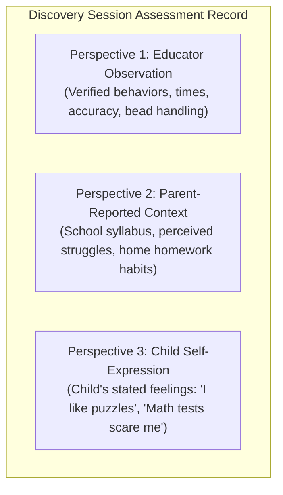

# ARNAV ABACUS ACADEMY (AAA) — ASSESSMENT & EVIDENCE MODEL
## Stage 3 Solution Architecture Deliverable (WS-08.3)

**Document Reference:** `AAA-S3-SPEC-WS08-03`  
**Deliverable Type:** Educational Assessment Data Model & Evidentiary Schema  
**Parent Workstream:** WS-08 — Diagnostic Assessment & Learning Recommendation Architecture  
**Stage:** Stage 3 — Architecture & Design  
**Date of Compilation:** 04 November 2026  
**Status:** 🟡 **DRAFT — AWAITING MANAGEMENT REVIEW**  
**Executive Authority:** Neha Patil (Founder & Academic Director) & Nitin Patil (Operations & Technology Lead)  

---

## 1. Core Principles of the AAA Evidentiary Model

The AAA Assessment and Evidence Model governs how observations are captured, structured, contextualized, and transformed into pedagogical recommendations during a Discovery Session.

```
+----------------------------------------------------------------------------------------------------+
| 🔒 CORE EVIDENTIARY ARCHITECTURE PRINCIPLES:                                                       |
| 1. Every Claim Must Trace to Observable Evidence: Subjective impressions ("smart", "slow", "lazy") |
|    are strictly prohibited. Every evaluation must cite an identifiable behavioral event.          |
| 2. Speed != Mathematical Understanding: A child computing rapidly via memorization does not       |
|    necessarily possess deep number sense; a child pausing thoughtfully to decompose equations      |
|    demonstrates high executive analytical stamina.                                                 |
| 3. Single-Session Limitation: A 60-minute intake session reflects current contextual comfort and   |
|    emerging readiness—it is NEVER a permanent, immutable ceiling on a child's potential.          |
| 4. Tripartite Perspective Isolation: Teacher Observations, Parent Context, and Child Voice must    |
|    remain clearly segregated in all records.                                                       |
+----------------------------------------------------------------------------------------------------+
```

---

## 2. Seven-Stage Evidentiary Transformation Pipeline

To ensure rigorous objectivity, every piece of assessment data passes through seven distinct cognitive and operational stages:



### 2.1 Definitions of the Seven Pipeline Stages

| Pipeline Stage | Precise Architectural Meaning | Example in Practice |
| :--- | :--- | :--- |
| **1. Activity Assigned** | The exact standardized mathematical task, manipulative, and prompt presented by the mentor. | *"Presented Soroban abacus with 1 heaven bead and 4 earth beads; prompted child to form 7."* |
| **2. Child Response** | The raw, unmediated behavioral and verbal action performed by the child. | *Child pushed 1 upper bead down and 2 lower beads up, stating: "5 and 2 makes 7".* |
| **3. Educator Observation** | The mentor’s immediate descriptive note of how the response was produced. | *Child displayed instantaneous base-5 visual grouping without finger counting or hesitating.* |
| **4. Evidence Recorded** | The tangible, audit-traceable record captured on the assessment sheet or scratch paper. | *Completed card #A-04; elapsed time: 3 seconds; zero verbal prompts required.* |
| **5. Interpretation** | Neha Patil’s professional pedagogical evaluation of developmental readiness. | *Strong intuitive Number Sense; comfortable with base-5 decomposition; ready for multi-row Abacus.* |
| **6. Recommendation** | The tailored educational pathway selected to nurture the child's next step. | *Placement in Soroban Abacus Foundation (SR-1) in a micro-batch of maximum 5.* |
| **7. Follow-Up Action** | The actionable guidance shared with the parent for immediate encouragement. | *Reassure parent that child is ready to advance without fingers; practice 5-complements playfully.* |

---

## 3. Tripartite Perspective Isolation Architecture

To prevent subjective bias and maintain clarity, the data schema explicitly segregates three distinct information sources:



| Perspective Attribute | Source 1: Educator Observation | Source 2: Parent-Reported Context | Source 3: Child Self-Expression |
| :--- | :--- | :--- | :--- |
| **Authoritative Status** | Primary empirical evidence | Secondary contextual background | Formative emotional indicator |
| **Data Capture Method** | Standardized rubric notes | Pre-session inquiry & dialogue | Spontaneous quotes & body language |
| **Verification Level** | Directly observed in session | Parent narrative (unverified) | Child's subjective self-perception |
| **Use in Recommendation** | Drives course level placement | Informs pacing and parent advice | Shapes emotional reassurance plan |
| **Labeling Standard** | `[OBS-TCH]` | `[CTX-PAR]` | `[VOX-STU]` |

---

## 4. Standardized Observation Record Schema

The proposed internal observation record captures all critical contextual variables to ensure fair and accurate evaluation:

```
+----------------------------------------------------------------------------------------------------+
| AAA DISCOVERY SESSION OBSERVATION RECORD SCHEMA                                                     |
+----------------------------------------------------------------------------------------------------+
| 1. SESSION METADATA:                                                                               |
|    - Session Reference ID:      AAA-OBS-YYYYMMDD-XXXX                                              |
|    - Date & Start/End Time:     DD-MM-YYYY (Nominal 45–90 min)                                     |
|    - Conducting Educators:      Neha Patil (Lead Mentor) & Nitin Patil (Operations Lead)           |
|    - Venue:                     Wakad Residential Learning Bungalow (Dedicated Room)               |
|                                                                                                    |
| 2. CHILD CONTEXTUAL BASELINE:                                                                      |
|    - Candidate Pseudonym:       Learner #[CandidateID] (e.g. Student A.P.)                         |
|    - Chronological Age:         Years + Months (e.g. 8 yrs, 7 mos)                                 |
|    - Current School Grade:      Grade (CBSE / ICSE / State Board / IB)                             |
|    - Session Alertness State:   Fresh (Morning) / Alert (Midday) / Post-School (Requires Water/Rest) |
|                                                                                                    |
| 3. TASK EXECUTION CONTEXT:                                                                         |
|    - Task Familiarity:          [ ] Entirely Novel Manipulative   [ ] Previously Seen / Tuitions    |
|    - Level of Assistance:       [ ] Independent   [ ] Gentle Verbal Scaffolding   [ ] Modelled Demo |
|    - Objective Accuracy:        Tasks Attempted: [N] | Tasks Correct: [N] | Calculation Slips: [N]  |
|    - Thinking Pace / Tempo:     [ ] Thoughtful Pause (3-5s)  [ ] Instant Intuitive  [ ] Impulsive   |
|                                                                                                    |
| 4. SIX-DIMENSIONAL OBSERVATION SUMMARY:                                                            |
|    - Dimension 1 (Number Sense):            Band: [Exploring/Developing/Secure/Extending]           |
|      Factual Evidence: [Concrete note on clustering, place value, and finger transition]            |
|    - Dimension 2 (Arithmetic Understanding): Band: [Exploring/Developing/Secure/Extending]           |
|      Factual Evidence: [Concrete note on regrouping logic and operational meaning]                  |
|    - Dimension 3 (Logical Approach):         Band: [Exploring/Developing/Secure/Extending]           |
|      Factual Evidence: [Concrete note on problem breakdown, pattern spotting, and testing]        |
|    - Dimension 4 (Learning Attitude):        Band: [Exploring/Developing/Secure/Extending]           |
|      Factual Evidence: [Concrete note on emotional response to mistakes and guidance]              |
|    - Dimension 5 (Response & Engagement):    Band: [Exploring/Developing/Secure/Extending]           |
|      Factual Evidence: [Concrete note on concentration stamina and manipulative focus]              |
|    - Dimension 6 (Interest & Passion):       Band: [Exploring/Developing/Secure/Extending]           |
|      Factual Evidence: [Concrete note on curiosity, spontaneous questions, and joyful wonder]       |
|                                                                                                    |
| 5. ACADEMIC INTERPRETATION & RECOMMENDATION:                                                       |
|    - Recommended Learning Stream: [Abacus / Mental Math / Vedic / School Math / IPM / Olympiad]     |
|    - Recommended Starting Module: [e.g. SR-1 Soroban Foundation / JVM-1 Junior Vedic]              |
|    - Pedagogical Justification:   [Synthesis explaining why this pathway nurtures the child best]   |
|    - Parent Guidance Notes:       [Actionable, non-critical home encouragement steps]               |
+----------------------------------------------------------------------------------------------------+
```

---

## 5. Safeguards Against Inaccurate Inferences

| Common Cognitive Pitfall | Erroneous Assessment Inference | AAA Required Corrective Architecture |
| :--- | :--- | :--- |
| **High Calculation Speed** | *"Child is mathematically advanced; skip foundations."* | **Verify Conceptual Depth:** Test if child can explain *why* the answer works using physical beads or decomposition. |
| **Slow Thoughtful Pausing** | *"Child is struggling or lacks confidence."* | **Value Metacognitive Stamina:** Recognize deliberate pausing (3–5 seconds) as healthy executive decomposition, not hesitation. |
| **Initial Shyness / Silence** | *"Child has low engagement or poor communication."* | **Provide Low-Verbal Manipulatives:** Allow child to demonstrate thinking through physical Soroban beads before demanding verbal answers. |
| **Single Calculation Slip** | *"Child lacks arithmetic mastery."* | **Evaluate Error Recovery:** Observe how the child reacts when the slip is pointed out; willingness to self-correct is a high-value positive signal. |

---
*End of Assessment & Evidence Model (AAA-S3-SPEC-WS08-03).*
