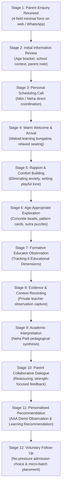

# ARNAV ABACUS ACADEMY (AAA) — DISCOVERY SESSION WORKFLOW ARCHITECTURE
## Stage 3 Solution Architecture Deliverable (WS-08.1)

**Document Reference:** `AAA-S3-SPEC-WS08-01`  
**Deliverable Type:** Educational Workflow & Operational Journey Architecture  
**Parent Workstream:** WS-08 — Diagnostic Assessment & Learning Recommendation Architecture  
**Stage:** Stage 3 — Architecture & Design  
**Date of Compilation:** 04 November 2026  
**Status:** 🟡 **DRAFT — AWAITING MANAGEMENT REVIEW**  
**Executive Authority:** Neha Patil (Founder & Academic Director) & Nitin Patil (Operations & Technology Lead)  

---

## 1. Executive Summary & Purpose

The **AAA Personalised Learning Discovery Session** represents the foundational gateway through which prospective parents and children experience the educational philosophy of Arnav Abacus Academy (Wakad, Pune). 

The purpose of this specification is to transition the Discovery Session from an informal, ad-hoc classroom meeting into a **structured, repeatable, and evidence-grounded educational observation journey**. 

### 1.1 Non-Negotiable Educational Boundary
> [!IMPORTANT]
> **PEDAGOGICAL OBSERVATION BOUNDARY — STRICTLY NON-DIAGNOSTIC:**  
> The Discovery Session is an **educational observation of learning behavior**, NOT an entrance examination, IQ test, or psychological evaluation.  
> - It does **not** generate an admission pass/fail score.  
> - It does **not** assign clinical labels (e.g., ADHD, Dyscalculia, Gifted IQ).  
> - It does **not** compare or rank children against peers.  
> - It evaluates the child's intuitive number sense, thinking strategies, and emotional response to guidance, grounding all subsequent recommendations in observed evidence.

---

## 2. Twelve-Stage Discovery Session End-to-End Workflow

The journey spans twelve structured operational stages, ensuring clarity, parental warmth, and rigorous child protection from initial inquiry through post-session guidance:

---

### Stage 1: Parent Enquiry Received
* **Objective:** Capture initial parental interest with minimum data friction and zero invasive profiling.
* **Responsible Person:** Nitin Patil (Operations & Technology Lead).
* **Inputs:** 4-Field Minimal Website Modal (`LeadForm.tsx`) or direct helpline WhatsApp message to `+91 90219 24968`.
* **Activities:** System ingests Parent Full Name, Mobile/WhatsApp Number, Child Age Bracket OR School Grade, and Optional Programme of Interest, accompanied by unbundled transactional consent.
* **Outputs:** Automated intake ticket generated in secure lead queue; transactional confirmation rendered to parent.
* **Parent Communication:** Immediate on-screen confirmation: *"Thank you. Neha Patil or Nitin Patil will personally contact you within 24–48 hours to schedule your complimentary session."*
* **Data Collected:** Parent Name, Mobile/WhatsApp, Child Grade/Age Bracket. (Zero date of birth, home address, or school name collected at this stage).
* **Privacy Controls:** Zero-PII analytics telemetry; inquiry data isolated from public client bundles.
* **Exceptions:** If parent requests an immediate walk-in without pre-booking, they are warmly welcomed if educators are free, or scheduled for the next available slot.

---

### Stage 2: Initial Information Review
* **Objective:** Review parental context before contact to prepare an age-appropriate session setup.
* **Responsible Person:** Neha Patil (Academic Director).
* **Inputs:** Lead queue intake record.
* **Activities:** Review indicated age bracket (e.g. 5–6 yrs vs 9–10 yrs) to pre-select appropriate physical manipulatives (Soroban abacus, flashcards, or Vedic puzzle sheets).
* **Outputs:** Pre-session preparation checklist assigned.
* **Parent Communication:** None at this internal stage.
* **Data Collected:** None additional.
* **Privacy Controls:** Data accessible only to authorized founders.
* **Exceptions:** If parent notes express severe math anxiety or negative school experiences, note is flagged for gentle, pressure-free handling.

---

### Stage 3: Personal Scheduling & Intake Confirmation
* **Objective:** Agree upon a mutually convenient date and time at the Wakad bungalow based on the child's peak alertness.
* **Responsible Person:** Nitin Patil or Neha Patil.
* **Inputs:** Parent phone contact.
* **Activities:** Personal phone call or WhatsApp message. Discuss child's routine (e.g. avoiding post-school fatigue hours). Schedule a 45–90 minute dedicated slot.
* **Outputs:** Confirmed appointment in master academy calendar (`Mon–Sat 9:30 AM–7:30 PM`, or pre-booked Sunday assessment).
* **Parent Communication:** Personalized WhatsApp confirmation with Google Maps location to Balaji Sagar Bungalow, parking directions, and reassurance note: *"No prior preparation, books, or tests required. Just bring your child with a curious mind!"*
* **Data Collected:** Scheduled date and time.
* **Privacy Controls:** Contact communication governed by transactional consent.
* **Exceptions:** Parent cancellation or reschedule; slots held open without penalties.

---

### Stage 4: Warm Welcome & Arrival at Wakad Centre
* **Objective:** Establish physical psychological safety and eliminate unfamiliar classroom intimidation.
* **Responsible Person:** Neha Patil & Nitin Patil.
* **Inputs:** Scheduled arrival.
* **Activities:** Welcome parent and child at the entrance of the residential learning bungalow. Offer water. Introduce Neha Patil casually as a mentor, not an "examiner."
* **Outputs:** Child physically relaxed; parent seated comfortably in observation lounge.
* **Parent Communication:** Casual, hospitable greeting. Explaining the low-pressure session format to the parent.
* **Data Collected:** Physical arrival confirmed.
* **Privacy Controls:** No security cameras pointed at private working desks; no external visitors present in the micro-classroom.
* **Exceptions:** Child appears shy or hesitant; allow parent to sit directly beside the child initially.

---

### Stage 5: Rapport & Comfort Building (First 5–10 Minutes)
* **Objective:** Dissolve calculation anxiety and establish child agency and curiosity.
* **Responsible Person:** Neha Patil.
* **Inputs:** Playful non-academic conversation.
* **Activities:** Discuss child's favorite games, colors, or hobbies. Present an abacus as an intriguing "mechanical wooden toy" with clicky beads, inviting the child to touch, shake, and reset the beads using the clear bar.
* **Outputs:** Child smiling, comfortable moving hands, receptive to interaction.
* **Parent Communication:** Parent observes quietly from nearby without intervening or prompting.
* **Data Collected:** Initial emotional disposition noted.
* **Privacy Controls:** Purely verbal interaction; no written forms thrust at the child.
* **Exceptions:** If child remains visibly distressed or withdrawn, session transitions entirely to exploratory bead play without structured arithmetic.

---

### Stage 6: Age-Appropriate Mathematical Exploration (30–45 Minutes)
* **Objective:** Engage the child in structured, playful mathematical activities suited to their developmental stage.
* **Responsible Person:** Neha Patil.
* **Inputs:** Concrete learning manipulatives:
  - *Ages 4.5–7:* Soroban bead reading, finger placement, single-digit quantity clustering, pattern matching.
  - *Ages 8–10:* Multi-row direct addition, base-10 complement games ("Friends of 10"), introductory cross-multiplication or doubling puzzles.
  - *Ages 11–14:* Vedic sutra shortcuts, rapid mental squaring, school word-problem decomposition.
* **Activities:** Presenting one challenge at a time as an interactive puzzle. Allowing the child to think aloud, touch beads, or doodle on scratch paper.
* **Outputs:** Child's observable mathematical thinking processes in action.
* **Parent Communication:** Parent encouraged to watch without correcting slips.
* **Data Collected:** Behavioral indicators across the 6 Educational Observation Dimensions.
* **Privacy Controls:** Tasks completed on disposable physical scratch paper or physical beads.
* **Exceptions:** Child finishes tasks rapidly $\rightarrow$ introduce gentle extension puzzles. Child shows fatigue $\rightarrow$ terminate activity immediately.

---

### Stage 7: Formative Educator Observation
* **Objective:** Systematically observe and record how the child processes mathematical information.
* **Responsible Person:** Neha Patil.
* **Inputs:** Live interactions during Stage 6.
* **Activities:** Observing specific behaviors across the six approved dimensions:
  1. *Number Sense:* Quantity clustering vs. sequential counting.
  2. *Arithmetic Understanding:* Regrouping comprehension vs. mechanical memorization.
  3. *Logical Approach:* Component decomposition vs. impulsive guessing.
  4. *Learning Attitude:* Resilience during slips vs. anxious withdrawal.
  5. *Response & Engagement:* Visual-tactile focus stamina.
  6. *Interest & Learning Passion:* Spontaneous curiosity and pattern joy.
* **Outputs:** Mental and rough handwritten observation markers on standardized rubric sheet.
* **Parent Communication:** None during active observation.
* **Data Collected:** Qualitative behavioral descriptions.
* **Privacy Controls:** Notes remain in educator's private possession; zero public recording.
* **Exceptions:** If child demonstrates a completely unique problem-solving heuristic, it is documented with praise.

---

### Stage 8: Evidence & Context Recording
* **Objective:** Anchor every observation in tangible, identifiable behavioral facts.
* **Responsible Person:** Neha Patil.
* **Inputs:** Completed scratch worksheets, bead placements, child's exact verbal quotes.
* **Activities:** Educator records specific factual anchors (e.g. *"Child immediately saw 8 as 5+3 on upper/lower beads without counting 1-by-1"*, or *"Child hesitated on 13-7, using fingers for 4 seconds before finding complement"*).
* **Outputs:** Completed internal Assessment & Evidence Sheet.
* **Parent Communication:** Reassuring transitional comment to parent while child takes a brief water break.
* **Data Collected:** Objective context (assistance level, task familiarity, speed vs accuracy nuance).
* **Privacy Controls:** Hardcopy stored in secure center cabinet; no PII entered into public cloud systems.
* **Exceptions:** Ambiguous evidence triggers a brief confirmatory micro-game.

---

### Stage 9: Academic Interpretation by Neha Patil
* **Objective:** Synthesize raw observations into an authoritative, empathetic pedagogical assessment.
* **Responsible Person:** Neha Patil (Academic Director).
* **Inputs:** Evidence recorded in Stage 8.
* **Activities:** Evaluate developmental readiness: Is the child ready for abstract mental visualization, or do they need extended tactile bead grounding? For a 9-year-old: does the child need Abacus foundational base-10 work or Vedic high-speed sutra flexibility?
* **Outputs:** Formulated learning pathway and recommended batch level.
* **Parent Communication:** Internal synthesis preceding parent discussion.
* **Data Collected:** Proposed programme recommendation and batch category.
* **Privacy Controls:** Sole academic determination under Neha's authority.
* **Exceptions:** If child exhibits readiness for multiple streams, hybrid options (e.g., Abacus foundation followed by Vedic transition) are outlined.

---

### Stage 10: Collaborative Parent Feedback & Dialogue (15–20 Minutes)
* **Objective:** Share transparent, constructive insights with the parent, demystifying their child's mathematical strengths and growth areas.
* **Responsible Person:** Neha Patil & Nitin Patil.
* **Inputs:** Synthesized observations.
* **Activities:** Sit down with parent (and child if comfortable). Open with genuine praise for the child's effort and curiosity. Walk through the 6 dimensions using parent-friendly language. Address parent anxieties (e.g., school exam struggles, finger counting).
* **Outputs:** Shared parent-educator consensus on the child's immediate developmental needs.
* **Parent Communication:** Warm, authoritative, non-judgmental verbal review.
* **Data Collected:** Parent's observed reactions and home learning context.
* **Privacy Controls:** Private consultation room; conversations held strictly in confidence.
* **Exceptions:** Parent seeks clinical diagnosis; educator strictly clarifies AAA's non-diagnostic educational boundary and refers to qualified developmental pediatric specialists if requested.

---

### Stage 11: Personalised Learning Recommendation Generation
* **Objective:** Formalize the discussion into the official written document: `AAA Demo Observation & Learning Recommendation`.
* **Responsible Person:** Neha Patil.
* **Inputs:** Collaborative dialogue outcomes.
* **Activities:** Generate the structured parent document detailing: child strengths, 6-dimensional observation summary, recommended learning stream (Abacus, Mental Math, Vedic, School Math, IPM, or Olympiad), suggested weekly pace, and home encouragement tips.
* **Outputs:** Official `AAA Demo Observation & Learning Recommendation` document (Physical printed copy or secure PDF).
* **Parent Communication:** Formal delivery of the recommendation to the parent.
* **Data Collected:** Final recommendation record.
* **Privacy Controls:** Marked *Confidential Educational Observation*; delivered directly to parent.
* **Exceptions:** Parent requests digital copy; sent via private direct WhatsApp message.

---

### Stage 12: Voluntary Follow-Up & Micro-Batch Placement
* **Objective:** Allow parents to reflect in their own time and choose whether to proceed with enrollment, with zero commercial sales pressure.
* **Responsible Person:** Nitin Patil (Operations).
* **Inputs:** Parent decision after reflection.
* **Activities:** Academy maintains a strict **48-hour quiet window**—no aggressive sales follow-up calls. If parent contacts the academy to enroll, Nitin coordinates schedule availability in a micro-batch strictly capped at 5 students.
* **Outputs:** Formal onboarding or respectful archiving of inquiry.
* **Parent Communication:** Courteous follow-up message after 48 hours offering to answer any remaining questions.
* **Data Collected:** Enrollment status; if not proceeding, inquiry archived per 90-day privacy retention schedule.
* **Privacy Controls:** Data deleted or archived per parent request.
* **Exceptions:** Desired batch timing full; parent placed on confidential waiting list for maximum-5 micro-group.

---

## 3. Workflow Operational Safeguards Matrix

| Safeguard Dimension | Operational Standard | Enforcement Mechanism |
| :--- | :--- | :--- |
| **Voluntary Participation** | Session is 100% complimentary; zero obligation to enroll. | Written disclosure on `/contact` and in welcome greeting. |
| **Duration Adaptability** | Nominal 45–90 min adjusted dynamically to child's stamina. | Session terminated immediately if child shows cognitive fatigue. |
| **Non-Diagnostic Framing** | No clinical terminology (ADHD, Dyscalculia, IQ scores). | Strict adherence to approved vocabulary in Section 8 of WS-06.6. |
| **Educator Attribution** | Discovery sessions led directly by Neha Patil & Nitin Patil. | Founder-led guarantee in Wakad learning bungalow. |
| **No-Pressure Policy** | Zero instant-enrollment discounts or high-pressure tactics. | 48-hour quiet reflection window enforced by management. |

---
*End of Discovery Session Workflow Architecture (AAA-S3-SPEC-WS08-01).*
