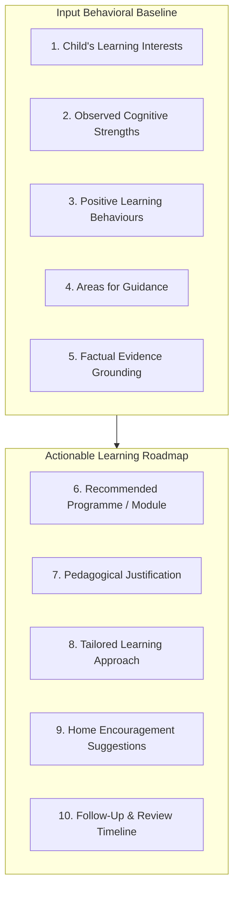

# ARNAV ABACUS ACADEMY (AAA) — PERSONALISED LEARNING RECOMMENDATION FRAMEWORK
## Stage 3 Solution Architecture Deliverable (WS-08.5)

**Document Reference:** `AAA-S3-SPEC-WS08-05`  
**Deliverable Type:** Pedagogical Decision Architecture & Recommendation Structure  
**Parent Workstream:** WS-08 — Diagnostic Assessment & Learning Recommendation Architecture  
**Stage:** Stage 3 — Architecture & Design  
**Date of Compilation:** 04 November 2026  
**Status:** 🟡 **DRAFT — AWAITING MANAGEMENT REVIEW**  
**Executive Authority:** Neha Patil (Founder & Academic Director) & Nitin Patil (Operations & Technology Lead)  

---

## 1. Executive Summary & Purpose

The Personalised Learning Recommendation Framework translates the qualitative behavioral evidence gathered during the Discovery Session into a **constructive, empowering, and actionable learning roadmap** for parents and educators.

```
+----------------------------------------------------------------------------------------------------+
| 🔒 NON-NEGOTIABLE RECOMMENDATION PRINCIPLES:                                                       |
| 1. Encouraging & Strength-First: Always lead with observed cognitive strengths and curiosity.      |
| 2. Actionable & Specific: Avoid vague platitudes ("needs practice"). Provide clear micro-steps.   |
| 3. Zero Guarantees: Never guarantee future school marks, board ranks, or calculation speeds.       |
| 4. Zero Child Intelligence Scores: No combined score, percentile ranking, or comparative metrics.  |
| 5. Home Partnership: Equip parents with simple, joyful encouragement routines for home.           |
+----------------------------------------------------------------------------------------------------+
```

---

## 2. Ten-Element Structured Recommendation Model

Every learning recommendation generated by Arnav Abacus Academy must rigorously incorporate the following ten architectural components:



### 2.1 Component Specifications

#### Element 1: Child's Learning Interests
* **Purpose:** Acknowledges the child's authentic passions and stated voice (`VOX-STU`).
* **Approved Phrasing Standard:** Captures what the child enjoyed doing during the session (e.g., tactile bead moving, high-speed flashing drills, number puzzles).
* **Sample Text:** *"Your child expressed genuine enthusiasm for tactile wooden bead manipulation and stated they love solving geometric pattern puzzles."*

#### Element 2: Observed Cognitive Strengths
* **Purpose:** Highlights areas where the child exhibits strong intuitive competence.
* **Approved Phrasing Standard:** Grounded in observable actions across Number Sense, Arithmetic Understanding, or Logic.
* **Sample Text:** *"Demonstrated outstanding spatial visualization and intuitive grasp of 5-complements, instantly recognizing groupings without finger counting."*

#### Element 3: Positive Learning Behaviours
* **Purpose:** Celebrates the child's emotional disposition, concentration stamina, and resilience.
* **Approved Phrasing Standard:** Highlights openness to guidance, focused attention, or willingness to self-correct.
* **Sample Text:** *"Exhibited wonderful persistence; when an initial calculation didn't balance, they welcomed a hint with a smile and eagerly traced the slip."*

#### Element 4: Areas Where Additional Guidance May Help
* **Purpose:** Identifies foundational developmental opportunities without critical or deficit-based framing.
* **Approved Phrasing Standard:** Frames challenges as emerging skills ready to be nurtured.
* **Sample Text:** *"Currently relies on vertical column scratch paper for subtraction above 20; ready to discover mental base-10 decomposition to compute without anxiety."*

#### Element 5: Evidence Supporting Observations
* **Purpose:** Provides the audit trail connecting recommendations to session facts.
* **Approved Phrasing Standard:** Cites exact activities, times, and observable behaviors.
* **Sample Text:** *"During Card #B-06, child decomposed 15 into 10 and 5 in 3 seconds, demonstrating secure place-value readiness."*

#### Element 6: Recommended Programme or Next Step
* **Purpose:** Specifies the tailored curriculum pathway and starting level.
* **Approved Options:**
  - Soroban Abacus Mathematics (Junior `JR-1` or Senior `SR-1`).
  - Mental Mathematics (Anzan Visualization).
  - Vedic Mathematics (Junior `JVM-1` or Senior `SVM-0`).
  - School Mathematics Conceptual Reinforcement.
  - IPM / Olympiad Mathematics Foundation.
  - Extended Observation / Playful Trial Session.

#### Element 7: Pedagogical Reason for Recommendation
* **Purpose:** Explains *why* this specific stream serves the child's immediate stage best.
* **Sample Text:** *"Soroban Abacus is recommended because your child responds strongly to tactile touch. Moving physical beads will build a vivid mental anchor, naturally replacing finger counting before abstract Vedic shortcuts are introduced."*

#### Element 8: Suggested Learning Approach
* **Purpose:** Guides the educator on how to teach this specific child within the micro-batch.
* **Sample Text:** *"Guide in a micro-batch of maximum 5 students; provide 15-minute focused tactile micro-drills interspersed with short mental visualization challenges."*

#### Element 9: Parent Support Suggestions
* **Purpose:** Empowers parents with non-stressful, supportive home routines.
* **Approved Phrasing Standard:** Focuses on praise, emotional calmness, and 5-minute playful games.
* **Sample Text:** *"At home, avoid timed calculation drills or pressure. Instead, celebrate effort when your child decomposes everyday numbers (e.g. noticing license plates or supermarket prices)."*

#### Element 10: Proposed Follow-Up & Review Timeline
* **Purpose:** Establishes clear progress review milestones.
* **Sample Text:** *"Quarterly observation review scheduled after 12 weeks to celebrate your child's emerging confidence and evaluate readiness for multi-row calculations."*

---

## 3. Exemplar Personalised Recommendation (Full Case Model)

```
====================================================================================================
EXEMPLAR AAA LEARNING RECOMMENDATION (ANONYMISED CASE STUDY)
Candidate: Learner #2026-A04 (Age: 8 yrs, 9 mos | Grade 3 CBSE)
Date: 04-November-2026 | Lead Mentor: Neha Patil
====================================================================================================

1. LEARNING INTERESTS:
   Enjoyed physical bead clicking; eagerly asked how the upper bead equals 5 lower beads.

2. OBSERVED COGNITIVE STRENGTHS:
   Exceptional active listening and visual pattern recognition; instantly recognized clusters of 
   up to 4 beads without counting one-by-one.

3. POSITIVE LEARNING BEHAVIOURS:
   High focus stamina; maintained concentrated engagement for 40 minutes without distraction. 
   Took visible pride in self-correcting a calculation slip.

4. AREAS FOR GUIDANCE:
   Currently relies on sequential finger counting for additions involving numbers between 6 and 9. 
   Experiences mild hesitation when asked to mentally subtract from 10.

5. SUPPORTING EVIDENCE:
   - Card #A-02 (Subitizing): Answered 4/4 cards in < 2 seconds accurately.
   - Card #B-05 (Complements): Hesitated on 10 - 4; used fingers for 5 seconds before finding 6.
   - Task Familiarity: Entirely new to the Soroban abacus.

6. RECOMMENDED PROGRAMME & LEVEL:
   Soroban Abacus Mathematics — Senior Level 1 (SR-1 Foundation).

7. REASON FOR RECOMMENDATION:
   Tactile bead manipulation will give the child a physical base-10 representation, eliminating 
   finger counting naturally while building mental storage stamina.

8. SUGGESTED LEARNING APPROACH:
   Placement in a micro-batch capped at 5 students. Focus on base-5 ("Little Friends") and 
   base-10 ("Big Friends") complement games before introducing timed drills.

9. PARENT SUPPORT SUGGESTIONS:
   Celebrate your child's wonderful curiosity! At home, play playful "Friends of 10" guessing games 
   during car rides (e.g., "I have 7, who is my friend to make 10?"). Avoid checking school math speed.

10. PROPOSED REVIEW TIMELINE:
    Progress reflection conference after 12 weeks (3 months) to evaluate Anzan mental visualization.
====================================================================================================
```

---
*End of Personalised Learning Recommendation Framework (AAA-S3-SPEC-WS08-05).*
