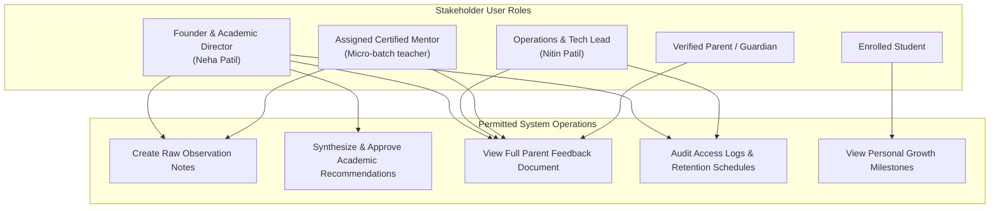

# ARNAV ABACUS ACADEMY (AAA) — PRIVACY, ACCESS & GOVERNANCE REQUIREMENTS
## Stage 3 Solution Architecture Deliverable (WS-08.7)

**Document Reference:** `AAA-S3-SPEC-WS08-07`  
**Deliverable Type:** Data Governance, Access Control & Privacy Architecture  
**Parent Workstream:** WS-08 — Diagnostic Assessment & Learning Recommendation Architecture  
**Stage:** Stage 3 — Architecture & Design  
**Date of Compilation:** 04 November 2026  
**Status:** 🟡 **DRAFT — AWAITING MANAGEMENT & WS-10 PRIVACY REVIEW**  
**Executive Authority:** Nitin Patil (Operations & Technology Lead) & Neha Patil (Founder & Academic Director)  

---

## 1. Executive Summary & Privacy Mandate

Educational observations collected during an assessment session represent highly confidential and personal child data. 

In strict alignment with the ratified **WS-07 Boundary Isolation Architecture** and the cross-cutting **WS-10 Security & Privacy Compliance Architecture**, this specification defines the mandatory access controls, data boundaries, consent lifecycle, and audit policies governing Discovery Session observations.

```
+----------------------------------------------------------------------------------------------------+
| 🔒 CORE PRIVACY & GOVERNANCE DIRECTIVES:                                                           |
| 1. Minimum Necessary Data Privacy Principle: Only collect data strictly required to guide the     |
|    educational recommendation. No medical history, Aadhaar, PAN, or clinical records collected.   |
| 2. Pseudonymisation != Anonymisation: Pseudonymous child tokens (e.g. Learner #A-04) protect against|
|    casual exposure, but remain confidential internal child data requiring privacy protection.       |
| 3. Zero Public Showcase Without Unbundled Written Consent: Observation notes and videos are NEVER   |
|    published or displayed publicly without separate, explicit, countersigned parental consent.     |
| 4. Role-Based Access Enforcement: Access to observation records is strictly restricted by role.    |
+----------------------------------------------------------------------------------------------------+
```

---

## 2. Role-Based Access Control Matrix (RBAC)

Access permissions across the entire assessment lifecycle are enforced across five distinct user roles:



### 2.1 Granular Permissions Grid

| Operation / Record Type | Neha Patil (Academic Dir) | Nitin Patil (Tech/Ops) | Certified Mentor | Parent / Guardian | Enrolled Child |
| :--- | :---: | :---: | :---: | :---: | :---: |
| **Create Raw Observation Notes** | 🟢 Full Access | 🔴 No Access | 🟢 Create for Assigned Child | 🔴 No Access | 🔴 No Access |
| **Edit / Amend Observation Notes** | 🟢 Full Access | 🔴 No Access | 🟡 Draft Only (Pre-Approval) | 🔴 No Access | 🔴 No Access |
| **Approve Academic Recommendation**| 🟢 Exclusive Authority | 🔴 No Access | 🔴 No Access | 🔴 No Access | 🔴 No Access |
| **View Full Feedback Document** | 🟢 Full Access | 🟢 Full Access | 🟢 Assigned Students Only | 🟢 Own Child Only | 🟡 Child Summary |
| **Schedule / Reschedule Session** | 🟢 Full Access | 🟢 Full Access | 🟡 View Schedule | 🟢 Request Update | 🔴 No Access |
| **Access Audit Logs & Retention** | 🟢 Full Access | 🟢 Full Access | 🔴 No Access | 🔴 No Access | 🔴 No Access |
| **Export / Archive Observations** | 🟢 Full Access | 🟢 Full Access | 🔴 No Access | 🟡 Own Child PDF | 🔴 No Access |
| **Public Showcase Publishing** | 🟢 Approval Authority | 🟢 Technical Control | 🔴 No Access | 🟡 Written Consent Required | 🔴 No Access |

---

## 3. Data Collection Minimization & Field Governance

In compliance with the **Minimum Necessary Data Principle**, the data fields permitted for collection during the Discovery Session are strictly bounded:

```
+----------------------------------------------------------------------------------------------------+
| 🟢 MANDATORY PERMITTED DATA FIELDS (Strictly Necessary):                                           |
| - Parent Full Name & Mobile/WhatsApp Number (For scheduling & feedback delivery).                  |
| - Child First Name or Initial & Current School Grade / Age Bracket (For task calibration).         |
| - Observed Mathematical Thinking Habits across the 6 Dimensions (For pedagogical placement).      |
| - Parent Home Learning Context (Voluntarily shared during consultation).                           |
+----------------------------------------------------------------------------------------------------+
| 🔴 STRICTLY PROHIBITED DATA FIELDS (Unnecessary / Intrusive):                                      |
| - Government Identifiers: Aadhaar numbers, PAN cards, passport copies.                             |
| - Financial Information: Bank account numbers, parent salary, credit card details.                 |
| - Sensitive Personal Data: Medical history, psychological diagnoses, religious or caste identity.  |
| - Residential Address: Complete street address (only general locality, e.g. Wakad, is recorded).   |
+----------------------------------------------------------------------------------------------------+
```

---

## 4. Consent Lifecycle Architecture

```mermaid
sequenceDiagram
    autonumber
    actor Parent as Prospective Parent
    participant Web as AAA Web Intake
    participant Center as Wakad Learning Center
    participant Archive as Secure Offline Archive

    Note over Parent,Web: PHASE 1: INQUIRY STAGE
    Parent->>Web: Submits 4-Field Enquiry Form
    Web-->>Parent: Captures Unbundled Transactional Consent (Mandatory for Contact)
    Web-->>Parent: Offers Separate Optional Consent for Math Guides via WhatsApp

    Note over Parent,Center: PHASE 2: IN-PERSON SESSION STAGE
    Parent->>Center: Attends Discovery Session at Wakad Center
    Center-->>Parent: Verbal disclosure of educational observation format
    Center-->>Parent: Conducts session; delivers confidential feedback document

    Note over Parent,Archive: PHASE 3: ADMISSION OR ARCHIVAL
    alt Parent Enrolls Child
        Parent->>Center: Signs Enrollment Form + Separate Optional Showcase Consent
        Center->>Archive: Maps Discovery Observation to permanent Student ID
    else Parent Does Not Enroll
        Center->>Archive: Observation archived under 90-day retention schedule
        Archive-->>Archive: Permanently purged after 90 days unless retention requested
    end
```

### 4.1 Unbundled Consent Checkbox Specifications (`PROPOSED`)
1. **Transactional Discovery Consent (Required for Session):**  
   `[X] I consent to Arnav Abacus Academy reviewing these details and contacting me via phone/WhatsApp (+91 90219 24968) to coordinate my child's Discovery Session.`
2. **Community Showcase & Photography Consent (Strictly Optional & Standalone):**  
   `[ ] (Optional) I grant permission for Arnav Abacus Academy to celebrate my child's mathematical milestones on their internal noticeboard. I understand this is completely optional and does not affect my child's admission.`

---

## 5. Historical Record Preservation, Amendments & Audit Logging

### 5.1 Immutable Observation History
- Once Neha Patil formally signs and delivers the `AAA Demo Observation & Learning Recommendation`, the underlying baseline observation record is **locked against silent overwriting**.
- If a subsequent assessment occurs (e.g. a quarterly review after 12 weeks), it is recorded as a **new, sequential milestone record** linked to the student's permanent ID, preserving the original discovery baseline for longitudinal progress comparison.

### 5.2 Amendment Protocol
- If a parent or educator identifies a factual error in session metadata (e.g., misspelled child name or incorrect school board), a formal **Observation Amendment Note** is appended.
- The original text is preserved; the amendment record records: Date, Amending Mentor, Justification, and Neha Patil countersignature.

### 5.3 Security Audit Trail Requirements
Every access, export, or status change on assessment records must generate a structured log entry:
- `timestamp`: ISO-8601 UTC timestamp.
- `actor_id`: User ID of mentor or administrator.
- `action`: `OBSERVATION_CREATED`, `RECOMMENDATION_APPROVED`, `DOCUMENT_EXPORTED`, `CONSENT_UPDATED`.
- `target_student_id`: Pseudonymous student reference.
- `ip_address`: Network origin.

---

## 6. Retention, Archival & Purge Governance (Proposed Schedule)

```
====================================================================================================
PROPOSED DATA RETENTION TIMELINES — SUBJECT TO WS-10 LEGAL/STATUTORY RATIFICATION
====================================================================================================
1. Enrolled Students: Discovery Session observation records are preserved in the student's 
   confidential academic file for the duration of enrollment plus 12 months following departure, 
   allowing longitudinal progress tracking.
2. Non-Enrolled Inquiries: Observation records for families who complete a session but choose not 
   to enroll are held in a secure staging archive for 90 days to accommodate delayed enrollments, 
   after which all personal contact data is securely purged.
3. Parental Right to Erasure: Parents may request immediate deletion of non-enrolled discovery 
   records at any time by contacting nehaatharv@gmail.com or +91 90219 24968.
====================================================================================================
```

---
*End of Privacy, Access & Governance Requirements (AAA-S3-SPEC-WS08-07).*
