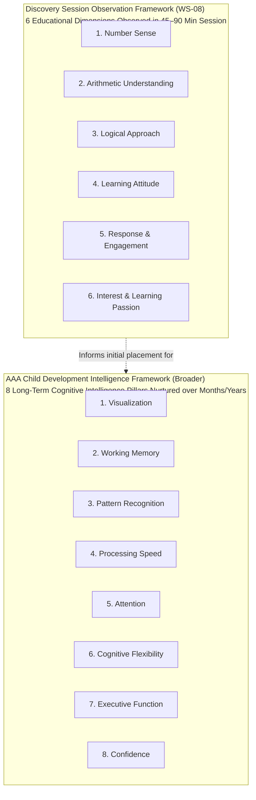

# ARNAV ABACUS ACADEMY (AAA) — SIX-DIMENSIONAL OBSERVATION RUBRICS
## Stage 3 Solution Architecture Deliverable (WS-08.2)

**Document Reference:** `AAA-S3-SPEC-WS08-02`  
**Deliverable Type:** Pedagogical Observation Framework & Rubric Specification  
**Parent Workstream:** WS-08 — Diagnostic Assessment & Learning Recommendation Architecture  
**Stage:** Stage 3 — Architecture & Design  
**Date of Compilation:** 04 November 2026  
**Status:** 🟡 **DRAFT — AWAITING ACADEMIC VALIDATION BY NEHA PATIL**  
**Executive Authority:** Neha Patil (Founder & Academic Director) & Nitin Patil (Operations & Technology Lead)  

---

## 1. Pedagogical Governance & Non-Diagnostic Framing

In strict adherence to AAA's core mission (*"Mathematics is the medium; developing confident, independent and thoughtful learners is the mission"*), this specification establishes observable behavioral rubrics across the **six approved Educational Observation Dimensions**.

```
+----------------------------------------------------------------------------------------------------+
| 🔒 MANDATORY PEDAGOGICAL SAFEGUARDS:                                                               |
| 1. Observable Action Over Subjective Labels: Document what the child DOES, not what they "are".    |
| 2. Zero Diagnostic or Clinical Jargon: Never use clinical terminology (e.g. Dyscalculia, ADHD).   |
| 3. Zero Single Intelligence Scores: No combined "Child IQ" or percentile rank is ever calculated. |
| 4. Descriptive Developmental Bands (PROPOSED): Qualitative descriptors (Exploring, Developing,    |
|    Secure, Extending) are PROPOSED and strictly PENDING NEHA PATIL'S ACADEMIC APPROVAL.            |
| 5. Contextual Limitation: A 60-minute interaction reflects current comfort, not lifelong capacity. |
+----------------------------------------------------------------------------------------------------+
```

---

## 2. Distinction Between the Two AAA Dimensional Frameworks

To avoid internal confusion and prevent inaccurate marketing claims, the two distinct AAA frameworks are formally differentiated:



> [!NOTE]
> **GOVERNANCE RULE ON DIMENSION CLAIMS:**  
> A single Discovery Session observes behaviors across the **Six Educational Dimensions**.  
> The academy must **never** claim that a single 60-minute intake session comprehensively evaluates or measures all Eight Long-Term Cognitive Intelligence Pillars.

---

## 3. The Proposed 4-Band Qualitative Evaluation Scale

```
====================================================================================================
PROPOSED SCORING SCALE — PENDING ACADEMIC APPROVAL BY NEHA PATIL
To avoid rigid numerical marks or pass/fail grades, observations in each dimension are mapped to 
four qualitative developmental continuum bands:
- Band 1: EXPLORING — Child is meeting the concept for the first time; relies on heavy tactile/prompting.
- Band 2: DEVELOPING — Child grasps the core idea with educator scaffolding; emerging independence.
- Band 3: SECURE — Child applies the method smoothly and independently on age-appropriate tasks.
- Band 4: EXTENDING — Child spontaneously spots deeper patterns, decomposes puzzles, and self-checks.
====================================================================================================
```

---

## 4. Detailed Rubric Specifications across the Six Dimensions

### 4.1 Dimension 1: Number Sense
* **Pedagogical Definition:** The child's intuitive grasp of quantity, magnitude, relative number sizes, base-10 anchors, and mental clustering (subitizing) without reliance on one-by-one sequential counting.
* **What the Educator Observes:**
  - Does the child recognize a group of 3 or 4 beads instantly, or must they touch and count `1, 2, 3, 4`?
  - Do they understand that $7$ is composed of $5 + 2$ (upper bead plus two lower beads)?
  - How do they visualize 10 (as two 5s, as $9+1$, as double 5)?
* **Age-Appropriate Activity Examples:**
  - *Ages 4.5–6:* "Bead Flash" game. Flash 3 beads on the Soroban for 1 second; ask the child to mirror the quantity on their own frame.
  - *Ages 7–9:* "Number Neighbors" game. Show the number 28; ask which tens milestone it is closer to ($20$ or $30$).
  - *Ages 10–14:* Mental base distance. Ask the child how far $94$ is from $100$, and how far $996$ is from $1,000$.
* **Observable Positive Indicators:**
  - Instantly calls out small quantities ($\le 5$) without head-nodding or finger tapping.
  - Uses anchors like 5 and 10 to estimate distances quickly.
  - Comfortably transitions between visual beads, spoken words, and written numerals.
* **Areas Where Additional Support May Help:**
  - Relies persistently on sequential finger counting for numbers above 3.
  - Cannot visualize relative size (e.g. guesses that 48 is smaller than 39).
  - Hesitates when asked "what makes 10 with 6?".
* **Concrete Evidence Examples:**
  - *Evidence A (Positive):* *"When shown 4 lower beads, child stated 'four' in $< 1$ second without counting individual beads."*
  - *Evidence B (Support Needed):* *"Child counted fingers one-by-one from 1 to 8 to calculate $5 + 3$ on paper."*
* **Suggested Educator Prompt:** *"If you look at these beads without counting one-by-one, what picture does your mind see?"*
* **Parent Discussion Point:** *"Your child has an emerging sense of 5-groups, but still feels safest counting fingers. Tactile abacus beads will give them a physical anchor to let go of finger counting naturally."*
* **Limitations of Interpretation:** Shyness or unfamiliarity with the Japanese abacus beam can cause a child to hesitate; initial hesitation must not be conflated with weak numerical aptitude.

---

### 4.2 Dimension 2: Arithmetic Understanding
* **Pedagogical Definition:** The child's conceptual grasp of mathematical operations (addition as combining/regrouping, subtraction as difference/removal, multiplication as equal scaling) rather than mere mechanical procedural execution.
* **What the Educator Observes:**
  - Does the child understand *why* $8 + 7 = 15$ (e.g., taking 2 from 7 to turn 8 into 10, leaving 5)?
  - When faced with multi-digit operations, do they understand place value or just follow a rote column script?
* **Age-Appropriate Activity Examples:**
  - *Ages 4.5–6:* Combining 2 red beads and 3 green beads; asking what happens when 1 bead rolls away.
  - *Ages 7–9:* Solving $12 - 5$ on the abacus using the "Small Friend" or "Big Friend" concept (subtract 10, add 5).
  - *Ages 10–14:* Decomposing $18 \times 5$ into $(10 \times 5) + (8 \times 5)$ or $(20 \times 5) - (2 \times 5)$ verbally.
* **Observable Positive Indicators:**
  - Explains the operation in their own words (*"I gave 2 to the 8 to make a full ten"*).
  - Easily reverses addition to check subtraction.
  - Shows flexibility in breaking numbers into friendlier parts.
* **Areas Where Additional Support May Help:**
  - Strictly relies on vertical column scratch paper without knowing why "borrowing" or "carrying" happens.
  - Blanking out or guessing wildly when a standard mechanical algorithm fails.
* **Concrete Evidence Examples:**
  - *Evidence A:* *"Child verbally explained: 'I know $9 + 6$ is 15 because 9 only needs 1 more to become 10, so 6 becomes 5'."*
  - *Evidence B:* *"When asked $20 - 7$, child wrote 20 and 7 vertically, attempted to borrow from 0, and became confused."*
* **Suggested Educator Prompt:** *"Can you show me how you broke those numbers apart in your head?"*
* **Parent Discussion Point:** *"Your child knows how to write the calculation steps on paper, but hasn't yet experienced the tactile logic behind regrouping. Vedic and abacus complements make regrouping visual and effortless."*
* **Limitations of Interpretation:** A child taught strict school textbook procedures may initially hide their own intuitive reasoning out of fear that it is "not the teacher's way."

---

### 4.3 Dimension 3: Logical Approach
* **Pedagogical Definition:** How the child structures their thinking when faced with a non-routine task: pausing, breaking problems into components, testing hypotheses, and seeking patterns.
* **What the Educator Observes:**
  - Does the child rush to blurting out guesses, or do they pause and inspect the clues?
  - How do they organize information when a puzzle has two steps?
  - Do they notice repeating cycles or mirror symmetries in number patterns?
* **Age-Appropriate Activity Examples:**
  - *Ages 4.5–6:* Pattern continuation with colored beads (Red-Blue-Blue, Red-Blue-Blue, what comes next?).
  - *Ages 7–9:* Simple missing number balances: $\square + 6 = 14$ and $20 - \square = 12$.
  - *Ages 10–14:* Digital root (Beejank) pattern spotting: Summing the digits of multiples of 9 ($18 \rightarrow 9, 27 \rightarrow 9, 36 \rightarrow 9$).
* **Observable Positive Indicators:**
  - Takes a deliberate 3–5 second thinking pause before answering.
  - Methodically tests one possibility at a time.
  - Identifies underlying rules (*"Oh, it's jumping by 4 every time!"*).
* **Areas Where Additional Support May Help:**
  - Impulsively blurting out random numbers to relieve the pressure of thinking.
  - Becoming overwhelmed when a problem contains more than one sentence.
* **Concrete Evidence Examples:**
  - *Evidence A:* *"Presented with missing-number puzzle, child stated: 'If the total is 15 and I have 9, I need 1 to get to 10 and 5 more, so the missing bead is 6'."*
  - *Evidence B:* *"Child guessed 10, then 12, then 20 without looking at the puzzle numbers."*
* **Suggested Educator Prompt:** *"What clue in this puzzle tells you what to try first?"*
* **Parent Discussion Point:** *"We observed great analytical potential; when we guided your child to slow down for 3 seconds, their accuracy shot up immediately. In our micro-batches of five, we train this calm, step-by-step decomposition."*
* **Limitations of Interpretation:** Impulsive guessing is often an emotional coping mechanism for test anxiety rather than a lack of logical capability.

---

### 4.4 Dimension 4: Learning Attitude
* **Pedagogical Definition:** The child's emotional resilience, openness to guidance, tolerance for temporary struggle, and relationship with mathematical mistakes.
* **What the Educator Observes:**
  - When an initial answer is incorrect, does the child slump, freeze, or look ashamed?
  - Do they welcome a gentle hint, or do they become defensive?
  - Do they celebrate discovering where a calculation slip happened?
* **Age-Appropriate Activity Examples:**
  - *Universal:* Offering a slightly challenging puzzle where the child is likely to make an initial slip, followed by a warm, encouraging prompt: *"Oops, that didn't quite balance! Let's be detectives and see where the sneaky bead slipped."*
* **Observable Positive Indicators:**
  - Smiles or laughs comfortably when a slip is pointed out.
  - Enthusiastically re-examines their work when offered a hint.
  - Asks *"Can I try another one to get it right?"*
* **Areas Where Additional Support May Help:**
  - Erasing furiously or hiding their paper when an answer is wrong.
  - Tearfulness, shutting down, or declaring *"I'm bad at math"*.
  - Refusing to attempt a task unless 100% sure of the answer.
* **Concrete Evidence Examples:**
  - *Evidence A:* *"When guided that $7+6$ was 13 rather than 14, child smiled, counted the lower beads, and said: 'Aha, I pushed one extra bead by mistake!'."*
  - *Evidence B:* *"Child folded arms and looked down anxiously when a calculation didn't match, requiring 3 minutes of gentle reassurance."*
* **Suggested Educator Prompt:** *"At Arnav Abacus, mistakes are our favorite learning clues. What did that clue just teach us?"*
* **Parent Discussion Point:** *"Your child is a perfectionist who puts enormous pressure on themselves. Our first mission in the micro-batch will be creating total emotional safety, transforming mistakes from a source of shame into exciting detective clues."*
* **Limitations of Interpretation:** A child who has recently faced high-pressure school exams or scolding will naturally exhibit defensive behavior during their first session.

---

### 4.5 Dimension 5: Response & Engagement
* **Pedagogical Definition:** The child's active listening, sustained attention stamina, visual tracking, and responsive interaction during educator-guided micro-drills.
* **What the Educator Observes:**
  - How long can the child remain happily focused on a single manipulative?
  - Do they maintain eye contact with the learning materials?
  - Do they respond to verbal rhythm (e.g. rapid call-and-response abacus commands)?
* **Age-Appropriate Activity Examples:**
  - *Ages 4.5–6:* "Bead Marching". Following 5 consecutive verbal bead commands (*"Add 2, add 1, add 5, subtract 2, what's your answer?"*).
  - *Ages 7–10:* Continuous 3-row mental calculation with rhythmic clapping or finger snaps.
  - *Ages 11–14:* Rapid-fire mental divisibility test across 6 random numbers.
* **Observable Positive Indicators:**
  - Sustained focus for 20–30 minutes without fidgeting or looking at the clock.
  - High sensory absorption when moving wooden beads.
  - Quickly mirrors educator hand gestures and finger positions.
* **Areas Where Additional Support May Help:**
  - Drifting attention after 5 minutes; looking around the room or seeking parent intervention.
  - Difficulty tracking multi-step oral instructions.
* **Concrete Evidence Examples:**
  - *Evidence A:* *"Child remained deeply engaged for 35 continuous minutes, completing 8 separate bead puzzle cards with sustained focus."*
  - *Evidence B:* *"Child looked towards parent 6 times in 10 minutes and shifted restlessly during verbal instructions."*
* **Suggested Educator Prompt:** *"Ready for a speed challenge? Let's see if your fingers can keep up with my voice!"*
* **Parent Discussion Point:** *"Your child responds wonderfully to tactile touch. When using paper, their attention drifted, but the moment we placed the wooden Soroban in their hands, their concentration locked in for 25 minutes straight."*
* **Limitations of Interpretation:** Fatigue from an exhausting school day, hunger, or sensory overload directly impacts focus and must not be interpreted as an attention deficit.

---

### 4.6 Dimension 6: Interest & Learning Passion
* **Pedagogical Definition:** The intrinsic spark of curiosity, wonder, and joy the child exhibits when discovering patterns, unlocking shortcuts, and exploring numbers.
* **What the Educator Observes:**
  - Do the child's eyes light up when a mathematical shortcut is revealed?
  - Do they ask spontaneous questions (*"Does this trick work for bigger numbers too?"*)?
  - Do they express pride in their growing capability?
* **Age-Appropriate Activity Examples:**
  - *Ages 4.5–7:* Discovering that moving the single upper bead (Heaven bead) instantly equals 5 lower beads.
  - *Ages 8–10:* The 9s finger trick or Vedic cross-multiplication pattern: seeing two large numbers multiply in 5 seconds.
  - *Ages 11–14:* Instant squaring of numbers ending in 5 using the Vedic sutra *Ekadhikena Purvena* ($25^2 = 2 \times 3 \text{ and } 25 = 625$).
* **Observable Positive Indicators:**
  - Exclaims *"Whoa, that's magic!"* or *"Show me another one!"*
  - Immediately tries to apply the shortcut to a self-invented problem.
  - Eagerly shows their solved card to the parent.
* **Areas Where Additional Support May Help:**
  - Displays flat, indifferent affect; views all math activities as a burdensome chore.
  - Relieved only when the activity stops.
* **Concrete Evidence Examples:**
  - *Evidence A:* *"Upon learning the Vedic squaring shortcut, child gasped, smiled broadly, and immediately computed $35^2$ and $45^2$ unprompted."*
  - *Evidence B:* *"Child completed the cards passively without showing curiosity or asking questions."*
* **Suggested Educator Prompt:** *"Isn't it fascinating how numbers hide secret shortcuts? Would you like to unlock the secret code for multiplying by 11?"*
* **Parent Discussion Point:** *"We saw that spark of joy return today when your child mastered the Vedic squaring shortcut. Our small micro-batches are designed specifically to keep that joyful passion alive."*
* **Limitations of Interpretation:** Highly self-contained or quiet children may feel profound internal satisfaction without showing loud outward excitement.

---
*End of Six-Dimensional Observation Rubrics (AAA-S3-SPEC-WS08-02).*
