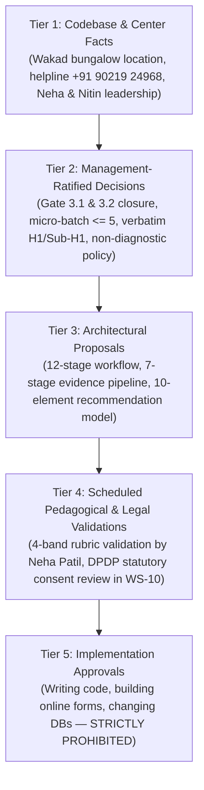
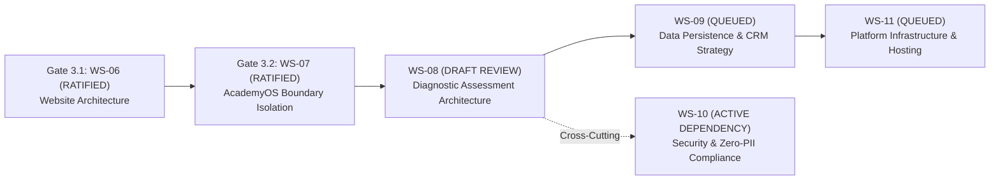

# ARNAV ABACUS ACADEMY (AAA) — WS-08 VALIDATION REPORT
## Stage 3 Solution Architecture Deliverable Validation

**Document Reference:** `AAA-S3-VAL-WS08-01`  
**Deliverables Under Review:** `AAA-S3-SPEC-WS08-01` through `AAA-S3-SPEC-WS08-07`  
**Stage:** Stage 3 — Architecture & Design  
**Workstream:** WS-08 — Diagnostic Assessment & Learning Recommendation Architecture  
**Compilation Date:** 04 November 2026  
**Status:** 🟡 **DRAFT — AWAITING MANAGEMENT REVIEW (Gate 3.3 Remains Open)**  
**Executive Reviewers:** Neha Patil (Founder & Academic Director) & Nitin Patil (Operations & Technology Lead)  

---

## 1. Executive Summary & Deliverable Audit

This validation report independently evaluates the complete specification suite developed for **Workstream WS-08 (Diagnostic Assessment & Learning Recommendation Architecture)**. 

The suite comprises seven architectural specifications:
1. `WS-08.1` — Discovery Session Workflow Architecture (`AAA_WS08_Discovery_Session_Workflow_Architecture.md`)
2. `WS-08.2` — Six-Dimensional Observation Rubrics (`AAA_WS08_Six_Dimensional_Observation_Rubrics.md`)
3. `WS-08.3` — Assessment & Evidence Model (`AAA_WS08_Assessment_and_Evidence_Model.md`)
4. `WS-08.4` — Age-Nine Programme Crossover Framework (`AAA_WS08_Age_Nine_Programme_Crossover_Framework.md`)
5. `WS-08.5` — Personalised Learning Recommendation Framework (`AAA_WS08_Personalised_Learning_Recommendation_Framework.md`)
6. `WS-08.6` — Parent Feedback Document Architecture (`AAA_WS08_Parent_Feedback_Document_Architecture.md`)
7. `WS-08.7` — Privacy, Access & Governance Requirements (`AAA_WS08_Privacy_Access_and_Governance_Requirements.md`)

---

## 2. Five-Tier Governance Classification Matrix

In accordance with Stage 3 governance standards, the findings, principles, and proposals within WS-08 are transparently classified:

---

## 3. Non-Negotiable Governance & Academic Compliance Checklist

Every mandatory principle stipulated in Section 4 of the WS-08 charter has been independently audited across all seven specification documents:

| # | Governance & Academic Principle | Specification Reference | Audit Finding | Compliance Status |
| :---: | :--- | :--- | :--- | :---: |
| **V-01** | **Self-Referential Progress First** | WS-08.2 §1, WS-08.5 §1 | Child progress is evaluated against their own baseline; zero comparison against peers. | 🟢 **COMPLIANT** |
| **V-02** | **No Public Developmental Rankings** | WS-08.2 §1, WS-08.6 §2 | Zero public leaderboards, percentile graphs, or peer rankings exist in any deliverable. | 🟢 **COMPLIANT** |
| **V-03** | **No Child Intelligence Scores** | WS-08.2 §1, WS-08.5 §1 | Prohibition against generating a single numerical IQ or combined development index enforced. | 🟢 **COMPLIANT** |
| **V-04** | **Strictly Non-Diagnostic Boundary** | WS-08.1 §1.1, WS-08.6 §8 | Zero clinical labels (ADHD, Dyscalculia, etc.); session framed strictly as educational observation. | 🟢 **COMPLIANT** |
| **V-05** | **No Unsupported Cognitive Claims** | WS-08.5 §1, WS-08.6 §8 | No guarantees of future marks, board ranks, IQ boosts, or speed miracles. | 🟢 **COMPLIANT** |
| **V-06** | **Every Claim Grounded in Evidence** | WS-08.3 §1–§3 | Seven-stage evidence transformation pipeline mandates factual observable anchors for all claims. | 🟢 **COMPLIANT** |
| **V-07** | **Tripartite Perspective Isolation** | WS-08.3 §3 | Educator observations (`[OBS-TCH]`), parent context (`[CTX-PAR]`), and child voice (`[VOX-STU]`) segregated. | 🟢 **COMPLIANT** |
| **V-08** | **Single Session Limitation Stated** | WS-08.3 §1, WS-08.6 §2 | Explicit disclosure that a 60-min session reflects current comfort, not a permanent ceiling. | 🟢 **COMPLIANT** |
| **V-09** | **Guidance, Not Guaranteed Outcome** | WS-08.5 §1, WS-08.6 §8 | Recommendations explicitly defined as educational guidance without admission or outcome guarantee. | 🟢 **COMPLIANT** |
| **V-10** | **Neha Patil Final Academic Authority** | WS-08.1 §2, WS-08.4 §5 | Academic interpretation, crossover decisions, and rubric validations require Neha's approval. | 🟢 **COMPLIANT** |
| **V-11** | **No Rigid Age Eligibility Rules** | WS-08.4 §1–§3 | Age-nine framework uses multi-factorial diagnostic criteria; age is explicitly not the sole factor. | 🟢 **COMPLIANT** |
| **V-12** | **Framework Separation Preserved** | WS-08.2 §2 | Exact approved 6 Observation Dimensions separated from the broader 8 Child Development Dimensions. | 🟢 **COMPLIANT** |

---

## 4. Workstream Roadmap & Dependency Reconciliation

The delivery of WS-08 maintains the integrity of the Stage 3 Architecture roadmap:

| Workstream ID | Workstream Title | Applicable Gate | Governance Status |
| :--- | :--- | :---: | :---: |
| **`WS-06`** | Digital Experience & Website Architecture (Specs 06.1–06.6) | Gate 3.1 | 🟢 **RATIFIED & CLOSED** (`MGT-DET-S3-09`) |
| **`WS-07`** | AcademyOS Boundary Isolation & Protection Architecture | Gate 3.2 | 🟢 **RATIFIED & CLOSED** (`MGT-DET-S3-10`) |
| **`WS-08`** | Diagnostic Assessment & Learning Recommendation Architecture | Gate 3.3 | 🟢 **RATIFIED & CLOSED** (`MGT-DET-S3-11`) |
| **`WS-09`** | Technology Architecture, Data Persistence & CRM Strategy | Gate 3.4 | 🟡 **AUTHORISED TO COMMENCE** |
| **`WS-10`** | Privacy, Security & Zero-PII Compliance Architecture | Cross-Cutting | 🔄 **ACTIVE CROSS-CUTTING AUDIT** |
| **`WS-11`** | Commercial Readiness, Franchise & Platform Infrastructure | Gate 3.5 | 🔒 **QUEUED** (Scope strictly preserved) |

---

## 5. Technical Environment & Implementation Freeze Verification

An automated check was conducted on the repository environment:
- **`git diff --stat`:** Exactly **0 lines modified** across tracked repository files.
- **Tracked Application Code:** `src/` and `public/` remain 100% untouched.
- **Execution State:** Strictly documentation-only; zero commits, pushes, merges, or production builds.

---

## 6. Formal Ratification & Gate 3.3 Closure Record

> [!NOTE]
> **GATE 3.3 FORMALLY RATIFIED & CLOSED (`MGT-DET-S3-11`):**  
> On 04 November 2026, Neha Patil (Founder & Academic Director) and Nitin Patil (Operations & Technology Lead) reviewed and formally approved Determinations 1, 2, and 3.  
> **Status:** 🟢 **RATIFIED & CLOSED**.  
> **Next Authorized Milestone:** Management has formally authorized commencement of **WS-09: Technology Architecture, Data Persistence & CRM Strategy**.

---
*Report End — Formally Signed Off and Ratified under MGT-DET-S3-11.*
