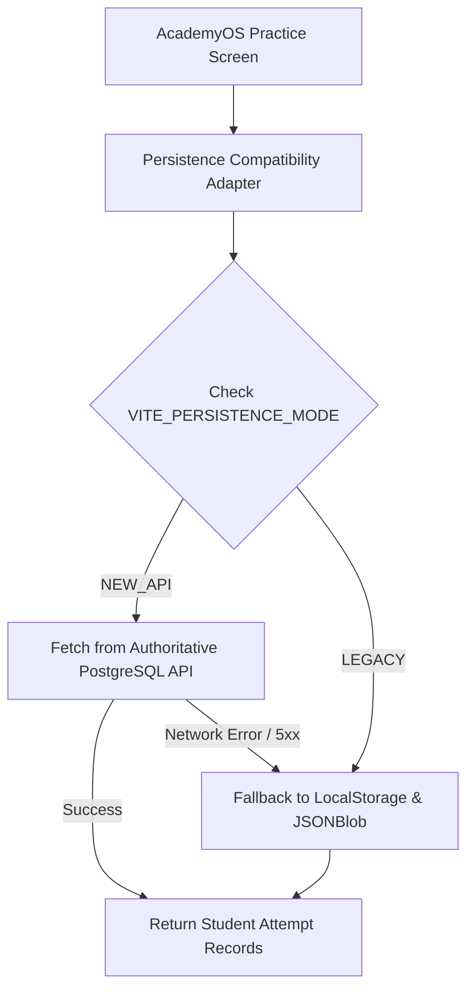

# ARNAV ABACUS ACADEMY (AAA) — STAGE 3 SOLUTION ARCHITECTURE
# WS-09A.8: ACADEMYOS COMPATIBILITY ASSESSMENT

**Project:** Arnav Abacus Academy (AAA), Wakad, Pune  
**Document Reference:** `AAA-S3-SPEC-WS09A-08`  
**Stage:** Stage 3 — Architecture & Design  
**Parent Workstream:** WS-09 — Technology Architecture, Data Persistence & CRM Strategy  
**Sub-Workstream:** WS-09A — Student Identity, Data Architecture & Persistence Strategy  
**Deliverable:** WS-09A.8 — AcademyOS Compatibility Assessment Specification  
**Governance Authority:** Nitin Patil (Operations & Technology Lead) & Neha Patil (Academic Director)  
**Date:** 04 November 2026  
**Status:** 🟡 **DRAFT — AWAITING MANAGEMENT REVIEW (GATE 3.4 OPEN)**  
**Execution Mode:** STRICTLY DOCUMENTATION-ONLY (IMPLEMENTATION FREEZE ACTIVE)  

---

## 1. Scope & Objective

To satisfy the non-negotiable Prime Directive (*"Extend the academy's digital capabilities without breaking, duplicating, exposing, or disrupting existing student practice engines"*), this specification provides an empirical audit of the existing codebase data structures and defines the compatibility adapters required for future migration.

---

## 2. Empirical Repository Data Structure Audit

An exhaustive examination of `src/` reveals the exact data models and storage mechanisms currently driving AcademyOS:

| Source File | Exact Lines | Code Element | Current Structure & Storage Behavior | Migration Compatibility Impact |
| :--- | :--- | :--- | :--- | :--- |
| `src/types.ts` | 6–15 | `interface Program` | Static interface defining academy programmes. Stored as client-side code array. | Zero risk. Maps cleanly to `programmes` relational entity. |
| `src/types.ts` | 46–50 | `interface LevelPermission` | Course permissions object (`course`, `levels: string[]`, `accessMode`). | Needs translation. Replaced by `enrolments` and `levels` foreign keys. |
| `src/types.ts` | 52–58 | `interface ApprovedEmailRecord` | Access record tied directly to `email`. Stored in `localStorage` under `aaa_approved_email_access_db`. | Critical. Must be mapped to `guardians.email` $\to$ `students.id`. |
| `src/types.ts` | 69–90 | `interface Question`, `QuestionSet` | Granular quiz question definitions with vertical arithmetic stacks (`numbers?: number[]`). | High compatibility. Schema preserved as JSONB within the new question bank. |
| `src/types.ts` | 99–114 | `interface PracticeAttemptResult` | Comprehensive practice result object with questions and user answers. | Direct mapping to `practice_attempts` relational + JSONB payload. |
| `src/lib/cloudSync.ts` | 6–22 | `interface AttemptRecord` | Flattened attempt record containing `userId: string` (email), `userName`, `completedAt`. | Medium impact. Fields `userId` and `userEmail` must map to `student_id`. |
| `src/lib/cloudSync.ts` | 24–27 | `LOCAL_STORAGE_KEY` & `CLOUD_SYNC_URL` | Syncs attempts to `aaa_leaderboard_attempts` and `https://jsonblob.com/api/jsonBlob/019f9065...`. | Major migration target. Addressed in WS-09A.5 deprecation strategy. |
| `src/lib/AuthContext.tsx` | 11–17 | `interface User` | User session object where `id: string` is the user's email. | Must be adapted. Client session must carry `studentId` alongside email. |
| `src/lib/AuthContext.tsx` | 31–32 | `USERS_DB_KEY`, `SESSION_KEY` | Stores session in `sessionStorage` and `localStorage` under `aaa_current_session`. | Compatible. Structure can be maintained with non-breaking field additions. |
| `src/lib/accessControl.ts` | 15–35 | Whitelist CRUD Functions | CRUD functions manipulating `aaa_approved_email_access_db` in `localStorage`. | Phased replacement. Wrap in persistence adapter supporting dual-read. |

---

## 3. Storage Dependencies & Local Fallback Mechanisms

AcademyOS features robust local storage fallback logic that allows practice sessions to continue even when offline:
1. **Local Leaderboard Cache:** When `saveStudentAttempt()` is called (`cloudSync.ts:32`), the attempt is first appended to `localStorage.getItem("aaa_leaderboard_attempts")` before any network request is attempted.
2. **Session Persistence:** Active user sessions survive page reloads by checking both `sessionStorage` and `localStorage` (`AuthContext.tsx:40`).

### 3.1 Dual-Read Compatibility Adapter Architecture
To introduce the new relational persistence architecture without modifying existing practice screens or risking student disruptions during Stage 4:

---

## 4. Preservation of Practice Engine Functionality

1. **Zero UI Disruption:** Practice timers, flashcard intervals, instant feedback sounds, and vertical number stacks in `/practice/*` will remain untouched.
2. **Local Attempt Caching:** The local storage caching layer (`aaa_leaderboard_attempts`) is retained as an offline safety net.
3. **Graceful Field Polyfilling:** When records from the new persistence engine are passed to legacy practice components, an adapter polyfills legacy fields (`userId = student.email`, `userName = student.name`) to guarantee zero runtime exceptions.

---

## 5. Stage-Gate Acceptance & Verification

This specification satisfies **WS-09A.8** under Stage 3 Workstream WS-09A. It is submitted in **DRAFT** status and will be formally reviewed under Management Determination `MGT-DET-S3-12`. Gate 3.4 remains **OPEN**.
