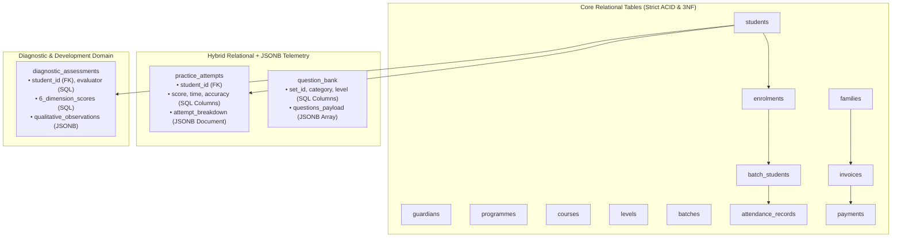

# ARNAV ABACUS ACADEMY (AAA) — STAGE 3 SOLUTION ARCHITECTURE
# WS-09A.4: AUTHORITATIVE PERSISTENCE ARCHITECTURE

**Project:** Arnav Abacus Academy (AAA), Wakad, Pune  
**Document Reference:** `AAA-S3-SPEC-WS09A-04`  
**Stage:** Stage 3 — Architecture & Design  
**Parent Workstream:** WS-09 — Technology Architecture, Data Persistence & CRM Strategy  
**Sub-Workstream:** WS-09A — Student Identity, Data Architecture & Persistence Strategy  
**Deliverable:** WS-09A.4 — Authoritative Persistence Architecture Specification  
**Governance Authority:** Nitin Patil (Operations & Technology Lead) & Neha Patil (Academic Director)  
**Date:** 04 November 2026  
**Status:** 🟡 **DRAFT — AWAITING MANAGEMENT REVIEW (GATE 3.4 OPEN)**  
**Execution Mode:** STRICTLY DOCUMENTATION-ONLY (IMPLEMENTATION FREEZE ACTIVE)  

---

## 1. Scope, Purpose & Architectural Boundaries

This specification defines the logical persistence architecture for Arnav Abacus Academy's production transformation. It evaluates persistence paradigms, defines the authoritative data storage strategy, and specifies logical schema designs.

### 1.1 Strict Governance Boundary: Hosting Vendor Neutrality
In strict compliance with Stage 3 Architecture Charter (`AAA-S3-GOV-001`) and the Stage 3 Workstream Plan:
- This document evaluates **persistence paradigms** (Relational vs. Document vs. Hybrid) and specifies **logical storage models**.
- This document **DOES NOT** select, bind, or recommend cloud hosting infrastructure vendors (e.g., Supabase vs. AWS RDS vs. MongoDB Atlas vs. Firebase). Cloud provider, hosting, and operational deployment decisions are strictly reserved for **Workstream WS-11** (Platform Hosting & Infrastructure Architecture).
- No production database instances or cloud infrastructure shall be provisioned during Stage 3.

---

## 2. Evaluation of Persistence Paradigms

Arnav Abacus Academy requires a data persistence architecture capable of handling highly structured relational entities (students, siblings, micro-batches, fee invoices) alongside flexible, semi-structured practice telemetry (quiz answers, dictation speed metrics, AI story generation responses).

### 2.1 Persistence Comparison Matrix

| Evaluation Dimension | Option A: Pure Document Model (NoSQL / MongoDB / Firestore) | Option B: Pure Relational Model (Traditional RDBMS / Strict 3NF) | Option C: Relational-First Hybrid Model (PostgreSQL + JSONB) (Recommended) |
| :--- | :--- | :--- | :--- |
| **Data Integrity & Constraints** | Poor. Lacks native multi-table foreign key constraints and triggers. Micro-batch $\le 5$ constraints must be enforced in application code. | Superior. Enforces strict ACID transactions, foreign key cascades, and check constraints at the engine level. | Superior. Core student, family, enrolment, and payment entities enjoy full ACID guarantees and database-level constraints. |
| **Sibling & Relationship Modeling** | Difficult. High risk of orphaned records, denormalized inconsistencies, or nested document bloat. | Native. Elegant modeling of $1:N$ and $M:N$ cardinalities with cascading rules and foreign keys. | Native. Normalized relational tables represent parent-student-sibling relationships with zero duplication. |
| **Semi-Structured Practice Data** | Excellent. Naturally stores hierarchical quiz attempts, vertical arithmetic rows, and variable question formats. | Rigid. Requires complex join tables or normalization of every individual quiz row and flashcard question. | Superior. Structured attempt metadata (score, time, status) stored relationally; raw question rows stored in indexed `JSONB`. |
| **Historical Immutability & Audit** | Moderate. Append-only logs possible but schema drift across years can break historical report parsers. | High. Strong schema enforcement ensures 5-year historical attempt comparisons remain valid. | Superior. Versioned schemas combined with relational audit triggers ensure immutable attempt histories. |
| **Row-Level Security & Access Control** | Variable. Often requires custom application middleware or complex rule scripts. | High. Standard SQL grant roles; mature native Row-Level Security (RLS) policies. | Superior. Relational RLS policies enforce student-level data isolation, preventing cross-student data leakage. |
| **Vendor Portability & Lock-In** | High Lock-In. Proprietary query languages (Firestore/DynamoDB) create severe vendor lock-in. | Zero Lock-In. Standard ANSI SQL runs seamlessly across any cloud or local container. | Zero Lock-In. PostgreSQL-compliant engines run on every major cloud provider (AWS, GCP, Azure) and self-hosted Linux. |
| **Cost & Efficiency** | Pay-per-document-read pricing models can explode as students perform high-frequency speed drills. | Predictable compute/storage pricing; highly efficient B-tree indexing for rapid lookup. | Optimal. Low compute overhead, flat pricing models, and efficient storage of both relational and JSON data. |

---

## 3. Recommended Architectural Choice: Relational-First Hybrid Model

The **Relational-First Hybrid Model (PostgreSQL with JSONB)** is formally recommended as the authoritative persistence architecture for Arnav Abacus Academy.

### 3.1 Architectural Layout

### 3.2 Benefits of the Relational-First Hybrid Model
1. **Core Relational Rigor:** Guarding student identities, parent finances, sibling linkages, and micro-batch capacities ($\le 5$) with bulletproof database constraints.
2. **Telemetry Flexibility:** The `practice_attempts` table stores overall performance metrics (date, score percentage, duration) in relational columns for ultra-fast indexing and analytics, while storing the granular question-by-question responses in a flexible `attempt_breakdown` JSONB column.
3. **Zero Risk to Production:** This specification establishes the data structure blueprint. Physical database provisioning is deferred to WS-11 and Stage 4.

---

## 4. Stage-Gate Acceptance & Verification

This specification satisfies **WS-09A.4** under Stage 3 Workstream WS-09A. It is submitted in **DRAFT** status and will be formally reviewed under Management Determination `MGT-DET-S3-12`. Gate 3.4 remains **OPEN**.
