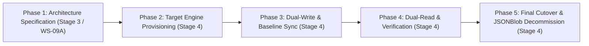
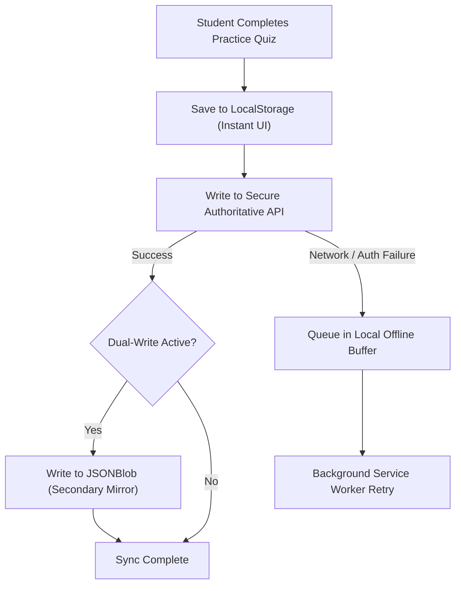

# ARNAV ABACUS ACADEMY (AAA) — STAGE 3 SOLUTION ARCHITECTURE
# WS-09A.5: JSONBLOB DEPRECATION & REPLACEMENT STRATEGY

**Project:** Arnav Abacus Academy (AAA), Wakad, Pune  
**Document Reference:** `AAA-S3-SPEC-WS09A-05`  
**Stage:** Stage 3 — Architecture & Design  
**Parent Workstream:** WS-09 — Technology Architecture, Data Persistence & CRM Strategy  
**Sub-Workstream:** WS-09A — Student Identity, Data Architecture & Persistence Strategy  
**Deliverable:** WS-09A.5 — JSONBlob Deprecation & Replacement Strategy Specification  
**Governance Authority:** Nitin Patil (Operations & Technology Lead) & Neha Patil (Academic Director)  
**Date:** 04 November 2026  
**Status:** 🟡 **DRAFT — AWAITING MANAGEMENT REVIEW (GATE 3.4 OPEN)**  
**Execution Mode:** STRICTLY DOCUMENTATION-ONLY (IMPLEMENTATION FREEZE ACTIVE)  

---

## 1. Executive Summary & Mandatory Safeguards

In Stage 3 Workstream WS-07, Management Determination `MGT-DET-S3-10` ratified the technical finding that the prototype student practice synchronizer (`src/lib/cloudSync.ts`) and success story manager (`src/lib/successStories.ts`) rely on unauthenticated third-party endpoints hosted on `jsonblob.com`:
1. Practice Attempts Endpoint: `https://jsonblob.com/api/jsonBlob/019f9065-ec4f-7d60-b80c-07b7f039afe6`
2. Success Stories Endpoint: `https://jsonblob.com/api/jsonBlob/019fa81d-0104-7348-beae-a82900883473`

As recorded in `AAA_WS07_Risk_and_Open_Issue_Register.md` (Risk `RSK-WS07-01`), reliance on public JSONBlob endpoints carries severe data integrity, availability, and child privacy risks. However, prematurely cutting off or disabling these endpoints would immediately break the live AcademyOS practice sync for current students.

### 1.1 Strict Governance Safeguards for Stage 3
In accordance with `AGENTS.md` and ratified determination `MGT-DET-S3-10`:
- **Planning Only:** This document defines the **strategy, readiness gates, dual-read design, and fallback protocols** for future replacement.
- **Zero Network Interaction:** Under no circumstances shall any agent trigger automated HTTP requests, scraping, payload inspection, or stress tests against live JSONBlob endpoints.
- **Zero Endpoint Disablement:** The JSONBlob endpoints **MUST NOT** be modified, disabled, disconnected, or blocked in `src/` during Stage 3.
- **Zero Live Migration:** Live historical attempt data extraction and migration to a production database is strictly deferred to Stage 4 after the new persistence layer passes all Stage 4 Hard Gates.

---

## 2. Five-Stage Deprecation & Cutover Framework

The migration from JSONBlob to the authoritative persistence architecture follows a strict 5-stage lifecycle:

### 2.1 Phase Descriptions & Stage Boundaries

| Phase | Phase Name | Execution Stage | Architectural Scope & Gate Conditions |
| :--- | :--- | :--- | :--- |
| **Phase 1** | **Architecture Specification** | **Stage 3 (Current)** | Define deprecation strategy, dual-read fallback contract, 11-point readiness checklist, and rollback protocols. **Zero code changes.** |
| **Phase 2** | **Target Engine Provisioning** | **Stage 4** | Deploy target persistence engine (PostgreSQL/JSONB) selected under WS-11; implement authenticated API routes with Row-Level Security. |
| **Phase 3** | **Dual-Write & Baseline Sync** | **Stage 4** | Update client to write completed attempts to both the new secure API and JSONBlob simultaneously. Perform offline historical sync and reconciliation. |
| **Phase 4** | **Dual-Read & Verification** | **Stage 4** | Client reads primarily from secure API; falls back to JSONBlob only if API is unreachable. Verify zero attempt loss across 14 consecutive days. |
| **Phase 5** | **Final Cutover & Decommission** | **Stage 4** | Terminate all reads/writes to JSONBlob. Purge JSONBlob contents if permitted; archive frozen offline snapshot in AAA vault. Remove dead code. |

---

## 3. The 11-Point Deprecation Readiness Checklist

Before transitioning from Phase 3 to Phase 5 in Stage 4, all 11 readiness criteria must be evidenced, audited, and approved by Nitin Patil:

| # | Readiness Criterion | Verification Method / Evidence Requirement | Sign-Off Lead |
| :-: | :--- | :--- | :--- |
| **1** | **Target Persistence Engine Active** | Production database active with automated SSL/TLS encryption in transit and at rest. | Nitin Patil |
| **2** | **Zero-PII Student Schema Applied** | Database enforces internal UUIDs and foreign keys; zero email addresses used as primary keys. | Nitin Patil |
| **3** | **Authenticated API Endpoints Active** | Student attempt ingestion protected by signed JWT authentication; zero anonymous writes. | Nitin Patil |
| **4** | **Historical Attempt Snapshot Captured** | Cryptographically verified offline JSON backup of historical attempts secured in encrypted storage. | Nitin Patil |
| **5** | **Historical Record Reconciliation** | 100% of valid historical attempts reconciled against verified student roster with zero data loss. | Nitin Patil |
| **6** | **Dual-Write Telemetry Verified** | 14 consecutive days of dual-write execution showing 0% divergence between API and JSONBlob. | Nitin Patil |
| **7** | **Offline Local Storage Fallback Tested** | AcademyOS verified to seamlessly cache attempts in `localStorage` when offline and replay upon reconnect. | Nitin Patil |
| **8** | **Zero Impact on Practice UX** | Attempt submission latency $\le 500\text{ms}$; zero UI blocking or timer interruption. | Neha Patil |
| **9** | **Success Stories Decoupled** | Public website success stories served from verified CMS/static dataset, not JSONBlob. | Neha Patil |
| **10** | **Automated Rollback Mechanism Tested** | Documented one-click environment toggle to restore read-only fallback in event of API failure. | Nitin Patil |
| **11** | **Formal Management Decommission Order** | Executed Stage 4 determination signed by Neha Patil and Nitin Patil authorizing endpoint cutoff. | Joint |

---

## 4. Dual-Read & Rollback Architecture

During the Stage 4 cutover window, AcademyOS client synchronization will operate under a resilient dual-read strategy:

### 4.1 Rollback Contract
If the new persistence engine suffers service degradation or authentication failures during Phase 4:
1. The client-side persistence adapter automatically degrades to local offline storage (`localStorage`).
2. Zero student attempt data is lost; records are queued locally and synchronized once connectivity or service is restored.
3. If an unrecoverable failure occurs, the configuration switch `VITE_PERSISTENCE_MODE` can be instantly toggled back to legacy fallback mode without redeploying code bundles.

---

## 5. Stage-Gate Acceptance & Verification

This specification satisfies **WS-09A.5** under Stage 3 Workstream WS-09A. It is submitted in **DRAFT** status and will be formally reviewed under Management Determination `MGT-DET-S3-12`. Gate 3.4 remains **OPEN**.
