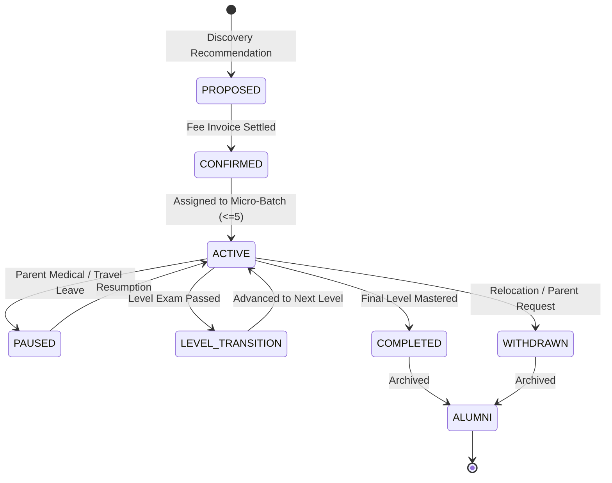

# ARNAV ABACUS ACADEMY (AAA) — STAGE 3 SOLUTION ARCHITECTURE
# WS-09A.3: MULTI-PROGRAMME ENROLMENT ARCHITECTURE

**Project:** Arnav Abacus Academy (AAA), Wakad, Pune  
**Document Reference:** `AAA-S3-SPEC-WS09A-03`  
**Stage:** Stage 3 — Architecture & Design  
**Parent Workstream:** WS-09 — Technology Architecture, Data Persistence & CRM Strategy  
**Sub-Workstream:** WS-09A — Student Identity, Data Architecture & Persistence Strategy  
**Deliverable:** WS-09A.3 — Multi-Programme Enrolment Architecture Specification  
**Governance Authority:** Neha Patil (Academic Director) & Nitin Patil (Operations & Technology Lead)  
**Date:** 04 November 2026  
**Status:** 🟡 **DRAFT — AWAITING MANAGEMENT REVIEW (GATE 3.4 OPEN)**  
**Execution Mode:** STRICTLY DOCUMENTATION-ONLY (IMPLEMENTATION FREEZE ACTIVE)  

---

## 1. Context & Business Rationale

Arnav Abacus Academy offers five distinct educational programmes:
1. **Abacus Mathematics** (Ages 4.5–9)
2. **Vedic Mathematics** (Ages 9–14)
3. **Mental Mathematics** (Ages 6–14)
4. **School Mathematics** (Grades 1–10 CBSE, ICSE, State Board)
5. **IPM & Olympiad Mathematics** (Grades 2–9)

Under AAA's core educational philosophy, mathematical development is a continuous journey. As students master Abacus foundations, they frequently transition into Vedic Mathematics or enroll concurrently in Olympiad problem-solving. 

In the existing prototype, course access is managed via a rudimentary permissions array in `localStorage` (`LevelPermission[]` in `src/types.ts:46-50` and `accessControl.ts`):
```typescript
export interface LevelPermission {
  course: "abacus" | "vedic" | "mental" | "both" | "all";
  levels: string[]; // e.g. ["JR-1", "JR-2"] or ["ALL"]
  accessMode: AccessFeatureMode; // "quiz" | "learn" | "both"
}
```
This historical approach creates significant operational deficiencies:
- There is no concept of enrolment lifecycle (start date, pause, graduation).
- Attendance, batch assignment, and fee invoicing cannot be tracked per programme.
- When a student advances to a new level, previous level permissions are often overwritten, destroying historical audit trails.

---

## 2. Multi-Programme Architecture Design

### 2.1 Independent Enrolment Lifecycle State Machine

Each programme enrolment for a given student operates as an independent state machine. A student may be `ACTIVE` in Abacus while simultaneously `ACTIVE` in School Math, or `COMPLETED` in Abacus while `ACTIVE` in Vedic Math.



### 2.2 Independent Academic Dimensions Per Enrolment

For each programme enrolment, the architecture maintains segregated, immutable records across five functional dimensions:

| Functional Dimension | Architectural Handling | Integrity Rule |
| :--- | :--- | :--- |
| **1. Progression Levels** | Tracked via `level_progression_history` table recording entry date, completion date, and Neha Patil's evaluation sign-off. | Level promotions do not overwrite previous levels; historical levels remain immutable for student portfolio verification. |
| **2. Micro-Batches** | Enrolment is linked to a specific physical/online batch slot ($\le 5$ students). | A student enrolled in two programmes belongs to two distinct batches with separate schedules and educators. |
| **3. Attendance Tracking** | Attendance sessions are recorded against `batch_student_id`. | An absence in Saturday Abacus has zero impact on Sunday Vedic Math attendance records. |
| **4. Fee Schedules & Invoices** | Invoices are generated per enrolment or consolidated per family. | Fee structures, renewal cycles, and material kit costs remain distinct per curriculum track. |
| **5. Practice & Assessment** | Practice attempts record both `programme_code` and `level_code`. | Abacus speed drills and Vedic mental drills aggregate into separate student skill dashboards. |

---

## 3. Simultaneous Enrolments & Programme Transitions

### 3.1 Scenario A: Concurrent Multi-Programme Enrolment
*Example:* A 9-year-old student attends Abacus Level 4 (Saturday morning) and School Math Grade 4 (Wednesday evening).
- **Data Model Representation:**
  - One `StudentEntity` (UUID: `stu_abc123`, Display ID: `AAA-STU-2026-0042`).
  - Two active `EnrolmentEntity` records:
    1. Enrolment 1: `programme_code: "ABACUS"`, `current_level: "Level 4"`, `batch_id: "batch_ab_sat1"`.
    2. Enrolment 2: `programme_code: "SCHOOL_MATH"`, `current_level: "Grade 4"`, `batch_id: "batch_sm_wed1"`.
- **System Behavior:** AcademyOS displays a clean programme switcher upon login. Practice questions and timer presets dynamically adapt based on the selected programme context.

### 3.2 Scenario B: Sequential Programme Progression
*Example:* An 8.5-year-old student completes Abacus Grand Level and progresses into Vedic Mathematics Foundation.
- **Data Model Representation:**
  - Enrolment 1 (`ABACUS`) transitions to `status: "COMPLETED"`, with completion date and Grand Level certificate issued.
  - Enrolment 2 (`VEDIC`) transitions from `PROPOSED` $\to$ `CONFIRMED` $\to$ `ACTIVE`.
- **Data Preservation:** Zero historical Abacus practice attempts, speed records, or certificates are deleted or modified. They remain permanently accessible in the student's historical portfolio.

---

## 4. Stage-Gate Acceptance & Verification

This specification satisfies **WS-09A.3** under Stage 3 Workstream WS-09A. It is submitted in **DRAFT** status and will be formally reviewed under Management Determination `MGT-DET-S3-12`. Gate 3.4 remains **OPEN**.
