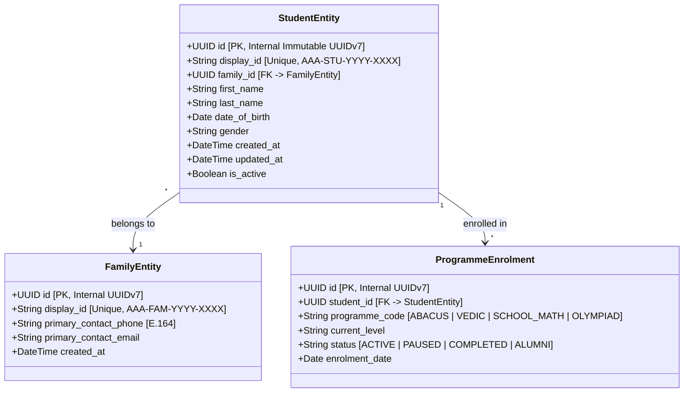

# ARNAV ABACUS ACADEMY (AAA) — STAGE 3 SOLUTION ARCHITECTURE
# WS-09A.1: STUDENT IDENTITY ARCHITECTURE SPECIFICATION

**Project:** Arnav Abacus Academy (AAA), Wakad, Pune  
**Document Reference:** `AAA-S3-SPEC-WS09A-01`  
**Stage:** Stage 3 — Architecture & Design  
**Parent Workstream:** WS-09 — Technology Architecture, Data Persistence & CRM Strategy  
**Sub-Workstream:** WS-09A — Student Identity, Data Architecture & Persistence Strategy  
**Deliverable:** WS-09A.1 — Student Identity Architecture Specification  
**Governance Authority:** Nitin Patil (Operations & Technology Lead) & Neha Patil (Academic Director)  
**Date:** 04 November 2026  
**Status:** 🟡 **DRAFT — AWAITING MANAGEMENT REVIEW (GATE 3.4 OPEN)**  
**Execution Mode:** STRICTLY DOCUMENTATION-ONLY (IMPLEMENTATION FREEZE ACTIVE)  

---

## 1. Executive Summary & Context

Under the ratified Stage 2 Master BRD (`BRD-S2-DATA-01`) and the Stage 3 Architecture Charter (`AAA-S3-GOV-001`), Arnav Abacus Academy requires an authoritative, scalable, and child-safe student identity architecture. 

Currently, the existing AcademyOS prototype (`src/lib/AuthContext.tsx` line 12) defines `User.id` directly as `User.email`:
```typescript
export interface User {
  id: string; // Email ID is the ID
  name: string;
  email: string;
  role: "student";
  picture?: string;
}
```
This historical implementation introduces three critical systemic limitations:
1. **Sibling Collision:** Siblings in Pune households almost universally share a single parent email address (e.g., `parent@gmail.com`). When email is the primary key, a second sibling enrolling in the academy either overwrites the first sibling's practice history, leaderboard standings, and level progress, or forces parents to create artificial email accounts for minor children (ages 4.5–9).
2. **PII Exposure in Telemetry & Logs:** Using email as an identifier leads to unintentional transmission of child/family contact details across URL query strings, localStorage keys, and cloud payloads (`cloudSync.ts` line 19–22).
3. **Multi-Programme Identity Fragmentation:** A student participating across Abacus, Vedic Math, and Olympiad Math has no unified academic profile; their progress cannot be holistically tracked across years.

This specification evaluates candidate identifier schemas, defines the authoritative identity structure, establishes sibling handling mechanisms, and specifies immutable assignment lifecycle rules.

---

## 2. Evaluation of Student Identifier Schemes

In accordance with Stage 3 governance, the candidate format `AAA-STU-YYYY-XXXX` proposed during Stage 2 is treated as a design proposal rather than a pre-approved constraint. Below is a rigorous comparative analysis of three architectural options.

### 2.1 Comparative Options Matrix

| Evaluation Dimension | Option A: Candidate Business Format (`AAA-STU-YYYY-XXXX`) | Option B: Pure Synthetic Surrogate (`UUIDv4` / `CUID2`) | Option C: Hybrid Two-Tier Identity Architecture (Recommended) |
| :--- | :--- | :--- | :--- |
| **Description** | Human-readable string containing academy code, fixed entity tag (`STU`), enrollment calendar year (`YYYY`), and zero-padded sequence (`XXXX`). | Pure opaque, randomly generated 128-bit UUID or cryptographically collision-resistant CUID2 string. | **Internal Primary Key:** Pure synthetic surrogate (`UUIDv4` or `UUIDv7`).<br>**External Display Token:** Human-readable structured identifier (`AAA-STU-YYYY-XXXX` or `AAA-C-YYYY-XXXX`). |
| **Global Uniqueness** | High within academy scope, provided sequence generation is strictly atomic in database. | Statistically absolute across all systems and databases without centralized coordination. | Absolute at persistence layer; guaranteed unique at human presentation layer via unique constraints. |
| **Identity Permanence** | Risk of semantic distortion if enrollment year changes or if student re-enrolls after sabbatical. | 100% immutable; contains zero business metadata or temporal semantics. | Internal UUID is 100% immutable forever. Display token remains stable and permanent from initial registration. |
| **Zero-PII & Privacy Protection** | Good (does not leak child name or phone), but leaks enrollment vintage (`YYYY`) in public URLs. | Superior. Completely opaque; conveys zero temporal, demographic, or institutional intelligence. | Superior. Public APIs, telemetry, and client-side tokens reference opaque UUIDs. Display IDs appear only on verified parent/student documents. |
| **Scalability & Concurrency** | Requires atomic table locks or distributed sequence counters to prevent gaps/collisions under concurrent registration. | Boundless horizontal scalability; zero coordination required between microservices or webhooks. | Boundless persistence scalability via UUID primary keys; display token generated via transactional atomic sequence on confirmation. |
| **Sibling & Family Ergonomics** | Highly convenient for parents, fee receipts, physical attendance registers, and WhatsApp support. | Extremely poor for human communication. Parents cannot quote `f47ac10b-58cc-4372-a567-0e02b2c3d479` over phone/desk. | Optimal balance: Human-friendly token for parents/receipts/diplomas; secure opaque UUID for system storage and APIs. |
| **Collision Resilience** | Sequence resets or multi-branch expansion can cause sequence exhaustion or accidental duplication if unmanaged. | Collision probability is infinitesimal ($< 1 \times 10^{-15}$). | Zero collision risk: UUID guarantees primary integrity; database unique index guarantees display token uniqueness. |
| **Cross-System Migration** | High friction if downstream systems (e.g., Tally, Zoho, Supabase) enforce differing ID formats. | Native standard supported across every SQL/NoSQL engine, ORM, and cloud API. | Effortless migration: foreign keys reference UUIDs; human display tokens map cleanly into any UI or invoice field. |

---

## 3. Recommended Architectural Choice: Two-Tier Hybrid Architecture

The **Two-Tier Hybrid Architecture (Option C)** is formally recommended for Arnav Abacus Academy.

### 3.1 Architectural Structure



### 3.2 Key Definitions
1. **Internal Immutable Identifier (`student_id`):**
   - Format: `UUIDv7` (time-ordered 128-bit identifier) or `UUIDv4`.
   - Purpose: Primary key in all relational databases, foreign key across tables, and API parameter.
   - Visibility: Strictly internal system layer; never printed on physical paper diplomas or quoted to parents.
2. **Public Student Display ID (`student_display_id`):**
   - Candidate Format: `AAA-STU-YYYY-XXXX` (where `YYYY` is calendar year of enrollment, and `XXXX` is a 4-digit sequential integer zero-padded from `0001` to `9999`).
   - Purpose: Physical certificates, fee receipts, parent communication, attendance rosters, and practice badges.
   - Uniqueness: Enforced by an explicit `UNIQUE INDEX` in the persistence engine.

---

## 4. Multi-Programme Identity & Sibling Architecture

### 4.1 Principle: One Child, One Identity, Multiple Programmes
A child is registered in the academy exactly once. When a child enrolled in Abacus subsequently enrolls in Vedic Maths, IPM, or School Math:
- The academy **DOES NOT** issue a new Student ID.
- The academy **DOES NOT** create a duplicate student record.
- The academy attaches a new `ProgrammeEnrolment` record referencing the child's permanent `student_id`.

### 4.2 Sibling Separation Mechanism
To permanently eliminate the email collision bug present in the prototype:
1. **Parent/Family Entity:** Represents the paying household/guardian (`FamilyEntity` or `ParentEntity`). It holds the parent's phone number (`+91 90219 24968` format) and primary contact email.
2. **Independent Child Records:** Each sibling possesses an entirely distinct `StudentEntity` with their own independent `student_id` and `student_display_id`.
3. **Practice & Attempt Isolation:** Each practice attempt, diagnostic result, and leaderboard entry points exclusively to the child's `student_id`, completely decoupling student performance from the parent's login email.

---

## 5. Lifecycle Rules & Immutability Guarantees

1. **Permanent Assignment:** A Student ID is issued upon formal admission confirmation. Once assigned, it is permanent and immutable for the lifetime of the student's association with AAA (active, paused, or alumni).
2. **Discovery Session Separation:** Prospective leads and Discovery Session bookings **DO NOT** receive a Student ID. They receive a transient `LeadID` (`AAA-LEAD-YYYY-XXXX`) or Discovery Booking ID (`AAA-DSC-YYYY-XXXX`). A permanent Student ID is issued *only* upon verified academy admission.
3. **Non-Reusability:** If a student withdraws or graduates, their Student ID is marked `ARCHIVED` or `ALUMNI`. It is **NEVER** re-assigned, recycled, or deleted.
4. **Zero Live ID Generation in Stage 3:** This specification defines the logical architecture. **Zero production Student IDs shall be generated, allocated, or written to databases during Stage 3.**

---

## 6. Stage-Gate Acceptance & Verification

This specification forms deliverable **WS-09A.1** under Stage 3 Workstream WS-09A. It is submitted in **DRAFT** status and will be formally reviewed under Management Determination `MGT-DET-S3-12`. Gate 3.4 remains **OPEN**.
