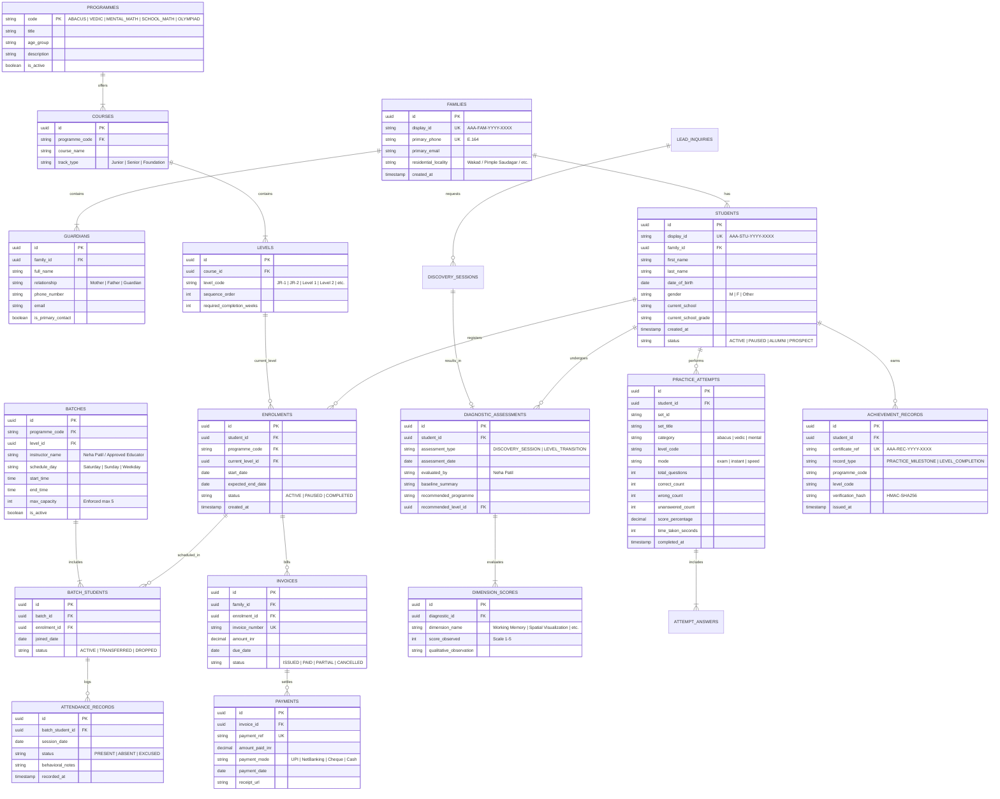

# ARNAV ABACUS ACADEMY (AAA) — STAGE 3 SOLUTION ARCHITECTURE
# WS-09A.2: STUDENT, PARENT & SIBLING RELATIONAL DATA MODEL

**Project:** Arnav Abacus Academy (AAA), Wakad, Pune  
**Document Reference:** `AAA-S3-SPEC-WS09A-02`  
**Stage:** Stage 3 — Architecture & Design  
**Parent Workstream:** WS-09 — Technology Architecture, Data Persistence & CRM Strategy  
**Sub-Workstream:** WS-09A — Student Identity, Data Architecture & Persistence Strategy  
**Deliverable:** WS-09A.2 — Relational Data Model Specification  
**Governance Authority:** Nitin Patil (Operations & Technology Lead) & Neha Patil (Academic Director)  
**Date:** 04 November 2026  
**Status:** 🟡 **DRAFT — AWAITING MANAGEMENT REVIEW (GATE 3.4 OPEN)**  
**Execution Mode:** STRICTLY DOCUMENTATION-ONLY (IMPLEMENTATION FREEZE ACTIVE)  

---

## 1. Scope & Objective

This document specifies the complete, authoritative Entity-Relationship (ER) model for Arnav Abacus Academy. It models all academic, administrative, diagnostic, operational, and student progress entities required by the academy's real-world business operating procedures (SOPs), permanently decoupling operational student records from simplistic web enquiry forms.

### 1.1 Repository Baseline vs. Proposed Additions

To maintain absolute architectural transparency, the table below distinguishes between entities verified in the existing code baseline (`src/types.ts`, `src/lib/cloudSync.ts`, `src/lib/accessControl.ts`) and proposed relational entities:

| Entity Name | Source / Status | Current Representation in Repository | Proposed Relational Representation |
| :--- | :--- | :--- | :--- |
| **Student** | Evolved from Code | Stored implicitly as `ApprovedEmailRecord` (`src/types.ts:52`) and `User` (`src/lib/AuthContext.tsx:11`). Identity tied directly to email. | Normalized `students` entity with internal UUID primary key and unique human display ID. |
| **Parent / Guardian** | Newly Proposed | Transiently captured as `LeadSubmission.parentName` (`src/types.ts:36`). No persistent entity exists. | First-class `guardians` and `families` entities with E.164 phone and email normalization. |
| **Sibling Linkage** | Newly Proposed | Completely absent in prototype; causes email collisions. | Relational junction `student_family_members` linking siblings to shared family account. |
| **Programme** | Exists in Code | Static data interface `Program` (`src/types.ts:6`). | Normalized catalog `programmes` entity supporting all 5 academy offerings. |
| **Enrolment** | Newly Proposed | Conflated with static `LevelPermission` array in localStorage. | Explicit `enrolments` entity with enrollment date, status, and fee tier. |
| **Course & Level** | Exists in Code | Hardcoded string arrays in `accessControl.ts` and `types.ts:48`. | Structured `courses` and `levels` entities defining formal academic curricula. |
| **Batch** | Newly Proposed | Conflated in scheduling discussions; no data entity. | Structured `batches` entity enforcing maximum $\le 5$ students micro-batch constraint. |
| **Attendance** | Newly Proposed | Absent in repository; tracked physically on paper registers. | Structured `attendance_records` entity tracking physical/online presence and punctuality. |
| **Fee / Payment** | Newly Proposed | Absent in repository; tracked via external receipts. | Structured `fee_invoices` and `payments` entities tracking financial transactions. |
| **Diagnostic Assessment** | Designed in WS-08 | Abstract rubric in `AAA-S3-SPEC-WS08-01`. | Structured `diagnostic_assessments` and `dimension_scores` entities. |
| **Practice Attempt** | Exists in Code | Flattened JSON object `AttemptRecord` (`cloudSync.ts:6`) synced to JSONBlob. | Normalized `practice_attempts` and `practice_answers` entities. |
| **Achievement Record** | Designed in WS-07 | Flattened `ApprovedEmailRecord` / unverified local certificates. | Structured `practice_achievement_records` entity with tamper-evident hash. |

---

## 2. Complete Entity-Relationship (ER) Diagram

---

## 3. Detailed Entity Cardinalities & Referential Integrity

### 3.1 Family & Sibling Relationships
- `FAMILIES` to `STUDENTS`: **$1 : N$ (One-to-Many)**. Exactly one family/household can have multiple children enrolled in AAA.
- `FAMILIES` to `GUARDIANS`: **$1 : N$ (One-to-Many)**. A family can have multiple registered parents/guardians (e.g., Mother and Father).
- Referential Action: Deleting a family is strictly restricted (`ON DELETE RESTRICT`) if student or payment records exist.

### 3.2 Student to Multi-Programme Enrolments
- `STUDENTS` to `ENROLMENTS`: **$1 : N$ (One-to-Many)**. A student can simultaneously maintain active enrolments in multiple programmes (e.g., Abacus Level 2 and Vedic Math Junior).
- Referential Action: Foreign keys enforce valid `student_id` and `programme_code`.

### 3.3 Micro-Batch Constraint Enforcement
- `BATCHES` to `BATCH_STUDENTS`: **$1 : N$**. To strictly uphold AAA's core pedagogical differentiator ratified in Stage 2 (`BRD-S2-OPS-01`), the database layer enforces a trigger or check constraint ensuring active enrolments in a single batch never exceed 5:
$$\sum_{\text{status} = \text{'ACTIVE'}} \text{batch\_students} \le 5$$

### 3.4 Practice Attempts Isolation
- `STUDENTS` to `PRACTICE_ATTEMPTS`: **$1 : N$**. All practice attempts must explicitly link to `student_id`. Attempt records are append-only; historical attempts are immutable and cannot be overwritten.

---

## 4. Stage-Gate Acceptance & Verification

This specification satisfies **WS-09A.2** under Stage 3 Workstream WS-09A. It is submitted in **DRAFT** status and will be formally reviewed under Management Determination `MGT-DET-S3-12`. Gate 3.4 remains **OPEN**.
