# ARNAV ABACUS ACADEMY (AAA) — STAGE 3 SOLUTION ARCHITECTURE
# WS-09B.1: END-TO-END PARENT LEAD & ADMISSIONS DATA FLOW

**Project:** Arnav Abacus Academy (AAA), Wakad, Pune  
**Document Reference:** `AAA-S3-SPEC-WS09B-01`  
**Stage:** Stage 3 — Architecture & Design  
**Parent Workstream:** WS-09 — Technology Architecture, Data Persistence & CRM Strategy  
**Sub-Workstream:** WS-09B — Data Integration, Lead Ingestion & Zero-PII Telemetry  
**Deliverable:** WS-09B.1 — End-to-End Parent Lead & Admissions Data Flow Specification  
**Governance Authority:** Nitin Patil (Operations & Technology Lead) & Neha Patil (Academic Director)  
**Date:** 04 November 2026  
**Status:** 🟡 **DRAFT — AWAITING MANAGEMENT REVIEW (GATE 3.4 OPEN)**  
**Execution Mode:** STRICTLY DOCUMENTATION-ONLY (IMPLEMENTATION FREEZE ACTIVE)  

---

## 1. Executive Summary & Core Architectural Principle

A fundamental defect in ad-hoc educational websites is conflating an **inbound prospective enquiry** with a **confirmed student admission**. Under Arnav Abacus Academy's ratified governance baseline:
- An enquiry, discovery session request, academic recommendation, admission, and AcademyOS practice access represent **independent, non-overlapping lifecycle states**.
- A prospective lead **NEVER** automatically becomes an enrolled student.
- A permanent Student ID is **NEVER** allocated at initial enquiry.
- Personal data collected during the initial enquiry is strictly minimized to the 4-field approved contract.

This specification maps the complete 19-step parent lead and admissions data flow, defining authoritative boundaries, roles, audit trails, and recovery actions.

---

## 2. The 19-Step End-to-End Admissions Data Flow

```mermaid
flowchart TD
    subgraph Public_Web_Domain["Phase 1: Public Engagement & Discovery (Client-Side)"]
        S01["1. Website Discovery & Exploration"] --> S02["2. Parent Enquiry Initiation"]
        S02 --> S03["3. Dual Consent Capture (Transactional vs Optional Marketing)"]
        S03 --> S04["4. Lead Payload Dispatch"]
    end

    subgraph Ingestion_Domain["Phase 2: Ingestion, Validation & Triage (Trusted Server)"]
        S04 --> S05["5. Trusted Server-Side Validation & Sanitization"]
        S05 --> S06["6. Deduplication & Family Relationship Detection"]
        S06 --> S07["7. Authoritative Lead Record Creation (AAA-LEAD-YYYY-XXXX)"]
        S07 --> S08["8. Admissions Triage & SLA Queue (2 Operating Hours)"]
    end

    subgraph Academic_Discovery_Domain["Phase 3: Parent Consultation & Discovery Session"]
        S08 --> S09["9. Personalized Parent Contact (Phone/WhatsApp)"]
        S09 --> S10["10. Discovery Session Request Intake"]
        S10 --> S11["11. Personal Schedule Confirmation (45–90 min, Neha Patil)"]
        S11 --> S12["12. Discovery Session Execution (Wakad Center / Live 1:1)"]
        S12 --> S13["13. 6-Dimension Observation & Recommendation Generation"]
    end

    subgraph Formal_Admission_Domain["Phase 4: Admission, Payment & AcademyOS Provisioning"]
        S13 --> S14["14. Parent Review & Enrollment Decision"]
        S14 --> S15["15. Formal Registration & KYC Verification"]
        S15 --> S16["16. Verified Tuition Payment & Receipt Issuance"]
        S16 --> S17["17. Permanent Student Identity Association (UUIDv7 + AAA-STU-YYYY-XXXX)"]
        S17 --> S18["18. AcademyOS Micro-Batch Enrolment (<= 5 Students)"]
        S18 --> S19["19. Ongoing Educational Governance & Parent Progress Reporting"]
    end
```

---

## 3. Comprehensive 19-Step Data Flow Matrix

| Step # | Process Step Name | Trigger Event | Responsible Role | Input Data | Output Data / Artifact | Authoritative Record | System Boundary | Data Classification | Failure Scenario | Recovery & Fallback Action | Audit Requirement |
| :---: | :--- | :--- | :--- | :--- | :--- | :--- | :--- | :--- | :--- | :--- | :--- |
| **01** | **Website Discovery** | Parent visits public page or campaign slug. | Visitor | HTTP Request, Referrer. | Rendered SPA page view. | Web Server Access Log (Masked IP). | Public Edge / CDN. | Anonymous Public. | CDN edge failure. | Edge failover to secondary static cache. | Anonymized page view telemetry (`page_view`). |
| **02** | **Parent Enquiry Initiation** | Parent clicks primary CTA ("Book Discovery Session"). | Parent | User intent. | Rendered 4-field modal. | Client DOM state. | Client Browser. | Anonymous Public. | Modal script error. | Static fallback contact card displayed. | Form start event (`enquiry_form_start`). |
| **03** | **Consent Capture** | Parent reviews modal checkboxes. | Parent | Checkbox state (Required Transactional; Optional Marketing). | Explicit boolean flags + timestamp. | Client form state. | Client Browser. | Legal Consent Metadata. | Parent unchecks transactional consent. | Submission blocked; inline tooltip explains service necessity. | Consent state recorded with microsecond timestamp. |
| **04** | **Lead Payload Dispatch** | Parent clicks "Submit Enquiry". | Parent | 4-Field Contract (Parent Name, Mobile, Age/Grade, Program). | JSON POST request. | Browser Network Payload. | Client-to-API Boundary. | Restricted PII. | Client offline or network disconnect. | Local offline cache in `localStorage`; retry button shown. | Zero-PII submission event (`enquiry_submit`). |
| **05** | **Server-Side Validation** | HTTP POST received at API gateway. | Ingestion Worker | Raw JSON request body. | Validated & sanitized payload. | Server Ingestion Log. | Trusted Server. | Restricted PII. | Malicious payload (XSS, Formula Injection). | Request rejected with HTTP 422; security event logged. | Security audit log of rejected payload hash. |
| **06** | **Deduplication & Triage** | Valid payload passes schema gate. | Ingestion Worker | Normalized phone (`+919021924968`), Parent Name. | Match score & linkage flag. | Deduplication Index. | Trusted Server / DB. | Confidential Internal. | High-frequency bot spam. | Rate limiter throttles IP/Phone; duplicate flagged. | Deduplication decision audit log. |
| **07** | **Lead Record Creation** | Ingestion pipeline approves payload. | System Worker | Validated lead attributes. | Created `LeadEntity` with ID `AAA-LEAD-YYYY-XXXX`. | `lead_inquiries` table. | Relational Persistence. | Restricted PII. | Database connection timeout. | Message queued in Dead-Letter Queue (DLQ); retry. | Database write transaction log. |
| **08** | **Admissions Triage** | New lead record committed. | Admissions Lead | Lead details, locality, age. | Triage status assigned (Priority Wakad vs Remote). | Admissions Queue Dashboard. | Operations Internal. | Restricted PII. | Staff unavailable during business hours. | Automated SLA alert to Nitin Patil if pending > 90 min. | SLA clock started; logged in triage ledger. |
| **09** | **Personal Parent Contact** | Lead triaged to admissions queue. | Admissions Lead / Neha | Lead phone number, preferred time. | Verified parent interest, preliminary dialogue. | Parent Call Interaction Log. | Phone / WhatsApp Channel. | Confidential Personal. | Parent unreachable (unanswered call). | Max 3 structured contact attempts across 48h; then closed. | Call attempt timestamp and outcome logged. |
| **10** | **Discovery Session Request** | Parent expresses readiness for observation. | Parent & Admissions Lead | Student availability, learning goals. | Structured Discovery Request. | `discovery_sessions` (Status: `REQUESTED`). | Core Database. | Confidential Personal. | Scheduling conflict. | Alternative batch slot proposed to parent. | Status change audit trail. |
| **11** | **Schedule Confirmation** | Neha Patil approves observation slot. | Neha Patil | Educator calendar, child age. | Confirmed session appointment (Date, Time, Wakad Room). | `discovery_sessions` (Status: `CONFIRMED`). | Core Database. | Confidential Personal. | Last-minute parent cancellation. | Slot released; rescheduled via manual booking triage. | Confirmation notice dispatch logged. |
| **12** | **Discovery Session Execution** | Student arrives at Wakad Center. | Neha Patil | Tactile bead kit, observation worksheets. | Completed Discovery Session (45–90 min). | `discovery_sessions` (Status: `COMPLETED`). | Physical Center / 1:1. | Pedagogical Sensitive. | Child fatigue or distress. | Session paused; supportive game-based engagement. | Session attendance verified. |
| **13** | **Observation & Recommendation** | Neha completes session evaluation. | Neha Patil (Exclusive Authority) | 6 Observation Dimensions, notes. | Authored Learning Recommendation report. | `diagnostic_assessments` table. | Core Database. | Pedagogical Confidential. | Inconclusive assessment. | Second complimentary micro-observation scheduled. | Academic Director cryptographic sign-off. |
| **14** | **Parent Decision** | Recommendation shared with parent. | Parent | Recommendation report, fee schedule. | Parent enrollment consent. | Admissions Log (Status: `PROCEEDING`). | Operations Internal. | Confidential. | Parent decides not to proceed. | Lead marked `NOT_PROCEEDING`; purged after 90 days. | Reason code recorded for academic audit. |
| **15** | **Formal Registration** | Parent confirms admission. | Admissions Lead | Full family details, sibling links. | Formal Enrollment Application. | `families` & `students` records created. | Core Database. | Confidential Minor PII. | Missing guardian verification. | Registration held in `PENDING_VERIFICATION`. | Registration timestamp and KYC evidence linked. |
| **16** | **Verified Tuition Payment** | Parent settles term tuition. | Accounts / Nitin | Fee amount, payment mode (UPI/NetBanking). | Payment receipt with unique reference. | `invoices` & `payments` tables. | Core Database. | Highly Confidential Financial. | Payment gateway failure / pending bank credit. | Provisional receipt issued pending bank reconciliation. | Bank transaction reference and receipt audit log. |
| **17** | **Student Identity Association** | Tuition verified by accounts. | System / Nitin | Student record, family ID. | Permanent UUIDv7 + `AAA-STU-YYYY-XXXX`. | `students` table. | Core Database. | Confidential Minor PII. | Sequence generation lock contention. | Transactional atomic lock with sequence fallback. | Immutable student ID allocation log. |
| **18** | **AcademyOS Micro-Batch Enrolment** | Student ID generated and active. | Academic Admin | Student ID, Level ID, Batch ID. | Student mapped to batch ($\le 5$ students). | `batch_students` & `enrolments` tables. | AcademyOS Core. | Internal Operational. | Batch capacity already at 5 students. | System constraint blocks enrolment; new batch opened. | Batch allocation audit log. |
| **19** | **Ongoing Communication** | Student active in regular curriculum. | Neha Patil & Instructors | Attendance, practice scores, term reports. | Progress updates sent to parent. | AcademyOS Student Ledger. | AcademyOS / Comms. | Confidential Educational. | Parent communication channel broken. | Secondary contact phone activated from family profile. | Full history retained in student development ledger. |

---

## 4. Stage-Gate Acceptance & Verification

This specification satisfies **WS-09B.1** under Stage 3 Workstream WS-09B. It is submitted in **DRAFT** status and will be formally reviewed under Management Determination `MGT-DET-S3-13`. Gate 3.4 remains **OPEN**.
