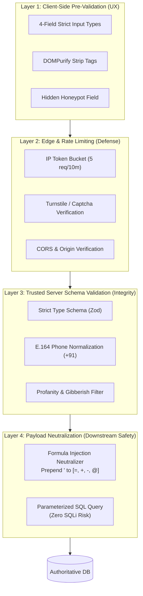

# ARNAV ABACUS ACADEMY (AAA) — STAGE 3 SOLUTION ARCHITECTURE
# WS-09B.5: FORM SECURITY, VALIDATION & INPUT SANITIZATION

**Project:** Arnav Abacus Academy (AAA), Wakad, Pune  
**Document Reference:** `AAA-S3-SPEC-WS09B-05`  
**Stage:** Stage 3 — Architecture & Design  
**Parent Workstream:** WS-09 — Technology Architecture, Data Persistence & CRM Strategy  
**Sub-Workstream:** WS-09B — Data Integration, Lead Ingestion & Zero-PII Telemetry  
**Deliverable:** WS-09B.5 — Form Security, Validation & Input Sanitization Specification  
**Governance Authority:** Nitin Patil (Operations & Technology Lead) & Neha Patil (Academic Director)  
**Date:** 04 November 2026  
**Status:** 🟡 **DRAFT — AWAITING MANAGEMENT REVIEW (GATE 3.4 OPEN)**  
**Execution Mode:** STRICTLY DOCUMENTATION-ONLY (IMPLEMENTATION FREEZE ACTIVE)  

---

## 1. Scope & Layered Defense-in-Depth Principle

Public web forms are the primary external attack surface of any digital application. To protect Arnav Abacus Academy from spam, automated bot floods, cross-site scripting (XSS), and data corruption, this specification establishes a **Strict Layered Defense-in-Depth Architecture**.

### 1.1 Core Security Axiom: Client-Side Validation is NOT a Security Boundary
Client-side validation (such as HTML5 `required` attributes or React state regex) exists **solely for user experience (UX)**. Any malicious actor or bot can easily bypass the browser and issue raw HTTP POST requests directly to API endpoints. 

Therefore:
- **Client Layer:** Provides instant, helpful feedback to genuine parents.
- **Trusted Server Layer:** Serves as the authoritative, unbreakable security boundary enforcing schema parsing, sanitization, rate limiting, and formula injection defense.

---

## 2. Multi-Layer Input Security Architecture

---

## 3. Threat Mitigation Matrix & Defense Mechanisms

| # | Attack Vector / Risk | Target Vulnerability | Defense Mechanism Enforced on Server | Repository Code Status |
| :-: | :--- | :--- | :--- | :--- |
| **1** | **Spreadsheet / CSV Formula Injection** | An attacker inputs `=CMD\|' /C calc'!A0` or `=SUM(...)` in name/notes fields. When exported to Google Sheets or Excel, the formula executes arbitrary commands or leaks data. | **Neutralization Rule:** Any string beginning with `=`, `+`, `-`, `@`, `\t`, or `\r` is automatically prepended with a single quote character (`'`). | Implemented in `src/lib/securitySanitizer.ts:321` (`sanitizeForGoogleSheets`). Must be enforced server-side. |
| **2** | **Stored / Reflected Cross-Site Scripting (XSS)** | Attacker submits `` or `` in parent name or message. | **HTML Stripping & Sanitization:** Server strips all HTML tags using a secure parser; client uses `DOMPurify` before rendering any user-supplied text. | Implemented in `securitySanitizer.ts:95-117` (`sanitizeHtml`, `sanitizeInput`). |
| **3** | **SQL Injection (SQLi)** | Attacker submits `' OR 1=1; DROP TABLE students; --` in form fields. | **Parameterized Queries / ORM:** 100% of database queries must use prepared statements with typed parameters. Zero raw string concatenation. | Architecture requirement for WS-09A/B persistence. |
| **4** | **NoSQL Injection / JSON Smuggling** | Attacker injects `{"$ne": null}` operators in JSON payloads to bypass authentication or filters. | **Strict Schema Validation:** Schema validation rejects any unexpected keys, objects, or arrays where scalar strings are expected. | Planned via server-side schema validator (e.g., Zod). |
| **5** | **Automated Bot & Spam Floods** | Headless scripts repeatedly submitting junk leads, exhausting staff time and SMS quotas. | **Honeypot Trap + Cloudflare Turnstile:** Hidden form field (`honeypot`) that invisible bots fill out; submissions with filled honeypots are silently dropped with HTTP 200. | Honeypot implemented in `leadWebhook.ts:33`. Turnstile recommended for Stage 4. |
| **6** | **Denial of Service / Brute Force** | High-velocity HTTP POST requests targeting `/api/v1/leads`. | **Rate Limiting:** IP-based rate limiting capping submissions at 5 requests per 10-minute window. | To be provisioned in Stage 4 API Gateway. |
| **7** | **Junk, Dummy & Gibberish Submissions** | Users entering `asdfghjk`, `1234567890`, or `test@test.com`. | **Lexical & Pattern Filtering:** Validates Indian mobile series (starts with 6, 7, 8, or 9; exactly 10 digits); blocks dummy numbers (`1111111111`, `9876543210`). | Implemented in `securitySanitizer.ts:66-88, 256-315`. |
| **8** | **Profanity & Abusive Language** | Trolls or abusive submissions directed at academy educators. | **Multi-Lingual Profanity Gatekeeper:** Scans text against English, Hindi, Hinglish, and Marathi abusive dictionaries. | Implemented in `securitySanitizer.ts:9-32, 122-132`. |

---

## 4. Proposed Security Test Cases & Acceptance Criteria

To ensure verified compliance before Stage 4 deployment, the ingestion pipeline must pass the following automated test battery:

| Test ID | Test Name | Inbound Test Vector | Expected Pipeline Behavior | Pass / Fail Criteria |
| :---: | :--- | :--- | :--- | :--- |
| **SEC-01** | **Formula Injection Prefix** | `parentName: "=SUM(1+1)"` | Transformed to `'=SUM(1+1)` before database insertion or spreadsheet dispatch. | Verified string starts with `'`. |
| **SEC-02** | **XSS Payload Neutralization** | `parentName: "Rahul"` | Stripped to `Rahul` with tags eliminated. | Verified zero `<script>` or HTML tags in output. |
| **SEC-03** | **Dummy Mobile Rejection** | `phone: "9876543210"` | Rejected with validation error: *"Please enter a genuine mobile number"*. | HTTP 422 Unprocessable Entity returned. |
| **SEC-04** | **Honeypot Trap Trigger** | `honeypot: "bot_filled_value"` | Request silently accepted with HTTP 200 but discarded; zero records written. | Database record count unchanged. |
| **SEC-05** | **Rate Limit Enforcement** | 6 consecutive requests from same IP in 60 seconds. | 6th request rejected with HTTP 429 Too Many Requests. | HTTP 429 returned on 6th attempt. |
| **SEC-06** | **SQL Injection Neutralization** | `parentName: "Nitin'; DROP TABLE lead_inquiries;--"` | Escaped safely as literal string; database table untouched. | Table intact; literal string stored. |

---

## 5. Stage-Gate Acceptance & Verification

This specification satisfies **WS-09B.5** under Stage 3 Workstream WS-09B. It is submitted in **DRAFT** status and will be formally reviewed under Management Determination `MGT-DET-S3-13`. Gate 3.4 remains **OPEN**.
